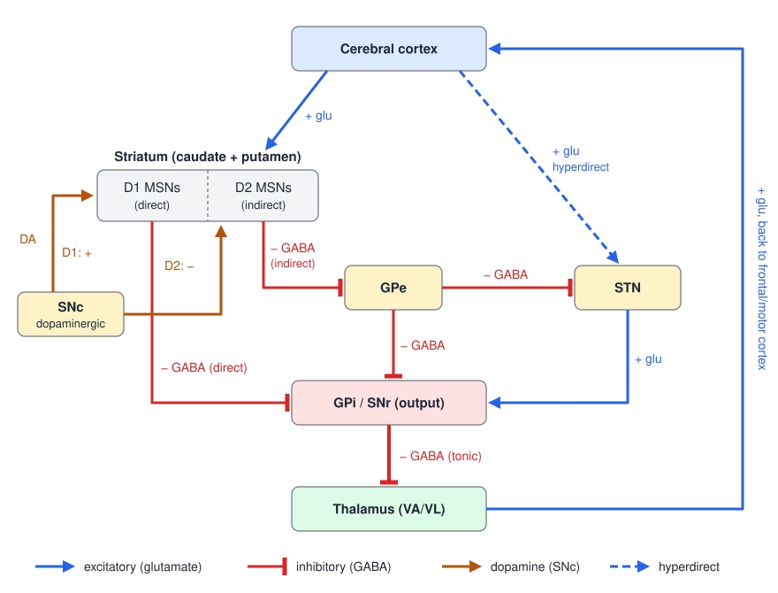
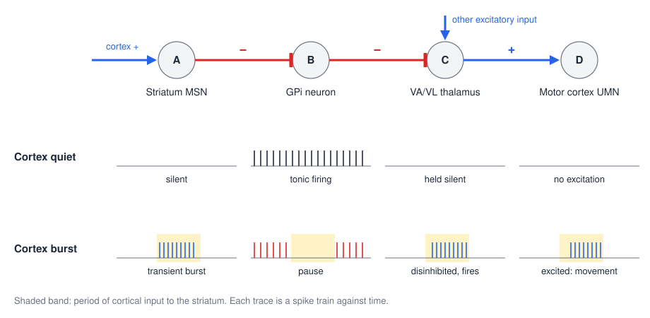
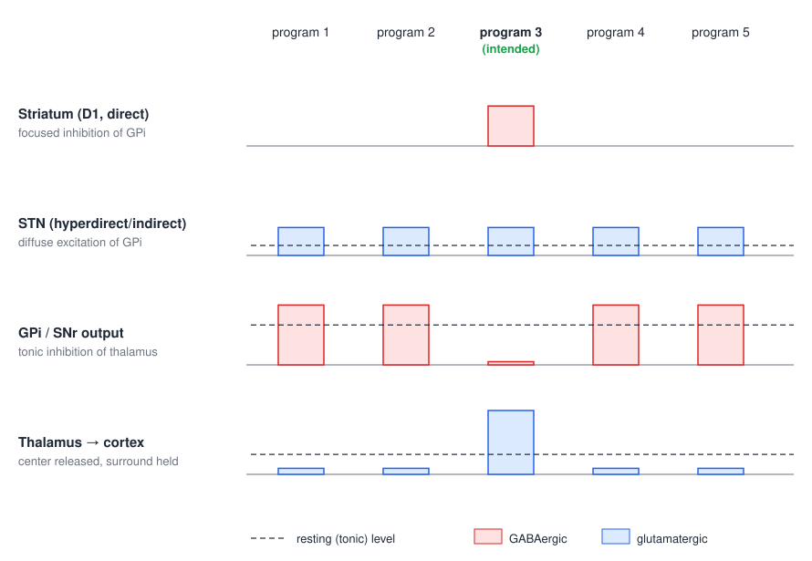
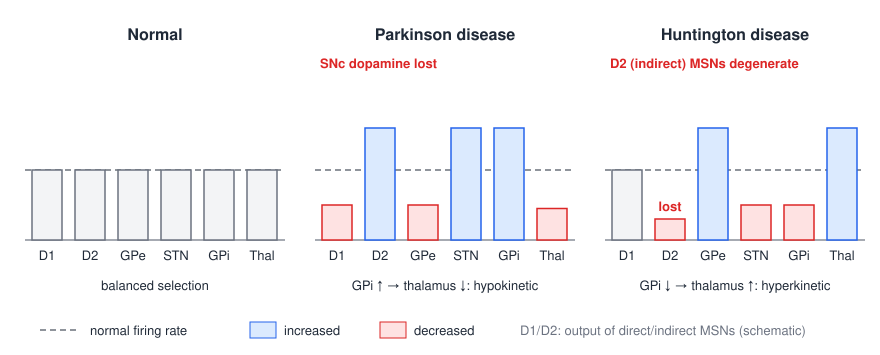

# The Basal Ganglia

The basal ganglia are a set of nuclei deep in the forebrain and midbrain that sit in a loop between the cerebral cortex and the thalamus. They do not project to the spinal cord and do not initiate movement; instead they decide which of the many movements the cortex is preparing will be released and which will be held back. Because their output is purely inhibitory, they work by *disinhibition*, and an imbalance in their internal pathways produces two opposite families of movement disorder: too little movement, as in Parkinson disease, or too much, as in Huntington disease. This chapter builds the circuit nucleus by nucleus, explains how its signed pathways select actions, and uses that logic to account for the signs of the two diseases and for their treatments.

## The Nuclei

### Anatomy

The basal ganglia proper are five structures, visible together on a coronal section through the thalamus:

- The **caudate nucleus**, a C-shaped mass whose head bulges into the floor of the lateral ventricle and whose body and tail arch back around the thalamus.
- The **putamen**, the large lens-shaped nucleus lateral to the internal capsule. The caudate and putamen are one structure split by the fibers of the internal capsule; together they are the **striatum** (named for the gray bridges that cross the capsule between them).
- The **globus pallidus**, medial to the putamen, divided into an **external segment (GPe)** and an **internal segment (GPi)**. The putamen and globus pallidus together form the lentiform nucleus.
- The **subthalamic nucleus (STN)**, a small lens of cells at the junction of the diencephalon and midbrain, just below the thalamus.
- The **substantia nigra**, in the ventral midbrain, divided into a dorsal **pars compacta (SNc)** of pigmented dopaminergic neurons and a ventral **pars reticulata (SNr)**, which is cytologically and functionally a detached piece of GPi.

### The rule of twos

The nuclei are easiest to remember by their place in the flow of information. Two receive input from outside the basal ganglia, two pass information within it, and two send it out.

| Role | Nucleus 1 | Nucleus 2 |
|---|---|---|
| **Input** (receive from outside) | Striatum (caudate + putamen) | Subthalamic nucleus (STN) |
| **Intrinsic** (connect within) | Globus pallidus, external segment (GPe) | Substantia nigra pars compacta (SNc) |
| **Output** (project outside) | Globus pallidus, internal segment (GPi) | Substantia nigra pars reticulata (SNr) |

### Input nuclei

The striatum and STN both receive **excitatory (glutamatergic) input from the cerebral cortex**, and that input comes from almost the entire cortical mantle. The only large regions that do not project to the striatum are the primary visual and primary auditory cortices. The projection is topographically organized, so that distinct cortical territories engage distinct, largely parallel channels through the basal ganglia. The **putamen** receives from the supplementary motor area, premotor cortex and primary motor and somatosensory cortex and is concerned with **body movements**. The **caudate** receives from the frontal eye field and association cortex and is concerned with **eye movements** and cognition. Other channels, through the anterior caudate and the ventral striatum, are non-motor.

### Intrinsic nuclei

The **GPe** receives inhibitory input from the striatum and sends GABAergic, inhibitory output to the STN and to the GPi. The **SNc** contains the dopaminergic neurons of the nigrostriatal pathway. It receives inhibitory input from the striatum and returns dopamine to it. What dopamine does to a striatal neuron depends on which dopamine receptor that neuron carries, which is the hinge of the whole circuit (below).

### Output nuclei

The **GPi** receives inhibitory input from the striatum and the GPe and excitatory input from the STN. It sends **tonic inhibitory** output to the ventral anterior and ventral lateral (VA/VL) nuclei of the thalamus, which project to motor and premotor cortex. The **SNr** receives the same three inputs (striatum, inhibitory; GPe, inhibitory; STN, excitatory) and inhibits the superior colliculus, the thalamus (and through it the frontal eye field), and so controls saccades and orienting.

Every axon that leaves the basal ganglia is GABAergic. Output neurons fire tonically at high rates (60–80 spikes/s in primates), clamping their targets under steady inhibition. The consequence is captured in a slogan: for the basal ganglia, **more output means less activity** in the thalamus, the cortex and ultimately movement.

## Striatal Neurons

### Medium spiny neurons

**Medium spiny neurons (MSNs)** make up 90–95% of striatal neurons. They are GABAergic projection neurons whose dendrites are densely covered with spines, and each one receives some **5,000–15,000 synapses** from cortical pyramidal neurons, typically on the spine heads. Dopaminergic terminals from the SNc synapse on the necks of the same spines, where they are positioned to gate the cortical input. Local-circuit interneurons (cholinergic and GABAergic) make up the remaining few percent.

MSNs have a very negative resting potential and are nearly silent at rest. Any single cortical input is weak, so **many coincident cortical inputs are needed to fire an MSN**. This "focused input" requirement makes each MSN a coincidence detector: it responds only when a particular pattern of cortical activity, drawn from several cortical areas that converge on it, is present at once. MSNs therefore fire in brief, context-specific bursts rather than tonically.

### Two populations: D1 and D2

The MSNs are divided into two populations that are intermingled in the striatum but differ in their receptors, co-transmitters and targets.

| | Direct-pathway MSNs | Indirect-pathway MSNs |
|---|---|---|
| Target | GPi and SNr | GPe |
| Dopamine receptor | **D1** | **D2** |
| Effect of dopamine | **Excitatory** (D1 couples to G\\(\_s\\)/G\\(\_{olf}\\), raising cAMP) | **Inhibitory** (D2 couples to G\\(\_i\\), lowering cAMP) |
| Result of dopamine at the target | GPi receives **more** inhibition | GPe receives **less** inhibition |
| Co-transmitters (with GABA) | Substance P, dynorphin | Enkephalin |

Dopamine therefore has opposite effects on the two populations, but, as the next sections show, both effects push the circuit in the same direction: toward movement.

## Parallel Cortico–Basal Ganglia–Thalamo–Cortical Loops

The basal ganglia are best thought of not as a single circuit but as a set of parallel loops. Each loop starts in a region of cortex, passes through a matching part of the striatum, the pallidum and the thalamus, and returns to the frontal cortex, largely to the region it started from. The loops share a common architecture but serve different functions.

| | **Body movement** (motor) | **Oculomotor** (motor) | **Prefrontal** (non-motor) | **Limbic** (non-motor) |
|---|---|---|---|---|
| Cortical input | Motor, premotor, somatosensory cortex | Posterior parietal, prefrontal cortex | Dorsolateral prefrontal cortex | Amygdala, hippocampus, orbitofrontal, anterior cingulate, temporal cortex |
| Striatum | Putamen | Caudate (body) | Anterior caudate | Ventral striatum (incl. nucleus accumbens) |
| Pallidum | GPi (lateral part) | GPi; SNr | GPi; SNr | Ventral pallidum |
| Thalamus | VL and VA | Mediodorsal and VA | Mediodorsal and VA | Mediodorsal |
| Cortical target | Primary motor, premotor, supplementary motor cortex | Frontal and supplementary eye fields | Dorsolateral prefrontal cortex | Anterior cingulate, orbitofrontal cortex |

An equivalent grouping divides the circuits into a **motor** loop (sensorimotor and premotor cortex), an **associative** loop (dorsolateral prefrontal and lateral orbitofrontal cortex) and a **limbic** loop (limbic and paralimbic cortex, hippocampus and amygdala). The same nuclei carry all of them, which is why basal ganglia diseases have cognitive and emotional as well as motor signs, and why a deep brain stimulation electrode placed slightly off its motor target can change mood or behavior.

## The Direct, Indirect and Hyperdirect Pathways

Within each loop, cortex reaches the output nuclei by three routes. Treating each synapse as a sign (+ for glutamate, − for GABA) and multiplying along the chain gives the net effect of cortical activity on the thalamus.

*Figure: the basal ganglia circuit with the sign of every connection. Blue arrows are excitatory (glutamate), red bars are inhibitory (GABA), brown arrows are nigrostriatal dopamine, which excites D1 MSNs and inhibits D2 MSNs. Direct pathway: cortex → D1 MSNs → GPi/SNr → thalamus. Indirect pathway: cortex → D2 MSNs → GPe → STN → GPi/SNr → thalamus (GPe also inhibits GPi directly). Hyperdirect pathway (dashed): cortex → STN → GPi/SNr. The thalamus returns excitation to frontal cortex, closing the loop.*

### The direct pathway: focused selection of the desired movement

The direct pathway runs cortex → striatum (D1 MSNs) → GPi/SNr → thalamus (VA/VL) → cortex:
\\[
\text{Direct: } \underbrace{(+)}\_{\text{Ctx}\to\text{Str}}\cdot\underbrace{(-)}\_{\text{Str}\to\text{GPi}}\cdot\underbrace{(-)}\_{\text{GPi}\to\text{Thal}} = (+)\quad\text{(facilitation)}.
\\]
Two inhibitory synapses in series make a net excitation. The mechanism, **disinhibition**, is the central idea of the basal ganglia and is clearest as a sequence of spike trains.

*Figure: disinhibition in the direct pathway. With the cortex quiet, the striatal MSN (A) is silent, the GPi neuron (B) fires tonically, and its steady inhibition holds the thalamic neuron (C) silent despite other excitatory input, so the cortical upper motor neuron (D) receives no thalamic drive. When cortex excites A, A fires a brief burst that silences B; C is released, fires under its other inputs, and excites D.*

At rest, GPi fires continuously and holds the thalamus in check. When a cortical pattern drives a set of D1 MSNs, they fire a burst that briefly silences the GPi neurons they contact. The VA/VL neurons downstream are **disinhibited**: their other excitatory inputs, from cortex and cerebellum, can now fire them, and they in turn excite upper motor neurons in motor and premotor cortex. The basal ganglia did not supply the excitation; they removed a brake. This is why the direct pathway is called the disinhibitory pathway, and why it is said to release the *desired* movement.

### The indirect pathway: suppression of unwanted movement

The indirect pathway runs cortex → striatum (D2 MSNs) → GPe → STN → GPi/SNr → thalamus:
\\[
\text{Indirect: } (+)\cdot(-)\cdot(-)\cdot(+)\cdot(-) = (-)\quad\text{(suppression)}.
\\]
D2 MSNs inhibit the GPe. GPe neurons are themselves tonically active and normally restrain the STN (and the GPi directly). Silencing them releases the STN, whose glutamatergic neurons then drive the GPi harder, so the thalamus is inhibited **more** strongly. The indirect pathway offsets and balances the direct pathway: where the direct pathway opens a gate, the indirect pathway closes gates, preventing competing or inappropriate movements.

### The hyperdirect pathway: a fast brake

The hyperdirect pathway bypasses the striatum and GPe entirely:
\\[
\text{Hyperdirect: } (+)\cdot(+)\cdot(-) = (-)\quad\text{(suppression)}.
\\]
Cortex excites the STN directly, the STN excites the GPi, and the GPi inhibits the thalamus. It has the same sign as the indirect pathway but, with only two synapses before the output nucleus, it acts sooner. It is thought to deliver a rapid, broad "hold" signal that suppresses movement while a selection is made, or stops an action already under way.

| Pathway | Route | Net effect on thalamus/UMNs | Function | Striatal involvement |
|---|---|---|---|---|
| **Direct** | Ctx → Str (D1) → GPi/SNr → Thal | Releases from inhibition | Focused selection of the desired movement | D1 MSNs |
| **Indirect** | Ctx → Str (D2) → GPe → STN → GPi/SNr → Thal | Increases inhibition | Inhibition of undesired, competing movements | D2 MSNs |
| **Hyperdirect** | Ctx → STN → GPi/SNr → Thal | Increases inhibition (fast) | Rapid suppression of unwanted movement | None; bypasses striatum and GPe |

### Dopamine: facilitating movement through both pathways

Dopamine from the SNc acts on both MSN populations. At **D1** receptors on direct-pathway MSNs it is **excitatory**: those MSNs inhibit GPi more strongly, GPi inhibits the thalamus less, and upper motor neurons are more likely to fire. At **D2** receptors on indirect-pathway MSNs it is **inhibitory**: those MSNs inhibit GPe less, GPe inhibits STN more, STN excites GPi less, and again GPi inhibits the thalamus less. Two opposite cellular actions converge on one circuit-level effect: **dopamine facilitates movement**. Together the pathways raise the excitability of upper motor neurons for the desired movement and lower it for undesired movements, and dopamine biases the balance toward action.

Dopamine also has a second role that unfolds over a longer time scale. SNc neurons fire in relation to behaviorally significant events: they burst for unexpected rewards and pause when an expected reward is omitted. This **reward prediction error** gates plasticity at corticostriatal synapses and so teaches the striatum which cortical patterns lead to good outcomes (see [Motor Learning](motor-learning.md)).

## Selection, Not Initiation

When a movement is made, activity in the basal ganglia lags the activity in motor cortex that signals movement onset. The basal ganglia therefore do not start movements. Their role is to choose among candidate motor programs that cortex has prepared, and to scale how vigorously the chosen one is executed.

The anatomy makes selection possible. The direct pathway is **focused**: a given set of D1 MSNs inhibits a small, matching set of GPi neurons. The STN, driven by the hyperdirect and indirect pathways, sends **diffuse** excitation to wide areas of GPi. The result is a **center–surround** pattern.

*Figure: center–surround action selection across five competing motor programs. Focused D1 striatal activity removes GPi output only in the channel for the intended program (center), while diffuse STN excitation raises GPi output in all the other channels (surround). The thalamocortical neurons for the intended program are released; those for the competing programs are suppressed more than at rest. Dashed lines mark the resting, tonic firing level of each population.*

In the center, the intended motor program is disinhibited ("activation of intended motor programs"). In the surround, GPi fires more than at rest and competing programs are held more firmly ("suppression of competing motor programs"). Because dopamine reduces the inhibitory output of both pathways, it widens the center and deepens the release, disinhibiting upper motor neurons overall. A failure of the surround, so that competing programs leak through, is one explanation for the co-contraction and overflow of dystonia.

## Non-Motor Functions

The prefrontal and limbic loops use the same disinhibitory logic to modulate working memory, attention, motivation and emotion, and dysfunction of these loops is implicated in **depression, obsessive–compulsive disorder, attention-deficit/hyperactivity disorder and schizophrenia**. The dopaminergic reward signal makes the basal ganglia central to reinforcement learning and habit formation. Because the loops run through the same small nuclei, non-motor symptoms routinely accompany movement disorders: depression, apathy and executive dysfunction are common in both Parkinson and Huntington disease.

## A Rate Model of Basal Ganglia Disease

The pathways above suggest a simple quantitative picture, the **rate model**: the output of GPi/SNr is set by the balance of direct-pathway inhibition against indirect- and hyperdirect-pathway excitation, and movement varies inversely with that output. Anything that weakens the direct pathway or strengthens the indirect pathway raises GPi output and produces a **hypokinetic** disorder; anything that weakens the indirect pathway lowers GPi output and produces a **hyperkinetic** disorder.

*Figure: schematic firing-rate changes relative to normal (dashed line) in each node of the circuit. In Parkinson disease, loss of dopamine weakens D1 (direct) output and strengthens D2 (indirect) output; GPe falls, STN and GPi rise, and the thalamus is suppressed. In Huntington disease, indirect-pathway MSNs degenerate; GPe is released, STN and GPi fall, and the thalamus is overactive.*

### Parkinson disease: too much inhibition

In Parkinson disease the dopaminergic neurons of the **SNc degenerate**. At autopsy the dark, neuromelanin-pigmented band of the substantia nigra is visibly pale. Loss of dopamine affects both pathways:

- **Direct pathway:** without D1 excitation, D1 MSNs fire less, so striatal inhibition of GPi is **diminished**.
- **Indirect pathway:** without D2 inhibition, D2 MSNs fire more, so striatal inhibition of GPe is **increased**. GPe falls silent, its inhibition of STN is reduced, and STN excitation of GPi is **increased**.

Both changes raise GPi output, so GPi delivers **more tonic inhibition** to VA/VL thalamus, and thalamic excitation of frontal cortex **decreases**. Upper motor neurons are inhibited excessively and movement becomes hard to select and slow to execute.

### Huntington disease: too little inhibition

In Huntington disease the earliest and most severe loss is of **striatal MSNs in the indirect pathway** (D2, enkephalin-containing neurons). With the striatum → GPe projection degenerated:

- GPe is released from inhibition and its inhibition of STN is **increased**;
- STN excitation of GPi is **diminished**;
- GPi delivers **less tonic inhibition** to the thalamus;
- thalamic excitation of frontal cortex is **increased**.

Upper motor neurons are disinhibited when they should not be, and fragments of movement escape the selection process as involuntary movements.

### Limits of the rate model

The rate model explains the direction of the clinical signs and correctly predicted that lesioning or silencing an overactive STN or GPi would relieve parkinsonism. It is not the full story. Tremor and rigidity are not explained by rates alone; parkinsonian basal ganglia show abnormal **synchronized oscillations** in the beta band (13–30 Hz) and abnormal burst patterns, and lesions of GPi, which should cause hyperkinesia by the rate model, actually improve dyskinesias. Direct recordings have also shown that inhibitory pallidal and nigral input can generate rebound bursts in the motor thalamus that drive movement, and that rebound firing becomes abnormally common in a low-dopamine state (Kim et al., 2017). The model remains the best starting point for reasoning about the circuit, but the pattern and timing of activity matter as well as its mean rate.

## Clinical Correlations

### Hypokinetic and hyperkinetic disorders

| | **Hypokinetic** (too little movement) | **Hyperkinetic** (too much movement) |
|---|---|---|
| Circuit change | Increased indirect-pathway activity (and decreased direct); increased inhibitory BG output | Decreased indirect-pathway activity; decreased BG output |
| Upper motor neurons | Excessively inhibited | Unwantedly disinhibited |
| Prototype | Parkinson disease | Huntington disease; hemiballismus (STN lesion) |
| Signs | Rigidity; bradykinesia, hypokinesia, akinesia; resting tremor | Chorea, athetosis, ballismus, dystonia, dyskinesias |

The hyperkinetic signs are defined as follows:

- **Chorea**: brief, irregular, dance-like movements that flow from one body part to another.
- **Athetosis**: slow, continuous, writhing movements, especially of the hands and fingers.
- **Ballismus**: large-amplitude, flinging or jerking movements of a proximal limb; when unilateral (**hemiballismus**) it classically follows a lesion, often a small stroke, of the contralateral STN, which removes the excitatory drive of GPi.
- **Dystonia**: sustained or intermittent muscle contractions producing twisting, rigid postures.
- **Dyskinesias**: involuntary, random movements, including those induced by long-term levodopa.

### Parkinson disease

Parkinson disease is defined clinically by the motor triad of **resting tremor**, **bradykinesia/akinesia** and **rigidity**, and is typically **asymmetric at onset**, beginning on one side of the body (contralateral to the more affected nigra). These core signs lead to the familiar picture: postural instability, a flexed, stooped posture, a mask-like face (hypomimia), quiet, fast and monotonous speech, small handwriting, and a **shuffling, festinating gait** with short steps, reduced arm swing and episodes of freezing. Rigidity is "lead-pipe" (uniform through the range, unlike velocity-dependent spasticity) and, when tremor is superimposed, "cogwheel." Non-motor features (hyposmia, constipation, REM sleep behavior disorder, depression, cognitive decline) often precede or accompany the motor signs.

The image of the disease as one of frail, elderly, stooped men is outdated. Most people with Parkinson disease have middle or younger onset, women are affected nearly as often as men, and severity runs along a spectrum from mild, motor-predominant disease in active people to diffuse disease with major autonomic, psychiatric and cognitive involvement (Armstrong and Okun, 2020).

**External cues** are a striking clinical phenomenon. A person who shuffles or freezes may walk with near-normal steps over lines on the floor or to the beat of a metronome. Cueing, internal cueing strategies and action observation all increase cortical engagement during gait, apparently routing control around the impaired basal ganglia loop (Tosserams et al., 2022). Dopaminergic medication and cueing both improve gait, and their effects add.

### Huntington disease

Huntington disease is an autosomal-dominant inherited disease that typically manifests in the **fourth or fifth decade**. It is caused by an expanded CAG trinucleotide repeat in the gene on **chromosome 4** that encodes the protein **huntingtin**; longer repeats give earlier onset. The predominant motor sign is **chorea**, later joined by dystonia, rigidity and impaired voluntary movement. Emotional and cognitive changes are integral to the disease: irritability, depression and apathy; attentional and memory deficits; and eventually dementia with a "subcortical" profile of slowed retrieval.

### Treatment

- **Levodopa (L-DOPA).** Dopamine does not cross the blood–brain barrier, but its precursor L-DOPA does, and surviving nigral terminals convert it to dopamine. It is given with a peripheral decarboxylase inhibitor (carbidopa) to limit conversion outside the brain. It is the most effective symptomatic treatment for bradykinesia and rigidity, less so for tremor, and poor for postural instability and freezing. As the disease progresses the therapeutic window narrows: patients fluctuate between "off" periods of parkinsonism and "on" periods complicated by **levodopa-induced dyskinesias**, which reflect excessive, pulsatile stimulation of the direct pathway (Ryan et al., 2018). Dopamine agonists and MAO-B or COMT inhibitors extend or smooth the dopaminergic effect.
- **Deep brain stimulation (DBS).** High-frequency (about 130 Hz) stimulation through electrodes implanted in the **STN** or **GPi** reduces tremor, rigidity, bradykinesia and motor fluctuations, mimicking the effect of a lesion in the overactive output nodes predicted by the rate model, although its mechanism is better described as overriding or regularizing the pathological oscillatory activity than as simple silencing. STN stimulation often allows medication to be reduced; GPi stimulation directly suppresses dyskinesias. DBS of the same loops is also used for dystonia and is being explored for psychiatric disorders through the non-motor loops. See [Deep Brain Stimulation and Neuromodulation](../../biomed/neuro/neuromodulation.md).
- **Other neuromodulation.** Axial signs such as freezing of gait respond poorly to both levodopa and DBS, which has motivated trials of dorsal **spinal cord stimulation** (Samotus et al., 2018) and of non-invasive **caloric vestibular stimulation** (Wilkinson et al., 2019); see [The Vestibular System](vestibular.md).
- **Rehabilitation.** Exercise, treadmill and balance training, cueing strategies and dual-task training are core treatments in Parkinson disease, and training changes resting-state brain networks.
- **Huntington disease** is treated symptomatically: VMAT2 inhibitors (tetrabenazine and related drugs) deplete presynaptic dopamine and reduce chorea, alongside psychiatric treatment and rehabilitation.

## Key Readings

- Kravitz AV, Freeze BS, Parker PRL, Kay K, Thwin MT, Deisseroth K, Kreitzer AC (2010). *Regulation of parkinsonian motor behaviours by optogenetic control of basal ganglia circuitry*. Nature. — The first direct in vivo test of the direct/indirect model: optogenetically exciting D2 (indirect) MSNs caused freezing and bradykinesia, while exciting D1 (direct) MSNs increased locomotion and rescued parkinsonian deficits.
- Mink JW (2018). *Basal ganglia mechanisms in action selection, plasticity, and dystonia*. European Journal of Paediatric Neurology. — States the center–surround selection model and links failed surround inhibition and abnormal striatal plasticity to dystonia.
- Kim J, Kim Y, Nakajima R, et al. (2017). *Inhibitory basal ganglia inputs induce excitatory motor signals in the thalamus*. Neuron. — Shows that pallidal and nigral inhibition produces rebound thalamic firing that drives movement and becomes excessive without dopamine, refining the simple rate model.
- Ryan MB, Bair-Marshall C, Nelson AB (2018). *Aberrant striatal activity in parkinsonism and levodopa-induced dyskinesia*. Cell Reports. — Recordings from identified D1 and D2 MSNs: dopamine loss depresses the direct pathway, and very high levodopa-evoked direct-pathway firing tracks dyskinesia.
- Armstrong MJ, Okun MS (2020). *Time for a new image of Parkinson disease*. JAMA Neurology. — Argues that the stooped, elderly-male stereotype misrepresents a heterogeneous and fast-growing disease.
- Tosserams A, Weerdesteyn V, Bal T, Bloem BR, Solis-Escalante T, Nonnekes J (2022). *Cortical correlates of gait compensation strategies in Parkinson disease*. Annals of Neurology. — EEG during walking shows that cueing and related strategies engage cortex, explaining how they bypass the impaired basal ganglia.
- Samotus O, Parrent A, Jog M (2018). *Spinal cord stimulation therapy for gait dysfunction in advanced Parkinson's disease patients*. Movement Disorders. — Pilot evidence that thoracic spinal cord stimulation improves gait and freezing that resist levodopa and DBS.
- Wilkinson D, Podlewska A, Banducci SE, et al. (2019). *Caloric vestibular stimulation for the management of motor and non-motor symptoms in Parkinson's disease*. Parkinsonism & Related Disorders. — A double-blind trial supporting vestibular stimulation as an adjunct therapy.

## See Also

- [Motor Cortex](motor-cortex.md): the upper motor neurons whose excitability the basal ganglia regulate.
- [The Cerebellum](cerebellum.md): the other subcortical loop through the thalamus, built for comparison rather than selection.
- [Motor Learning](motor-learning.md): dopamine, reward prediction error and reinforcement learning.
- [Neuroanatomy](neuroanatomy.md): the location of the deep nuclei.
- [Deep Brain Stimulation and Neuromodulation](../../biomed/neuro/neuromodulation.md): deep brain stimulation and other implanted therapies.
- [Spinal Cord Stimulation](../../biomed/neuro/spinal-stimulation.md): the technology behind SCS for parkinsonian gait.
- [Reinforcement Learning](../../../cs/ml/rl.md): the computational theory of learning from reward.
