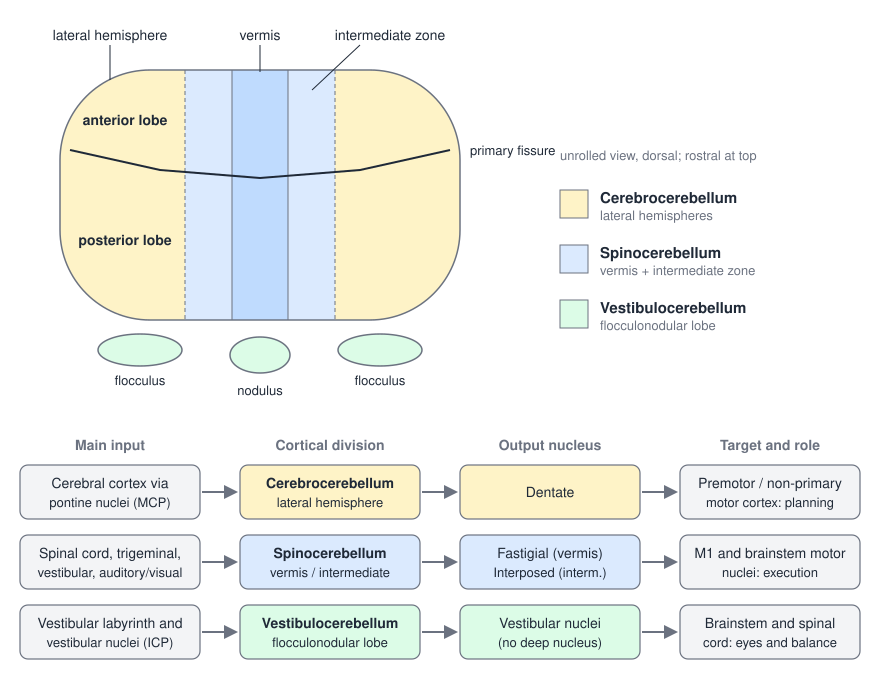
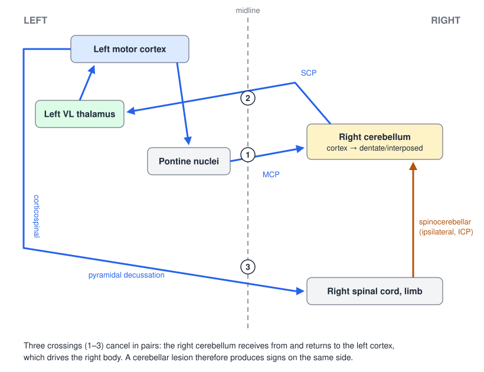
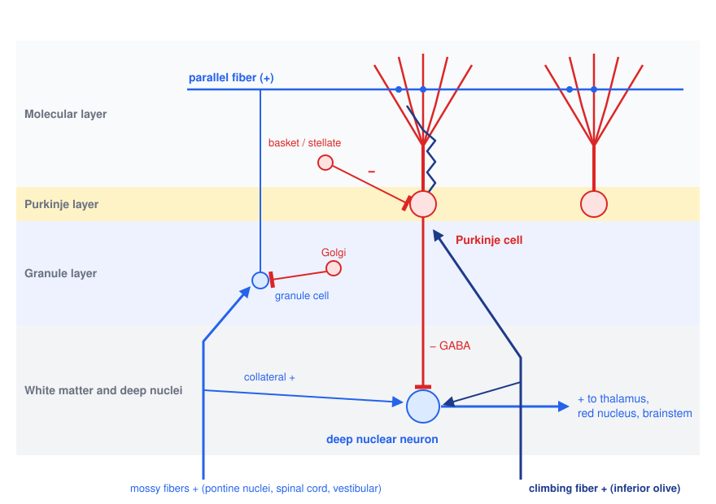
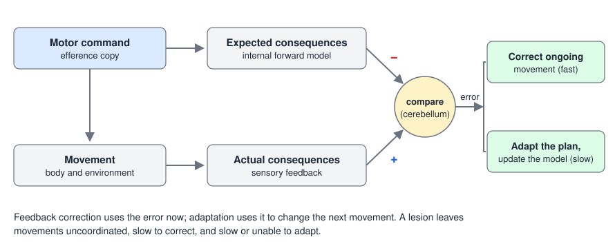

# The Cerebellum

The cerebellum holds more than half the neurons of the brain in a tenth of its volume, yet it neither initiates movement nor is needed for strength or sensation. Its job is to make movement accurate, smooth and coordinated: it compares what a movement was meant to do with what it is actually doing, corrects the difference while the movement is under way, and adjusts the next movement so that the error is smaller. Damage produces no paralysis but a characteristic clumsiness, called ataxia, on the same side of the body as the lesion. This chapter covers the gross and functional anatomy of the cerebellum, its remarkably uniform cortical circuit, the comparator function that circuit is thought to implement, and the clinical signs of cerebellar disease.

## Gross Anatomy

### Lobes and fissures

The cerebellum sits in the posterior cranial fossa behind the pons and medulla, separated from the occipital lobes by the tentorium. Its surface is folded into thin parallel ridges, the **folia**, which on a midsagittal section give the white matter its tree-like appearance (the arbor vitae). Deep transverse fissures divide it into three lobes, most easily seen if the cerebellum is imagined "unrolled" and flattened:

- The **anterior lobe**, rostral to the **primary fissure**.
- The **posterior lobe**, the largest part, between the primary fissure and the posterolateral fissure.
- The **flocculonodular lobe**, the most caudal and phylogenetically oldest part, made up of the **nodulus** in the midline and a **flocculus** on each side.

Running longitudinally, the midline strip is the **vermis**, flanked on each side by a narrow **intermediate (paravermal) zone** and then the large **lateral hemisphere**.

### Three functional divisions

The longitudinal zones and the flocculonodular lobe define three functional divisions, each with its own inputs, its own output nucleus and its own role in movement.

*Figure: the cerebellum unrolled and seen from above, with its three functional divisions. The cerebrocerebellum is the lateral hemispheres; the spinocerebellum is the vermis plus the intermediate zones; the vestibulocerebellum is the flocculonodular lobe. Below, the main input, output nucleus and target of each division.*

| Division | Region | Main inputs | Output nucleus | Targets | Role |
|---|---|---|---|---|---|
| **Cerebrocerebellum** | Lateral hemispheres | Cerebral cortex (motor, premotor, parietal, prefrontal) via pontine nuclei | **Dentate** | VL thalamus → premotor and other non-primary motor and association cortex | **Planning**: timing and coordination of multijoint movements, motor learning, cognition |
| **Spinocerebellum** | Vermis + intermediate zone | Spinal cord (dorsal and ventral spinocerebellar, cuneocerebellar tracts), trigeminal, vestibular, visual and auditory input | **Fastigial** (vermis); **interposed** (intermediate zone) | M1 (via thalamus) and brainstem motor nuclei (reticular, vestibular, red nucleus) | **Execution**: posture, axial and proximal control (vermis); limb control and agonist–antagonist balance (intermediate) |
| **Vestibulocerebellum** | Flocculonodular lobe | Vestibular labyrinth (directly) and vestibular nuclei; visual input | **Vestibular nuclei** (no deep cerebellar nucleus) | Brainstem and spinal cord | **Balance and eye movements**: VOR gain, smooth pursuit, gaze holding |

### Deep cerebellar nuclei

The output of the cerebellar cortex goes to three pairs of **deep cerebellar nuclei** buried in the white matter, arranged from lateral to medial:

1. **Dentate**, the largest and most lateral, a crenated sheet of cells that receives the lateral hemisphere and projects to non-primary motor cortical areas;
2. **Interposed**, made up of the **emboliform** and **globose** nuclei, which receives the intermediate zone;
3. **Fastigial**, the most medial, in the roof of the fourth ventricle, which receives the vermis.

The interposed and fastigial nuclei project to primary motor cortex (through the thalamus) and to brainstem motor neurons and premotor nuclei. The single exception to this arrangement is the flocculonodular lobe, whose Purkinje cells project **directly to the vestibular nuclei**. In effect the vestibular nuclei serve as the deep nuclei of the vestibulocerebellum.

### Peduncles

The cerebellum communicates with the rest of the nervous system through three paired **cerebellar peduncles**:

| Peduncle | Main contents | Direction |
|---|---|---|
| **Superior** (brachium conjunctivum) | Output of the dentate and interposed nuclei to red nucleus and thalamus (crossing in the decussation of the superior peduncle); ventral spinocerebellar tract | Mostly **output** |
| **Middle** (brachium pontis) | Pontocerebellar fibers from the contralateral pontine nuclei, relaying cerebral cortex | Entirely **input** |
| **Inferior** (restiform and juxtarestiform bodies) | Dorsal spinocerebellar and cuneocerebellar tracts, olivocerebellar (climbing) fibers, vestibular input; fastigial and flocculonodular output to vestibular nuclei and reticular formation | Mostly **input**, plus vestibular output |

In summary, the dentate projects through the superior peduncle and thalamus to motor cortical areas for **planning**; the interposed and fastigial nuclei reach M1 and the brainstem for **execution** (the interposed largely through the superior peduncle, the fastigial largely through the inferior peduncle); and the flocculonodular lobe and vestibular nuclei reach the brainstem and spinal cord for **eye and balance control**.

### Ipsilateral control: the double crossing

Unlike the cerebral cortex, each half of the cerebellum controls the **same** side of the body. This follows from the way its inputs and outputs cross.

*Figure: the crossings that make cerebellar control ipsilateral. Left motor cortex projects to the left pontine nuclei, whose axons cross (1) and enter the right cerebellum through the middle peduncle. Right cerebellar output crosses back (2) in the superior peduncle to the left VL thalamus and so to left motor cortex. Left motor cortex controls the right limbs through the corticospinal tract, which crosses (3) at the pyramidal decussation. Spinocerebellar input from the right body reaches the right cerebellum without crossing.*

Cerebral cortical input crosses to reach the opposite cerebellum: frontal and parietal cortex project to the ipsilateral pontine nuclei, whose axons cross and enter the contralateral cerebellum through the middle peduncle. Cortex also reaches the cerebellum through the red nucleus and the **inferior olive**, whose climbing fibers likewise cross and enter through the inferior peduncle. Spinal input (from the dorsal nucleus of Clarke and the external cuneate nucleus) and vestibular input arrive **ipsilaterally** through the inferior peduncle. The output crosses back to the cortex that sent the input, and that cortex controls the opposite side of the body. The net effect is that **cerebellar deficits appear on the side of the lesion**.

## Cytoarchitecture

### Three layers

The cerebellar cortex is the same everywhere. From the surface inward it has three layers:

- the **molecular layer**, almost cell-poor, filled with the flat dendritic trees of Purkinje cells, the parallel fibers that cross them, and two kinds of inhibitory interneuron, the **stellate** and **basket** cells;
- the **Purkinje cell layer**, a single row of very large Purkinje cell bodies;
- the **granule cell layer**, packed with tiny **granule cells** (about \\(5\times10^{10}\\) in humans, the most numerous neuron in the brain) and the inhibitory **Golgi cells**.

Each Purkinje cell's dendritic tree is a flat fan oriented perpendicular to the long axis of the folium, like a page in a book. Granule cell axons rise to the molecular layer and split in a T to become **parallel fibers** that run along the folium for several millimeters, threading through hundreds of Purkinje fans at right angles. The geometry is a crystal-like lattice, and its homogeneity suggests that the cerebellum works as a large array of similar modular circuits, each performing the same computation on different inputs.

### The circuit

Two kinds of input fiber enter the cerebellar cortex, and they are strikingly different.

*Figure: the cerebellar cortical circuit with the sign of each connection. Mossy fibers excite granule cells, whose parallel fibers excite many Purkinje cells; a single climbing fiber from the inferior olive wraps and powerfully excites one Purkinje cell. Basket and stellate cells inhibit Purkinje cells; Golgi cells inhibit granule cells. Purkinje cells, the only output of the cortex, inhibit the deep nuclear neurons, which also receive excitatory collaterals of mossy and climbing fibers and send excitatory output to thalamus, red nucleus and brainstem.*

- **Mossy fibers** come from the **pontine nuclei** (relaying cerebral cortex), the **spinal cord** and the **vestibular** system, among other brainstem sources. They excite granule cells, and each Purkinje cell receives input from on the order of \\(10^5\\) parallel fibers. This is a massively convergent, divergent pathway carrying context: the motor command (as an efference copy from cortex) and the state of the body.
- **Climbing fibers** come exclusively from the contralateral **inferior olive**. Each Purkinje cell receives just **one** climbing fiber, which winds up its dendritic tree and makes hundreds of synapses. Every climbing-fiber action potential produces a large, all-or-none **complex spike** in the Purkinje cell, at low rates of about 1 per second. By contrast, parallel-fiber input modulates the Purkinje cell's ongoing **simple spikes**, which run at 50–100 per second.
- **Purkinje cells** are the sole output of the cerebellar cortex, and they are **GABAergic**. They inhibit the deep cerebellar (and vestibular) nuclei.
- **Deep nuclear neurons** receive this Purkinje inhibition together with excitatory collaterals of the mossy and climbing fibers. Their output, to the thalamus, red nucleus and brainstem, is excitatory (except for a GABAergic projection back to the inferior olive).

The signed circuit therefore contains two loops:

- an **inhibitory loop through the cortex**: mossy fiber → granule cell → parallel fiber → Purkinje cell → deep nuclei, and climbing fiber → Purkinje cell → deep nuclei;
- an **excitatory loop through the deep nuclei**: mossy and climbing fiber collaterals → deep nuclei directly.

The deep-nuclear output is the difference between the two:
\\[
\text{DCN output} \approx E\_{\text{mossy + climbing collaterals}} - I\_{\text{Purkinje}} .
\\]
The excitatory loop carries the raw input signal; the cortical loop subtracts a learned, sculpted copy of it. By adjusting Purkinje cell activity, the cortex shapes the timing and size of the nuclear output that eventually reaches motor neurons.

### Error signals and plasticity

The climbing fiber is the key to how the circuit learns. Climbing-fiber activity rises when a movement goes wrong: when a reach misses, when the image slips on the retina during the VOR, when a step is perturbed. When a climbing-fiber complex spike coincides with parallel-fiber input, the parallel-fiber synapses active at that moment undergo **long-term depression (LTD)**. The parallel-fiber contexts that preceded an error are thereby weakened, Purkinje inhibition of the deep nuclei is reshaped, and the next movement in the same context is altered. This is the Marr–Albus–Ito theory of cerebellar learning: the mossy–parallel fiber pathway supplies the context, and the climbing fiber supplies a teaching signal.

## Function

### A comparator

The cerebellum is uniquely placed to compare two kinds of information: the **expected consequences of a movement**, derived from the motor command that cortex sends to the spinal cord (a copy reaches the cerebellum through the pontine nuclei), and the **actual consequences**, reported by spinal, vestibular and visual afferents. The cortical circuit compares many such inputs and uses the difference.

*Figure: the comparator model. An efference copy of the motor command drives an internal forward model that predicts the sensory consequences of the movement. The cerebellum compares this prediction with the actual sensory consequences; the difference, a sensory prediction error, is used immediately to correct the ongoing movement and, over repeated movements, to adapt the motor plan and update the internal model.*

The comparison has two uses. On a fast time scale it **corrects ongoing movements**: because sensory feedback is slow (tens to hundreds of milliseconds), a controller that waited for feedback would oscillate, so the cerebellum predicts the consequences of the command and corrects against the prediction. On a slow time scale it **adapts the movement plan**: when the same error recurs, as when a person wears prism glasses or walks on a split-belt treadmill, the cerebellum gradually rebuilds the mapping from goal to command so that the error disappears, and an aftereffect appears when the perturbation is removed. In the language of control theory the cerebellum builds and modifies **internal models** of the body and the world: forward models that predict the consequences of commands, and inverse models that compute the commands needed for a goal. This is the basis of error-based learning, discussed in [Motor Learning](motor-learning.md). People with cerebellar damage show deficits not only in motor control and adaptation but in perception that depends on prediction, such as judging visual motion or the position of a limb they move themselves (Therrien and Bastian, 2015).

### Coordination across joints and limbs

A single multijoint movement requires each muscle to anticipate the interaction torques produced by motion at other joints. The cerebellum's wiring suits this task. Its body maps show **fractured somatotopy**: rather than a single continuous homunculus, the granule layer contains a mosaic of small patches, each representing a body part, with the same part repeated in many discontinuous patches and neighboring patches representing distant parts. Long **parallel fibers** run across many such patches, so one parallel fiber can link the representations of, say, the lip, the paw and the shoulder. Fractured somatotopy plus long parallel fibers allows **synchronized activation of muscles across segments and limbs**, taking into account the movement of other segments. The result is smooth, coordinated and increasingly automatic movement.

Two coarser maps are also present: an inverted body map in the anterior lobe (head toward the primary fissure, legs rostrally) and a second, doubled map in the posterior lobe (lobule VIII).

### The cognitive cerebellum

The lateral cerebellum projects through the dentate nucleus and thalamus not only to motor areas but to prefrontal and parietal association cortex, and functional imaging maps the cerebellum into distinct territories:

| Function | Main cerebellar territory |
|---|---|
| Sensorimotor | Anterior lobe (lobules I–V, especially V) and lobule VIII |
| Language | Right lobule VI and Crus I (lateral) |
| Spatial processing | Left lobules VI–VIIB and Crus II |
| Working memory | Lobules VI, Crus I and VIIB–VIIIA |

Language maps to the **right** cerebellum because it is connected with the left cerebral hemisphere. Beyond motor control, the cerebellum is thought to play the same predictive, error-correcting role for cognitive operations. Damage in adults can produce a **cerebellar cognitive affective syndrome** (executive dysfunction, impaired spatial cognition, language difficulties, blunted or disinhibited affect). In children, cerebellar malformations are associated with high rates of motor, cognitive, language, behavioral and social disability, and altered cerebello-cortical connectivity has been found in autism spectrum disorder.

## Clinical Correlations

### General effects of cerebellar damage

Because the cerebellum compares and corrects rather than commands, damage to it or to its input and output pathways produces a characteristic set of deficits rather than weakness:

- **uncoordinated movements** (ataxia);
- **slow correction of ongoing movement**;
- **inability to adapt the movement plan** to a new situation;
- **disrupted or slowed motor learning**.

All appear on the side of the body **ipsilateral** to the lesion.

### Cerebellar signs

The classic signs, first systematically described in soldiers with gunshot wounds of the cerebellum, are:

- **Ataxia**: uncoordinated movement. **Limb ataxia** affects reaching and fine movement; **truncal and gait ataxia** produces a wide-based, staggering, "drunken" gait and difficulty with tandem walking.
- **Dysmetria**: errors in the range of a movement, typically overshooting (hypermetria) or undershooting (hypometria) a target, tested with finger-to-nose and heel-to-shin.
- **Decomposition of movement**: a multijoint movement is broken into a sequence of single-joint movements, as if the interaction torques could no longer be predicted.
- **Intention (action) tremor**: a tremor that is absent at rest, appears during voluntary movement and grows as the limb approaches the target. It contrasts with the resting tremor of Parkinson disease, which diminishes with movement.
- **Dysdiadochokinesia**: impaired rapid alternating movements, such as pronation and supination of the forearm, which become slow and irregular.
- **Rebound**: failure to check a movement when resistance is suddenly released.
- **Hypotonia**: reduced resistance to passive movement, with pendular tendon reflexes, especially in acute lesions.
- **Nystagmus and abnormal eye movements**: gaze-evoked nystagmus, impaired smooth pursuit, saccadic dysmetria, and an inability to suppress the VOR, particularly with lesions of the vestibulocerebellum.
- **Dysarthria**: slurred, "scanning" speech with irregular rhythm and volume.

### Localization

Different divisions and their nuclei produce different deficits:

| Subdivision | Nucleus | Normal function | Lesion results in |
|---|---|---|---|
| Spinocerebellum (vermis) | Fastigial | Control of upright stance against gravity | Truncal ataxia; **falls toward the side of the lesion** |
| Spinocerebellum (intermediate zone) | Interposed | Gross limb movement; balance of agonist and antagonist muscles at a single joint | **Ipsilateral action (intention) tremor** during voluntary movements such as reaching |
| Cerebrocerebellum (lateral hemisphere) | Dentate | Coordinating movement across segments and limbs; adapting and learning skilled voluntary movement; language and cognition | **Ataxia** (uncoordinated multijoint movement); **dysmetria** (over- or undershooting arm and leg movements); impaired adaptation |
| Vestibulocerebellum (flocculonodular lobe) | Vestibular nuclei | Balance, VOR, gaze holding | Disequilibrium, wide-based gait, nystagmus |

Midline lesions, such as degeneration of the anterior vermis in chronic alcohol use, mainly affect stance and gait; lateral lesions, such as a hemispheric stroke or tumor, mainly affect the ipsilateral limbs.

### Rehabilitation and stimulation

Because the cerebellum is the main substrate of error-based adaptation, people with cerebellar ataxia adapt poorly to new mappings, although they may still improve through reinforcement and repetition. Conversely, anodal transcranial direct current stimulation over the cerebellum accelerates locomotor adaptation on a split-belt treadmill (Jayaram et al., 2012) and restores the slower visuomotor adaptation of older adults to the rate of young adults (Hardwick and Celnik, 2014), which makes cerebellar stimulation a candidate adjunct to rehabilitation.

## Key Readings

- Holmes G (1939). *The cerebellum of man*. Brain. — The clinical definition of the cerebellar signs (hypotonia, dysmetria, decomposition of movement, dysdiadochokinesia, intention tremor, ataxia, nystagmus) from careful study of focal wounds.
- Therrien AS, Bastian AJ (2015). *Cerebellar damage impairs internal predictions for sensory and motor function*. Current Opinion in Neurobiology. — Unifies cerebellar motor, adaptive and perceptual deficits as failures of internal forward models.
- Jayaram G, Tang B, Pallegadda R, Vasudevan EVL, Celnik P, Bastian AJ (2012). *Modulating locomotor adaptation with cerebellar stimulation*. Journal of Neurophysiology. — Anodal cerebellar tDCS sped and cathodal tDCS slowed split-belt adaptation of spatial gait parameters.
- Hardwick RM, Celnik PA (2014). *Cerebellar direct current stimulation enhances motor learning in older adults*. Neurobiology of Aging. — Cerebellar tDCS brought older adults' adaptation rate up to that of young adults.
- Bolduc ME, du Plessis AJ, Sullivan N, et al. (2011). *Spectrum of neurodevelopmental disabilities in children with cerebellar malformations*. Developmental Medicine & Child Neurology. — Clinical evidence that the cerebellum contributes to cognition, language and social behavior.
- Stoodley CJ, D'Mello AM, Ellegood J, et al. (2017). *Altered cerebellar connectivity in autism and cerebellar-mediated rescue of autism-related behaviors in mice*. Nature Neuroscience. — Causal evidence that Crus I circuits shape social and repetitive behavior.
- Olivito G, Clausi S, Laghi F, et al. (2017). *Resting-state functional connectivity changes between dentate nucleus and cortical social brain regions in autism spectrum disorders*. The Cerebellum. — Reduced dentate–cortical connectivity in autism, consistent with a cerebello-thalamo-cortical "disconnection."

## See Also

- [Motor Learning](motor-learning.md): error-based adaptation, internal models and the role of climbing-fiber error signals.
- [The Basal Ganglia](basal-ganglia.md): the other subcortical loop through the thalamus, built for selection.
- [The Vestibular System](vestibular.md): the vestibulocerebellum, the VOR and balance.
- [Descending Pathways](descending-pathways.md): the brainstem pathways through which cerebellar output reaches the cord.
- [Motor Cortex](motor-cortex.md): the cortical targets of the dentate and interposed nuclei.
- [Cognition](cognition.md): non-motor functions of the cerebellum.
- [Control Systems](../../../eng/control/README.md): feedforward prediction, feedback correction and adaptive control.
