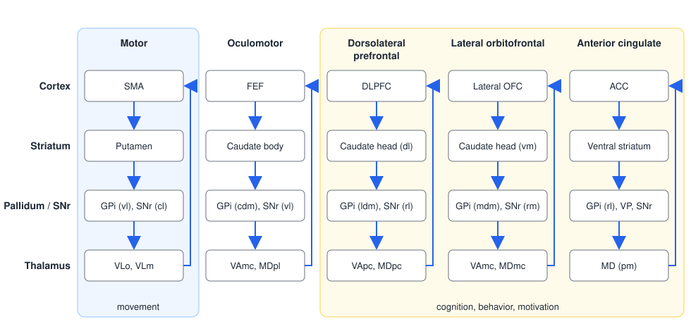
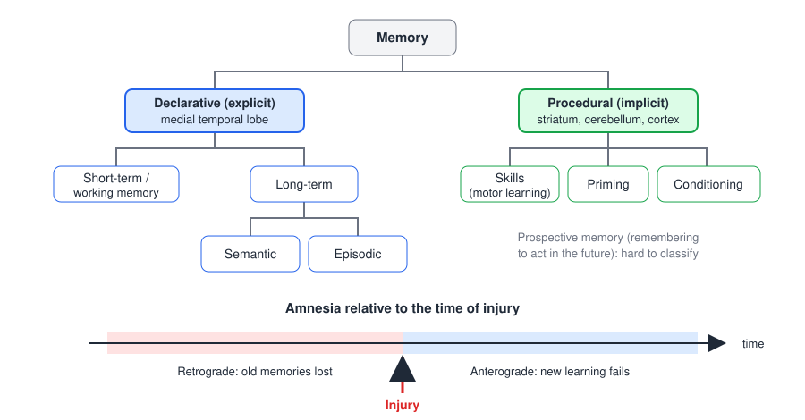
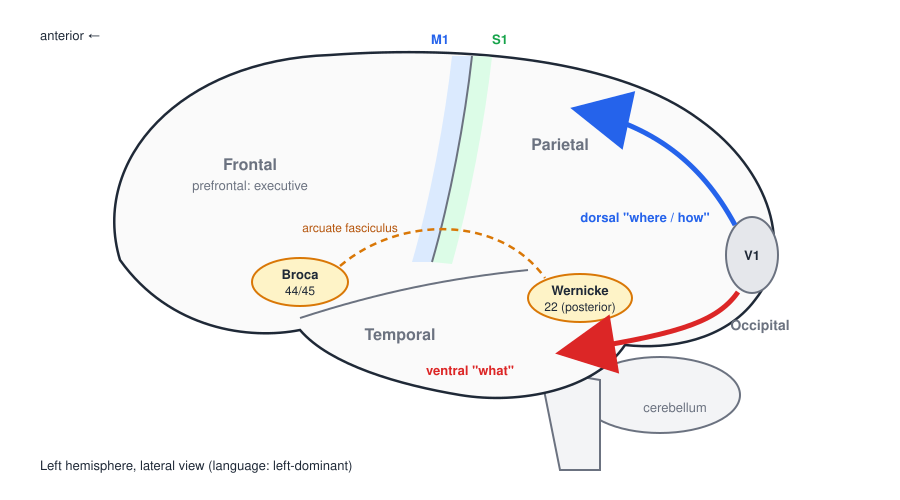

# Higher Cognitive Functions

Movement is never purely motor. Deciding to reach, attending to the target, remembering how the task is done, understanding a therapist's instruction and adjusting the plan when the cup is heavier than expected all depend on cognition. This chapter surveys the five cognitive domains used in clinical neuropsychology (attention, learning and memory, language, visual-spatial processing, and executive function), the brain systems that support them, the disorders that disrupt them and the tests that measure them. It ends with cognitive aging and dementia and with why cognitive status shapes motor performance and rehabilitation.

## Cognitive Domains

Cognitive function is conventionally divided into five domains:

1. **Attention**
2. **Learning and memory**
3. **Language**
4. **Visual-spatial processing**
5. **Executive function**

The domains overlap. Executive function sits at the center, interacting with all of the others: it allocates attention, organizes encoding and retrieval of memories, structures discourse and plans the copying of a complex figure. A deficit in one domain therefore often shows up on tests designed for another, and interpreting a test score requires knowing which domains it draws on.

The relationship between brain and behavior is not fixed by anatomy alone. Cognitive performance is modulated by **psychological factors** (depression, anxiety, motivation), **environmental factors** (education, sleep, noise, testing conditions) and **medical conditions** (infection, metabolic disturbance, medication). A low score on a memory test in a patient with delirium or depression does not mean the same as the same score in a patient with Alzheimer's disease.

## Organization of the Cerebral Cortex

### From phrenology to cytoarchitecture

The idea that mental functions are localized has a mixed history. Nineteenth-century **phrenology** claimed that faculties such as "benevolence" or "destructiveness" occupy discrete regions whose size could be read from bumps on the skull. The method was baseless, but the core idea that different regions do different things was confirmed by lesion studies (Broca's patient with lost speech production, 1861) and by anatomy.

**Brodmann** (1909) divided the cortex into about 50 areas on the basis of **cytoarchitecture**, the thickness and cell composition of the six cortical layers. Many of these areas turned out to correspond to functional divisions:

| Brodmann areas | Region | Function |
|---|---|---|
| 4 | Primary motor cortex | Voluntary movement |
| 6 | Premotor cortex, SMA | Movement planning and sequencing |
| 8 | Frontal eye fields | Voluntary eye movements |
| 3, 1, 2 | Primary somatosensory cortex | Touch and proprioception |
| 5, 7, 39, 40 | Posterior parietal cortex (superior and inferior parietal lobules) | Visuospatial and sensorimotor integration |
| 44, 45 | Broca's area (left inferior frontal gyrus) | Speech production |
| 41, 42 | Primary auditory cortex | Hearing |
| 22 (posterior) | Wernicke's area (left superior temporal gyrus) | Language comprehension |
| 9, 10, 46, 11, 47 | Prefrontal cortex | Cognition, executive function |
| 38 | Temporal pole | Emotion |
| 17 | Primary visual cortex (V1) | Vision |
| 18, 19 | Visual association cortex | Visual processing |
| 20, 21, 37 | Inferior and middle temporal cortex | Visual object recognition |
| 24, 32, 33 | Anterior cingulate cortex | Conflict monitoring, motivation |
| 23, 31 | Posterior cingulate cortex | Memory, default-mode network |
| 28, 34, 35, 36 | Entorhinal, perirhinal and parahippocampal cortex | Memory (34: olfaction) |

### Association cortex

Primary sensory and motor areas occupy only a small fraction of the human cortex. The rest is **association cortex**, which integrates information across senses and links perception with action and memory. Three association regions are especially important:

- **Prefrontal association cortex** (anterior to premotor cortex): planning, working memory, decision making, behavioral regulation and personality.
- **Parietal–temporal–occipital association cortex**: integrates somatosensory, visual and auditory information for spatial awareness, attention and language.
- **Limbic association cortex** (cingulate, parahippocampal and orbitofrontal cortex, temporal pole): emotion, motivation and memory.

### Distributed networks

Cognitive functions do not live in single areas but emerge from interacting networks. **Diffusion tensor imaging (DTI)** tracks the white-matter bundles that connect regions (the corpus callosum, the superior longitudinal and arcuate fasciculi, the uncinate fasciculus), and graph-theoretical analyses of brain connectivity describe the brain as a network of nodes (regions) and edges (connections) with measurable properties: path length (how many steps separate two regions), clustering (how interconnected a region's neighbors are), betweenness (how often a region lies on the shortest paths between others, a measure of hub status) and communicability. Damage to a hub or a long white-matter tract can disrupt cognition far more than its size would suggest, and diseases that degrade white matter (small-vessel disease, multiple sclerosis, normal aging) impair cognition by slowing communication between regions.

### Frontal–striatal circuits

The [basal ganglia](basal-ganglia.md) (caudate, putamen, globus pallidus, subthalamic nucleus, substantia nigra) are usually discussed as motor structures, but they participate in a series of parallel loops with the frontal lobe, most of which serve cognition and behavior. Each loop runs **cortex → striatum → pallidum/substantia nigra pars reticulata (SNr) → thalamus → back to the same cortical area**, and each keeps a degree of anatomical segregation from the others (Alexander, DeLong and Strick, 1986).

| Loop | Cortex (main inputs) | Striatum | Pallidum / SNr | Thalamus | Function |
|---|---|---|---|---|---|
| Motor | SMA (arcuate premotor area, motor cortex, somatosensory cortex) | Putamen | Ventrolateral GPi; caudolateral SNr | VLo, VLm | Movement execution, scaling |
| Oculomotor | Frontal eye field (DLPFC, posterior parietal cortex) | Caudate body | Caudal dorsomedial GPi; ventrolateral SNr | Lateral VAmc, MDpl | Voluntary saccades |
| Dorsolateral prefrontal | DLPFC (posterior parietal cortex, arcuate premotor area) | Dorsolateral caudate head | Lateral dorsomedial GPi; rostrolateral SNr | VApc, MDpc | Executive function, working memory, set-shifting |
| Lateral orbitofrontal | Lateral OFC (superior and inferior temporal gyri, ACC) | Ventromedial caudate head | Medial dorsomedial GPi; rostromedial SNr | Medial VAmc, MDmc | Social behavior, inhibition of inappropriate responses |
| Anterior cingulate | ACC (hippocampus, entorhinal cortex, superior and inferior temporal gyri) | Ventral striatum (nucleus accumbens) | Rostrolateral GPi, ventral pallidum; rostrodorsal SNr | Posteromedial MD | Motivation, initiative |

*Abbreviations: SMA, supplementary motor area; DLPFC, dorsolateral prefrontal cortex; OFC, orbitofrontal cortex; ACC, anterior cingulate cortex; GPi, internal globus pallidus; VLo/VLm, oral and medial ventrolateral thalamus; VA, ventral anterior thalamus (pc, parvocellular; mc, magnocellular); MD, mediodorsal thalamus (pl, paralaminar; pc, parvocellular; mc, magnocellular; pm, posteromedial).*

*Figure: the five frontal–striatal circuits. Each column is a closed loop (blue arrows) from a frontal cortical area through a distinct part of the striatum, the internal pallidum/SNr and the thalamus back to the same cortex. Only the motor loop (left) serves movement directly; the oculomotor loop serves eye movement, and the dorsolateral prefrontal, lateral orbitofrontal and anterior cingulate loops (yellow) serve cognition, social behavior and motivation.*

The loops explain why basal ganglia disease is also a cognitive and behavioral disease. Parkinson's disease impairs executive function (set-shifting, planning, working memory) through the dorsolateral prefrontal loop and produces apathy through the anterior cingulate loop; Huntington's disease produces disinhibition and irritability through the orbitofrontal loop long before chorea is severe. Real basal ganglia connectivity is far denser than the loop diagram suggests, with many cross-connections, but the loop scheme remains the most useful clinical framework.

## Attention

### Components and networks

Attention is the selection of some information for further processing at the expense of other information. Three components are distinguished, each supported by its own network (Posner's model; Raz and Buhle, 2006):

- **Alerting** — achieving and maintaining a state of readiness: basic (simple) attention and **sustained** attention (vigilance). Supported by the thalamus and right frontal and parietal cortex, with noradrenergic input from the locus coeruleus.
- **Orienting** — **selective** attention: choosing which location or feature to attend. Supported by the superior parietal cortex, frontal eye fields and superior colliculus, with cholinergic modulation.
- **Executive attention** — resolving conflict between competing responses, **inhibiting** prepotent responses and **mental tracking** (keeping track of several things at once). Supported by the anterior cingulate and lateral prefrontal cortex, with dopaminergic modulation.

A complementary scheme describes two frontoparietal networks for orienting (Corbetta and Shulman's model, reviewed by Vossel et al., 2014):

- **Dorsal attention network** — the **frontal eye fields (FEF)** and **intraparietal sulcus (IPS)**, bilaterally. It controls the **top-down**, voluntary allocation of attention to locations and features ("look for the red cup").
- **Ventral attention network** — the **temporoparietal junction (TPJ)** and **ventral frontal cortex (VFC)**, lateralized to the **right** hemisphere. It detects **bottom-up**, unattended or unexpected stimuli and triggers a shift of attention toward them (a car horn, a stumble).

The two networks interact: the ventral network interrupts the dorsal network when something behaviorally important appears outside the current focus. The right lateralization of the ventral network is one reason neglect follows right-hemisphere lesions far more often than left.

Attention is not localized to a single lobe: it emerges from these distributed networks, which is why it is disrupted by such a wide range of conditions.

### Measures and deficits

| Component | Test |
|---|---|
| Simple or basic attention | Digit Span (forward) |
| Sustained attention | Digit Vigilance Test; continuous performance tests |
| Selective attention and inhibition | Stroop task (naming the ink color of color words) |
| Mental tracking | Paced Auditory Serial Addition Test (PASAT) |

Attention deficits occur in attention-deficit disorders (ADD/ADHD), traumatic brain injury (TBI) and stroke, psychological disorders (depression, anxiety), dementia and delirium, as effects of drugs and medications, and as a result of environment and behavior (sleep deprivation, distraction). Because every other domain depends on attention, an attention deficit must be identified first: a patient who cannot attend will fail memory tests without having a memory disorder.

## Learning and Memory

### Taxonomy of memory systems

Memory is not a single system. The modern taxonomy grew from the study of patient **H.M.**, who became profoundly unable to form new conscious memories after bilateral removal of the medial temporal lobes but could still learn a mirror-drawing skill over days, without remembering having practiced it (Milner, Squire and Kandel, 1998).

*Figure: top, the taxonomy of memory. Declarative (explicit) memory, dependent on the medial temporal lobe, divides into short-term/working memory and long-term memory, which is semantic or episodic. Procedural (implicit) memory includes skills, priming and conditioning, and depends on the striatum, cerebellum and cortex. Bottom: amnesia relative to the time of injury; retrograde amnesia affects memories formed before the injury, anterograde amnesia the formation of new memories after it.*

- **Declarative (explicit) memory** — memory that can be consciously recalled and stated.
  - **Short-term and working memory** — holding a small amount of information (about seven items, or four chunks) for seconds, and manipulating it (working memory). Supported by prefrontal and parietal cortex.
  - **Long-term memory**:
    - **Semantic** — facts and general knowledge (Paris is the capital of France), independent of when they were learned.
    - **Episodic** — personal events tied to a time and place (what you had for breakfast).
- **Procedural (implicit, nondeclarative) memory** — memory expressed through performance rather than recollection.
  - **Skills and habits** — motor and cognitive skills (riding a bicycle). This is the memory system of [motor learning](motor-learning.md), supported by the striatum, cerebellum and motor cortex.
  - **Priming** — facilitated processing of a stimulus because of earlier exposure (neocortex).
  - **Conditioning** — learned associations between stimuli and responses (cerebellum for motor responses such as the eyeblink, amygdala for emotional responses).

**Prospective memory**, remembering to perform an intended action in the future (taking a medication at noon), does not fit neatly into the taxonomy; it combines episodic memory with executive monitoring and is especially relevant to independent living.

Declarative learning and memory involve three basic processes: **encoding** (forming the memory), **storage** (consolidating and maintaining it) and **retrieval** (accessing it). Different disorders fail at different stages, and tests that compare free recall with recognition can tell them apart (see Dementia below).

### Amnesia

Amnesia is the loss of declarative memory with otherwise preserved cognition.

- **Anterograde amnesia** is the inability to learn new information through the declarative long-term memory system.
- **Retrograde amnesia** is the inability to retrieve information learned before the onset of amnesia. It typically follows a temporal gradient: memories from just before the injury are lost most, and remote memories are spared (Ribot's law), because older memories have been consolidated in neocortex and no longer depend on the hippocampus.

Popular fiction ("soap opera syndrome") favors pure retrograde amnesia, in which a character forgets their identity but learns new things normally; real amnesia is dominated by the anterograde deficit.

Declarative memory disorders follow damage to a circuit that includes the **hippocampus** and **rhinal (entorhinal and perirhinal) cortex** of the medial temporal lobe, the **fornix**, the **mamillary bodies** and the **anterior and mediodorsal thalamus** of the diencephalon, the **basal forebrain** (source of cholinergic input to the hippocampus) and the **prefrontal cortex** (organization of encoding and retrieval). The **amygdala** adds emotional significance to memories. **Wernicke–Korsakoff syndrome**, caused by thiamine deficiency (usually with chronic alcohol use), damages the mamillary bodies and thalamus and produces dense anterograde amnesia with confabulation.

### Measures and deficits

| Type | Tests |
|---|---|
| Verbal memory | Word-list learning (e.g. California Verbal Learning Test, CVLT) |
| Visual memory | Visual Reproduction; Rey–Osterrieth Complex Figure (delayed recall) |
| Spatial memory | Corsi blocks; spatial delayed recall |

Learning and memory deficits occur in Alzheimer's disease, Wernicke–Korsakoff syndrome, TBI, the **subcortical dementias** (Huntington's disease, Parkinson's disease), psychological disorders and, to a lesser degree, normal aging.

## Language

### Components and measures

Language skills fall into **production** (fluency, word finding, repetition, syntax) and **comprehension** (from simple to complex commands, and from simple to complex ideas).

| Skill | Measures |
|---|---|
| Production | Verbal fluency (generating words beginning with a letter or from a category in one minute); confrontation naming (naming pictured objects); picture description and story telling |
| Comprehension | Following commands of increasing complexity; answering questions about sentences and stories |

### Language and the brain

Language is **left-hemisphere dominant** in nearly all right-handers and most left-handers. The classical model identifies two key areas connected by the **arcuate fasciculus**:

- **Broca's area** (Brodmann 44 and 45, left inferior frontal gyrus), adjacent to the face and mouth region of motor cortex, for speech production and syntax.
- **Wernicke's area** (posterior Brodmann 22, left superior temporal gyrus), adjacent to auditory cortex, for language comprehension.

*Figure: lateral view of the left hemisphere (anterior to the left). Broca's area (inferior frontal) and Wernicke's area (posterior superior temporal) are linked by the arcuate fasciculus. From primary visual cortex (V1), the dorsal stream (blue) runs into the parietal lobe and processes where objects are and how to act on them; the ventral stream (red) runs along the inferior temporal lobe and processes what objects are. M1 and S1 lie on either side of the central sulcus.*

Functional imaging confirmed and refined this picture. In a classic PET subtraction study, passively **hearing** words activated superior temporal (auditory) cortex, **seeing** words activated occipital (visual) cortex, **speaking** words activated motor and sensorimotor cortex, and **generating** words (saying a verb that goes with a noun) activated left inferior frontal cortex (Petersen et al., 1988). Each level of processing added a distinct region, showing that language is a hierarchy of subprocesses rather than a single function.

### Aphasias

An **aphasia** is an acquired disorder of language caused by brain damage. Descriptions of the same picture (a standard scene of a boy stealing cookies from a jar while his mother washes dishes and the sink overflows) illustrate the two classical types:

- **Broca's (non-fluent, expressive) aphasia**: speech is slow, effortful and telegraphic, with content words preserved and grammatical words missing: "Boy … girl … stool tr-tr-tripping … the washer, uhhh, washet … dishes … water falling." Comprehension is relatively preserved and patients are aware of, and frustrated by, their errors. Because Broca's area lies beside motor cortex, right hemiparesis (arm more than leg) often accompanies it.
- **Wernicke's (fluent, receptive) aphasia**: speech is fluent and grammatical in rhythm but empty of meaning, filled with **paraphasias** (wrong or distorted words) and **neologisms** (invented words): "The boyo had the stooliken while mother washes and watches the window, had it fanangled there…". Comprehension is severely impaired and patients are often unaware of their errors. Motor function is usually spared.
- **Conduction aphasia**, from damage to the arcuate fasciculus or supramarginal gyrus, spares fluency and comprehension but impairs repetition.
- **Global aphasia**, from large left-hemisphere strokes in the middle cerebral artery territory, impairs all language functions.

Neurodegenerative diseases also affect language, typically reducing verbal fluency and causing word-finding difficulty (anomia); in the primary progressive aphasias, language is the main or only domain affected for years.

## Visual-Spatial Processing

### Components, measures and the two visual streams

Visual-spatial processing includes **construction** (assembling parts into a whole, as in drawing or building), **perception** (judging the properties of visual stimuli) and **organization** (integrating parts into a coherent whole).

| Component | Measures |
|---|---|
| Construction | Copying or drawing tasks (clock drawing, figure copy) |
| Perception | Judgment of Line Orientation; object and face recognition tasks |
| Organization / integration | Rey–Osterrieth Complex Figure (copy); Block Design; Hooper Visual Organization Test |

Visual information leaving primary visual cortex divides into two streams (Ungerleider and Mishkin; Goodale and Milner, 1992):

- The **ventral "what" stream** runs along the inferior temporal lobe and identifies objects, faces and scenes. It supports perception and recognition.
- The **dorsal "where" (or "how") stream** runs into the posterior parietal lobe and encodes location, motion and the spatial relationships needed to act on objects. Goodale and Milner emphasized that it computes visuomotor transformations for action: the size of the grip aperture, the orientation of the hand. Patients with ventral-stream damage may be unable to report the orientation of a slot yet post a card through it accurately; patients with dorsal-stream damage (optic ataxia) can describe an object but misreach for it.

The dorsal stream feeds the parieto-premotor circuits that plan reaching and grasping (see [Motor Cortex](motor-cortex.md)), so it is the visual system's direct input to movement.

### Visual-spatial deficits

- **Visual agnosias** — inability to recognize visually presented objects despite intact elementary vision, from ventral-stream damage:
  - **Prosopagnosia** — inability to recognize faces (fusiform gyrus).
  - **Apperceptive agnosia** — failure to form a coherent percept; the patient cannot copy or match shapes.
  - **Associative agnosia** — the percept is intact (the object can be copied) but cannot be linked to its meaning.
- **Constructional apraxia** — inability to assemble or draw figures despite adequate perception and motor ability, more often after parietal damage.
- **Neglect syndrome** (below).
- **Neurodegenerative diseases** — visual-spatial deficits are prominent in Parkinson's disease and Alzheimer's disease, and dominate in dementia with Lewy bodies and posterior cortical atrophy.

### Unilateral spatial neglect

**Unilateral spatial neglect** is a failure to attend to, respond to or orient toward stimuli on the side opposite a brain lesion, not explained by sensory or motor loss. It is far more common and severe after **right**-hemisphere damage, so the left side of space is neglected. Patients may eat only from the right half of a plate, shave only the right side of the face, collide with objects on the left, and bisect lines well to the right of center. Many are unaware of the problem (anosognosia).

The lesions that cause neglect cluster in the right **inferior parietal lobule** (Brodmann 39 and 40) and **temporoparietal junction**, the **ventral frontal cortex** (around area 44), the superior temporal cortex, and the white matter connecting them, especially the **superior longitudinal fasciculus**, a parieto-frontal tract. Neglect is thus a disorder of the right-lateralized attention networks described above rather than of a single area. It is one of the strongest predictors of poor functional recovery after stroke, because it disrupts balance, wheelchair navigation, self-care and safety, and because the patient does not compensate for what they do not notice.

## Executive Function

Executive function is the set of control processes that coordinate goal-directed behavior. Its components include:

- **Working memory** — holding and manipulating information online.
- **Set-shifting** — switching flexibly between rules or tasks.
- **Processing speed** — the rate at which cognitive operations are carried out.
- **Planning and strategy development** — organizing steps toward a goal.
- **Abstract reasoning** — forming concepts and seeing relationships.
- **Problem solving and decision making**.
- **Inhibition** — suppressing habitual or inappropriate responses.

| Measure | What it tests |
|---|---|
| Wisconsin Card Sorting Test (WCST) | Inferring a sorting rule from feedback and shifting when it changes; perseverative errors indicate poor set-shifting |
| Letter–Number Sequencing | Working memory (reorder a mixed sequence of letters and numbers) |
| Trail Making Test (A and B) | Processing speed (A: connect numbers); set-shifting (B: alternate numbers and letters) |
| Tower tasks (Tower of London, Tower of Hanoi) | Planning |
| Matrix Reasoning | Abstract, nonverbal reasoning |
| Similarities | Verbal abstraction ("How are an orange and a banana alike?") |

Executive function depends above all on the **frontal lobe**, particularly the dorsolateral prefrontal cortex and its frontal–striatal loop, but it also depends on the integrity of the white matter and subcortical structures that connect the prefrontal cortex to the rest of the brain. Deficits occur after TBI and other brain damage, in neurodegenerative disorders and dementia, in psychological disorders, in normal aging, and with "environmental" factors such as sleep loss and stress. Patients with executive dysfunction may score normally on tests of individual abilities yet fail in daily life, where tasks are unstructured and must be self-initiated and sequenced.

## Cognitive Aging, Cognitive Reserve and Dementia

### Normal aging

Cognitive aging is uneven (Hedden and Gabrieli, 2004). **Declining** with age: episodic memory encoding, working memory, processing speed and executive control. **Stable** with age: short-term memory span, autobiographical and semantic knowledge (vocabulary often increases into old age), implicit memory and emotional processing. The decline in normal aging is attributed mainly to changes in **frontal–striatal** systems: loss of white-matter integrity, reduced dopamine and frontal volume loss. **Pathological** aging, the path toward Alzheimer's disease, instead begins in the **medial temporal lobe** (entorhinal cortex and hippocampus). Older adults often recruit additional regions for a task, including the homologous area in the other hemisphere (reduced lateralization), which can be compensatory.

### Cognitive reserve

People with similar brain pathology differ in how impaired they are. **Cognitive reserve** is the ability to maintain function despite pathology, attributed to more efficient or more flexible use of brain networks and built up by education, occupational complexity and cognitively stimulating activity. In Parkinson's disease, in 155 patients imaged for cortical β-amyloid with PiB PET, more years of education weakened the association between amyloid burden and cognitive impairment, consistent with reserve protecting against the cognitive effects of pathology (Lucero et al., 2015).

### Alzheimer's disease and the biomarker cascade

**Dementia** is an acquired decline in cognition, across one or more domains, severe enough to interfere with independence in daily life. **Alzheimer's disease (AD)** is the most common cause. Its pathology consists of extracellular **β-amyloid plaques** and intracellular **tau neurofibrillary tangles**, with neuron and synapse loss beginning in the entorhinal cortex and hippocampus. The dominant early symptom is anterograde episodic memory loss.

The hypothetical biomarker model of Jack et al. (2010) orders AD biomarkers in time, each following a sigmoid curve. **Amyloid** markers (low cerebrospinal fluid Aβ42, positive amyloid PET) become abnormal first, while people are still cognitively normal, years before symptoms. **Neurodegeneration** markers (raised CSF tau, reduced glucose metabolism on FDG-PET, atrophy on MRI) follow and track clinical severity; memory impairment and then functional decline come last. The model underpins the concept of **preclinical AD** and the use of biomarkers in diagnosis and trials.

### Cortical and subcortical profiles

Dementias differ in which memory process fails. On the CVLT, patients with Alzheimer's disease and patients with Korsakoff's amnesia share a "cortical" or amnesic profile: rapid forgetting over a delay, many intrusions (recall of words not on the list) and poor recognition, indicating failure of encoding and storage. Patients with Huntington's disease show a "subcortical" profile: poor free recall but better retention, fewer intrusions and relatively preserved recognition, indicating a **retrieval** deficit (Delis et al., 1991). Parkinson's disease without dementia resembles the subcortical pattern, with slowed processing and executive impairment, reflecting frontal–striatal dysfunction. This distinction guides both diagnosis and therapy: cues and structure help patients with retrieval deficits much more than patients with encoding deficits.

## Neuropsychological Tests by Domain

| Domain | Component | Representative tests |
|---|---|---|
| Attention | Simple attention | Digit Span |
| | Sustained attention | Digit Vigilance Test |
| | Selective attention, inhibition | Stroop task |
| | Mental tracking | PASAT |
| Learning and memory | Verbal | Word-list learning (CVLT) |
| | Visual | Visual Reproduction; Rey–Osterrieth Complex Figure (recall) |
| | Spatial | Corsi blocks; spatial delayed recall |
| Language | Production | Verbal fluency; confrontation naming; picture description |
| | Comprehension | Commands; question and story comprehension |
| Visual-spatial | Construction | Copying and drawing tasks |
| | Perception | Judgment of Line Orientation; recognition tasks |
| | Organization | Rey–Osterrieth copy; Block Design; Hooper Visual Organization Test |
| Executive | Set-shifting, working memory, planning, reasoning | WCST; Letter–Number Sequencing; Trail Making; Tower tasks; Matrix Reasoning; Similarities |

## Why Cognition Matters for Movement

- **Attention and automaticity.** Early in learning, movement demands attention (the cognitive stage of [motor learning](motor-learning.md)). After a stroke or in Parkinson's disease, walking and balance often remain attention-demanding, so **dual-task** conditions (walking while talking, carrying an object while turning) degrade gait and increase falls. Dual-task performance is a sensitive clinical measure and a target of training.
- **Procedural versus declarative learning.** Motor skills are procedural memories and can be learned by people with severe amnesia, as H.M. showed. Patients with memory impairment can therefore learn motor skills if practice is structured, consistent and errorless where needed, even if they do not remember the sessions. Conversely, patients with basal ganglia or cerebellar disease have impaired procedural learning despite intact declarative memory and may benefit from explicit strategies and cues.
- **Executive function and rehabilitation.** Planning, sequencing, self-monitoring and problem solving are needed to carry out multi-step tasks (a transfer, a meal), to follow a home exercise program and to use adaptive equipment safely. Executive deficits predict functional outcome after stroke and TBI more strongly than many motor measures.
- **Language.** A patient with receptive aphasia cannot follow verbal instructions; therapists must demonstrate, use gestures and rely on intrinsic feedback. A patient with Broca's aphasia often understands well but cannot report symptoms.
- **Visual-spatial function and neglect.** Neglect and visuospatial deficits disrupt balance, navigation and safety and slow rehabilitation; training of scanning and cueing toward the neglected side is required.
- **Apraxia.** Left-hemisphere lesions, especially parietal and premotor, can cause apraxia: inability to perform skilled, purposeful actions (such as using a tool or miming a gesture) despite adequate strength, sensation and comprehension. It reflects a breakdown of the link between knowing what to do and the motor program, and it impairs daily activities.
- **Motivation.** The anterior cingulate and ventral striatal loop supports initiative; apathy after frontal or basal ganglia damage, or with depression, reduces practice and therefore recovery.

## Clinical Correlations

- **Stroke.** Left-hemisphere strokes cause aphasia and apraxia; right-hemisphere strokes cause neglect, anosognosia and visuospatial deficits. Both impair executive function and attention, and both influence motor recovery.
- **Traumatic brain injury.** Diffuse axonal injury and frontal and temporal contusions produce deficits in attention, processing speed, memory and executive function out of proportion to focal findings.
- **Parkinson's disease.** Frontal–striatal dysfunction produces executive and attentional deficits early; dementia develops in many patients, and amyloid pathology and cognitive reserve modify its course (Lucero et al., 2015).
- **Huntington's disease.** Subcortical retrieval deficits and orbitofrontal behavioral changes accompany chorea (Delis et al., 1991).
- **Alzheimer's disease.** Episodic memory fails first; amyloid biomarkers become abnormal before symptoms (Jack et al., 2010).
- **Wernicke–Korsakoff syndrome.** Diencephalic amnesia with confabulation, preventable with thiamine.
- **Delirium.** An acute, fluctuating disturbance of attention and awareness, common in hospitalized older adults; it must be distinguished from dementia because it is often reversible.

## Key Readings

- Milner B, Squire LR, Kandel ER (1998). *Cognitive neuroscience and the study of memory*. Neuron. — The history of memory systems from patient H.M. to the molecular basis of storage.
- Albright TD, Kandel ER, Posner MI (2000). *Cognitive neuroscience*. Current Opinion in Neurobiology. — A broad review of memory, vision, attention and executive processes.
- Hedden T, Gabrieli JDE (2004). *Insights into the ageing mind: a view from cognitive neuroscience*. Nature Reviews Neuroscience. — Which cognitive functions decline and which are preserved with age, and why.
- Jack CR Jr, Knopman DS, Jagust WJ, et al. (2010). *Hypothetical model of dynamic biomarkers of the Alzheimer's pathological cascade*. Lancet Neurology. — The temporal ordering of amyloid and neurodegeneration biomarkers.
- Delis DC, Massman PJ, Butters N, et al. (1991). *Profiles of demented and amnesic patients on the California Verbal Learning Test*. Psychological Assessment. — Distinguishes cortical encoding from subcortical retrieval deficits.
- Lucero C, Campbell MC, Flores H, et al. (2015). *Cognitive reserve and β-amyloid pathology in Parkinson disease*. Parkinsonism & Related Disorders. — Education buffers the cognitive impact of amyloid in PD.
- Rizzolatti G, Cattaneo L, Fabbri-Destro M, Rozzi S (2014). *Cortical mechanisms underlying the organization of goal-directed actions and mirror neuron-based action understanding*. Physiological Reviews. — Parieto-premotor circuits link visuospatial processing to action and cognition.

## See Also

- [The Basal Ganglia](basal-ganglia.md): the motor loop and dopamine.
- [The Cerebellum](cerebellum.md): cerebellar contributions to cognition.
- [Motor Learning](motor-learning.md): attention, procedural memory and stages of skill learning.
- [Motor Plasticity and Recovery](plasticity.md): recovery after stroke.
- [Organization of the Nervous System](neuroanatomy.md): lobes, white-matter tracts and vascular territories.
- [Motor Cortex](motor-cortex.md): parieto-premotor circuits for reaching and grasping.
