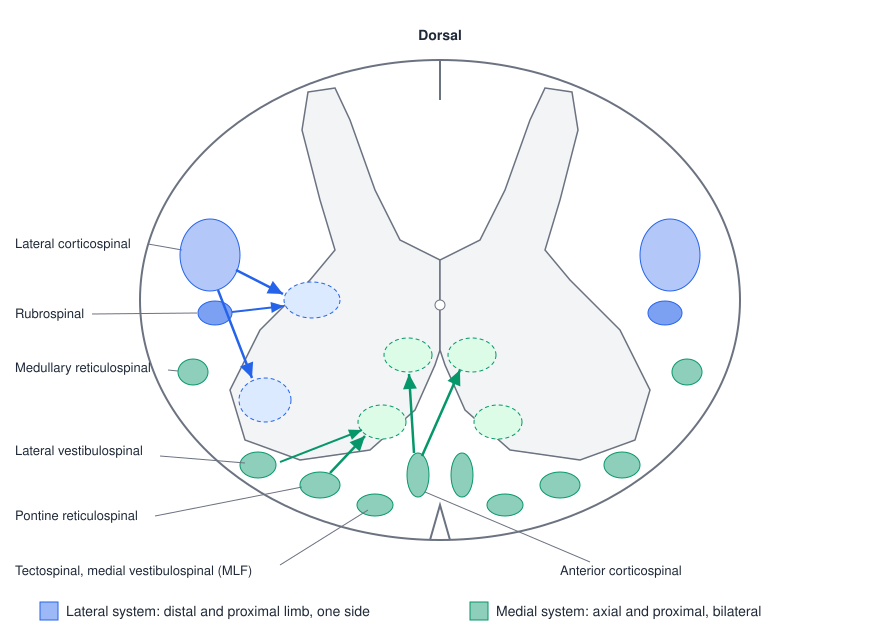
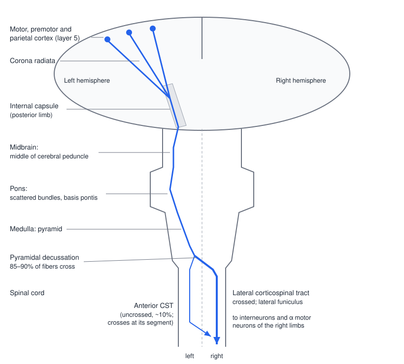
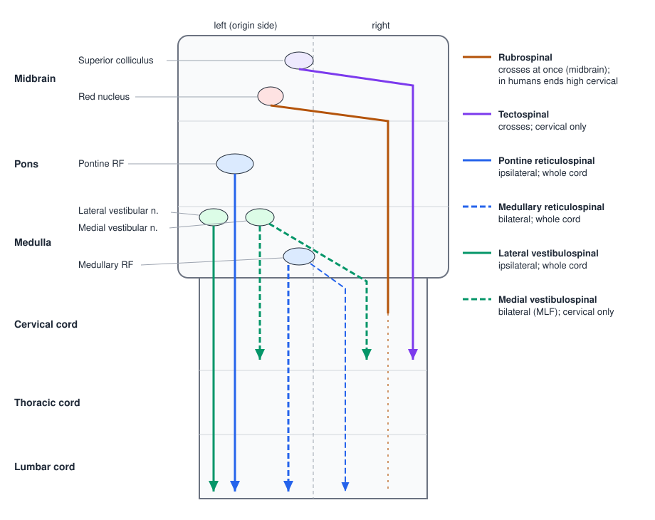

# Descending Motor Pathways

Every voluntary movement, postural adjustment and change in reflex excitability reaches the spinal cord through a small number of descending tracts. These are the axons of the upper motor neurons: the corticospinal tract from the cerebral cortex, and the rubrospinal, reticulospinal, vestibulospinal and tectospinal tracts from the brainstem. Each has a characteristic origin, course, side of termination and set of target neurons, and those anatomical facts explain what each pathway contributes to movement, why lesions at different levels look different at the bedside, and which pathways are available to support recovery when the corticospinal tract is damaged.

## Organizing Principle: Lateral and Medial Systems

The descending pathways fall into two groups, a scheme that grew out of the lesion experiments of Lawrence and Kuypers (1968b) and the tract-tracing work of Kuypers. The grouping follows the topography of the ventral horn described in [The Spinal Cord and Reflexes](spinal-reflexes.md), where motor pools for axial and proximal muscles lie medially and pools for distal muscles lie laterally.

| | Lateral system | Medial (ventromedial) system |
|---|---|---|
| Tracts | Lateral corticospinal; rubrospinal | Reticulospinal; lateral and medial vestibulospinal; tectospinal; anterior corticospinal |
| Location in the cord | Lateral funiculus | Ventral and ventrolateral funiculi |
| Terminations | Dorsolateral intermediate zone and lateral motor pools, over a few segments | Ventromedial intermediate zone and medial motor pools, often bilateral and over many segments |
| Muscles controlled | Distal and proximal limb muscles of one side | Axial and girdle (proximal) muscles of both sides |
| Function | Fine, fractionated, independent limb and hand movement | Posture, balance, orientation of head and body, gross limb movement, locomotion |

Two consequences follow. Because medial-system axons branch widely and terminate bilaterally, they suit the control of muscles that always work together on both sides of the body, such as the trunk muscles that keep us upright. Because lateral-system axons terminate on a few segments of one side, they suit the independent use of a single limb and especially of individual fingers.

*Figure: a cervical cord cross-section. The lateral system (blue) runs in the lateral funiculus and ends in the dorsolateral intermediate zone and on the lateral motor pools of distal muscles. The medial system (green) runs in the ventral funiculus and ends in the ventromedial intermediate zone and on medial motor pools of axial and proximal muscles, on both sides of the cord. Light ellipses in the gray matter mark the target zones; tracts are drawn on both sides, projections only from the left.*

## The Corticospinal Tract

### Origin

The corticospinal tract (CST) is the largest descending pathway in humans, with roughly a million axons in each medullary pyramid. Its axons arise from pyramidal neurons in **layer 5** of the cortex, but not only from the primary motor cortex. Roughly a third come from M1 (area 4), roughly a third from the non-primary motor areas of area 6 (premotor cortex and supplementary motor area) and the cingulate motor areas, and the remainder from primary somatosensory cortex and posterior parietal cortex (area 5). The giant **Betz cells** of M1 supply only a few percent of the fibers. Corticospinal neurons are therefore distributed across a broad frontoparietal territory around the central sulcus and along the cingulate sulcus on the medial surface (see [The Motor Cortex](motor-cortex.md)).

### Course

Fibers from this broad cortical territory converge and descend as a compact bundle:

1. **Corona radiata and internal capsule.** The fibers funnel through the corona radiata into the **posterior limb of the internal capsule**, where the fibers for face, arm and leg lie in close order. Corticobulbar fibers to cranial nerve motor nuclei run just ahead of them, near the genu.
2. **Midbrain.** They occupy the middle portion of the **cerebral peduncle** (crus cerebri), ventral to the substantia nigra and near the red nucleus.
3. **Pons.** In the basis pontis they break up into scattered bundles separated by pontine nuclei and transverse pontocerebellar fibers.
4. **Medulla.** They regroup to form the **pyramids** on the ventral surface of the medulla, which gives the tract its other name, the pyramidal tract. Collaterals leave along the way to the red nucleus, the reticular formation and the cranial nerve nuclei.
5. **Pyramidal decussation.** At the junction of medulla and cord about **85–90%** of the fibers cross the midline.
6. **Spinal cord.** The crossed fibers descend in the **lateral corticospinal tract** in the lateral funiculus through the whole length of the cord. The uncrossed fibers (about 10%) descend in the **anterior (ventral) corticospinal tract** next to the anterior median fissure, mainly to cervical and upper thoracic levels; most of them cross at the segment where they terminate, through the anterior white commissure. A few percent descend uncrossed in the lateral tract.

*Figure: the corticospinal tract from the left hemisphere. Fibers from motor, premotor and parietal cortex pass through the internal capsule, cerebral peduncle, basis pontis and pyramid. At the pyramidal decussation most cross to form the right lateral corticospinal tract; the rest descend on the left as the anterior corticospinal tract and cross at segmental levels to reach medial motor pools.*

Because of the decussation, each hemisphere controls mainly the opposite side of the body. A lesion above the decussation (cortex, internal capsule, brainstem) causes weakness on the opposite side; a lesion of the lateral CST in the cord causes weakness on the same side, below the lesion.

### Terminations

Corticospinal axons enter the spinal gray matter and terminate on **interneurons and α motor neurons**. Anterograde tracing from the hand area of monkey M1 shows dense terminal labeling in the intermediate zone and ventral horn at every level of the cervical enlargement from C3 to T1 (Dum & Strick 1996). The pattern depends on where the fibers come from:

- Fibers from **M1** end mainly in the intermediate zone (laminae V–VII) and, in primates, directly in lamina IX on the motor pools of distal muscles.
- Fibers from **somatosensory and parietal cortex** end mainly in the dorsal horn (laminae III–V), where they modulate the transmission of sensory input rather than drive movement.
- The **lateral CST** terminates in the contralateral dorsolateral intermediate zone and lateral motor pools, controlling proximal and distal muscles of the limbs.
- The **anterior CST** terminates bilaterally in the ventromedial intermediate zone and medial motor pools (laminae VII–VIII), controlling axial and proximal muscles.

### Direct corticomotoneuronal connections

Some CST axons synapse monosynaptically on α motor neurons. These **corticomotoneuronal (CM)** connections are a primate specialization: absent or rare in cats and rodents, present in monkeys and most extensive in apes and humans. They are concentrated on the motor neurons of hand and finger muscles, and across species their density correlates with manual dexterity (Lemon 2008). CM cells lie mostly in the caudal part of M1 in the anterior bank of the central sulcus, the evolutionarily "new M1".

Textbook diagrams usually show one corticospinal axon contacting one motor neuron. In reality, single CST axons branch extensively. Reconstructions of individual axons show collaterals at several segments (C6–T1) and, within a segment, terminals in several motor nuclei (Shinoda et al. 1981); spike-triggered averaging shows that one CM cell facilitates a "muscle field" of several muscles (Fetz & Cheney 1980; see [The Motor Cortex](motor-cortex.md)). Corticospinal control therefore works through combinations of muscles, not through private lines to each one.

### What the CST contributes: the pyramidotomy experiments

The classic test of CST function is to cut it. Lawrence and Kuypers (1968a) sectioned both medullary pyramids in rhesus monkeys, interrupting the corticospinal tract while sparing the brainstem pathways. Immediately after surgery the animals were weak and moved little, but within weeks they could sit, stand, walk, run and climb, and could grasp food and the cage bars with the whole hand. What never recovered was the **relatively independent movement of the fingers**: the monkeys could not pick small food pellets out of narrow wells with a precision grip, and they moved more slowly and with less force. Original films of these animals, later published (Lemon et al. 2012), show the permanent deficit directly. The conclusion has held up: the CST is not needed for posture, locomotion or gross reaching and grasping, but it is essential for **fractionated, dexterous movement of the hand and digits**, and it adds speed and agility to movement generally.

In a second series (1968b) the authors made additional brainstem lesions in pyramidotomized monkeys. Lesions of the **ventromedial brainstem pathways** caused severe and lasting impairment of posture and of axial and proximal movement: the animals had difficulty righting themselves, sitting and walking, though they could still use their hands to grasp. Lesions of the **lateral brainstem pathway** (the rubrospinal tract) impaired the independent use of the extremities, particularly the hand, so that the arm tended to move only as part of whole-body movements. These results are the experimental basis of the medial–lateral scheme.

## The Brainstem Pathways

*Figure: the brainstem descending pathways from the left side of the brainstem. Rubrospinal and tectospinal axons cross in the midbrain. The pontine reticulospinal and lateral vestibulospinal tracts stay ipsilateral and run the length of the cord; the medullary reticulospinal and medial vestibulospinal tracts are bilateral, and the medial vestibulospinal and tectospinal tracts reach only cervical segments. In humans the rubrospinal tract ends in the upper cervical cord (dashed).*

### Rubrospinal tract

The rubrospinal tract arises from the **magnocellular** (large-celled) part of the red nucleus in the midbrain, which receives input from motor cortex (corticorubral fibers) and from the interposed nucleus of the cerebellum. Its axons **cross immediately**, in the ventral tegmental decussation, descend through the lateral brainstem, and run in the **lateral funiculus** of the cord just ventral to the lateral CST. In cats and monkeys it terminates in the lateral intermediate zone (laminae V–VII), mostly on interneurons, where it facilitates flexors and distal limb muscles and supports independent limb and hand movement, which is why it belongs with the lateral system.

In humans the rubrospinal tract appears to be vestigial. The magnocellular red nucleus is small, and most of the red nucleus is **parvocellular**, projecting to the inferior olive as part of a cerebellar loop rather than to the cord. In a degeneration study of human material, Nathan and Smith (1982) found only a few rubrospinal fibers in the lower medulla and the upper cervical cord and none below. To the best of current knowledge the human rubrospinal tract terminates too high to exert much control over the limbs, and its function in humans remains uncertain. The CST appears to have taken over its role.

### Reticulospinal tracts

The **reticular formation** is the core of the brainstem, a network of neurons extending from midbrain to medulla with many functions. Its rostral part (mesencephalic and rostral pontine reticular formation) modulates forebrain activity and arousal. Its caudal part (caudal pontine and medullary reticular formation) provides premotor coordination of the somatic and visceral motor neurons below it. Two reticulospinal tracts descend from the caudal part:

- The **pontine (medial) reticulospinal tract** arises from the pontine reticular formation (nuclei reticularis pontis oralis and caudalis), descends **ipsilaterally** in the ventral funiculus, and mainly excites motor neurons of axial and limb extensor (antigravity) muscles.
- The **medullary (lateral) reticulospinal tract** arises from the medullary reticular formation (nucleus gigantocellularis), descends **bilaterally**, mostly ipsilaterally, in the ventrolateral funiculus, and has more mixed effects, including inhibition of extensor tone and of spinal reflexes.

Both terminate mainly on interneurons of laminae VII and VIII and on some motor neurons, throughout the cord and on both sides. The reticulospinal fibers begin their descent in or near the **medial longitudinal fasciculus (MLF)**, and their exact location in the human cord is uncertain: a comparison of eight neuroanatomy textbooks found eight different placements, spread across the ventral, ventrolateral and lateral funiculi (Nathan et al. 1996).

Two features make the reticulospinal system important clinically. First, each side of the reticular formation receives input from broad areas of **both** cerebral hemispheres, especially premotor cortex and the supplementary motor area (the cortico-reticulospinal route), and projects to **both** sides of the cord. A unilateral cortical lesion therefore leaves bilateral control of axial and proximal muscles partly intact, which is one reason trunk control is relatively spared after a hemispheric stroke. Second, the reticulospinal system is the main route for **anticipatory postural adjustments** (the trunk and leg muscle activity that precedes a voluntary arm movement), for the initiation of locomotion from the mesencephalic locomotor region, and for startle. In primates it also projects to motor neurons of the arm and hand and can produce strong, though coarse, movements of the whole limb.

### Vestibulospinal tracts

The vestibular nuclei in the pons and medulla receive input from the semicircular canals and otolith organs (see [The Vestibular System](vestibular.md)) and from the cerebellum. Two vestibulospinal tracts work together to keep the head and body upright:

| | Lateral vestibulospinal tract | Medial vestibulospinal tract |
|---|---|---|
| Origin | Lateral vestibular nucleus (Deiters' nucleus) | Medial vestibular nucleus |
| Course | Descends **ipsilaterally** in the ventral part of the lateral funiculus | Descends **bilaterally** in the medial longitudinal fasciculus |
| Extent | Whole length of the cord | **Cervical** and upper thoracic cord only |
| Terminations | Interneurons and α motor neurons of axial and proximal limb muscles (laminae VII–VIII); excites extensors (antigravity muscles) and inhibits flexors | Interneurons and α motor neurons of neck muscles |
| Function | Postural control of the **whole body**; antigravity support and balance reactions | Stabilizes the **head and neck** (vestibulocollic reflex), coordinated with eye movements |

The vestibulospinal tracts receive no direct input from the cerebral cortex, but the lateral vestibular nucleus is under strong inhibitory control from the cerebellum (Purkinje cells of the vermis), which shapes its output.

### Tectospinal tract

The tectospinal tract arises from the deep layers of the **superior colliculus**, crosses in the dorsal tegmental decussation of the midbrain, and descends near the MLF in the ventral funiculus to the cervical cord. It orients the head toward visual, auditory and somatic stimuli, working together with the collicular control of gaze.

## Summary of the Descending Pathways

Remember that each pathway exists twice, one from each side of the brain.

| Pathway | Origin | Cortical input | Crossed, uncrossed or bilateral | Termination | Target neurons | Movements controlled |
|---|---|---|---|---|---|---|
| Lateral corticospinal | Cerebral cortex: motor and some sensory regions | Unilateral | Crossed | Spinal cord, all levels | Interneurons, α motor neurons | Proximal and distal (especially fractionated hand) movements |
| Anterior corticospinal | Cerebral cortex: motor and some sensory regions | Unilateral | Uncrossed (crosses segmentally) | Spinal cord, cervical and upper thoracic | Interneurons, α motor neurons | Axial and proximal movements |
| Reticulospinal | Pontine and medullary reticular formation | Bilateral | Bilateral | Spinal cord, all levels | Interneurons, α motor neurons | Axial and proximal movements; posture, locomotion |
| Rubrospinal | Red nucleus (magnocellular) | Unilateral | Crossed | Spinal cord; in humans only upper cervical | Interneurons, α motor neurons | Uncertain in humans (distal limb in other species) |
| Medial vestibulospinal | Medial vestibular nucleus | None (vestibular and cerebellar input) | Bilateral | Cervical segments | Interneurons and α motor neurons of neck muscles | Head and neck, coordinated with eye movements |
| Lateral vestibulospinal | Lateral vestibular nucleus | None (vestibular and cerebellar input) | Uncrossed | Spinal cord, all levels | Interneurons, α motor neurons | Axial and proximal movements; antigravity posture |
| Tectospinal | Superior colliculus | Indirect | Crossed | Cervical segments | Interneurons, α motor neurons | Orienting movements of the head |

The pattern is worth stating plainly. Only the lateral corticospinal tract gives strong, focused control of distal muscles, especially the fingers. Every other tract is a medial system for axial and proximal control. The vestibulospinal tracts receive no direct cortical input. The reticulospinal system receives input from both hemispheres and projects to both sides of the cord, which explains why axial and postural control is relatively preserved after a unilateral cortical lesion while hand function is not.

## Parallel Pathways, Not a Chain of Command

The descending systems are often drawn as independent cables, but they work as a network (Lemon 2008). Cortex projects not only to the cord but also to every brainstem origin: the red nucleus, the reticular formation and, through the cerebellum, the vestibular nuclei. Motor commands therefore reach the cord along **parallel routes**: directly through the CST and indirectly through cortico-reticulospinal and other brainstem relays. Once there, descending signals do not simply pass through: they converge with sensory input on spinal interneurons, and the cord shapes the final motor output (Nielsen 2004). Parallel routes provide alternative pathways for motor commands, which is the substrate for some recovery after injury but also a source of the abnormal movement patterns that recovery can bring.

Species differences make this network hard to study. Rodents have essentially no CM connections and route most corticospinal control through spinal interneurons; the rubrospinal tract is prominent in cats and monkeys but vestigial in humans. Conclusions about recovery drawn from rodent experiments therefore cannot be transferred directly to people.

## Clinical Correlations

### Localizing a corticospinal lesion

All lesions of the descending pathways produce the **upper motor neuron syndrome**: weakness, spasticity, hyperreflexia, clonus, a Babinski sign and loss of fine voluntary movement (see the UMN–LMN table in [The Spinal Cord and Reflexes](spinal-reflexes.md)). Where the weakness falls depends on where the lesion is:

- **Cortex.** Cortical representation is spread over a large area, so cortical strokes tend to produce partial weakness affecting the face and arm more than the leg (middle cerebral artery territory) or the leg more than the arm (anterior cerebral artery territory), on the opposite side, often with sensory, language or visuospatial deficits.
- **Internal capsule.** Corticospinal and corticobulbar fibers are packed tightly here, so a small lacunar infarct can cause dense **pure motor hemiparesis** of the opposite face, arm and leg.
- **Brainstem.** Lesions produce **crossed signs**: an ipsilateral cranial nerve palsy (the nucleus or nerve at that level) with contralateral hemiparesis below it.
- **Spinal cord.** A lesion of the lateral CST causes **ipsilateral** weakness below the level. A hemisection (Brown-Séquard syndrome) adds ipsilateral loss of proprioception and vibration (dorsal columns) and contralateral loss of pain and temperature (spinothalamic tract), because those pathways cross at different levels.

Corticobulbar control of most cranial motor nuclei is bilateral, which is why a unilateral UMN lesion weakens the lower face on the opposite side but spares the forehead (central facial palsy), whereas an LMN facial nerve lesion (Bell's palsy) weakens the whole side of the face.

### Isolated pyramidal lesions and spasticity

Spasticity is a sign of UMN damage, yet monkeys with isolated pyramidotomy (and rare human patients with lesions confined to the medullary pyramid) show weakness and loss of dexterity with little spasticity. Spasticity is thought to arise from damage to the accompanying cortico-reticulospinal ("parapyramidal") fibers, which normally keep the reticulospinal and vestibulospinal systems and spinal reflex circuits in check. Lesions in the capsule or cord, where these fibers run together, produce both.

### Decerebrate and decorticate posturing

Release of brainstem pathways from higher control produces characteristic postures. A transection between the superior and inferior colliculi (below the red nucleus, above the vestibular nuclei) in an animal produces **decerebrate rigidity**: extension of all four limbs, driven by unopposed lateral vestibulospinal and pontine reticulospinal excitation of extensor motor neurons (and of γ motor neurons). In comatose patients, **decerebrate posturing** (extension and internal rotation of the arms and legs) indicates severe brainstem dysfunction, while **decorticate posturing** (flexion of the arms with extension of the legs), classically attributed to lesions above the red nucleus that leave rubrospinal flexor drive to the arms intact, indicates a higher lesion and carries a somewhat better prognosis.

### Recovery after stroke: corticospinal versus reticulospinal

After a stroke that damages the CST, what is left determines what can be recovered. The integrity of the CST is the strongest predictor of upper limb recovery: patients in whom transcranial magnetic stimulation of the affected hemisphere still evokes a motor-evoked potential in the paretic hand typically recover about 70% of their possible improvement within three months, whatever their initial impairment, whereas those without a response recover much less (Byblow et al. 2015).

When the CST is badly damaged, the reticulospinal system may take on more of the work. Its bilateral organization and its projections to arm muscles allow it to support strength and gross movement, but its axons branch widely and couple muscles together, so reliance on it brings **flexion synergy** (shoulder abduction pulling the elbow, wrist and fingers into flexion) and poor fractionation of the fingers. Consistent with this, the StartReact effect (the shortening of reaction time by a loud sound, used as a non-invasive index of reticulospinal function) is enhanced after stroke, and patients with the greatest reticulospinal enhancement have the worst upper limb function (Choudhury et al. 2019). Reticulospinal upregulation therefore appears to be a compensation that preserves strength at the cost of dexterity. Whether rehabilitation should try to harness it, or to promote use of whatever corticospinal connections remain, is an active question.

## Key Readings

- Lawrence DG, Kuypers HGJM (1968a). *The functional organization of the motor system in the monkey. I. The effects of bilateral pyramidal lesions*. Brain. — After pyramidotomy, posture, walking and whole-hand grasp recovered but independent finger movement did not: the CST is essential for dexterity.
- Lawrence DG, Kuypers HGJM (1968b). *The functional organization of the motor system in the monkey. II. The effects of lesions of the descending brain-stem pathways*. Brain. — The experimental origin of the medial (postural) and lateral (limb) system framework.
- Lemon RN, Landau W, Tutssel D, Lawrence DG (2012). *Lawrence and Kuypers (1968a, b) revisited: copies of the original filmed material from their classic papers in Brain*. Brain. — The original films that show the deficits directly.
- Lemon RN (2008). *Descending pathways in motor control*. Annual Review of Neuroscience. — Reassesses corticomotoneuronal connections, species differences, and the network view of descending control.
- Choudhury S, et al. (2019). *The relationship between enhanced reticulospinal outflow and upper limb function in chronic stroke patients*. Neurorehabilitation and Neural Repair. — Greater reticulospinal reliance after stroke goes with worse upper limb function.
- Byblow WD, et al. (2015). *Proportional recovery after stroke depends on corticomotor integrity*. Annals of Neurology. — Corticospinal integrity, measured with TMS and imaging, predicts upper limb recovery.
- Frey SH, et al. (2011). *Neurological principles and rehabilitation of action disorders: computation, anatomy, and physiology (CAP) model*. Neurorehabilitation and Neural Repair. — Frames parallel corticospinal and cortico-reticulospinal routes within a model for rehabilitation.

## See Also

- [The Spinal Cord and Reflexes](spinal-reflexes.md): the circuits these pathways act on, and UMN versus LMN signs.
- [The Motor Cortex](motor-cortex.md): where the corticospinal tract begins.
- [The Vestibular System](vestibular.md) and [The Cerebellum](cerebellum.md): inputs to the vestibulospinal and rubrospinal systems.
- [Somatosensory Pathways](somatosensory-pathways.md): the ascending tracts that share the cord with these pathways.
- [Motor Plasticity and Recovery](plasticity.md)
- [Spinal Cord Injury](../../biomed/neuro/spinal-cord-injury.md)
