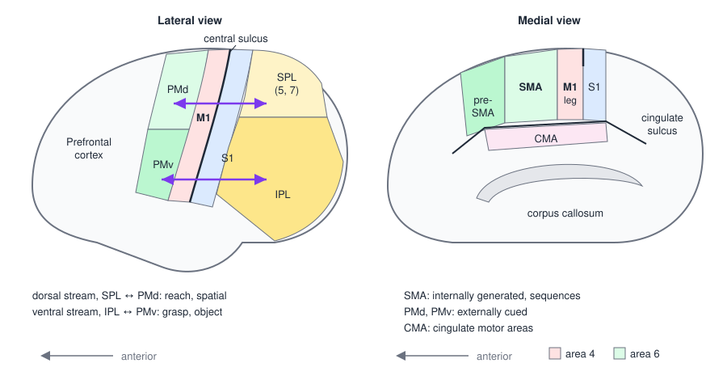
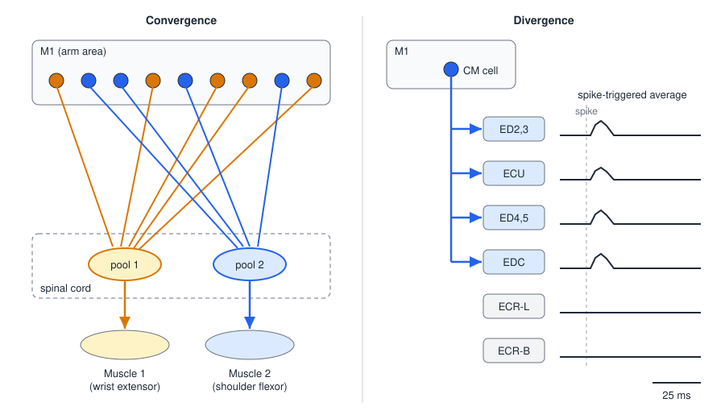
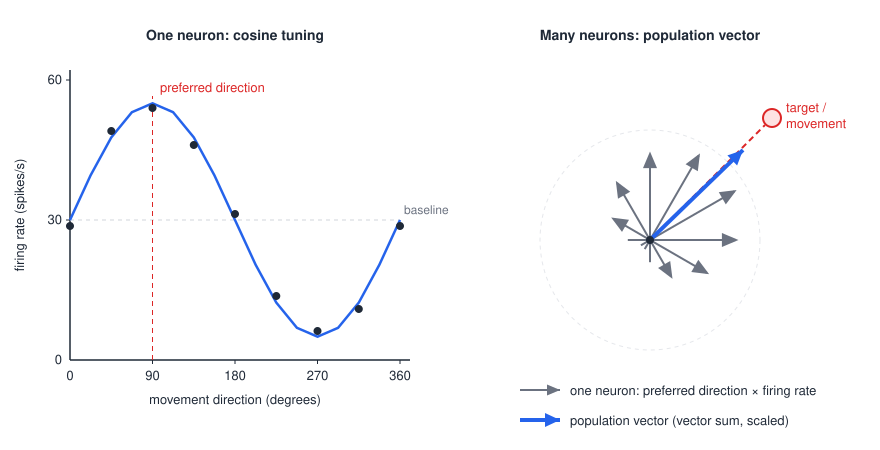
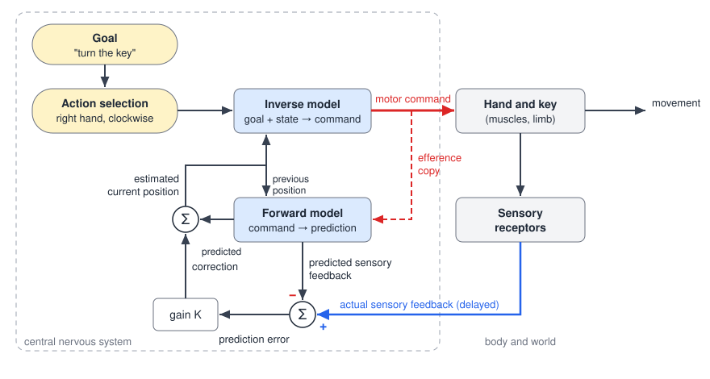

# The Motor Cortex

The motor areas of the frontal lobe turn goals into commands. They decide which movement to make, plan its sequence, choose the muscles and forces, and send the result down the corticospinal tract, while exchanging information continuously with parietal cortex, the basal ganglia and the cerebellum. This chapter describes the structure of the motor cortex, the primary motor cortex and what its neurons encode, the non-primary motor areas that plan movement, the parietal input that links vision to action, and a computational framework (feedforward and feedback control with internal models) that ties these areas together. The organization of motor cortex has direct implications for rehabilitation after brain injury and for brain–machine interfaces.

## Location and Structure

### Cortical layers

Like all neocortex, motor cortex has **six layers**, numbered I to VI from the pial surface inward. Neurons in each layer project to different targets:

1. to cells in the same layer;
2. to cells in other layers of the same column;
3. to subcortical structures;
4. to the other hemisphere, through the corpus callosum.

The superficial layers (II and III) contain pyramidal cells whose axons connect cortical areas with one another. **Layer V** contains the large pyramidal cells that project out of the cortex: to the spinal cord (corticospinal), brainstem (corticobulbar, cortico-reticular, corticorubral, corticopontine) and striatum. Layer VI projects mainly to the thalamus. Layer IV, which receives most thalamic input in sensory cortex, is thin or nearly absent in the primary motor cortex, so M1 is described as **agranular** cortex. The thick layer V of M1 contains the **Betz cells**, the largest neurons of the cortex, though they supply only a small fraction of corticospinal axons; most corticospinal neurons are smaller pyramidal cells of the same layer.

### The motor areas

The motor cortex lies in the posterior part of the frontal lobe, in front of the central sulcus. It is divided into the **primary motor cortex (M1)**, which corresponds to Brodmann's area 4 in the precentral gyrus and the anterior bank of the central sulcus, and the **non-primary motor areas** of area 6 in front of it: the **premotor cortex (PM)** on the lateral surface, divided into dorsal (PMd) and ventral (PMv) parts, and the **supplementary motor area (SMA)** on the medial surface, with the **pre-SMA** just anterior to it. The **cingulate motor areas (CMA)** lie in the banks of the cingulate sulcus on the medial surface (area 24 and adjacent cortex). Area 8 (the frontal eye field) controls gaze, and the prefrontal cortex in front of all of these sets goals. Behind the central sulcus lie the primary somatosensory cortex (S1) and the **posterior parietal cortex (PPC)**, areas 5 and 7, divided by the intraparietal sulcus into superior (SPL) and inferior (IPL) parietal lobules.

*Figure: lateral (left) and medial (right) views of the left hemisphere, anterior to the left. M1 (area 4) lies in front of the central sulcus; premotor cortex (PMd, PMv) and the supplementary motor areas (SMA, pre-SMA) form area 6 in front of it; the cingulate motor areas lie in the cingulate sulcus. Double arrows mark the two parieto-premotor pathways: SPL–PMd for reaching and IPL–PMv for grasping.*

## The Primary Motor Cortex

### Voluntary control of the opposite body

M1 is the cortical area most directly connected to the spinal motor neurons, and its main job is the **voluntary control of movement**, primarily of the **contralateral** side of the body. Consider a waiter carrying a tray across a crowded room. He keeps his head and neck pointed forward to see where he is going; flexes and stabilizes the elbow, wrist and fingers to balance the tray; activates the trunk muscles to stay upright; and uses the hips, knees, ankles and feet to propel himself forward. Each of these components requires M1 to select which muscles to activate and how strongly, and to deliver those commands to the spinal cord.

M1 neurons begin to change their firing about **50–100 ms before** the muscle action potentials of a movement, as a command source should. Their firing relates to the **force, position, velocity and direction** of movement. The best summary of what M1 does is that it selects the **muscle activity, forces and trajectories** needed for a movement.

### Somatotopy, old and new

Penfield and Boldrey (1937) stimulated the exposed cortex of awake patients undergoing epilepsy surgery and recorded the movements and sensations evoked from each site. They found an orderly map of the body along the precentral gyrus, the **motor homunculus**. The leg and foot are represented most medially, extending onto the medial surface in the paracentral lobule; the trunk, shoulder, arm and hand follow laterally, then the neck and face, with the lips, jaw, tongue and throat most lateral, just above the Sylvian fissure. The map was distorted: the hand and face occupied far more cortex than the trunk or the proximal limb.

This distortion is **cortical magnification**: the amount of cortex devoted to a body part reflects the precision of its control, not its size. The hand and the muscles of speech and facial expression, which produce the finest movements, receive the largest territories.

The modern view keeps the general medial-to-lateral order (leg medial, then trunk and arm, then face lateral) but rejects the idea of a point-to-point map. Within the arm region, representations of the shoulder, elbow, wrist and digits are **intermingled** and overlap extensively. Intracortical microstimulation maps of monkey M1 show a mosaic in which digit, wrist, elbow and shoulder sites are interleaved, each appearing in several patches. Recordings of single neurons related to movements of individual fingers show that neurons for different fingers are distributed throughout the hand area rather than segregated into a sequence of finger zones (Schieber & Hibbard 1993). M1 is therefore a **loose somatotopy**: not a one-to-one map of body parts, of muscles, or of movements.

### Convergence and divergence

Two anatomical and physiological facts explain the intermingled map.

**Convergence.** Many M1 neurons, spread over a wide area, project onto the motor neurons of a single muscle. Microstimulation within M1 of the baboon showed that the territories from which a single hand muscle (extensor digitorum communis, the thenar muscles, the first dorsal interosseous) could be activated at low threshold (below 20, 40 and 80 µA) were large, a few millimeters across, and overlapped extensively with those of other muscles (Andersen et al. 1975).

**Divergence.** A single corticospinal neuron projects to the motor neuron pools of several muscles. Anatomically, single corticospinal axons reconstructed in the monkey cord branch to innervate several motor nuclei at several segments (Shinoda et al. 1981). Physiologically, **spike-triggered averaging** reveals the same thing: averaging the EMG of many muscles time-locked to the spikes of one M1 neuron shows a small, short-latency **post-spike facilitation** in each muscle that the cell excites, through a direct or near-direct connection. One corticomotoneuronal cell recorded this way facilitated several finger and wrist extensors (ED2,3, ED4,5, EDC and ECU) but not the radial wrist extensors (ECR-L, ECR-B) (Fetz & Cheney 1980). The set of muscles a cell facilitates is its **muscle field**.

*Figure: left, convergence. M1 neurons for two muscles are scattered and intermixed in cortex, and many of them converge on each motor neuron pool. Right, divergence. One corticomotoneuronal cell branches to several motor pools; spike-triggered averages of EMG show post-spike facilitation (a small peak just after the spike) in the muscles of its muscle field and flat averages in the others.*

Together, convergence and divergence mean that a small patch of M1 contains elements controlling many muscles, and each muscle is controlled from many patches. The analogy is an orchestra in which the players are not seated by section but intermixed: any small group of seats contains violins, horns and flutes. This **wide distribution of control** allows M1 to produce a great variety of muscle combinations, and it allows learning to reshape the combinations. It also explains why small cortical lesions rarely paralyze a single muscle.

### What M1 neurons encode

What variable does M1 activity represent: the forces and muscle activations needed for a movement, or the movement itself in space? Both kinds of relation are found.

- **Force.** In monkeys making wrist movements against loads, the firing of many corticospinal neurons scaled with the force required rather than with the position of the joint (Evarts, 1968). Firing relates to the rate of change of force as well as its level.
- **Direction.** In monkeys moving a handle from a central position to targets arranged around a circle, most arm-area neurons fired most for one **preferred direction** and progressively less for directions further from it. Firing rate was well described by a cosine function of the angle between the movement and the preferred direction (Georgopoulos and colleagues, 1982):

\\[
f\_i(\theta) = b\_{0,i} + b\_{1,i}\cos(\theta - \theta\_i),
\\]

where \\(\theta\\) is the movement direction, \\(\theta\_i\\) is neuron \\(i\\)'s preferred direction, \\(b\_{0,i}\\) its baseline rate and \\(b\_{1,i}\\) its modulation depth.

Each neuron is broadly tuned, so a single cell says little about direction. The population, however, says a great deal. If each neuron "votes" for its preferred direction, as a unit vector \\(\mathbf{c}\_i\\), with a weight given by how much its firing rises above baseline, the weighted vector sum, the **population vector**,

\\[
\mathbf{P}(\theta) = \sum\_{i=1}^{N} \frac{f\_i(\theta) - b\_{0,i}}{b\_{1,i}}\\,\mathbf{c}\_i ,
\\]

points close to the actual direction of movement. With preferred directions spread roughly uniformly, the cosine terms sum to a vector proportional to the movement direction, and the estimate improves as more neurons are included. The population vector even rotates in time when a monkey mentally rotates a target before reaching, and it begins to point in the movement direction before the movement starts.

*Figure: left, the cosine tuning of one M1 neuron, firing most for movements in its preferred direction (90°) and least for the opposite direction. Right, the population vector. Each gray arrow is one neuron's preferred direction scaled by its change in firing for a movement toward the upper right; their sum (blue) points close to the actual movement direction (dashed red).*

The population vector shows that direction can be *read out* from M1, not that M1 *computes* in those terms. Because muscle activity, joint torques and hand direction are correlated during natural reaching, cosine tuning to direction is also predicted if M1 neurons encode muscle-like commands, and tuning changes with arm posture and load in ways that a pure spatial code would not. Current views therefore treat M1 as a population whose activity evolves in time to generate muscle commands, with both kinematic and kinetic variables recoverable from it. The practical point, for brain–machine interfaces, is that population decoding of M1 works well whatever the underlying code.

## Non-Primary Motor Areas

The non-primary motor areas lie anterior to M1 in the frontal lobe (area 6, together with the cingulate motor areas). They are involved in **planning** voluntary movement: preparing the steps before a movement and organizing sequences of movements. Compared with M1, their neurons are more often related to movements of **both sides** of the body. Each sends its own axons into the corticospinal tract and also projects heavily to M1.

Two everyday examples show the kind of planning involved. Driving: lift the foot off the brake, move it to the accelerator, press with the right force to set the speed, and keep the hands positioned on the wheel. Drinking from a water bottle: locate the bottle, decide where to reach, select the right grasp, use enough force to hold it, open the lid with the other hand, and bring the bottle to the mouth.

### Premotor cortex

The premotor cortex lies on the lateral surface, anterior to M1. Its two divisions plan different aspects of the same action, as when kicking a ball:

- **PMv (ventral premotor cortex)** plans **what** to move and how, based on the properties of the object: the shape of the hand for a grasp, the part of the foot for a kick. Its neurons fire for particular grip types (precision grip, whole-hand grasp) and often respond to the sight of graspable objects.
- **PMd (dorsal premotor cortex)** plans **where** to move, based on the location of the target: the direction and extent of a reach. Its neurons show **preparatory (set-related) activity** during a delay between an instruction and a go signal, and PMd is needed for learning arbitrary associations between cues and movements (a red light means press the brake).

Premotor neurons respond especially to **externally cued** voluntary movements: movements triggered or guided by visual, auditory or somatosensory stimuli.

### Mirror neurons

A subset of neurons in PMv (area F5 of the monkey) and in the connected inferior parietal cortex fire both when a monkey performs a goal-directed hand action and when it watches someone else perform the same action. A neuron that fires when the monkey grasps a food pellet also fires when it watches the experimenter grasp the pellet. It does not fire, however, when the experimenter grasps the pellet with pliers, an action with the same goal but a different, non-biological effector, and it fires again when the monkey itself grasps. Because they map observed actions onto the observer's own motor repertoire, **mirror neurons** have been proposed as a mechanism for recognizing and understanding the actions of others and perhaps their intentions (Rizzolatti et al. 2014). In humans, a homologous mirror system in ventral premotor and inferior parietal cortex is active during action observation. The idea that observed, imagined and executed actions share neural representations underlies **action-observation** and **mirror therapy** in rehabilitation (Case et al. 2015).

### Supplementary motor area

The SMA lies on the medial surface of the hemisphere, anterior to the leg area of M1. Its distinctive role is in **sequences** of movement and in movements generated from **internal cues** (self-initiated, from memory) rather than external ones. A classic set of blood-flow imaging experiments (Roland and colleagues, around 1980) made the distinction clear:

1. A **simple finger flexion**, repeated, activated the contralateral M1 and S1 hand areas only.
2. A **complex sequence** of finger movements activated M1 and S1 and, in addition, the SMA on both sides.
3. **Mental rehearsal** of the same sequence, without moving, activated the **SMA alone**, not M1.

The SMA is therefore involved in planning and rehearsing sequences, and is active in **mental practice** (as in a gymnast or pianist running through a routine in imagination). It also contributes to bimanual coordination and is one source of the readiness potential, the slow negative scalp potential that precedes a self-initiated movement by a second or more.

### Pre-SMA

The **pre-SMA**, anterior to the SMA (roughly in front of a vertical line through the anterior commissure), differs from the SMA proper. It has few or no direct corticospinal projections, is connected mainly with prefrontal cortex rather than with M1, and is engaged when new sequences are being learned, when a planned action must be switched to another, and when a prepared response must be withheld. It sits at the transition between the cognitive control of action in prefrontal cortex and its motor implementation, which illustrates the anterior–posterior gradient described below.

### Cingulate motor areas

The cingulate motor areas, in the banks of the cingulate sulcus, also project to M1 and directly to the spinal cord. They receive strong input from limbic and prefrontal areas and are thought to link motivation and reward to action selection, for example by changing the selected movement when a response stops being rewarded.

## Posterior Parietal Cortex: from Vision to Action

Reaching for a cup requires converting where the cup is on the retina into where it is relative to the hand, and its shape into the shape of the grasp. This **visuomotor transformation** proceeds roughly as follows:

1. **Identify and localize** the target in visual (eye-centered) coordinates.
2. **Transform** the location into body- and hand-centered coordinates, using information about eye, head and limb position.
3. **Select** the action and the effector (which hand, which grip).
4. **Plan** the trajectory of the hand.
5. **Compute** the joint torques and muscle activations needed to produce it.

The posterior parietal cortex performs the early stages and premotor cortex the later ones, through **parallel parieto-premotor pathways**:

- A **dorsal pathway**, from the superior parietal lobule (SPL, including medial intraparietal area and V6A) to **PMd**, carries **spatial** information for **reaching**.
- A **ventral pathway**, from the inferior parietal lobule (IPL, including the anterior intraparietal area, AIP) to **PMv**, carries **object** information for **grasping**.

These pathways integrate sensory and motor information (Rizzolatti et al. 2014). Damage to the SPL and intraparietal sulcus causes **optic ataxia**, misreaching for visually presented targets despite normal vision and strength. Damage to the left IPL and premotor cortex causes **apraxia**, a loss of skilled, learned actions (such as using a tool or miming its use) that cannot be explained by weakness or sensory loss.

## A Framework for the Neural Control of Movement

### Movements are solutions to problems

Movements can be classified into categories such as **reach, grasp, manipulation, transfer, gait and posture**, but most daily activities combine several: getting a drink of water from a faucet requires walking to the sink while maintaining posture, reaching for and grasping a glass, manipulating the tap, and transferring the glass to the mouth. Every movement has a **goal**, and every movement is the solution to a problem the brain has identified and wants to solve. Thirst defines a goal (a drink of water); the goal can be met by many different actions, such as filling a glass in the kitchen or using a drinking fountain. This **motor equivalence**, one goal and many possible solutions, means the brain must continually choose among actions and adapt them to changing goals and environments.

### Feedforward and feedback control

The CNS combines two modes of control (see [Control Systems](../../../eng/control/README.md)):

- **Feedback control** compares sensory signals about the actual state of the body with the desired state and corrects the difference. It is robust to unexpected disturbances, but it is slow: spinal stretch reflexes act in about 25–50 ms, transcortical long-latency responses in about 50–100 ms, and visually guided corrections in 100–200 ms or more. Fast movements would be over before visual feedback could correct them.
- **Feedforward control** issues commands computed in advance from knowledge of the body and the task, without waiting for feedback. It is fast, but it is only as good as that knowledge.

Feedforward control relies on two **internal models**, neural representations of the body and its interaction with the world:

- The **inverse model** takes the goal and the current state of the body and computes the motor command needed to achieve the goal. It solves the problem "what command will get me there?"
- The **forward model** takes a copy of the outgoing motor command (the **efference copy**) and predicts its consequences: the next state of the limb and the sensory feedback that should result. It solves the problem "what will happen if I send this command?"

*Figure: control of a skilled action (turning a key). The goal and selected action feed an inverse model, which issues the motor command. An efference copy of the command drives a forward model that predicts the new position and the sensory feedback it should produce. Actual sensory feedback, which arrives late, is compared with the prediction; the prediction error corrects the estimate of the current position used for the next command.*

Feedforward and feedback controllers work together. The forward model's prediction gives the brain an estimate of where the limb is now, without waiting for delayed feedback. When feedback arrives, it is compared with what was predicted, and the difference corrects the estimate. Written as an update rule, the current estimate of the limb state \\(\hat{x}\_t\\) is

\\[
\hat{x}\_t = \hat{x}\_{t-1} + f(u\_{\text{copy}}) + K\left(s\_{\text{actual}} - \hat{s}\_{\text{predicted}}\right),
\\]

the previous estimate, plus the change predicted from the efference copy \\(u\_{\text{copy}}\\), plus a correction proportional (gain \\(K\\)) to the **sensory prediction error**. This is the structure of a state observer, or Kalman filter, in engineering. Prediction errors serve two further purposes: they flag unexpected events (a cup that is lighter than expected), and they are the teaching signal for updating the internal models themselves (see [Motor Learning](motor-learning.md)). Forward models also explain why self-generated sensations are attenuated: a predicted sensation can be subtracted, which is why you cannot tickle yourself.

### Six principles of functional anatomy

A framework developed for the rehabilitation of action disorders (Frey et al. 2011) organizes the functional anatomy of action into six principles.

1. **Anatomical gradients, not absolute boundaries, in parietal and premotor cortex.**
   - *An anterior–posterior gradient in the frontal lobe*, from desire and intention in prefrontal cortex, through action selection in premotor cortex, to execution in M1, with sensory processing in parietal cortex behind it.
   - *Parallel pathways between premotor and parietal areas*, dorsal (SPL–PMd, reach, spatial) and ventral (IPL–PMv, grasp, object), which integrate sensory and motor information.
   - *A medial–lateral gradient in premotor cortex*, from internally generated movements on the medial wall (SMA) to externally driven movements on the lateral surface (PMd, PMv).
2. **Overlapping synergies extending from M1.** Convergence (many M1 neurons onto one motor neuron pool) and divergence (one M1 neuron onto several pools) mean that M1 controls overlapping combinations of muscles.
3. **The cerebellum is critical for motor and cognitive prediction.** It predicts the consequences of actions by comparing signals, builds new internal models and adapts established ones. Mossy fibers from brainstem and spinal cord reach Purkinje cells through granule cells and parallel fibers; climbing fibers from the inferior olive provide the error signal; output leaves through the deep nuclei (see [The Cerebellum](cerebellum.md)).
4. **The basal ganglia are critical for action selection and reward.** Segregated cortico–basal ganglia–thalamo–cortical loops modulate different cortical areas to select some actions and suppress others, and dopamine circuitry supports reward-based learning (see [The Basal Ganglia](basal-ganglia.md)).
5. **Parallel pathways to the spinal cord provide alternative routes for motor commands.** Corticospinal fibers arise from many frontal and parietal areas, and cortical output also reaches the cord through the reticulospinal system, which descends bilaterally (see [Descending Motor Pathways](descending-pathways.md)).
6. **The spinal cord shapes the consequences of the motor command.** Descending commands are integrated with spinal interneuronal circuits, such as the reciprocal inhibition between ankle flexors and extensors; the cord is not a passive conduit (see [The Spinal Cord and Reflexes](spinal-reflexes.md)).

### Organization of the motor cortex

The same ideas can be stated as four organizing principles of motor cortex itself:

1. **A gradient from action selection to execution in the frontal lobe.** Desire to move (frontal association areas) leads to planning (non-primary motor areas), to execution (M1), to movement (spinal motor neurons), with information flowing in both directions at each step.
2. **Wide distribution of control.** The distributed output of M1 to many spinal motor neurons allows a great variety of movement combinations.
3. **Neural convergence.** Many M1 neurons converge on each motor neuron pool.
4. **Neural divergence.** Each M1 neuron reaches several motor neuron pools.

Information is shared concurrently among these areas rather than passed down a strict chain. Prefrontal cortex projects to premotor and supplementary areas, which project to M1; M1 projects to the brainstem and spinal cord; premotor and supplementary areas also project directly to the brainstem and cord in parallel. The basal ganglia and cerebellum form reciprocal loops with premotor and supplementary areas and with M1 through the thalamus, and the cerebellum also acts on the brainstem.

## Comparison of the Major Motor Areas

| | Primary motor cortex (M1) | Premotor cortex (PM) | Supplementary motor area (SMA) |
|---|---|---|---|
| Brodmann area | 4 | 6 | 6 |
| Location | Precentral gyrus and anterior bank of the central sulcus | Anterior to M1, on the lateral surface of the hemisphere | Anterior to M1, on the medial surface of the hemisphere |
| Major contributions | Selects which muscles to activate and how much; activates spinal motor neurons; produces voluntary movement | Plans how to move (where to reach, how to grasp); plans movements based on external cues; mirror neurons | Plans the sequence of movements; plans movements based on internal cues; mental rehearsal |
| Side of body influenced | Primarily contralateral | Contralateral, ipsilateral and bilateral | Contralateral, ipsilateral and bilateral |
| Effect of damage | Paresis of the contralateral side | Temporary paresis and/or motor planning problems | Few lasting clinical deficits; isolated damage is rare |

## Clinical Correlations

### Lesions of the motor areas

- **M1 and its output.** Damage causes **contralateral paresis**, most severe and longest-lasting in the distal limb, especially the hand, with loss of fractionated finger movement. Because the CST also arises from non-primary areas, and because other descending systems remain, proximal movement usually recovers better than distal.
- **Premotor cortex.** Damage causes temporary weakness and lasting problems in the planning and organization of movement: difficulty selecting movements in response to cues, impaired shaping of the hand to objects, and, with left-hemisphere lesions, apraxia.
- **SMA.** Isolated damage is rare. Resection of the SMA (for example in tumor surgery) produces a transient **SMA syndrome** of contralateral akinesia, and mutism when the dominant side is involved, that largely resolves over weeks, leaving few lasting deficits. Medial frontal lesions can also produce difficulty initiating self-generated movements and, sometimes, the alien hand sign.
- **Posterior parietal cortex.** Optic ataxia (misreaching), apraxia (left IPL) and neglect of contralateral space (right IPL) reflect failures of the sensorimotor transformations described above.

### Implications for rehabilitation

The organization of motor cortex argues for training **functional, goal-directed tasks** rather than isolated single-joint exercises. Because M1 represents overlapping combinations of muscles and joints rather than individual ones, and because the non-primary areas plan whole actions toward goals, practicing stepping with a walker, folding towels or drinking from a glass engages the circuits that must recover, whereas repeated wrist flexion and extension, radial and ulnar deviation, pronation and supination or ankle dorsiflexion and plantarflexion in isolation engages them only partially. M1 maps are themselves shaped by such practice: in squirrel monkeys, training a skilled small-object retrieval task expanded the digit representation at the expense of the wrist and forearm, and the changes followed skill acquisition rather than repetition alone (Nudo et al. 1996; see [Motor Plasticity and Recovery](plasticity.md)). The roles of the SMA in mental rehearsal and of the mirror system in action observation provide a rationale for **motor imagery** and **action-observation** therapy, which can engage motor circuits even before a patient can move.

### Brain–machine interfaces

Because M1 population activity carries rich information about intended movement, it is the main source of control signals for intracortical **brain–machine interfaces** (see [Brain–Computer Interfaces](../../biomed/neuro/bci.md) and [Neural Recording and Decoding](../../biomed/neuro/recording-decoding.md)). Early decoders were explicit population vectors; current decoders use statistical filters on the same principle. M1 output is also remarkably flexible: monkeys can learn within a single session to control a cursor dimension with small, arbitrarily chosen sets of M1 neurons, whatever their natural relation to the arm (Law et al. 2014). In a person with high cervical tetraplegia, signals decoded from two microelectrode arrays in the hand area of motor cortex were used to drive implanted functional electrical stimulation of his own arm muscles, restoring multi-joint reaching and grasping well enough for him to drink and feed himself (Bolu Ajiboye et al. 2017). One caution for decoder design: much of the movement-related high-gamma activity recorded over sensorimotor cortex reflects somatosensory feedback rather than the motor command (Ryun et al. 2017).

## Key Readings

- Penfield W, Boldrey E (1937). *Somatic motor and sensory representation in the cerebral cortex of man as studied by electrical stimulation*. Brain. — Established the human motor and sensory homunculus and cortical magnification of hand and face.
- Rizzolatti G, Cattaneo L, Fabbri-Destro M, Rozzi S (2014). *Cortical mechanisms underlying the organization of goal-directed actions and mirror neuron-based action understanding*. Physiological Reviews. — Parieto-premotor circuits for reach and grasp, and the mirror neuron system.
- Lemon RN (2008). *Descending pathways in motor control*. Annual Review of Neuroscience. — Corticomotoneuronal connections from M1, their species distribution and their link to dexterity.
- Frey SH, et al. (2011). *Neurological principles and rehabilitation of action disorders: computation, anatomy, and physiology (CAP) model*. Neurorehabilitation and Neural Repair. — The computational and anatomical framework (internal models, six principles) used in this chapter.
- Nudo RJ, Milliken GW, Jenkins WM, Merzenich MM (1996). *Use-dependent alterations of movement representations in primary motor cortex of adult squirrel monkeys*. Journal of Neuroscience. — M1 maps are reshaped by skill training, the basis of task-specific rehabilitation.
- Law AJ, Rivlis G, Schieber MH (2014). *Rapid acquisition of novel interface control by small ensembles of arbitrarily selected primary motor cortex neurons*. Journal of Neurophysiology. — The flexibility of M1 output for brain–machine interfaces.
- Bolu Ajiboye A, et al. (2017). *Restoration of reaching and grasping movements through brain-controlled muscle stimulation in a person with tetraplegia*. Lancet. — Motor cortex signals driving the person's own muscles through implanted FES.
- Case LK, Pineda J, Ramachandran VS (2015). *Common coding and dynamic interactions between observed, imagined, and experienced motor and somatosensory activity*. Neuropsychologia. — Shared representations for observed, imagined and executed action, and their use in therapy.

## See Also

- [Descending Motor Pathways](descending-pathways.md): the corticospinal tract that carries motor cortex output.
- [The Spinal Cord and Reflexes](spinal-reflexes.md): the circuits that shape cortical commands.
- [The Basal Ganglia](basal-ganglia.md) and [The Cerebellum](cerebellum.md): the two loops that modulate motor cortex.
- [Somatosensory Cortex and Plasticity](somatosensory-cortex.md)
- [Motor Learning](motor-learning.md) and [Motor Plasticity and Recovery](plasticity.md)
- [Brain–Computer Interfaces](../../biomed/neuro/bci.md)
- [Control Systems](../../../eng/control/README.md) and [Reinforcement Learning](../../../cs/ml/rl.md)
