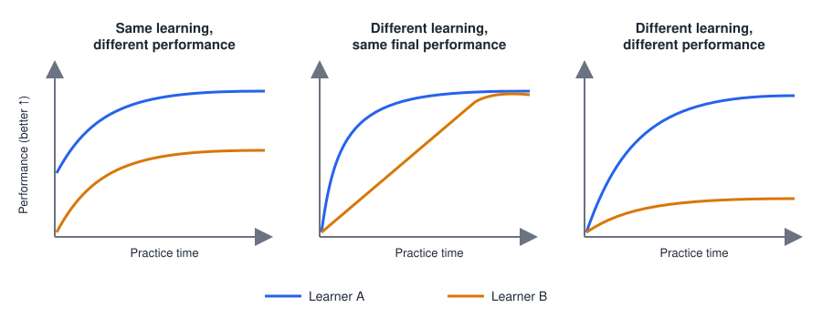
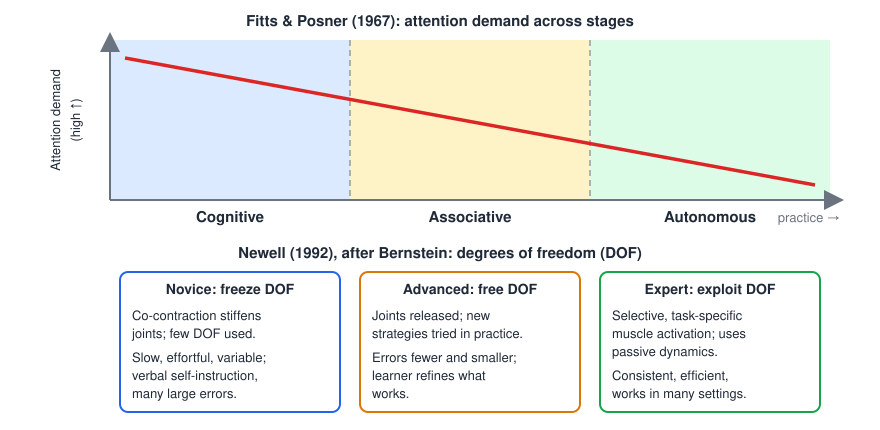
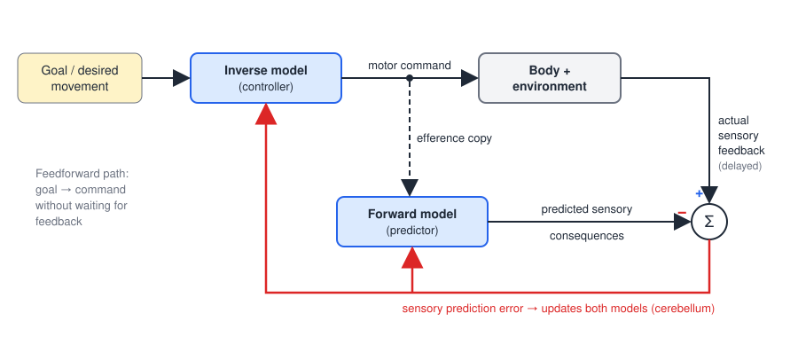
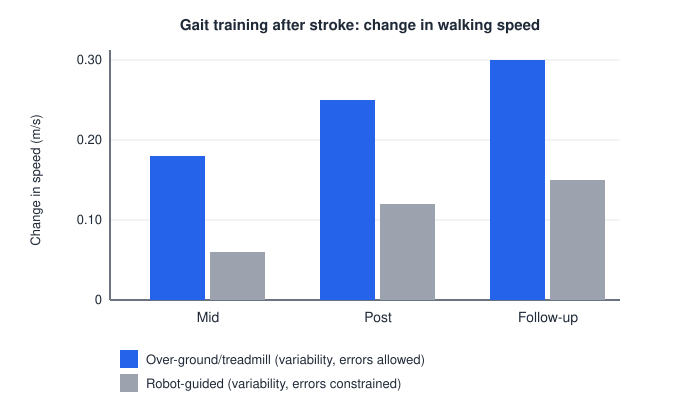

# Motor Learning

Motor learning is how the nervous system acquires a new movement, refines one it already has, or regains one it has lost. The same processes serve a toddler learning to throw a ball, a professional perfecting a jump shot, and a person relearning to walk after a stroke; rehabilitation is, at its core, motor relearning. This chapter defines learning and separates it from performance, describes how skill develops in stages, sets out the distinct learning processes and the brain structures that carry them, and turns that knowledge into principles for structuring practice, feedback and dose. It closes with a case study in how the two cerebral hemispheres divide the work of controlling the arm.

## What Motor Learning Is

### Definition

A widely used definition is that motor learning is *a set of processes associated with practice or experience leading to relatively permanent changes in the capability for producing skilled action* (Shumway-Cook and Woollacott, 2007). Each phrase carries weight:

- **Processes.** Learning is not one event but several mechanisms acting at once (error correction, reinforcement, repetition, memory formation), described below.
- **Practice or experience.** The change is driven by doing, not by maturation or fatigue.
- **Relatively permanent.** A change that disappears within minutes, such as a warm-up effect, is not learning.
- **Capability, not performance.** Learning is a change in an internal state that cannot be observed directly. What we observe is behavior on a given occasion, which also depends on fatigue, motivation, arousal and the conditions of the test.

### Learning versus performance

Because learning is a hidden capability, it has to be *inferred* from behavior observed repeatedly over time. A single snapshot of performance cannot tell learning apart from momentary behavior.

*Figure: learning and performance dissociate. Left: two learners improve by the same amount at the same rate (equal learning) but from different starting points, so their performance always differs. Middle: one learner improves quickly and the other slowly and linearly, yet both end at the same level (different learning, same final performance). Right: both the amount of learning and the final performance differ. Only the time course of performance reveals which case applies.*

Practice conditions can depress performance during acquisition while improving long-term learning, and the reverse. Factors that make practice easy and smooth (constant conditions, frequent guidance) often inflate performance during practice without producing durable learning. Motor learning research therefore separates two phases:

- **Acquisition** — performance during the practice sessions themselves.
- **Retention test** — performance after a delay (hours to days) with the temporary effects of practice gone and usually without augmented feedback. Retention is the standard measure of learning.
- **Transfer test** — performance on a new variant of the task or in a new context (a different target, a different room, a different surface). Transfer measures how well what was learned **generalizes**, which is what matters in daily life.

### Learning curves

Plotting performance against the amount of practice gives a **learning curve**. Most skills show rapid early gains that slow with practice, a *negatively accelerated* curve. Speed often follows an approximate **power law of practice**: the time to complete a task on trial \\(N\\) is
\\[
T\_N = a\\,N^{-b},
\\]
with \\(a\\) the time on the first trial and \\(b\\) a learning-rate exponent, so that each doubling of practice yields a constant proportional improvement. Curve shape depends on the task. In a classic ring-toss experiment, easy (short-distance) versions gave negatively accelerated curves while harder versions gave more positively accelerated curves, in which improvement was slow at first and then sped up (Krueger, 1947). Many skills, particularly those with a discrete "insight" component, are S-shaped: a slow phase while the task requirements are worked out, a rapid rise, then a plateau. The skilled-reaching curves of rats described in [Motor Plasticity and Recovery](plasticity.md) have exactly this shape.

Plateaus deserve caution. A flat curve does not mean learning has stopped: reorganization in the brain continues for some time after behavior plateaus, and gains in consistency, efficiency and attention demand often continue when speed or accuracy no longer change.

### Learning and plasticity share mechanisms

The neural mechanisms of plasticity are the mechanisms of learning. Two parallel continua summarize the link. Along the axis of neural modifiability, brief experience changes **synaptic efficiency** (how strongly an existing synapse transmits); if the change persists it is consolidated into changes in **synaptic connections** (new spines, synapses and branches). Along the parallel axis of learning, **short-term changes** in behavior become **long-term changes** as practice continues. Short-term learning thus corresponds to functional change in existing synapses, and long-term learning to structural change in circuits. The cellular details are in [Motor Plasticity and Recovery](plasticity.md).

## Three Fundamentals

Whatever the theory, three practical facts hold for every learner.

1. **The goal must be defined.** Learning needs a criterion of success (the ball goes through the hoop). Without a clear goal there is no error to correct and no success to reinforce.
2. **Discovery fosters better learners.** People who search for their own solutions, trying different postures and strategies, learn more robustly than those guided through a single prescribed movement. Exploration builds a richer map of what works and why.
3. **Learning includes knowing which features of the environment matter.** In shooting a basketball, distance and angle to the basket are relevant; the color of the ball is not. Part of learning a skill is learning which environmental variations require adjustment and which can be ignored.

## Stages of Learning

### Fitts and Posner: cognition to automaticity

Fitts and Posner (1967) described three stages defined by how much attention the task requires.

- **Cognitive stage.** The learner works out what to do. Performance is slow, inconsistent and full of errors; the learner often talks themselves through the movement and relies heavily on vision and instruction.
- **Associative stage.** The learner has the basic pattern and refines *how* to do it. Errors become fewer and smaller, and the learner begins to detect and correct their own errors.
- **Autonomous stage.** The movement runs largely automatically, with little attention required. Attention is freed for other tasks, such as conversation or scanning the environment, and the skill becomes resistant to stress and distraction.

### Newell's systems model and Bernstein's degrees of freedom

Bernstein (1934/1967) recognized that the body has many more mechanical **degrees of freedom (DOF)** than any task requires: many joints, many more muscles, and many more motor units, so any goal can be achieved in infinitely many ways. How the nervous system chooses among them is the **degrees-of-freedom problem** (motor redundancy). Bernstein also noted, from cyclographic recordings of real movements, that the same motor command never produces the same trajectory twice; movement has to be organized around feedback and the goal, not around a fixed command.

Newell (1992) built a three-stage model of skill acquisition on this idea.

1. **Novice: freeze the DOF.** The learner simplifies the problem by reducing the number of free joints, typically by **co-contracting** antagonist muscles so that joints are held stiff. A beginner skier or a child learning to write moves stiffly for this reason.
2. **Advanced: free the DOF.** Joints are progressively released and the learner **tries out new strategies** through practice, exploring the coordination patterns now available.
3. **Expert: exploit the DOF.** The learner recruits all the DOF the task needs, with **selective, task-specific muscle activation**, and exploits the passive mechanics of the limbs (gravity, inertia, interaction torques) rather than fighting them. The learned movement is **consistent, efficient and usable in many environments**.

*Figure: two complementary stage models. Top: in the Fitts and Posner model, attention demand falls steadily from the cognitive through the associative to the autonomous stage. Bottom: in Newell's model, derived from Bernstein, the learner first freezes degrees of freedom by co-contraction, then frees them while exploring strategies, and finally exploits them with selective, efficient muscle activation.*

The two models describe different aspects of the same progression: Fitts and Posner describe how learning and **attention** interact, while Newell describes how **motor control** for a specific movement is reorganized. Recordings in mouse motor cortex mirror the progression at the neural level. Early in training a large, variable population of layer 2/3 neurons is active, exploring many patterns; with practice activity condenses into a smaller ensemble that fires a reproducible spatiotemporal sequence for the learned movement (Peters et al., 2014). Human imaging likewise shows that sequence-specific representations change non-linearly over weeks of training: a rapid early increase, a mid-training decrease as processing becomes efficient, and a slow late increase in motor cortex, supplementary motor area (SMA) and premotor cortex (Wymbs and Grafton, 2015).

## Components of Skilled Action

Skilled performance is more than generating the right muscle commands. Wolpert, Diedrichsen and Flanagan (2011) break a skill into components, each of which can improve with practice:

- **Gathering information** — learning where to look and what to sense (an expert batter watches different cues than a novice).
- **Decision making** — selecting the action and its timing.
- **Predictive (feedforward) control** — issuing commands that anticipate the dynamics of the body and the environment.
- **Reactive (feedback) control** — correcting the movement on the fly, including fast, task-dependent reflex-like responses whose gains are themselves learned.

The predictive and reactive components are the subject of [control theory](../../../eng/control/README.md): feedforward control is fast but blind to disturbances; feedback control is robust but slowed by sensorimotor delays of 100 ms or more. Skilled movement depends on both.

## Types and Mechanisms of Learning

Motor learning is not a single process. At least four kinds can be distinguished by the signal that drives them, and they rely on different neural substrates (Wolpert et al., 2011).

### Error-based learning and internal models

**Internal models** are neural representations of the mapping between motor commands and their consequences.

- An **inverse model** (controller) computes the motor command needed to achieve a desired movement: it inverts the dynamics of the body.
- A **forward model** (predictor) takes a copy of the outgoing command (the **efference copy** or corollary discharge) and predicts its sensory consequences.

Forward models solve the problem of delay. Sensory feedback about a movement arrives too late to guide a fast movement, but a prediction is available immediately. The prediction also lets the nervous system distinguish self-generated sensation (reafference) from external events, which is why you cannot tickle yourself.

*Figure: internal models in sensorimotor control. The inverse model converts the goal into a motor command; an efference copy of that command drives the forward model, which predicts the sensory consequences. The comparator subtracts the prediction from the actual, delayed sensory feedback. The resulting sensory prediction error is the teaching signal that updates both models; the cerebellum is thought to compute and use it.*

**Error-based learning** (adaptation) uses the **sensory prediction error**, the difference between predicted and actual outcome, to update these models on a trial-by-trial basis. It is studied with perturbations that change the mapping between command and outcome:

- **Visuomotor rotation**: the cursor representing the hand is rotated (for example by 30°) relative to the real hand.
- **Prism adaptation**: prism goggles shift the visual field sideways; throws at a target miss toward the shifted side and gradually return on target.
- **Force-field adaptation**: a robot pushes the moving arm sideways in proportion to its velocity.
- **Split-belt treadmill walking**: the two legs are driven at different speeds, and stepping becomes symmetric again over minutes.

In each case errors are large at first and decline over tens to hundreds of trials. When the perturbation is removed, movements err in the *opposite* direction: an **after-effect**. The after-effect is the signature of adaptation: it shows that the internal model itself changed, rather than the subject adopting a conscious strategy. Re-exposure to the same perturbation later produces faster adaptation, called **savings**.

Adaptation is well described by a simple **state-space model**. Let \\(x\_n\\) be the internal estimate of the perturbation on trial \\(n\\) and \\(e\_n\\) the error experienced. Then
\\[
x\_{n+1} = A\\,x\_n + B\\,e\_n ,
\\]
where the retention factor \\(A\\) (slightly less than 1) describes forgetting between trials and the learning rate \\(B\\) describes how much of each error is corrected. With two such processes in parallel, a **fast** process that learns quickly but forgets quickly and a **slow** process that learns slowly but retains well, the model reproduces savings and the spontaneous recovery of an earlier adaptation after a brief counter-adaptation. This framework connects motor adaptation to estimation theory in [control engineering](../../../eng/control/README.md).

**The cerebellum** is the key structure for error-based learning. Climbing-fiber input from the inferior olive signals errors to Purkinje cells and drives long-term depression at parallel-fiber synapses, adjusting the cerebellar output that implements forward and inverse models (see [The Cerebellum](cerebellum.md)). People with cerebellar damage adapt poorly or not at all to prisms, force fields and split-belt treadmills, even though they may still improve with practice through other mechanisms. Therrien and Bastian (2015) argue that the shared deficit across their motor, perceptual and proprioceptive problems is a failure to build and calibrate internal predictions. Conversely, anodal transcranial direct current stimulation (tDCS) over the cerebellum speeds adaptation: it accelerates split-belt locomotor adaptation (Jayaram et al., 2012) and brings the slow visuomotor adaptation of older adults up to the rate of young adults (Hardwick and Celnik, 2014).

### Reinforcement learning

Sometimes the learner receives no vector error signal ("how far and in which direction"), only an outcome: success or failure, reward or no reward. **Reinforcement learning** uses such scalar outcome signals to make successful actions more likely. Because it must discover *which* aspect of the movement caused success, it is slower than error-based learning and relies on **exploration**: variability in movement is not just noise but the raw material of learning.

The neural signal for reinforcement is the **reward prediction error** carried by midbrain dopamine neurons: they fire above baseline when outcomes are better than expected and dip below baseline when worse. Dopamine released in the striatum gates plasticity at corticostriatal synapses, strengthening the cortical inputs that led to rewarded actions. This is why the [basal ganglia](basal-ganglia.md), and particularly the striatum, are central to reinforcement-driven learning, habit formation and action selection. The mathematics of the same problem, learning value functions and policies from scalar reward, is covered in [Reinforcement Learning](../../../cs/ml/rl.md); temporal-difference errors in that theory closely resemble the dopamine signal.

Reinforcement and error-based learning interact. Reward improves retention of an adapted movement, and success-based learning can occur in people with cerebellar damage who adapt poorly from errors, which suggests a route for training when the cerebellum is impaired.

### Use-dependent learning

Simply repeating a movement biases future movements toward the repeated one, even with no error and no reward. This **use-dependent learning** is seen, for example, when repeated thumb movements in one direction shift the direction of movements evoked by transcranial magnetic stimulation (TMS) over motor cortex toward the practiced direction. It probably reflects Hebbian strengthening within motor cortex and is a reminder that what is practiced, including compensatory movement patterns, tends to be reinforced. Use-dependent plasticity is sensitive to recent activity: eight hours of index-finger immobilization reduce motor-cortex excitability and alter both use-dependent plasticity and the subsequent learning and retention of a pegboard skill (Opie et al., 2016).

### Skill and sequence learning

**Skill learning** in the narrower sense is acquiring a new capability, a new speed–accuracy relation, that did not exist before: playing a piano piece, typing, or tying a knot. Unlike adaptation, which returns performance to baseline under a new mapping, skill learning shifts the speed–accuracy trade-off itself and takes days to months. **Sequence learning** (for example, the serial reaction-time task, in which participants become faster at a repeating sequence of key presses even when unaware of it) has an implicit component dependent on the basal ganglia and cortex, and an explicit component that engages prefrontal cortex and working memory. Skills are consolidated **offline**, between sessions and during sleep, so that performance can improve after a night without further practice.

Consistent with the idea that the motor cortex stores skilled patterns, **[motor cortex](motor-cortex.md)** maps and synapses change during skill learning but not during simple repetition of an easy task (see [Motor Plasticity and Recovery](plasticity.md)).

Habitual coordination patterns resist change. When the mechanical effect of a wrist muscle was altered in a virtual environment to simulate weakness or noise, subjects did not re-optimize their muscle coordination; they scaled their habitual patterns, and the same happened after real muscle damage (de Rugy et al., 2012). Learned coordination appears to be "good enough" and updated slowly, rather than continuously optimal.

### Summary of learning types

| Type | Driving signal | Typical paradigm | Time course | Key structures |
|---|---|---|---|---|
| Error-based (adaptation) | Sensory prediction error (direction and size) | Prisms, visuomotor rotation, force fields, split-belt treadmill | Minutes; after-effects; savings | Cerebellum |
| Reinforcement | Scalar outcome, reward prediction error | Success/failure feedback, binary reward | Slower; needs exploration | Basal ganglia, dopamine |
| Use-dependent | Repetition itself | Repeated movements in one direction | Minutes to hours | Motor cortex |
| Skill / sequence | Combination of the above, plus strategy | Serial reaction time, new tool skills, sport | Days to months; offline consolidation | Motor cortex, SMA, premotor, basal ganglia, cerebellum |

Explicit **strategy** use (for example, deliberately aiming off-target to cancel a known rotation) is a further, cognitive, contributor that depends on prefrontal cortex and working memory. In rehabilitation these processes run together, and a patient's pattern of lesions determines which are available.

## Structuring Practice

The principles below draw on animal models of skilled reaching and on human learning studies (compiled by Lang and Birkenmeier, 2013, from sources including Winstein and Stewart, 2006, Kleim and Jones, 2008, and Hubbard et al., 2009). Animal studies tend to show *that* a principle holds; translating it into therapy requires judgment.

### What to practice: task specificity

Practicing a movement or action improves that movement or action. In animal models, animals practice the functional movement (such as reaching for food), and human studies always have people practice what is to be learned. Clinically, the person should practice the task they want to be able to do. Transfer from one task to another is limited: strengthening the wrist extensors does not by itself teach a person to reach and grasp a cup.

The same thinking applies across rehabilitation. Even interventions that are not usually thought of as "motor learning", such as strengthening, stretching, cardiovascular conditioning, functional training, pain reduction and patient education, all involve teaching and learning a motor behavior and benefit from the same principles.

### How much: dose

Large amounts of practice are needed to master a motor skill. Animals in plasticity studies perform hundreds of repetitions daily for weeks or months. Neither animal nor human studies have yet determined an optimal dose or frequency, but brain reorganization continues for a while after behavior plateaus, so stopping practice as soon as performance flattens may be premature.

Typical therapy provides far less. An observational study of rehabilitation sessions counted the repetitions actually performed (Lang et al., 2009):

| Category | Sessions observed (n) | Sessions observed (%) | Mean repetitions per session |
|---|---|---|---|
| **Upper extremity** — active exercise | 118 | 73 | 54 |
| Upper extremity — passive exercise | 67 | 41 | 33 |
| Upper extremity — sensory | 29 | 18 | 13 |
| Upper extremity — functional | 83 | 51 | 32 |
| **Lower extremity** — active exercise | 160 | 70 | 75 |
| Lower extremity — passive exercise | 63 | 27 | 12 |
| Lower extremity — sensory | 10 | 4 | 10 |
| Lower extremity — functional | 20 | 7 | 6 |
| **Gait** — episodes | 193 | 84 | 6 |
| Gait — steps | 193 | 84 | 357 |
| **Stair climbing** — episodes | 50 | 22 | 3 |
| Stair climbing — steps | 50 | 22 | 38 |
| **Transfers** | 219 | 70 | 11 |
| **Balance** | 147 | 47 | 27 |

A session therefore offers roughly 30–75 repetitions of an upper- or lower-extremity task and a few hundred steps, one to two orders of magnitude below the doses that drive cortical reorganization in animals, and below the several thousand steps a day of community walking. The clinical implications are to limit rest breaks, encourage continued practice, build practice into the time outside therapy sessions, and find ways for practice to continue after formal services end.

### How to set up practice

**Problem solving, not rote repetition.** Brain reorganization accompanies *learning*, not repetition as such (see the small-well and large-well experiments in [Motor Plasticity and Recovery](plasticity.md)). Practice should set up the environment for discovery, give opportunities to explore possible solutions, and be graded to challenge the person's current capability, with difficulty progressed as capability grows. A task that is mastered no longer drives change.

**Variability.** Variable practice conditions are best for learning and generalization. Laboratory studies usually examine a single task under tightly controlled conditions for scientific reasons, but clinically the essential movement components should be kept the same while the context is varied, within a task (different objects, heights, speeds, surfaces) and across tasks. Variability builds a more general internal representation, the "schema" relating movement parameters to outcomes, that transfers to new conditions.

Variability and error during practice also help long-term outcomes. In a gait-training trial in people several months after stroke, conventional over-ground and treadmill training, in which step-to-step variability and errors were allowed, produced roughly twice the gain in walking speed of robot-guided training, which constrained the leg to a fixed trajectory; the advantage persisted at follow-up (Hidler et al., 2009).

*Figure: change in walking speed (m/s) at mid-training, post-training and follow-up in people several months after stroke (values approximate, after Hidler et al., 2009). Training that allowed variability and errors (blue) improved speed about twice as much as robot-guided training that constrained them (gray), and the difference was significant at every time point.*

**Contextual interference.** When several tasks are practiced, the schedule matters. In **blocked practice** all trials of task A are completed before task B; in **random (interleaved) practice** the tasks are mixed. Blocked practice gives better performance *during acquisition*, but random practice gives better *retention and transfer*: the classic contextual interference effect. Switching between tasks forces the learner to reconstruct the action plan on each trial and to compare tasks, which is effortful but produces more durable learning. This is a clear example of the learning–performance distinction: the schedule that looks better in the clinic can be worse for the patient at home.

**Distribution of practice.** **Massed** practice has little rest between trials or sessions; **distributed** practice spreads the same amount over more time. For continuous tasks, distributed practice generally gives better learning per unit of practice, partly because fatigue depresses performance in massed practice and partly because consolidation needs time between sessions. In rehabilitation the constraint is usually total time available, which argues for distributing practice across the day, including outside supervised sessions.

**Whole versus part practice.** Practicing a whole action produces better learning than practicing its parts, unless the task can be broken into clearly separable components. Tasks whose parts are tightly coupled in time (a reach and grasp, a gait cycle) should be practiced as a whole; tasks made of independent serial components (the steps of a wheelchair transfer) can be practiced in parts, provided the whole is practiced regularly too. Simplification of the whole task (slower speed, lighter object, body-weight support) is usually better than fragmentation.

### Feedback

Learning does not occur without feedback. Two broad kinds exist:

- **Intrinsic feedback** comes from the person's own senses: vision of the hand and target, proprioception, the sound of a ball hitting the rim.
- **Augmented (extrinsic) feedback** is added from outside, by a therapist, coach or device. It comes in two forms:
  - **Knowledge of results (KR)**: information about the outcome relative to the goal ("you missed 10 cm to the left", "your walking speed was 0.6 m/s").
  - **Knowledge of performance (KP)**: information about the movement pattern itself ("your knee did not straighten at heel strike"), often from video or biofeedback.

Intrinsic feedback is optimal for promoting self-learning and generalization, because it is always available after therapy ends. Animals in plasticity studies have clear intrinsic feedback on every trial: they either get the food pellet or they do not. Clinically, tasks should have clear goals so the person can judge success on their own; the person should be taught to look for feedback and judge their own movement without being told; and summary feedback can be given at the end of a set of trials.

Too much augmented feedback is harmful to learning even though it helps performance. The **guidance hypothesis** explains why: feedback given after every trial guides the learner to correct each error, so they come to depend on it and do not develop their own error detection; performance drops when the feedback is withdrawn. Several schedules reduce dependence:

- **Reduced relative frequency**: feedback on only a proportion of trials.
- **Faded feedback**: frequent early in learning, progressively withdrawn.
- **Bandwidth feedback**: feedback only when the error exceeds a tolerance band, so that feedback frequency falls automatically as the learner improves.
- **Summary feedback**: one report after a block of trials, summarizing all of them.
- **Delayed feedback**: a short delay, during which the learner estimates their own error before being told.

Learner-controlled (self-selected) feedback schedules also tend to improve learning, probably by increasing engagement.

### Motivation and engagement

Optimal learning requires high levels of motivation and engagement. In animal models this is trivially ensured: animals are mildly food-deprived and the task is to retrieve food. In people, motivation has to be built. The individual should help select rehabilitation goals and the tasks to practice; the therapist should remind them how each practiced task relates to those goals; and more than one task should be practiced in a session, with tasks changed to increase variability and reduce boredom. Reward and the expectation of success also act directly on learning through the dopaminergic reinforcement system described above.

### Summary of practice principles

| Question | Principle | Clinical translation |
|---|---|---|
| What to practice? | Practice improves the practiced movement | Practice the task the person wants to do |
| How much? | Large amounts are required | Maximize repetitions; practice outside sessions |
| How to set up? | Learning requires solving the motor problem | Discovery, graded challenge, progression |
| | Variable practice generalizes best | Keep the essential movement, vary the context; interleave tasks |
| | Whole beats part, unless parts are separable | Practice the whole task when possible |
| How to give feedback? | Feedback is necessary; intrinsic is best | Clear goals; teach self-assessment; faded, bandwidth or summary augmented feedback |
| How to keep interest? | Motivation and engagement drive learning | Shared goal setting; vary tasks |

## Case Study: Laterality of Motor Control

Brain lateralization means that the two hemispheres have different functions. Some lateralizations are well established: language depends primarily on left-hemisphere areas (Broca's and Wernicke's areas), the right hemisphere governs prosody and emotional gesture, and the visual system separates "what" and "where" processing (see [Higher Cognitive Functions](cognition.md)). Whether, and how, motor control of the arms is lateralized has been studied for over a century, and the sequence of models illustrates how ideas about motor control develop.

Non-human primates show consistent hand preferences for reaching regardless of target location, but animal models translate imperfectly because humans have a distinct dominant limb and a uniquely skilled prehensile grasp. Most of the evidence therefore comes from human behavior and from patients with unilateral lesions.

### Two-component model

Woodworth (1899) observed that aimed reaching has two phases: an **initial impulse** that carries the hand rapidly toward the target, and a **homing (current-control) phase** of small corrections near the target. In right-handers the two hands differed in reaction time and in error. A century later this was reinterpreted in control terms: the initial impulse is **feedforward**, planned in advance, while homing is **feedback**-driven error correction; studies of a deafferented patient performing a Fitts' law task supported this split. The interpretation that emerged was that the dominant hemisphere specializes in rapid feedforward control and the non-dominant hemisphere in feedback-based correction. The model described movement patterns well but did not explain mechanism.

### Open-loop/closed-loop model

Studies of patients with unilateral stroke or tumor tested the idea with simple reaching, grip strength, finger tapping and fine motor tasks. **Left-hemisphere damage** produced deficits in planning and controlled aiming that grew with task complexity, consistent with a left-hemisphere role in the open-loop, motor-program component. **Right-hemisphere damage** often produced deficits in correcting errors to reach a target accurately, consistent with a right-hemisphere role in closed-loop feedback processing and spatial use of visual information, although some studies found no deficit in either component. The simple division "left plans, right corrects" was not consistently supported, and the proposal that the left hemisphere may control bilateral movements while both hemispheres monitor feedback remained only partly tested.

### Dynamic dominance

The **dynamic-dominance model** (Sainburg and colleagues) reframes laterality in terms of limb mechanics. Moving a multi-joint arm creates **interaction torques**: rotation at the shoulder produces torque at the elbow and vice versa. The two limbs specialize for different control problems:

- **Dominant arm and hemisphere**: better control of limb **dynamics**, in particular predictive coordination of muscle torques with the interaction torques between shoulder and elbow. The dominant arm exploits interaction torques efficiently and excels when the task demands a precise trajectory and interjoint coordination.
- **Non-dominant arm and hemisphere**: better **load compensation** and control of final **position**, including impedance control that stabilizes the limb against unexpected mechanical perturbations. Its hand paths are more variable when torques vary, but it reduces errors when conditions change unexpectedly.

The model fits a hierarchical, serial organization of visually guided reaching and integrates other evidence. Apraxia (a disorder of skilled, purposeful action without weakness, described by Liepmann in 1905) follows left-hemisphere damage, implicating that hemisphere in motor planning. The dominant hemisphere is active during ipsilateral, contralateral and bilateral arm movements, and lesions of the dominant hemisphere are more likely to impair both limbs. Visuomotor transformations in the right posterior parietal cortex, linked to right-hemisphere motor areas, may underlie the non-dominant hemisphere's role in feedback and position control; these transformations are right-lateralized but shared by both limbs.

### Limitations and clinical relevance

The literature is dominated by right-handers, by unimanual reaching in contrived laboratory settings, and by few studies of bilateral or functional tasks or of the brain pathways involved. Its clinical promise is that after stroke, the deficits of the "less-affected" ipsilesional arm and of the contralesional arm should depend on which hemisphere was damaged, and that rehabilitation could be tailored to whether the dominant or non-dominant system was affected.

## Clinical Correlations

- **Rehabilitation as motor learning.** Every rehabilitation goal, from regaining independent walking to returning to work tasks, requires the patient to learn. The principles above (task specificity, high dose, challenge, variability, appropriate feedback and motivation) apply to strengthening, balance and functional training alike.
- **Low dose in standard care.** The observed repetition counts show that conventional sessions provide far less practice than learning requires. High-dose, task-specific protocols such as constraint-induced movement therapy (see [Motor Plasticity and Recovery](plasticity.md)) are designed to close that gap.
- **Cerebellar damage.** Patients with cerebellar ataxia adapt poorly to errors (prisms, split-belt treadmills) but may still learn through reinforcement and repetition; cerebellar tDCS is under study as an adjunct to adaptation training.
- **Basal ganglia disease.** In Parkinson's disease, reduced dopamine impairs reinforcement-based learning and the automatization of skills, so movements remain attention-demanding (cognitive-stage-like) and deteriorate under dual-task conditions. External cues and attention strategies are used to compensate (see [The Basal Ganglia](basal-ganglia.md)).
- **Attention and dual tasks.** Because early-stage skills demand attention, adding a cognitive task (talking while walking) degrades the performance of a newly relearned movement; the ability to walk while talking is a practical marker of the autonomous stage and a predictor of fall risk.
- **Concussion.** Athletes with repeated concussions show reduced motor skill learning and blunted learning-related changes in motor-cortex excitability despite normal clinical motor examinations, suggesting that learning capacity is a sensitive marker of brain injury (Cantarero et al., 2020).
- **Immobilization.** Even hours of disuse (casting, slings, non-use of a paretic limb) change cortical excitability and impair subsequent learning (Opie et al., 2016).

## Key Readings

- Wolpert DM, Diedrichsen J, Flanagan JR (2011). *Principles of sensorimotor learning*. Nature Reviews Neuroscience. — The computational framework of error-based, reinforcement and use-dependent learning and the components of skill.
- Bernstein N (1967; work from 1934). *The Co-ordination and Regulation of Movements*. Pergamon Press. — States the degrees-of-freedom problem and argues for feedback-driven control loops.
- Krueger WCF (1947). *Influence of difficulty of perceptual-motor task upon acceleration of curves of learning*. Journal of Educational Psychology. — Shows that task difficulty changes the shape of learning curves.
- Peters AJ, Chen SX, Komiyama T (2014). *Emergence of reproducible spatiotemporal activity during motor learning*. Nature. — Follows the same motor-cortex neurons as exploratory activity condenses into a reproducible ensemble.
- Wymbs NF, Grafton ST (2015). *The human motor system supports sequence-specific representations over multiple training-dependent timescales*. Cerebral Cortex. — Shows non-linear changes in skill representations across weeks of practice.
- de Rugy A, Loeb GE, Carroll TJ (2012). *Muscle coordination is habitual rather than optimal*. Journal of Neuroscience. — Learned coordination patterns are scaled rather than re-optimized.
- Hardwick RM, Celnik PA (2014). *Cerebellar direct current stimulation enhances motor learning in older adults*. Neurobiology of Aging. — Cerebellar tDCS restores youthful adaptation rates.
- Opie GM, Evans A, Ridding MC, Semmler JG (2016). *Short-term immobilization influences use-dependent cortical plasticity and fine motor performance*. Neuroscience. — Hours of disuse alter cortical excitability and later learning.

## See Also

- [Motor Plasticity and Recovery](plasticity.md): the cellular and systems changes that implement learning.
- [The Cerebellum](cerebellum.md): error signals, internal models and adaptation.
- [The Basal Ganglia](basal-ganglia.md): dopamine, reinforcement and action selection.
- [Motor Cortex](motor-cortex.md): the representations that change with skill.
- [Higher Cognitive Functions](cognition.md): attention, procedural memory and executive function in learning.
- [Reinforcement Learning](../../../cs/ml/rl.md): the computational theory of learning from reward.
- [Control Systems](../../../eng/control/README.md): feedforward, feedback and state estimation.
- [Rehabilitation Devices](../../biomed/rehab.md): devices and robots for delivering practice.
