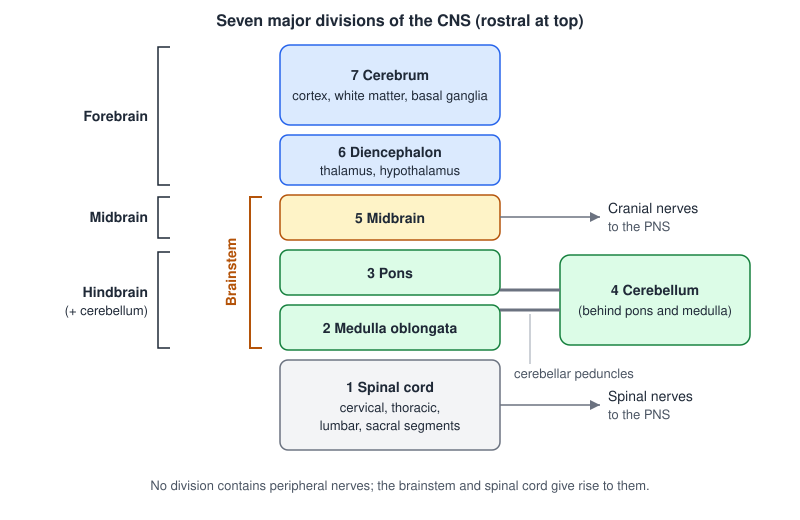
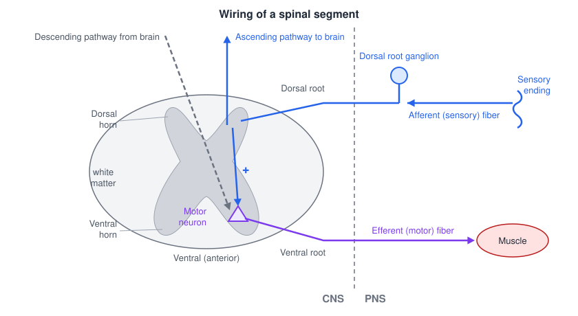
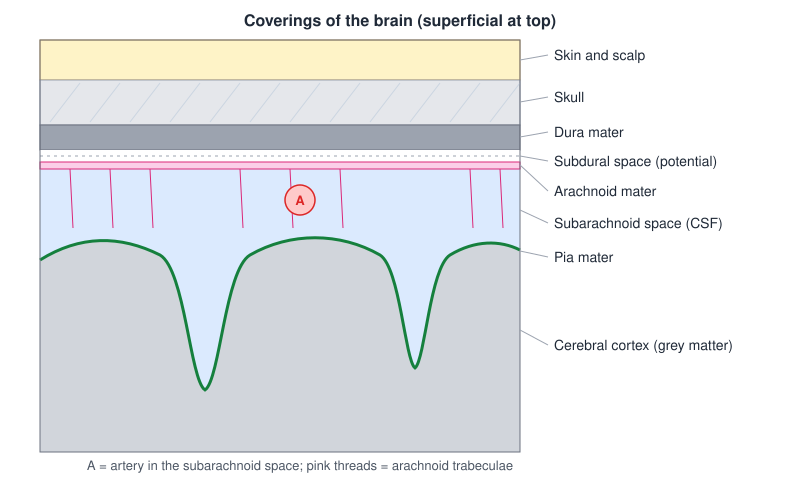
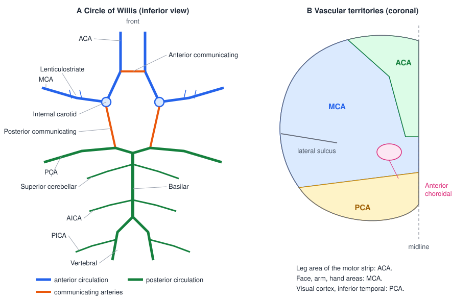
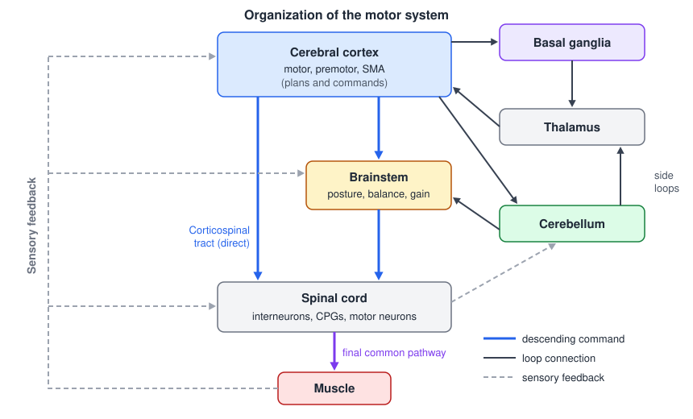

# Organization of the Nervous System

Every movement, from a reflexive withdrawal to a tennis serve, is produced by circuits spread across the whole central nervous system (CNS). Reading the rest of this subsection requires a working map of that system: the words used to describe position and structure, the seven major divisions of the CNS and what each contributes, how the spinal cord is laid out, how the brain is wrapped and cushioned, and where its blood comes from. The chapter ends with an overview of how the motor system is organized as a hierarchy with side loops, which is the frame the later chapters fill in.

## Directional Terms and Planes of Section

Anatomical directions in the nervous system are defined relative to the long axis of the neuraxis, the line running from the front of the brain down the spinal cord.

- **Rostral** means toward the nose; **caudal** means toward the "tail."
- **Dorsal** means toward the back; **ventral** means toward the belly.
- **Medial** means toward the midline; **lateral** means away from it.

In a quadruped such as a rat, the neuraxis is nearly straight, so these terms mean the same thing everywhere: dorsal is always up, rostral is always forward. Because humans stand upright, the neuraxis bends by roughly 90° at the junction of the midbrain and diencephalon. Above the bend, in the cerebrum, rostral is toward the forehead, caudal toward the back of the head, **dorsal is superior** and **ventral is inferior**. Below the bend, in the brainstem and spinal cord, rostral is up toward the brain, caudal is down toward the sacrum, **dorsal is posterior** and **ventral is anterior**. The "dorsal" horn of the spinal cord is therefore its back, while the "dorsal" surface of the cerebrum is its top. This is why texts sometimes pair the two vocabularies, as in "dorsal (posterior) columns."

Sections through the brain are named for three orthogonal planes:

- A **coronal** (frontal) section divides front from back, like slicing a loaf of bread.
- A **sagittal** section divides left from right; the **midsagittal** section passes exactly through the midline.
- A **horizontal** (axial, transverse) section divides top from bottom. In the spinal cord, a cross-section perpendicular to the cord is a transverse section.

Clinical imaging uses the same vocabulary: MRI scans are viewed as axial, coronal or sagittal slices, and all of the major CNS divisions described below can be identified on a midsagittal MRI.

## Grey Matter and White Matter

The CNS is built from two kinds of tissue that look different to the naked eye.

- **Grey matter** contains neuron cell bodies and dendrites, the synapses where incoming axons contact other neurons, and glial cells, the "support cells" of the nervous system. It is where information is integrated.
- **White matter** consists of axons wrapped in myelin, the fatty insulation that gives it its pale color. It is where information is transmitted from one place to another.

A single cortical pyramidal neuron illustrates the division. Its dendrites, cell body and the synapses it receives lie in grey matter; its myelinated axon runs through white matter; and its presynaptic terminals end in grey matter again, on the dendrites of the next neurons.

The arrangement of the two tissues differs along the neuraxis, and recognizing it is the quickest way to orient oneself on a section:

| Level | Grey matter | White matter |
|---|---|---|
| Cerebrum | Outside (the cortex), plus deep nuclei such as the thalamus and basal ganglia | Inside, between cortex and deep nuclei |
| Brainstem | Nuclei scattered among the fiber tracts | Interspersed with the nuclei |
| Spinal cord | Inside, in a "butterfly" or H shape | Outside, surrounding the grey |

A head of broccoli is a useful analogy for the cerebrum: the florets on the surface are the grey cortex and the stalk running into them is the white matter. The spinal cord is the opposite, with grey matter at the core.

## Common Terms

Neuroanatomy has a vocabulary of its own for groups of cells and bundles of axons. The terms are best internalized gradually as they appear, but the core set is collected here for reference.

| Term | Meaning |
|---|---|
| **Nucleus** | A group of neurons forming a grey matter structure that is anatomically fairly distinct from surrounding tissue. A **sub-nucleus** is a small, relatively distinct part of a larger nucleus. |
| **Ganglion** | Typically a collection of cell bodies near the origin of a nerve, usually outside the CNS; occasionally used in place of "nucleus" (as in the basal ganglia). |
| **Cortex** | The outer layer of grey matter covering the cerebrum and the cerebellum. |
| **Peduncle** | A large bundle of axons that physically connects one structure to another (e.g., the cerebellar peduncles). |
| **Commissure** | A group of axons that crosses the midline together (e.g., the corpus callosum). |
| **Tract** | A bundle of axons with a common origin, a common destination and a common function. |
| **Pathway** | A route along which information travels, usually made of several tracts connected in series through intervening neurons. |
| **Lamina** | A thin layer of white matter separating nuclei or sub-nuclei within grey matter. |
| **Mesial** | An inner surface formed where two structures are apposed, usually at the midline where the two hemispheres face each other. |

The distinction between a tract and a pathway matters throughout the motor and sensory chapters. Axons running directly from cortex to cerebellum would form a tract; the actual route, from cortex to neurons in the pons and from there to the cerebellum, is a pathway. A few examples of the other terms: the **nucleus cuneatus** is a group of cell bodies in the medulla that receives ascending sensory information from the spinal cord and relays it toward the thalamus; the **dorsal root ganglion** holds the cell bodies of peripheral sensory (afferent) nerves; and the **trigeminal ganglion** holds the cell bodies of the sensory fibers of the trigeminal nerve.

Two further terms describe direction of information flow. **Afferent** fibers carry signals toward the CNS from the periphery, and **efferent** fibers carry signals away from the CNS to the periphery. A sensory axon from a stretch receptor in a hand muscle such as the abductor digiti minimi is afferent and enters the spinal cord through a dorsal root; the motor axon that drives the same muscle is efferent and leaves through a ventral root. The terms are relative, so within the brain one also speaks of afferents to or efferents from a particular nucleus. See [Neurophysiology Foundations](../../biomed/neuro/neurophysiology.md) for the afferent/efferent distinction in neural engineering.

## The Seven Major Divisions of the CNS

The CNS is conventionally divided into seven major parts, listed from caudal to rostral:

1. **Spinal cord**, with cervical, thoracic, lumbar and sacral segments.
2. **Medulla oblongata**.
3. **Pons**.
4. **Cerebellum**.
5. **Midbrain** (mesencephalon).
6. **Diencephalon**, principally the thalamus and hypothalamus.
7. **Cerebrum**, the two cerebral hemispheres, including the cerebral cortex and deep structures such as the basal ganglia.

These are grouped developmentally into the **forebrain** (cerebrum and diencephalon), the **midbrain**, and the **hindbrain** (pons, medulla and cerebellum). The midbrain, pons and medulla together form the **brainstem**.

*Figure: the seven major divisions of the CNS arranged rostral (top) to caudal (bottom). Brackets on the left give the developmental grouping into forebrain, midbrain and hindbrain; the bracket on the right marks the brainstem. The cerebellum sits behind the pons and medulla and joins the brainstem through the cerebellar peduncles. Only the brainstem and spinal cord send nerves directly to the periphery.*

None of the seven divisions contains peripheral nerves. The spinal cord and brainstem give rise to the spinal and cranial nerves, but those nerves leave the CNS and belong to the peripheral nervous system (PNS). The boundary is sharp in function as well as anatomy: the cells that support axons are oligodendrocytes in the CNS and Schwann cells in the PNS, and peripheral axons can regenerate after injury far more readily than central ones.

Even a simple behavior engages most of these divisions at once. Consider a tennis player returning a serve. While watching the ball, visual cortex estimates its size, direction and speed; premotor cortex prepares a motor program; and the amygdala, acting through the hypothalamus, raises heart rate and respiration and motivates the response. While executing the shot, motor cortex sends commands to the spinal cord that activate some arm and leg muscles and inhibit others; the basal ganglia help initiate the movement pattern and recall the learned stroke; the cerebellum adjusts the movement using proprioceptive feedback; posterior parietal cortex keeps track of where the body and racket arm are in space; brainstem nuclei regulate heart rate, respiration and arousal; and the hippocampus stores a memory of the return. Movement is never the product of a single "motor center."

## The Cerebrum

The cerebrum consists of two **cerebral hemispheres**. Each is covered by the **cerebral cortex**, a sheet of grey matter 2–4 mm thick that is folded into ridges (**gyri**, singular gyrus) and grooves (**sulci**, singular sulcus). Folding roughly triples the cortical area that fits inside the skull. Beneath the cortex lie large tracts of white matter and the deep grey nuclei, including the **basal ganglia**. The left and right hemispheres are connected mainly by the **corpus callosum**, a massive commissure of white matter visible on any midsagittal section.

### Lobes and their functions

Three sulci divide each hemisphere into four lobes:

- The **central sulcus** separates the frontal lobe (in front) from the parietal lobe (behind).
- The **lateral sulcus** (Sylvian fissure) separates the frontal and parietal lobes above from the temporal lobe below.
- The **parieto-occipital sulcus**, seen best on the medial surface, separates the parietal lobe from the occipital lobe. The **calcarine sulcus** runs horizontally through the medial occipital lobe and marks the primary visual cortex.

| Lobe | Principal functions |
|---|---|
| **Frontal** | Executive function and decision making; motor planning and motor output (primary motor cortex lies in the precentral gyrus, immediately in front of the central sulcus) |
| **Parietal** | Processing of somatosensation (primary somatosensory cortex in the postcentral gyrus); perception; integration of somatosensation with the special senses such as vision and hearing |
| **Occipital** | Vision: initial processing of objects in the visual field, color and motion; projects forward to parietal and temporal lobes for more sophisticated recognition and perception |
| **Temporal** | Language, auditory processing, memory and object recognition |

The motor and somatosensory cortices that straddle the central sulcus are the subject of [Motor Cortex](motor-cortex.md) and [Somatosensory Cortex](somatosensory-cortex.md). Higher functions of frontal and temporal cortex are discussed in [Higher Cognitive Functions](cognition.md).

### Insula, cingulate gyrus and corpus callosum

Two regions of cortex are hidden from the usual lateral view.

The **insula** lies deep within the lateral sulcus, covered by the frontal and temporal lobes. Pulling the lips of the sulcus apart reveals its short and long gyri. The insula participates in autonomic function, eating and digestion, and is part of the emotional processing system; it also contains vestibular and interoceptive cortex.

The **cingulate gyrus** wraps around the top of the corpus callosum on the medial surface of each hemisphere, separated from the rest of the medial cortex by the cingulate sulcus. It links behavioral outcomes to motivation and takes part in processing emotions and basic drives such as hunger. Its anterior part is also engaged in the affective component of pain (see [The Neuroscience of Pain](pain.md)).

The **corpus callosum** itself is not cortex but the largest commissural pathway in the brain, carrying axons that connect corresponding areas of the two hemispheres.

## The Diencephalon

The diencephalon lies between the cerebral hemispheres and the midbrain, surrounding the third ventricle. Its two main parts are:

- The **thalamus**, a paired egg-shaped mass of nuclei that is the major relay station for sensory information on its way to the cortex. Every sensory modality except smell passes through a thalamic nucleus before reaching cortex. The thalamus also processes motor information: the outputs of the basal ganglia and cerebellum reach motor cortex through thalamic nuclei, which is why the thalamus appears in both of the motor "side loops" described below.
- The **hypothalamus**, below the thalamus and separated from it by the hypothalamic sulcus, which regulates functions needed for survival: sleep and wakefulness, hunger and thirst, body temperature, and hormone release through its control of the pituitary gland (hypophysis).

Other landmarks of the diencephalon on a midsagittal view include the optic chiasm in front of the hypothalamus, the epithalamus (with the pineal gland) at the back, and the interventricular foramen connecting the lateral ventricles to the third ventricle.

## The Brainstem

The brainstem (midbrain, pons and medulla) is small but densely packed. It contains:

- the cell bodies of most **cranial nerve** nuclei, which serve the head and neck;
- centers for **survival functions**: respiration, cardiovascular control, consciousness, and the sleep–wake cycle;
- nuclei involved in **movement**, especially posture and locomotion, which give rise to the reticulospinal, vestibulospinal, rubrospinal and tectospinal tracts.

The brainstem also connects the cerebrum with the spinal cord and cerebellum. Every ascending sensory pathway and every descending motor pathway passes through it, and many synapse there. On its posterior surface the midbrain carries the superior and inferior colliculi (visual and auditory reflex centers), and the floor of the fourth ventricle lies over the pons and upper medulla. On its anterior surface are the cerebral peduncles of the midbrain (carrying descending cortical fibers), the bulging pons, and on the medulla the **pyramids**, which carry the corticospinal tract, and the **olives**. At the junction of the medulla and spinal cord most corticospinal fibers cross the midline in the **pyramidal decussation**, which is why each hemisphere controls the opposite side of the body (see [Descending Motor Pathways](descending-pathways.md)).

Because so many pathways are compressed into so small a space, a small brainstem lesion can produce a striking combination of deficits, often affecting a cranial nerve on one side and the limbs on the other.

## The Cerebellum

The cerebellum ("little brain") sits behind the brainstem, attached to it by three pairs of cerebellar peduncles. Like the cerebrum, it has an outer cortex of grey matter, internal white matter and a set of deep nuclei. It does not initiate movement, but it is essential for coordination: it compares intended movements with sensory feedback, corrects errors, and drives motor learning and adaptation. Damage produces ataxia, dysmetria and tremor on the same side as the lesion. Its circuitry and functions are covered in [The Cerebellum](cerebellum.md).

## The Spinal Cord

### Grey and white matter

In cross-section the spinal cord shows a butterfly-shaped core of grey matter surrounded by white matter. The grey matter contains:

- the cell bodies of **motor neurons**, which lie in the **ventral (anterior) horn**;
- the terminals of peripheral **afferent** fibers, concentrated in the **dorsal (posterior) horn**;
- **interneurons**, which make up most of the grey matter and form the local circuits for reflexes and rhythmic movement;
- the terminals of axons from **descending motor pathways**.

The white matter contains ascending sensory and descending motor tracts, grouped into **columns** (funiculi): the **dorsal**, **lateral** and **ventral** columns, with the **anterolateral** region of the lateral and ventral columns carrying the pain and temperature pathway.

The proportions of grey and white matter change along the cord. **White matter increases rostrally**, because at higher levels the cord carries more ascending axons (collected from all the segments below) and more descending axons (not yet peeled off to their target segments). Grey matter is relatively larger caudally. Two **enlargements** reflect the extra grey matter needed for the limbs: the **cervical enlargement** (supplying the arms, as well as head and neck musculature in the upper segments) and the **lumbar enlargement** (supplying the lower torso and legs). The cord itself ends around the first or second lumbar vertebra in adults and is anchored below by a thin strand, the **filum terminale**.

### Roots, ganglia and spinal nerves

Information enters and leaves the cord in a regular pattern at every segment. Sensory information from skin, muscles and joints arrives through the **dorsal roots** and enters the dorsal horn. The cell bodies of these afferent neurons sit outside the cord in the **dorsal root ganglia**. Each is pseudo-unipolar: a single stalk from the cell body splits into a peripheral branch that ends in a receptor and a central branch that enters the cord. Motor commands leave through the axons of ventral horn motor neurons, which exit in the **ventral roots**. Dorsal and ventral roots join to form a mixed **spinal nerve**, which divides into a dorsal ramus (to the back) and a ventral ramus (to the limbs and the front of the trunk, for example as an intercostal nerve). Ventral rami in turn form the plexuses (brachial, lumbosacral) and peripheral nerves of the limbs. Rami communicantes link the spinal nerve to the sympathetic chain ganglia.

*Figure: the basic wiring of a spinal segment. The dashed line marks the boundary between CNS (left) and PNS (right). An afferent fiber (blue) from a sensory ending has its cell body in the dorsal root ganglion and enters the dorsal horn, where its branches both ascend toward the brain and connect, directly or through interneurons, to a ventral horn motor neuron. The motor axon (red) leaves through the ventral root to a muscle. Descending pathways (gray) also converge on the same motor neuron.*

This simple arrangement, a sensory input that is both relayed upward and used locally to drive motor output, is the template for the spinal reflexes described in [The Spinal Cord and Reflexes](spinal-reflexes.md).

## Meninges, Ventricles and Cerebrospinal Fluid

### The meninges

The brain and spinal cord are wrapped in three membranes, the **meninges**. From superficial to deep, a section through the head passes through:

1. skin and scalp;
2. skull;
3. **dura mater**, a tough, fibrous layer adherent to the inner surface of the skull;
4. the **subdural space**, a *potential* space that normally contains nothing but can fill with blood after tearing of bridging veins (a subdural hematoma);
5. **arachnoid mater**, a thin membrane with web-like trabeculae reaching down to the pia;
6. the **subarachnoid space**, a real space filled with cerebrospinal fluid and containing the major blood vessels of the brain surface;
7. **pia mater**, a delicate layer that adheres to the brain, following every gyrus and dipping into every sulcus, and cannot easily be separated from the cortex;
8. the cortex itself.

*Figure: the coverings of the brain from superficial (top) to deep (bottom). The subdural space is drawn exaggerated; normally the arachnoid lies against the dura. Cerebrospinal fluid and the large surface vessels occupy the subarachnoid space, while the pia follows the contour of the gyri into each sulcus.*

The same three layers continue around the spinal cord. There the dura is separated from the vertebrae by an **epidural space** filled with fat and veins, which is where epidural anesthetics and epidural spinal cord stimulation electrodes are placed (see [Spinal Cord Stimulation](../../biomed/neuro/spinal-stimulation.md)). Dorsal and ventral roots cross the subarachnoid space and pierce the dura to reach the intervertebral foramina.

### Ventricles and CSF

Inside the brain is a connected system of fluid-filled cavities, the **ventricles**. Each hemisphere contains a C-shaped **lateral ventricle** with an anterior (frontal) horn, a body, a posterior (occipital) horn and an inferior (temporal) horn. The lateral ventricles drain through the **interventricular foramina (of Monro)** into the midline **third ventricle** of the diencephalon, which connects through the narrow **cerebral aqueduct (of Sylvius)** in the midbrain to the **fourth ventricle**, between the pons and medulla in front and the cerebellum behind. From the fourth ventricle, fluid escapes into the subarachnoid space through two lateral apertures (foramina of Luschka) and one median aperture (foramen of Magendie).

**Cerebrospinal fluid (CSF)** is secreted by the **choroid plexus** in the lateral, third and fourth ventricles. It flows through the ventricles into the subarachnoid space and its enlargements, the cisterns, circulates around the brain and spinal cord, and is reabsorbed through the **arachnoid granulations** into the venous blood of the superior sagittal sinus. CSF has three main roles: it is a mechanical cushion, letting the brain float and reducing its effective weight; it circulates nutrients; and it removes metabolic waste and toxins. Obstruction of the flow, often at the narrow cerebral aqueduct, causes the ventricles upstream to enlarge (hydrocephalus).

## Blood Supply

The brain is about 2% of body weight but receives roughly 15% of cardiac output, and it has almost no energy reserve. Interruption of its blood supply for a few minutes kills neurons, which is why stroke is the most common cause of acquired brain injury seen in neurorehabilitation.

### The Circle of Willis

Blood reaches the brain through two pairs of arteries. The **internal carotid arteries** supply most of the cerebral hemispheres (the anterior circulation). The **vertebral arteries** run up through the cervical vertebrae, give off the posterior inferior cerebellar arteries (**PICA**) and the anterior and posterior spinal arteries, and join at the pontomedullary junction to form the midline **basilar artery** (the posterior circulation). The basilar artery supplies the brainstem and gives off the anterior inferior cerebellar arteries (**AICA**) and superior cerebellar arteries before dividing into the two posterior cerebral arteries.

At the base of the brain, the two circulations are linked in a ring, the **Circle of Willis**:

- the two **anterior cerebral arteries (ACA)**, branches of the internal carotids, joined by the **anterior communicating artery**;
- the **internal carotid arteries** themselves, which continue laterally as the **middle cerebral arteries (MCA)**;
- the **posterior communicating arteries**, linking each internal carotid to the posterior cerebral artery;
- the two **posterior cerebral arteries (PCA)**, terminal branches of the basilar artery.

*Figure: (A) the Circle of Willis seen from below, front at the top. The anterior circulation (internal carotids, ACA, MCA) is in blue, the posterior circulation (vertebral, basilar, PCA and cerebellar branches) in green, and the communicating arteries that close the ring in orange. The MCAs leave the circle laterally and give off the small lenticulostriate arteries to the deep nuclei and internal capsule. (B) A schematic coronal section of one hemisphere showing the territories of the ACA (medial surface and top of the convexity, green), MCA (most of the lateral convexity and deep structures, blue), PCA (inferior temporal and occipital cortex, yellow) and anterior choroidal artery (internal capsule, pink).*

In principle the ring lets one circulation compensate when a vessel feeding the other is blocked. In practice the communicating arteries are often small or incomplete, so the circle protects some people far better than others. Small perforating branches also arise near the circle: the **lenticulostriate arteries** from the proximal MCA supply the basal ganglia and internal capsule, and the **recurrent artery of Heubner** from the ACA supplies the head of the caudate and the anterior limb of the internal capsule. These are end arteries, and their occlusion causes small deep ("lacunar") infarcts.

### Vascular territories

Each of the three cerebral arteries supplies a predictable territory of cortex and underlying white matter. These territories have high clinical importance, because the location of a stroke, and therefore the pattern of deficits, follows directly from which artery is blocked.

- **ACA territory**: the medial surface of the frontal and parietal lobes, plus a strip along the top of the lateral (superior) convexity. This includes the medial part of the motor and sensory strips, where the leg and foot are represented.
- **MCA territory**: most of the lateral convexity of the hemisphere, including the lateral motor and sensory cortex (face, arm and hand), the language areas of the dominant hemisphere, and, through its deep lenticulostriate branches, the basal ganglia and much of the internal capsule.
- **PCA territory**: the occipital lobe (including primary visual cortex) and the inferior and medial temporal lobe; its deep branches also supply the thalamus and midbrain.
- **Anterior choroidal artery** (a small branch of the internal carotid): the posterior limb of the internal capsule and nearby deep structures.

Panel B of the Circle of Willis figure shows these territories on a coronal section. The motor strip runs from the medial surface of the hemisphere over the convexity down to the lateral sulcus, with the leg and foot represented medially and the trunk, arm, hand and face successively more laterally. The leg area therefore falls in ACA territory, while the arm, hand and face areas fall in MCA territory.

The motor and sensory homunculi (see [Motor Cortex](motor-cortex.md)) explain the classic stroke syndromes:

| Artery occluded | Typical deficits (contralateral unless stated) |
|---|---|
| **ACA** | Weakness and sensory loss of the leg and foot more than the arm; with frontal involvement, apathy, slowed initiation (abulia) and urinary incontinence |
| **MCA** (superior and inferior divisions) | Weakness and sensory loss of face and arm more than leg; gaze deviation toward the lesion; aphasia if the dominant (usually left) hemisphere is affected; neglect of the opposite side of space if the non-dominant hemisphere is affected; visual field loss with deep involvement |
| **MCA deep branches (lenticulostriate)** | Lacunar infarct of the internal capsule: pure motor hemiparesis of face, arm and leg equally, because the descending fibers are tightly bundled there |
| **PCA** | Homonymous hemianopia (loss of the opposite visual field in both eyes), often with macular sparing; memory impairment with medial temporal involvement; reading deficits with dominant-hemisphere lesions; thalamic sensory loss and pain with deep involvement |
| **Anterior choroidal** | Hemiparesis, hemisensory loss and sometimes hemianopia from damage to the posterior limb of the internal capsule |

Strokes of the posterior circulation (vertebral and basilar arteries and their cerebellar branches) produce brainstem and cerebellar syndromes, with combinations of cranial nerve signs, crossed motor and sensory loss, ataxia, vertigo and, in basilar occlusion, coma or the locked-in state.

## How the Motor System Is Organized

With the anatomy in place, the motor system can be described as a set of levels, each able to generate movement on its own but each modified by the levels above it.

1. **Spinal cord.** At the lowest level are the **motor neurons** of the ventral horn, the "final common pathway" through which every motor command must pass to reach muscle. Spinal interneuron circuits use sensory input to produce reflexes and coordinate muscles across joints, and networks called central pattern generators can produce rhythmic stepping by themselves. These are described in [Neurons, Synapses, and the Neuromuscular Junction](neurons-synapses.md) and [The Spinal Cord and Reflexes](spinal-reflexes.md).
2. **Brainstem.** Brainstem nuclei send reticulospinal, vestibulospinal and tectospinal pathways to the cord that control posture, balance, orienting movements of head and eyes, and the axial and proximal muscles, and they scale spinal excitability through monoaminergic projections. The vestibular contribution is the subject of [The Vestibular System](vestibular.md).
3. **Cortex.** Primary motor cortex, premotor cortex and the supplementary motor area plan and command voluntary movement. They act on the spinal cord directly through the **corticospinal tract** (essential for fine, fractionated movements of the hand) and indirectly through the brainstem. See [Descending Motor Pathways](descending-pathways.md) and [Motor Cortex](motor-cortex.md).

Two large structures sit beside this hierarchy rather than within it. Neither the **basal ganglia** nor the **cerebellum** sends substantial projections directly to the spinal cord. Instead each forms a loop that receives input from cortex and sends its output back to cortex through the thalamus (and to brainstem motor centers). The basal ganglia are concerned with selecting and initiating appropriate actions and setting their vigor; the cerebellum with coordinating, timing and correcting them, using sensory feedback and internal predictions. Damage to either loop produces disorders of movement, such as the slowness of Parkinson's disease or cerebellar ataxia, without paralysis. See [The Basal Ganglia](basal-ganglia.md) and [The Cerebellum](cerebellum.md).

*Figure: the hierarchical and parallel organization of the motor system. Descending arrows (blue) run from cortex to brainstem and spinal cord, with the corticospinal tract also projecting directly to the cord. The basal ganglia and cerebellum (right) receive cortical input and return their output to cortex through the thalamus, forming side loops rather than links in the descending chain. Sensory feedback (gray, left) reaches every level.*

Three features of this organization recur throughout the subsection. First, the levels work **in parallel** as well as in series: cortex can reach the motor neuron by several routes, which is one reason partial recovery is possible after damage to one of them. Second, **sensory information** enters at every level, from the monosynaptic stretch reflex in the cord to the parietal maps used to plan a reach (see [Sensory Receptors and Afferent Coding](sensory-receptors.md) and [Somatosensory Pathways](somatosensory-pathways.md)). Third, the whole system is **plastic**: practice reshapes cortical maps and cerebellar and basal ganglia circuits, which is the basis of motor learning and of rehabilitation after injury (see [Motor Learning](motor-learning.md) and [Motor Plasticity and Recovery](plasticity.md)).

## Clinical Correlations

- **Stroke.** Ischemic stroke follows the arterial territories. Because the leg area of the motor strip is supplied by the ACA and the face and arm areas by the MCA, the distribution of weakness is often the first clue to which vessel is involved. A small lacunar stroke in the internal capsule can cause a dense hemiparesis out of proportion to its size because the corticospinal fibers converge there. Stroke is also the classic example of a lesion that alters neuronal excitability far beyond the damaged region.
- **Laterality.** Because the main motor and sensory pathways cross, a lesion above the decussations produces deficits on the opposite side of the body. Cerebellar lesions are the exception: their signs appear on the same side.
- **Spinal cord injury.** The segmental organization of the cord means that the level of injury determines which muscles and dermatomes are affected. Damage to the grey matter at the level of injury removes motor neurons (a lower motor neuron lesion), while damage to the white matter interrupts descending and ascending tracts to and from all segments below (see [Spinal Cord Injury](../../biomed/neuro/spinal-cord-injury.md)).
- **White matter disease.** Disorders of myelin such as multiple sclerosis selectively damage white matter, producing deficits that follow tracts rather than vascular territories (see [Neurons, Synapses, and the Neuromuscular Junction](neurons-synapses.md)).
- **Meningeal and CSF disorders.** Bleeding into the subdural space (from torn bridging veins) or the subarachnoid space (often from a ruptured aneurysm near the Circle of Willis), and obstruction of CSF flow (hydrocephalus), all raise intracranial pressure and can compress the brain.

## Key Readings

- Kandel ER (2000). *Nerve cells and behavior*. Ch. 2 in *Principles of Neural Science*, 4th ed. — introduces neurons, glia and the input–trigger–conduction–output sequence shared by all neurons, using the stretch reflex as the worked example.
- Kimberley TJ, Lewis SM (2007). *Understanding neuroimaging*. Physical Therapy. — a primer on the MRI, fMRI, DTI, EEG and TMS methods used to see the structures in this chapter in living patients.
- Lawrence DG, Kuypers HGJM (1968a). *The functional organization of the motor system in the monkey. I. The effects of bilateral pyramidal lesions*. Brain. — showed that the corticospinal tract is essential for independent finger movements but not for posture or gross movement.
- Lawrence DG, Kuypers HGJM (1968b). *The functional organization of the motor system in the monkey. II. The effects of lesions of the descending brain-stem pathways*. Brain. — established the medial–lateral division of brainstem pathways that still organizes the motor hierarchy.
- Lemon RN (2008). *Descending pathways in motor control*. Annual Review of Neuroscience. — argues that the descending pathways work as a network rather than a top-down chain of command.
- Penfield W, Boldrey E (1937). *Somatic motor and sensory representation in the cerebral cortex of man as studied by electrical stimulation*. Brain. — the stimulation maps behind the motor and sensory homunculi used to interpret stroke territories.

## See Also

- [Neurons, Synapses, and the Neuromuscular Junction](neurons-synapses.md)
- [Descending Motor Pathways](descending-pathways.md)
- [Motor Cortex](motor-cortex.md)
- [The Basal Ganglia](basal-ganglia.md)
- [The Cerebellum](cerebellum.md)
- [The Spinal Cord and Reflexes](spinal-reflexes.md)
- [Neurophysiology Foundations](../../biomed/neuro/neurophysiology.md)
- [Spinal Cord Injury](../../biomed/neuro/spinal-cord-injury.md)
