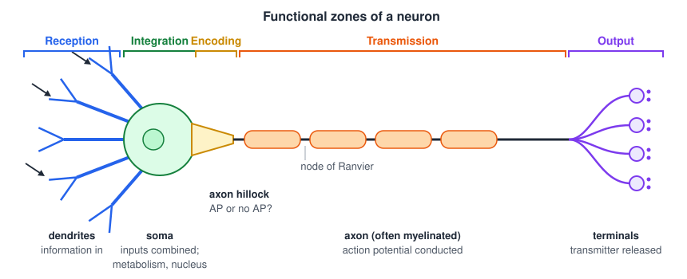
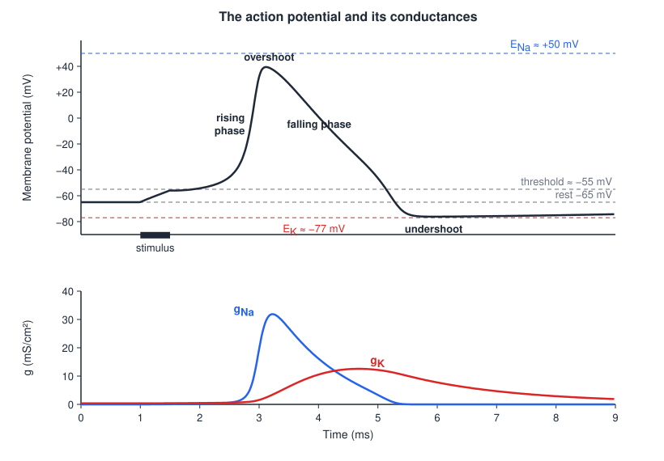
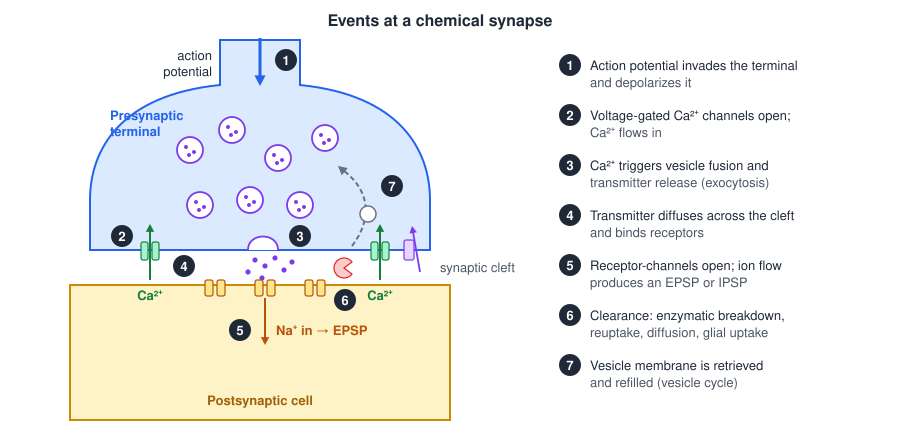
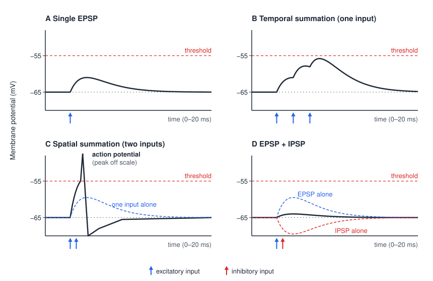
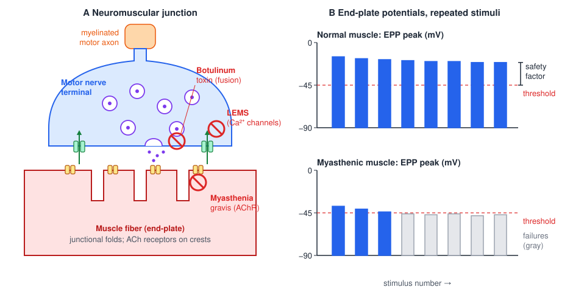

# Neurons, Synapses, and the Neuromuscular Junction

Every motor command is ultimately a sequence of electrical and chemical events in single cells: a neuron integrates its inputs, fires action potentials, and releases transmitter onto the next cell, until a motor neuron releases acetylcholine onto muscle and force is produced. This chapter describes those events conceptually, from the resting membrane potential through synaptic integration, neurotransmitter systems and drug actions, to the neuromuscular junction. The quantitative biophysics (the Nernst and Goldman equations, the Hodgkin–Huxley model and cable theory) is developed in the Bioelectric Phenomena chapters; here the emphasis is on mechanism and on why these processes matter for movement and its disorders.

## The Neuron

### Functional zones

Neurons come in many shapes, but nearly all share the same functional plan, which can be read from one end of the cell to the other.

- **Dendrites** receive information. Most synaptic inputs arrive on the dendritic tree, which in a spinal motor neuron can extend over a millimeter and receive tens of thousands of synapses.
- The **cell body (soma)** combines the inputs and carries out the cell's metabolism; it contains the nucleus and DNA and synthesizes most of the cell's proteins.
- The **axon hillock**, where the axon leaves the soma, together with the adjacent **initial segment**, is the decision point or **trigger zone**: if the combined input is large enough here, the neuron fires an action potential; if not, it does not. It has the highest density of voltage-gated Na⁺ channels and the lowest threshold in the cell.
- The **axon** transmits the action potential, often over long distances. It may or may not be myelinated.
- The **axon terminals** are the output: they release neurotransmitter onto the next cell.

These five regions correspond to five functions: **reception**, **integration and metabolism**, **encoding**, **transmission** and **output**.

*Figure: the functional zones of a generic neuron. Synaptic input (arrows) arrives on the dendrites and is combined in the soma. The axon hillock "decides" whether to fire an action potential, which then travels down the myelinated axon, jumping between nodes of Ranvier, to the terminals, where transmitter is released.*

### Many shapes, same core functions

Ramón y Cajal's drawings showed the variety of neuronal form: the fan-shaped **Purkinje cell** of the cerebellum, the tiny **granule cell**, the multipolar spinal **motor neuron**, **tripolar** neurons, cortical **pyramidal cells** with their long apical dendrites, **chandelier cells** whose axons end on the initial segments of pyramidal cells, elongated **spindle neurons**, and star-shaped **stellate cells**. Shape reflects the pattern of inputs a neuron collects and the targets it reaches, but the sequence of reception, integration, encoding, transmission and output is the same in all of them.

Neurons are outnumbered by **glial cells**. Oligodendrocytes (in the CNS) and Schwann cells (in the PNS) make myelin; astrocytes regulate the extracellular environment, take up transmitter and support synapses; and microglia are the immune cells of the CNS.

## The Resting Membrane Potential

### Ions, channels and equilibrium

The neuron's membrane is a phospholipid bilayer that separates the intracellular fluid from the extracellular fluid. Ions (charged atoms or molecules such as Na⁺, K⁺, Cl⁻ and Ca²⁺) cannot cross the bilayer itself; they cross through **ion channels**, proteins that form pores in the membrane. Ion channels have three key properties:

- they are **selective**: a Na⁺ channel passes Na⁺ but not K⁺;
- they are **gated**: they open and close in response to factors such as membrane voltage, the binding of a transmitter, or mechanical deformation;
- when a channel is open, the membrane is **permeable** to that ion.

Whether an ion flows through an open channel depends on two forces. The **concentration gradient** drives diffusion from high to low concentration, as cream poured into iced coffee spreads until it is uniformly mixed. The **electrical gradient** drives charges according to the voltage across the membrane: positive ions move toward the negative side, and like charges repel.

Consider a cell with high K⁺ inside (balanced by large impermeant anions, A⁻) and low K⁺ outside. When K⁺ channels open, K⁺ diffuses out. Each K⁺ ion that leaves carries a positive charge, so positive charge accumulates on the outer face of the membrane and negative charge is left on the inner face. That separated charge begins to pull K⁺ back in. Diffusion stops being net when the electrical force exactly balances the concentration force. This is **electrochemical equilibrium**, and the voltage at which it occurs is the ion's **equilibrium potential**. Each ion has its own, given by the Nernst equation:

\\[
E\_{\text{ion}} = \frac{RT}{zF}\ln\frac{[\text{ion}]\_{\text{out}}}{[\text{ion}]\_{\text{in}}} .
\\]

Only a minute fraction of the ions needs to move to set up this voltage, so the bulk concentrations hardly change. The derivation and typical values are in [Ions, Diffusion, and Membrane Potentials](../../biomed/bioelectric/ions-membranes.md).

| Ion | Where it is concentrated | Approximate equilibrium potential |
|---|---|---|
| K⁺ | Inside > outside | about −90 mV |
| Na⁺ | Outside > inside | about +50 to +60 mV |
| Cl⁻ | Outside > inside | about −65 to −70 mV |
| Ca²⁺ | Outside ≫ inside | about +120 mV |

### Pumps, leaks and the resting potential

The concentration gradients are created and maintained by **active ion pumps**, which consume ATP to move ions against their gradients. The most important is the **Na⁺/K⁺ pump**, which moves 3 Na⁺ out and 2 K⁺ in on each cycle. The resting potential then arises in three steps:

1. Active pumps establish the concentration gradients (K⁺ high inside, Na⁺ high outside).
2. Some passive ("leak") channels are open at rest, so ions diffuse down their gradients.
3. Charge accumulates and resists further diffusion, so each permeant ion moves toward its own electrochemical equilibrium.

Because several ions are permeant at once, the membrane cannot be at every ion's equilibrium simultaneously. It settles at a compromise: a combination of the equilibrium potentials, **weighted by how permeable the membrane is to each ion**. At rest the membrane is far more permeable to K⁺ than to Na⁺, so the **resting membrane potential (RMP)** lies close to E_K, typically **−65 to −70 mV**, with the inside negative relative to the outside. The Goldman–Hodgkin–Katz equation makes this weighting quantitative; see [Ions, Diffusion, and Membrane Potentials](../../biomed/bioelectric/ions-membranes.md) and [The Parallel Conductance Model and the Voltage Clamp](../../biomed/bioelectric/membrane-circuit.md).

The RMP is not fixed. It shifts with pathology, such as stroke, spinal cord injury and chronic pain, and it is the target of rehabilitation interventions designed to modulate nervous system excitability, such as transcranial direct current stimulation (tDCS), epidural spinal cord stimulation and peripheral nerve stimulation. As the next section shows, moving the RMP closer to or farther from threshold changes how easily a neuron fires, which has direct consequences for movement.

## Graded Potentials and the Action Potential

### Two kinds of signal

A few terms describe changes in membrane potential:

- **Depolarization**: the membrane potential becomes less negative (more positive).
- **Hyperpolarization**: the membrane potential becomes more negative.
- **Firing threshold**: the membrane potential at which a depolarization triggers an action potential, typically around −55 mV.

Neurons use two kinds of electrical signal:

| | Graded potential | Action potential |
|---|---|---|
| Role | Local communication and integration | Long-distance communication |
| Amplitude | Variable, proportional to the stimulus | Fixed: "all or none" |
| Direction | Depolarizing or hyperpolarizing | Always depolarizing |
| Spread | Passive; decays with distance and time | Actively regenerated; no decay |
| Summation | Can sum | Cannot sum; followed by a refractory period |
| Where | Dendrites, soma, sensory endings, end-plate | Axon (from the trigger zone onward) |

When a microelectrode is pushed into a neuron, the recorded voltage drops from 0 to the resting potential. Small current pulses then produce small **passive responses**, hyperpolarizing or depolarizing, whose size follows the stimulus. Once a depolarizing pulse carries the membrane past threshold, an action potential of fixed size appears; stronger stimuli do not make it larger but produce more of them, at a higher rate. Intensity is encoded in the **frequency** of action potentials.

### Postsynaptic potentials

Most graded potentials in the CNS are produced by synapses. When neurotransmitter binds to receptors that are themselves ion channels, the channels open and ions flow, generating a local potential. Its size is graded by how much transmitter was released and how many receptors opened. Which ions flow depends on the transmitter and receptor:

- When glutamate opens channels that admit Na⁺, Na⁺ enters and depolarizes the membrane. This depolarizing graded potential is an **excitatory postsynaptic potential (EPSP)**. A single EPSP is typically less than a millivolt to a few millivolts, peaks about 1.5–2 ms after the presynaptic action potential and decays within about 6–8 ms.
- When GABA or glycine opens channels that admit Cl⁻, Cl⁻ enters and the membrane hyperpolarizes (or is held near E_Cl). This is an **inhibitory postsynaptic potential (IPSP)**.

A graded potential spreads passively from the synapse through the dendrites and soma, and it **decays in amplitude** as it goes, because current leaks out across the membrane (see [The Cable Equation and Propagation](../../biomed/bioelectric/cable.md)). The trigger zone is where the outcome is decided: if the net graded potential still exceeds threshold when it reaches the axon hillock, an action potential fires. Recorded at a distal dendrite, a synaptic potential may be several millivolts; recorded at the soma it is smaller; at the trigger zone it either crosses threshold and triggers a spike or does not.

### Steps of the action potential

An action potential lasts about 1–2 ms and has four phases: a steep **rising phase**, an **overshoot** above 0 mV, a **falling phase**, and an **undershoot** (afterhyperpolarization) below rest, from which the membrane slowly recovers. These phases are produced by two populations of voltage-gated (VG) channels with different timing.

| Step | Na⁺ contribution | K⁺ contribution | Phase |
|---|---|---|---|
| 1 | Firing threshold is reached | | |
| 2 | VG Na⁺ channels are triggered to open | VG K⁺ channels are triggered to open (but open slowly) | |
| 3 | VG Na⁺ channels open rapidly; the membrane becomes highly permeable to Na⁺; Na⁺ rushes in and the membrane depolarizes rapidly | Still closed | Rising phase |
| 4 | Depolarization continues toward E_Na (about +50 mV) | Still mostly closed | Overshoot |
| 5 | VG Na⁺ channels **inactivate**: they close and temporarily cannot reopen, so Na⁺ entry stops | VG K⁺ channels open after a delay of about 1 ms; K⁺ rushes out and the membrane repolarizes | Falling phase |
| 6 | Inactivated | VG K⁺ channels remain open while the membrane is driven below the RMP toward E_K | Undershoot |
| 7 | VG Na⁺ channels **de-inactivate**: they remain closed but can open again if threshold is reached | VG K⁺ channels close | RMP is re-established |

*Figure: a computed action potential (Hodgkin–Huxley squid model, shifted to a −65 mV rest) and the conductances that produce it. Top: membrane potential with its four phases, the threshold, and the equilibrium potentials E_Na and E_K that bound it. Bottom: the Na⁺ conductance (blue) rises fast and is cut off by inactivation; the K⁺ conductance (red) rises later, outlasts the spike and produces the undershoot.*

The same sequence can be described in terms of the **driving force** on each ion, the difference between the membrane potential and that ion's equilibrium potential, \\(V\_m - E\_{\text{ion}}\\):

- **Threshold** is the membrane potential at which enough VG Na⁺ channels have opened that the membrane's relative permeability favors Na⁺ over K⁺.
- In the **rising phase**, the inside is negative, so the driving force on Na⁺ is large; Na⁺ rushes in through the open channels.
- At the **overshoot**, permeability so strongly favors Na⁺ that the membrane approaches E_Na, which is above 0 mV.
- In the **falling phase**, VG Na⁺ channels inactivate while the VG K⁺ channels, triggered about 1 ms earlier, finally open. With the membrane strongly depolarized, the driving force on K⁺ is large, K⁺ leaves, and the inside becomes negative again.
- In the **undershoot**, the open VG K⁺ channels add to the resting K⁺ permeability while Na⁺ permeability is very low, so the membrane is pulled toward E_K, below the RMP, until the VG K⁺ channels close.

During and after the spike, ion concentrations barely change; the Na⁺/K⁺ pump and K⁺ leak channels restore them over the long run. The Na⁺ channel's fast activation and slower inactivation (the "ball" that plugs the pore) and the K⁺ channel's delayed activation are exactly the \\(m\\), \\(h\\) and \\(n\\) gates of the [Hodgkin–Huxley model](../../biomed/bioelectric/hodgkin-huxley.md), which reproduces the whole waveform from measured conductances.

### Refractoriness and excitability

Inactivation of Na⁺ channels makes the membrane **refractory**. During the **absolute refractory period**, roughly the duration of the spike, no stimulus can trigger a second action potential because too many Na⁺ channels are inactivated. During the following **relative refractory period**, while Na⁺ channels recover and extra K⁺ channels are still open, a stronger than normal stimulus is needed. Refractoriness limits the maximum firing rate and, as described below, makes propagation one-way.

Excitability also depends on the RMP. With a typical RMP of −65 to −70 mV and a threshold near −55 mV, a neuron must be depolarized by about 10–15 mV to fire. If the RMP moves **closer** to threshold, the neuron fires **more easily**; if it moves **farther** from threshold, firing is **more difficult**. Pathology after stroke or spinal cord injury and neuromodulatory interventions alike act partly by shifting this distance.

## Propagation and Myelin

### How the action potential travels

An action potential at one point on the axon becomes an action potential at the next by a repeated cycle:

1. An action potential arises at point A, where Na⁺ channels have opened in response to the stimulus.
2. Depolarizing current **spreads passively** along the inside of the axon.
3. The depolarization opens Na⁺ channels at point B, generating a new action potential there.
4. The action potential does not turn back, because the membrane it has just left is **refractory**: its Na⁺ channels are inactivated and its K⁺ channels are open. Propagation is therefore one-way, away from the trigger zone.
5. The process repeats along the axon. Each action potential is regenerated at full size, so unlike graded potentials the signal **does not decay**.

### Conduction velocity

The speed of propagation depends on how far the passive current spreads before it is lost. A garden hose with leaks is a useful picture: current flows down the axon (water down the hose) but also leaks out across the membrane (water through holes). Two factors therefore speed conduction:

1. **Axon diameter.** A larger axon has lower internal resistance, so more current flows down it and depolarizes membrane farther ahead.
2. **Myelin.** Insulation reduces leakage across the membrane, so more current stays inside and travels farther.

**Myelin** is formed by **oligodendrocytes** in the CNS (one cell myelinates segments of many axons) and **Schwann cells** in the PNS (one cell per segment). It covers the axon in segments (internodes) separated by short gaps, the **nodes of Ranvier**. Na⁺ and K⁺ channels are concentrated at the nodes, which are the only places where action potentials are generated. The current spreads rapidly and with little loss under the myelin, and each node "re-ups" the signal to full size and boosts it on to the next. The action potential thus appears to jump from node to node: **saltatory conduction**.

A domino analogy captures the difference. In an unmyelinated axon the dominoes stand close together and each must fall in turn. In a myelinated axon the dominoes are spaced far apart but linked by strings, so one falling pulls down a distant one at once: fewer, widely separated events carry the signal the same distance much faster. Large myelinated motor and proprioceptive axons conduct at up to about 120 m/s, unmyelinated pain fibers at under 2 m/s (see the fiber classification in [Neurophysiology Foundations](../../biomed/neuro/neurophysiology.md)). The cable theory behind these numbers is developed in [The Cable Equation and Propagation](../../biomed/bioelectric/cable.md) and [Models of the Node of Ranvier](../../biomed/bioelectric/node-models.md).

### Demyelinating disorders

When myelin is lost, current leaks out through the bare internodes. Conduction slows, becomes unreliable at high firing rates, or fails entirely. Myelin can be lost in two ways: it can be **destroyed**, or it can **fail to be produced** or maintained.

**Multiple sclerosis (MS)** is the main example of destruction. It is an immune-mediated demyelinating disease of the **CNS**, in which attacks on myelin are disseminated in **time and space**: lesions appear at different sites (often periventricular white matter, optic nerves, brainstem and spinal cord) and at different times. Typical features include painful, unilateral loss of vision (optic neuritis), double vision (diplopia), ataxia, facial numbness, weakness or sensory loss, and cognitive decline, along with many other sensory and motor changes. The disease is often progressive, with accumulating disability. On MRI, the lesions appear as bright plaques in the white matter.

**Vitamin B12 deficiency** illustrates the second mechanism. B12 has a substantial role in synthesizing and maintaining myelin. Deficiency can result from a strict vegan diet or from impaired absorption due to gastrointestinal disease or medications. It produces **subacute combined degeneration** of the spinal cord, in which the dorsal columns and lateral columns degenerate, along with peripheral neuropathy. The features follow: peripheral weakness, impaired position and vibration sense (dorsal columns), and neuropsychiatric symptoms such as depression and insomnia that can mimic dementia.

## Synaptic Transmission

### The steps of chemical transmission

Neurons communicate with each other mainly at **chemical synapses**, where a **presynaptic terminal** is separated from the **postsynaptic** membrane by a **synaptic cleft** about 20–40 nm wide. The terminal contains synaptic vesicles filled with transmitter, mitochondria, and specialized release sites, the **active zones**; opposite them the postsynaptic membrane has a dense array of receptors, the **postsynaptic density**. Transmission proceeds in a fixed sequence:

1. Transmitter is **synthesized** and stored in vesicles.
2. An action potential **invades** the presynaptic terminal.
3. The depolarization opens **voltage-gated Ca²⁺ channels** in the terminal membrane.
4. **Ca²⁺ flows in**, down its steep gradient.
5. The rise in Ca²⁺ mobilizes vesicles to the release site and causes them to **fuse** with the presynaptic membrane.
6. Transmitter is **released** into the cleft by exocytosis.
7. Transmitter **diffuses** across the cleft and **binds** to receptors in the postsynaptic membrane.
8. Binding **opens or closes** postsynaptic ion channels, directly or through second messengers.
9. The resulting postsynaptic current produces an **EPSP or IPSP** that changes the excitability of the postsynaptic cell.
10. Transmitter is **removed** from the cleft by diffusion, enzymatic breakdown, or uptake into the terminal or nearby glia.
11. Vesicle membrane is **retrieved** from the plasma membrane by endocytosis and refilled, completing the **vesicle cycle**.

*Figure: the sequence of events at a chemical synapse. An action potential arriving at the terminal opens voltage-gated Ca²⁺ channels (1–2); Ca²⁺ entry triggers vesicle fusion and transmitter release (3–4); transmitter binds postsynaptic receptor-channels, which admit ions and produce a postsynaptic potential (5–6); transmitter is then cleared by enzymatic breakdown, reuptake or diffusion, and vesicle membrane is recycled (7–8).*

The dependence on Ca²⁺ is the critical link between electrical and chemical signaling. Release depends steeply on Ca²⁺ concentration near the active zone, roughly as its fourth power, so small changes in Ca²⁺ entry produce large changes in transmitter output. This is why disorders and drugs that alter presynaptic Ca²⁺ channels, such as Lambert-Eaton myasthenic syndrome described below, have such strong effects. The whole process introduces a **synaptic delay** of about 0.5–1 ms.

### Integration: temporal and spatial summation

A single EPSP at a central synapse is far too small to bring a neuron to threshold; many inputs must combine. Because graded potentials last several milliseconds and spread over some distance before decaying, they can add together in two ways:

- **Temporal summation** is the combined effect of a series of inputs from **one** presynaptic neuron arriving in quick succession, each adding to the remains of the last before it has decayed.
- **Spatial summation** is the combined effect of inputs from **separate** presynaptic neurons arriving at about the same time at different synapses.

Both are limited by the decay of graded potentials: inputs must arrive quickly enough (temporal) or close enough together (spatial) that they overlap before they fade. EPSPs move the membrane toward threshold and IPSPs move it away, so when both are present the result is their sum. An EPSP alone may be subthreshold; two EPSPs together may reach threshold and fire the cell; adding an IPSP can cancel the excitation and keep the cell silent.

*Figure: summation of postsynaptic potentials recorded at the trigger zone (rest −65 mV, threshold −55 mV). (A) A single EPSP is subthreshold. (B) Temporal summation: three EPSPs from one input in rapid succession stack up. (C) Spatial summation: simultaneous EPSPs from two inputs reach threshold and fire an action potential. (D) An EPSP and a simultaneous IPSP largely cancel.*

Inhibition does more than subtract. A spontaneously active neuron with no inhibitory input fires at a steady rate; well-timed IPSPs remove particular spikes and sculpt the train into a distinctive pattern. The combination of excitatory and inhibitory input therefore changes the **information conveyed** in a train of action potentials, which is the neural code that motor neurons pass to muscle.

### Where a synapse sits

Synapses are classified by the part of the postsynaptic cell they contact:

- **Axosomatic** synapses end on the cell body.
- **Axodendritic** synapses end on dendrites, either on the dendritic shaft or on small protrusions called **spines**.
- **Axo-axonic** synapses end on another axon, often on a presynaptic terminal.
- The **neuromuscular junction** is the synapse between a motor neuron and a skeletal muscle fiber.

Location matters for integration. A synapse on the soma, close to the trigger zone, has the most influence on whether the cell fires, because its potential decays least before reaching the axon hillock. Inputs on distal dendrites decay more and individually have less effect. Axo-axonic synapses do not change the postsynaptic cell's membrane potential at all. Instead they control how much transmitter a terminal releases. When a third neuron synapses on the terminal of the presynaptic cell, it can produce **presynaptic inhibition** (less transmitter released per action potential, because fewer vesicles fuse) or **presynaptic facilitation** (more released). Presynaptic inhibition of sensory afferent terminals is one of the main ways the spinal cord and brain regulate the gain of reflexes (see [The Spinal Cord and Reflexes](spinal-reflexes.md)).

### The same sequence everywhere

The sequence of input, integration, conduction and output is repeated at every stage of a sensorimotor pathway. In a **sensory neuron**, the input is not a transmitter but a physical stimulus, such as pressure or stretch, acting on a receptor ending. The stimulus produces a graded **receptor potential** proportional to its strength, which spreads passively to the trigger zone (in a myelinated afferent, the first node of Ranvier), where it acts as a **generator potential**. A stronger stimulus produces a larger generator potential, a higher frequency of action potentials, and more transmitter released at the central terminal. Rapidly adapting receptors, such as the Pacinian corpuscle, fire only at the onset and offset of a sustained stimulus. See [Sensory Receptors and Afferent Coding](sensory-receptors.md).

The stretch reflex shows the full chain. Stretch of a muscle spindle produces a receptor potential whose amplitude follows the stretch; it triggers action potentials that propagate without change along the Ia afferent; transmitter released in the spinal cord produces a graded synaptic potential in the motor neuron; that potential triggers action potentials at the motor neuron's initial segment; and transmitter released at the neuromuscular junction produces a synaptic potential, then an action potential, and finally contraction in the muscle fiber. At each of the three cells the same four stages, input, integration, conduction and output, recur.

### Ionotropic and metabotropic receptors

Transmitters affect the postsynaptic cell in two broad ways, **direct signaling** and **neuromodulation**, which correspond to two classes of receptor.

**Ionotropic receptors** (ligand-gated channels) are **direct and fast**. The receptor and the ion channel are the **same protein**: transmitter binding opens the pore within about a millisecond, producing an EPSP or IPSP that lasts milliseconds. Ionotropic receptors make the cell fire action potentials, or not, if the potential does not exceed threshold.

**Metabotropic receptors** (G-protein-coupled receptors) are **indirect and slow**. The receptor and any channel it affects are **different proteins**. Transmitter binding activates a G protein, which may act on a channel directly or through a second-messenger cascade (for example, G protein → adenylyl cyclase → cAMP → protein kinase A → phosphorylation of a channel). The effects develop over tens of milliseconds to seconds or longer and are diverse:

- prolonged opening or closing of ion channels, producing slow depolarization or hyperpolarization;
- activation of genes and increased synthesis of specific cellular products;
- changes in intracellular Ca²⁺ that affect cell metabolism and other processes.

Metabotropic actions change the **state** of the cell, its excitability, sensitivity or metabolism, rather than directly causing it to fire.

The distinction has a simple arithmetic meaning for a motor neuron. Its ionotropic excitatory and inhibitory inputs carry **specific, task-related information**, and they combine like addition and subtraction, \\(e - i\\). Its metabotropic **neuromodulatory** inputs, chiefly serotonin and norepinephrine from the brainstem, change how strongly the motor neuron responds to that information, acting more like multiplication, \\(n \cdot (e - i)\\). Skilled motor control requires an appropriate balance of all three kinds of input.

The effect of neuromodulation on motor neurons is dramatic. With low levels of serotonin and norepinephrine, an excitatory synaptic input depolarizes a motor neuron by a few millivolts but may not make it fire, and the membrane returns to baseline when the input ends. With high monoamine levels the same input is **amplified**, producing repetitive firing during the input, and **prolonged**, producing sustained firing after the input has ended. The underlying mechanism is the activation of persistent inward Na⁺ and Ca²⁺ currents in the motor neuron's dendrites, which act as an amplifier. This is how the brainstem adjusts motor neuron gain to the demands of the task, and as described below it is also implicated in spasticity after injury.

## Neurotransmitter Systems

Each transmitter is a messenger, not a meaning: its effect depends on the receptor it binds. Nevertheless, each of the major transmitters has characteristic sites, actions and clinical associations.

| Transmitter | Main sites | Main actions | Clinical notes |
|---|---|---|---|
| **Glutamate** | Primary fast excitatory transmitter of the CNS, at about half of all synapses | General excitatory signaling; learning and development, especially through the NMDA receptor | Excessive levels can cause some epileptic seizures; **excitotoxicity** in stroke and brain injury |
| **GABA** and **glycine** | Principal inhibitory transmitters; GABA throughout the CNS, glycine mainly in the brainstem and spinal cord | Inhibition, mainly through Cl⁻ influx; GABA is sedating, anxiolytic, anticonvulsant and sleep-inducing; both shape motor commands in the spinal cord | Baclofen, benzodiazepines, barbiturates and alcohol enhance GABA signaling |
| **Acetylcholine (ACh)** | (1) Every neuromuscular junction; (2) autonomic ganglia (ionotropic); (3) parasympathetic targets (metabotropic, muscarinic); (4) cerebral cortex and ventral striatum | (1) Skeletal muscle contraction; (2) excitation of postganglionic autonomic neurons; (3) parasympathetic actions; (4) cognitive arousal and reward | Myasthenia gravis; botulinum toxin; nicotine acts on ACh receptors in the basal ganglia (pleasure, addiction); cortical ACh receptors are reduced in Alzheimer's disease |
| **Norepinephrine (NE)** | CNS: cerebral cortex, limbic system, spinal cord; PNS: sympathetic nervous system | Mood; increases excitability of α-motor neurons in the spinal cord; "fight or flight" | Contributes to spasticity and hyperreflexia after injury; role in chronic pain and central sensitization (partial target of SNRIs); involved in Parkinson's disease |
| **Serotonin (5-HT)** | Throughout brain and spinal cord, from brainstem raphe nuclei | Brain: mood, pain perception, arousal. Spinal cord: increases excitability of the ventral (motor) horn and decreases excitability of the dorsal (sensory) horn | Contributes to spasticity and hyperreflexia; after spinal cord injury, loss of descending serotonin leads to adaptive hyperactivity of motor neuron receptors and spasms; role in chronic pain (SNRI target) and Parkinson's disease |
| **Dopamine** | Basal ganglia, limbic system, frontal lobe | Control of movement; pleasure and reinforcement of behavior (including addiction); decision making and planning | **Parkinson's disease**: loss of dopamine neurons in the substantia nigra; treated with L-DOPA, which in excess causes dyskinesia and sometimes addictive behaviors; amphetamines and cocaine increase or prolong dopamine signaling |
| **Substance P** | PNS: nerve endings in skin, muscle and joints; CNS: spinal cord, brainstem and brain | Signals pain | Excessive in some pathological pain conditions |
| **Endorphins** (endogenous opioids) | CNS, including spinal cord | Inhibit pain signaling | Reduce transmission in nociceptive pathways as part of the descending pain modulation system; morphine, heroin and oxycodone are opioid agonists |

A few of these entries deserve explanation.

**Glutamate excitotoxicity.** During ischemia, the energy-dependent pumps and transporters that remove glutamate from the cleft slow down for lack of oxygen and glucose. Glutamate accumulates, overstimulates its receptors (particularly NMDA receptors, which admit Ca²⁺), and Ca²⁺ overload triggers enzymes that damage and kill the cell. Neurons around an infarct are, in effect, excited to death, which enlarges the damage beyond the core of the stroke.

**Monoamines and spasticity.** Serotonin and norepinephrine set the gain of spinal motor neurons through the persistent inward currents described above. After spinal cord injury, the descending serotonergic axons are cut, yet motor neurons below the lesion become hyperexcitable: their serotonin receptors adapt and become active even without serotonin, restoring persistent inward currents. This supports some recovery of motor function but also produces long-lasting involuntary spasms. Altered monoaminergic drive has likewise been proposed to contribute to the exaggerated reflexes of chronic hemiparetic stroke.

**Dopamine and Parkinson's disease.** Dopamine is synthesized mainly in the substantia nigra of the midbrain and released in the striatum, part of the basal ganglia. Loss of these neurons is a major cause of the motor deficits of Parkinson's disease (see [The Basal Ganglia](basal-ganglia.md)).

### The transmitter life cycle

Every transmitter goes through three stages:

1. **Synthesis**, either in the presynaptic terminal or in the cell body (the location depends on the transmitter); neuropeptides such as substance P are made in the soma and transported down the axon.
2. **Synaptic action**: diffusion across the cleft and binding to ionotropic or metabotropic receptors.
3. **Clearance**: diffusion out of the cleft, breakdown by enzymes, and reuptake into the presynaptic terminal or glia.

The cholinergic synapse illustrates all three. Acetyl coenzyme A (from glucose metabolism in mitochondria) and choline are combined by **choline acetyltransferase** to make ACh, which is loaded into vesicles by a vesicular transporter (VAChT). After release, ACh is cleared mainly by **acetylcholinesterase**, an enzyme in the cleft that splits it into acetate and choline within about a millisecond. A Na⁺-coupled **choline transporter** then takes the choline back into the terminal for reuse. By contrast, monoamines such as serotonin and dopamine are cleared mainly by reuptake transporters.

## Drug Targets

Almost every step of synaptic transmission can be targeted by drugs, and many of the medications encountered in neurorehabilitation work this way.

| Step | Example | Mechanism |
|---|---|---|
| Transmitter synthesis | **L-DOPA** in Parkinson's disease | A precursor of dopamine, given to boost dopamine synthesis in the surviving dopaminergic neurons |
| Action potential conduction | **Lidocaine** | Blocks voltage-gated Na⁺ channels, especially in small sensory fibers, preventing action potentials (local anesthesia) |
| Transmitter release | **Botulinum toxin** | Cleaves proteins needed for vesicle fusion, so ACh-containing vesicles cannot release their contents |
| Receptor binding | **Benzodiazepines, barbiturates, ethanol, neurosteroids** | Bind separate sites on the GABA_A receptor (a GABA-gated Cl⁻ channel); they do not open the channel by themselves but increase the effect of GABA when it binds |
| Receptor binding | **Baclofen** | Agonist at the metabotropic GABA_B receptor; reduces spasticity by inhibiting spinal reflex transmission |
| Transmitter clearance | **Acetylcholinesterase inhibitors** | Prevent ACh breakdown, increasing the ACh available in the cleft |
| Transmitter clearance | **SSRIs** (selective serotonin reuptake inhibitors); **SNRIs** | Block reuptake transporters, increasing serotonin (and, for SNRIs, norepinephrine) in the cleft |
| Release and reuptake | **Amphetamines, cocaine** | Increase release and block reuptake of dopamine and other monoamines |

Gabapentin is often grouped with GABA-enhancing drugs because it was designed as a GABA analogue and is used for spasticity and neuropathic pain, but its main action is to bind a subunit of presynaptic voltage-gated Ca²⁺ channels and reduce transmitter release.

## The Neuromuscular Junction

### The motor unit

A **motor unit** is an α-motor neuron and all the muscle fibers it innervates. It is the basic unit of motor output. The motor neurons that innervate one muscle are grouped into a **motor nucleus** (motor pool), a longitudinal column of cells in the ventral horn that often spans several spinal segments. Each motor axon leaves through the ventral root, travels in a peripheral nerve to its muscle, and then branches to innervate a set of fibers that are scattered through the muscle rather than clustered together. Every muscle fiber, in turn, is innervated by only one motor neuron.

The α-motor neuron is a neuro-mechanical transducer. Its large dendritic tree receives complex sensorimotor information, excitatory, inhibitory and neuromodulatory, from descending pathways, sensory afferents and spinal interneurons. It converts that information into a comparatively simple output, a train of action potentials, which produces twitches of its muscle fibers that sum into force. Because every motor command must pass through motor neurons to reach muscle, Sherrington called them the **final common pathway** for movement. How motor units are recruited and how their firing rates grade force is described in [The Spinal Cord and Reflexes](spinal-reflexes.md) and [Musculoskeletal Modeling](../musculoskeletal.md).

### Transmission at the junction

Near the muscle, the motor axon loses its myelin and branches into terminals that lie in shallow troughs on the muscle fiber surface, at a specialized region called the **motor end-plate**. The presynaptic terminals are packed with ACh vesicles clustered at active zones. Opposite them, the postsynaptic membrane is thrown into **junctional folds**, whose crests carry a high density of nicotinic ACh receptors and whose depths contain voltage-gated Na⁺ channels. The sequence of transmission from nerve to muscle is:

1. Action potentials travel down the motor axon to its terminals.
2. Ca²⁺ entry triggers the release of **ACh** at the neuromuscular junction.
3. ACh binds to **ACh receptors** in the sarcolemma (muscle membrane). These are ionotropic receptor-channels that admit Na⁺ (and some K⁺), depolarizing the end-plate and initiating a muscle action potential that propagates along the fiber.
4. The action potential enters the interior of the fiber through the **T-tubules**, invaginations of the sarcolemma, where voltage sensors (dihydropyridine receptors) are coupled to ryanodine receptors that release Ca²⁺ from the sarcoplasmic reticulum, triggering cross-bridge cycling between actin and myosin (see [Musculoskeletal Modeling](../musculoskeletal.md)).

The depolarization produced at the end-plate is the **end-plate potential (EPP)**. It is an EPSP in the muscle membrane, but an exceptionally large one. A single motor nerve action potential releases on the order of 100–150 vesicles of ACh, compared with only a few at a typical central synapse, and the EPP rises tens of millivolts, far beyond the threshold for a muscle action potential. As a result, every nerve action potential produces a muscle action potential. The excess of the EPP over what is needed to reach threshold is called the **safety factor** of neuromuscular transmission.

*Figure: left, the neuromuscular junction. A motor nerve action potential opens presynaptic voltage-gated Ca²⁺ channels, Ca²⁺ entry triggers fusion of ACh vesicles, and ACh binds receptors on the crests of the junctional folds. Red markers show where three disorders act: Lambert-Eaton myasthenic syndrome on the presynaptic Ca²⁺ channels, botulinum toxin on vesicle fusion, and myasthenia gravis on the postsynaptic ACh receptors. Right, EPP amplitudes during repeated stimulation. In normal muscle (top) every EPP is far above threshold; the gap is the safety factor. In myasthenic muscle (bottom) EPPs are smaller and decline with repetition, so some barely reach threshold and others fail.*

### The NMJ compared with central synapses

The neuromuscular junction is built for reliability, whereas central synapses are built for integration.

| Feature | Neuromuscular junction | Neuron–neuron synapse |
|---|---|---|
| Number of presynaptic inputs to the target | 1 (a single α-motor neuron per fiber) | Varies; usually many |
| Number of postsynaptic targets of the response | None; the only response is contraction | Varies; usually many |
| Vesicles released per action potential | About 140–150 | About 5–10 at most |
| Certainty of a postsynaptic action potential | Guaranteed | Variable; depends on summation |
| Excitatory or inhibitory | Excitatory only | Either |
| Direction of information | Efferent | Efferent or afferent |

Because the NMJ is excitatory only and each fiber has a single input, all grading of muscle force must happen upstream, in the motor neuron, through recruitment of motor units and modulation of their firing rates. Muscle cannot be inhibited at the junction; it can only stop being excited.

### Disorders and drugs of the NMJ

Three conditions act at three different points in the sequence, and their different mechanisms explain their different clinical patterns.

**Myasthenia gravis** ("serious muscle weakness") is an autoimmune disease in which antibodies attack the postsynaptic **ACh receptors**. With fewer receptors, each EPP is smaller, the safety factor is reduced, and at some junctions transmission fails. Weakness fluctuates and can be profound. It characteristically **worsens with sustained activity and through the course of the day**, because transmitter release normally declines a little during repetitive firing, and junctions with a reduced safety factor can no longer absorb that decline. The eyelids (ptosis), eye movements (double vision), speech, swallowing and limb muscles are commonly affected. Treatment includes **acetylcholinesterase inhibitors**, which keep ACh in the cleft longer so that it activates more of the remaining receptors and produces a larger EPP; immunomodulatory therapies; and **thymectomy**, because the thymus plays a role in the expression of the disease.

**Lambert-Eaton myasthenic syndrome (LEMS)** is an autoimmune disease in which antibodies attack the **presynaptic voltage-gated Ca²⁺ channels** of the motor nerve terminal. Without adequate Ca²⁺ influx, fewer vesicles are mobilized and released. LEMS is often associated with **small cell lung cancer**, whose cells express the same channels. Weakness predominantly affects **proximal** muscles, especially the hips and thighs. In contrast to myasthenia gravis, strength may **improve** briefly with repeated effort, because a rapid train of action potentials lets residual Ca²⁺ accumulate in the terminal and facilitates release.

**Botulinum toxin**, produced by the bacterium *Clostridium botulinum*, **prevents ACh release** by cleaving the proteins required for vesicle fusion. Botulism can be acquired from improperly canned food, from wound infection, or, in infants, from honey, which is why honey is not given to children under one year old. It produces a symmetric, progressive, **descending** paralysis that involves the limbs, trunk and respiratory muscles, and it is fatal in about 3–5% of cases. In tiny, locally injected doses the same toxin is a valuable treatment: it is used for chronic headache, for spasticity and increased muscle tone after CNS injury, and cosmetically. Because it chemically denervates the injected muscle, repeated use weakens the muscle and alters its structure over time, making it stiffer.

| Disorder | Site of action | Mechanism | Response to repeated activity |
|---|---|---|---|
| Myasthenia gravis | Postsynaptic ACh receptors | Autoimmune loss of receptors; smaller EPP | Worsens (fatigable weakness) |
| Lambert-Eaton syndrome | Presynaptic Ca²⁺ channels | Autoimmune block of Ca²⁺ entry; less ACh released | Transiently improves (facilitation) |
| Botulism / botulinum toxin | Vesicle fusion machinery | Blocks ACh release | Descending, symmetric paralysis; no recovery until new terminals sprout |

## Clinical Correlations

- **Excitability as a therapeutic target.** Stroke, spinal cord injury and chronic pain all alter the resting potential and excitability of neurons. Rehabilitation interventions such as tDCS, epidural and transcutaneous spinal stimulation, and peripheral nerve stimulation aim to shift excitability back toward a useful range (see [Deep Brain Stimulation and Neuromodulation](../../biomed/neuro/neuromodulation.md) and [Transcutaneous Spinal Cord Stimulation](../../biomed/neuro/tscs.md)).
- **Local anesthesia.** Lidocaine blocks voltage-gated Na⁺ channels and therefore conduction, especially in small sensory fibers.
- **Demyelination.** Multiple sclerosis (immune-mediated destruction of CNS myelin, disseminated in time and space) and vitamin B12 deficiency (failure of myelin synthesis, with subacute combined degeneration of the dorsal and lateral columns) both slow or block conduction.
- **Excitotoxicity.** Glutamate accumulation during ischemia kills neurons around a stroke; excessive glutamate signaling also contributes to some seizures.
- **Spasticity and spasms.** Monoaminergic (serotonin and norepinephrine) modulation of motor neuron persistent inward currents contributes to hyperreflexia and spasticity after stroke and to spasms after spinal cord injury. Baclofen, benzodiazepines and local botulinum toxin injections are standard treatments.
- **Parkinson's disease.** Loss of dopamine neurons in the substantia nigra is treated with L-DOPA, at the cost of dyskinesia at high doses.
- **Pain.** Substance P is elevated in some pathological pain states; endogenous and exogenous opioids, SSRIs and SNRIs act on nociceptive transmission and its descending modulation (see [The Neuroscience of Pain](pain.md)).
- **NMJ disorders.** Myasthenia gravis (postsynaptic, fatigable weakness, ptosis), Lambert-Eaton syndrome (presynaptic, proximal weakness that improves with effort, associated with small cell lung cancer) and botulism (blocked release, descending paralysis) each follow from where in the transmission sequence they act.

## Key Readings

- Hodgkin AL, Huxley AF (1939). *Action potentials recorded from inside a nerve fibre*. Nature. — the first intracellular recording of an action potential, whose overshoot above zero led to the sodium hypothesis.
- Kandel ER (2000). *Nerve cells and behavior*. Ch. 2 in *Principles of Neural Science*, 4th ed. — the input, trigger, conduction and output sequence common to all neurons, worked through the stretch reflex.
- Hultborn H (2006). *Spinal reflexes, mechanisms and concepts: from Eccles to Lundberg and beyond*. Progress in Neurobiology. — how intracellular recordings revealed postsynaptic and presynaptic inhibition in spinal motor circuits.
- Murray KC, Nakae A, Stephens MJ, et al. (2010). *Recovery of motoneuron and locomotor function after spinal cord injury depends on constitutive activity in 5-HT2C receptors*. Nature Medicine. — the receptor mechanism by which motor neurons regain excitability, and develop spasms, after losing descending serotonin.
- McPherson JG, McPherson LM, Thompson CK, Ellis MD, Heckman CJ, Dewald JPA (2018). *Altered neuromodulatory drive may contribute to exaggerated tonic vibration reflexes in chronic hemiparetic stroke*. Frontiers in Human Neuroscience. — links monoaminergic amplification of motor neuron firing to spasticity after stroke.

## See Also

- [Organization of the Nervous System](neuroanatomy.md)
- [Ions, Diffusion, and Membrane Potentials](../../biomed/bioelectric/ions-membranes.md)
- [Hodgkin–Huxley Kinetics and Excitation](../../biomed/bioelectric/hodgkin-huxley.md)
- [The Cable Equation and Propagation](../../biomed/bioelectric/cable.md)
- [Neurophysiology Foundations](../../biomed/neuro/neurophysiology.md)
- [Sensory Receptors and Afferent Coding](sensory-receptors.md)
- [The Spinal Cord and Reflexes](spinal-reflexes.md)
- [Musculoskeletal Modeling](../musculoskeletal.md)
