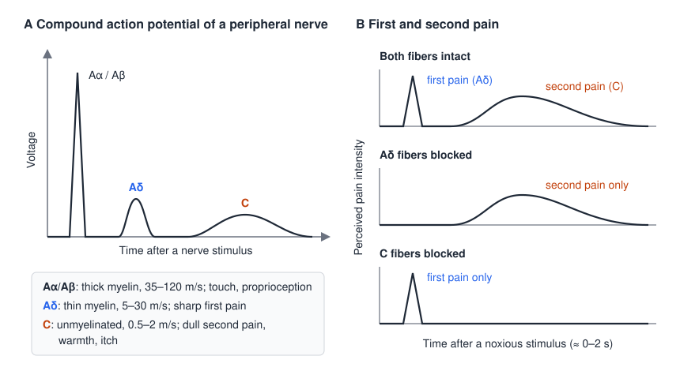
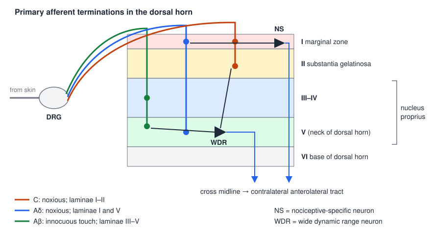
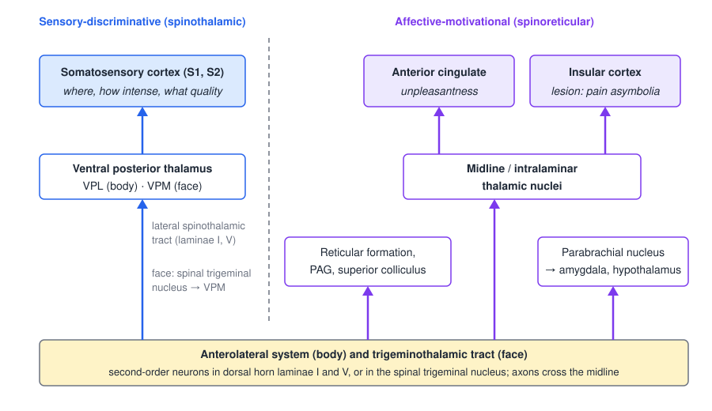
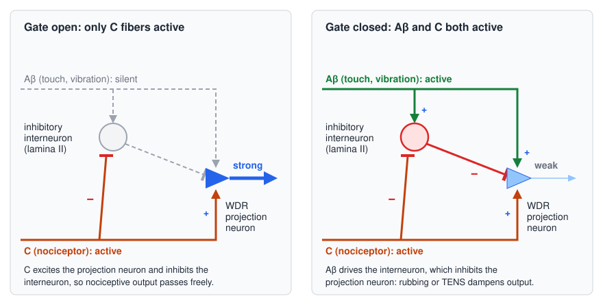
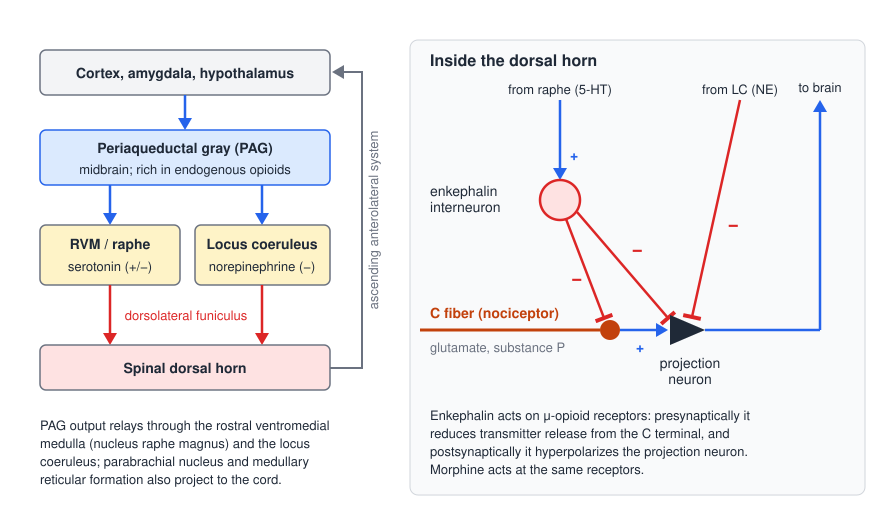

# The Neuroscience of Pain

Pain is the nervous system's alarm, and like any alarm it can be set off by a real fire, by faulty wiring, or by a sensor that has become too sensitive. This chapter follows the signal from the free nerve endings that detect tissue-damaging stimuli, through the dorsal horn and the ascending pathways, to the cortical networks that make pain both a sensation and an emotion. It then turns to the ways that signal is amplified (sensitization) and suppressed (gating, descending control, opioids). Pain matters for movement because it reshapes how people move, how much they move, and whether they move at all, and because movement and exercise in turn are among the most powerful modulators of pain.

## What Pain Is

### The IASP definition

The International Association for the Study of Pain (IASP) revised its definition of pain in 2020, the first change since 1979. Pain is now

> an unpleasant sensory and emotional experience associated with, or resembling that associated with, actual or potential tissue damage.

The older wording ended "associated with actual or potential tissue damage, or described in terms of such damage". Its reliance on *description* implicitly excluded anyone who cannot describe pain. The new wording drops that requirement and allows that an experience can *resemble* damage-related pain without any damage being present. Six notes accompany the definition:

1. Pain is always a personal experience that is influenced to varying degrees by biological, psychological and social factors.
2. Pain and nociception are different phenomena. Pain cannot be inferred solely from activity in sensory neurons.
3. Through their life experiences, individuals learn the concept of pain.
4. A person's report of an experience as pain should be respected.
5. Although pain usually serves an adaptive role, it may have adverse effects on function and on social and psychological well-being.
6. Verbal description is only one of several behaviors for expressing pain. Inability to communicate does not negate the possibility that a human or non-human animal experiences pain.

The second note is the most important for a neuroscientist. **Nociception**, the neural process of encoding noxious stimuli, can happen without pain (under anesthesia the withdrawal reflex and the blood-pressure response still occur), and pain can happen without nociception. Pain is a perception constructed by the brain; nociceptor activity is one input to that construction, not the experience itself. The same point was already made in the older IASP notes: experiences that resemble pain but are not unpleasant, such as pricking, should not be called pain, and pain reported without any tissue damage should be accepted as pain if the person regards it as such.

### Three mechanistic categories

Clinically, pain is classified by its presumed mechanism:

| Category | IASP definition | Typical examples |
|---|---|---|
| **Nociceptive** | Pain that arises from actual or threatened damage to non-neural tissue and is due to the activation of nociceptors | Sprain, fracture, post-operative pain, osteoarthritis flare |
| **Neuropathic** | Pain caused by a lesion or disease of the somatosensory nervous system | Diabetic polyneuropathy, postherpetic neuralgia, radiculopathy, central post-stroke pain, pain after spinal cord injury, phantom limb pain |
| **Nociplastic** | Pain that arises from altered nociception despite no clear evidence of actual or threatened tissue damage causing the activation of peripheral nociceptors, or evidence of disease or lesion of the somatosensory system causing the pain | Fibromyalgia, many cases of chronic low back pain, chronic whiplash-associated disorder |

Nociceptive pain is pain from a normally functioning somatosensory system doing its job. Neuropathic pain is a clinical description, not a diagnosis: it requires a demonstrable *lesion* (an abnormality on imaging, neurophysiology, biopsy or laboratory testing, or obvious trauma) or a *disease* that meets neurological diagnostic criteria (stroke, vasculitis, diabetes mellitus, a genetic abnormality). Symptoms alone, such as touch-evoked pain, do not justify the label. "Somatosensory" here includes information from the viscera. Neuropathic pain is subdivided into **peripheral** and **central** neuropathic pain according to where the lesion lies.

Nociplastic pain is the newest category. It was formerly described as "pain of unknown origin": pain that persists in the absence of tissue injury, or is out of proportion to the initial insult, and is thought to reflect enhanced central excitability, loss of central inhibition, or both. The alternative names "algopathic" and "nocipathic" pain have also been proposed. Nociplastic pain overlaps with neuropathic pain in many features, and the two often coexist; a patient can also combine nociceptive and nociplastic components. The term "chronic pain" almost inevitably implies some nociplastic component. Many ostensibly musculoskeletal conditions probably have one: chronic low back pain is associated with marked changes in subcortical gray matter and in communication between regions involved in fear, reward and motivation, and chronic whiplash-associated disorder behaves similarly. Nociplastic pain is notoriously hard to treat because there is no single peripheral target.

A useful clinical model places these three mechanisms at the base of a triangle whose other corners are **psychosocial factors** (vulnerability and resilience) and **movement** (the effect of movement on pain and of pain on movement). Each corner interacts with the other two. For each mechanism the clinician defines it and then measures it through history and examination.

## Terminology

Pain science uses a precise vocabulary, and much clinical confusion comes from using these words loosely. The IASP terms below are the ones most often needed at the bedside. Like *allodynia* and *hyperalgesia*, most are clinical descriptions of what the patient reports in response to a stimulus; they do not imply a mechanism.

### Stimuli, receptors and thresholds

| Term | IASP definition | Note |
|---|---|---|
| Noxious stimulus | A stimulus that is damaging or threatens damage to normal tissues | Does not by itself imply that nociceptors were activated |
| Nociceptive stimulus | An actually or potentially tissue-damaging event transduced and encoded by nociceptors | |
| Nociceptor | A high-threshold sensory receptor of the peripheral somatosensory nervous system that is capable of transducing and encoding noxious stimuli | From Latin *nocere*, "to hurt" |
| Nociceptive neuron | A central or peripheral neuron of the somatosensory nervous system that is capable of encoding noxious stimuli | Includes dorsal horn neurons |
| Nociception | The neural process of encoding noxious stimuli | Consequences may be autonomic or behavioral; pain is not necessarily implied |
| Pain threshold | The minimum intensity of a stimulus that is perceived as painful | In psychophysics, the intensity at which 50% of stimuli are recognized as painful. The threshold is the person's experience; the stimulus is not pain |
| Pain tolerance level | The maximum intensity of a pain-producing stimulus that a subject is willing to accept in a given situation | Shaped by cultural norms, fear, locus of control, instructions and rapport with the examiner |

### Altered sensation and altered pain

| Term | IASP definition | What distinguishes it |
|---|---|---|
| **Allodynia** | Pain due to a stimulus that does not normally provoke pain | A change in the *quality* of sensation: the stimulus mode is non-painful (light touch, a blanket, warm water) but the response is pain. Greek *allo*, "other", *odyne*, "pain" |
| **Hyperalgesia** | Increased pain from a stimulus that normally provokes pain | An augmented response within the same mode (painful stimulus, more pain), on suprathreshold stimulation |
| **Hyperpathia** | A painful syndrome characterized by an abnormally painful reaction to a stimulus, especially a repetitive stimulus, as well as an increased threshold | Often explosive; may show faulty localization, delay, radiation and aftersensation. Typical of partially denervated skin |
| **Hypoalgesia** | Diminished pain in response to a normally painful stimulus | Formerly a form of hypoesthesia; now restricted to pain |
| **Analgesia** | Absence of pain in response to stimulation that would normally be painful | |
| **Hyperesthesia** | Increased sensitivity to stimulation, excluding the special senses | Umbrella term covering touch and thermal sensation as well as pain; includes allodynia and hyperalgesia, but the specific terms are preferred |
| **Hypoesthesia** | Decreased sensitivity to stimulation, excluding the special senses | Stimulus and location should be specified |
| **Paresthesia** | An abnormal sensation, whether spontaneous or evoked | Used when the sensation is *not* unpleasant (e.g., the tingling of TENS) |
| **Dysesthesia** | An unpleasant abnormal sensation, whether spontaneous or evoked | Always unpleasant; hyperalgesia and allodynia are special cases. Paresthesia may include dysesthesia, not the reverse |
| **Anesthesia dolorosa** | Pain in an area or region that is anesthetic | Classic after deafferentation |
| **Causalgia** | Sustained burning pain, allodynia and hyperpathia after a traumatic nerve lesion, often with vasomotor and sudomotor dysfunction and later trophic changes | Now grouped under complex regional pain syndrome type II |

The four threshold–response terms can be compared on three axes:

| | Threshold | Response | Stimulus mode vs response mode |
|---|---|---|---|
| Allodynia | Lowered | Pain where none is expected | Differ (non-painful stimulus, painful response) |
| Hyperalgesia | Unchanged (or raised, e.g., in neuropathy) | Increased | Same (both painful) |
| Hyperpathia | Raised | Increased | May be the same or different |
| Hypoalgesia | Raised | Lowered | Same |

IASP itself specifies only the threshold for allodynia. Some teaching versions of this table describe the allodynic response as "unchanged" (because it is still a single painful response) and others as "increased" (because pain has replaced a non-painful sensation); both describe the same phenomenon. The definitions are deliberately not symmetrical, and there is no category for a lowered threshold with a lowered response. The first three rows are the signs most closely associated with sensitization.

### Nerve-related terms

| Term | Definition |
|---|---|
| Neuropathy | A disturbance of function or pathological change in a nerve: in one nerve, *mononeuropathy*; in several nerves, *mononeuropathy multiplex*; if diffuse and bilateral, *polyneuropathy* |
| Neuritis | Inflammation of a nerve or nerves; a special case of neuropathy, used only when inflammation is thought to be present |
| Neuralgia | Pain in the distribution of a nerve or nerves; often paroxysmal, though the term is not restricted to paroxysmal pain. Trigeminal neuralgia is defined by its clinical presentation; postherpetic neuralgia is diagnosed from the history |
| Sensitization | Increased responsiveness of nociceptive neurons to their normal input, and/or recruitment of a response to normally subthreshold inputs |

### Treatment terms

IASP also distinguishes how treatments are combined. **Unimodal** treatment is a single intervention aimed at one mechanism (exercise from a physical therapist). **Multimodal** treatment combines interventions with different mechanisms *within one discipline* (a physician prescribing pregabalin plus an opioid, or an NSAID plus an orthosis). **Multidisciplinary** treatment involves practitioners from several disciplines working separately toward their own aims. **Interdisciplinary** treatment is the same mix of disciplines (say, an antidepressant from a physician, exercise from a physical therapist and cognitive behavioral therapy from a psychologist) working as one team with a shared biopsychosocial model, regular meetings and agreed goals.

## Nociceptors

### Free nerve endings

Nociceptors are the peripheral terminals of primary afferent neurons whose cell bodies lie in the dorsal root ganglia (or the trigeminal ganglion for the face). Unlike Meissner, Pacinian, Ruffini and Merkel endings (see [Sensory Receptors](sensory-receptors.md)), they have no encapsulating end organ: they are **free nerve endings** that branch through the dermis and penetrate the epidermis, carried on **thinly myelinated (Aδ) or unmyelinated (C) axons**. Their transduction machinery is in the membrane of the bare terminal itself, which is why they are reached so directly by chemicals released from damaged tissue.

What makes a nociceptor a nociceptor is its **high threshold**. If a microelectrode records from a single afferent in a human forearm nerve while a heat lamp warms the skin in steps, a non-nociceptive warm thermoreceptor fires at every step, but its firing rate saturates at the higher temperatures: it cannot distinguish hot from dangerously hot. A nociceptor is silent at the low steps, begins firing only around 45 °C, and fires vigorously at the highest step. Nociception is therefore carried *only by certain* sensory receptors, those specialized to respond in the damaging range.

### Classes and fiber types

| Class | Adequate stimulus | Fiber | Conduction velocity |
|---|---|---|---|
| Thermal | Temperature extremes, above about 43–45 °C or below about 5 °C | Small, thinly myelinated Aδ | 5–30 m/s |
| Mechanical | Intense pressure, pinch, sharp objects | Small, thinly myelinated Aδ | 5–30 m/s |
| Polymodal | High-intensity heat and cold, mechanical and chemical stimuli | Smallest, unmyelinated C | 0.5–2 m/s |

The heat threshold is variously quoted as 43 °C or 45 °C; 43 °C is essentially the threshold at which heat starts to be perceived as painful, and individual nociceptors begin firing somewhere in the 43–45 °C range. Aδ nociceptors come in two types. **Type I** Aδ fibers have a high heat threshold (about 53 °C) and respond more readily to mechanical and chemical stimuli; **type II** Aδ fibers have a lower heat threshold (about 43 °C), lower than their mechanical or chemical thresholds. C fibers, which also carry innocuous temperature and itch, have a heat threshold of about 43 °C.

Electrically stimulating a whole peripheral nerve and recording a short distance away reveals these fiber groups directly. The **compound action potential** (the summed action potentials of all the axons in the nerve) breaks into separate waves because each class conducts at its own speed (Figure A below): a tall, early Aα/Aβ wave from the large myelinated fibers that serve proprioception and touch, a small Aδ wave, and, much later, a low, broad C wave. In electron micrographs the large fibers appear as thick black rings of myelin, while C axons travel in **Remak bundles**, many small unmyelinated axons wrapped together by a single Schwann cell. The conduction-velocity scale matches the general fiber table in [Neurophysiology Foundations](../../biomed/neuro/neurophysiology.md).

### First and second pain

The difference in conduction velocity has a direct perceptual consequence. Stub your toe and you feel a sharp, well-localized **first pain**, followed a second or so later by a dull, aching, poorly localized and longer-lasting **second pain**. First pain is carried by the faster Aδ afferents; second pain by the slow C afferents. Selective block proves the assignment: blocking Aδ conduction (for example by pressure on the nerve, which affects myelinated fibers first) abolishes first pain and leaves second pain, while blocking C fibers (local anesthetic at low concentration affects small fibers first) leaves only first pain.

*Figure: A, the compound action potential of a peripheral nerve separates into Aα/Aβ, Aδ and C waves because of their different conduction velocities. B, perceived pain intensity over time after a brief noxious stimulus. Normally a sharp first pain (Aδ) is followed by a dull second pain (C); blocking Aδ fibers leaves only the second pain, and blocking C fibers leaves only the first.*

### Transduction: why hot peppers are hot

The best-understood nociceptive transducer is **TRPV1** (transient receptor potential vanilloid 1, originally called VR-1), a nonselective cation channel expressed on C fibers. It opens in response to noxious heat (above about 43 °C), to protons (acidic tissue in inflammation or ischemia) and to **capsaicin**, the active ingredient of chili peppers. Capsaicin is lipophilic: it crosses the membrane and binds the channel from the inside. When TRPV1 opens, Na⁺ and Ca²⁺ flow in, depolarizing the terminal. Because the same channel signals heat, capsaicin feels hot even though no heat is present.

Repeated or sustained capsaicin exposure has the opposite effect. The large Ca²⁺ influx **desensitizes** the channel and, at high doses, causes the fine terminals to retract, so that pain fibers become unresponsive for days to weeks. Topical capsaicin is therefore used as an analgesic and anti-inflammatory agent in arthritis, postherpetic neuralgia, post-mastectomy pain and trigeminal neuralgia.

### Transmitters of nociceptive afferents

Both Aδ and C afferents release **glutamate**, the fast excitatory transmitter acting on AMPA receptors (and, under stronger drive, NMDA receptors) of dorsal horn neurons. Many C fibers also contain neuropeptides, principally **substance P** (with calcitonin gene-related peptide, CGRP). Substance P binds the **NK1 receptor**. It enhances and prolongs the action of glutamate and increases the excitability of dorsal horn neurons and of the C fibers themselves. Because peptides have no specific reuptake mechanism and are cleared only by proteolysis, substance P diffuses considerable distances and acts slowly and widely. It is not specific to pain; it is found throughout the central and peripheral nervous systems, the gut and blood cells.

Small-molecule transmitters and neuropeptides are handled differently. Glutamate is synthesized and packaged in the terminal, from enzymes delivered by slow axonal transport and precursors taken up locally. Peptides are synthesized as precursors in the cell body, cleaved by enzymes in transit down microtubule tracks, and stored in **large dense-core vesicles** that sit farther from the active zone than the small clear vesicles holding glutamate. A single spike produces a localized rise in Ca²⁺ near the active zone, enough to release only glutamate. A high-frequency train produces a more diffuse Ca²⁺ rise that also releases the dense-core vesicles. Neuropeptides are therefore released mainly during intense, sustained nociceptor firing, which is exactly when their prolonged facilitating action matters for sensitization.

## The Dorsal Horn

### Entry and laminar termination

Nociceptive afferents enter the spinal cord through the dorsal root, branch up and down for one or a few segments in the **tract of Lissauer** (the dorsolateral fasciculus), and then terminate in the dorsal horn. The gray matter of the cord is divided into Rexed laminae, numbered from dorsal to ventral:

- **Lamina I**, the marginal zone, is a thin cap on the dorsal horn.
- **Lamina II**, the substantia gelatinosa, is packed with small interneurons, many of them inhibitory.
- **Laminae III–V** form the nucleus proprius; lamina V lies at the neck of the dorsal horn.
- **Lamina VI** is the base of the dorsal horn.

The three afferent classes terminate in characteristic patterns. **C fibers end in laminae I and II. Aδ fibers end in laminae I and V. Aβ fibers**, carrying innocuous touch, end in **laminae III–V** (they also send a branch up the dorsal columns; see [Somatosensory Pathways](somatosensory-pathways.md)). Most nociceptive afferents therefore synapse in laminae I and II, with some in lamina V.

### Nociceptive-specific and wide dynamic range neurons

Two kinds of projection neurons carry the result upward. **Nociceptive-specific (NS)** neurons, concentrated in lamina I, respond only to noxious input from Aδ and C fibers. **Wide dynamic range (WDR)** neurons, predominantly in lamina V, receive **convergent input from Aβ, Aδ and C fibers**, often via dendrites that reach up into the superficial laminae. A WDR neuron fires weakly to light touch, more to pressure and most to noxious stimulation: it encodes stimulus intensity across the whole range from innocuous to damaging. Some WDR neurons also receive visceral input.

WDR neurons are central to several later themes. Their convergence explains **referred pain**; their mixed Aβ and C input is the substrate of the **gate control** circuit; they are a key site of **central sensitization**, in which their Aβ input starts to drive them as if it were nociceptive; and they are implicated in many pathological pain states, including neuropathic pain after spinal cord injury.

*Figure: afferents enter from the dorsal root ganglion (DRG) and terminate in distinct laminae. C fibers (orange) end in laminae I–II, Aδ fibers (blue) in laminae I and V, and Aβ touch fibers (green) in laminae III–V. A nociceptive-specific (NS) neuron in lamina I receives Aδ and C input; a wide dynamic range (WDR) neuron in lamina V receives all three. Both project across the midline into the anterolateral tract.*

## Ascending Pathways

### The anterolateral system

Nearly all ascending nociceptive information from the body travels in the **anterolateral system**. Second-order neurons in laminae I and V send their axons across the midline in the anterior white commissure, within a segment or two of entry, and up the contralateral anterolateral white matter. The anterolateral system also carries innocuous temperature, crude (non-discriminative) touch and itch. Because the crossing occurs near the level of entry, a hemisection of the cord produces loss of pain and temperature on the *opposite* side below the lesion, while touch and proprioception, which ascend uncrossed in the dorsal columns, are lost on the *same* side (the Brown-Séquard pattern; compare the dorsal column–medial lemniscus pathway in [Somatosensory Pathways](somatosensory-pathways.md)).

In cross-section the anterolateral system occupies the ventrolateral white matter as the **lateral** and **anterior spinothalamic tracts**, with a somatotopic arrangement in which sacral and lumbar fibers lie most laterally and cervical fibers most medially (added fibers from each higher segment are laid down on the inside). Neighboring ascending tracts are the dorsal columns (gracile and cuneate fasciculi), the posterior and anterior spinocerebellar tracts and the spino-olivary fibers; the descending tracts include the lateral and anterior corticospinal, rubrospinal, reticulospinal, vestibulospinal and olivospinal tracts.

Functionally the anterolateral system contains two divisions:

- The **spinothalamic tract** conveys the **sensory-discriminative** component of pain: is a stimulus present, where is it, and how intense is it? Third-order neurons in the **ventral posterior lateral (VPL) nucleus** of the thalamus project to the primary and secondary somatosensory cortex (S1, S2).
- The **spinoreticular tract** (with related spinomesencephalic and spinoparabrachial projections) conveys the **affective-motivational** component: how unpleasant is it, how much does it bother me, and what should I do about it? It also drives the general arousal that accompanies pain.

### The trigeminal pain pathway

Pain and temperature from the face follow a parallel route. First-order afferents come mainly from the trigeminal nerve (V), with contributions from the facial (VII), glossopharyngeal (IX) and vagus (X) nerves. After entering at the mid-pons they **descend** in the spinal trigeminal tract and synapse in the **spinal nucleus of the trigeminal complex** in the caudal medulla, which is the cranial homologue of the dorsal horn. Second-order axons cross the midline and ascend as the **trigeminothalamic tract** to the **ventral posterior medial (VPM)** nucleus, which projects to the face area of S1.

### Two parallel streams

The two components of pain reach different targets:

- **Sensory-discriminative stream:** anterolateral system (and trigeminothalamic tract) → ventral posterior thalamus (VPL for the body, VPM for the face) → S1 and S2. Stimulus **intensity** is encoded here.
- **Affective-motivational stream:** branches of the anterolateral system to the reticular formation of the medulla, pons and midbrain, the **periaqueductal gray (PAG)**, the superior colliculus, and the **parabrachial nucleus**, which relays to the **amygdala** and **hypothalamus**; plus a projection to the **midline and intralaminar thalamic nuclei**, which project to the **anterior cingulate cortex** (the collar of cortex around the corpus callosum) and the **insular cortex** (buried in the lateral sulcus). Stimulus **unpleasantness** is encoded in the anterior cingulate.

*Figure: the two ascending streams. Left of the dashed line, the spinothalamic route through the ventral posterior thalamus to somatosensory cortex signals where and how intense. Right, spinoreticular and related projections reach brainstem and limbic structures and, via the midline and intralaminar thalamus, the anterior cingulate and insular cortex, which signal how unpleasant.*

The separation is not merely anatomical. Hypnotic suggestion can change how unpleasant a fixed heat stimulus feels without changing how intense it feels, and the change tracks activity in the anterior cingulate rather than in S1. The clinical counterpart is **pain asymbolia**, produced by lesions of the insular cortex: patients perceive and can localize a painful stimulus, and may even say it hurts, but show no appropriate emotional response and no withdrawal or distress.

### The pain matrix

Because no single cortical area "contains" pain, the set of regions consistently activated by painful stimuli is often called the **pain matrix**: the somatosensory cortex, insular cortex, amygdala and anterior cingulate cortex. Lamina I NS neurons feed predominantly the affective route through the parabrachial nucleus to limbic structures, and lamina V WDR neurons feed predominantly the discriminative route through the thalamus, so the two dorsal horn populations can be thought of as the spinal origins of the two streams. The matrix is also the top of a loop: through the PAG and the rostral ventromedial medulla (RVM), it sends descending projections back to the dorsal horn that can either inhibit or facilitate incoming nociceptive traffic (see Descending Modulation below).

## Sensitization

**Sensitization** is increased responsiveness of nociceptive neurons to their normal input, and/or recruitment of a response to normally subthreshold inputs. It can include a drop in threshold, an increased suprathreshold response, spontaneous discharge and enlarged receptive fields. Strictly, it is a neurophysiological term that requires a controlled input and a measured neural output; clinically it can only be *inferred* from signs such as hyperalgesia and allodynia. Clinical signs of peripheral and/or central sensitization are common in neuropathic and nociplastic pain, and sensitization is one of the main routes by which acute nociceptive pain becomes chronic.

### Peripheral sensitization

**Peripheral sensitization** is increased responsiveness and reduced threshold of nociceptive neurons in the periphery to stimulation of their receptive fields. Tissue injury releases an **inflammatory soup** around the nociceptor terminal:

- damaged cells release **H⁺** (protons), **ATP** and other nucleotides, and **arachidonic acid**;
- **platelets** release **serotonin** (5-HT);
- **mast cells** and neutrophils release **histamine**;
- **bradykinin** is cleaved from plasma proteins;
- **prostaglandins** are synthesized from arachidonic acid by **cyclooxygenase (COX)**;
- **macrophages** release the cytokines **IL-1β** and **TNF-α** and **nerve growth factor (NGF)**.

Some of these (protons, bradykinin, ATP, serotonin) directly activate nociceptors; others (prostaglandins, NGF) lower their threshold, for example by phosphorylating TRPV1 and voltage-gated Na⁺ channels. The result is a nociceptor that fires to weaker stimuli, fires more to strong ones, and may fire spontaneously; sunburned skin that hurts under warm water is the everyday example (heat hyperalgesia and allodynia in the injured zone, called **primary hyperalgesia**).

Peripheral sensitization is protective. It makes the injured area tender, so we guard it while it heals, and the accompanying increase in blood flow and inflammation helps fight infection. It also identifies drug targets: **aspirin and ibuprofen inhibit cyclooxygenase**, blocking prostaglandin synthesis, and the soup remains a key area of research for new and more effective analgesics.

### Neurogenic inflammation

Nociceptors are not only detectors but also effectors. Action potentials that start in one branch of a C-fiber terminal travel antidromically into neighboring branches (the axon reflex) and release **substance P**, **CGRP** and ATP into the tissue. CGRP dilates blood vessels; substance P increases vascular permeability (plasma extravasation) and degranulates mast cells, which release more histamine, which further excites the nociceptors. This **neurogenic inflammation** produces the wheal and flare around a scratch and spreads sensitivity beyond the site of injury.

Neurogenic inflammation is coordinated with, but mechanistically distinct from, the immune response. Peripheral sensory neurons share many of the same danger- and pathogen-recognition receptor pathways as innate immune cells, so they respond to many of the same signals. The result shares the cardinal signs of inflammation, heat (*calor*), redness (*rubor*) and swelling (*tumor*), and the fourth sign, pain (*dolor*), is the giveaway that nerves are involved. Neurogenic inflammation is implicated in migraine, asthma, fibromyalgia and other conditions.

### Central sensitization

**Central sensitization** is increased responsiveness of nociceptive neurons in the central nervous system to their normal or subthreshold afferent input. The peripheral neurons work normally; the change is in central neurons, and it can include failure of endogenous pain-control systems. It was first demonstrated in rats: after a peripheral burn, flexion-reflex thresholds fell and responses lengthened in a way that outlasted and spread beyond any peripheral sensitization (Woolf 1983). It is **activity-dependent**: it is triggered by intense, repetitive or continuous C-fiber input, and it makes dorsal horn neurons **hyperexcitable**.

Its main features are:

- **Wind-up.** Repeated C-fiber stimulation at a constant intensity (about 1 Hz or faster) produces a progressively larger response in NS and WDR neurons with each stimulus. Wind-up depends on summation of slow synaptic potentials (partly mediated by substance P acting on NK1 receptors) and on two voltage-dependent conductances: **L-type Ca²⁺ channels**, and **NMDA receptors**. At rest the NMDA channel is plugged by Mg²⁺ even when glutamate is bound. Sustained depolarization expels the Mg²⁺, so the channel opens and admits Na⁺ and Ca²⁺. Each depolarization thus makes the next glutamate release more effective. The clinical counterpart is **temporal summation**, the increasing pain of repeated identical pinpricks.
- **Recruitment of innocuous input.** Aβ input that normally produces a modest WDR response now drives WDR and even NS neurons as if it were nociceptive. This is the main mechanism of **dynamic mechanical allodynia** (pain from stroking) and of **secondary hyperalgesia**, the tenderness in uninjured skin surrounding an injury.
- **Long-term potentiation.** Ca²⁺ entry through NMDA receptors triggers kinase cascades that strengthen nociceptive synapses for hours or longer, the dorsal horn analogue of hippocampal LTP (see [Neural Plasticity](plasticity.md)).
- **Disinhibition.** Some inhibitory transmitters can come to *excite* nociceptive neurons. After nerve injury, for example, loss of the K⁺–Cl⁻ cotransporter KCC2 raises intracellular Cl⁻, so GABA and glycine depolarize rather than hyperpolarize.
- **Humoral and glial changes.** Over longer times, COX-2 is induced in the cord, increasing central prostaglandin production. **Microglia** and **astrocytes** become activated and release pro-inflammatory cytokines (TNF-α, IL-1β), prostaglandins and **brain-derived neurotrophic factor (BDNF)**, which maintain the hyperexcitable state.

Central sensitization explains why pain can spread beyond the injured area, why it can persist after the tissue has healed, and why it contributes to neuropathic and nociplastic pain. Neuropathic pain in particular is best understood as maladaptive plasticity: ectopic firing, synaptic facilitation, disinhibition, rewiring and neuroimmune interactions together turn a lesion into a persistent pain state (Costigan, Scholz and Woolf 2009).

## Pain Without Peripheral Damage

### Referred pain

Pain from an internal organ is often felt on the body surface. Myocardial ischemia (angina) or infarction is felt over the sternum, in the left chest and down the medial (ulnar) left arm (dermatomes T1–T5); diaphragmatic irritation is felt at the shoulder tip (C3–C5, via the phrenic nerve); early appendicitis is felt around the umbilicus (T10). Other classic maps place esophageal pain in the neck, chest and upper back; urinary bladder pain over the suprapubic region and perineum; ureteric pain in the flank and groin; and prostate pain in the lateral thigh and lower leg.

The explanation is **convergence**. Few, if any, dorsal horn neurons receive input only from the viscera. Most visceral nociceptive afferents synapse on second-order neurons in **lamina V** (WDR neurons) that also receive cutaneous input from the same spinal segment. Higher centers cannot tell which source drove the neuron, and because cutaneous input is far more common, the brain attributes the activity to the skin. Not all visceral pain is referred: well-localized, non-referred visceral pain travels in a separate pathway in the dorsal columns rather than the anterolateral system.

### Phantom pain

After amputation, most people continue to feel the missing limb, and many experience **phantom pain** in it: tingling, burning, cramping or shooting pain ranging from a mild, transient annoyance to debilitating chronic pain. The phantom is often felt most vividly at the fingers, toes, palm or sole, and over time it may "telescope", the hand or foot seeming to move closer to the stump. Phantom pain shows that central pain-processing circuits can remain active without any peripheral input. It is a form of **neuropathic pain** and is probably a maladaptive consequence of plasticity and reorganization of the deafferented cortical and subcortical maps; its intensity usually decreases over time as the maps reorganize further. Phantom sensations are reported even by some children born without a limb, which suggests that the nervous system builds a full internal representation of the body that does not depend entirely on the periphery (see [Somatosensory Cortex](somatosensory-cortex.md)).

## Modulation: Gating, Descending Control and Placebo

The subjective intensity of pain often bears little relation to the stimulus. An athlete injured during competition or a soldier wounded in battle may feel little pain until later, while the same injury in a quiet setting is agonizing. It was not always obvious that the nervous system could regulate its own pain, and the gap between the objective stimulus and the subjective response is what motivated the search for central modulation. Psychological effects on pain are real, and they have identifiable neural mechanisms.

### Placebo

A **placebo** ("I will please") is a pharmacologically inert treatment that nevertheless produces a physiological response. In one classic experiment medical students were given either a "sedative" or a "stimulant", both inert. Two-thirds of the "sedative" group felt drowsy, and two pills made them more tired than one; most of the "stimulant" group felt less tired; many reported side effects such as headache, dizziness, tingling extremities and an unsteady gait, and almost none reported no effect at all. In post-operative patients, an injection of sterile saline relieved pain in about 75%. Crucially, that placebo analgesia was blocked by **naloxone**, an opioid-receptor antagonist. The placebo effect on pain is therefore not imaginary: expectation releases **endogenous opioids** that act on the same receptors as morphine.

### Gate control theory

Why does rubbing an injured spot make it hurt less? **Gate control theory** proposes that the dorsal horn projection neuron (a WDR neuron in lamina V, which is also a spinothalamic "projection" neuron) acts as a gate whose output is set by the balance of large- and small-fiber input:

- **Opening the gate.** Aδ and C fibers excite the projection neuron and *inhibit* inhibitory interneurons in lamina II. With the interneurons silenced, the projection neuron fires strongly.
- **Closing the gate.** Aβ fibers excite the projection neuron weakly but also *excite* the lamina II inhibitory interneurons, which inhibit the projection neuron. When Aβ and C fibers are active together, the net output is reduced.

*Figure: the gate control circuit. Left, only C fibers are active; they excite the WDR projection neuron and inhibit the lamina II inhibitory interneuron, so output is strong. Right, Aβ fibers are also active; they drive the interneuron, which inhibits the projection neuron, so output is weak despite the same C-fiber input. Arrows and "+" mark excitation; flat bars and "−" mark inhibition.*

The details of the original circuit have not all survived (for example, it predicted presynaptic inhibition of afferent terminals that is now attributed to different interneurons), and the circuit is best treated as a useful construct rather than a literal wiring diagram. But its central claim, that non-nociceptive input can suppress nociceptive transmission at the first synapse, is well supported, and it explains why vibration and rubbing reduce pain by activating large-diameter fibers.

### TENS and spinal cord stimulation

Gate theory was the basis for two electrical therapies. **Transcutaneous electrical nerve stimulation (TENS)** applies current through skin electrodes over or near the painful area to activate low-threshold afferents that overlap the area of injury or pain. Because large fibers have the lowest threshold to external stimulation (see [Electrical Stimulation of Excitable Tissue](../../biomed/bioelectric/excitation.md)), conventional high-frequency, low-intensity TENS recruits Aβ fibers preferentially and produces a non-painful tingling **paresthesia** in the area. **Spinal cord stimulation** (once called the "pain pacemaker") uses implanted epidural electrodes over the dorsal columns and dorsal roots to drive the same large fibers centrally; in its traditional form the paresthesia must cover the painful region. In both cases the large-fiber activation is thought to close the gate, although the actual mechanisms of spinal cord stimulation are not clear and many newer variants (high-frequency, burst and closed-loop paradigms) produce analgesia without paresthesia. The engineering of these devices, and the use of epidural and transcutaneous spinal stimulation to restore movement, are covered in [Spinal Cord Stimulation](../../biomed/neuro/spinal-stimulation.md) and [Neuromodulation](../../biomed/neuro/neuromodulation.md).

### Descending modulation

The brain also controls the gate from above. Electrical or chemical stimulation of the **periaqueductal gray (PAG)**, the gray matter surrounding the cerebral aqueduct and third ventricle in the midbrain, produces profound analgesia in animals and humans. The PAG receives input from the somatosensory cortex, the amygdala and the hypothalamus, so cognitive and emotional state can reach it directly. It has excitatory connections to descending pathways that inhibit ascending nociceptive neurons in the cord. Its output is relayed through several brainstem nuclei, collectively part of the ponto-medullary reticular formation, which is essential not only for pain but for movement and many physiological functions:

- the **rostral ventromedial medulla (RVM)**, including the **nucleus raphe magnus**, whose serotonergic (5-HT) neurons project to the dorsal horn;
- the **locus coeruleus** in the pons, whose noradrenergic (NE) neurons project to the dorsal horn;
- the **parabrachial nucleus** and the **medullary reticular formation**.

These descending fibers travel in the dorsolateral funiculus and act in the dorsal horn in three ways:

1. They excite local **enkephalin-containing interneurons**. Enkephalin acts on opioid receptors on the C-fiber terminal (presynaptic inhibition, reducing glutamate and substance P release) and on the projection neuron (postsynaptic hyperpolarization).
2. They release transmitter directly near **projection neurons**, inhibiting them.
3. They release transmitter near **primary afferent terminals**, inhibiting transmitter release.

*Figure: descending modulation. Left, the cortex, amygdala and hypothalamus drive the PAG, which acts through the RVM/raphe (serotonin) and locus coeruleus (norepinephrine) on the dorsal horn; the dorsal horn's ascending output closes the loop. Right, inside the dorsal horn, descending input excites an enkephalin interneuron that inhibits both the C-fiber terminal and the projection neuron, and noradrenergic fibers inhibit the projection neuron directly.*

The chemical messengers of this system are the **endogenous opioids**: **enkephalins**, **endorphins** and **dynorphins**, found in the PAG, the RVM, the dorsal horn and elsewhere. The monoamines are more complicated. **Norepinephrine** is predominantly inhibitory in pain circuits (through α2-adrenergic receptors). **Serotonin** has mixed actions: different 5-HT receptor subtypes inhibit or facilitate. The RVM itself contains "ON" cells that facilitate and "OFF" cells that inhibit nociceptive transmission, so descending control is bidirectional: the same system that produces stress-induced analgesia can, when its balance shifts toward facilitation, maintain chronic pain. Loss of descending inhibition is one of the mechanisms included in central sensitization.

The PAG and the endogenous opioid system can be targeted pharmacologically (opioids), with an implanted stimulator in the PAG or periventricular gray (a technique similar to deep brain stimulation for Parkinson's disease), or non-invasively and indirectly with **TENS at appropriate parameters**: low-frequency, high-intensity ("acupuncture-like") TENS produces analgesia that is reversed by naloxone, implying endogenous opioid release, in contrast to the gate mechanism of conventional TENS.

## Pain and Movement

Pain and movement share the same spinal machinery. The descending monoamines that modulate pain are potent modulators of *all* spinal transmission. Increased serotonin and norepinephrine **inhibit nociceptive (sensory, dorsal) circuits** and **excite motor (ventral) circuits**: in the ventral horn they enhance motoneuron excitability, including persistent inward currents (see [Spinal Reflexes](spinal-reflexes.md) and [Descending Pathways](descending-pathways.md)). The same brainstem nuclei also send ascending projections that control mood and arousal. The resulting state, reduced pain sensitivity with heightened motor readiness and arousal, is the core of the "fight or flight" response, and the monoaminergic tone that supports it varies across the day.

The interaction runs in both directions. Nociceptive input drives withdrawal reflexes and protective changes in movement (guarding, altered gait, reduced range), which are adaptive acutely but can become maladaptive if they persist. Conversely, movement modulates pain. Regular physical activity can prevent the development of activity-induced muscle hyperalgesia in animals through central opioid and serotonergic mechanisms acting in the RVM (Lima et al. 2017), and in endurance athletes a long run reduces pain-related activity in the PAG and other areas (Scheef et al. 2012). This **exercise-induced hypoalgesia** is one reason exercise is a first-line treatment for many chronic pain conditions. After spinal cord injury, where 40–60% of people develop neuropathic pain, sensorimotor activity such as locomotor training may reduce pain by normalizing maladaptive spinal and supraspinal plasticity (Nees et al. 2017), linking pain management to the rehabilitation strategies in [Spinal Cord Injury](../../biomed/neuro/spinal-cord-injury.md).

## Opioids

### Analgesia and side effects

**Morphine** and **codeine** are effective analgesics for certain indications. They mimic the endogenous opioids, acting mainly at **μ-opioid receptors** in the PAG, the RVM and the dorsal horn, where they activate descending inhibitory pathways and inhibit transmission at the first synapse. Their side effects arise because opioid receptors are also found outside pain circuits: receptors on the smooth muscle and enteric neurons of the bowel and anal sphincter cause **constipation**, and receptors in the brainstem, including the **nucleus of the solitary tract**, cause **respiratory depression** and cardiovascular effects. Respiratory depression is the cause of death in overdose.

Opioids can be given in several ways. **Systemic** administration (oral, or into the bloodstream) reaches all receptors and produces the full spectrum of side effects. **Intrathecal or epidural** delivery acts directly on dorsal horn receptors and minimizes side effects; the familiar labor or post-operative "epidural" often includes fentanyl. Delivery at the **peripheral terminals** of afferents, for example injection into a joint after surgery, can give prolonged pain relief at lower doses with fewer side effects, because inflamed tissue expresses peripheral opioid receptors.

### Tolerance, addiction and hyperalgesia

Repeated opioid use produces **tolerance**: higher doses are needed for the same analgesic effect. Tolerance is probably a compensatory response to sustained receptor activation (receptor desensitization and internalization, and upregulation of opposing signaling) that tends to return the body to its baseline state. **Addiction**, a psychological need to take the drug repeatedly, is distinct from tolerance and from physical dependence. The compensatory changes become visible when the drug is withdrawn: **washout** produces withdrawal symptoms and new-onset **hyperalgesia**, and prolonged high-dose use can itself produce **opioid-induced hyperalgesia**, in which the drug makes pain worse.

### The opioid epidemic

Between 1999 and 2014, sales of prescription opioids in the United States almost quadrupled, with no increase in the amount of pain Americans reported. Risks of opioid use include depression, overdose, addiction, withdrawal and the use of other drugs; addiction to a prescription opioid makes heroin addiction about 40% more likely. Opioid-related deaths in the United States now number in the hundreds of thousands, and opioids account for roughly two-thirds of drug-related deaths. The epidemic has driven interest in non-pharmacological pain management. Physical therapy is promoted as a safer first-line alternative (the American Physical Therapy Association's #ChoosePT campaign and its 2018 white paper "Beyond Opioids: How Physical Therapy Can Transform Pain Management to Improve Health").

### Toward better analgesics

Knowing how the μ-opioid receptor signals suggests how to design a better drug. The receptor is coupled to the inhibitory G protein Gi, which opens **GIRK** K⁺ channels (hyperpolarizing the neuron) and inhibits **adenylyl cyclase** (reducing cAMP); this branch is thought to produce most of the **analgesia**. The receptor also recruits **β-arrestin**, a pathway linked to **respiratory depression, constipation and tolerance**. A **G-protein-biased agonist** that activates the first pathway without the second might separate analgesia from harm. Using structure-based computational screening against the μ-opioid receptor, Manglik and colleagues (2016) developed **PZM21**, which in mice produced dose-dependent analgesia lasting longer than morphine's, with much less constipation and with respiratory frequency close to that of untreated animals, whereas morphine depressed breathing markedly. The comparison drug TRV130 (oliceridine), an earlier biased agonist, gave brief analgesia without respiratory depression. Whether bias alone accounts for these benefits remains debated, but the approach illustrates how receptor-level mechanism can guide analgesic design. Other targets for new analgesics come directly from the mechanisms in this chapter: the peripheral inflammatory soup (NGF, prostaglandins), TRPV1, nociceptor-specific Na⁺ channels, NMDA receptors and glial activation.

## Assessing Pain Mechanisms: painDETECT

Because treatment depends on mechanism, clinicians need ways to recognize a neuropathic component. The **painDETECT** questionnaire (Freynhagen et al. 2006) is a patient-completed screening tool for the presence of a neuropathic pain component; it supports but does not replace clinical diagnosis. It has two pages.

The patient page asks for:

1. **Three 0–10 numerical ratings**: pain now, strongest pain in the past 4 weeks, and average pain in the past 4 weeks. These describe severity but are not scored.
2. **Pain course pattern**, chosen from four small graphs: persistent pain with slight fluctuations; persistent pain with pain attacks; pain attacks without pain between them; or pain attacks with pain between them.
3. **A body chart** on which the patient marks the main area of pain and indicates whether, and in which direction, it radiates.
4. **Seven sensory descriptors**, each rated never (0), hardly noticed (1), slightly (2), moderately (3), strongly (4) or very strongly (5):

| Item | Descriptor | What it probes |
|---|---|---|
| 1 | Burning sensation (e.g., like stinging nettles) | Spontaneous burning pain |
| 2 | Tingling or prickling (crawling ants, electrical tingling) | Paresthesia/dysesthesia |
| 3 | Light touch (clothing, a blanket) is painful | Mechanical allodynia |
| 4 | Sudden pain attacks, like electric shocks | Paroxysmal pain |
| 5 | Cold or heat (bath water) is occasionally painful | Thermal hyperalgesia |
| 6 | Numbness in the marked areas | Sensory loss |
| 7 | Slight pressure (e.g., with a finger) triggers pain | Pressure hyperalgesia |

The clinician sums the seven items (0–35), adds points for the course pattern (persistent with slight fluctuations 0; persistent with attacks −1; attacks without pain between +1; attacks with pain between +1) and adds **+2 if the pain radiates**, giving a final score from −1 to 38. The result is interpreted as:

| Final score | Result | Interpretation |
|---|---|---|
| ≤ 12 | Negative | A neuropathic component is unlikely (< 15%) |
| 13–18 | Unclear | Ambiguous; a neuropathic component may be present |
| ≥ 19 | Positive | A neuropathic component is likely (> 90%) |

The items map directly onto the mechanisms described above: burning and electric-shock pain reflect ectopic firing in damaged afferents, allodynia and pressure hyperalgesia reflect sensitization, and numbness reflects the loss of function that accompanies a lesion of the somatosensory system.

## Clinical Correlations

- **Mechanism-based classification.** The same complaint of "back pain" may be nociceptive (an inflamed facet joint), neuropathic (a compressed nerve root, with a dermatomal distribution, sensory loss and a positive painDETECT) or largely nociplastic (widespread pain, sensitization signs, no proportional tissue finding). Each calls for different treatment, and they often coexist.
- **Sensitization signs at the bedside.** Allodynia to stroking with a brush, hyperalgesia to pinprick, temporal summation of repeated pinpricks and pain at sites remote from the injury suggest central sensitization. In knee osteoarthritis, for example, about half of patients show spreading sensitization and enhanced brain responses to pressure at a remote site, not just at the joint (Pujol et al. 2017).
- **Neuropathic pain after spinal cord injury.** At- and below-level neuropathic pain affects 40–60% of people with SCI and involves hyperexcitable WDR neurons and supraspinal reorganization.
- **Referred pain as a diagnostic clue.** Left arm and jaw pain in angina or myocardial infarction, shoulder-tip pain from the diaphragm, periumbilical pain in early appendicitis and flank-to-groin pain from a ureteric stone all reflect visceral–somatic convergence on lamina V neurons.
- **Pain asymbolia** after insular lesions shows that perceiving pain and caring about it are separable.
- **Capsaicin** for postherpetic neuralgia, arthritis, post-mastectomy pain and trigeminal neuralgia; **NSAIDs** (COX inhibition) for inflammatory pain; **TENS** and **spinal cord stimulation** for localized and neuropathic pain; **opioids** for acute severe pain, delivered locally where possible to reduce side effects.
- **Interdisciplinary care.** For chronic pain, combining exercise, education about pain neuroscience, psychological therapy and judicious medication within a shared biopsychosocial plan is generally more effective than any single treatment.

## Key Readings

- Woolf CJ (1983). *Evidence for a central component of post-injury pain hypersensitivity*. Nature. — The founding demonstration of central sensitization: post-injury hypersensitivity arising within the spinal cord itself.
- Costigan M, Scholz J, Woolf CJ (2009). *Neuropathic pain: a maladaptive response of the nervous system to damage*. Annual Review of Neuroscience. — Frames neuropathic pain as maladaptive plasticity, from ectopic firing and disinhibition to microglial activation.
- Pujol J, Martínez-Vilavella G, Llorente-Onaindia J, et al. (2017). *Brain imaging of pain sensitization in patients with knee osteoarthritis*. Pain. — Shows a central sensitization component in a condition usually treated as purely nociceptive.
- Lima LV, DeSantana JM, Rasmussen LA, Sluka KA (2017). *Short-duration physical activity prevents the development of activity-induced hyperalgesia through opioid and serotoninergic mechanisms*. Pain. — Links exercise analgesia to opioid and serotonergic descending modulation in the RVM.
- Scheef L, Jankowski J, Daamen M, et al. (2012). *An fMRI study on the acute effects of exercise on pain processing in trained athletes*. Pain. — Human evidence that exercise reduces pain-related activity in the PAG and related areas.
- Nees TA, Finnerup NB, Blesch A, Weidner N (2017). *Neuropathic pain after spinal cord injury: the impact of sensorimotor activity*. Pain. — Reviews how locomotor training and activity may reduce neuropathic pain after SCI.

## See Also

- [Sensory Receptors](sensory-receptors.md): the encapsulated mechanoreceptors that nociceptors are contrasted with.
- [Somatosensory Pathways](somatosensory-pathways.md): the dorsal column–medial lemniscus system and the anterolateral system in context.
- [Somatosensory Cortex](somatosensory-cortex.md): body maps and their reorganization after amputation.
- [Spinal Reflexes](spinal-reflexes.md): the flexion-withdrawal reflex driven by nociceptors.
- [Neural Plasticity](plasticity.md): LTP and maladaptive plasticity.
- [Neurophysiology Foundations](../../biomed/neuro/neurophysiology.md): fiber classes and conduction velocity.
- [Spinal Cord Stimulation](../../biomed/neuro/spinal-stimulation.md): epidural stimulation, from pain control to locomotor recovery.
- [Neuromodulation](../../biomed/neuro/neuromodulation.md): implanted and non-invasive stimulation therapies.
- [Spinal Cord Injury](../../biomed/neuro/spinal-cord-injury.md): the clinical setting of central neuropathic pain.
- [Electrical Stimulation of Excitable Tissue](../../biomed/bioelectric/excitation.md): why large fibers are recruited first by TENS.
