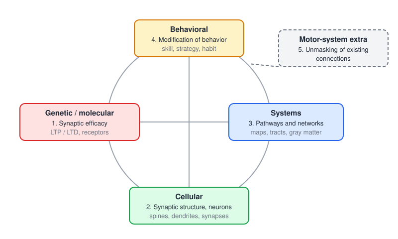
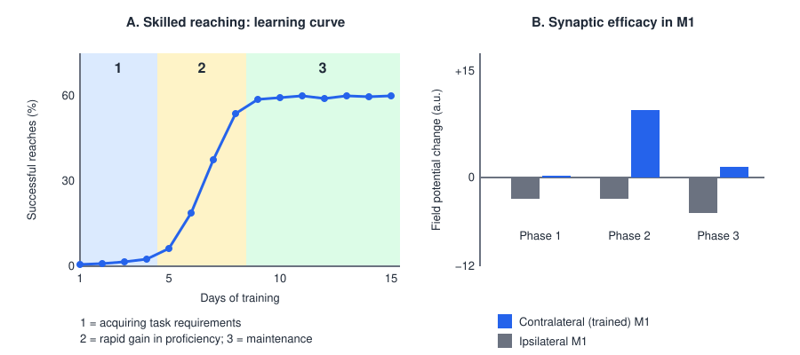
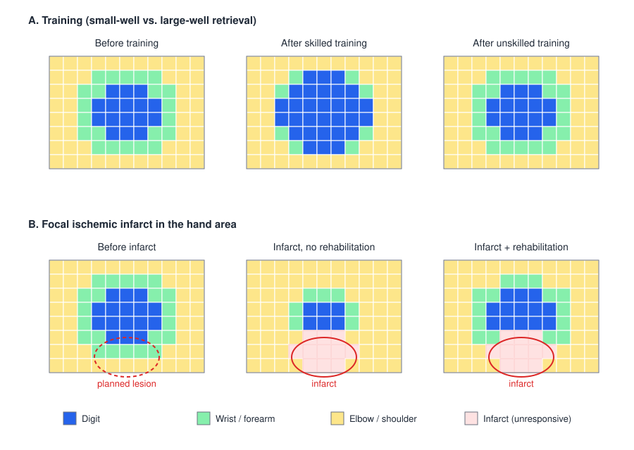

# Motor Plasticity and Recovery

Neural plasticity is the capacity of the nervous system to change its structure and function. In the motor system plasticity is the rule, not the exception: synapses, neurons, cortical maps and descending pathways change continually with use, with disuse, with development and after injury. This chapter describes the levels at which plasticity occurs and its mechanisms, the behavioral principles that drive it, the classic map experiments that established it in adult motor cortex, and how it shapes recovery after stroke and spinal cord injury. It is the biological counterpart of [Motor Learning](motor-learning.md): rehabilitation works by changing experience, and experience works by changing the nervous system.

## Plasticity at Four Levels

Plasticity can be studied at four linked levels of analysis, and a change at one level is usually accompanied by changes at the others.

| Level | What changes | Example |
|---|---|---|
| Genetic / molecular | **Synaptic efficacy**: receptor number and function, transmitter release, gene expression | Long-term potentiation (LTP) at a cortical synapse |
| Cellular | **Synaptic structure and neurons**: spines, dendrites, synapses, axon branches | Increased dendritic spine density after skill training |
| Systems | **Pathways and networks**: cortical maps, tracts, regional volume | Expansion of the digit representation in motor cortex |
| Behavioral | **Behavior**: skills, strategies, habits | Faster, more accurate reaching |

The motor system adds a fifth route: the **unmasking of existing connections**. Many anatomical connections are present but functionally silent, held in check by inhibition or overshadowed by stronger inputs. When inhibition is reduced or a dominant pathway is damaged, these latent connections can be expressed within minutes, far faster than new connections can grow. Descending input that normally plays a minor role, or segmental spinal circuits that receive afferent input alongside corticospinal input, can take on a larger role in this way.

*Figure: the five ways plasticity occurs in the motor system. The four levels of analysis (molecular, cellular, systems, behavioral) are linked, so that a change in synaptic efficacy, synaptic structure, network organization or behavior propagates to the others. Unmasking of existing connections is a fifth, fast route particularly important in the motor system.*

### Plasticity is ubiquitous and bidirectional

Plasticity is not reserved for special circumstances. Even pathological activity drives it: repeatedly inducing seizures in rats (kindling) enlarges motor-cortex movement maps and increases dendritic branching of cortical neurons (Teskey et al., 2006). Plasticity is also **bidirectional**. Maps and synapses can expand or shrink, strengthen or weaken, and the change can be **adaptive** (supporting recovery or skill) or **maladaptive** (spasticity, abnormal synergies, learned non-use, focal dystonia or [chronic pain](pain.md), in which central sensitization is a form of maladaptive spinal plasticity).

## Mechanisms

### Changes in synaptic efficacy: LTP and LTD

The fastest durable changes alter how strongly an existing synapse transmits. **Long-term potentiation (LTP)** is a persistent increase in synaptic strength produced by strong or correlated pre- and postsynaptic activity, the cellular form of Hebb's rule ("cells that fire together wire together"). At glutamatergic synapses in hippocampus and cortex, its induction depends on the **NMDA receptor**, which acts as a coincidence detector: it conducts only when glutamate is bound *and* the postsynaptic membrane is depolarized enough to expel its Mg²⁺ block. The resulting Ca²⁺ influx activates kinases (notably CaMKII) that phosphorylate AMPA receptors and insert more of them into the postsynaptic membrane, increasing the response to each release of transmitter. This early phase lasts hours; a late phase, lasting days or longer, requires gene transcription (via CREB) and protein synthesis and is accompanied by structural growth.

**Long-term depression (LTD)** is the converse: a persistent weakening, produced in cortex by low-frequency or uncorrelated activity (a smaller, slower Ca²⁺ rise that activates phosphatases and removes AMPA receptors). In the cerebellum, LTD at parallel-fiber–Purkinje-cell synapses, triggered when parallel-fiber input coincides with climbing-fiber error signals, is a key mechanism of motor adaptation (see [The Cerebellum](cerebellum.md)). **Spike-timing-dependent plasticity** refines the rule: a presynaptic spike that precedes the postsynaptic spike by a few milliseconds potentiates the synapse; the reverse order depresses it.

In the motor cortex, skill learning occludes LTP: after rats learn a skilled reach, LTP is harder to induce in the trained cortex and LTD easier, because the synapses have already been potentiated by learning. Synaptic efficacy is not altered once and for all; it rises during the phase of rapid skill gain and then returns toward baseline while the skill is maintained (see the Repetition section below).

### Changes in synaptic structure and neurons

With persistence, functional change becomes structural. Neurons grow and prune dendritic branches (**dendritic arborization**), add or remove **dendritic spines**, form new synapses (**synaptogenesis**), enlarge existing ones, and sprout new axon collaterals. The measurable changes fall into structural and functional categories:

| Structural | Functional |
|---|---|
| Dendritic arborization | Excitatory postsynaptic current |
| Dendritic spine density | Inhibitory postsynaptic current |
| Synapse number | Neuron firing frequency |
| Synapse size | Membrane resistance |
| Axonal arborization | Synaptic vesicle release |

Skill training in rats increases synapse number per neuron in the motor cortex, and in vivo imaging shows new spines forming within hours of training, a subset of which stabilize and persist as long as the skill is retained.

### Changes in pathways and networks

At the systems level, plasticity changes how whole regions and pathways are organized:

| Structural | Functional |
|---|---|
| Brain-region thickness or volume | Plasticity within a tract |
| Increases in gray matter | Using circuitry from other pathways (redundancy) |
| Motor-cortex reorganization | |
| Corticospinal-tract reorganization | |

The ability to use circuitry from other pathways depends on **redundancy**, which exists both within and across motor areas. Within primary motor cortex (M1), intracortical microstimulation (ICMS) maps of the squirrel monkey hand area show a mosaic: digit, wrist and forearm movements are each evoked from many separate, intermixed sites rather than one tidy patch (Nudo et al., 1996). Across areas, the same movements are also represented in premotor cortex and the supplementary motor area (Plautz and Nudo, 2005). After damage to one site, the same movement can still be produced from others, which gives the system raw material for reorganization (see [Motor Cortex](motor-cortex.md)).

## When Plasticity Occurs

Motor plasticity occurs with **increased** motor activity, with **decreased** motor activity, and after **lesions** of the motor system. Every patient in a rehabilitation clinic falls into at least one of three categories that drive plasticity: experience, injury and development, and often more than one.

## Principles of Experience-Dependent Plasticity

Four behavioral principles are the main drivers of motor plasticity: **use it or lose it, specificity, repetition and novelty**, modulated by **salience, intensity and difficulty**. These correspond to the principles of experience-dependent plasticity compiled by Kleim and Jones (2008), whose full list is:

1. **Use it or lose it** — failure to drive specific brain functions leads to their degradation.
2. **Use it and improve it** — training that drives a function enhances it.
3. **Specificity** — the nature of the training dictates the nature of the plasticity.
4. **Repetition matters** — inducing durable plasticity requires sufficient repetition.
5. **Intensity matters** — sufficient training intensity is needed.
6. **Time matters** — different forms of plasticity occur at different times during training and recovery.
7. **Salience matters** — the training experience must be meaningful to the individual.
8. **Age matters** — training-induced plasticity is greater in the younger brain.
9. **Transference** — plasticity in response to one training experience can enhance the acquisition of similar behaviors.
10. **Interference** — plasticity in response to one experience can impede the acquisition of other behaviors (for example, learned compensatory patterns can interfere with recovery of normal ones).

### Use it or lose it

Three map studies show the principle in its different guises.

- **Increased use expands territory.** In rats trained on a skilled reaching task, ICMS maps of motor cortex taken at day 3, day 7 and day 10 of training show the forepaw (distal) representation progressively expanding while the shoulder representation shrinks (Kleim et al., 2004). Notably, the map changes appear late, after the skill has largely been acquired: map reorganization consolidates learning rather than causing the earliest gains. Synaptogenesis precedes map change, and both follow, rather than lead, the first improvements in behavior.
- **Decreased use shrinks territory.** After amputation of a forelimb, the cortical territory that had represented the digits and wrist is taken over by neighboring representations; stimulation now evokes movement of the stump and an expanded shoulder (Raineteau and Schwab, 2001).
- **Damage shrinks territory further.** A small ischemic infarct placed in part of the squirrel monkey M1 hand representation destroys that part directly, but in the weeks that follow, if the animal receives no rehabilitative training, the **spared** hand representation around the lesion also shrinks, and elbow and shoulder representations expand into former hand territory (Nudo, 2001). The animal compensates with proximal movements, and the cortex follows behavior. With rehabilitative training of skilled hand use, the spared hand territory is preserved and can even expand into regions formerly devoted to elbow and shoulder.

### Specificity

Only movement patterns specific to what is practiced change. Rats trained on a skilled reaching task, requiring precise wrist and digit movement, show expanded wrist and digit representations in the caudal and rostral forelimb areas; rats that perform an equal amount of unskilled, simple reaching do not (Kleim et al., 1998).

### Repetition

Motor plasticity requires many repetitions and appears as skill increases. In rats learning a skilled reach, the learning curve has three phases (Monfils and Teskey, 2004): (1) acquisition of the task requirements, with few successes over the first several days; (2) a steep increase in proficiency, from about 5% to about 60% success over a few days; and (3) maintenance of skilled proficiency at a plateau. Field-potential recordings show that synaptic efficacy in the **contralateral** (trained) motor cortex rises sharply during phase 2 and falls back toward baseline during phase 3, whereas the ipsilateral cortex shows no increase.

*Figure: repetition and the time course of synaptic change (schematic values after Monfils and Teskey, 2004). A: success in a skilled reaching task rises in an S-shaped curve with three phases: acquiring task requirements, rapid gain in proficiency, and maintenance. B: LTP-like potentiation of synaptic efficacy in the trained (contralateral) motor cortex is large during phase 2 and returns toward baseline in phase 3; the untrained (ipsilateral) cortex shows no potentiation.*

The time course explains why synaptic potentiation, synaptogenesis and map change occur at different stages, and why practice has to continue beyond the first rapid improvements for changes to be consolidated into structure.

### Novelty: learning, not just repetition

The decisive experiment (Nudo et al., 1996) trained squirrel monkeys to retrieve food pellets from wells in a Klüver board. Retrieving from a **small well** required a new skill: fine control of one or two digits. Retrieving from a **large well** required no new skill: the monkey could scoop the pellet with the whole hand. Both groups made large numbers of retrievals. After small-well training, the digit and digit-plus-wrist representations in M1 expanded substantially, at the expense of wrist and forearm; after large-well training, despite comparable repetition, the maps were essentially unchanged. A related task requiring forearm rotation (turning a key) expanded the forearm representation instead. The changes were progressive and reversible, and they followed skill acquisition rather than repetition alone.

*Figure: schematic M1 hand-area maps. A: skilled (small-well) training expands the digit representation (blue) at the expense of wrist and forearm (green); unskilled (large-well) training leaves the map unchanged. B: a focal infarct destroys part of the hand area; without rehabilitation the spared digit and wrist representation shrinks and elbow/shoulder territory (yellow) expands into it, whereas with rehabilitative training the spared hand representation is preserved.*

The lesson for rehabilitation is direct: repetition of an easy, already mastered movement does not reorganize the motor cortex. Practice has to pose a motor problem that the learner has not yet solved (see [Motor Learning](motor-learning.md)).

### Salience, intensity and difficulty

Animals in these studies are motivated (the task yields food), train intensively (hundreds of trials per day) and face tasks of graded difficulty. Each is necessary. Salience engages neuromodulatory systems (dopamine, acetylcholine, noradrenaline) that gate plasticity in cortex; intensity determines whether enough repetitions accumulate; difficulty keeps the task in the range where errors and successes both occur.

## Implications for Rehabilitation

### Rehabilitation as a modifier of experience

Physical rehabilitation acts on a loop: **motor behavior** drives **motor-system plasticity**, and plasticity changes motor behavior. Rehabilitation enters the loop by changing behavior, that is, by modifying the person's motor experience. It is a tool to guide the learning process toward beneficial plasticity rather than maladaptive change.

Experience can restore motor maps after injury. In rats, motor maps before and after an infarct in motor cortex show that without rehabilitation the map loses most of its responsive forelimb territory around the lesion, while with rehabilitative training substantially more distal and proximal forelimb territory is retained or recovered (Kleim et al., 2011).

### The type of training determines what changes

The motor experience dictates what is modified, and where (Adkins et al., 2006; Mang et al., 2013):

| Training type | Changes | No change in |
|---|---|---|
| **Endurance** (e.g. treadmill running) | Angiogenesis in motor cortex; increased neurotrophic factors (e.g. BDNF) | Synapse number, motor maps |
| **Skill** (e.g. skilled reaching, learning a new movement) | Synaptic efficacy, synaptogenesis and map reorganization in motor cortex | — |
| **Strength** (e.g. resistance training) | Synaptic efficacy and synaptogenesis in the spinal cord; increased spinal motoneuron excitability | Motor-cortex maps |

Specificity therefore matters at the level of the whole nervous system: strength training adapts spinal circuits, skill training adapts cortex, and aerobic training improves the metabolic and trophic environment in which other plasticity occurs. Combining aerobic exercise with skill practice is one rationale for priming the brain before task training.

### Constraint-induced movement therapy

**Constraint-induced movement therapy (CIMT)** applies these principles to the paretic arm after stroke. It has two components: the less-affected hand is restrained in a mitt for most waking hours, which forces use of the more-affected arm and counters **learned non-use**; and the more-affected arm receives intensive, **shaped** task practice, with difficulty progressed in small steps. It is thus high in dose, specificity, difficulty and salience.

The **EXCITE** trial, a multicenter randomized trial in people 3–9 months after stroke who had some active wrist and finger extension, found that two weeks of CIMT produced larger and longer-lasting gains in arm function and real-world use than usual care, persisting at one year (Wolf et al., 2006). TMS mapping in a subset of EXCITE participants showed that the motor map of the affected hand in the damaged hemisphere enlarged with CIMT, from about 5.6 cm² at baseline to about 6.0 cm² after two weeks and about 7.2 cm² at four months, while maps in the control group drifted slightly downward from about 4.6 to 4.2 cm² (Sawaki et al., 2008). Behavioral improvement and cortical reorganization went together, and the map continued to expand after treatment ended, presumably because patients kept using the arm.

### Recovery after stroke

After a stroke, recovery reflects several processes acting on different time scales: resolution of edema and diaschisis (depressed function in intact regions connected to the lesion) over days; a period of heightened, injury-induced plasticity over the first weeks to months; and slower experience-dependent learning thereafter.

**Molecular programs.** The peri-infarct cortex enters a growth-promoting state: neurons that survive near the infarct reactivate developmental genes, sprout new axons and form new connections, while growth-inhibiting molecules (myelin-associated inhibitors, chondroitin sulfate proteoglycans in the glial scar) and tonic GABAergic inhibition limit the process. Overman and Carmichael (2014) argue that molecular signals alone are not enough: which connections form and persist depends on neural activity and behavioral experience, so molecular and rehabilitation therapies must be combined.

**Corticospinal tract integrity.** How much a patient can recover depends heavily on whether the corticospinal tract (CST) from the damaged hemisphere still conducts. In a cohort of 93 patients, those in whom TMS still evoked motor-evoked potentials (MEPs) in the paretic arm recovered about 70% of their possible upper-limb improvement by 12 weeks, whatever their initial impairment; this is the **proportional recovery rule**. Recovery was predicted by MEP status and by fractional anisotropy of the posterior limb of the internal capsule on diffusion imaging, not by the dose of therapy received (Byblow et al., 2015). Patients without MEPs recover less predictably and often rely on other pathways, such as the reticulospinal tract, which can support strength at the cost of synergies and poor dexterity (see [Descending Pathways](descending-pathways.md)). CST integrity is therefore the most useful biomarker for predicting arm recovery and setting realistic goals.

**Network effects.** A focal lesion affects distant regions. After subcortical damage to the CST, resting-state imaging shows disrupted interhemispheric connectivity between the somatomotor cortices upstream of the lesion, and the disruption correlates with motor deficits (Carter et al., 2012). Recovery is a property of networks, not of a single region.

**Fatigue.** Post-stroke fatigue, common even in patients with good motor recovery, is associated with reduced corticospinal excitability (higher resting motor threshold) and greater perceived effort (Kuppuswamy et al., 2015).

### Recovery after spinal cord injury

The spinal cord below an injury is not a passive cable; it reorganizes as well (see [Spinal Cord Injury](../../biomed/neuro/spinal-cord-injury.md)).

- **Neuromodulatory plasticity.** Loss of descending serotonin after SCI leads motoneuron 5-HT2C receptors to become **constitutively active**, through altered RNA editing. This restores persistent inward currents and motoneuron excitability, which supports recovery of locomotor function but also drives muscle spasms; inverse agonists of the receptor reduce the spasms (Murray et al., 2010). Adaptive and maladaptive plasticity share one mechanism.
- **Spared-pathway plasticity.** In incomplete injuries, spared descending axons sprout and form new relay circuits through propriospinal interneurons. **Acute intermittent hypoxia** (fifteen 90-second episodes of breathing 9% oxygen) triggers serotonin-dependent spinal plasticity via BDNF and its TrkB receptor; given daily, it improved walking speed in chronic incomplete SCI, and combined with walking practice it also improved endurance (Hayes et al., 2014).
- **Training.** Body-weight-supported treadmill training, intended to engage spinal locomotor circuits, gave no better outcomes than an equal dose of over-ground mobility training in a large trial in incomplete SCI (Dobkin et al., 2006). The amount and specificity of practice mattered more than the device.
- **Activity-dependent stimulation.** Pairing spinal stimulation with the person's own motor commands harnesses spike-timing-dependent plasticity. In rats with cervical contusion, intraspinal stimulation triggered by the animal's own forelimb EMG produced more than twice the recovery of reach-and-grasp seen with open-loop stimulation or training alone, and the gains outlasted stimulation (McPherson et al., 2015). Transcutaneous and epidural spinal stimulation combined with training rely on similar principles (see [Transcutaneous Spinal Cord Stimulation](../../biomed/neuro/tscs.md) and [Spinal Cord Stimulation](../../biomed/neuro/spinal-stimulation.md)).

### Non-invasive brain stimulation as an adjunct

Non-invasive brain stimulation aims to put the motor system into a state in which training produces more plasticity.

- **Repetitive TMS (rTMS)** delivers trains of magnetic pulses that induce currents in cortex. High-frequency (≥5 Hz) trains and intermittent theta-burst stimulation tend to increase cortical excitability; low-frequency (about 1 Hz) trains and continuous theta-burst tend to decrease it.
- **Transcranial direct current stimulation (tDCS)** passes a weak (1–2 mA) constant current between scalp electrodes. It does not fire neurons but shifts resting potentials: anodal stimulation generally increases and cathodal decreases excitability, and effects that outlast the stimulation depend on NMDA receptors, consistent with an LTP- or LTD-like mechanism.

After unilateral stroke, one rationale is **interhemispheric competition**: the intact hemisphere may inhibit the damaged one via the corpus callosum, so exciting the lesioned hemisphere or inhibiting the intact one could help. This model applies best to patients with mild impairment; in patients with large lesions the intact hemisphere may instead support recovery. Effects in clinical trials have been modest and variable. Stimulation is most useful as an **adjunct paired with training**, not on its own: cerebellar anodal tDCS during adaptation speeds learning in young people (Jayaram et al., 2012) and restores the adaptation rate of older adults to youthful levels (Hardwick and Celnik, 2014). The physics of stimulation is covered in [Electrical Stimulation of Neural Tissue](../../biomed/neuro/stimulation-theory.md) and [Deep Brain Stimulation and Neuromodulation](../../biomed/neuro/neuromodulation.md).

### Immobilization and disuse

Disuse acts quickly. After only eight hours of index-finger immobilization in healthy adults, TMS motor-evoked potentials of the immobilized muscle were reduced, without changes in intracortical inhibition or facilitation; immobilization also altered use-dependent plasticity and the learning and retention of a grooved-pegboard skill (Opie et al., 2016). Longer immobilization (weeks of casting) shrinks the cortical representation of the immobilized muscles. For patients, prolonged slings, casts and non-use of a paretic limb are not neutral: they drive "use it or lose it" in the wrong direction, and the resulting **learned non-use** is exactly what CIMT is designed to reverse.

## Clinical Correlations

- **Timing.** A window of heightened plasticity in the first weeks to months after stroke favors early, intensive rehabilitation; very early, very high-intensity training of the affected limb can, however, enlarge an infarct in animal models, so intensity must be balanced against safety.
- **Prognosis.** TMS MEP status and diffusion imaging of the CST, combined with early clinical scores, predict upper-limb recovery and help set goals (Byblow et al., 2015).
- **CIMT.** Effective for patients with some preserved wrist and finger extension; its benefit and the accompanying map expansion persist after treatment (Wolf et al., 2006; Sawaki et al., 2008).
- **Spasticity and spasms.** Maladaptive plasticity of spinal motoneurons (constitutive 5-HT2C activity, persistent inward currents) underlies spasms after SCI and contributes to spasticity after stroke.
- **Neuropathic pain.** Pain after nerve or spinal injury reflects maladaptive plasticity in the dorsal horn and brain (see [The Neuroscience of Pain](pain.md)).
- **Adjunct therapies.** Brain stimulation, intermittent hypoxia and pharmacological modulation are promising only when combined with task-specific practice that gives the plasticity a direction.

## Key Readings

- Nudo RJ, Milliken GW, Jenkins WM, Merzenich MM (1996). *Use-dependent alterations of movement representations in primary motor cortex of adult squirrel monkeys*. Journal of Neuroscience. — Showed that adult M1 maps are reshaped by skill learning, not by repetition alone.
- Overman JJ, Carmichael ST (2014). *Plasticity in the injured brain: more than molecules matter*. The Neuroscientist. — Reviews injury-induced molecular programs and why they must be combined with experience.
- Buch ER, Liew S-L, Cohen LG (2017). *Plasticity of sensorimotor networks: multiple overlapping mechanisms*. The Neuroscientist. — Links synaptic, network and systems plasticity to skill learning and recovery.
- Byblow WD, Stinear CM, Barber PA, Petoe MA, Ackerley SJ (2015). *Proportional recovery after stroke depends on corticomotor integrity*. Annals of Neurology. — Corticospinal integrity, not therapy dose, predicts proportional recovery.
- Carter AR, Patel KR, Astafiev SV, et al. (2012). *Upstream dysfunction of somatomotor functional connectivity after corticospinal damage in stroke*. Neurorehabilitation and Neural Repair. — Focal lesions disrupt cortical networks upstream.
- Murray KC, Nakae A, Stephens MJ, et al. (2010). *Recovery of motoneuron and locomotor function after spinal cord injury depends on constitutive activity in 5-HT2C receptors*. Nature Medicine. — One receptor mechanism drives both recovery and spasms.
- Hardwick RM, Celnik PA (2014). *Cerebellar direct current stimulation enhances motor learning in older adults*. Neurobiology of Aging. — Non-invasive stimulation as an adjunct to learning.
- Opie GM, Evans A, Ridding MC, Semmler JG (2016). *Short-term immobilization influences use-dependent cortical plasticity and fine motor performance*. Neuroscience. — Hours of disuse change motor cortex and later learning.

## See Also

- [Motor Learning](motor-learning.md): the behavioral principles that drive plasticity.
- [Motor Cortex](motor-cortex.md): maps, redundancy and corticospinal output.
- [Descending Pathways](descending-pathways.md): corticospinal and reticulospinal routes to recovery.
- [Neurons, Synapses, and the Neuromuscular Junction](neurons-synapses.md): synaptic transmission underlying LTP and LTD.
- [Spinal Cord Injury](../../biomed/neuro/spinal-cord-injury.md) and [Transcutaneous Spinal Cord Stimulation](../../biomed/neuro/tscs.md): neuromodulation-driven spinal plasticity.
- [Deep Brain Stimulation and Neuromodulation](../../biomed/neuro/neuromodulation.md): stimulation technologies.
- [Rehabilitation Devices](../../biomed/rehab.md): robots and devices for delivering practice.
