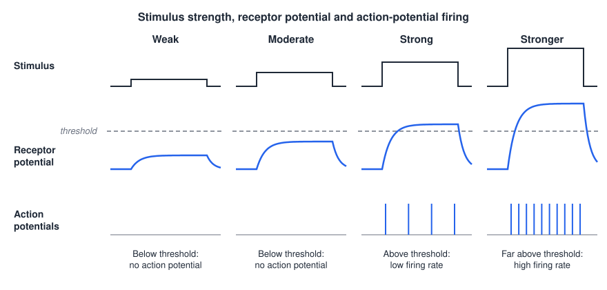
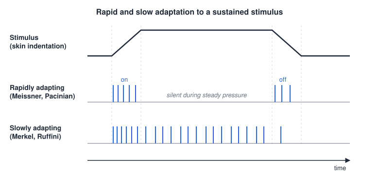
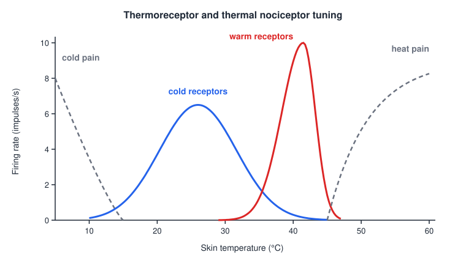
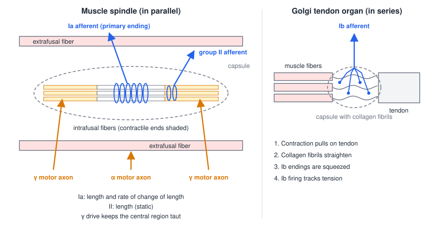
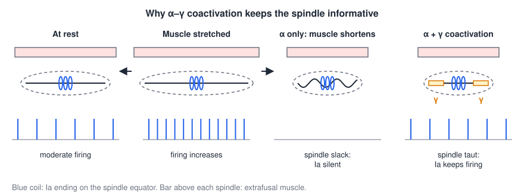

# Sensory Receptors and Afferent Coding

Every movement is shaped by sensory feedback. Before the brain can correct a grasp, adjust a step or learn a new skill, physical events in the skin, muscles and joints must be converted into trains of action potentials and carried into the central nervous system. This chapter covers how sensory receptors are classified, how they transduce stimuli, how a population of afferents encodes what a stimulus is, how strong it is, how long it lasts and where it is, and the receptors most important for movement: the cutaneous mechanoreceptors, thermoreceptors, nociceptors and the two muscle proprioceptors, the muscle spindle and the Golgi tendon organ.

## What a Sensory Receptor Is

A **sensory receptor** is a specialized nerve cell, or the specialized terminal of a nerve cell, that detects a particular kind of stimulus. In the somatosensory system the receptor is usually the peripheral ending of a primary afferent neuron itself. Its cell body sits in a dorsal root ganglion (for the body) or the trigeminal ganglion (for the face), and it is **pseudo-unipolar**: one process runs out to the receptor ending and the other runs into the spinal cord or brainstem. Special senses such as vision, hearing and balance instead use separate receptor cells (rods and cones, hair cells) that synapse onto afferent neurons.

### Ways to classify receptors

Receptors can be grouped in two complementary ways.

- **By the origin of the stimulus.** *Exteroceptors* respond to stimuli from outside the body (touch on the skin, heat, light). *Interoceptors* (enteroceptors) respond to stimuli from inside the body (stretch of a muscle or a viscus, blood chemistry).
- **By the nature of the stimulus.** *Photoreceptors* (light), *thermoreceptors* (temperature), *mechanoreceptors* (deformation, stretch, vibration), *chemoreceptors* (chemicals, including taste and smell) and *nociceptors* (stimuli that damage or threaten to damage tissue).

Each sense pairs an organ with its own receptor type: rods and cones in the eye, olfactory neurons in the nasal epithelium, taste buds on the tongue, encapsulated endings in the skin for touch, free nerve endings for temperature and pain, hair cells in the cochlea and vestibular labyrinth, and muscle spindles for proprioception.

### Four features common to all receptors

1. **Specificity.** Each receptor is tuned to one kind of stimulus energy, its **adequate stimulus**. A Pacinian corpuscle responds to vibration at threshold amplitudes far smaller than the pressure or heat needed to excite it. Specificity comes from the transduction apparatus (a mechanically gated channel, a photopigment, a chemoreceptor protein) and from accessory structures such as capsules.
2. **Receptive field.** The region of space (for a skin receptor, a patch of skin) in which an adequate stimulus will make the receptor respond.
3. **Sensory transduction.** The conversion of stimulus energy into an electrical signal.
4. **Receptor potentials.** Transduction produces a graded change in membrane potential. It must be large enough to bring the spike-initiating zone to threshold. The resulting action potentials are the neural code for the stimulus, and they change as the stimulus changes.

## Sensory Transduction

Transduction follows the same sequence in every somatosensory receptor:

> physical stimulus → depolarization of the receptor membrane → **receptor potential** → **action potentials** in the afferent fiber

The two electrical steps have very different properties. The receptor potential is a **graded, local** signal: its amplitude scales with the stimulus, and it spreads passively and decrementally, fading within a fraction of a millimeter (the length-constant decay described in [Cable Theory](../../biomed/bioelectric/cable.md)). It cannot travel to the spinal cord. The action potential is all-or-none and regenerative, so it is the **only** way the signal can cross the distance, sometimes over a meter, to the central nervous system.

A mechanoreceptor such as the Pacinian corpuscle shows the mechanism clearly. When the lamellated, onion-like capsule around the nerve ending is deformed, the stretch is transmitted to the axon membrane and opens **stretch-sensitive (mechanically gated) cation channels**. Na⁺ flows in and the terminal depolarizes: this depolarization is the receptor potential. Whether an action potential follows depends on stimulus strength. A weak or moderate stimulus produces a receptor potential that stays below threshold at the first node of Ranvier, and no spike is generated. A strong stimulus produces a receptor potential that crosses threshold, and the afferent fires.

*Figure: stimulus strength sets the size of the receptor potential (blue), and the receptor potential sets the firing. Weak and moderate steps give subthreshold receptor potentials and no action potentials. A strong step just crosses the dashed threshold and gives a low firing rate; a stronger step drives the receptor potential far above threshold and the firing rate rises.*

## How Stimuli Are Encoded

A somatosensory stimulus has four attributes that the nervous system must recover: **modality, intensity, duration and location**.

### Modality

Modality is the type of stimulus energy. The somatosensory modalities are **touch, itch, temperature, proprioception and pain**. Modality is coded mainly by *which* afferents are active (a "labeled line"): a Meissner afferent signals touch whether it is excited by a fingertip tap or by an electrical pulse. This is why electrical stimulation of a nerve, of the dorsal columns or of the cortex produces sensations in the modality of the fibers it recruits (see [Sensory Prostheses](../../biomed/neuro/sensory-prostheses.md)).

### Intensity

Stimulus intensity is coded by the **firing rate** of individual receptors (a rate code) and by the **number of receptors recruited** (a population code). Within one afferent, a larger stimulus gives a larger receptor potential, which drives the spike-initiating zone further above threshold and shortens the interval between spikes. The receptor potential must exceed threshold for anything to be signaled at all. Thresholds are not fixed: they shift with practice, fatigue and context, and central mechanisms can raise or lower the gain of a sensory channel.

Rate is not the only code. In human microneurography from fingertip afferents, the **relative timing of the first spike** across a population of afferents carried information about the direction of fingertip force and the curvature of a contacted surface, faster than any rate code could (Johansson and Birznieks 2004). This explains how grip forces can be corrected within about 100 ms of a slip.

### Duration: adaptation

The response to a sustained stimulus depends on the receptor type.

- **Rapidly adapting (RA, or fast adapting, FA) receptors** fire a burst at stimulus onset, fall silent while the stimulus is held steady, and often fire again at offset. They signal *change*: movement of a stimulus across the skin, vibration, the moment of contact and release.
- **Slowly adapting (SA) receptors** fire during the onset and then continue with a sustained discharge for as long as the stimulus lasts. They signal the *steady state*: maintained pressure, skin stretch, static position.

*Figure: a ramp-and-hold indentation of the skin (top). A rapidly adapting afferent (middle) fires only during the ramps, giving an "on" and an "off" response, and is silent during the plateau. A slowly adapting afferent (bottom) fires fastest during the ramp and then keeps firing throughout the plateau.*

Adaptation has both mechanical and membrane origins. In the Pacinian corpuscle, the fluid-filled lamellae of the capsule redistribute a steady pressure so that the nerve ending inside is deformed only transiently; strip the capsule away and the ending adapts more slowly. Voltage-dependent and Ca²⁺-dependent K⁺ currents in the terminal add a further, membrane-level adaptation.

### Location: receptive fields and two-point discrimination

Location is coded by **which** receptors are active, that is, by their receptive fields. Receptive fields differ widely in size, from a sharp spot a couple of millimeters across to a diffuse area covering much of a finger or palm. How well a region of skin can localize a stimulus depends on two things: the **size of the receptive fields** and the **density of receptors** innervating it.

The clinical measure is **two-point discrimination**: the smallest distance between two simultaneously applied points (for example, the tips of calipers) at which a person perceives two stimuli instead of one. On the fingertip, where receptive fields are small and densely packed, two points a few millimeters apart fall on separate receptive fields and are felt as two. On the forearm, receptive fields are large and overlapping, and the same two points excite a common set of afferents and feel like one. **The two-point threshold is a function of receptive-field size and receptor density.**

| Body site | Approximate two-point threshold (mm) |
|---|---|
| Fingers 1–4, thumb | 2–4 |
| Upper lip | ~5 |
| Cheek | 7–8 |
| Nose | 8–9 |
| Palm | 10–11 |
| Toe | ~12 |
| Forehead | 15–17 |
| Sole | 20–22 |
| Belly | 31–33 |
| Lower arm | 38–40 |
| Breast | ~39 |
| Upper arm, back | 40–42 |
| Shoulder | 43–46 |
| Thigh | 43–44 |
| Calf | 45–47 |

The fingertips and lips have the finest discrimination; the trunk, thigh and calf the poorest. The same gradient appears in the cortex, where the fingertips and lips occupy disproportionately large territories (see [Somatosensory Cortex and Plasticity](somatosensory-cortex.md)).

## Classifying Somatosensory Afferents

Somatosensory afferents have their cell bodies in the dorsal root ganglia (or trigeminal ganglion). Two afferent types illustrate the range: a **large myelinated mechanosensory afferent** that ends in an encapsulated receptor, and a **small, thinly myelinated or unmyelinated pain-and-temperature afferent** that ends as free nerve endings. Afferents are classified in two parallel systems, one by fiber diameter and conduction velocity (letters, originally devised for all peripheral nerve fibers) and one by origin and size of muscle afferents (Roman numerals).

| Letter | Roman (afferent group) | Diameter (µm) | Conduction velocity (m/s) | Main function |
|---|---|---|---|---|
| Aα | Ia, Ib | 13–22 | 70–120 | Muscle spindle primary endings (Ia), Golgi tendon organs (Ib); also α motor axons (efferent) |
| Aβ | II | 8–13 | 40–70 | Touch, kinesthesia, muscle spindle secondary endings |
| Aγ | — | 4–8 | 15–40 | γ motor axons to muscle spindles (efferent); touch, pressure |
| Aδ | III | 1–4 | 5–15 | Sharp pain, crude touch, pressure, temperature (cold) |
| B | — | 1–3 | 3–14 | Preganglionic autonomic |
| C | IV | 0.1–1 (unmyelinated) | 0.2–2 | Slow pain, itch, temperature (warm), crude touch, postganglionic autonomic |

Aα fibers are the biggest and fastest; C fibers are the smallest and slowest, and the only unmyelinated class. Velocity follows diameter because, for myelinated fibers, conduction velocity grows roughly linearly with diameter (about 6 m/s per µm), while for unmyelinated fibers it grows only with the square root of diameter (see [Myelinated Axon Models](../../biomed/bioelectric/node-models.md)). Published ranges differ somewhat between sources; the table in [Neurophysiology Foundations](../../biomed/neuro/neurophysiology.md) gives slightly different boundaries for the same classes. Fiber size also governs which fibers an electrode recruits first, which is why large Ia and Aβ afferents are the first targets of spinal and peripheral stimulation.

Somatosensory receptors are also grouped by the stimulus they transduce: **mechanoreceptors** (free nerve endings, Meissner corpuscles, Merkel cell–neurite complexes, Ruffini endings, Pacinian corpuscles), **proprioceptors** (muscle spindles, Golgi tendon organs, joint receptors), **thermoreceptors** (cold and warm endings) and **nociceptors** (free nerve endings).

## Cutaneous Mechanoreceptors

The skin has an epidermis, a dermis and a subcutaneous layer, and its mechanoreceptors sit at different depths:

- **Free nerve endings** reach up into the epidermis.
- **Superficial receptors**, at the junction of epidermis and dermis in the dermal papillae: **Meissner corpuscles** and **Merkel cell–neurite complexes**.
- **Deep receptors**: spindle-shaped **Ruffini endings** in the dermis and large, onion-like **Pacinian corpuscles** in the subcutaneous layer.

Depth largely determines receptive-field size. A superficial receptor is deformed only by stimuli directly above it, so it has a small receptive field with sharp borders. A deep receptor is reached by deformation spreading through a large volume of tissue, so its receptive field is large with indistinct borders. Combining the two axes, field size (type I small, type II large) and adaptation (slow vs fast), gives the classic 2 × 2 classification of the glabrous (hairless) skin of the hand.

| | Slowly adapting (static response present) | Fast adapting (no static response) |
|---|---|---|
| **Type I: small field, sharp borders** (dense at the fingertips) | **SA I – Merkel** (≈25% of hand afferents): irregular sustained firing; edge sensitive | **FA I – Meissner** (≈43%): bursts at on and off; edge sensitive |
| **Type II: large field, obscure borders** (sparser, more uniform) | **SA II – Ruffini** (≈19%): regular sustained firing; sensitive to lateral skin stretch | **FA II – Pacinian** (≈13%): brief on/off transients; vibration |

The percentages are the proportions of mechanoreceptive afferents innervating the human hand. Receptive-field size, adaptation and innervation density together decide which stimuli each receptor detects best:

- **Merkel (SA I)**: sustained pressure, fine spatial detail, form, texture and edges. With small fields, high density and a sustained response, Merkel afferents give the highest spatial resolution.
- **Meissner (FA I)**: light touch, low-frequency flutter (roughly 5–50 Hz) and slip of an object across the skin; essential for grip control.
- **Pacinian (FA II)**: high-frequency vibration (best near 200–300 Hz) and transient deep pressure, transmitted from distant sites; extremely sensitive but with almost no spatial resolution. Pacinian afferents also detect vibrations transmitted through a held tool.
- **Ruffini (SA II)**: lateral skin stretch and sustained deep pressure. Because skin stretches as joints move, Ruffini afferents also contribute to the sense of finger and joint position.

Reading Braille shows how these signals combine. When a fingertip is scanned across raised Braille dots and the firing of each afferent type is reconstructed as a spatial image, Merkel afferents reproduce the dot pattern crisply; Meissner afferents give a recognizable but blurred pattern; Ruffini afferents fire sparsely with no recognizable pattern; and Pacinian afferents fire densely and uniformly, with no pattern at all. Perception of the letters relies on the high-resolution SA I channel, while the others report contact, movement and vibration.

## Thermoreceptors

Thermoreceptors are free nerve endings that sense skin temperature, and there are two kinds.

- **Cold receptors** increase their firing as temperature *decreases*; they are active between about **5 and 40 °C**. They are mostly carried by thinly myelinated Aδ fibers.
- **Warm receptors** increase their firing as temperature *increases*; they are active between about **29 and 45 °C**. They are carried by unmyelinated C fibers.

*Figure: static firing rate against skin temperature. Cold receptors (blue) have a broad tuning curve peaking in the mid-20s °C; warm receptors (red) peak near 41–42 °C and fall silent above about 47 °C. Below about 15 °C and above about 45 °C, thermal nociceptors (dashed gray) take over and the sensation becomes cold pain or heat pain.*

Because each thermoreceptor's static curve is bell-shaped, a single afferent cannot report temperature unambiguously: a cold fiber fires the same at 18 °C and 34 °C. Temperature is read from the *ratio* of activity across cold and warm populations, and thermoreceptors respond much more vigorously to temperature *change* than to steady temperature, which is why a pool feels cold on entry and neutral a minute later. Transduction is by temperature-gated TRP channels (TRPM8 in cold endings; TRPV1 in heat nociceptors). Above about 45 °C and below about 15 °C, thermal **nociceptors** respond, and the sensation changes from temperature to pain.

## Nociceptors

Nociceptors are **unspecialized free nerve endings**, distributed throughout skin, muscle, joints and viscera, that respond to stimuli intense enough to damage tissue. They fall into overlapping classes:

- **Aδ mechanosensitive nociceptors** respond to intense mechanical stimuli such as a pinprick.
- **Aδ mechanothermal nociceptors** respond to intense mechanical and thermal stimuli.
- **C polymodal nociceptors** respond to intense mechanical, thermal and chemical stimuli, including substances released from damaged tissue and inflammatory cells.

The two fiber types give pain two phases. A sudden injury produces a sharp, well-localized **first pain** carried by fast Aδ fibers, followed after a delay by a dull, burning, poorly localized and longer-lasting **second pain** carried by slow C fibers. The delay between them is a direct consequence of the difference in conduction velocity. The central processing of nociceptive signals, sensitization and the modulation of pain are covered in [Pain](pain.md).

## Proprioceptors

**Proprioceptors** report mechanical forces arising within the body itself. The sense of limb and body position (static position sense) and of limb movement (**kinesthesia**) does not come from any single receptor. It is built from four sources: **muscle spindles**, **Golgi tendon organs**, **joint receptors** and **cutaneous receptors** (skin stretch over moving joints). Muscle spindles carry most of the weight, but the cutaneous contribution is substantial: stretching the skin alone can produce illusions of joint movement at the finger, elbow and knee (Collins et al. 2005). The importance of all this input for action was shown by deafferentation experiments: monkeys whose dorsal roots were cut barely used the affected limb at first and regained only coarse movement (Twitchell 1954).

### The muscle spindle

The **muscle spindle** senses muscle **length** and the **rate of change of length**. It is a fusiform capsule, a few millimeters long, lying among and **in parallel with** the ordinary force-producing (**extrafusal**) muscle fibers, so it is stretched whenever the whole muscle is stretched.

Inside the capsule are specialized **intrafusal muscle fibers**. Their central (equatorial) regions contain nuclei but few contractile elements; their polar ends are striated and contractile. Two structural types are usually distinguished: **nuclear bag fibers** (dynamic bag₁ and static bag₂), with nuclei clustered in the swollen center, and thinner **nuclear chain fibers**, with nuclei in a single row. Four kinds of axon innervate the spindle:

- **Group Ia afferent (primary ending)**: a large Aα fiber whose **annulospiral** ending wraps around the equatorial region of every intrafusal fiber. It is highly sensitive to both length and especially the *velocity* of stretch (a strong dynamic response).
- **Group II afferent (secondary ending)**: an Aβ fiber whose "flower-spray" endings lie next to the equator, mainly on chain and static bag fibers. It signals mostly static length.
- **γ (fusimotor) motor axons**: small Aγ efferents that end on the contractile polar regions of the intrafusal fibers. Dynamic γ axons raise the velocity sensitivity of the Ia ending; static γ axons raise the length sensitivity of Ia and II endings.
- **α motor axons** do not innervate the spindle; they supply the surrounding extrafusal fibers.

*Figure: left, the muscle spindle lies in parallel with extrafusal fibers. The Ia afferent coils around the noncontractile equator of the intrafusal fibers and the group II afferent ends beside it; γ motor axons (amber) end on the contractile polar ends, while the α motor axon supplies extrafusal muscle. Right, the Golgi tendon organ lies in series at the muscle–tendon junction; branches of the Ib afferent are woven between collagen fibrils inside its capsule.*

When the muscle is stretched, the spindle is stretched, the equatorial region elongates, mechanically gated channels in the afferent terminals open, and the Ia and II afferents increase their firing. At rest the spindle is under slight tension and fires at a moderate background rate.

### α–γ coactivation

A spindle that simply hung in parallel with the muscle would have a serious flaw. When α motor neurons contract the extrafusal fibers, the muscle shortens, the spindle goes **slack**, and the Ia afferent falls silent, exactly when information about the ongoing movement is most needed. The nervous system prevents this by activating **γ motor neurons together with α motor neurons** (α–γ coactivation). γ drive contracts the polar ends of the intrafusal fibers so that they shorten along with the muscle, keeping the equatorial region taut. The spindle therefore stays sensitive across the whole range of muscle lengths and can signal deviations between the intended and the actual movement.

*Figure: the Ia afferent fires moderately at rest and faster when the muscle is stretched. If only α motor neurons fire, the muscle shortens, the spindle goes slack and the afferent falls silent. With α–γ coactivation, γ-driven contraction of the intrafusal polar ends (amber) keeps the spindle taut and the afferent keeps firing.*

Spindles are a key component of reflexes and movement control. The Ia afferent makes **monosynaptic excitatory** connections onto α motor neurons of the same muscle, the basis of the stretch (tendon-tap) reflex: a tap on the patellar tendon stretches the quadriceps spindles, Ia volleys enter the dorsal horn, excite quadriceps motor neurons directly, and the leg kicks, while a collateral excites an inhibitory interneuron that relaxes the antagonist hamstrings (reciprocal inhibition). These circuits, and their electrical counterpart the H-reflex, are developed in [Spinal Reflexes](spinal-reflexes.md). Spindle signals also travel to the cerebellum and to cortical area 3a (see [Somatosensory Pathways](somatosensory-pathways.md)).

### The Golgi tendon organ

The **Golgi tendon organ (GTO)** senses muscle **tension**. It is an encapsulated bundle of braided collagen fibrils at the **muscle–tendon junction**, connected **in series** with a small group of extrafusal muscle fibers (often 10–20, from different motor units). A single **group Ib** (Aα) afferent enters the capsule and branches between the collagen fibrils. The transduction sequence is:

> muscle is activated → pulls on the tendon → collagen fibrils straighten → Ib nerve endings are compressed → the Ib afferent fires

Because the GTO is in series, it responds both to passive stretch of the tendon and, much more sensitively, to **active contraction**: a single motor unit inserting on the organ can excite it. Its firing rate tracks the force produced by the attached muscle fibers. The spindle and GTO are therefore complementary: a passive stretch excites the spindle strongly and the GTO weakly, while an isometric contraction excites the GTO strongly and unloads the spindle (unless γ drive compensates).

The Ib afferent acts through an **inhibitory interneuron** in the spinal cord on the α motor neurons of the *same* muscle (**autogenic inhibition**), with excitation of the antagonist: tension is detected, the Ib volley reaches the dorsal horn, an inhibitory interneuron is excited, and the agonist (for example, the quadriceps) is inhibited. This pathway was classically viewed as protecting muscles from excessive tension and as helping to hold a steady level of tone. Modern work shows that Ib interneurons also receive convergent input from cutaneous, joint and descending pathways, and that during locomotion load signals from GTOs can even *excite* extensor motor neurons, so the Ib system is better understood as a flexible force-feedback channel (see [Spinal Reflexes](spinal-reflexes.md)).

## Clinical Correlations

- **Two-point discrimination** is tested with calipers. Thresholds are normally a few millimeters on the fingertips; a raised threshold suggests loss of large-fiber afferents (peripheral neuropathy, nerve injury) or a central lesion in the dorsal column–medial lemniscal system or S1.
- **Vibration sense** (a 128 Hz tuning fork on a bony prominence) tests the Pacinian–Aβ–dorsal column channel and is often the first sensation lost in length-dependent large-fiber neuropathy, for example in diabetes.
- **Temperature and pinprick testing** probe small Aδ and C fibers. Small-fiber neuropathy can abolish pain and temperature sense while leaving vibration and position sense intact, and the reverse pattern points to large-fiber disease.
- **Proprioceptive loss** (large-fiber sensory neuropathy, dorsal root or dorsal column damage) produces sensory ataxia: unsteady stance that worsens with eyes closed, and clumsy reaching that must be guided visually. Balance training on foam surfaces deliberately degrades cutaneous and proprioceptive input from the feet.
- **Tendon reflexes** (stretch reflexes) test the Ia afferent, the spinal segment and the α motor neuron together; their interpretation is covered in [Spinal Reflexes](spinal-reflexes.md).

## Key Readings

- McGlone F, Reilly D (2010). *The cutaneous sensory system*. Neuroscience & Biobehavioral Reviews. — Compact reference for the skin receptors, afferent classes and their central projections, including the 2 × 2 mechanoreceptor scheme.
- Johansson RS, Birznieks I (2004). *First spikes in ensembles of human tactile afferents code complex spatial fingertip events*. Nature Neuroscience. — Shows that relative first-spike timing across fingertip afferents codes force direction and surface shape faster than a rate code.
- Collins DF, Refshauge KM, Todd G, Gandevia SC (2005). *Cutaneous receptors contribute to kinesthesia at the index finger, elbow, and knee*. Journal of Neurophysiology. — Skin stretch alone produces illusions of joint movement, so cutaneous afferents are genuine proprioceptors.
- Twitchell TE (1954). *Sensory factors in purposive movement*. Journal of Neurophysiology. — Deafferentation in monkeys shows that sensory input is essential for purposive movement.
- Kandel ER (2000). *Nerve cells and behavior*. In Principles of Neural Science, 4th ed. — Introduces the neuron's signaling sequence using the stretch-reflex pathway from the muscle spindle.

## See Also

- [Somatosensory Pathways](somatosensory-pathways.md): where these afferents go once they enter the spinal cord.
- [Somatosensory Cortex and Plasticity](somatosensory-cortex.md): how the cortex represents and reorganizes their input.
- [Spinal Reflexes](spinal-reflexes.md): stretch reflex, reciprocal inhibition and Ib pathways.
- [Pain](pain.md): nociceptor signaling, sensitization and modulation.
- [Neurons and Synapses](neurons-synapses.md): the membrane basis of receptor and action potentials.
- [Neurophysiology Foundations](../../biomed/neuro/neurophysiology.md): fiber classes, the H-reflex and M-wave.
- [Sensory Prostheses](../../biomed/neuro/sensory-prostheses.md): restoring touch and proprioception by stimulating afferent pathways.
