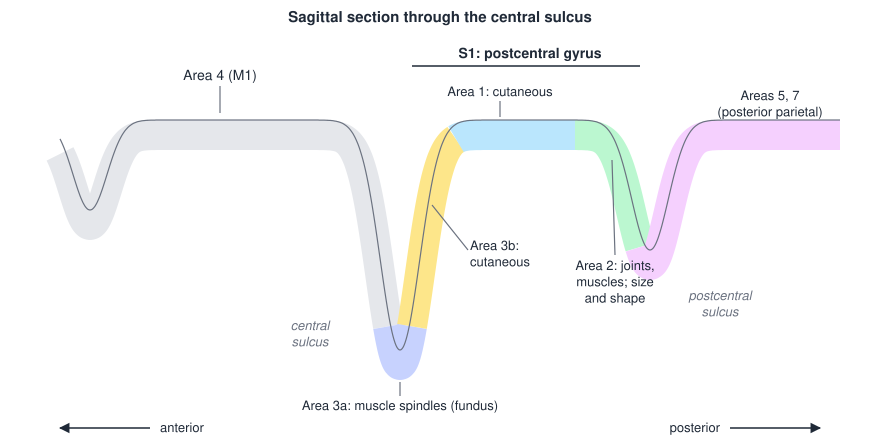
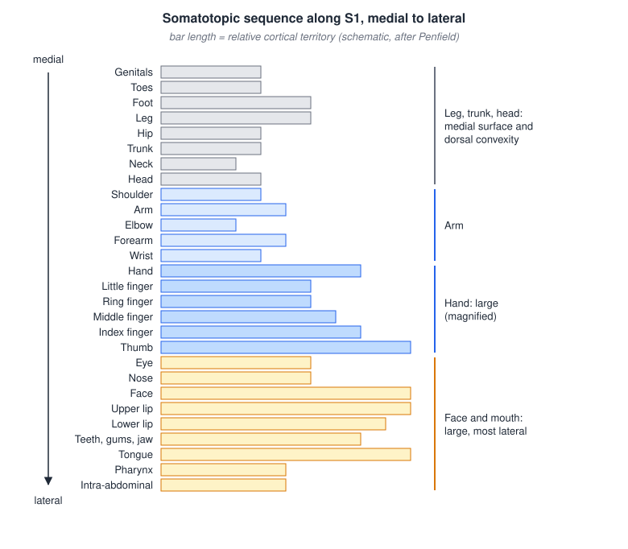
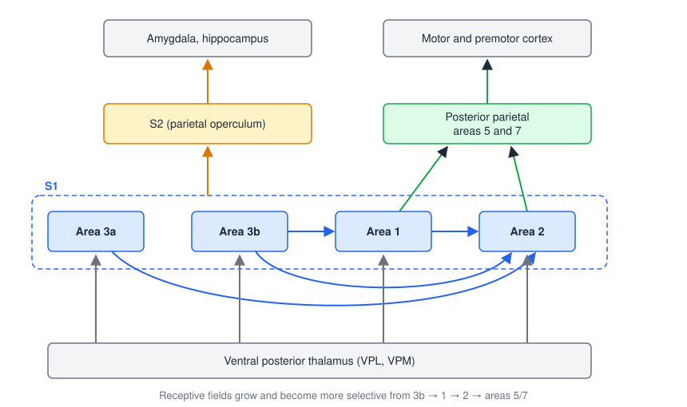
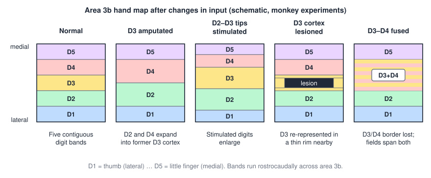

# Somatosensory Cortex and Plasticity

The ascending pathways deliver touch, vibration, proprioception, pain and temperature to the primary somatosensory cortex (S1), where they are mapped, combined and passed on to areas that recognize objects and guide movement. This chapter describes how S1 is organized into four cytoarchitectonic areas, how the body is laid out across it, and how information flows from S1 to secondary somatosensory and posterior parietal cortex. It then uses the somatosensory system, where the evidence is clearest, to introduce neural plasticity: the maps change when their inputs change, by the same synaptic and structural mechanisms that underlie learning, and the changes can help (recovery, skill) or harm (phantom pain, focal dystonia, central sensitization). This is the scientific basis of much of neurorehabilitation.

## Primary Somatosensory Cortex

### Location and areas

**S1** occupies the **postcentral gyrus** of the parietal lobe, immediately behind the central sulcus, and receives its main input from the **ventral posterior (VP) complex of the thalamus**: VPL for the body and VPM for the face (see [Somatosensory Pathways](somatosensory-pathways.md)). The **secondary somatosensory cortex (S2)** lies in the upper bank of the lateral (Sylvian) sulcus, on the parietal operculum, and **posterior parietal cortex** (Brodmann areas 5 and 7) lies behind S1.

S1 is not one area but four strips, Brodmann areas 3a, 3b, 1 and 2, running parallel to the central sulcus. A sagittal section through the central sulcus shows them in order from front to back.

*Figure: a sagittal section through the central sulcus. Area 4 (primary motor cortex) forms the precentral gyrus and the anterior bank of the sulcus. Area 3a lies in the fundus, area 3b on the posterior bank, area 1 on the crown of the postcentral gyrus and area 2 on its posterior slope, followed by posterior parietal areas 5 and 7. Each S1 area is dominated by a different input.*

| Area | Location | Dominant input | Typical function |
|---|---|---|---|
| **3a** | Fundus of the central sulcus | Muscle spindles (proprioceptive) | Limb position and movement; closely linked to motor cortex |
| **3b** | Posterior bank of the central sulcus | Cutaneous (SA and RA afferents) | Primary tactile area: small receptive fields, fine spatial detail |
| **1** | Crown of the postcentral gyrus | Cutaneous | Texture, motion across the skin |
| **2** | Posterior slope of the postcentral gyrus | Deep receptors of joints and muscles, plus cutaneous input via 3b and 1 | Size and shape of grasped objects; integration of touch and proprioception |

Areas 3a and 3b receive the densest thalamic input; area 3b is often called "S1 proper" because it has the most direct, best-resolved tactile representation. Each area contains columns of neurons sharing a receptive-field location and submodality, the columnar organization first described in S1.

### Somatotopy and cortical magnification

S1 is organized **somatotopically**: neighboring body parts are represented in neighboring cortex, producing a map of the contralateral body across the gyrus. The map runs, from the medial surface of the hemisphere over the dorsal convexity to the lateral sulcus, roughly as follows: genitals, toes, foot and leg on the medial surface; hip, trunk, neck and head on the dorsal convexity; then shoulder, arm, elbow, forearm, wrist and hand; the digits from little finger to thumb; and laterally the eye, nose, face, upper lip, lips and lower lip, teeth, gums and jaw, tongue and pharynx, with intra-abdominal representation near the lateral sulcus.

*Figure: the somatotopic sequence along the postcentral gyrus, medial (top) to lateral (bottom). Bar length is a schematic of how much cortex each part receives. The hand and digits and the face, lips and tongue occupy far more cortex than the trunk or proximal limbs.*

The map is distorted. The **sensory homunculus**, drawn by Penfield from electrical stimulation of the exposed cortex in awake patients, has enormous hands, lips and tongue and a small trunk and limbs. This **cortical magnification** is not proportional to the area of skin but to the **density of receptors** and the behavioral importance of the region, which is why it matches the two-point thresholds described in [Sensory Receptors and Afferent Coding](sensory-receptors.md): a fingertip with a 2–4 mm threshold receives far more cortex per square centimeter than the back with a 40 mm threshold.

### Receptive fields in S1 allow precise localization

Within area 3b the receptive fields of neurons are small and orderly. Microelectrode mapping in monkeys shows that each digit is represented as a band of cortex in which recording sites progress systematically along the finger from distal to middle to proximal phalanx, with slowly adapting and rapidly adapting neurons each forming their own orderly tiling. Each body part is represented **twice**, once in 3b and once in 1, and the two maps are **mirror images** of each other across the 3b/1 border.

## Hierarchical Processing

### From S1 to S2 and posterior parietal cortex

Information flows through S1 serially and then leaves it along two main routes.

*Figure: the ventral posterior thalamus projects to all four S1 areas. Within S1, area 3b projects to areas 1 and 2, area 1 to area 2, and area 3a to area 2. All S1 areas project to S2, which projects on to the amygdala and hippocampus; areas 1 and 2 project to posterior parietal areas 5 and 7, which project to motor and premotor cortex. Receptive fields become larger and more selective at each step.*

- **S1 → S2 → amygdala and hippocampus.** S2 receives input from all four S1 areas and projects to limbic and insular structures and to the hippocampus. This route contributes to recognizing objects by touch, to tactile memory and to the emotional significance of touch.
- **S1 → areas 5 and 7 → motor and premotor cortex.** Posterior parietal cortex combines somatosensory with visual and vestibular information to build a representation of the body and of objects in space for guiding action, including reaching and grasping (see [Motor Cortex](motor-cortex.md)).

### Receptive fields grow and become more complex

Receptive fields start out small and precise. Each primary afferent has a small receptive field (smallest for Merkel and Meissner afferents in the superficial skin), with several sensitive spots corresponding to the branches of one axon. At each stage of the pathway, neurons integrate input from many cells at the previous stage, so their receptive fields become larger and more complex:

- In **area 3b**, receptive fields cover part of one fingertip.
- In **area 1**, they cover several fingertips or a whole digit.
- In **area 2**, they cover several whole digits and may be **bilateral** (both hands), and many neurons respond to joint position as well as touch.

Area 3b cells converge onto area 1 cells, which also receive joint input, and these converge onto area 2 cells. The convergence allows neurons in areas 1 and 2 to become selective for features such as the direction of motion across the skin, the orientation of an edge, or the shape of an object grasped with several fingers. Everyday perception depends on this convergence of submodalities: recognizing that a bug is crawling on the arm requires combining touch, location and motion; carrying a child piggyback requires combining touch, pressure and proprioception.

### Stereognosis and agnosia

**Stereognosis** is the ability to recognize an object by touch and manipulation alone. It requires the cortical integration of cutaneous and proprioceptive information in S1 (especially area 2) and posterior parietal cortex. Clinically it is tested by having the patient reach behind a screen or into a box, handle an unseen common object (a comb, a clothespin, a key) and name it or match it to a picture. Loss of this ability despite adequate elementary sensation is **astereognosis**, a form of **tactile agnosia**, and it points to a lesion of contralateral parietal cortex. Related cortical signs are loss of **graphesthesia** (recognizing numbers traced on the skin) and **extinction** (failure to perceive a stimulus on the affected side when both sides are touched simultaneously).

## Neural Plasticity

In physics, plasticity is the ability of a material to deform without breaking. **Neural plasticity is the capacity of the nervous system to undergo change.** Plasticity is not an exceptional response to injury but a constant property of the nervous system, which changes in response to:

- **development** (an infant learning to walk),
- **experience** (learning to ride a bicycle, playing video games), and
- **injury** (relearning to walk with a cane after a stroke).

Somatosensory cortex has provided the clearest demonstrations, because its maps can be measured precisely with microelectrodes in animals and with imaging in humans. Plasticity is not limited to cortex: reorganization also occurs in the **thalamic nuclei**, the **brainstem dorsal column nuclei** and the **spinal cord and dorsal root ganglia**. Motor cortex maps are similarly shaped by use (Nudo et al. 1996; see [Plasticity and Recovery](plasticity.md)).

### Cortical map plasticity: the monkey experiments

A series of experiments in owl and squirrel monkeys, mainly by Merzenich, Kaas and colleagues in the 1980s and early 1990s, mapped the area 3b hand representation before and after manipulating its input.

*Figure: schematic area 3b hand maps. Normally the five digits are represented as contiguous bands (D1, the thumb, laterally; D5 medially). After amputation of D3, the cortex that represented it comes to respond to D2 and D4. After repeated stimulation of the D2 and D3 fingertips, those representations enlarge. After a lesion of the D3 cortex itself, D3 is re-represented in a thin rim of surrounding cortex. After surgical fusion of D3 and D4, the sharp border between them disappears and receptive fields span both digits.*

- **Amputation.** Two months after amputation of the third digit, the D3 territory no longer responded to D3 (which no longer existed); the representations of the **neighboring digits D2 and D4 had expanded into it**. Cortex deprived of its input does not stay silent; it is taken over by adjacent inputs.
- **Stimulation.** When monkeys were trained to use the tips of digits 2 and 3 (and partly 4) repeatedly to contact a rotating disk, the cortical representations of the **stimulated fingertips enlarged**, at the expense of their neighbors. This is **use-dependent** expansion: behaviorally relevant, repeated input claims more cortex.
- **Cortical lesion.** When the D3 representation in S1 was itself destroyed by a small lesion, D3 was later **re-represented** in a thin band of surviving cortex around the lesion, between the D2 and D4 regions (Kaas 1991).
- **Digit fusion (syndactyly).** After the skin of D3 and D4 was surgically joined so the two digits always moved and were touched together, the normally **sharp border between their representations disappeared** and neurons developed receptive fields spanning both digits. The map reflects the **correlation of inputs in time**: inputs that fire together come to share cortex, and inputs that fire separately are kept apart.

The general conclusion is that **any change in the inputs or in the neural structures produces plastic change in the map**.

### Human plasticity: amputation and hand transplantation

Human maps behave the same way. Imaging and magnetoencephalography show that after **amputation of a hand**, the face representation, which lies next to the hand in S1, **invades the former hand area**. Hand transplantation then provides a remarkable test of reversibility (Farnè et al. 2002). **Early after transplantation** the hand and face occupy overlapping cortical territory; **later**, as the transplanted hand is reinnervated and used, the hand and face return to near-normal, separate territories. The map is therefore maintained continuously by its inputs, and restoring the input can reverse the reorganization.

## Mechanisms of Plasticity

The neural mechanisms of plasticity are the same as the neural mechanisms of learning. Both lie on a continuum: **changes in synaptic efficiency**, if they persist, lead to **changes in synaptic connections**, just as **short-term** learning, if it persists, leads to **long-term** learning (Shumway-Cook and Woollacott).

### Levels of plasticity

Stimuli trigger adaptations at any of four levels, and change at one level influences the others: **behavioral ↔ systems ↔ cellular ↔ genetic/molecular**, in a loop. The specific mechanisms map onto these levels:

1. **Modification of synaptic efficacy** (genetic/molecular and cellular levels). Possible changes include the size of excitatory postsynaptic currents (EPSCs) and inhibitory postsynaptic currents (IPSCs), the neuron's firing frequency and excitability, its membrane resistance, and the probability of synaptic vesicle release. At the chemical synapse, an action potential arrives at the terminal, voltage-gated Ca²⁺ channels open, vesicles dock and fuse, and transmitter binds postsynaptic receptors; each step can be strengthened or weakened, as in long-term potentiation and depression. Persistence of a change in synaptic strength signals the nervous system to make more permanent changes.
2. **Modification of the structure of synapses and neurons** (cellular and systems levels). Possible changes include dendritic arborization (more branches), dendritic spine density, synapse number, synapse size and axonal arborization (Nudo et al. 2001). Pyramidal neurons in an enriched or trained region grow more dendritic branches and spines.
3. **Modification of pathways and networks** (systems level): the redistribution of map territories described above.
4. **Modification of behavior** (behavioral level): the changes in perception and skill that result.

Map changes occur on several time scales. Some appear within minutes or hours of deafferentation, too fast for new growth. These are explained by **unmasking** of existing but functionally silent connections: horizontal intracortical connections and divergent thalamocortical and brainstem projections already reach beyond each zone's borders, but their influence is normally suppressed by GABAergic inhibition. Losing the dominant input reduces this inhibition and lets the latent inputs drive the cortex. Over weeks and months, synaptic strengthening, axonal sprouting and new synapses consolidate the change, and reorganization at subcortical relays is amplified at each level on its way to the cortex.

**Plastic changes are specific to the neurons and pathways stimulated.** Only the inputs that are actually used, and the circuits that carry them, are strengthened. For rehabilitation this has a direct implication: to change a function, therapy must engage the specific pathways and behaviors underlying that function, with enough repetition, intensity and relevance for the changes to persist (see [Motor Learning](motor-learning.md) and [Plasticity and Recovery](plasticity.md)).

## Functional Consequences: Beneficial or Maladaptive?

Map reorganization is not automatically good. Its consequences depend on what the new connections signal.

### Larger maps do not always mean better function

After hand amputation, the face representation expands into the former hand area, yet **the sensory acuity of the face is not enhanced**: facial two-point discrimination does not improve despite the larger area of cortex devoted to it. More cortex helps only when the extra territory is driven by meaningful, behaviorally relevant input, as in the use-dependent stimulation experiments.

### Phantom limb sensation

When maps change, **localization changes** too. After amputation of the left hand, magnetoencephalographic mapping of the right hemisphere shows that the hand representation is absent and that sources for the face and upper arm have shifted into the former hand region, while the intact hemisphere keeps normal ordering. Behaviorally, touching specific points on the amputee's left face, with the eyes closed, evokes sensations that are **referred to specific digits of the phantom hand**, in an orderly map on the cheek (Ramachandran and Hirstein 1998). Cortex that once signaled "hand" still signals "hand" to the rest of the brain even when it is now driven by input from the face. Phantom sensations from the arm stump follow the same logic.

### Phantom limb pain

Reorganization can also produce suffering. Most amputees experience a **phantom limb**, and many experience **phantom limb pain** as well as **stump pain**. Recordings and microstimulation in the human somatosensory thalamus (the ventral caudal nucleus, Vc, the human equivalent of VPL and VPM) during stereotactic surgery in leg amputees showed that many neurons now had receptive fields on the **stump**, yet stimulating those same sites evoked sensations, sometimes painful, **projected into the missing limb** (Davis et al. 1998). Thalamic neurons that once represented the amputated limb had been taken over by stump input but kept their perceptual meaning. Across patients, the amount of cortical reorganization correlates with the severity of phantom pain, which motivates treatments that try to restore a normal representation, such as mirror therapy, motor imagery and sensory discrimination training, and prostheses that provide sensory feedback.

### Focal hand dystonia

**Focal hand dystonia** (writer's cramp, musician's dystonia) is an involuntary, task-specific co-contraction and abnormal posturing of the hand and fingers, often in people who perform highly repetitive, synchronous finger movements. Thalamic recordings and stimulation in patients undergoing surgery show **abnormally large and mismatched receptive and projected fields**: single thalamic sites respond to, or project sensations to, multiple digits or the whole hand instead of one digit, and stimulation can evoke dystonic responses. The sensory representation of the hand has become **dedifferentiated**, with the borders between digits blurred, much as in the syndactyly experiment, because the digits have been used together. Monkeys trained to make highly repetitive grasping movements develop similar degraded area 3b maps and motor control problems. This is maladaptive use-dependent plasticity, and it suggests treatment by sensory retraining that re-separates the digit representations.

### Central sensitization

**Central sensitization** is a further example of maladaptive somatosensory plasticity in humans: after injury, nociceptive neurons in the spinal dorsal horn and brain increase their excitability, so that pain is amplified, spreads beyond the injured area and can be evoked by normally innocuous touch. It is the plasticity mechanism behind many chronic pain states and is covered in [Pain](pain.md).

## Clinical Correlations

- **Cortical sensory loss** after stroke or tumor affecting S1 or parietal cortex is contralateral and somatotopic (a lateral lesion affects the face and hand; a medial one the leg) and is most severe for discriminative functions: two-point discrimination, position sense, stereognosis, graphesthesia, and localization, with extinction to double simultaneous stimulation.
- **Stereognosis testing** (identifying objects by touch behind a screen) assesses integration of touch and proprioception in S1 and posterior parietal cortex.
- **Phantom limb pain** can be addressed by therapies that aim to normalize the cortical representation of the missing limb (mirror therapy, graded motor imagery, sensory discrimination training) and by prostheses that supply sensory feedback.
- **Focal hand dystonia** is treated with botulinum toxin and, increasingly, with sensorimotor retraining designed to restore separate digit representations.
- **Sensory restoration**: because S1 remains somatotopically organized after spinal cord injury or amputation, its maps can be targeted directly. Electrical stimulation of human S1 through subdural or intracortical electrodes evokes localized sensations whose quality and intensity depend on stimulus parameters, providing a feedback channel for bidirectional brain–computer interfaces (see [Sensory Prostheses](../../biomed/neuro/sensory-prostheses.md) and [Brain–Computer Interfaces](../../biomed/neuro/bci.md)).
- **Rehabilitation after injury** relies on the principle that plasticity is specific to the pathways used: sensory retraining and task-specific practice must engage the impaired function directly.

## Key Readings

- Penfield W, Boldrey E (1937). *Somatic motor and sensory representation in the cerebral cortex of man as studied by electrical stimulation*. Brain. — Established human somatotopy and the sensory homunculus by stimulating the cortex of awake patients.
- Nudo RJ, Milliken GW, Jenkins WM, Merzenich MM (1996). *Use-dependent alterations of movement representations in primary motor cortex of adult squirrel monkeys*. Journal of Neuroscience. — The motor-cortex counterpart of the S1 stimulation experiments: skill training reshapes adult cortical maps.
- Case LK, Pineda J, Ramachandran VS (2015). *Common coding and dynamic interactions between observed, imagined, and experienced motor and somatosensory activity*. Neuropsychologia. — Reviews referred sensation and phantom-limb phenomena and links them to mirror therapy and motor imagery.
- Lee B, Kramer D, Armenta Salas M, et al., Andersen RA (2018). *Engineering artificial somatosensation through cortical stimulation in humans*. Frontiers in Systems Neuroscience. — Stimulating human S1 produces localized, naturalistic sensations tunable by stimulation parameters.
- Ryun S, Kim JS, Jeon E, Chung CK (2017). *Movement-related sensorimotor high-gamma activity mainly represents somatosensory feedback*. Frontiers in Neuroscience. — Shows that much movement-related cortical activity reflects somatosensory feedback, with implications for BCI decoding.
- Buch ER, Liew S-L, Cohen LG (2016/2017). *Plasticity of sensorimotor networks: multiple overlapping mechanisms*. The Neuroscientist. — Synaptic, network and systems mechanisms of sensorimotor plasticity in learning and recovery.
- Mink JW (2018). *Basal ganglia mechanisms in action selection, plasticity, and dystonia*. European Journal of Paediatric Neurology. — Links abnormal plasticity and failed surround inhibition to dystonia.
- Woolf CJ (1983). *Evidence for a central component of post-injury pain hypersensitivity*. Nature. — The founding demonstration of central sensitization.

## See Also

- [Sensory Receptors and Afferent Coding](sensory-receptors.md) and [Somatosensory Pathways](somatosensory-pathways.md): the inputs to S1.
- [Plasticity and Recovery](plasticity.md): plasticity after stroke and spinal cord injury.
- [Motor Learning](motor-learning.md): the behavioral side of use-dependent plasticity.
- [Motor Cortex](motor-cortex.md): the neighboring motor maps and parietal–frontal circuits for action.
- [Pain](pain.md): central sensitization and chronic pain.
- [Sensory Prostheses](../../biomed/neuro/sensory-prostheses.md): restoring sensation by stimulating afferent pathways and S1.
- [Brain–Computer Interfaces](../../biomed/neuro/bci.md): bidirectional interfaces that write sensory feedback into cortex.
