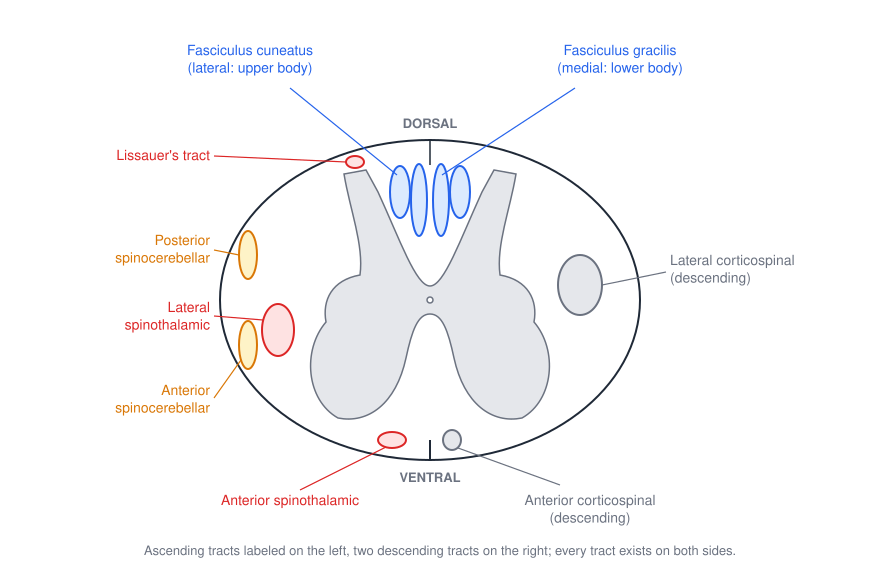
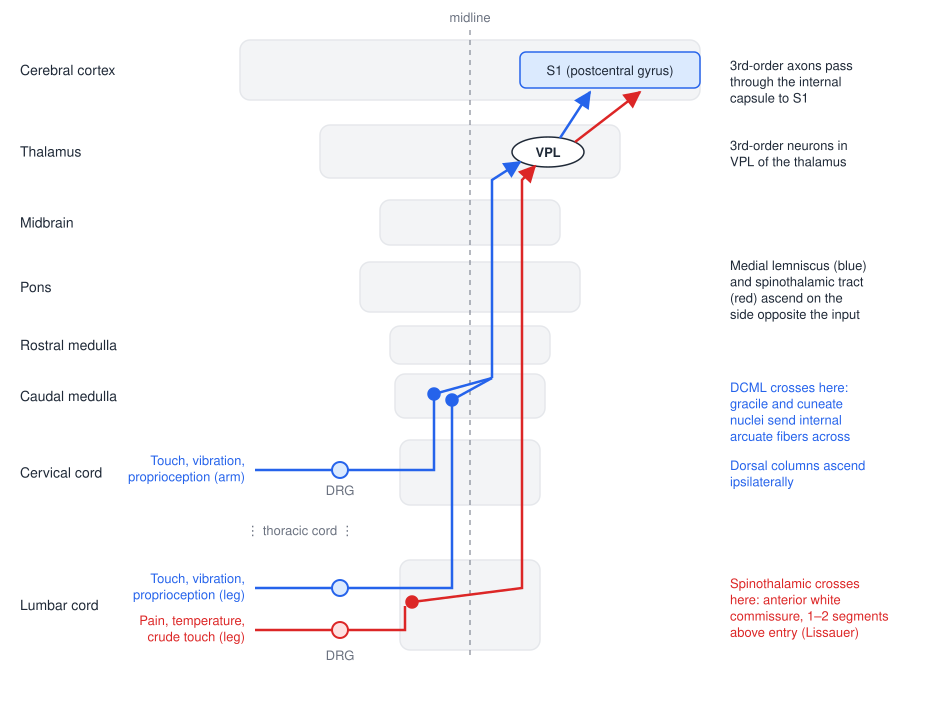
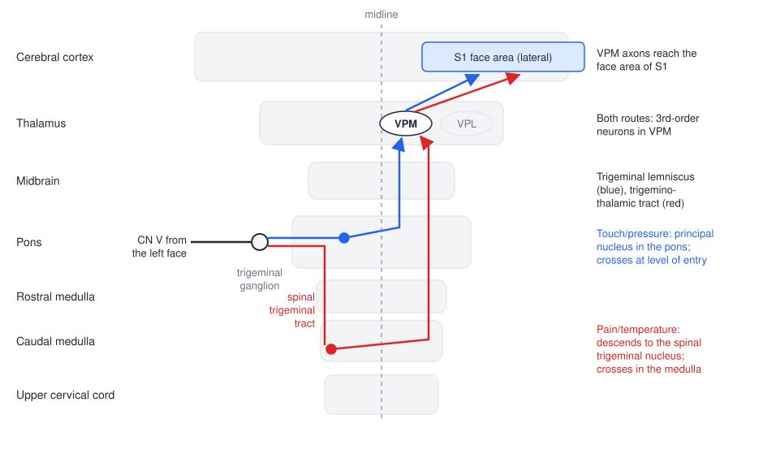
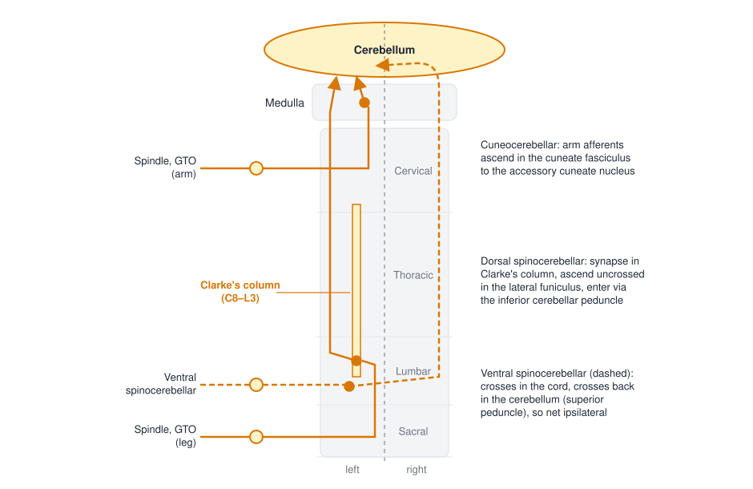
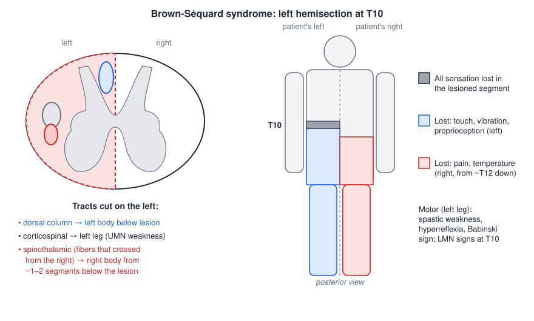

# Somatosensory Pathways

Afferent signals from the skin, muscles and joints reach the brain along a small number of ascending pathways, each carrying particular modalities and each crossing the midline at a characteristic level. This chapter traces the dorsal column–medial lemniscal system, the anterolateral (spinothalamic) system, the two trigeminal routes for the face and the spinocerebellar pathways, neuron by neuron. Knowing where each pathway runs and where it crosses is what allows a clinician to localize a lesion from a pattern of sensory loss, and it explains why conscious position sense and the unconscious proprioception used by the cerebellum for coordination travel separately.

## A Common Plan: the Three-Neuron Chain

Each pathway that reaches the cerebral cortex is a chain of three neurons.

1. The **first-order neuron** is the primary afferent. Its cell body lies in a **dorsal root ganglion (DRG)** for the body, or in a cranial nerve ganglion (the **trigeminal ganglion**) for the face. Its peripheral process ends in the receptor (see [Sensory Receptors and Afferent Coding](sensory-receptors.md)); its central process enters the spinal cord or brainstem.
2. The **second-order neuron** lies in the spinal cord or brainstem. Its axon **crosses the midline** (decussates) and ascends to the thalamus.
3. The **third-order neuron** lies in the **ventral posterior complex of the thalamus**: the **ventral posterior lateral nucleus (VPL)** for the body and the **ventral posterior medial nucleus (VPM)** for the face. Its axon ascends through the posterior limb of the **internal capsule** to the **primary somatosensory cortex (S1)** on the postcentral gyrus.

Because the second-order axon crosses, each hemisphere receives sensation from the opposite side of the body. The pathways differ in *where* that crossing happens, and this single fact explains most of clinical lesion localization. The spinocerebellar pathways are the exception to the plan: they end in the cerebellum, not the cortex, and they stay ipsilateral.

The thalamus is more than the relay for somatic sensation. Its nuclear groups project to different cortical targets: the anterior group to the limbic system, the medial (dorsomedial) group to prefrontal cortex, the intralaminar and midline groups to widespread cortex as part of the arousal system, the ventral anterior and ventral lateral nuclei to motor cortex (carrying basal ganglia and cerebellar output), the VPL and VPM to somatosensory cortex, the pulvinar to visual association cortex (visual attention), and the lateral and medial geniculate nuclei to visual and auditory cortex. The thalamic reticular nucleus forms a shell around the thalamus and modulates its output.

## Where the Tracts Lie in the Spinal Cord

The ascending tracts occupy reproducible positions in the white matter of the spinal cord.

*Figure: cross-section of the cervical spinal cord, dorsal side up. The dorsal columns (blue) lie between the dorsal horns: the fasciculus gracilis medially and the fasciculus cuneatus laterally. Lissauer's tract caps the dorsal horn. In the lateral funiculus, the posterior and anterior spinocerebellar tracts (amber) lie along the margin and the lateral spinothalamic tract (red) lies deep to them; the anterior spinothalamic tract lies in the anterior funiculus. Two descending tracts are shown for reference on the right (gray). Every tract is present on both sides.*

- **Dorsal (posterior) columns**: ascending only. **Fasciculus gracilis** (medial) and **fasciculus cuneatus** (lateral) carry fine touch, vibration and conscious proprioception.
- **Lateral columns (funiculi)**: both directions. Ascending: the **lateral spinothalamic tract** (pain, temperature) and the **dorsal and ventral spinocerebellar tracts** (unconscious proprioception). Descending: the **lateral corticospinal** and **rubrospinal** tracts.
- **Anterior (ventral) columns**: both directions. Ascending: the **anterior spinothalamic tract** (crude touch, some pain and temperature). Descending: the anterior corticospinal, reticulospinal and vestibulospinal tracts (see [Descending Pathways](descending-pathways.md)).

## The Dorsal Column–Medial Lemniscal (DCML) Pathway

### Modalities

The DCML pathway carries **mechanosensory** information from the body and the back of the head: **fine (discriminative) touch, vibration and conscious proprioception**. It is the pathway tested at the bedside with a tuning fork, with two-point discrimination, and by asking a patient with eyes closed whether a toe has been moved up or down; and it is the pathway challenged when someone balances on one leg on a foam pad.

### Route, neuron by neuron

- **Receptors**: the cutaneous mechanoreceptors (Meissner, Merkel, Pacinian, Ruffini) and proprioceptors (muscle spindles, joint receptors).
- **First-order neuron**: cell body in the **DRG**; a large-diameter **Aβ** (and group I or II) afferent. The central process enters the spinal cord through the medial part of the dorsal root, gives off collaterals to the spinal gray matter (for reflexes), and then turns upward **in the dorsal column on the same side**. It ascends without synapsing all the way to the **caudal medulla**.
  - Afferents from the **lower body** (sacral, lumbar and lower thoracic roots, below about T6) run in the **fasciculus gracilis**, the medial tract (*gracilis*, "slender").
  - Afferents from the **upper body** (upper thoracic and cervical roots, above about T6) join laterally and run in the **fasciculus cuneatus** (*cuneatus*, "wedge-shaped"), which therefore exists only at upper thoracic and cervical levels.
  - The result is a somatotopic lamination: in the dorsal columns the body is represented from sacral (medial) to cervical (lateral).
- **Second-order neuron**: in the **dorsal column nuclei** of the caudal medulla, the **nucleus gracilis** (lower body) and **nucleus cuneatus** (upper body). Their axons sweep ventrally and medially as the **internal arcuate fibers**, **cross the midline in the caudal medulla**, and turn upward as the **medial lemniscus**, which ascends through the rostral medulla, pons and midbrain.
- **Third-order neuron**: in the **VPL nucleus of the thalamus**.
- **Cortex**: VPL axons pass through the **internal capsule** to **S1** on the postcentral gyrus, arriving somatotopically (leg medially, arm and hand laterally).

Mechanosensory information from the **face** reaches the thalamus by the trigeminal system and terminates in **VPM**; body information terminates in **VPL**. The back of the head, innervated by upper cervical roots, travels with the body in the dorsal columns.

*Figure: the two main somatosensory pathways for input from the left side of the body. The DCML (blue) ascends ipsilaterally in the dorsal columns to the gracile and cuneate nuclei, crosses in the caudal medulla as the internal arcuate fibers, and ascends in the medial lemniscus to VPL. The spinothalamic pathway (red) synapses in the dorsal horn within one or two segments of entry, crosses immediately in the anterior white commissure, and ascends in the anterolateral cord and lateral brainstem to VPL. Both then project through the internal capsule to S1 of the right hemisphere.*

### Summary

The DCML carries touch, vibration and proprioception. It ascends from the DRG (first order) in the dorsal columns on the same side; the medial gracile part carries the lower body and the lateral cuneate part the upper body. In the caudal medulla the gracile and cuneate nuclei (second order) send axons across the midline into the medial lemniscus, which ascends to VPL (third order); VPL axons reach S1 through the internal capsule.

## The Anterolateral System: the Spinothalamic Pathway

### Modalities

The spinothalamic pathway carries **pain, temperature and crude (non-discriminative) touch** from the body. Its receptors are nociceptors, thermoreceptors and free-nerve-ending mechanoreceptors, served by small **Aδ and C** fibers.

### Route, neuron by neuron

- **First-order neuron**: cell body in the **DRG**. The small-diameter central process enters through the lateral part of the dorsal root and ascends or descends for **one or two segments** in **Lissauer's tract** (the dorsolateral tract capping the dorsal horn) before synapsing in the **dorsal horn**.
- **Second-order neuron**: in the **dorsal horn** (mainly laminae I and V). Its axon **crosses in the anterior (ventral) white commissure** of the spinal cord, close to the level of entry, and ascends in the contralateral **anterolateral system**: the **lateral spinothalamic tract** in the lateral funiculus and the **anterior spinothalamic tract** in the anterior funiculus. The tract continues through the medulla, pons and midbrain in a lateral position.
- **Third-order neuron**: in the **VPL** nucleus of the thalamus.
- **Cortex**: through the **internal capsule** to **S1**, again somatotopically: pain and temperature from the lower body end medially and dorsally on the S1 strip, and from the upper body more laterally.

Because fibers join the tract from the medial side as they cross at each level, the lateral spinothalamic tract is also laminated, but in the opposite sense to the dorsal columns: sacral fibers lie most laterally and cervical fibers most medially. This is why a lesion expanding from the center of the cord can spare sacral sensation.

The spinothalamic tract is only one component of the anterolateral system. Other second-order axons travel with it to the reticular formation (spinoreticular), the periaqueductal gray and tectum (spinomesencephalic) and the medial and intralaminar thalamus. These carry the arousing, affective and motivational aspects of pain and engage descending pain modulation, and they are treated in [Pain](pain.md).

### Summary

The spinothalamic pathway carries pain, temperature and crude touch from the body and runs in the anterior and lateral parts of the cord. First-order axons from the DRG enter the cord, travel about two segments in Lissauer's tract and synapse in the dorsal horn. Second-order axons cross in the anterior commissure and ascend to VPL; third-order axons reach S1 through the internal capsule.

## The Trigeminal Pathways

The face and head are served by the **trigeminal nerve (cranial nerve V)**, whose first-order cell bodies lie in the **trigeminal ganglion**. The trigeminal system is one system with two tracts that parallel the two body pathways: a touch-and-pressure route that behaves like the DCML, and a pain-and-temperature route that behaves like the spinothalamic tract. The two routes have different second-order nuclei and cross at different levels.

### Touch and pressure (trigeminal lemniscal route)

- **First order**: trigeminal ganglion. Axons enter the brainstem at the level of the **pons**.
- **Second order**: the **principal (main sensory) nucleus of the trigeminal complex**, in the pons. Axons **cross at the level of entry** and ascend as the **trigeminal lemniscus**, alongside the medial lemniscus.
- **Third order**: **VPM** nucleus of the thalamus.
- **Cortex**: the face area of S1, on the lateral part of the postcentral gyrus.

### Pain and temperature (trigeminothalamic route)

- **First order**: trigeminal ganglion. Axons enter at the pons and then **descend** in the **spinal trigeminal tract** through the medulla, some reaching the upper cervical cord.
- **Second order**: the **spinal nucleus of the trigeminal complex** in the medulla (its caudal part is continuous with the dorsal horn of the upper cervical cord). Axons **cross in the medulla** and ascend as the **trigeminothalamic tract** (in effect, the facial part of the anterolateral system).
- **Third order**: **VPM**.
- **Cortex**: S1, face area.

*Figure: the two trigeminal routes for input from the left face. Touch and pressure (blue) synapse in the principal nucleus in the pons and cross at once into the trigeminal lemniscus. Pain and temperature (red) descend in the spinal trigeminal tract to the spinal trigeminal nucleus in the caudal medulla, cross there, and ascend in the trigeminothalamic tract. Both routes end in VPM, which projects to the face area of S1.*

The descent of facial pain fibers into the medulla has clinical consequences. A lesion of the lateral medulla can damage the uncrossed spinal trigeminal tract and nucleus (ipsilateral facial pain loss) together with the already-crossed spinothalamic tract from the body (contralateral body pain loss), producing the crossed pattern described below.

## The Spinocerebellar Pathways

### Modality and purpose

The spinocerebellar pathways carry **proprioceptive information about muscles and joints** to the **cerebellum**. Their receptors are muscle spindles, Golgi tendon organs and the stretch and pressure receptors of joints and connective tissue. This information does not reach consciousness. The cerebellum uses it to compare intended with actual movement, so it is critical for movement feedback, for coordination and for movement planning (see [Cerebellum](cerebellum.md)).

### Route

The spinocerebellar system is a collection of smaller pathways, each carrying information from a different part of the body, but they share a plan: first-order neuron in the **DRG**, second-order neuron in the spinal cord or caudal medulla, axons ascending to the cerebellum **on the same side**. Each half of the cerebellum controls the same side of the body, so the information stays ipsilateral throughout.

- **Dorsal (posterior) spinocerebellar tract: trunk and lower limb.** First-order spindle and tendon-organ afferents synapse in **Clarke's column** (nucleus dorsalis, Clarke's nucleus), a column of large neurons at the base of the dorsal horn that extends from **C8 to L3**. Afferents entering below L3 (lower lumbar and sacral roots) first ascend in the fasciculus gracilis to reach it. Second-order axons ascend **uncrossed** in the dorsal spinocerebellar tract at the margin of the lateral funiculus and enter the cerebellum through the **inferior cerebellar peduncle**.
- **Cuneocerebellar tract: upper limb.** Above C8 there is no Clarke's column. Upper-limb afferents ascend in the fasciculus cuneatus to the **accessory (lateral) cuneate nucleus** in the caudal medulla, the upper-limb equivalent of Clarke's column, whose axons enter the ipsilateral cerebellum through the inferior peduncle. Some of the same afferents also reach the dorsal column nuclei for conscious perception. (A **rostral spinocerebellar tract** is the upper-limb counterpart of the ventral tract.)
- **Ventral (anterior) spinocerebellar tract: lower body.** Its second-order neurons (spinal border cells in the lumbar cord) report less about the limb itself than about the activity of spinal interneurons and descending commands. Their axons cross in the cord, ascend contralaterally at the anterolateral margin, enter through the **superior cerebellar peduncle**, and then **cross back** within the cerebellum, so the net projection is again ipsilateral.

*Figure: spinocerebellar routes from the left side. Leg afferents ascend to Clarke's column (C8–L3) and their second-order axons form the uncrossed dorsal spinocerebellar tract; arm afferents synapse in the accessory cuneate nucleus of the medulla (cuneocerebellar tract). The ventral spinocerebellar tract (dashed) crosses in the cord and crosses back in the cerebellum. All three end in the cerebellum on the side of origin.*

### Summary

The spinocerebellar pathways bring proprioceptive information from muscles and joints to the cerebellum. In general they start in the DRG (first order), synapse in Clarke's column or its upper-limb equivalent (second order), and ascend to the cerebellum on the same side of the body. They are a collection of smaller pathways carrying information from different parts of the cord, and that information is critical for movement feedback and planning.

## The Pathways Compared

| Pathway | Modality | Receptors / fibers | 1st-order cell body | 2nd-order nucleus | Decussation | Ascending tract | Thalamus | Target |
|---|---|---|---|---|---|---|---|---|
| DCML | Fine touch, vibration, conscious proprioception (body) | Meissner, Merkel, Pacinian, Ruffini, spindles, joint receptors; Aβ, Ia, II | DRG | Nucleus gracilis (lower body) / cuneatus (upper body), caudal medulla | Caudal medulla (internal arcuate fibers) | Dorsal columns (ipsilateral) → medial lemniscus | VPL | S1 via internal capsule |
| Spinothalamic (anterolateral) | Pain, temperature, crude touch (body) | Free nerve endings; Aδ, C | DRG | Dorsal horn, after 1–2 segments in Lissauer's tract | Spinal cord, anterior white commissure, near entry | Lateral and anterior spinothalamic (contralateral) | VPL | S1 via internal capsule |
| Trigeminal, touch/pressure | Touch, pressure (face) | Mechanoreceptors | Trigeminal ganglion (CN V) | Principal nucleus, pons | Pons (level of entry) | Trigeminal lemniscus | VPM | S1 face area |
| Trigeminal, pain/temperature | Pain, temperature (face) | Nociceptors, thermoreceptors | Trigeminal ganglion (CN V) | Spinal trigeminal nucleus, medulla (after descending in the spinal trigeminal tract) | Medulla | Trigeminothalamic tract | VPM | S1 face area |
| Spinocerebellar | Unconscious proprioception (muscle length and tension, joints) | Spindles, GTOs, joint receptors; Ia, Ib, II | DRG | Clarke's column (C8–L3); accessory cuneate nucleus (arm) | None (dorsal, cuneocerebellar); ventral crosses twice | Dorsal and ventral spinocerebellar, cuneocerebellar | None | Ipsilateral cerebellum |

The same information can be organized from the receptor's point of view, which is how sensory examination is usually reasoned:

| Receptor | Information | Afferent fiber | Pathway(s) | Brain target |
|---|---|---|---|---|
| Meissner (FA I) | Light touch, flutter, slip | Aβ | DCML (body), trigeminal principal (face) | VPL/VPM → S1 (3b, 1) |
| Merkel (SA I) | Pressure, form, texture, edges | Aβ | DCML, trigeminal principal | VPL/VPM → S1 (3b, 1) |
| Pacinian (FA II) | Vibration | Aβ | DCML, trigeminal principal | VPL/VPM → S1 |
| Ruffini (SA II) | Skin stretch, sustained pressure | Aβ | DCML, trigeminal principal | VPL/VPM → S1 |
| Free nerve endings | Crude touch | Aδ, C | Spinothalamic | VPL → S1 |
| Aδ nociceptors | Sharp "first pain" | Aδ | Spinothalamic, trigeminothalamic | VPL/VPM → S1 |
| C nociceptors | Burning "second pain" | C | Spinothalamic, trigeminothalamic | VPL/VPM → S1 |
| Thermoreceptors | Cold, warm | Aδ, C | Spinothalamic, trigeminothalamic | VPL/VPM → S1 |
| Muscle spindle | Length and rate of change of length | Ia, II | DCML (conscious), spinocerebellar (unconscious) | S1 area 3a; cerebellum |
| Golgi tendon organ | Tension | Ib | Spinocerebellar (and DCML) | Cerebellum; S1 |
| Joint receptors | Joint position and movement | Aβ | DCML, spinocerebellar | S1 area 2; cerebellum |

## Localizing Lesions

The rules that follow from the anatomy are simple.

- **Peripheral nerve or dorsal root**: all modalities lost together, ipsilaterally, in the distribution of the nerve or dermatome.
- **Spinal cord**: DCML deficits are **ipsilateral** to the lesion (the fibers have not yet crossed); spinothalamic deficits are **contralateral**, starting one or two segments below the level of the lesion (the fibers crossed near entry, after a short ascent in Lissauer's tract); spinocerebellar damage gives **ipsilateral** incoordination.
- **Medulla**: the DCML crosses in the caudal medulla, so lesions above the decussation give contralateral loss for both systems. The crossed trigeminal pattern (ipsilateral face, contralateral body) is diagnostic of the lateral medulla.
- **Above the medulla** (pons, midbrain, thalamus, internal capsule, cortex): all body modalities are lost on the **contralateral** side, and above the pons the face is affected on the same side as the body.

### Brown-Séquard syndrome

A **hemisection** of the spinal cord (from a stab wound, for example, or an asymmetric tumor or disc) produces the clearest illustration of these rules.

*Figure: left hemisection at T10, posterior view. The left dorsal column is cut, so touch, vibration and proprioception are lost on the left below the lesion (blue). The left lateral spinothalamic tract carries fibers that already crossed from the right, so pain and temperature are lost on the right, beginning one to two segments below the lesion (red). At the level of the lesion, all sensation is lost on the left in that segment (dark band), and the cut left corticospinal tract causes upper motor neuron weakness of the left leg.*

- **Ipsilateral, below the lesion**: loss of fine touch, vibration and proprioception (dorsal column); spastic weakness with hyperreflexia and an extensor plantar (Babinski) response (lateral corticospinal tract, an upper motor neuron lesion).
- **Contralateral, from one to two segments below the lesion**: loss of pain and temperature (lateral spinothalamic tract).
- **At the level of the lesion, ipsilateral**: a narrow band of complete sensory loss (the entering dorsal root fibers and dorsal horn are destroyed) and lower motor neuron signs in the segment's muscles (ventral horn).

Pure hemisection is uncommon, but partial forms are frequent, and the logic is the same.

### Other characteristic cord and brainstem patterns

- **Dorsal column lesions** (tabes dorsalis in neurosyphilis; subacute combined degeneration in vitamin B₁₂ deficiency, which also affects the corticospinal tracts) cause loss of vibration and position sense with **sensory ataxia** and a positive Romberg sign: the patient can stand with eyes open, using vision to substitute for proprioception, but sways or falls with eyes closed.
- **Central cord lesions** (syringomyelia, hyperextension injury of a stenotic cervical canal) first interrupt the spinothalamic fibers crossing in the anterior commissure, producing **bilateral, segmental ("cape") loss of pain and temperature** over the affected levels with preserved touch. Because cervical spinothalamic fibers lie medially and sacral fibers laterally, sacral sensation is spared.
- **Anterior cord syndrome** (anterior spinal artery occlusion) removes the anterior two-thirds of the cord: bilateral loss of pain and temperature and paralysis below the lesion, with dorsal column sensation preserved.
- **Lateral medullary (Wallenberg) syndrome** (vertebral or posterior inferior cerebellar artery) damages the spinal trigeminal tract and nucleus and the spinothalamic tract: loss of pain and temperature on the **ipsilateral face** and the **contralateral body**, often with ipsilateral ataxia from involvement of the inferior cerebellar peduncle.
- **Thalamic (VPL/VPM) lesions** cause contralateral loss of all modalities over the face and body. Some patients later develop a severe central pain in the numb territory (thalamic pain syndrome).
- **Cortical (S1 and parietal) lesions** cause contralateral, somatotopically restricted loss that is most severe for discriminative functions: two-point discrimination, position sense, graphesthesia and stereognosis, with relative sparing of crude pain and temperature (see [Somatosensory Cortex and Plasticity](somatosensory-cortex.md)).

## Clinical Correlations

- **Testing DCML function**: vibration with a 128 Hz tuning fork, joint position sense, two-point discrimination and the Romberg test. Balance on a compliant surface (foam) with eyes closed removes visual substitution and reduces reliable plantar cutaneous input, isolating proprioceptive and vestibular contributions.
- **Testing spinothalamic function**: pinprick and hot or cold objects, mapped dermatome by dermatome to find a sensory level.
- **Spinal cord injury** is classified by the most caudal level with intact light touch (DCML) and pinprick (spinothalamic) sensation as well as motor function; preservation of sacral sensation marks an incomplete injury (see [Spinal Cord Injury](../../biomed/neuro/spinal-cord-injury.md)).
- **Dorsal column stimulation** for pain exploits the superficial position of the dorsal columns, and epidural or transcutaneous spinal stimulation recruits the large proprioceptive afferents entering through the dorsal roots (see [Spinal Cord Stimulation](../../biomed/neuro/spinal-stimulation.md)).
- **Sensory ataxia versus cerebellar ataxia**: both disturb coordination, but loss of DCML input worsens markedly with eyes closed, whereas cerebellar ataxia (including damage to spinocerebellar inputs) changes little with vision.

## Key Readings

- McGlone F, Reilly D (2010). *The cutaneous sensory system*. Neuroscience & Biobehavioral Reviews. — Follows each afferent class from the skin through its central projections in the spinal cord and brainstem.
- Twitchell TE (1954). *Sensory factors in purposive movement*. Journal of Neurophysiology. — Dorsal root section abolishes purposive limb use, showing how much movement depends on these ascending pathways.
- Therrien AS, Bastian AJ (2015). *Cerebellar damage impairs internal predictions for sensory and motor function*. Current Opinion in Neurobiology. — Explains what the cerebellum does with spinocerebellar proprioceptive input: build predictions of movement and its sensory consequences.
- Nees TA, Finnerup NB, Blesch A, Weidner N (2017). *Neuropathic pain after spinal cord injury: the impact of sensorimotor activity*. Pain. — Shows the clinical consequence of damage to these pathways in SCI and how sensorimotor activity may counter maladaptive plasticity.

## See Also

- [Sensory Receptors and Afferent Coding](sensory-receptors.md): the first-order neurons and their receptors.
- [Somatosensory Cortex and Plasticity](somatosensory-cortex.md): what happens to the signals in S1 and beyond.
- [Pain](pain.md): the anterolateral system in depth.
- [Cerebellum](cerebellum.md): the target of the spinocerebellar pathways.
- [Descending Pathways](descending-pathways.md): the motor tracts that share the cord's white matter.
- [Neuroanatomy](neuroanatomy.md): the overall layout of spinal cord, brainstem and thalamus.
- [Spinal Cord Injury](../../biomed/neuro/spinal-cord-injury.md) and [Spinal Cord Stimulation](../../biomed/neuro/spinal-stimulation.md).
