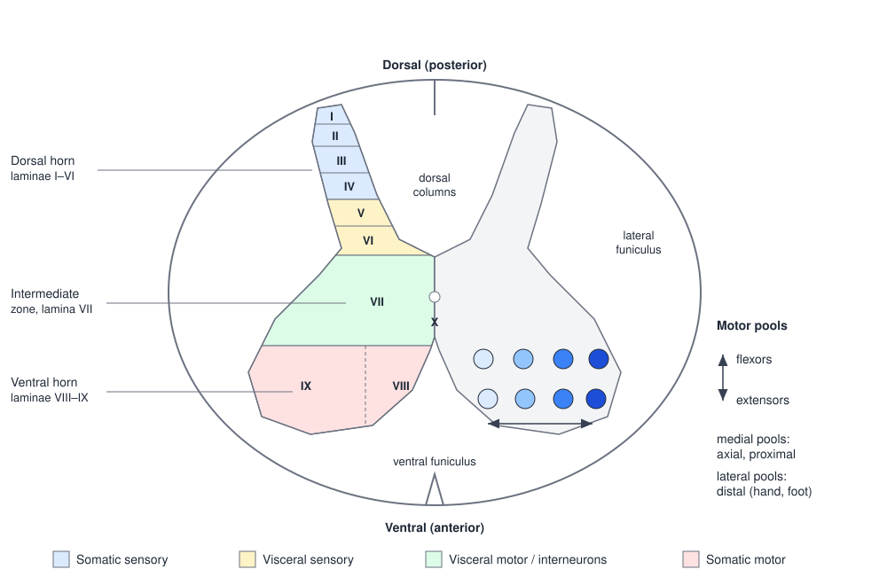
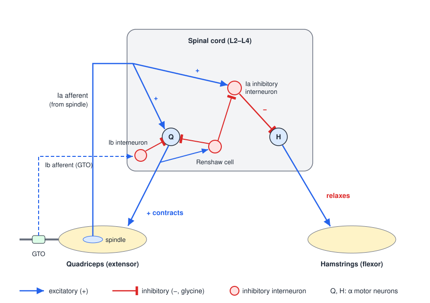
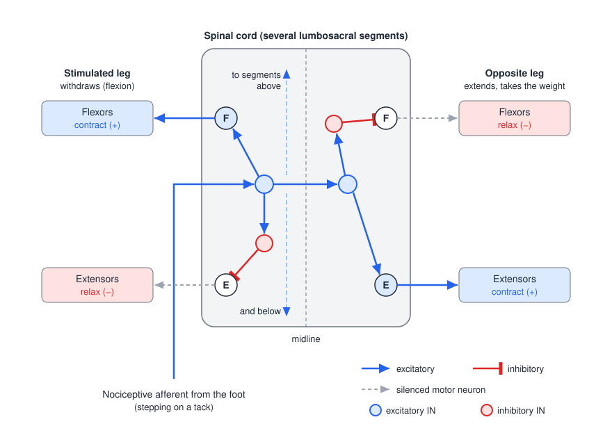
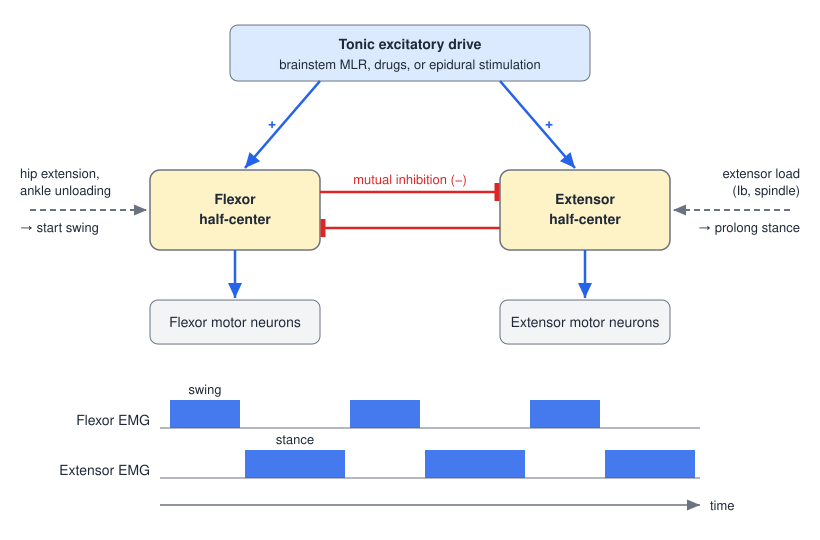

# The Spinal Cord and Reflexes

The spinal cord is far more than a cable between brain and muscle. It holds the motor neurons that form the final common path to every limb and trunk muscle, the interneuronal circuits that turn sensory input into reflexes, and networks that can generate the rhythm of stepping without any instruction from the brain. Descending commands from cortex and brainstem act *through* these circuits rather than around them, so understanding spinal organization is the first step to understanding voluntary movement, and to interpreting the reflex changes that follow injury to the brain or cord.

## The Cord in the Motor Hierarchy

Motor control is organized as a hierarchy with side loops. The motor areas of the cerebral cortex plan and initiate voluntary movement. Brainstem centers produce basic movements and postural control. The spinal cord carries out reflexes and integrates descending commands with sensory input. Two structures modulate this chain without projecting to the cord themselves: the basal ganglia, which gate the proper initiation of movement, and the cerebellum, which handles sensorimotor integration and motor learning. Both act back on cortex through the thalamus, and the cerebellum also projects to the brainstem. Movement produces sensory consequences, and the feedback from sensory receptors returns to the cord and to every level above it.

The cord therefore has three jobs:

1. **Conduction.** Sensory information travels "northbound" in ascending tracts and motor commands travel "southbound" in descending tracts; the white matter is the highway.
2. **Movement production.** Interneuronal circuits generate reflexes and rhythmic movements.
3. **Integration.** Sensory and descending motor signals converge on the same interneurons and motor neurons, so that every motor command is shaped by the current state of the body.

The terms **upper motor neuron (UMN)** and **lower motor neuron (LMN)** come from this hierarchy. UMNs have their cell bodies in cerebral cortex or brainstem and send axons down to synapse on local-circuit interneurons and LMNs. LMNs have their cell bodies in the ventral horn of the cord or in brainstem motor nuclei and innervate skeletal muscle directly. The overall organization is introduced in [Organization of the Nervous System](neuroanatomy.md).

## Gross Anatomy

### Segments, vertebrae and nerves

The cord runs inside the vertebral canal from the foramen magnum to its tapered tip, the **conus medullaris**, at about the L1 vertebra in adults. Below that the canal contains the **cauda equina**, the bundle of lumbar and sacral roots descending to their exit foramina, and the **filum terminale**, a strand of pia that anchors the cord to the coccyx. Because the cord is shorter than the column, cord segments lie progressively higher than the vertebrae of the same name, and the roots of lower segments run a long way down before they exit.

| Region | Vertebrae | Spinal nerve pairs |
|---|---|---|
| Cervical | 7 | 8 |
| Thoracic | 12 | 12 |
| Lumbar | 5 | 5 |
| Sacral | 5 (fused) | 5 |
| Coccygeal | 3–4 (fused) | 1 |
| **Total** | **33** | **31** |

There is one more cervical nerve than cervical vertebrae. Cervical nerves exit *above* the vertebra of the same number (C1 between skull and atlas), so C8 exits between the C7 and T1 vertebrae; from T1 downward each nerve exits *below* its vertebra. Each nerve leaves through an intervertebral foramen bounded by the pedicles of adjacent vertebrae, the vertebral bodies and the intervertebral disc (a fibrocartilage annulus fibrosus around a gelatinous nucleus pulposus), and the articular facets of the zygapophysial joints. A herniated nucleus or a hypertrophied facet narrows this foramen and compresses the root, which is why root lesions are so common.

Each segment supplies a **dermatome**, the strip of skin innervated by sensory neurons of that segment, and a **myotome**, the set of muscles innervated by its motor neurons. Dermatome and myotome maps let a clinician localize a root or segmental lesion from the pattern of sensory loss and weakness. The face is supplied not by spinal nerves but by the trigeminal nerve.

### Enlargements

The cord is not uniform in diameter. At the **cervical enlargement (C3–T1)** and the **lumbar enlargement (L1–S2)** the gray matter swells, because these segments contain the large motor neuron pools for the limbs and receive the dense sensory input from them. Thoracic segments are slim, with small horns but a distinct **lateral horn** (the intermediolateral cell column of sympathetic preganglionic neurons). Sacral segments are small overall but have proportionally large gray matter. The shape of a cross-section is therefore enough to identify its level.

### Meninges and spaces

Three membranes surround the cord. The **dura mater** ("tough mother") is the thick outer sheath; the **arachnoid mater**, named for its spiderlike processes, lies beneath it; and the **pia mater** ("tender mother") adheres to the cord surface and forms the denticulate ligaments that anchor it laterally. From outside inward the spaces are the **epidural space** between bone and dura, which contains fat and veins; the potential **subdural space** between dura and arachnoid; and the **subarachnoid space** between arachnoid and pia, which contains cerebrospinal fluid. Infection of these membranes is **meningitis**. The epidural space is where epidural anesthesia is delivered and where spinal cord stimulator leads are placed (see [Spinal Cord Stimulation](../../biomed/neuro/spinal-stimulation.md)).

### Roots, nerves and rami

Each of the 31 pairs of spinal nerves forms from two roots. The **dorsal root** carries sensory (afferent) axons into the cord; their pseudo-unipolar cell bodies lie in the **dorsal root ganglion (DRG)**, outside the cord. The **ventral root** carries motor (efferent) axons out of the cord. The roots join to form the **mixed spinal nerve**, which carries both, and which divides almost at once into rami:

- The **dorsal (posterior) ramus** supplies the paraspinal muscles and the skin, vessels and joints of the back, including the vertebral facet joints. A **facet block** interrupts the dorsal ramus branch to a painful facet joint, by anesthetic, by denervation or by electrical stimulation.
- The **ventral (anterior) ramus** supplies the limbs and the anterolateral trunk, motor and sensory. The ventral rami of the enlargements form the brachial and lumbosacral plexuses.
- The **white and gray rami communicantes** link the thoracolumbar nerves to the sympathetic chain ganglia: myelinated preganglionic fibers go out through the white ramus and unmyelinated postganglionic fibers return through the gray ramus.

The rule that dorsal roots are sensory and ventral roots are motor (the Bell–Magendie law) means that a root lesion produces a pure sensory or pure motor deficit, whereas a nerve lesion produces both.

## Cross-Sectional Anatomy

In cross-section the cord shows an H- or butterfly-shaped core of **gray matter** (neuron cell bodies, dendrites, glia and unmyelinated axons) around the central canal, surrounded by **white matter** made of myelinated tracts. Dorsal is at the top by convention; the posterior median sulcus marks the dorsal midline and the deeper anterior median fissure the ventral midline. The two halves of the gray matter are joined by the anterior and posterior gray commissures, and crossing axons run through the anterior white commissure.

*Figure: a lumbar-enlargement cross-section. Left half: Rexed laminae I–X and the four functional zones (somatic sensory, visceral sensory, visceral motor, somatic motor) from dorsal to ventral. Right half: the somatotopy of motor pools in lamina IX. Proximal (axial and girdle) muscles are represented medially and distal muscles laterally; flexors lie dorsal to extensors.*

### Gray matter and Rexed laminae

Rexed divided the gray matter into ten laminae on the basis of cell size and density. Functionally they group into four regions:

| Region | Laminae | Contents and function |
|---|---|---|
| Dorsal horn | I–VI | Somatic and visceral sensory processing. Lamina I (marginal zone) and II (substantia gelatinosa) receive nociceptive and thermal input; III–IV (nucleus proprius) receive light-touch input; V–VI receive convergent cutaneous, nociceptive and proprioceptive input. |
| Intermediate zone | VII | Interneurons of most reflex and locomotor circuits. Contains **Clarke's column** (C8–L3; relay of hindlimb proprioception to the cerebellum via the dorsal spinocerebellar tract) and the **intermediolateral cell column** (lateral horn, T1–L2/L3 sympathetic and S2–S4 parasympathetic preganglionic neurons). |
| Ventral horn | VIII–IX | Somatic motor output. Lamina VIII holds commissural interneurons; lamina IX holds the α and γ motor neuron pools. |
| Around the canal | X | Gray commissure; visceral and nociceptive processing. |

### Ventral horn somatotopy

Motor neurons for a given muscle form a longitudinal column, the **motor pool**, extending over one to three segments. The pools are arranged topographically in two axes:

- **Medial to lateral: proximal to distal.** Pools for axial muscles lie most medially, then girdle (shoulder and hip), then arm and thigh, and those for the hand and foot lie most laterally. This is why the ventral horn bulges laterally only in the enlargements.
- **Dorsal to ventral: flexors to extensors.** Within the lateral column, flexor pools lie dorsal to extensor pools.

This map matters for descending control. Pathways that terminate medially (reticulospinal, vestibulospinal, anterior corticospinal) reach axial and proximal muscles bilaterally, whereas the lateral corticospinal tract reaches the lateral pools of the distal limb (see [Descending Motor Pathways](descending-pathways.md)).

### White matter tracts

The white matter is divided into dorsal, lateral and ventral **funiculi** (columns), and within them into **tracts** (fasciculi): bundles of axons that carry the same kind of information in the same direction.

- **Ascending:** the dorsal columns (fasciculus gracilis medially, cuneatus laterally) for touch, vibration and proprioception; the dorsal and ventral spinocerebellar tracts at the lateral margin; and the lateral and anterior spinothalamic tracts (the anterolateral system) for pain, temperature and crude touch. See [Somatosensory Pathways](somatosensory-pathways.md).
- **Descending:** the lateral corticospinal and rubrospinal tracts in the lateral funiculus; the lateral (medullary) reticulospinal tract in the ventrolateral funiculus; and the medial (pontine) reticulospinal, vestibulospinal, tectospinal and anterior corticospinal tracts in the ventral funiculus.

## Motor Units and Recruitment

A **motor unit** is one α motor neuron and all the extrafusal muscle fibers it innervates. When the motor neuron fires, every fiber of the unit contracts, so the motor unit is the smallest unit of force the nervous system can command. The **innervation ratio** varies with how finely a muscle must be graded: about 1 motor neuron per 1,000 or more fibers in large postural and limb muscles such as the gastrocnemius, and fewer than 10 fibers per neuron in small precise muscles such as the extraocular and intrinsic hand muscles. All the motor neurons that innervate one muscle form its **motor neuron pool**.

Motor units come in a spectrum. Small motor neurons innervate few, slow-twitch, fatigue-resistant fibers (type S, or slow oxidative); large motor neurons innervate many fast-twitch fibers, which may be fatigue-resistant (FR) or fatigable (FF). Force is graded in two ways:

1. **Recruitment**, adding more units.
2. **Rate coding**, increasing the firing rate of active units so that twitches summate toward tetanus.

### Henneman's size principle

Within a pool, units are recruited in a fixed order from smallest to largest, a regularity described by Henneman in the 1950s and 1960s. The mechanism is largely passive. A small motor neuron has a small membrane area and therefore a high input resistance, so a given synaptic current produces a larger depolarization (by Ohm's law, \\(\Delta V = I R\_{in}\\)) and brings it to threshold first. Because the smallest units are also the slowest and most fatigue-resistant, the size principle automatically matches the motor unit type to the task: weak, sustained postural contractions use small fatigue-resistant units, and fast or forceful contractions add large units on top. It also keeps force increments proportional to the force already being produced, which makes fine control at low force possible. Electrical stimulation of a peripheral nerve reverses this order, because large axons are the easiest to excite with an external electrode (see [Electrical Stimulation of Excitable Tissue](../../biomed/bioelectric/excitation.md)).

The LMN is the **final common pathway**: whatever the source of a motor command (cortex, brainstem, a reflex or a pattern generator), it reaches muscle only through the motor neuron. Spinal **interneurons** greatly outnumber motor neurons (by roughly 30 to 1) and are both excitatory and inhibitory. Some project only locally and build the circuits that generate reflexes and rhythm; others relay and integrate sensory and descending signals over many segments.

## The Reflex Arc

Movements can be grouped as **voluntary** (purposeful and goal-directed, such as a pinch grip), **reflex** (involuntary and stereotyped, such as the knee jerk) and **rhythmic** (locomotion, chewing, scratching), which combine voluntary initiation with reflex-like automatic patterning. Reflexes are the simplest of these and were the starting point of modern neurophysiology. Sherrington, in *The Integrative Action of the Nervous System* (1906), treated the reflex as the simplest expression of the integrative action of the CNS, coined the words **synapse** and **proprioceptive**, and showed that afferents converge on shared motor neuron pools, giving rise to spatial summation ("subliminal fringe") and occlusion. With Laslett he showed that reflex activity spreads both up and down the cord through propriospinal connections between segments (Sherrington & Laslett 1903).

Every reflex follows the same arc:

1. **Receptor.** A stimulus produces a receptor potential, which triggers action potentials.
2. **Sensory neuron.** Its axon carries the signal through the dorsal root into the cord.
3. **Integration center.** One or more regions of gray matter; the arc is **monosynaptic** if the afferent contacts the motor neuron directly and **polysynaptic** if one or more interneurons intervene.
4. **Motor neuron.** Carries the command out through the ventral root.
5. **Effector.** A muscle or gland.

Reflexes are involuntary and stereotyped, but they are neither fixed nor isolated: their strength is set by descending pathways and by the current task, and the same interneurons that mediate them are used by voluntary commands. Reflexes can be innate or acquired. Because they are predictable, a missing or exaggerated reflex localizes damage: an absent knee jerk points to the sensory or motor nerve or to the L2–L4 segments; an absent pupillary light reflex, whose synapses are in the midbrain, points to the brainstem; and hyperreflexia indicates loss of descending inhibition.

## The Stretch Reflex

### Muscle spindles

The receptor for the stretch (myotatic) reflex is the **muscle spindle**, a capsule a few millimeters long that lies in parallel with the ordinary (extrafusal) muscle fibers and contains 3–12 specialized **intrafusal fibers**. Its central region is wrapped by the **primary (type Ia) ending**, and beside it lie **secondary (type II) endings**. Because the spindle is in parallel with the muscle, stretching the muscle stretches the spindle, and contraction of the extrafusal fibers unloads it.

The two ending types encode different things. Ia endings are very sensitive to the *rate* of stretch (a dynamic response) as well as to length; II endings signal mainly static length. The intrafusal fibers are of three types (dynamic nuclear bag, static nuclear bag and nuclear chain), which give the endings these properties. The receptor mechanics are treated in [Sensory Receptors and Afferent Coding](sensory-receptors.md).

### The monosynaptic circuit

A tap on the patellar tendon briefly stretches the quadriceps and its spindles. The Ia afferents fire, enter through the dorsal root (cell bodies in the DRG) and make **excitatory monosynaptic** connections onto the α motor neurons of the same (**homonymous**) muscle and of its synergists. The quadriceps contracts and the leg kicks. Because the circuit has a single central synapse and fast Aα fibers at both ends, the latency of the knee jerk is only about 20–25 ms. **All monosynaptic reflexes are ipsilateral.**

At the same time, collaterals of the Ia afferents excite **Ia inhibitory interneurons** in lamina VII, which release glycine onto the motor neurons of the **antagonist** (the hamstrings), which relax. This **reciprocal inhibition** (Sherrington's reciprocal innervation) is a disynaptic, polysynaptic pathway running in parallel with the monosynaptic one, and it ensures that agonist and antagonist do not fight. Descending pathways also drive the Ia inhibitory interneurons, so voluntary activation of a muscle automatically relaxes its antagonist through the same circuit.

*Figure: the stretch reflex for knee extensors. A spindle Ia afferent (blue) excites quadriceps motor neurons monosynaptically and, through a Ia inhibitory interneuron (red), inhibits the hamstring motor neurons. A motor-axon collateral excites a Renshaw cell, which inhibits the same motor neurons and the Ia inhibitory interneuron. A Golgi tendon organ Ib afferent (dashed) inhibits its own muscle through a Ib interneuron. Arrowheads are excitatory synapses; flat bars are inhibitory.*

In summary, the stretch reflex has stretch as its input, the spindle as its receptor, excitation of the stretched muscle and inhibition of its antagonist as its output, and the maintenance of muscle length as its goal. The phasic **tendon jerk** tested at the bedside is a brief, synchronous version of it; the **tonic stretch reflex** is the sustained resistance a muscle offers to slow stretch, and contributes to muscle tone.

### The stretch reflex as a feedback controller

The stretch reflex is a negative-feedback loop. Suppose you hold a glass and someone pours liquid into it. The added load stretches the biceps; its spindles increase their discharge; the Ia input excites the biceps motor neurons, which increase force and restore the length, while the triceps is reciprocally inhibited. In control terms (see [Control Systems](../../../eng/control/README.md)) the spindle senses the deviation of muscle length from an "appropriate" length and the reflex corrects it, while **descending facilitation and inhibition** set both the desired length (the set point) and the strength of the correction (the gain). The spinal reflex is therefore a length servo whose parameters are under supraspinal control, and it acts as the first and fastest line of defense against unexpected loads. Long-latency stretch responses at about 50–100 ms, which travel through cortex, add a slower but more flexible correction.

### The gamma motor system and α–γ coactivation

Intrafusal fibers have contractile ends, innervated by small **γ (fusimotor) motor neurons** in the ventral horn. γ motor neurons make up about a third of the motor axons in a ventral root. When they fire, the ends of the intrafusal fibers contract and stretch the central sensory region, which raises spindle discharge without changing muscle length. **Dynamic γ** motor neurons increase the velocity sensitivity of Ia endings; **static γ** motor neurons increase their length sensitivity.

Gamma drive solves a problem. If the extrafusal muscle shortened while the spindle stayed slack, the spindle would fall silent and stop reporting length during the very movements when the information is most needed. In voluntary contraction the CNS therefore activates α and γ motor neurons together (**α–γ coactivation**), so that the intrafusal fibers shorten along with the muscle and the spindle stays loaded. Microneurographic recordings in humans show spindle afferents firing during active shortening, as coactivation predicts. Through γ drive, descending systems can adjust spindle sensitivity, and therefore reflex gain, independently of α output: the γ system is one route by which the CNS "tunes" the stretch reflex for a task.

## The Golgi Tendon Organ and Autogenic Inhibition

The **Golgi tendon organ (GTO)** is an encapsulated receptor at the musculotendinous junction, in *series* with a small group of muscle fibers. Collagen strands within the capsule are braided around the terminals of a **type Ib** afferent, and tension straightens the strands and compresses the terminals. Because it is in series, the GTO responds poorly to passive stretch (most of which is taken up by the compliant muscle) but is highly sensitive to the force of active contraction. The contrast is the basis of a simple rule: **the spindle is activated by passive stretch and signals length; the GTO is activated by active contraction and signals tension.**

The classical tendon (inverse myotatic) reflex is polysynaptic:

- Ib afferents excite **Ib inhibitory interneurons**, which inhibit the motor neurons of the same muscle (**autogenic inhibition**): the quadriceps relaxes.
- Collaterals excite interneurons that excite the motor neurons of the antagonist: the hamstrings contract.

Its input is tension, its receptor the GTO, its output inhibition of the agonist and excitation of the antagonist, and its goal the regulation of muscle tension. In the activation–termination picture, the spindle reflex starts a contraction and the GTO reflex can terminate or limit it.

Two refinements matter. First, the Ib interneuron is not a private line: it receives convergent input from spindles, cutaneous and joint afferents and descending pathways, so it acts as an integrator of force-related information rather than a simple protective cutout. Second, during walking Ib input to extensors switches from inhibition to *excitation*, so that load on the leg reinforces extensor activity during stance (a reflex reversal described in cats and supported in humans). The older idea that GTOs produce the sudden give-way of a spastic limb (the clasp-knife phenomenon) has been revised; that response is now attributed mainly to other muscle afferents (group III and IV) acting through flexor reflex pathways.

## Withdrawal and Crossed Extension

### The flexor withdrawal reflex

Touching a flame or stepping on a tack evokes a rapid withdrawal of the limb. The input is a noxious stimulus detected by cutaneous nociceptors (Aδ and C fibers, together with the broader class known as flexor reflex afferents). The pathway is **polysynaptic** and **intersegmental**: the afferent activates interneurons whose axons spread up and down several segments, recruiting all the flexors needed to pull the whole limb away (hip, knee and ankle together: the triple flexion response). Reciprocal innervation is built in: ipsilateral flexors are excited and ipsilateral extensors inhibited. The response is graded with stimulus intensity: hot water evokes a smaller and more local withdrawal than boiling water, because a stronger stimulus recruits interneurons over more segments.

### The crossed extension reflex

Withdrawing one leg while standing would be a disaster without a matching adjustment on the other side. Interneurons activated by the noxious input therefore also cross the midline (through the anterior commissure) and act on the opposite leg with the opposite sign. The full **flexion–crossed extension reflex** is polysynaptic, intersegmental and **contralateral**:

| Side | Flexors | Extensors | Purpose |
|---|---|---|---|
| Ipsilateral (stimulated) | Excited | Inhibited | Withdrawal |
| Contralateral | Inhibited | Excited | Support of body weight, balance |

*Figure: stepping on a tack with the right foot. Nociceptive input enters one segment, spreads over several segments through ascending and descending interneurons, and crosses the midline. The right leg flexes (flexors excited, extensors inhibited) while the left leg extends (extensors excited, flexors inhibited) to take the weight.*

This is a complex postural reflex: it allows withdrawal of a limb while preserving balance and posture. Its alternating flexion on one side and extension on the other also resembles a single step, which hints at the shared machinery discussed below under central pattern generators. A **triple flexion** response to plantar stimulation in a comatose patient is the counterpart of the **Babinski sign** in an alert patient: both indicate release of primitive spinal flexion circuits from descending control.

## Recurrent and Presynaptic Inhibition

Two further inhibitory mechanisms, characterized by Eccles and his colleagues in intracellular recordings from cat motor neurons (reviewed by Hultborn 2006), shape the output of every spinal reflex.

### Renshaw cells: recurrent inhibition

Before leaving the cord, motor axons give off collaterals that excite **Renshaw cells**, interneurons in the ventromedial ventral horn (lamina VII–VIII). The transmitter at this synapse is acetylcholine, the same as at the neuromuscular junction. Renshaw cells release **glycine** onto the motor neurons that excite them and onto synergist motor neurons, forming a negative-feedback loop. **Recurrent inhibition** limits and stabilizes motor neuron firing rates and may sharpen the contrast between active and inactive pools. Renshaw cells also inhibit Ia inhibitory interneurons (thereby releasing the antagonist from reciprocal inhibition, which favors co-contraction), γ motor neurons and other Renshaw cells, and they receive descending input that can turn their gain up or down. The Renshaw cell is the classic demonstration of Dale's principle: the motor neuron releases acetylcholine at all its terminals, centrally as well as at muscle. Tetanus toxin and strychnine, which block glycinergic inhibition, produce violent spasms partly by disabling this loop.

### Presynaptic inhibition

Inhibition can also act on the afferent terminal itself. GABAergic interneurons form **axo-axonic synapses** on Ia afferent terminals. GABA opens Cl⁻ channels in the terminal; because primary afferents keep a high internal Cl⁻ concentration, the result is a small depolarization (**primary afferent depolarization**, PAD) that partly inactivates Na⁺ channels and shunts the arriving action potential, reducing Ca²⁺ entry and transmitter release. GABA-B receptors on the terminal also reduce release. Presynaptic inhibition is powerful because it is **selective**: it can turn down one input to a motor neuron (for example, Ia feedback from a particular muscle) without changing the motor neuron's response to other inputs, including descending commands. It is regulated by descending pathways and changes from moment to moment during voluntary movement and walking. The antispasticity drug **baclofen** is a GABA-B agonist that mimics this action.

## Clinically Tested Reflexes

Deep tendon reflexes test the segments and nerves of their arcs:

| Reflex | Segments | Peripheral nerve |
|---|---|---|
| Biceps | C5, C6 | Musculocutaneous |
| Triceps | C7, C8 | Radial |
| Patellar (knee jerk) | L2–L4 | Femoral |
| Achilles (ankle jerk) | S1, S2 | Tibial |

A reflex can be **absent or reduced** (damage to the afferent, the segment or the motor neuron; LMN or root lesion), **exaggerated** (loss of descending inhibition; UMN lesion), or **asymmetric**, which is often the most useful finding. The H-reflex, the electrical analogue of the tendon jerk, gives a quantitative version of the same test (see [Neurophysiology Foundations](../../biomed/neuro/neurophysiology.md)).

## Modulation of Reflexes

The monosynaptic stretch reflex is often taught as a fixed wire, but its strength changes continuously:

- **Across tasks.** The soleus H-reflex is larger during standing than walking, and smaller still during running. It is modulated within the step cycle, high in stance (when stretch resistance helps support the body) and low in swing (when it would oppose ankle dorsiflexion).
- **With descending drive.** The Jendrassik maneuver (clenching the hands or pulling interlocked fingers) enhances lower-limb reflexes, through increased motor neuron excitability and reduced presynaptic inhibition.
- **Through the γ system.** Fusimotor drive changes spindle sensitivity.
- **With learning.** Animals and people can be operantly conditioned to increase or decrease the size of a spinal reflex, and the change is accompanied by lasting plasticity in the cord itself (work from the Wolpaw laboratory). Spinal circuits are therefore a site of motor learning, not just of execution.

Mechanistically, descending systems act through all the routes described above: direct excitation or inhibition of motor neurons, γ drive, presynaptic inhibition of afferent terminals, and control of the interneurons (Ia, Ib, Renshaw) that the reflexes share with voluntary commands. Lundberg's work established that descending and segmental inputs converge on the same interneurons, so that reflex pathways are part of the machinery of voluntary control (Hultborn 2006). Brainstem monoamines (serotonin, norepinephrine) add a further layer: they enable **persistent inward currents** in motor neurons that amplify and prolong synaptic input, and so act as a volume control on motor neuron excitability.

## Central Pattern Generators

### Rhythm from the cord

Swimming in the lamprey, crawling, flying and walking share rhythmic, alternating movement of body or limbs, and the alternation of flexion and extension in the crossed extension reflex looks like a step. Is locomotion then a chain of reflexes, each phase triggered by the sensory consequences of the last, as Sherrington originally proposed? Sherrington himself wrote in 1924 that "an intrinsic automatic activity of spinal centres seems the essential nervous mechanism responsible for inconscient stepping, a central activity comparable with that of the respiratory centre in the bulb, and like the latter, highly regulated by reflex action."

The decisive experiment was Graham Brown's (1911). He showed that the hindlimbs of a spinal cat continued to produce alternating flexor and extensor activity after the dorsal roots had been cut, so that no rhythmic sensory input could be driving the pattern. **Central pattern generators (CPGs)** are neuronal circuits that produce rhythmic motor patterns in the absence of descending commands and of sensory feedback. Decades of work have established that walking, swimming and flying in vertebrates are largely generated by spinal CPGs, with one generator per limb coupled across the midline and between girdles.

### How CPGs are studied

| Preparation | Procedure | What it removes |
|---|---|---|
| Decerebrate | Transection at the midbrain | Influence of cortex and higher centers |
| Spinal | Transection at the lower thoracic cord | All supraspinal input to the hindlimb segments |
| Deafferented | Dorsal roots cut | Phasic sensory feedback from the limbs |
| Immobilized ("fictive" locomotion) | Neuromuscular blockade (curare) | Movement itself; rhythmic output is recorded from motor nerves |
| In vitro | Isolated neonatal cord in a bath | Everything except the cord; rhythm induced chemically |

A spinal cat, given drug or electrical activation and placed on a treadmill, steps with alternating extensor bursts in stance and flexor bursts in swing; it even adjusts its cadence to belt speed. Deafferentation and fictive preparations show that the alternation persists without sensory input, and in isolated cords stepping-like ventral root bursts can be evoked chemically. Individual excitatory interneurons (for example, those expressing the transcription factor Hb9) fire rhythmically in phase with ventral root bursts during such activity, identifying them as candidate components of the rhythm generator.

The conclusions for quadrupeds are:

1. The basic pattern of stepping is generated within the spinal cord.
2. Supraspinal structures are not needed for the basic pattern.
3. Sensory input is not needed for rhythm generation.
4. Both descending signals and sensory input nonetheless **initiate and modulate** the CPG.

### The half-center model

*Figure: the half-center model. Tonic excitatory drive (from the brainstem mesencephalic locomotor region, or from drugs or stimulation) excites flexor and extensor half-centers, which inhibit each other. While one half-center is active, the other is suppressed; adaptation in the active half-center lets the other escape, so activity alternates. Sensory input (hip angle, limb load) times the transitions.*

Brown explained the alternation with a **half-center** model. Two pools of interneurons, one driving flexors and one driving extensors, receive tonic excitation and inhibit each other reciprocally. Whichever half-center is active suppresses the other; as its activity declines (through adaptation or fatigue of the active neurons, or a rebound in the inhibited ones), the suppressed side escapes and takes over. The result is alternation from a constant input. Modern models split the generator into a rhythm-generating layer and a pattern-forming layer that distributes activity to many muscle pools, but mutual inhibition between flexor and extensor networks remains central to them.

Grillner (1979) synthesized the central and reflex views. The CPG supplies the locomotor drive to both α and γ motor neurons; afferent signals do not create the rhythm but **gate the phase transitions** and adapt the pattern to the terrain. Two signals are especially important: hip extension at the end of stance, which favors the start of swing, and unloading of the ankle extensors (falling GTO and spindle input), which allows stance to end. Descending control is equally essential: stimulation of the **mesencephalic locomotor region** in the midbrain initiates stepping and sets its speed, and cortex, basal ganglia, cerebellum and brainstem provide the ongoing control of gait (direction, obstacle avoidance and precise foot placement) while the CPG produces the basic pattern.

### Do humans have CPGs?

Several lines of evidence suggest they do:

- **Infant stepping.** Newborns held upright over a surface make rhythmic stepping movements. Anencephalic infants step as well, so the circuits are probably spinal. The basic muscle activation patterns ("primitives") of infant stepping are retained and elaborated into adult walking (Dominici et al. 2011).
- **Epidural stimulation.** In people with clinically complete spinal cord injury, tonic stimulation over the lumbar cord through epidural electrodes (around T11–L1) evoked involuntary, rhythmic, alternating flexion and extension of the legs, with alternating bursts in rectus femoris, hamstrings, tibialis anterior and triceps surae (Dimitrijevic et al. 1998; Shapkova et al. 2004; reviewed by Minassian et al. 2017). The stimulation is constant; the rhythm must come from the cord. This is the basis of current [spinal cord stimulation](../../biomed/neuro/spinal-stimulation.md) and [transcutaneous stimulation](../../biomed/neuro/tscs.md) approaches to restoring walking.
- **Pharmacological activation.** An oral combination intended to activate CPGs (levodopa/carbidopa plus the serotonin agonist buspirone, "Spinalon") induced rhythmic leg movements, with left–right alternation and flexor–extensor reciprocity in some of 45 people with complete SCI; EMG peaked around 85–95 minutes after dosing.

Human walking nonetheless differs from quadrupedal stepping. Bipedal gait requires single-limb support, heel strike at initial contact, upright posture and much greater balance control, along with loading, pelvic and trunk rotation and tight flexor–extensor coupling. Supraspinal centers, especially the corticospinal system, contribute more, and CPGs may contribute less, than in the cat. No adult with a complete SCI walks from spinal circuits alone.

### Locomotor training

The CPG concept motivated **body-weight-supported treadmill training (BWSTT)**: if spinal circuits can generate stepping and are shaped by load and hip-position feedback, repetitive stepping with partial weight support should retrain them. The evidence is mixed. In spinalized animals the effects of treadmill training are impressive, but the human evidence for incomplete SCI came largely from uncontrolled studies, and a single-blind multicenter randomized trial in people with acute incomplete SCI found **no difference** between BWSTT and an equal dose of over-ground mobility training (Dobkin et al. 2006). An open question is how much recovery reflects plastic change in preserved descending pathways and how much reflects change in the CPGs themselves. Understanding how CPGs operate and how they are recruited remains central to locomotor rehabilitation; see [Spinal Cord Injury](../../biomed/neuro/spinal-cord-injury.md).

## Clinical Correlations

### Upper versus lower motor neuron lesions

Damage anywhere along the descending pathways, from motor cortex through the internal capsule and brainstem to the lateral columns of the cord, is an **upper motor neuron** lesion. Damage to the motor neuron cell body in the ventral horn or brainstem nucleus, to its axon in the root or peripheral nerve, is a **lower motor neuron** lesion. The two produce opposite pictures:

| Sign | Upper motor neuron syndrome | Lower motor neuron syndrome |
|---|---|---|
| Strength | Weakness, with loss of fine voluntary movement | Weakness or paralysis of the muscles supplied |
| Tone | Increased (spasticity) | Decreased (flaccidity) |
| Deep tendon reflexes | Hyperactive; clonus | Hypoactive or absent |
| Superficial and primitive reflexes | Babinski sign present; abdominal reflexes lost | Superficial reflexes decreased |
| Muscle bulk | Little wasting (disuse only) | Severe atrophy |
| Spontaneous activity | None | Fasciculations and fibrillations |
| Distribution | Groups of muscles (e.g., a whole limb or one side) | Muscles of a root, nerve or segment |
| Examples | Stroke, multiple sclerosis, SCI, cerebral palsy, traumatic brain injury | ALS (also has UMN signs), Bell's palsy, bulbar palsy, polio, peripheral neuropathy |

In an LMN lesion the muscle has lost its only input: it is paralyzed or weak, flaccid, areflexic, and atrophies from denervation as well as disuse. Denervated muscle fibers fire spontaneously (**fibrillations**, detectable only by EMG), and irritable dying motor neurons fire whole motor units (**fasciculations**, visible twitches).

### Spinal shock and the evolution of UMN signs

Immediately after an acute UMN lesion, particularly a spinal cord injury, the limbs below are flaccid and areflexic: **spinal shock**. Over days to weeks reflexes return and become exaggerated, tone rises and the chronic UMN syndrome appears. The recovery of excitability reflects changes in the cord below the lesion: denervation supersensitivity, sprouting of segmental afferents into vacated synaptic sites, and recovery of motor neuron persistent inward currents, which in the absence of brainstem serotonin are partly restored by constitutively active serotonin receptors (Murray et al. 2010).

### Spasticity, hyperreflexia and clonus

**Spasticity** is a velocity-dependent increase in the tonic stretch reflex, with exaggerated tendon jerks, resulting from hyperexcitability of the stretch reflex (Lance's classical definition). The faster a spastic muscle is stretched, the more it resists. Its causes are the loss of descending control over the circuits described above: reduced presynaptic inhibition of Ia terminals, reduced reciprocal Ia inhibition and recurrent inhibition, altered Ib inhibition, and increased intrinsic motor neuron excitability through persistent inward currents (for which exaggerated, prolonged tonic vibration reflexes after stroke provide evidence: McPherson et al. 2018). In engineering language, the gain of the spinal stretch reflex loop increases. **Hyperreflexia** is the same increased gain revealed by a tendon tap, often with spread to neighboring muscles.

**Clonus** is a rhythmic series of involuntary contractions, typically at the ankle at 5–8 Hz, provoked by a sustained quick stretch. It is what a high-gain feedback loop with a delay does: each reflex contraction unloads the spindles, relaxation re-stretches them, and the cycle repeats. Sustained clonus (more than a few beats) is a UMN sign.

The **Babinski sign** (extensor plantar response) is extension of the great toe, often with fanning of the other toes, when the lateral sole is stroked. It is normal in infants, whose corticospinal tracts are immature, and indicates corticospinal dysfunction in adults; the normal adult response is toe flexion.

### Managing spasticity

Treatment aims to reduce reflex gain without worsening weakness:

- **Drugs.** Baclofen, a GABA-B agonist, reduces transmitter release from afferent terminals (enhancing presynaptic inhibition); it can be given orally or intrathecally by pump. Other agents act on α2-adrenergic receptors (tizanidine) or on muscle (dantrolene). Botulinum toxin injected into a muscle blocks acetylcholine release locally and is used for focal spasticity.
- **Dorsal rhizotomy.** Selective sectioning of dorsal rootlets reduces sensory input to the cord and so removes the abnormal increase in the gain of the spinal reflex arc; it is used mainly in children with spastic cerebral palsy.
- **Physical therapy.** Stretching, positioning, task-specific training and functional electrical stimulation address tone and its consequences (contracture, loss of function), and improve the voluntary control that spasticity masks.

Not all hypertonia after a UMN lesion is reflexive: changes in the muscle and connective tissue themselves (increased stiffness, shortening, contracture) contribute, and distinguishing the neural from the mechanical component guides treatment.

## Key Readings

- Sherrington CS, Laslett EE (1903). *Observations on some spinal reflexes and the interconnection of spinal segments*. Journal of Physiology. — Showed that reflexes spread between segments through propriospinal connections, part of the foundation for viewing reflexes as integrated spinal circuits.
- Brown TG (1911). *The intrinsic factors in the act of progression in the mammal*. Proceedings of the Royal Society B. — Deafferented spinal cats still stepped; the origin of the half-center model and of the CPG concept.
- Grillner S (1979). *Interaction between central and peripheral mechanisms in the control of locomotion*. Progress in Brain Research. — The modern synthesis: spinal CPGs generate the rhythm, afferents gate phase transitions and adapt it.
- Hultborn H (2006). *Spinal reflexes, mechanisms and concepts: from Eccles to Lundberg and beyond*. Progress in Neurobiology. — Review of the Ia, Ib, Renshaw, presynaptic-inhibition and flexor-reflex pathways and of how descending inputs converge on them.
- Dobkin B, et al., SCILT Group (2006). *Weight-supported treadmill vs over-ground training for walking after acute incomplete SCI*. Neurology. — The large negative trial that tempered expectations for CPG-based treadmill therapy.
- McPherson JG, et al. (2018). *Altered neuromodulatory drive may contribute to exaggerated tonic vibration reflexes in chronic hemiparetic stroke*. Frontiers in Human Neuroscience. — Evidence for monoaminergic, motor neuron–intrinsic mechanisms of spasticity.
- Murray KC, et al. (2010). *Recovery of motoneuron and locomotor function after spinal cord injury depends on constitutive activity in 5-HT2C receptors*. Nature Medicine. — A receptor mechanism behind both motor recovery and spasms after SCI.

## See Also

- [Sensory Receptors and Afferent Coding](sensory-receptors.md): muscle spindles and tendon organs in detail.
- [Descending Motor Pathways](descending-pathways.md): the upper motor neurons that control these circuits.
- [Neurons, Synapses, and the Neuromuscular Junction](neurons-synapses.md)
- [Neurophysiology Foundations](../../biomed/neuro/neurophysiology.md): the H-reflex, M-wave and post-activation depression.
- [Spinal Cord Injury](../../biomed/neuro/spinal-cord-injury.md) and [Spinal Cord Stimulation](../../biomed/neuro/spinal-stimulation.md)
- [Electrical Stimulation of Excitable Tissue](../../biomed/bioelectric/excitation.md): why stimulation reverses the size principle.
- [Motor Plasticity and Recovery](plasticity.md)
