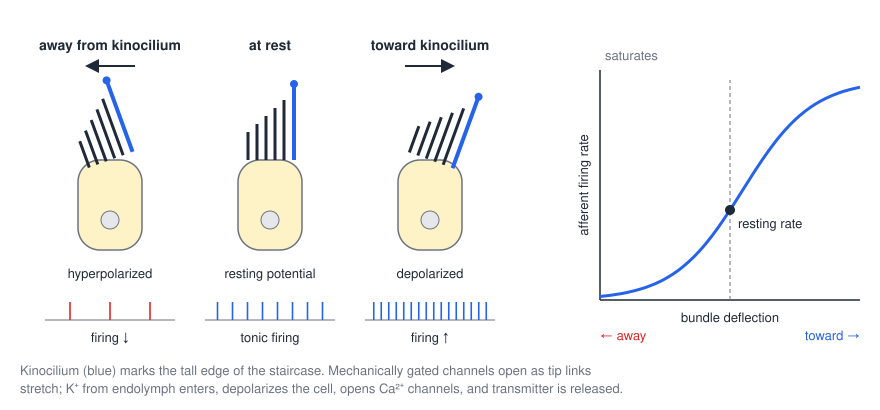
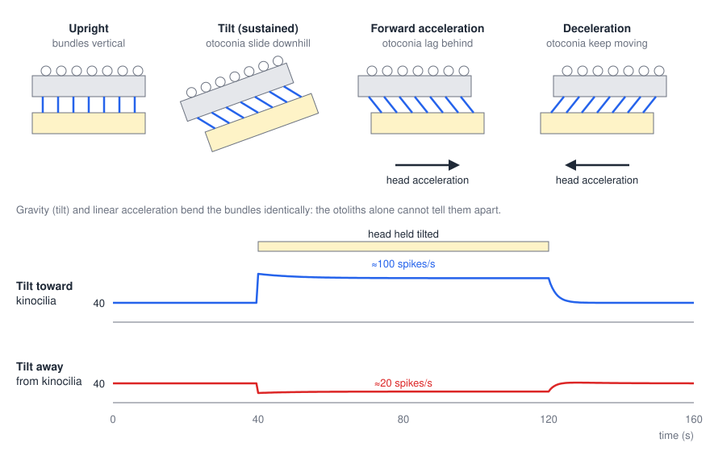
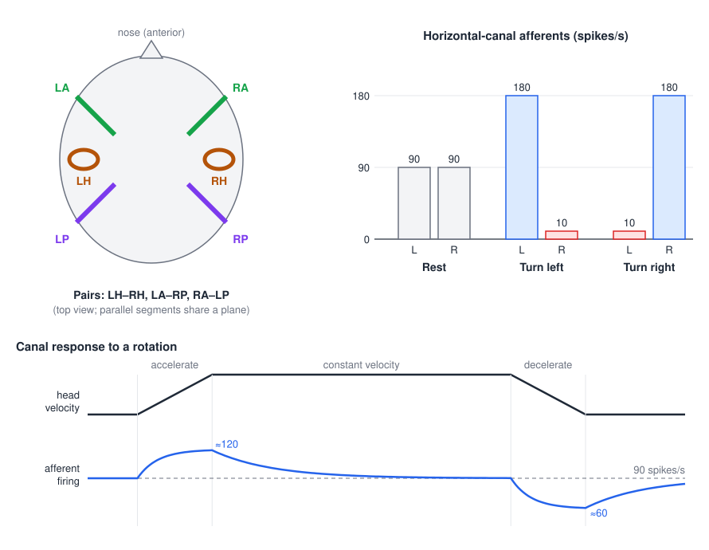
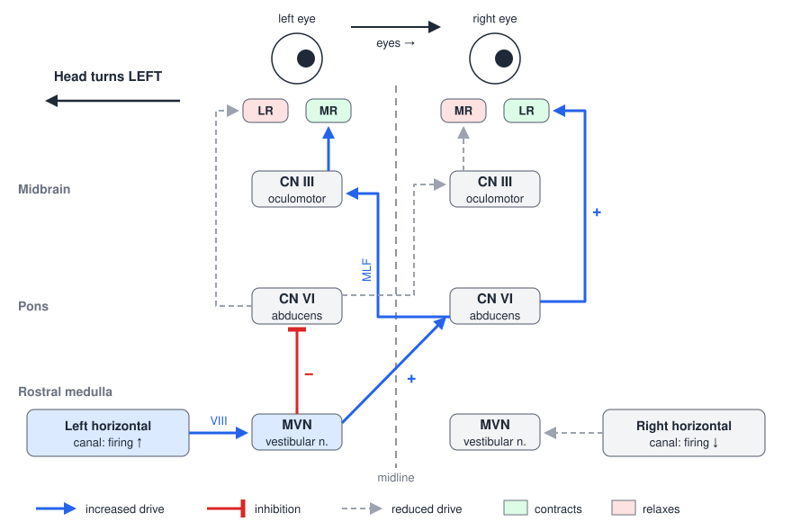

# The Vestibular System

The vestibular system measures how the head moves and which way is down. Five small sense organs in each inner ear report the angular and linear accelerations of the head, and the brainstem uses those signals within a few milliseconds to hold the eyes steady on a target, keep the head upright and adjust the tone of the antigravity muscles. Unlike vision or touch it works almost entirely below awareness, and it is noticed mainly when it fails, as vertigo, oscillopsia, imbalance or falls. This chapter covers the peripheral apparatus and how hair cells encode motion, the central vestibular nuclei and their projections, the vestibulo-ocular, vestibulocollic and vestibulospinal reflexes, and the disorders and bedside tests that follow from that wiring.

## Head Motion in Three Dimensions

A rigid head has six degrees of freedom: three of translation and three of rotation. The rotations are named for the axis about which they occur:

- **Yaw**: rotation about the vertical (z) axis, as in shaking the head "no."
- **Pitch**: rotation about the interaural (y) axis, as in nodding "yes."
- **Roll**: rotation about the naso-occipital (x) axis, as in tilting an ear toward the shoulder.

The vestibular labyrinth contains two kinds of sensor that together cover all six degrees of freedom. The **semicircular canals** sense **rotational (angular) acceleration** about all three cardinal axes; the **otolith organs** sense **translational (linear) acceleration** in all three directions, including the constant linear acceleration of gravity, and therefore static head tilt.

| Organ | Movement type | Detects |
|---|---|---|
| **Semicircular canals** (3 per side) | Rotation | Angular acceleration about all 3 axes (encoded as head velocity over the natural frequency range) |
| **Otolith organs** (utricle and saccule) | Translation and tilt | Linear acceleration in all 3 directions, including gravity (static head position) |

## The Peripheral Apparatus

### The labyrinth

The vestibular organs lie in the **petrous part of the temporal bone**, alongside the cochlea, forming the inner ear. The bony labyrinth is a set of interconnected channels in the bone; within it lies the **membranous labyrinth**, a continuous system of ducts and sacs filled with **endolymph** and surrounded by perilymph. Its vestibular parts are:

- three **semicircular canals**, the **horizontal** (lateral), **anterior** (superior) and **posterior**, roughly orthogonal to one another, each with a swelling at one end, the **ampulla**, that contains the sensory epithelium;
- two **otolith organs** in the central vestibule, the **utricle** and the **saccule**.

The **endolymphatic duct** leads from the vestibule to the endolymphatic sac, which absorbs endolymph, and the **ductus reuniens** connects the saccule with the cochlear duct. The sensory neurons have their cell bodies in **Scarpa's (vestibular) ganglion**, and their axons form the **vestibular division of the vestibulocochlear nerve (CN VIII)**, which runs with the auditory division and the facial nerve through the internal auditory meatus.

### Hair cells

The receptors of every vestibular organ, like those of the cochlea, are **hair cells**. Each carries on its apical surface a **hair bundle** of 50–100 stereocilia arranged in rows of increasing height, a staircase, with a single true cilium, the **kinocilium**, at the tall edge. The tips of adjacent stereocilia are joined by fine filaments, the **tip links**, attached to mechanically gated transduction channels.

*Figure: hair cell polarity. Deflecting the bundle toward the kinocilium (blue) depolarizes the cell and raises the firing rate of its afferent; deflection away hyperpolarizes it and lowers the rate. Right: afferent firing rate against bundle deflection. The resting rate sits partway up a sigmoid, so the cell signals both directions, but the response saturates and the inhibitory direction is cut off at zero.*

Transduction proceeds in three steps:

1. **Deflection toward the kinocilium** stretches the tip links and opens the transduction channels. The endolymph bathing the stereocilia is unusually rich in K⁺ (about 150 mM), so **K⁺ flows in** and **depolarizes** the cell. Deflection away from the kinocilium slackens the tip links, closes the channels that are open at rest, and **hyperpolarizes** the cell. Deflection at right angles to this axis has little effect.
2. Depolarization opens **voltage-gated Ca²⁺ channels** in the basolateral membrane. Ca²⁺ entry triggers **vesicle fusion and release of glutamate** onto the afferent nerve terminal, raising its firing rate.
3. Ca²⁺ also opens **Ca²⁺-activated K⁺ channels**, through which K⁺ leaves (into the low-K⁺ perilymph), repolarizing the cell. The interplay of steps 2 and 3 produces **electrical resonance** that tunes the cell's response.

Because K⁺ both enters and leaves passively, down its electrochemical gradient at each end, the hair cell transduces without spending energy on the transducer current itself.

Two features make hair cells good motion sensors. First, each cell is **directionally polarized**, with its best direction set by the position of the kinocilium. Second, the transduction channels are partly open at rest, and the afferents fire **tonically**, at about 90 spikes/s for canal afferents and somewhat lower for otolith afferents. A tonic rate allows bidirectional signaling: the same afferent can report motion in one direction by firing faster and the opposite direction by firing slower. Vestibular afferents are diverse; regular afferents fire like clocks and encode head velocity accurately, while irregular afferents are more sensitive and phasic.

### Polarization maps

The arrangement of hair-cell polarities differs between organs and determines what each organ encodes.

- In each **ampullary crista**, all hair cells are polarized in the **same direction**, so a canal reports rotation in one plane, excited by one direction and inhibited by the other.
- In each **macula**, a curving line, the **striola**, divides the epithelium, and polarity **reverses across it**. In the **utricle** hair cells point **toward** the striola; in the **saccule** they point **away** from it. Because the striola curves, the polarities fan out over all directions in the plane of the macula, and each macula encodes linear acceleration in **every direction within its plane**.

## The Otolith Organs

### Structure

The **utricular macula** lies roughly horizontal when the head is upright and the **saccular macula** roughly vertical, in a parasagittal plane. In each, the hair bundles project into a gelatinous **otolithic membrane** whose upper surface carries a mass of calcium carbonate crystals, the **otoconia**. Below are the reticular membrane, the hair cells and their supporting cells. Because the otoconia are about three times denser than endolymph, the otolithic membrane is a small inertial mass resting on the hair bundles.

### Tilt and translation

*Figure: top, the otoconial mass under different conditions. Upright, the bundles are vertical. With a sustained head tilt, gravity pulls the mass downhill along the macula and bends the bundles. During forward acceleration the mass lags behind and bends the bundles backward; during deceleration it continues forward. Bottom, tonic otolith afferent firing during a sustained tilt: tilt toward the kinocilia raises the rate from about 40 to about 100 spikes/s; tilt in the opposite direction lowers it to about 20 spikes/s. The change persists for as long as the head is held tilted.*

The otoliths sense two kinds of stimulus:

- **Static displacement (tilt).** When the head is tilted, the component of gravity along the macula slides the otoconial mass and bends the bundles. The deflection persists for as long as the tilt is held, so otolith afferents report **head position relative to gravity**, with a sustained change in firing and only slight adaptation.
- **Translation.** During a forward linear acceleration the otoconial mass, by inertia, lags behind the head and bends the bundles backward; during deceleration it continues forward and bends them forward. The same happens in the vertical direction, in the saccule, for example in an elevator.

The two stimuli are physically indistinguishable to an accelerometer. A backward head tilt and a forward linear acceleration bend the bundles in the same way (Einstein's equivalence principle). This **tilt–translation ambiguity** is resolved centrally by combining otolith signals with canal signals (tilt involves rotation; translation does not) and with vision. When resolution fails, as when an aircraft accelerates forward and the pilot feels the nose pitching up, the result is a dangerous illusion.

## The Semicircular Canals

### The cupula

Each canal is a ring of endolymph interrupted at the ampulla by the **cupula**, a gelatinous diaphragm that spans the ampulla and into which the hair bundles of the **crista** project. When the head begins to rotate in the plane of a canal, the bony canal moves with it, but the endolymph, by inertia, lags behind. Relative to the canal the fluid therefore flows in the direction **opposite** to the head rotation, pushes on the cupula, and deflects it and the hair bundles.

### Coplanar pairs and push–pull

The three canals on each side are nearly orthogonal, and each lies in roughly the same plane as one canal on the other side. When the head is upright, the horizontal canals are tilted up by about 30° at the front, so they lie in the horizontal plane when the head is pitched down 30°. The canals form three **coplanar pairs**:

- **left and right horizontal** canals;
- **left anterior and right posterior** canals;
- **right anterior and left posterior** canals.

*Figure: top left, the six canals seen from above, with the coplanar pairs drawn in matching orientation. Top right, horizontal-canal afferent firing at rest (90 spikes/s on each side), during a turn to the left (left 180, right 10 spikes/s), and during a turn to the right (the reverse). Bottom, the response of a canal afferent to a rotation profile: firing rises to about 120 spikes/s during acceleration, decays back to the resting rate during constant-velocity rotation as the cupula returns, and falls to about 60 spikes/s on deceleration before recovering.*

Within a pair the two canals are oriented as mirror images, so any rotation in their plane excites one and inhibits the other. When the head turns to the **left**, endolymph in the **left horizontal canal** deflects the cupula toward the utricle (ampullopetal flow), bends the bundles toward the kinocilia, and the afferent rate rises from about 90 to about 180 spikes/s. In the **right horizontal canal** the same rotation bends the bundles away from the kinocilia and the rate falls to about 10 spikes/s. A turn to the right does the reverse. This **push–pull** arrangement means that the brain reads rotation from the difference between the two sides:
\\[
r\_L - r\_R \propto \omega\_{\text{yaw}},
\\]
which doubles the sensitivity, cancels common-mode changes such as temperature, and leaves the system with a working signal if one side fails. Because each canal pair is aligned with a plane of rotation, together the three pairs report rotation about any axis.

### Dynamics: from acceleration to velocity

The canals are excited by **angular acceleration**, but their mechanics convert it into a signal of **velocity**. The endolymph–cupula system behaves as a heavily damped **torsion pendulum**: viscous drag in the narrow canal dominates the fluid's inertia, and the cupula's elasticity returns it slowly to rest. Over the frequencies of natural head movement, roughly 0.1 to 10 Hz, the cupular deflection, and hence the afferent firing, is approximately proportional to head angular velocity:
\\[
r(t) \approx r\_0 + g\\,\omega\_{\text{head}}(t), \qquad r\_0 \approx 90\ \text{spikes/s}.
\\]
At lower frequencies the approximation fails. During a sustained rotation at **constant velocity**, endolymph eventually moves with the canal, the cupula returns to its rest position with a time constant of several seconds, and firing decays back to baseline: the canals **do not signal constant-velocity rotation**. When the rotation stops, the endolymph continues to move, the cupula is deflected the other way, and firing falls below baseline, which is why one feels as if spinning in the opposite direction after stopping. Central circuits in the vestibular nuclei and cerebellum extend the effective time constant ("velocity storage"), but prolonged constant rotation is ultimately invisible to the vestibular system.

## Central Vestibular Pathways

### The vestibular nuclei

The vestibular nerve enters the brainstem at the pontomedullary junction and ends in the **vestibular nuclear complex** in the floor of the fourth ventricle: the **superior, lateral (Deiters'), medial and inferior (descending)** vestibular nuclei, plus small cell groups. A few primary afferents bypass the nuclei and go directly to the vestibulocerebellum.

The vestibular nuclei are not simple relays. They receive:

- **vestibular organs**: canal and otolith afferents through Scarpa's ganglion and CN VIII;
- **the opposite vestibular nuclei**: through **commissural fibers**, which sharpen the push–pull comparison and support recovery after unilateral loss;
- **the visual system**: through the accessory optic system and the nucleus of the optic tract, which signal whole-field visual motion;
- **the spinal cord**: proprioceptive information about neck and body position;
- **the cerebellum**: Purkinje cells of the flocculonodular lobe and vermis, and the **fastigial nucleus**, through the juxtarestiform body.

The result is a high level of multisensory integration before vestibular information is passed on. Many vestibular nucleus neurons respond to both vestibular and visual motion, and some respond only to motion that is externally imposed rather than self-generated, cancelling the expected sensory consequences of active head movements.

### Projections

The vestibular nuclei project to:

| Target | Route | Function |
|---|---|---|
| **Oculomotor (III), trochlear (IV) and abducens (VI) nuclei** | Ascending **medial longitudinal fasciculus (MLF)** | **Compensatory eye movements** (VOR) |
| **Cerebellum** (flocculonodular lobe, posterior vermis, anterior lobe lobules I–V) | Inferior cerebellar peduncle | **Motor coordination**; calibration of the reflexes |
| **Spinal cord** | **Lateral and medial vestibulospinal tracts** (descending MLF) | **Postural reflexes** of neck, trunk and limbs |
| **Thalamus** (ventral posterior complex) → cortex | Bilateral ascending projections | **Awareness of spatial orientation and self-motion** |
| Reticular formation, autonomic centers | | Autonomic adjustments; nausea of motion sickness |

The cortical projection is **bilateral**. Vestibular signals reach several areas rather than a single primary cortex: a region near the postcentral gyrus adjacent to the somatosensory representation of the head (areas 3a and 2v), the posterior parietal cortex, and the **parieto-insular vestibular cortex** in the posterior insula. There they are combined with visual and proprioceptive signals to create a **measure of self-motion** and of the body's orientation in space.

## Eye Movements

### Types of eye movement

| Movement | Definition | Features |
|---|---|---|
| **Saccades** | Rapid shifts of gaze to a new target, in any direction | Fast (up to several hundred °/s) and stereotyped |
| **Smooth pursuit** | Tracking a moving target with the eyes | Slow; needs a moving target |
| **Vergence** | Moving the eyes toward or away from each other | For depth perception and reading |
| **Fixation** | Holding the eyes on a stationary target | — |
| **Vestibulo-ocular reflex** | Counter-rotating the eyes during head movement | Very short latency |
| **Nystagmus** | Involuntary, repetitive eye movement | Alternating slow and fast phases |

### Muscles and innervation

Each eye is moved by six extraocular muscles working in three antagonist pairs:

| Muscle pair | Function |
|---|---|
| Medial and lateral recti | Horizontal movement (adduction, abduction) |
| Superior and inferior recti | Vertical movement (elevation, depression) |
| Superior and inferior obliques | Torsion (and secondary vertical actions) |

The **superior rectus** moves the eye up, the **inferior rectus** down, the **medial rectus** inward and the **lateral rectus** outward; the **superior oblique** moves it down and out (and intorts), the **inferior oblique** up and out (and extorts).

| Cranial nerve | Name | Muscles innervated |
|---|---|---|
| **CN III** | Oculomotor | Medial, superior and inferior recti; inferior oblique |
| **CN IV** | Trochlear | Superior oblique |
| **CN VI** | Abducens | Lateral rectus |

## The Vestibulo-Ocular Reflex

Vision blurs if the image slips across the retina faster than a few degrees per second, yet the head moves continually, at velocities of hundreds of degrees per second during walking and running. The **vestibulo-ocular reflex (VOR)** keeps the retinal image stable by rotating the eyes at the **same speed** as the head and in the **opposite direction**:
\\[
\dot\theta\_{\text{eye}}(t) = -G\\,\dot\theta\_{\text{head}}(t), \qquad G \approx 1 .
\\]
Visual tracking systems are too slow for this; the VOR acts with a latency of under 10 ms because it uses a **three-neuron arc**: primary vestibular neuron → vestibular nucleus neuron → ocular motor neuron → extraocular muscle. The reflex works in all three dimensions, and its planes of action align approximately with the canal planes, so each canal pair drives the eye muscles that rotate the eye in its own plane.

### The horizontal VOR

*Figure: the horizontal VOR for a head turn to the left (dorsal view, left on the left). The left horizontal canal is excited and drives the left medial vestibular nucleus (MVN). The MVN excites the contralateral (right) abducens nucleus, whose motor neurons contract the right lateral rectus and whose internuclear neurons cross and ascend in the left MLF to the left oculomotor nucleus, contracting the left medial rectus. The MVN also inhibits the ipsilateral (left) abducens nucleus, relaxing the left lateral rectus and, through the right MLF, the right medial rectus. Both eyes rotate to the right. Drive from the inhibited right canal falls (gray).*

For a head turn to the **left**:

1. The **left horizontal canal** is excited (firing increases) and the right is inhibited (firing decreases).
2. Left canal afferents excite neurons of the left **medial vestibular nucleus**.
3. These neurons send an **excitatory** projection across the midline to the **right abducens nucleus**. Its motor neurons contract the **right lateral rectus**; its **internuclear neurons** cross back and ascend in the **left MLF** to the medial rectus subdivision of the **left oculomotor nucleus**, contracting the **left medial rectus**.
4. The same vestibular neurons send an **inhibitory** projection to the **left abducens nucleus**, relaxing the **left lateral rectus** and, through its internuclear neurons in the right MLF, the **right medial rectus**.
5. The reduced drive from the right canal produces the mirror-image pattern, reinforcing both changes.

Both eyes therefore rotate to the **right**, opposite the head turn, at the same speed. The agonists (left medial rectus and right lateral rectus) are activated and the antagonists (left lateral rectus and right medial rectus) are inhibited. The gain of the VOR is continuously calibrated by the vestibulocerebellum (flocculus), which uses retinal slip, carried by climbing fibers, as its error signal; this is the best-understood example of cerebellar motor learning, seen for instance when the gain adapts to new spectacles.

### Nystagmus

If the head keeps rotating, the eyes cannot counter-rotate indefinitely. The VOR then produces **nystagmus**: a **slow phase** in which the eyes are carried in the compensatory direction, opposite the head rotation, alternating with a **fast phase**, a resetting saccade that brings them back in the direction of rotation. Nystagmus is named by the direction of its fast phase: in **right-beating** nystagmus the eyes drift slowly to the left and snap back to the right.

- **Physiological (rotational) nystagmus** is the normal VOR response to sustained head rotation. During rotation to the left, the slow phases go to the right (compensatory) and the fast phases to the left, in the direction of rotation; the nystagmus is left-beating. As the cupula returns during constant-velocity rotation, the nystagmus fades, and when the rotation stops, a post-rotatory nystagmus beats the other way.
- **Optokinetic nystagmus (OKN)** is induced by a large moving visual stimulus, the classic example being the scenery seen from a train. The **slow phase** is a pursuit-like movement that follows the moving scene; the **fast phase** is a saccade that shifts fixation to a new target. Its pathway runs from the retina to the **nucleus of the optic tract** and then to the **pontine nuclei**, the **vestibular nuclei**, and, through the **inferior olive**, the **vestibulocerebellum**. The optokinetic system complements the VOR by taking over at the low frequencies and constant velocities where the canals fail.
- **Spontaneous nystagmus**, occurring without head movement, signals **unilateral damage** to the vestibular system (below).

## Vestibulocollic and Vestibulospinal Reflexes

Descending projections of the vestibular nuclei make postural adjustments of the head and body.

| Reflex | Tract | Origin | Controls | Laterality |
|---|---|---|---|---|
| **Vestibulocollic (vestibulo-cervical) reflex, VCR** | **Medial vestibulospinal tract**, in the descending MLF | Medial vestibular nucleus | Neck and shoulder muscles; stabilizes head position in space | **Bilateral**, to the cervical cord |
| **Vestibulospinal reflex, VSR** | **Lateral vestibulospinal tract** | Lateral vestibular (Deiters') nucleus | Limb and trunk **extensor (antigravity)** muscles | **Ipsilateral**, the full length of the cord |

The **vestibulocollic reflex** counter-rotates the neck when the body moves, keeping the head, and with it the eyes and labyrinths, stable in space. The **lateral vestibulospinal tract** excites extensor motor neurons and inhibits flexors on the same side. When the body tips to one side, otolith and canal signals increase extensor tone in the limbs on that side, bracing against the fall. The lateral vestibular nucleus receives strong inhibitory input from Purkinje cells of the anterior vermis, so the cerebellum continuously regulates antigravity tone.

### Posture and gait

Balance depends on three sensory inputs, **vestibular, visual and somatosensory**, integrated in the vestibular nuclei and cerebellum. The vestibular contribution is crucial when the others are degraded: in the dark, on soft or moving surfaces, or when looking at a moving scene. During walking, vestibular signals stabilize gaze and head and contribute to foot placement and trunk control. Vestibular loss therefore reduces gait speed and increases fall risk, particularly in older adults. Vestibulospinal and reticulospinal pathways together form the ventromedial brainstem system for posture and axial control (see [Descending Pathways](descending-pathways.md)).

## Clinical Correlations

### Spontaneous nystagmus and unilateral loss

Because both labyrinths fire tonically, at rest their signals balance, and the brain reads zero rotation. If one labyrinth or vestibular nerve is destroyed, its side falls silent while the intact side continues at its **baseline** rate. The difference is identical to the signal produced by a head rotation **toward the intact side**, so the patient feels the room spinning and has a **spontaneous nystagmus** with no head movement: slow phases toward the side of the lesion and fast phases away from it. A left labyrinthine lesion produces a right-beating nystagmus. Over days to weeks the commissural system and cerebellum rebalance the vestibular nuclei (**vestibular compensation**), and the nystagmus and vertigo subside, although the dynamic deficit during rapid head movements may persist.

**Vestibular neuritis**, presumed viral inflammation of the vestibular nerve, is the commonest cause of acute unilateral loss. It produces sudden, severe, continuous vertigo lasting days, with nausea, spontaneous horizontal-torsional nystagmus beating away from the affected side, a tendency to fall toward that side, and no hearing loss (which distinguishes it from labyrinthitis). Recovery relies on central compensation, which is promoted by early movement and vestibular rehabilitation exercises.

### Bilateral vestibular loss

When both sides are lost, commonly from ototoxic aminoglycoside antibiotics, there is no asymmetry and therefore no vertigo or nystagmus. Instead the VOR is absent: the visual world appears to bounce with every step (**oscillopsia**), and balance is poor, especially in the dark or on uneven ground, where vision and proprioception cannot substitute.

### Ménière's disease

**Ménière's disease** is a chronic inner-ear disorder that distorts vestibular signals to the brain. Its basis is **endolymphatic hydrops**: endolymph backs up, and the membranous labyrinth swells under pressure. Swelling distorts balance information from the canals and sound information from the cochlea, and the distorted information travels to the brain. Patients have recurrent attacks of vertigo lasting from about twenty minutes to several hours, with fluctuating low-frequency hearing loss, tinnitus and a sense of fullness in the ear; hearing loss tends to become permanent over years.

### Benign paroxysmal positional vertigo

**BPPV** causes brief episodes, usually under a minute, of mild to intense vertigo triggered by specific changes in head position, such as rolling over in bed or looking up. Otoconia dislodged from the utricular macula drift into a semicircular canal, most often the **posterior canal** because it is the most dependent when lying down. When the head moves in that canal's plane, the free particles (**canaliths**) settle under gravity, drag endolymph with them and deflect the cupula, generating a burst of vertigo and nystagmus. It is diagnosed with the **Dix–Hallpike maneuver** (the head is turned 45° and the patient brought rapidly supine with the head hanging), which provokes a delayed, fatiguing, upbeating torsional nystagmus, and treated with **canalith repositioning maneuvers** such as the Epley maneuver, which roll the particles out of the canal and back into the utricle.

### Caloric testing

**Caloric testing** examines each horizontal canal separately and determines the integrity of the brainstem circuits behind it. The patient lies supine with the head raised about 30°, which brings the horizontal canals into the vertical plane so that gravity can act on the endolymph. Water or air at a temperature above or below body temperature is introduced into one ear canal. **Warm** water heats the nearby endolymph, which becomes less dense and **rises**, producing ampullopetal flow and **increased firing** of that canal, the same signal as a head turn toward the irrigated ear. **Cold** water makes the endolymph **fall** and **decreases firing**, the same signal as a head turn away from it.

In a conscious patient this produces nystagmus. Since nystagmus is named for its fast phase, the response is summarized by the mnemonic **COWS**: **C**old, **O**pposite; **W**arm, **S**ame.

| Condition | Cold water in one ear | Warm water in one ear | Interpretation |
|---|---|---|---|
| **Normal, conscious** | Nystagmus: slow phase toward the irrigated ear, fast phase away | Slow phase away from the irrigated ear, fast phase toward it | VOR and cortical fast-phase generation intact |
| **Unconscious, brainstem intact** | Tonic deviation of both eyes **toward** the irrigated ear; no fast phase | Tonic deviation of both eyes **away** from the irrigated ear | The fast phase depends on the cortex; the brainstem VOR is intact |
| **Bilateral MLF lesion** | Only the **abducting** eye (on the side of the irrigated ear) deviates; the adducting eye does not move | Only the abducting eye (opposite the irrigated ear) deviates | Abducens–oculomotor link through the MLF is cut (internuclear ophthalmoplegia) |
| **Low brainstem lesion** (vestibular nuclei, pons–rostral medulla) | **No response**; eyes stay in the midline | **No response** | The reflex arc itself is destroyed |

A weak or absent response from one ear, compared with the other, identifies a unilateral peripheral loss; in a comatose patient, the caloric (oculovestibular) reflex is a test of brainstem function.

### The head impulse test

The **head impulse test** examines the high-frequency VOR of each horizontal canal at the bedside. The examiner holds the patient's head, asks the patient to fixate the examiner's nose, and delivers a small, rapid, unpredictable head rotation to one side. Normally the eyes counter-rotate exactly and stay on target. If the canal on the side toward which the head is turned is weak, the eyes are carried off target with the head and a **corrective (catch-up) saccade** brings them back, a sign of a unilateral peripheral deficit on that side. Abnormal head impulse tests are common in older adults and are associated with slower gait and a higher risk of falls.

### Decerebrate rigidity

**Damage to the brainstem above the vestibular nuclei**, between the red nucleus and the vestibular nuclei, produces **decerebrate rigidity**: rigid extension of all four limbs. The lower limbs are **extended and plantar flexed**; the upper limbs are **extended, adducted and pronated**, with the wrists and fingers flexed; the neck and back may be extended. The lesion removes descending influences from the cortex and red nucleus that normally restrain the brainstem, leaving the excitatory drive of the **lateral vestibular nucleus** (and pontine reticulospinal neurons) onto extensor motor neurons unopposed, largely through the gamma loop. The cerebellum also contributes: its Purkinje cells inhibit the lateral vestibular nucleus, and removing that inhibition increases the rigidity, whereas lesioning the vestibular nuclei abolishes it. Decerebrate posturing indicates a worse prognosis than **decorticate** posturing (flexed upper limbs, extended lower limbs), which follows lesions above the red nucleus.

### Aging, falls and other conditions

Vestibular function declines with age: canal function is most often affected, followed by saccular and then utricular function. Because vestibular loss is common, often undiagnosed, and independently associated with slower gait and falls, it is a modifiable target for fall prevention through vestibular rehabilitation. **Motion sickness** arises from conflict between vestibular, visual and expected signals; vestibular-nucleus and fastigial neurons that respond only to externally imposed motion may signal this conflict to the nausea pathways. And because the vestibular system projects widely into the brainstem and the basal ganglia–thalamic circuits, non-invasive vestibular stimulation is being explored as a therapy for movement disorders such as Parkinson disease.

## Key Readings

- Goldberg JM, Fernández C (1971). *Physiology of peripheral neurons innervating semicircular canals of the squirrel monkey. I. Resting discharge and response to constant angular accelerations*. Journal of Neurophysiology. — The reference characterization of canal afferents: a resting rate of about 90 spikes/s, torsion-pendulum dynamics, and velocity coding over natural frequencies.
- Agrawal Y, Zuniga MG, Davalos-Bichara M, et al. (2012). *Decline in semicircular canal and otolith function with age*. Otology & Neurotology. — Canal, saccular and utricular function all decline in older adults, canal function most often.
- Agrawal Y, Davalos-Bichara M, Zuniga MG, Carey JP (2013). *Head impulse test abnormalities and influence on gait speed and falls in older individuals*. Otology & Neurotology. — Half of adults over 70 had an abnormal head impulse test, which predicted slower gait and about fivefold higher odds of falling.
- Oman CM, Cullen KE (2014). *Brainstem processing of vestibular sensory exafference: implications for motion sickness etiology*. Experimental Brain Research. — Vestibular-only neurons cancel self-generated motion and may signal the sensory conflict that causes motion sickness.
- Oh SY, Boegle R, Ertl M, Stephan T, Dieterich M (2018). *Multisensory vestibular, vestibular-auditory, and auditory network effects revealed by parametric sound pressure stimulation*. NeuroImage. — Maps the cortical vestibular network, with the posterior insula as a key multisensory hub.
- Wilkinson D, Podlewska A, Banducci SE, et al. (2019). *Caloric vestibular stimulation for the management of motor and non-motor symptoms in Parkinson's disease*. Parkinsonism & Related Disorders. — Home caloric vestibular stimulation improved motor and non-motor symptoms in a double-blind trial.
- Lawrence DG, Kuypers HGJM (1968b). *The functional organization of the motor system in the monkey. II. The effects of lesions of the descending brain-stem pathways*. Brain. — Defines the ventromedial (including vestibulospinal) system for posture and axial movement.

## See Also

- [The Cerebellum](cerebellum.md): the vestibulocerebellum and the calibration of the VOR.
- [Descending Pathways](descending-pathways.md): the vestibulospinal and reticulospinal tracts.
- [Sensory Receptors](sensory-receptors.md): mechanotransduction in other receptors.
- [Somatosensory Pathways](somatosensory-pathways.md): the proprioceptive inputs combined with vestibular signals for balance.
- [The Basal Ganglia](basal-ganglia.md): Parkinson disease and vestibular stimulation as an adjunct therapy.
- [Sensory Prostheses](../../biomed/neuro/sensory-prostheses.md): engineering approaches to restoring lost sensory input.
- [Rehabilitation Devices](../../biomed/rehab.md): devices for balance and gait rehabilitation.
