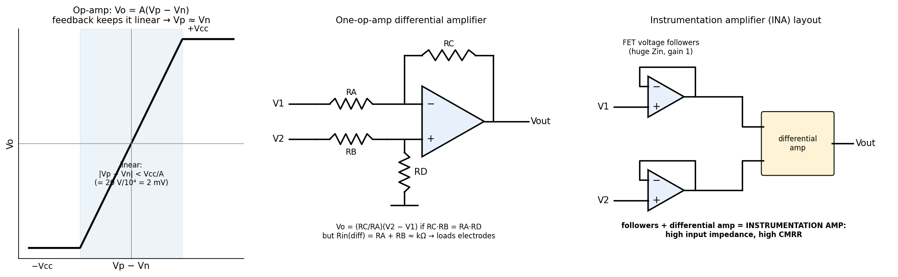
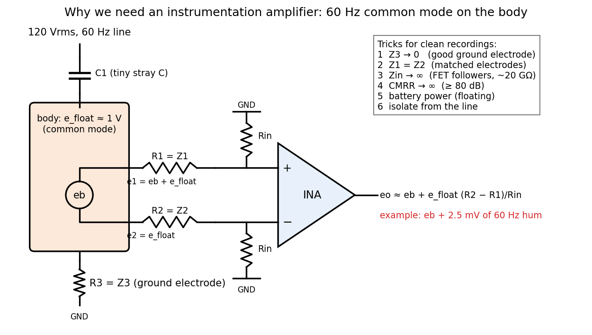

# Biopotential Amplifiers

Biopotentials are small, from microvolts (EEG) to a few millivolts (ECG, EMG), and they must be recorded from a body that is itself picking up around a volt of 60 Hz interference from the power lines in the room. The solution is to amplify only the *difference* between two electrodes. This chapter builds the instrumentation amplifier from the operational amplifier and shows how electrode impedances leak common-mode interference into the recording.

## The Operational Amplifier

The integrated op-amp (Fairchild, 1968) is complicated inside, with dozens of transistors and diodes, but simple at its terminals:
\\[
V\_o = A(V\_p - V\_n),
\\]
saturating at the supply rails \\(\pm V\_{cc}\\). With \\(V\_{cc}\\) at most ±20 V and open-loop gain \\(A\\) at least 10⁴, the output can stay in its linear range only if
\\[
\|V\_p - V\_n\| < \frac{V\_{cc}}{A} = \frac{20\ \text{V}}{10^4} = 2\ \text{mV}.
\\]
So whenever negative feedback keeps the amplifier linear, the two inputs are at essentially the same voltage, \\(V\_p\approx V\_n\\). Together with the second ideal rule, that the inputs draw no current, this is all that is needed to analyse op-amp circuits.

## The Difference Amplifier

A single op-amp differential stage has \\(R\_A\\) from input \\(V\_1\\) to the inverting input, feedback resistor \\(R\_C\\), \\(R\_B\\) from input \\(V\_2\\) to the non-inverting input, and \\(R\_D\\) from the non-inverting input to ground.

The non-inverting input sits on a voltage divider:
\\[
V\_p = \frac{R\_D}{R\_B + R\_D}V\_2 .
\\]
At the inverting input no current enters the op-amp, so the current through \\(R\_A\\) continues through \\(R\_C\\):
\\[
\frac{V\_1 - V\_n}{R\_A} = \frac{V\_n - V\_o}{R\_C}
\quad\Longrightarrow\quad
V\_o = V\_n\left(1 + \frac{R\_C}{R\_A}\right) - \frac{R\_C}{R\_A}V\_1 .
\\]
Set \\(V\_n = V\_p\\):
\\[
V\_o = \frac{R\_D}{R\_B + R\_D}\cdot\frac{R\_A + R\_C}{R\_A}V\_2 - \frac{R\_C}{R\_A}V\_1 .
\\]
If the resistor ratios match, \\(R\_C/R\_A = R\_D/R\_B\\) (equivalently \\(R\_CR\_B = R\_AR\_D\\)), then \\(R\_D/(R\_B + R\_D) = R\_C/(R\_A + R\_C)\\) and the first coefficient becomes \\(R\_C/R\_A\\):
\\[
\boxed{V\_o = \frac{R\_C}{R\_A}(V\_2 - V\_1)}
\\]
Any voltage common to both inputs cancels. If the ratios are mismatched by a fractional error \\(\varepsilon\\), a common-mode input \\(V\_{cm}\\) leaks through with gain of order \\(\varepsilon\\); with 1% resistors and unity gain the common-mode rejection is only about 40 dB.

The difference amplifier has a serious defect for biopotentials: its **differential input resistance is only \\(R\_A + R\_B\\)**, a few kilohms. Electrodes have impedances of kilohms to megohms, so the amplifier would load them heavily, and any difference between the two electrode impedances becomes a difference in gain.

## The Instrumentation Amplifier

The fix is to put a **voltage follower** (a unity-gain buffer with FET inputs) in front of each input. Each follower presents an enormous input impedance to its electrode and drives the difference stage from a low impedance. Buffers plus a difference amplifier form the **instrumentation amplifier (INA)**.

*Figure: left, the op-amp transfer curve, linear only within about ±2 mV of input; middle, the one-op-amp difference amplifier; right, the instrumentation amplifier: two input buffers followed by the difference stage.*

In the common three-op-amp version the two buffers are cross-coupled through a gain resistor \\(R\_G\\) with feedback resistors \\(R\\). Since each buffer holds its inverting input equal to its own input, the full differential voltage \\(V\_2 - V\_1\\) appears across \\(R\_G\\), and the same current flows through both \\(R\\)'s, so the difference between the buffer outputs is \\((V\_2 - V\_1)(1 + 2R/R\_G)\\). A common-mode voltage produces no current in \\(R\_G\\) and passes through the first stage at unity gain. The overall gain is
\\[
G = \left(1 + \frac{2R}{R\_G}\right)\frac{R\_C}{R\_A},
\\]
and the first stage multiplies the differential signal while leaving the common mode untouched, which improves the overall rejection by the first-stage gain.

## Where 60 Hz Interference Comes From

*Figure: the power line couples to the body through a small capacitance C₁; the body couples to ground through about 300 MΩ in parallel with C₂. The body therefore floats at e_float, common to both recording electrodes. Electrode impedances R₁ and R₂ form dividers with the amplifier input resistance R_in, and the ground electrode R₃ ties the body to the amplifier reference.*

The 117–120 V rms, 60 Hz power line is capacitively coupled to the body through a tiny stray capacitance \\(C\_1\\) (a parallel-plate estimate is \\(C = \varepsilon\_0A/d\\)), and the body is coupled to ground through roughly 300 MΩ of leakage in parallel with a larger capacitance \\(C\_2\\). These two impedances form a voltage divider:
\\[
e\_{float} = e\_{line}\\,\frac{Z\_2}{Z\_1 + Z\_2}.
\\]
For example, with \\(C\_1 = 3\\) pF (\\(Z\_1 = 1/(2\pi\cdot60\cdot3\times10^{-12}) \approx 880\\) MΩ) and \\(C\_2 = 200\\) pF (\\(Z\_2\approx 13\\) MΩ, dominating the 300 MΩ leak), \\(e\_{float}\approx 120\times13/893 \approx 1.7\\) V. Volt-level body potentials at 60 Hz are typical. Because the whole body is at this potential, it appears equally on every electrode: it is **common mode**.

With the biopotential \\(e\_b\\) between the electrodes,
\\[
e\_1 = e\_b + e\_{float}, \qquad e\_2 = e\_{float}.
\\]
An ideal difference amplifier would output \\(e\_b\\) alone. The problem is the electrodes.

### How electrode mismatch converts common mode to signal

Each electrode impedance forms a divider with the amplifier's input resistance \\(R\_{in}\\). The voltages that actually reach the two amplifier inputs are
\\[
e\_3 = \frac{R\_{in}}{R\_1 + R\_{in}}\\,(e\_{float} + e\_b), \qquad e\_4 = \frac{R\_{in}}{R\_2 + R\_{in}}\\,e\_{float}.
\\]
For \\(R\_1, R\_2\ll R\_{in}\\), use \\(R\_{in}/(R + R\_{in})\approx 1 - R/R\_{in}\\):
\\[
e\_3 - e\_4 \approx e\_b\left(1 - \frac{R\_1}{R\_{in}}\right) + e\_{float}\left[\left(1 - \frac{R\_1}{R\_{in}}\right) - \left(1 - \frac{R\_2}{R\_{in}}\right)\right]
\approx e\_b + e\_{float}\\,\frac{R\_2 - R\_1}{R\_{in}} .
\\]
Even with a perfect amplifier of gain 1,
\\[
\boxed{e\_o \approx e\_b + e\_{float}\\,\frac{R\_2 - R\_1}{R\_{in}}}
\\]
The unequal electrode impedances turn part of the common-mode voltage into a differential one, which no amplifier can reject afterwards.

### Worked example

Take \\(R\_1 = 50\\) kΩ, \\(R\_2 = 100\\) kΩ, a ground electrode \\(R\_3 = 50\\) kΩ, gain 1, \\(R\_{in} = 1\\) MΩ, and a leakage current \\(i\_c = 1\\) µA flowing to ground through the body. The ground electrode sets the body's potential relative to the amplifier reference:
\\[
e\_{float} = i\_cR\_3 = (1\ \text{µA})(50\ \text{kΩ}) = 50\ \text{mV}.
\\]
Then
\\[
e\_o \approx e\_b + (50\ \text{mV})\frac{100\ \text{k} - 50\ \text{k}}{1\ \text{M}} = e\_b + 2.5\ \text{mV at 60 Hz}.
\\]
Keeping the dividers exact instead of linearizing, the bracket is \\(0.9524 - 0.9091 = 0.0433\\), giving 2.2 mV, so the approximation is good. A hum of this size is as large as an ECG and a thousand times larger than an EEG.

## Common-Mode Rejection Ratio

An amplifier's ability to reject common-mode input is quantified by
\\[
\text{CMRR} = \left\|\frac{A\_{diff}}{A\_{cm}}\right\|, \qquad \text{CMRR}\_{dB} = 20\log\_{10}\text{CMRR},
\\]
so a CMRR of 10⁴ is 80 dB. With a common-mode input \\(v\_{cm,in}\\) the amplifier contributes an output error \\(v\_{cm,out} = A\_{diff}\\,v\_{cm,in}/\text{CMRR}\\). The worked example above shows that the electrode mismatch term, \\(e\_{float}(R\_2 - R\_1)/R\_{in}\\), can easily exceed the amplifier's own CMRR limitation, so the *system* CMRR is often set by the electrodes, not the chip.

## Six Ways to Reduce Common-Mode Interference

Each follows from the equations above.

1. **Make \\(Z\_3\to 0\\).** A low-impedance ground (reference) electrode on the body keeps \\(e\_{float} = i\_cR\_3\\) small.
2. **Make \\(Z\_1 - Z\_2\to 0\\).** Match the electrode impedances: same electrode type, same skin preparation.
3. **Make \\(Z\_{in}\to\infty\\).** A very high input impedance (for example 20 GΩ ∥ 2 pF) shrinks \\((R\_2 - R\_1)/R\_{in}\\).
4. **Make CMRR \\(\to\infty\\).** Use an amplifier with at least 80 dB CMRR.
5. **Battery power** with a floating reference and a guard, so the amplifier's own ground is not tied to the power line.
6. **Isolate** the line-powered parts from the battery-powered front end with an isolation impedance \\(Z\_{isol}\\).

The two that matter most are a low-impedance ground electrode and matched electrode impedances.

## See Also

- [Bioinstrumentation](../instrumentation.md): the measurement chain and patient safety.
- [Interfacing and Signal Conditioning](../../../eng/mechatronics/interfacing.md): amplifier circuits in general.
- [Biosignal Processing](../biosignals.md): filtering what remains of the 60 Hz interference.
- [The Electrode–Electrolyte Interface](electrode-interface.md): where \\(R\_1\\) and \\(R\_2\\) come from.
