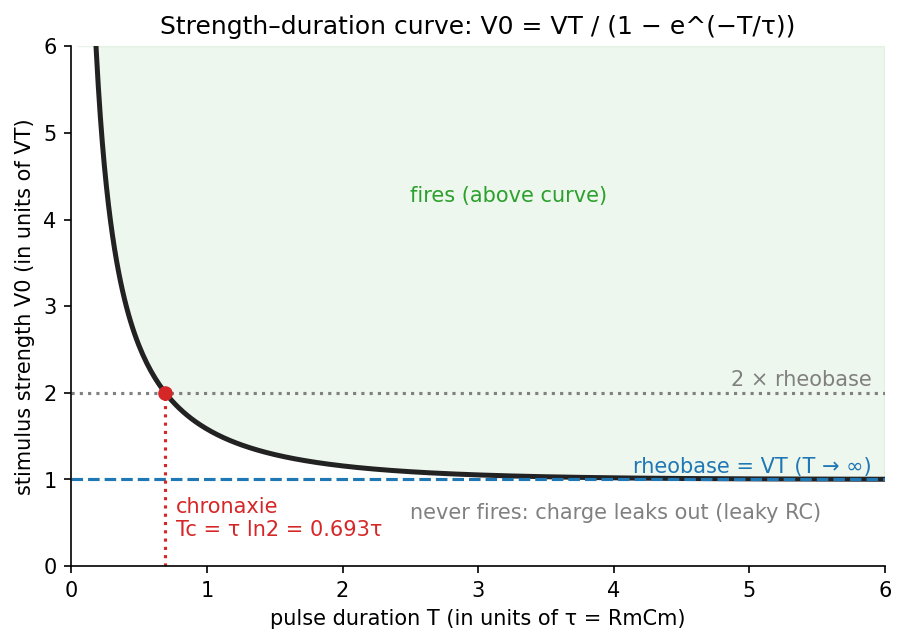
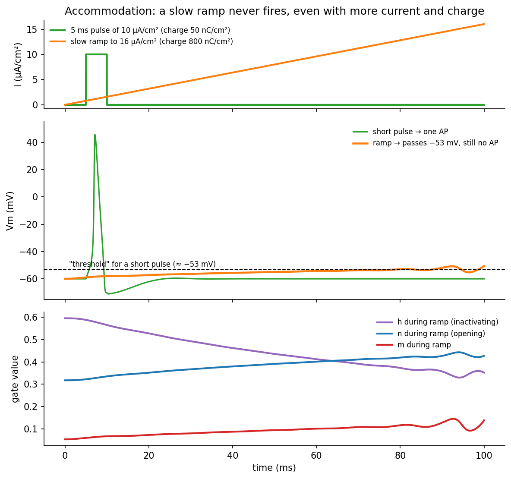
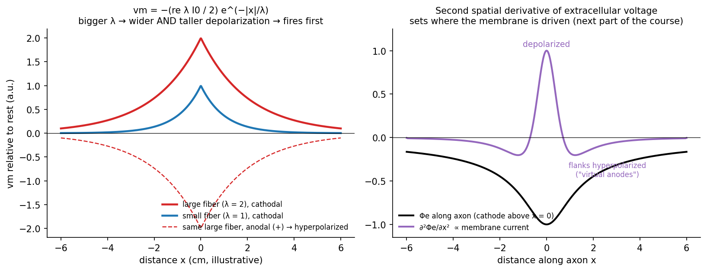

# Electrical Stimulation of Excitable Tissue

How strong, and for how long, must a stimulus be to fire an excitable cell? The simplest answer treats the membrane as a leaky integrator, an RC circuit, and leads to the strength–duration curve with its two classical parameters, rheobase and chronaxie. That picture is useful but incomplete: it cannot explain accommodation or anode break, and real stimulation is extracellular and depolarizes only part of a fibre at a time. This chapter develops the simple model, its limits, and the passive cable driven by an external electrode.

## Intracellular Stimulation of a Spherical Cell

Inject a current step \\(I\_0\\) of duration \\(t\\) into a spherical cell of surface area \\(A\\). Below threshold the membrane is passive, so the whole cell is a single RC circuit. With specific membrane resistance \\(r\_m\\) (Ω·cm²) and capacitance \\(c\_m\\) (F/cm²),
\\[
R\_m = \frac{r\_m}{A}, \qquad C\_m = c\_mA, \qquad \tau = R\_mC\_m = r\_mc\_m .
\\]
The time constant does not depend on the size of the cell: area cancels. The membrane charges exponentially toward \\(V\_0 = I\_0R\_m\\):
\\[
v\_m(t) = I\_0R\_m\left(1 - e^{-t/\tau}\right) = V\_0\left(1 - e^{-t/\tau}\right).
\\]

### The strength–duration curve

Let \\(V\_T\\) be the threshold depolarization. A pulse of duration \\(T\\) just reaches threshold at its end if
\\[
V\_T = V\_0\left(1 - e^{-T/\tau}\right)
\quad\Longrightarrow\quad
\boxed{V\_0 = \frac{V\_T}{1 - e^{-T/\tau}}}
\qquad\text{or, in current,}\qquad
I\_0 = \frac{I\_{rh}}{1 - e^{-T/\tau}}, \quad I\_{rh} = \frac{V\_T}{R\_m}.
\\]
This is the **strength–duration curve**: the shorter the pulse, the stronger it must be.

*Figure: the strength–duration curve. Required amplitude falls with pulse duration toward an asymptote, the rheobase. The duration at which twice the rheobase is needed is the chronaxie.*

- **Rheobase.** As \\(T\to\infty\\), \\(e^{-T/\tau}\to 0\\) and \\(V\_0\to V\_T\\) (\\(I\_0\to I\_{rh}\\)). The rheobase is the smallest stimulus that can ever excite, however long it lasts.
- **Chronaxie.** The pulse duration \\(T\_c\\) at which the required stimulus is twice the rheobase:
\\[
V\_T = 2V\_T\left(1 - e^{-T\_c/\tau}\right)
\\;\Longrightarrow\\;
e^{-T\_c/\tau} = \tfrac12
\\;\Longrightarrow\\;
\boxed{T\_c = \tau\ln 2 = 0.693\\,\tau}
\\]
(*chronos*, time). Physiologists used rheobase and chronaxie to compare the excitability of different tissues; chronaxie measures the membrane time constant without needing to know \\(R\_m\\) or \\(C\_m\\).

The intuition: the membrane is a **leaky integrator**. Firing needs a certain charge on the membrane. A short pulse must deliver it quickly, so its amplitude must be large. If charge were all that mattered, a tiny current left on forever would eventually work; but charge leaks out through \\(R\_m\\), so there is a minimum amplitude, the rheobase.

### The charge–duration curve

Multiplying amplitude by duration gives the charge per pulse:
\\[
Q(T) = I\_0T = \frac{I\_{rh}T}{1 - e^{-T/\tau}} .
\\]
As \\(T\to 0\\), \\(1 - e^{-T/\tau}\approx T/\tau\\) and \\(Q\to I\_{rh}\tau\\): a minimum charge \\(Q\_{min} = I\_{rh}\tau\\). For long pulses \\(Q\approx I\_{rh}T\\) grows without bound. **Short pulses are the most charge-efficient**, which is why clinical stimulators use pulse widths near or below chronaxie, and why charge-limited electrodes (see [Safe Stimulation](safe-stimulation.md)) favour them. Energy, \\(\propto I\_0^2T\\), is minimized at an intermediate width (\\(T\approx 1.26\tau\\)), which matters for battery life.

## Where the Simple Model Fails

1. **Linearity.** The RC network is linear only up to about 50% of threshold. Above that, Na⁺ channels begin to open and the membrane "resistor" changes value.
2. **Geometry.** Intracellular stimulation of a spherical cell is a special case. Stimulation is normally extracellular, and only part of the cell is depolarized at any instant.
3. **Too slow: accommodation.** With a ramp, or any waveform that reaches threshold on a time scale comparable to \\(\tau\_h\\), the threshold rises (\\(V\_{T2} > V\_{T1}\\)). Driven slowly enough, threshold may never be reached. During slow depolarization \\(h\\) inactivates Na⁺ channels and \\(n\\) opens K⁺ channels before \\(m\\) can run away.
4. **Too fast.** If the depolarization lasts less than about \\(\tau\_m\\), the regenerative process may not start even though threshold is momentarily exceeded.

*Figure: accommodation in the HH model. A 5 ms, 10 µA/cm² pulse (50 nC/cm²) fires one action potential. A slow ramp to 16 µA/cm² delivers 16 times the charge and carries V_m past the short-pulse "threshold", yet never fires: h falls and n rises throughout the ramp.*

Neither accommodation nor anode break can be explained by an RC circuit. Once Na⁺ channels open, the membrane is no longer **linear time-invariant**, so Laplace transforms and capacitor-charging arguments no longer apply; the full Hodgkin–Huxley equations must be integrated numerically (for example with `ode45` or Simulink, at the 6.3 °C squid temperature).

## The Passive Cable Driven from Outside

### The cable equation with a stimulus

Below threshold the membrane per unit length of fibre is a distributed RC:
\\[
i\_m = \frac{v\_m}{r\_m} + c\_m\frac{\partial v\_m}{\partial t}.
\\]
Combine with the [core-conductor result](cable.md) including the electrode term \\(i\_p\\) (mA/cm, positive for current entering the extracellular space):
\\[
\frac{\partial^2v\_m}{\partial x^2} = (r\_i + r\_e)\\,i\_m + r\_e\\,i\_p = (r\_i + r\_e)\left(\frac{v\_m}{r\_m} + c\_m\frac{\partial v\_m}{\partial t}\right) + r\_e\\,i\_p .
\\]
Multiply through by \\(r\_m/(r\_i + r\_e)\\) and define the **length constant** and **time constant**:
\\[
\boxed{\lambda^2\frac{\partial^2v\_m}{\partial x^2} - \tau\frac{\partial v\_m}{\partial t} - v\_m = r\_e\lambda^2\\,i\_p},
\qquad
\lambda = \sqrt{\frac{r\_m}{r\_i + r\_e}}\ (\text{cm}), \quad \tau = r\_mc\_m .
\\]
In dimensionless variables \\(X = x/\lambda\\), \\(T = t/\tau\\) this is \\(\partial^2v/\partial X^2 - \partial v/\partial T - v = r\_e\lambda^2i\_p\\), a diffusion equation with decay.

### Steady state and the length constant

With no stimulus in a region and \\(\partial/\partial t = 0\\):
\\[
\lambda^2\frac{d^2v\_m}{dx^2} - v\_m = 0
\quad\Longrightarrow\quad
v\_m = A\\,e^{-x/\lambda} + B\\,e^{x/\lambda}.
\\]
A disturbance decays by a factor \\(e\\) every length constant. With \\(r\_e\approx 0\\), \\(r\_m = R\_m/(2\pi a)\\) and \\(r\_i = R\_i/(\pi a^2)\\):
\\[
\lambda \approx \sqrt{\frac{r\_m}{r\_i}} = \sqrt{\frac{R\_m/2\pi a}{R\_i/\pi a^2}} = \sqrt{\frac{a}{2}\frac{R\_m}{R\_i}} .
\\]
\\(\lambda\\) grows with the **square root of fibre radius**. Better insulation (larger \\(R\_m\\)) or a better core conductor (smaller \\(R\_i\\)) lengthens it. For the squid axon (\\(a = 238\\) µm, \\(R\_m\approx 700\\) Ω·cm² at rest, \\(R\_i = 35.4\\) Ω·cm) this gives \\(\lambda\approx\sqrt{0.0119\cdot 700/35.4}\approx 0.5\\) cm.

### A point electrode: steady-state solution

*Figure: steady-state membrane potential under a point electrode for a large and a small length constant (cathodal current depolarizes, anodal hyperpolarizes), and the second spatial derivative of the extracellular potential along the fibre.*

Let the electrode inject \\(i\_p = I\_0\\,\delta(x)\\) at the origin. Current enters the extracellular space at \\(x = 0\\) and spreads both ways; further away, more and more of it has crossed into the axon, until \\(r\_iI\_i = r\_eI\_e\\), and transmembrane current and voltage fall to zero.

Integrate the steady-state equation across an infinitesimal interval around the origin. The \\(v\_m\\) term contributes nothing in the limit, but the delta function does:
\\[
\lambda^2\left(\left.\frac{dv\_m}{dx}\right\|\_{0^\+} - \left.\frac{dv\_m}{dx}\right\|\_{0^-}\right) = r\_e\lambda^2I\_0 .
\\]
The slope of \\(v\_m\\) jumps at the electrode. Away from the origin \\(v\_m\\) must vanish at \\(\pm\infty\\), and by symmetry \\(v\_m = C\\,e^{-\|x\|/\lambda}\\), whose slope jumps from \\(+C/\lambda\\) to \\(-C/\lambda\\):
\\[
-\frac{2C}{\lambda} = r\_eI\_0
\quad\Longrightarrow\quad
\boxed{v\_m(x) = -\frac{r\_e\lambda I\_0}{2}\\,e^{-\|x\|/\lambda}}
\\]

- The response peaks at the electrode and is negligible beyond about \\(\pm 5\lambda\\).
- Larger \\(r\_e\\) means a larger response: more current is forced across the membrane.
- **Positive (anodal) current makes \\(v\_m\\) negative: hyperpolarization. Negative (cathodal) current depolarizes.** This is why the cathode is the stimulating electrode.

### A point electrode: step response

Now switch the electrode current on at \\(t = 0\\). Laplace-transform in time (\\(\tau\\,\partial/\partial t\to s\\), using \\(T = t/\tau\\)), with zero initial conditions:
\\[
\frac{d^2\hat v}{dX^2} - (s + 1)\\,\hat v = 0 \quad (X\neq 0),
\qquad
\hat v = \hat C(s)\\,e^{-\|X\|\sqrt{s+1}} .
\\]
The jump condition becomes \\(-2\hat C\sqrt{s+1} = r\_e\lambda I\_0/s\\), so
\\[
\hat v(X,s) = -\frac{r\_e\lambda I\_0}{2}\\;\frac{e^{-\|X\|\sqrt{s+1}}}{s\sqrt{s+1}} .
\\]
Inverting with standard tables gives the solution in terms of the complementary error function, \\(\operatorname{erfc}(y) = 1 - \operatorname{erf}(y)\\), where
\\[
\operatorname{erf}(y) = \frac{2}{\sqrt\pi}\int\_0^ye^{-z^2}dz :
\\]
\\[
v\_m(X,T) = \frac{V\_\infty}{2}\left[e^{-X}\operatorname{erfc}\\!\left(\frac{X}{2\sqrt T} - \sqrt T\right) - e^{X}\operatorname{erfc}\\!\left(\frac{X}{2\sqrt T} + \sqrt T\right)\right],
\qquad V\_\infty = -\frac{r\_e\lambda I\_0}{2},\quad X = \frac{\|x\|}{\lambda},\ T = \frac{t}{\tau}.
\\]
Two checks: as \\(T\to\infty\\) the bracket tends to \\(2e^{-X}\\) and the steady state is recovered; at the electrode (\\(X = 0\\)) the bracket reduces to \\(2\operatorname{erf}(\sqrt T)\\), so
\\[
v\_m(0,t) = V\_\infty\operatorname{erf}\\!\left(\sqrt{t/\tau}\right).
\\]
The cable charges faster than an isolated patch: at \\(t = \tau\\) it has reached \\(\operatorname{erf}(1) = 84\\%\\) of its final value, against \\(1 - e^{-1} = 63\\%\\) for a patch, because current is shared with the neighbouring membrane. Spatial profiles at successive times (\\(T = 0.1\\) to 1) are bell-shaped curves that grow toward the exponential steady state; the time courses at increasing distance (\\(X = 0\\) to 2) rise more slowly and later, and are not exponentials.

### Stimulation by an external field: the activating function

When the electrode sits in a large volume conductor rather than in the thin extracellular layer of the core-conductor model, it is cleaner to treat the extracellular potential \\(\Phi\_e(x)\\) along the fibre as imposed by the electrode (\\(r\_e\to 0\\)). Using \\(\partial^2\Phi\_i/\partial x^2 = r\_ii\_m\\) and \\(\Phi\_i = V\_m + \Phi\_e\\):
\\[
\frac{\partial^2v\_m}{\partial x^2} + \frac{\partial^2\Phi\_e}{\partial x^2} = r\_i\left(\frac{v\_m}{r\_m} + c\_m\frac{\partial v\_m}{\partial t}\right)
\quad\Longrightarrow\quad
\lambda^2\frac{\partial^2v\_m}{\partial x^2} - \tau\frac{\partial v\_m}{\partial t} - v\_m = -\lambda^2\frac{\partial^2\Phi\_e}{\partial x^2}.
\\]
The source term is the second spatial derivative of the extracellular potential, the **activating function**: where \\(\partial^2\Phi\_e/\partial x^2 > 0\\) the membrane is driven to depolarize; where it is negative, to hyperpolarize. For a point electrode at distance \\(h\\) from the fibre, with the [monopole potential](fields.md#the-monopole) \\(\Phi\_e = I/(4\pi\sigma\sqrt{x^2 + h^2})\\),
\\[
\frac{\partial^2\Phi\_e}{\partial x^2} = \frac{I}{4\pi\sigma}\\,\frac{2x^2 - h^2}{(x^2 + h^2)^{5/2}} .
\\]
For a cathode (\\(I < 0\\)) this is positive for \\(\|x\| < h/\sqrt2\\), depolarizing the fibre directly beneath the electrode, and negative on either side, producing flanking hyperpolarized regions (the "virtual anodes"). For an anode the pattern reverses: hyperpolarization beneath, depolarization on the flanks, which is why strong anodal stimuli can excite at a distance. See [Electrical Stimulation of Neural Tissue](../neuro/stimulation-theory.md) for how this governs clinical stimulation.

## Which Fibre Fires First?

For the same electrode, a **larger fibre fires first**. Its length constant is longer (\\(\lambda\propto\sqrt a\\)), so the electrode depolarizes it over a longer stretch and by more; in a myelinated fibre its nodes are also farther apart, so more of the imposed potential difference falls across each node. This "large fibres first" recruitment order is the reverse of the natural (Henneman) order in which small motor neurons are recruited first, and it has major consequences for functional electrical stimulation.

## See Also

- [Hodgkin–Huxley Kinetics and Excitation](hodgkin-huxley.md): the gate dynamics behind accommodation and anode break.
- [Laplace Transform Methods](../../../math/diffeq/laplace-method.md): solving the step response.
- [Electrical Stimulation of Neural Tissue](../neuro/stimulation-theory.md): the activating function and recruitment in practice.
- [Safe Stimulation and Waveform Design](safe-stimulation.md): staying within charge limits.
