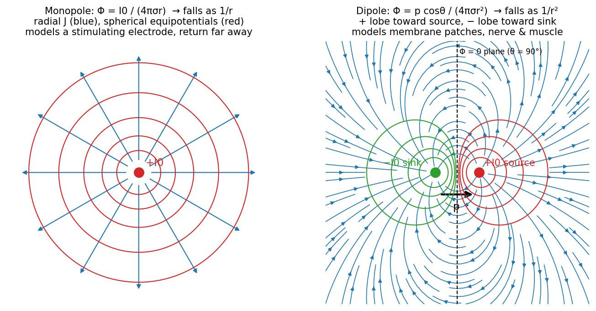

# Fields, Volume Conductors, and Sources

Bioelectric signals live in a three-dimensional conducting medium: the body. Before modelling membranes or electrodes we need the language for describing current that spreads through a volume, and a clear statement of when the simpler language of circuits is good enough.

## When Is Circuit Theory Valid?

Circuit theory is a **lumped-parameter** subset of electromagnetic (EM) field theory. It replaces distributed fields with a handful of nodes and branches, which is far simpler and very accurate, but only under two conditions:

1. the signal propagates fast compared with the size of the system, so every node sees a change "at once"; and
2. the wavelength of the signal is much larger than the system.

| Case | Speed and wavelength | Circuit theory valid? |
|---|---|---|
| Copper wire | Signal travels at ≈ 1×10⁸ m/s (the electrons themselves drift only ≈ 0.5 mm/s) | Yes |
| 60 Hz power grid | \\(\lambda = c/f = 3\times10^8/60 = 5\times10^6\\) m ≈ 3100 miles | Yes |
| AM radio tower | \\(\lambda \approx 300\\) m; a quarter-wave antenna is ≈ 75 m | No: the antenna is comparable to \\(\lambda\\) |
| Nerve action potential | 1–10 m/s unmyelinated, 10–100 m/s myelinated | No |

For the nerve, take a conduction velocity of 10 m/s and an action-potential duration of 1 ms. The spatial extent of the event is
\\[
\lambda = vT = (10\ \text{m/s})(1\ \text{ms}) = 1\ \text{cm},
\\]
which is the same size as the tissue we are studying. At any instant different parts of the same fibre are at very different potentials, so a single lumped node cannot represent it. We need field theory.

The four EM field quantities are the electric field \\(\vec E\\) (V/m), the electric flux density \\(\vec D\\) (C/m²), the magnetic flux density \\(\vec B\\) (V·s/m² = T) and the magnetic field intensity \\(\vec H\\) (A/m). In free space
\\[
\vec D = \varepsilon\_0\vec E, \qquad \vec B = \mu\_0 \vec H, \qquad
\varepsilon\_0 = \frac{10^{-9}}{36\pi}\ \text{F/m}, \qquad \mu\_0 = 4\pi\times10^{-7}\ \text{H/m}, \qquad c = \frac{1}{\sqrt{\varepsilon\_0\mu\_0}} = 3\times10^8\ \text{m/s}.
\\]

## The Gradient: From a Scalar Field to a Vector Field

A scalar field \\(\phi(x,y,z)\\) assigns a number to every point, like temperature on a weather map or elevation on a mountain. Moving by a small displacement \\(d\vec l = (dx, dy, dz)\\), the chain rule gives the change in \\(\phi\\):
\\[
d\phi = \frac{\partial\phi}{\partial x}dx + \frac{\partial\phi}{\partial y}dy + \frac{\partial\phi}{\partial z}dz = \vec G\cdot d\vec l = G\\,dl\cos\theta,
\qquad
\vec G \equiv \nabla\phi = \frac{\partial\phi}{\partial x}\vec a\_x + \frac{\partial\phi}{\partial y}\vec a\_y + \frac{\partial\phi}{\partial z}\vec a\_z .
\\]
Three properties follow directly from this one line.

- **Perpendicular to level surfaces.** On an equipotential surface \\(d\phi = 0\\) for every \\(d\vec l\\) lying in the surface, so \\(\vec G\cdot d\vec l = 0\\): the gradient is normal to the surface.
- **Direction of steepest ascent.** The rate of change along \\(d\vec l\\) is \\(d\phi/dl = G\cos\theta\\), which is largest when \\(\theta = 0\\). The gradient therefore points in the direction of maximum increase.
- **Magnitude equals slope.** At \\(\theta = 0\\), \\(d\phi/dl = \|\nabla\phi\|\\).

Water flows down the negative gradient of a hill; current in tissue flows down the negative gradient of potential. With \\(\vec E = -\nabla\Phi\\) and Ohm's law in point form,
\\[
\vec J = \sigma\vec E = -\sigma\nabla\Phi .
\\]

## The Divergence: Finding Sources and Sinks

The divergence measures net outflow per unit volume. Consider a tiny box with sides \\(dx, dy, dz\\) centred at \\((x,y,z)\\) in a current-density field \\(\vec J\\). Expand \\(J\_x\\) to first order about the centre. On the face at \\(x + dx/2\\) the outward current is
\\[
\left[J\_x + \tfrac{1}{2}\frac{\partial J\_x}{\partial x}dx\right]dy\\,dz,
\\]
and on the face at \\(x - dx/2\\) the outward current (the outward normal points in \\(-x\\)) is
\\[
-\left[J\_x - \tfrac{1}{2}\frac{\partial J\_x}{\partial x}dx\right]dy\\,dz .
\\]
The \\(J\_x\\) terms cancel and the pair contributes \\((\partial J\_x/\partial x)\\,dx\\,dy\\,dz\\). Repeating for the \\(y\\) and \\(z\\) faces and summing all six:
\\[
\oint\_S \vec J\cdot d\vec s = \left(\frac{\partial J\_x}{\partial x} + \frac{\partial J\_y}{\partial y} + \frac{\partial J\_z}{\partial z}\right)dx\\,dy\\,dz .
\\]
Dividing by the volume and shrinking the box defines the divergence:
\\[
\nabla\cdot\vec J \equiv \lim\_{V\to 0}\frac{\oint\_S \vec J\cdot d\vec s}{V} = \frac{\partial J\_x}{\partial x} + \frac{\partial J\_y}{\partial y} + \frac{\partial J\_z}{\partial z}\qquad [\text{A/m}^3].
\\]

- \\(\nabla\cdot\vec J > 0\\): net outflow, a **source**.
- \\(\nabla\cdot\vec J < 0\\): net inflow, a **sink**.
- \\(\nabla\cdot\vec J = 0\\): current merely passes through; no source in the region.

Picture a body with current flowing through it. A region that current only crosses has zero net outflow; a region that contains an electrode tip or an active patch of membrane has non-zero net outflow.

Adding up the boxes that fill a finite volume, the flux through every interior face cancels between neighbours and only the outer surface survives. This is **Gauss's (divergence) theorem**:
\\[
\int\_V \nabla\cdot\vec J\\,dV = \oint\_S \vec J\cdot d\vec s \qquad [\text{A}],
\\]
with units balancing as (A/m³)(m³) = (A/m²)(m²) = A.

## The Laplacian

The divergence of the gradient of a scalar is the **Laplacian**:
\\[
\nabla^2\psi \equiv \nabla\cdot\nabla\psi = \frac{\partial^2\psi}{\partial x^2} + \frac{\partial^2\psi}{\partial y^2} + \frac{\partial^2\psi}{\partial z^2}.
\\]
Applied to a potential, the gradient gives the flow and the divergence of that flow locates its sources, so the Laplacian of a potential identifies the presence and strength of current sources.

## The Volume Conductor and Poisson's Equation

### Quasi-static approximation

Bioelectric fields change with time, but slowly compared with the time it takes electromagnetic effects to cross the body. Capacitive, inductive and propagation effects in the bulk tissue are negligible at physiological frequencies (below a few kHz), so at every instant the field looks like a static field. This is the **quasi-static** approximation: we can use \\(\vec E = -\nabla\Phi\\) even though \\(\Phi\\) varies in time.

### Poisson's equation

Define the volume source density \\(I\_v\\) (A/m³) as the current introduced per unit volume, so that conservation of charge reads \\(\nabla\cdot\vec J = I\_v\\). Substituting Ohm's law, for a homogeneous conductor (constant \\(\sigma\\)):
\\[
I\_v = \nabla\cdot\vec J = \nabla\cdot(-\sigma\nabla\Phi) = -\sigma\nabla^2\Phi
\quad\Longrightarrow\quad
\boxed{\nabla^2\Phi = -\frac{I\_v}{\sigma}}\qquad \text{(Poisson)}.
\\]
In a source-free region \\(I\_v = 0\\) and this reduces to **Laplace's equation** \\(\nabla^2\Phi = 0\\).

Poisson's equation can be read in two directions.

- **Forward (potential → sources).** Measure \\(\Phi\\) everywhere, take its Laplacian, and you have a map of where current is being injected or removed.
- **Backward (sources → potential).** Given the sources, the solution in an infinite homogeneous medium is a superposition of point-source contributions:
\\[
\Phi(x,y,z) = \frac{1}{4\pi\sigma}\int\_V \frac{I\_v(x',y',z')}{r}\\,dV', \qquad r = \sqrt{(x-x')^2 + (y-y')^2 + (z-z')^2}.
\\]
Here \\((x,y,z)\\) is the **field point** where \\(\Phi\\) is evaluated and \\((x',y',z')\\) is the **source point**; the gradient with respect to the source coordinates obeys \\(\|\nabla'(1/r)\| = 1/r^2\\), directed along the line joining the two points.

That the integral solves Poisson's equation can be checked with the point-source result derived below: each element \\(I\_v\\,dV'\\) is a point source whose potential is \\(I\_v dV'/(4\pi\sigma r)\\), and Laplace's equation is linear, so contributions add.

The derivation assumes a **homogeneous, isotropic** conductor. Real tissue is neither: skeletal muscle, for instance, conducts several times better along its fibres than across them, and bone, fat and cerebrospinal fluid have very different conductivities. Numerical (finite-element) volume-conductor models handle these cases; see [Computational Neural Modeling](../neuro/modeling.md).

## Duality with Electrostatics

The mathematics of steady current in a conductor is identical in form to that of charge in a dielectric. The correspondence
\\[
\varepsilon \to \sigma, \qquad \vec D \to \vec J, \qquad \rho \to I\_v
\\]
turns Coulomb's law into the volume-conductor solution:
\\[
\Phi = \frac{1}{4\pi\varepsilon}\int\frac{\rho}{r}\\,dV \quad\longrightarrow\quad \Phi = \frac{1}{4\pi\sigma}\int\frac{I\_v}{r}\\,dV .
\\]
Duality does not mean the physics is the same (charges in a dielectric do not flow); it means any solution worked out in electrostatics can be reused in electrophysiology by renaming symbols.

## The Monopole

A **monopole** is a point current source \\(I\_0\\) in an infinite homogeneous conductor. By symmetry the current flows radially and crosses every concentric sphere of area \\(4\pi r^2\\), so
\\[
\vec J = \frac{I\_0}{4\pi r^2}\vec a\_r .
\\]
With \\(\vec J = -\sigma\nabla\Phi\\) and only a radial component,
\\[
\frac{d\Phi}{dr} = -\frac{I\_0}{4\pi\sigma r^2}
\quad\Longrightarrow\quad
\Phi(r) = \frac{I\_0}{4\pi\sigma r},
\\]
taking \\(\Phi(\infty) = 0\\). The potential falls as \\(1/r\\), the field lines are radial and the equipotentials are concentric spheres.

A monopole cannot exist on its own in tissue: current must return somewhere. It is nevertheless the right model for a **man-made stimulating electrode** whose return electrode is far away, for example a small cathode near a nerve with a large distant return.

## The Dipole

In excitable tissue current always flows in closed loops: every source has an equal and opposite sink nearby. The elementary source is therefore a **dipole**. A patch of membrane, about 100 Å thick and charged like a capacitor with + on one face and − on the other, behaves as a dipole when current flows through it.

*Figure: field lines and equipotentials of a monopole (left) and a dipole (right). The monopole potential falls as 1/r; the dipole potential falls as 1/r², is positive on the source side, negative on the sink side and zero on the midplane.*

### Derivation

Place a sink \\(-I\_0\\) at the origin and a source \\(+I\_0\\) displaced by a small vector \\(d\\,\vec a\_d\\). Let \\(r\_0\\) and \\(r\_1\\) be the distances from the field point to the sink and the source. Superposing two monopoles,
\\[
\Phi = -\frac{I\_0}{4\pi\sigma r\_0} + \frac{I\_0}{4\pi\sigma r\_1}.
\\]
The difference between the two terms is the change in the monopole potential produced by moving the source a distance \\(d\\) in the direction \\(\vec a\_d\\). For \\(r \gg d\\) a first-order Taylor expansion gives
\\[
\Phi \approx \frac{\partial}{\partial d}\left[\frac{I\_0}{4\pi\sigma r}\right]d = \frac{I\_0 d}{4\pi\sigma}\\,\frac{\partial}{\partial d}\left(\frac{1}{r}\right).
\\]
The directional derivative along \\(\vec a\_d\\) is the gradient projected on that direction. Because \\(r\\) is the distance from the *source* to the field point, moving the source by \\(+d\\,\vec a\_d\\) changes \\(1/r\\) at the rate \\(\nabla'(1/r)\cdot\vec a\_d\\), where \\(\nabla'\\) acts on source coordinates and \\(\nabla'(1/r) = \vec a\_r/r^2\\) with \\(\vec a\_r\\) the unit vector from the source toward the field point:
\\[
\frac{\partial}{\partial d}\left(\frac{1}{r}\right) = \nabla'\left(\frac{1}{r}\right)\cdot\vec a\_d = \frac{\vec a\_r\cdot\vec a\_d}{r^2} = \frac{\cos\theta}{r^2}.
\\]
Now let \\(d \to 0\\) and \\(I\_0 \to \infty\\) while holding the **dipole moment**
\\[
\vec p = I\_0\\,d\\,\vec a\_d \qquad [\text{A·m}],
\\]
constant. The vector \\(\vec p\\) points from sink to source. The **dipole potential** is
\\[
\boxed{\Phi\_d = \frac{1}{4\pi\sigma}\\,\vec p\cdot\nabla'\left(\frac{1}{r}\right) = \frac{\vec p\cdot\vec a\_r}{4\pi\sigma r^2} = \frac{p\cos\theta}{4\pi\sigma r^2}}
\\]
where \\(\theta\\) is measured from the dipole axis. In practice the approximation is good once \\(d/r < 0.1\\).

The electric field follows by differentiating in spherical coordinates:
\\[
E\_r = -\frac{\partial\Phi\_d}{\partial r} = \frac{2p\cos\theta}{4\pi\sigma r^3}, \qquad
E\_\theta = -\frac{1}{r}\frac{\partial\Phi\_d}{\partial\theta} = \frac{p\sin\theta}{4\pi\sigma r^3},
\\]
so the dipole field falls as \\(1/r^3\\), one power faster than its potential.

### Comparison

| | Monopole | Dipole |
|---|---|---|
| Source | One point current \\(I\_0\\) | \\(+I\_0\\) and \\(-I\_0\\) separated by small \\(d\\) |
| Potential | \\(I\_0/(4\pi\sigma r)\\) | \\(p\cos\theta/(4\pi\sigma r^2)\\) |
| Fall-off | \\(1/r\\) | \\(1/r^2\\) |
| Shape | Spherically symmetric | Positive lobe toward \\(\vec p\\), negative lobe behind, zero on the \\(\theta = 90°\\) plane |
| Physical use | Stimulating electrode with a distant return | Membrane patches; nerve, muscle and cardiac sources |

The faster dipole fall-off is why biopotentials recorded at the skin are so small: the sources are dipoles (and, for a propagating action potential, back-to-back dipoles forming a tripole), whose potentials decay rapidly with distance.

A pair of stimulating electrodes is itself a dipole: the anode is the source (current leaves the electrode into tissue) and the cathode is the sink (current re-enters the electrode). When the two are close together compared with the distance to the target fibre, the stimulus field is dipolar; when one is far away, the nearby electrode acts as a monopole.

## See Also

- [Vector Calculus](../../../math/calculus/vector.md): gradient, divergence and the divergence theorem in general form.
- [Electrostatics](../../../physics/em/electrostatics.md): the dual problem of charge in a dielectric.
- [Partial Differential Equations](../../../math/diffeq/pdes.md): Laplace's and Poisson's equations.
- [Ions, Diffusion, and Membrane Potentials](ions-membranes.md): where the current sources come from.
