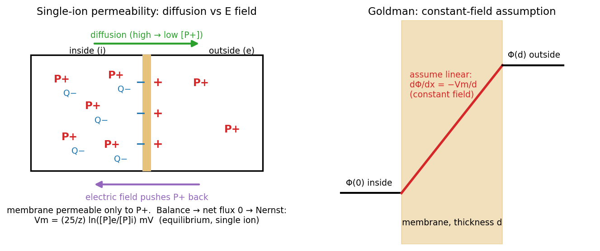

# Ions, Diffusion, and Membrane Potentials

Nerve and muscle are the **excitable tissues**. Their potentials and currents are carried by ions in electrolytes, not by electrons, and ions move under two influences: they diffuse down concentration gradients and they drift in electric fields. This chapter turns that statement into the Nernst–Planck equation and derives the two results every later chapter relies on: the Nernst potential for one ion and the Goldman–Hodgkin–Katz potential for several.

## Nerve and Muscle

Luigi Galvani showed in 1790 that nerve and muscle are electrical ("animal electricity"); Alessandro Volta disputed his interpretation and, in the course of the argument, invented the battery. Living tissue is full of electrolytes (dissolved acids, bases and salts) that conduct electricity. The important ions are Na⁺ and K⁺, with Ca²⁺ and Cl⁻ also significant.

Nerve and muscle fibres are long cylinders with a **resting potential** of −60 to −100 mV (inside negative) that can fire and propagate **action potentials**. The classic preparation is the **squid giant axon** (a giant axon of the squid, not an axon of the giant squid), whose diameter exceeds 300 µm.

| Ion | Intracellular (mM) | Extracellular (mM) |
|---|---|---|
| K⁺ | 397 | 20 |
| Na⁺ | 50 | 437 |
| Cl⁻ | 40 | 556 |

*Squid giant axon concentrations.* K⁺ is concentrated inside, Na⁺ and Cl⁻ outside. These gradients are maintained over the long term by the Na⁺/K⁺ pump.

## From Moles to Amperes

Chemistry counts particles; electricity counts charge. The **molar flux** \\(\vec j\\) (mol/(s·m²)) and the **current density** \\(\vec J\\) (A/m²) are linked by Faraday's constant, the charge on one mole of unit charges:
\\[
F = N\_A q = (6.02\times10^{23}\ \text{mol}^{-1})(1.6\times10^{-19}\ \text{C}) = 96{,}487\ \text{C/mol},
\qquad
\vec J = F z \vec j,
\\]
where \\(z\\) is the valence (+1 for K⁺ and Na⁺, −1 for Cl⁻, +2 for Ca²⁺). An anion flux in one direction is a current in the opposite direction.

## The Nernst–Planck Equation

### Diffusion

Particles spread from high to low concentration. **Fick's law** for species \\(p\\) is
\\[
\vec j\_{d} = -D\_p\nabla C\_p,
\\]
with diffusion coefficient \\(D\_p\\) measured experimentally: \\(D\_{Na} = 1.33\times10^{-5}\\) cm²/s and \\(D\_K = 1.96\times10^{-5}\\) cm²/s in water.

### Drift

An ion in an electric field feels a force \\(z q\vec E\\). It accelerates only briefly before collisions with water molecules limit its speed, so its average velocity is proportional to the field. The constant of proportionality is the **mobility** \\(u\_p\\) (m²/(V·s)), and the drift flux is concentration times velocity:
\\[
\vec j\_{e} = \frac{z\_p}{\|z\_p\|}u\_p C\_p\vec E = -u\_p\frac{z\_p}{\|z\_p\|}C\_p\nabla\Phi .
\\]
The factor \\(z\_p/\|z\_p\|\\) is just the sign: cations drift down the potential gradient, anions up it.

### The Einstein relation

Diffusion and drift are both limited by the same molecular collisions, so \\(D\\) and \\(u\\) cannot be independent. Einstein showed (and it took years of experiments to confirm) that
\\[
D\_p = \frac{u\_p RT}{\|z\_p\|F},
\\]
with \\(R = 8.314\\) J/(K·mol) and \\(T\\) the absolute temperature. At 20 °C, \\(RT/F = (8.314)(293)/96{,}487 = 25.2\\) mV. For K⁺ this gives \\(u\_K = D\_K F/RT = (1.96\times10^{-5})/(0.0252) \approx 7.8\times10^{-4}\\) cm²/(V·s).

### Total flux

Adding the two contributions and eliminating \\(u\_p\\) with the Einstein relation:
\\[
\boxed{\vec j\_p = \vec j\_d + \vec j\_e = -D\_p\left(\nabla C\_p + \frac{z\_p C\_p F}{RT}\nabla\Phi\right)},
\qquad
\vec J\_p = F z\_p\vec j\_p .
\\]
This is the **Nernst–Planck equation**. Both terms have the same structure: a "force" (a concentration gradient, or an electric field scaled by \\(z\_pF/RT\\)) times a mobility.

## Conductivity of an Electrolyte

With no concentration gradient, the diffusion term vanishes and Nernst–Planck reduces to Ohm's law. For a fully dissociated KCl solution of concentration \\(C\_{KCl}\\), K⁺ drifts with the field and Cl⁻ against it, but both carry positive current in the direction of \\(\vec E\\):
\\[
\vec J = F C\_{KCl}u\_K\vec E + F C\_{KCl}u\_{Cl}\vec E = F C\_{KCl}(u\_K + u\_{Cl})\vec E = \sigma\vec E,
\qquad
\sigma = F C\_{KCl}(u\_K + u\_{Cl}).
\\]
For 0.1 M KCl (\\(C = 100\\) mol/m³, \\(u\_K \approx 7.6\times10^{-8}\\), \\(u\_{Cl}\approx 7.9\times10^{-8}\\) m²/(V·s)) this gives \\(\sigma \approx 1.5\\) S/m, close to the measured 1.29 S/m. The formula explains why deionized water is a poor conductor (\\(C\to 0\\)) and why conductivity stops increasing once a solution saturates (added salt no longer dissociates).

Temperature enters through \\(RT/F\\) and through the mobilities. It matters in practice: mammalian tissue temperature changes with surgery, cold or disease; cold-blooded preparations vary widely, and the classic squid-axon experiments were done in 6.3 °C seawater.

## The Membrane as a Capacitor

The cell membrane is a lipid bilayer roughly 3 nm (30 Å) thick, an oil-like dielectric with relative permittivity \\(k \approx 3\\) separating two conducting electrolytes. As a parallel-plate capacitor,
\\[
C\_m = \frac{k\varepsilon\_0}{d} = (3)\left(\frac{10^{-9}}{36\pi}\ \text{F/m}\right)\left(\frac{1}{3\times10^{-9}\ \text{m}}\right) = 8.8\times10^{-3}\ \text{F/m}^2 \approx 0.9\ \text{µF/cm}^2 .
\\]
The universal textbook value of 1 µF/cm² follows from nothing more than the thickness of a lipid bilayer. Channels and pumps embedded in the bilayer make the membrane **semipermeable**: it passes some ions far more easily than others.

## The Nernst Potential: One Permeable Ion

Imagine a box divided by a membrane permeable only to a cation \\(P^+\\). Both sides contain the salt \\(P^+Q^-\\), at higher concentration inside.

*Figure: left, the single-ion box. \\(P^+\\) diffuses out and leaves \\(Q^-\\) behind; the separated charge sets up a field that pushes \\(P^+\\) back. Right, the constant-field assumption used in the Goldman derivation: potential falls linearly across the membrane thickness d.*

1. \\(P^+\\) diffuses outward down its concentration gradient.
2. \\(Q^-\\) cannot follow, so a thin layer of net negative charge is left inside and net positive charge outside. The membrane is a capacitor, so this charge \\(\Delta Q\\) produces a voltage \\(V = \Delta Q/C\\) and a field \\(E = V/d\\) inside the membrane.
3. The field pushes \\(P^+\\) back inward. Charge accumulates until drift exactly balances diffusion and the net flux is zero.

### Derivation

Set \\(\vec j\_p = 0\\) in Nernst–Planck and keep only the coordinate \\(x\\) perpendicular to the membrane:
\\[
0 = -D\_p\left(\frac{dC\_p}{dx} + \frac{z\_pC\_pF}{RT}\frac{d\Phi}{dx}\right)
\quad\Longrightarrow\quad
\frac{dC\_p}{C\_p} = -\frac{z\_pF}{RT}\\,d\Phi .
\\]
The variables separate. Integrate from the extracellular side (\\(e\\)) to the intracellular side (\\(i\\)):
\\[
\int\_{[C\_p]\_e}^{[C\_p]\_i}\frac{dC\_p}{C\_p} = -\frac{z\_pF}{RT}\int\_{\Phi\_e}^{\Phi\_i}d\Phi
\quad\Longrightarrow\quad
\ln\frac{[C\_p]\_i}{[C\_p]\_e} = -\frac{z\_pF}{RT}(\Phi\_i - \Phi\_e).
\\]
With \\(V\_m = \Phi\_i - \Phi\_e\\), and flipping the ratio to remove the minus sign,
\\[
\boxed{E\_p = V\_m\big\|\_{j\_p=0} = \frac{RT}{z\_pF}\ln\frac{[C\_p]\_e}{[C\_p]\_i}}
\\;=\\; \frac{25}{z\_p}\ln\frac{[C\_p]\_e}{[C\_p]\_i}\ \text{mV} \\;=\\; \frac{58}{z\_p}\log\_{10}\frac{[C\_p]\_e}{[C\_p]\_i}\ \text{mV}\quad (20\ ^\circ\text{C}).
\\]
This is a true **equilibrium**: no net flux of the ion and no energy needed to maintain it.

### Worked example: frog muscle

With \\([K]\_o = 2.2\\), \\([K]\_i = 124\\), \\([Na]\_o = 109\\), \\([Na]\_i = 4\\) mM,
\\[
E\_K = 25\ln\frac{2.2}{124} = -100.8\ \text{mV}, \qquad E\_{Na} = 25\ln\frac{109}{4} = +82.6\ \text{mV}.
\\]
For the squid axon at 6.3 °C (\\(RT/F = 24.1\\) mV) the table above gives \\(E\_K \approx -72\\) mV, \\(E\_{Na}\approx +52\\) mV and \\(E\_{Cl} = -24.1\ln(556/40) \approx -63\\) mV.

A cell has only one membrane potential, yet \\(E\_K \neq E\_{Na} \neq E\_{Cl}\\). When more than one ion is permeable, no single ion can be in equilibrium, and we need the Goldman equation.

## Electroneutrality

How much charge must move to build a Nernst potential? Take a muscle fibre of radius 10 µm and length 1 cm, with \\(C\_m = 1\\) µF/cm², charged to 100 mV.

- Membrane area: \\(A = 2\pi a L = 2\pi(10^{-3}\ \text{cm})(1\ \text{cm}) = 6.28\times10^{-3}\\) cm².
- Charge on the membrane: \\(Q = C\_mVA = (10^{-6})(0.1)(6.28\times10^{-3}) = 6.3\times10^{-10}\\) C.
- K⁺ inside: volume \\(\pi a^2 L = 3.14\times10^{-6}\\) cm³ = \\(3.14\times10^{-9}\\) L; at 124 mM this is \\(3.9\times10^{-10}\\) mol, carrying \\(Q\_K = (3.9\times10^{-10})(96{,}487) \approx 3.8\times10^{-5}\\) C.
- Ratio: \\(Q/Q\_K \approx 1.7\times10^{-5}\\).

Fewer than two in every hundred thousand K⁺ ions need to cross to charge the membrane, and the fraction is smaller still for the larger squid axon. So the **principle of electroneutrality** holds in the bulk: in any region of electrolyte the concentrations of anions and cations balance, because any net charge would create enormous restoring forces. The only net charge sits in a vanishingly thin layer at the membrane surfaces. This is also why an isolated nerve can fire many thousands of action potentials before its concentration gradients run down.

## The Goldman–Hodgkin–Katz Equation

When several ions are permeable, the resting potential is the voltage at which the **total current is zero**,
\\[
J = J\_K + J\_{Na} + J\_{Cl} = 0,
\\]
even though no individual flux is zero. K⁺ leaks out and Na⁺ leaks in continuously, and pumps restore them. The resting potential is therefore a **steady state**, not an equilibrium.

### The constant-field assumption

To integrate Nernst–Planck across the membrane we need \\(C\_p(x)\\) and \\(\Phi(x)\\) inside it, and both are unknown. Goldman's assumption is that the potential falls **linearly** across the membrane. Place \\(x = 0\\) at the inner face and \\(x = d\\) at the outer face:
\\[
\frac{d\Phi}{dx} = \frac{\Phi(d) - \Phi(0)}{d} = \frac{\Phi\_e - \Phi\_i}{d} = -\frac{V\_m}{d}.
\\]
The other assumptions are that ions cross independently of each other and that the concentration just inside each membrane face is proportional to the bulk concentration next to it.

### Integrating across the membrane

Write \\(u \equiv V\_mF/RT\\) (dimensionless voltage). For a monovalent cation such as K⁺, Nernst–Planck with the constant field becomes a first-order linear ODE for the concentration profile \\([C\_K]\\) as a function of \\(x\\):
\\[
j\_K = -D\_K\left[\frac{d[C\_K]}{dx} - \frac{u}{d}[C\_K]\right]
\quad\Longrightarrow\quad
\frac{d[C\_K]}{dx} - \frac{u}{d}[C\_K] = -\frac{j\_K}{D\_K}.
\\]
In steady state \\(j\_K\\) is the same at every \\(x\\) (whatever enters one face leaves the other), so the right-hand side is constant. Multiply by the integrating factor \\(e^{-ux/d}\\):
\\[
\frac{d}{dx}\left([C\_K]\\,e^{-ux/d}\right) = -\frac{j\_K}{D\_K}e^{-ux/d}.
\\]
Integrate from \\(0\\) to \\(d\\):
\\[
[C\_K]\_d\\,e^{-u} - [C\_K]\_0 = -\frac{j\_K}{D\_K}\cdot\frac{d}{u}\left(1 - e^{-u}\right).
\\]
Solve for \\(j\_K\\) and multiply numerator and denominator by \\(e^{u}\\):
\\[
j\_K = \frac{D\_K u}{d}\\,\frac{[C\_K]\_0 - [C\_K]\_d\\,e^{-u}}{1 - e^{-u}}
= \frac{D\_K u}{d}\\,\frac{[C\_K]\_d - [C\_K]\_0\\,e^{u}}{1 - e^{u}} .
\\]

### Partition coefficients and permeability

The concentrations at the membrane faces are related to bulk concentrations by a **partition coefficient** \\(\beta\_K\\), describing how readily the ion enters the membrane phase:
\\[
[C\_K]\_0 = \beta\_K[K]\_i, \qquad [C\_K]\_d = \beta\_K[K]\_o .
\\]
Collect the material constants into a single **permeability** \\(P\_K = D\_K\beta\_K/d\\) (cm/s). Multiplying by \\(F\\) gives the **GHK current equation**:
\\[
\boxed{J\_K = \frac{P\_K V\_mF^2}{RT}\\,\frac{[K]\_o - [K]\_i\\,e^{V\_mF/RT}}{1 - e^{V\_mF/RT}}}
\\]
with the same form for Na⁺. Two checks:

- If \\([K]\_o = [K]\_i e^{u}\\), i.e. \\(V\_m = E\_K\\), the current is zero, as it must be.
- As \\(V\_m \to 0\\), \\(u/(1 - e^{u}) \to -1\\) and \\(J\_K \to P\_KF([K]\_i - [K]\_o)\\): pure diffusion, outward for K⁺.

The current–voltage relation is not a straight line. It **rectifies**, because the ion is more plentiful on one side: outward K⁺ current grows faster with depolarization than inward K⁺ current grows with hyperpolarization.

### Anions

For Cl⁻ (\\(z = -1\\)) the same integration with \\(u \to -u\\) gives \\(j\_{Cl} = -P\_{Cl}u\\,([Cl]\_i - [Cl]\_o e^{u})/(1 - e^{u})\\), and since \\(J\_{Cl} = -Fj\_{Cl}\\),
\\[
J\_{Cl} = \frac{P\_{Cl}V\_mF^2}{RT}\\,\frac{[Cl]\_i - [Cl]\_o\\,e^{V\_mF/RT}}{1 - e^{V\_mF/RT}} .
\\]
Compared with the cation formula, the inside and outside concentrations are swapped.

### The resting potential

Summing the three currents, every term shares the factor \\(V\_mF^2/RT(1-e^{u})\\):
\\[
J = \frac{V\_mF^2P\_K}{RT}\\,\frac{w - y\\,e^{u}}{1 - e^{u}},
\qquad
w = [K]\_o + \frac{P\_{Na}}{P\_K}[Na]\_o + \frac{P\_{Cl}}{P\_K}[Cl]\_i,
\quad
y = [K]\_i + \frac{P\_{Na}}{P\_K}[Na]\_i + \frac{P\_{Cl}}{P\_K}[Cl]\_o .
\\]
Setting \\(J = 0\\) requires \\(w = y\\,e^{V\_{rest}F/RT}\\), so
\\[
\boxed{V\_{rest} = \frac{RT}{F}\ln\frac{P\_K[K]\_o + P\_{Na}[Na]\_o + P\_{Cl}[Cl]\_i}{P\_K[K]\_i + P\_{Na}[Na]\_i + P\_{Cl}[Cl]\_o}}
\\]
Each ion is weighted by its permeability. If only one ion is permeable, the other terms vanish and the Goldman equation collapses to the Nernst equation.

### How permeability changes produce the action potential

| State | \\(P\_K : P\_{Na} : P\_{Cl}\\) | \\(V\_m\\) pulled toward |
|---|---|---|
| Rest | 1 : 0.04 : 0.45 | \\(E\_K\\) |
| Action-potential peak | 1 : 20 : 0.45 | \\(E\_{Na}\\) (overshoot) |

With the squid concentrations and \\(RT/F = 25\\) mV:
\\[
V\_{rest} = 25\ln\frac{20 + 0.04(437) + 0.45(40)}{397 + 0.04(50) + 0.45(556)} = 25\ln\frac{55.5}{649} \approx -61\ \text{mV},
\\]
\\[
V\_{peak} = 25\ln\frac{20 + 20(437) + 0.45(40)}{397 + 20(50) + 0.45(556)} = 25\ln\frac{8778}{1647} \approx +42\ \text{mV}.
\\]
The Na⁺ permeability rises 500-fold, from 25 times smaller than \\(P\_K\\) to 20 times larger. None of the concentrations change; only the permeability does. Hodgkin confirmed this by varying external Na⁺: the peak of the action potential moved with \\(E\_{Na}\\).

The same equation explains why the measured reversal potential of the early current is close to, but not exactly at, \\(E\_{Na}\\). With both Na⁺ and K⁺ permeable,
\\[
E\_{rev} = \frac{RT}{F}\ln\frac{[K]\_o + (P\_{Na}/P\_K)[Na]\_o}{[K]\_i + (P\_{Na}/P\_K)[Na]\_i},
\\]
which approaches \\(E\_{Na}\\) only as \\(P\_{Na}/P\_K\to\infty\\).

### Assumptions, collected

1. Constant (linear) field across the membrane.
2. Ions move independently (no interaction between species or within a channel).
3. Membrane-face concentrations are proportional to bulk concentrations (partition coefficients).
4. Steady state: net current is zero, while individual ion fluxes are not; pumps maintain the gradients over the long term.

## See Also

- [Physical Chemistry](../../../physics/chemistry/physical.md): chemical potential and electrochemical equilibrium.
- [First-Order ODEs](../../../math/diffeq/first-order.md): the integrating-factor method used for Goldman.
- [The Parallel Conductance Model and the Voltage Clamp](membrane-circuit.md): the circuit equivalent of these results.
