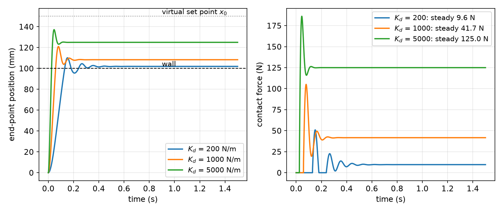
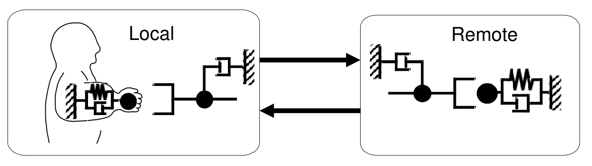
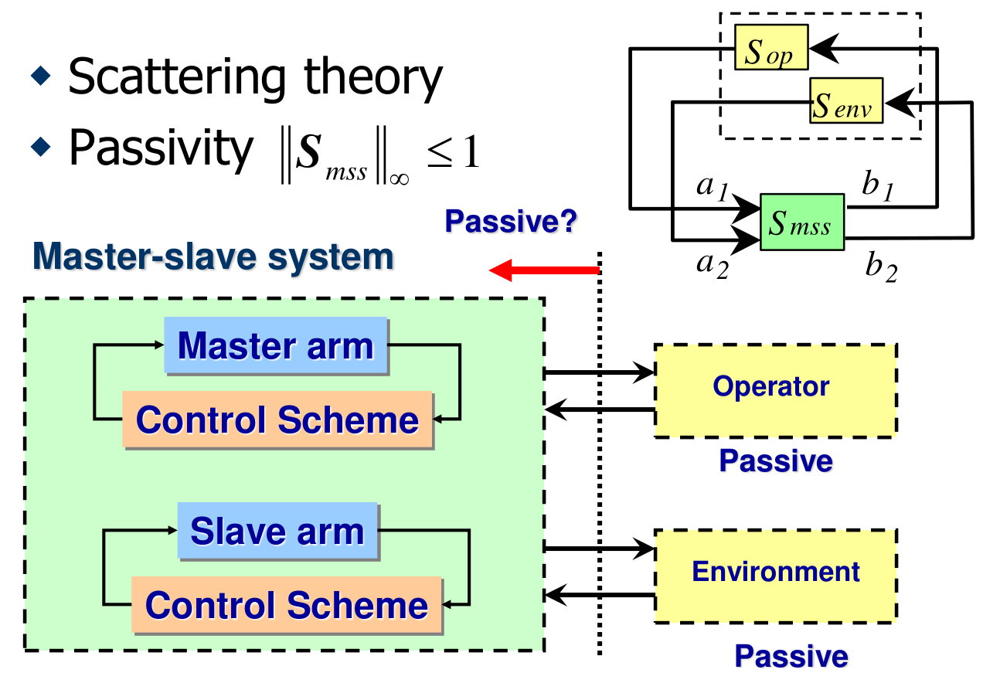
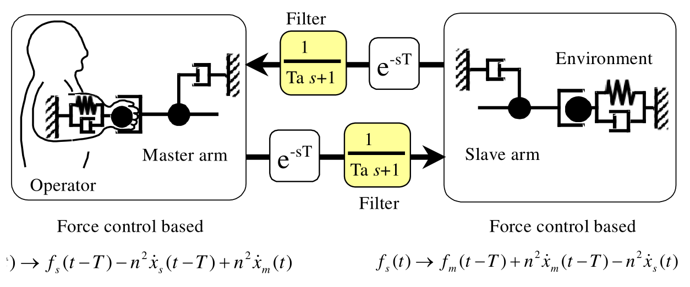

# Force Control, Haptics and Teleoperation

Position control treats contact as a disturbance. Many tasks, however, consist of contact: polishing, assembly, opening doors, shaking hands, and operating a remote robot by hand. In contact a stiff position servo fights the environment, and the interaction force, not the position, is what matters. This chapter moves from controlling force at the end point (explicit force control and hybrid position/force control) to controlling the *relationship* between force and motion (passive and active impedance, admittance control), and then to haptic systems, where a human is in the loop: haptic rendering, bilateral teleoperation, the network and passivity tools used to analyse it, the scattering (wave) solution to time delay, and scaled teleoperation. Statics (\\(\tau = J^TF\\)) from [Jacobians and Statics](jacobians-statics.md) and the dynamic model of [Manipulator Dynamics](dynamics.md) are used throughout.

## Force Control at the End Point

### From statics to a force law

An arm pressing on a surface with end-point force \\(F\\) (normal to the surface) requires the joint torques \\(\tau = J^TF\\) in static equilibrium. The simplest force controller uses this mapping as feedforward and corrects the error with integral action:
\\[
\boxed{\tau = J^T\left\\{K\_{fp}F\_d + K\_{fi}\int (F\_d - F)\\,dt\right\\}.}
\\]
The first term is open-loop force control (with \\(K\_{fp}\approx I\\) it commands exactly the static torque for \\(F\_d\\)); the second compensates errors from friction, model error and gravity by integrating the force error measured with a wrist force/torque sensor. Integral rather than proportional feedback is preferred because the force signal is noisy and the contact loop is very stiff: a proportional force gain multiplies the environment stiffness and easily destabilizes the loop, whereas the integrator acts as a low-pass filter.

### Natural and artificial constraints

In most tasks the end point cannot both move freely and push freely in the same direction. At a frictionless contact with a rigid surface:

- **Natural constraints** are imposed by the geometry: along the surface normal, the velocity is zero; in the tangent plane, the contact force is zero.
- **Artificial constraints** are what the task specifies in the remaining directions: a desired normal force and a desired tangential motion.

In a suitably chosen **constraint frame** each of the six task directions is either position-controlled or force-controlled, never both. Sliding a peg along a table, for example: force-controlled along the table normal, position-controlled in the two tangential translations and the rotation about the normal, and the remaining two rotations either force (zero moment, to keep the peg flat) or position controlled.

### Hybrid position/force control

The hybrid controller (Raibert and Craig) runs a position loop and a force loop in parallel and uses a diagonal **selection matrix** \\(S = \mathrm{diag}(s\_1,\dots,s\_6)\\), \\(s\_i\in\\{0,1\\}\\), expressed in the constraint frame, to decide which loop owns each direction: \\(s\_i = 1\\) for a position-controlled direction, \\(s\_i = 0\\) for a force-controlled one. A typical static form is
\\[
\tau = J^T\left[S\\,F\_{\mathrm{pos}} + (I - S)\\,F\_{\mathrm{force}}\right],
\\]
\\[
F\_{\mathrm{pos}} = K\_p(X\_d - X) + K\_v(\dot X\_d - \dot X), \qquad F\_{\mathrm{force}} = F\_d + K\_{fi}\int(F\_d - F)\\,dt,
\\]
with all vectors expressed in the constraint frame (and rotated to the base frame before \\(J^T\\) is applied). The full dynamic version adds the computed-torque terms \\(h + g\\) and an inertia model. The orthogonality of the two loops is the key idea; its weakness is that it assumes an exactly known contact geometry, and when the selection directions are wrong one loop pushes into a stiff constraint.

## Impedance Control

### Impedance versus force

Instead of regulating force or position, **impedance control** (Hogan) regulates the *dynamic relationship* between them. A mechanical impedance maps motion to force, like a spring-mass-damper \\(M\_d\ddot x + B\_d\dot x + K\_dx = F\\); an admittance maps force to motion. Because the environment usually behaves as an admittance (it moves when pushed) or as a stiff impedance, the manipulator should present itself as the complementary causality, an impedance. The desired behaviour is specified once and holds both in free motion and in contact: a soft virtual spring for safe contact, a stiff one for accurate positioning.

### Passive impedance

Compliance can be built into the hardware. A **remote center compliance (RCC)** device sits between the robot flange and the tool: shear pads (elastomer laminates) between a robot-side and a tool-side plate are arranged so that the tool's center of compliance lies near the tip of the inserted peg. In a peg-in-hole insertion, a **lateral misalignment** produces a single-point contact force through the compliance center, which makes the compensator shift sideways without rotating; a **cocking (angular) misalignment** produces a two-point contact whose moment rotates the compensator about the compliance center. Both errors correct themselves without any sensing. Soft fingertips (such as a gel fingertip on a robot hand) are another passive impedance.

### Active impedance control: a 1-DOF linear plant

A mass \\(m\\) with spring \\(k\\) and damper \\(b\\) is driven by an actuator force \\(u\\) and an external force \\(F\\):
\\[
m\ddot x + b\dot x + kx = F + u .
\\]
We want the system to behave, as seen from the external force, like a different mass-spring-damper:
\\[
m\_d\ddot x + b\_d\dot x + k\_dx = F .
\\]
Choose
\\[
u = (m - m\_d)\ddot x + (b - b\_d)\dot x + (k - k\_d)x .
\\]
*Check:* \\(m\ddot x + b\dot x + kx - u = m\_d\ddot x + b\_d\dot x + k\_dx = F\\). The control input requires the plant parameters and measurement of position, velocity and **acceleration**. Changing the apparent mass (\\(m\_d\neq m\\)) is the hard part: it needs acceleration, or equivalently force, measurement.

### A nonlinear 1-DOF example: a transparent exoskeleton

A knee exoskeleton should be "almost transparent" to the wearer: the person should not feel its friction and should feel only a fraction of its inertia. The plant is
\\[
J\ddot\theta + b\dot\theta + T\_k\\,\mathrm{sgn}\\,\dot\theta = \tau\_a + \tau\_h,
\\]
with Coulomb friction level \\(T\_k\\), actuator torque \\(\tau\_a\\) and human torque \\(\tau\_h\\). The desired impedance is
\\[
\left(1 - \frac{n}{100}\right)J\ddot\theta = \tau\_h, \qquad 0\leq n \leq 100,
\\]
where \\(n\\) percent of the inertia is cancelled (\\(n = 100\\) would cancel the dynamics completely). The control law
\\[
\tau\_a = b\dot\theta + T\_k\\,\mathrm{sgn}\\,\dot\theta + \frac{n}{100 - n}\\,\tau\_h
\\]
cancels friction and amplifies the measured human torque. Substituting, \\(J\ddot\theta = \left(1 + \frac{n}{100-n}\right)\tau\_h = \frac{100}{100-n}\tau\_h\\), which is the desired impedance. Unlike the previous law, this one uses a **force measurement** instead of acceleration. Its limitations are instructive: the force gain \\(n/(100-n)\to\infty\\) as \\(n\to100\\), amplifying sensor noise and quickly destabilizing the loop (the human and the cuff compliance close a feedback loop around this gain); friction cancellation depends on an accurate friction model and chatters at \\(\dot\theta = 0\\) through the sign function; and the actuator's own dynamics limit the bandwidth.

### Active impedance control of a manipulator

*Figure: a simulated 1-DOF end point under ideal impedance control (M_d = 1 kg, ζ = 0.7 in free space) approaches a wall at 100 mm (stiffness 5000 N/m) with its virtual set point x₀ at 150 mm, behind the wall. A soft impedance (K_d = 200 N/m) touches gently, bounces and settles at 9.6 N; a stiff one (K_d = 5000 N/m) penetrates further, peaks at 186 N and settles at 125 N. The steady force is set by the series combination of the virtual and environmental springs.*

The steady state of the figure follows from equilibrium: \\(K\_d(x - x\_0) = -k\_e(x - x\_w)\\), so
\\[
x = \frac{K\_dx\_0 + k\_ex\_w}{K\_d + k\_e}, \qquad F = k\_e(x - x\_w) = \frac{K\_dk\_e}{K\_d + k\_e}(x\_0 - x\_w).
\\]
The designer sets the contact force by choosing \\(K\_d\\) and how far the virtual set point lies behind the surface, without an explicit force loop; when \\(k\_e\gg K\_d\\), \\(F\approx K\_d(x\_0 - x\_w)\\), independent of the uncertain environment stiffness.

Now apply impedance control to a rigid-link arm so that its end point realizes a desired impedance. The link dynamics with an external end-point force \\(F\\) are
\\[
M(q)\ddot q + h(q,\dot q) + g(q) = \tau + J^TF,
\\]
and the target is
\\[
M\_d\ddot y + B\_d\dot y + K\_dy = F,
\\]
where \\(y\\) is the end-point displacement from its equilibrium, with \\(\dot y = J\dot q\\) and \\(\ddot y = J\ddot q + \dot J\dot q\\). Assume \\(J\\) square and nonsingular.

*Link dynamics in task space.* Substitute \\(\ddot q = J^{-1}(\ddot y - \dot J\dot q)\\) and premultiply by \\(J^{-T}\\):
\\[
J^{-T}MJ^{-1}(\ddot y - \dot J\dot q) + J^{-T}h + J^{-T}g = J^{-T}\tau + F,
\\]
\\[
J^{-T}MJ^{-1}\ddot y = J^{-T}\tau + F - J^{-T}h - J^{-T}g + J^{-T}MJ^{-1}\dot J\dot q .
\\]
*Desired impedance.* \\(\ddot y = M\_d^{-1}(F - B\_d\dot y - K\_dy)\\), so
\\[
J^{-T}MJ^{-1}\ddot y = J^{-T}MJ^{-1}M\_d^{-1}(F - B\_d\dot y - K\_dy).
\\]
*Match.* Equate the right-hand sides and premultiply by \\(J^T\\):
\\[
\tau + J^TF - h - g + MJ^{-1}\dot J\dot q = MJ^{-1}M\_d^{-1}(F - B\_d\dot y - K\_dy),
\\]
\\[
\boxed{\tau = h(q,\dot q) + g(q) + M(q)J^{-1}M\_d^{-1}\left(F - B\_d\dot y - K\_dy\right) - J^TF - M(q)J^{-1}\dot J\dot q .}
\\]
This is resolved-acceleration control (see [Manipulator Control](control.md)) with the commanded acceleration taken from the desired impedance, plus cancellation of the measured external force. It needs the full model and a force sensor. Two common simplifications: if the desired inertia is chosen equal to the arm's own task-space inertia \\(M\_d = J^{-T}MJ^{-1}\\), the force terms cancel and no force sensor is needed; and if only stiffness and damping are specified in a quasi-static setting, the law reduces to the transpose-Jacobian controller \\(\tau = J^T[K\_d(y\_0 - y) - B\_d\dot y] + g(q)\\), a stiffness controller.

### Admittance control

The dual implementation, **admittance control**, keeps a stiff inner position (or velocity) loop and computes its reference from the measured force through the desired dynamics:
\\[
M\_d\ddot x\_r + B\_d\dot x\_r + K\_d(x\_r - x\_0) = F\_{\mathrm{meas}}, \qquad x\_r\ \to\ \text{position servo}.
\\]
Impedance control (motion in, force out) suits light, back-drivable, torque-controlled arms and works well against stiff environments; admittance control (force in, motion out) suits stiff, highly geared, non-back-drivable industrial arms (see [Actuation](actuation.md)) and works well in free space and against soft environments, but becomes oscillatory against very stiff ones. In both, the sensor-based force feedback is what limits achievable stiffness and mass reduction.

## Haptics

**Haptics** is the study and use of tactile sensation and the sense of touch as a channel for interacting with computers and electronic devices, letting a user feel and manipulate digitized or remote objects. Force-feedback joysticks and pressure-sensitive touch screens are consumer examples. There are two kinds of haptic system:

1. **Virtual object display:** a desktop haptic device renders forces from a virtual environment shown on screen.
2. **Teleoperation:** the operator commands a remote slave arm through a master arm and feels the remote contact.

### Haptic rendering

Rendering computes, at a high rate (typically 1 kHz), the force to display from the device position. The canonical virtual object is a **virtual wall**: when the device penetrates the wall by \\(\delta > 0\\), command \\(F = -K\delta - B\dot\delta\\). The wall should feel stiff, but a sampled implementation injects energy: during each sample the force lags the penetration, so pushing in and pulling out are not symmetric. A classical result (Colgate and Schenkel) gives the condition for a sampled virtual wall with stiffness \\(K\\), virtual damping \\(B\\), sampling period \\(T\\) and physical device damping \\(b\\) to be passive:
\\[
b > \frac{KT}{2} + \lvert B\rvert .
\\]
Achievable wall stiffness is limited by the device's own damping and the sample rate. This is the same passivity reasoning developed for teleoperation below.

## Bilateral Teleoperation

### The master-slave model

*Figure: the operator's arm (left) holds the master arm at the local site; the slave arm (right) contacts the environment at the remote site. Operator and master move together, as do slave and environment. Each body is modeled as a mass with damping (and stiffness).*

With master and slave positions \\(x\_m, x\_s\\):
\\[
\text{Operator: } f\_{op} - f\_m = m\_{op}\ddot x\_m + b\_{op}\dot x\_m, \qquad \text{Master: } m\_m\ddot x\_m + b\_m\dot x\_m = \tau\_m + f\_m,
\\]
\\[
\text{Slave: } m\_s\ddot x\_s + b\_s\dot x\_s = \tau\_s - f\_s, \qquad \text{Environment: } f\_s = m\_{env}\ddot x\_s + b\_{env}\dot x\_s .
\\]
Here \\(f\_{op}\\) is the force generated by the operator's muscles, \\(f\_m\\) the force the operator applies to the master, \\(\tau\_m\\) and \\(\tau\_s\\) the actuator forces, and \\(f\_s\\) the force the slave exerts on the environment. The designer chooses the two commands \\(\tau\_m, \tau\_s\\).

### Unilateral and bilateral control

- **Unilateral control:** no force feedback, \\(\tau\_m = 0\\). The master is a passive input device and the system is stable. Typically the slave follows the master by PD control, \\(\tau\_s = k\_p(x\_m - x\_s) + k\_d(\dot x\_m - \dot x\_s)\\), giving \\(m\_s\ddot x\_s + b\_s\dot x\_s = k\_p(x\_m - x\_s) + k\_d(\dot x\_m - \dot x\_s) - f\_s\\): the slave is tied to the master's position by a virtual spring-damper pulling against the environment.
- **Bilateral control:** force feedback, \\(\tau\_m\neq0\\). The master generates a force based on the reaction from the environment, so the operator feels the remote contact; the loop through operator, master, slave and environment is closed, and the system is potentially unstable.

Three conventional bilateral schemes:

1. **Symmetric position servo:** \\(\tau\_m = k\_p(x\_s - x\_m) + k\_d(\dot x\_s - \dot x\_m)\\), \\(\tau\_s = k\_p(x\_m - x\_s) + k\_d(\dot x\_m - \dot x\_s)\\). Master and slave are connected by the same virtual spring-damper; the operator feels the environment only through the deflection of that spring, together with the slave's own inertia and friction.
2. **Force reflection:** \\(\tau\_m = -k\_ff\_s\\), \\(\tau\_s = k\_p(x\_m - x\_s) + k\_d(\dot x\_m - \dot x\_s)\\), with a force sensor on the slave.
3. **Force-reflecting servo:** \\(\tau\_m = k\_f(f\_m - f\_s)\\), \\(\tau\_s\\) as above, with force sensors on both sides.

### The ideal response: transparency

**Definition.** A teleoperator is **transparent** if there is no intervening impedance between operator and environment: the operator manipulates the environment as if directly. The master-slave system then behaves as a massless, rigid "magic hand":
\\[
x\_m = x\_s, \qquad f\_m = f\_s .
\\]
(With the sign conventions of the two-port below, this is written \\(f\_m = -f\_s\\) in some references, depending on whether \\(f\_s\\) is taken as the force on or by the slave.)

## Network Models of Teleoperation

### The force-current analogy

Mechanical and electrical networks obey the same equations under the **force-current analogy**:

| Mechanical | Electrical |
|---|---|
| force \\(f\\) | current \\(i\\) |
| velocity \\(\dot x\\) | voltage \\(E\\) |
| displacement \\(x\\) | flux linkage \\(\varphi\\) |
| mass \\(m\\) | capacitance \\(C\\) |
| viscous coefficient \\(b\\) | conductance \\(1/R\\) |
| spring constant \\(k\\) | inverse inductance \\(1/L\\) |

A mass-spring-damper \\(m\ddot x + b\dot x + kx = f\\) and a parallel RLC circuit driven by a current source \\(i\_s\\), \\(i\_L + i\_R + i\_C = i\_s\\), i.e. \\(\frac1L\int e\\,dt + \frac eR + C\frac{de}{dt} = i\_s\\), have identical equations once \\(e = d\varphi/dt\\): \\(C\ddot\varphi + \frac1R\dot\varphi + \frac1L\varphi = i\_s\\). Element impedances \\(E(s) = ZI(s)\\) are \\(Z\_R = R\\), \\(Z\_C = 1/(Cs)\\), \\(Z\_L = sL\\).

For teleoperation, velocities become voltages \\(V\_m, V\_s, V\_{op}, V\_{env}\\) and forces become currents \\(I\_m, I\_s, \dots\\). The operator is a source \\(V\_{op}\\) behind an impedance \\(Z\_{op}\\); master and slave are impedances \\(Z\_m, Z\_s\\) with controlled sources \\(U\_m, U\_s\\) (the actuators); the environment is \\(Z\_{env}\\). A one-port can be described by its impedance (\\(I\to V\\)), its admittance (\\(V\to I\\)), or by **scattering (wave) variables**
\\[
a = \frac{V + I}{2}, \qquad b = \frac{V - I}{2}.
\\]

### Two-port descriptions

The master-slave system is a **two-port** with port variables \\((V\_m, I\_m)\\) and \\((V\_s, I\_s)\\). Taking \\(-I\_s\\) as the current into the slave port, four standard descriptions are
\\[
\begin{bmatrix}V\_m\\\\ V\_s\end{bmatrix} = Z\begin{bmatrix}I\_m\\\\ -I\_s\end{bmatrix}, \quad \begin{bmatrix}I\_m\\\\ -I\_s\end{bmatrix} = Y\begin{bmatrix}V\_m\\\\ V\_s\end{bmatrix}, \quad \begin{bmatrix}V\_m\\\\ -I\_s\end{bmatrix} = H\begin{bmatrix}I\_m\\\\ V\_s\end{bmatrix}, \quad \begin{bmatrix}(V\_m - I\_m)/2\\\\ (V\_s + I\_s)/2\end{bmatrix} = S\begin{bmatrix}(V\_m + I\_m)/2\\\\ (V\_s - I\_s)/2\end{bmatrix},
\\]
the impedance, admittance, hybrid and scattering matrices.

**Example 1 (the ideal response as a two-port).** The magic hand imposes \\(V\_m = V\_s\\) and \\(I\_m = I\_s\\). Then \\(Z\\) and \\(Y\\) are **undefined** (a rigid massless bar has no finite impedance between independent currents). The hybrid form gives \\(V\_m = V\_s\\) and \\(-I\_s = -I\_m\\):
\\[
H\_{ideal} = \begin{bmatrix}0 & 1\\\\ -1 & 0\end{bmatrix}.
\\]
For the scattering form, \\((V\_m - I\_m)/2 = (V\_s - I\_s)/2\\) and \\((V\_s + I\_s)/2 = (V\_m + I\_m)/2\\), so
\\[
S\_{ideal} = \begin{bmatrix}0 & 1\\\\ 1 & 0\end{bmatrix}.
\\]
Waves pass straight through, unchanged.

## Passivity and Stability

### Passivity

A passive system never generates energy; it can only store or dissipate what it is given.

**Definition.** A system with input \\(u\\) and output \\(y\\) is **passive** if there are a storage function \\(H(x)\\), bounded below, and a dissipation \\(d(t)\geq0\\) such that
\\[
\underbrace{\int\_0^t u^T(s)y(s)\\,ds}\_{\text{energy supplied}} = \underbrace{H(x(t)) - H(x(0))}\_{\text{change in stored energy}} + \underbrace{d(t)}\_{\text{dissipated}} .
\\]
For a mechanical port, \\(u^Ty\\) is force times velocity, the power delivered. See [Passivity](../../../eng/control/nonlinear/passivity.md) for the general theory.

**Positive realness (LTI case).** A stable LTI system \\(G(s)\\) (analytic in \\(\mathrm{Re}\\, s > 0\\)) is passive if and only if it is positive real: \\(G(j\omega) + G^T(-j\omega)\geq0\\) for all real \\(\omega\\). The feedback interconnection of two passive systems is passive, hence stable. So if the plant is positive real, **any** positive-real controller stabilizes it, however high its gain. This is a design principle: mechanical systems should be designed, sensed and actuated so that they are positive real, for instance by collocating sensors with actuators.

**One-port passivity in scattering form.** For a one-port with impedance \\(Z\\) (normalized), \\(b = Sa\\) with
\\[
S = \frac{Z - 1}{Z + 1}.
\\]
The power absorbed is
\\[
P = \mathrm{Re}(V^\*I) = \frac{\lvert V + I\rvert^2 - \lvert V - I\rvert^2}{4} = a^\*a - b^\*b = \lvert a\rvert^2\left(1 - \lvert S\rvert^2\right).
\\]
It is non-negative for every incoming wave \\(a\\) if and only if \\(S(s)\\) is analytic in \\(\mathrm{Re}\\,s\geq0\\) and \\(\lvert S(j\omega)\rvert\leq1\\) for all \\(\omega\\): **a passive port reflects no more wave energy than it receives.**

**Two-port passivity.** With \\(\mathbf a = (\mathbf V + \mathbf I)/2\\), \\(\mathbf b = (\mathbf V - \mathbf I)/2\\), \\(\mathbf V = [V\_m, V\_s]^T\\), \\(\mathbf I = [I\_m, -I\_s]^T\\) (a scaling factor \\(n\\) may be included, \\(\mathbf a = (\mathbf V + n\mathbf I)/2\\)), the power absorbed is
\\[
P = \mathrm{Re}\left(V\_m^\*I\_m - V\_s^\*I\_s\right) = \mathbf a^\*\mathbf a - \mathbf b^\*\mathbf b = \mathbf a^\*\left(I - S^\*S\right)\mathbf a .
\\]
Hence the two-port is passive if and only if \\(S(s)\\) is analytic in \\(\mathrm{Re}\\,s\geq0\\) and \\(\bar\sigma(S(j\omega))\leq1\\) for all \\(\omega\\), i.e.
\\[
\boxed{\lVert S\rVert\_\infty \leq 1,}
\\]
where \\(\bar\sigma\\) is the largest singular value. The ideal \\(S\_{ideal}\\) has singular values 1 and 1: it is passive and lossless.

### Stability of teleoperation through passivity

*Figure: the master-slave system (master and slave arms with their control schemes) connects to an operator and an environment that are assumed passive but otherwise unknown. In scattering form (top right), S_mss is closed in feedback with the block-diagonal Δ_mss = diag(S_op, S_env) through the waves a₁, b₁, a₂, b₂. Passivity of the master-slave system, ‖S_mss‖∞ ≤ 1, guarantees stability.*

**Theorem (small gain).** A feedback loop of stable systems \\(P\\) and \\(K\\) is stable if \\(\lVert P\rVert\_\infty\lVert K\rVert\_\infty < 1\\), where \\(\lVert\cdot\rVert\_\infty\\) is the largest singular value over all frequencies.

Apply it to the loop of \\(S\_{mss}\\) and \\(\Delta\_{mss} = \mathrm{diag}(S\_{op}, S\_{env})\\). The operator and environment models are unknown, but assumed passive, so \\(\lVert\Delta\_{mss}\rVert\_\infty\leq1\\); the worst case is a rigid wall (\\(\lvert S\_{env}\rvert = 1\\)). Requiring \\(\lVert S\_{mss}\rVert\_\infty\leq1\\) then guarantees stability for every passive operator and environment (with the boundary case handled by strict passivity of at least one element). Passivity-based analysis is mathematically well established and robust to the worst case, but it is known to be conservative and to produce sluggish designs, and it relies on the arguable assumption that the human operator is passive.

**Necessary and sufficient conditions.** The small-gain test ignores structure: \\(\Delta\_{mss}\\) is block diagonal, because the operator and environment are physically remote and do not interact directly. The exact robust-stability test for structured uncertainty uses the **structured singular value**
\\[
\mu\_\Delta(M) = \frac{1}{\min\\{\bar\sigma(\Delta) : \Delta\in\underline{\Delta},\ \det(I - M\Delta) = 0\\}},
\\]
with \\(\underline\Delta\\) the set of block-diagonal perturbations; stability for all \\(\lVert\Delta\rVert\_\infty\leq1\\) holds iff \\(\sup\_\omega\mu\_\Delta(S\_{mss}(j\omega))\leq1\\) (with the usual strictness caveats). Always \\(\mu\_\Delta\leq\bar\sigma\\). If \\(S\_{mss}\\) is symmetric (a **reciprocal** two-port), \\(\mu\_\Delta = \bar\sigma\\) and the easy test is exact.

### Control schemes that approach the ideal response

The ideal response is unlikely to be realized exactly. Yokokohji and Yoshikawa instead introduce an **intervening impedance**, a small virtual mass \\(\hat m\\) and damper \\(\hat b\\) between master and slave, and treat its vanishing as the ideal. Since modifying an impedance requires acceleration terms, the general controller uses position (with integral and derivative) and force servos on both sides:
\\[
\tau\_m = f\_{mssm}(f\_m, f\_s, \ddot x\_m, \dot x\_m, x\_m, \ddot x\_s, \dot x\_s, x\_s), \qquad \tau\_s = f\_{msss}(\cdot).
\\]
A specific law: with the averages \\(x\_{ms} = (x\_m + x\_s)/2\\) and \\(f\_{ms} = (f\_m + f\_s)/2\\),
\\[
\tau\_m = m\_m\left[\ddot x\_{ms} + k\_1(\dot x\_{ms} - \dot x\_m) + k\_2(x\_{ms} - x\_m)\right] + b\_m\dot x\_m - \frac{1 + k\_{mf}}{2}\left[\hat m\ddot x\_{ms} + \hat b\dot x\_{ms}\right] + \frac\lambda2m\_mf\_{ms} - k\_{mf}(f\_s - f\_m) - f\_{ms},
\\]
\\[
\tau\_s = m\_s\left[\ddot x\_{ms} + k\_1(\dot x\_{ms} - \dot x\_s) + k\_2(x\_{ms} - x\_s)\right] + b\_s\dot x\_s - \frac{1 + k\_{sf}}{2}\left[\hat m\ddot x\_{ms} + \hat b\dot x\_{ms}\right] - \frac\lambda2m\_sf\_{ms} + k\_{sf}(f\_m - f\_s) + f\_{ms}.
\\]
Substituted into the master and slave dynamics, it yields two decoupled relations:
\\[
f\_m - f\_s = \hat m\ddot x\_{ms} + \hat b\dot x\_{ms}, \qquad \ddot e + k\_1\dot e + k\_2e = \lambda f\_{ms}, \quad e = x\_m - x\_s .
\\]
The operator feels the environment plus only the small intervening impedance, and the position error is driven to zero (\\(\lambda\\) adds a deliberate force-dependent compliance). Comparing \\(\bar\sigma\\), \\(\mu\\) and \\(\underline\sigma\\) of \\(S\_{mss}\\) over frequency: the symmetric position servo (reciprocal) has \\(\bar\sigma = \mu\approx0\\) dB; the force-reflecting servo (not reciprocal) has \\(\bar\sigma\\) peaking near 0.9 dB while \\(\mu\\) stays lower, so the small-gain test is conservative for it; the ideal-response scheme (reciprocal) sits at about 0 dB, lossless.

## Teleoperation with Time Delay

### Why delay destabilizes

Limited data rates, line switching and long distances (space, internet) insert a delay \\(e^{-sT}\\) in each direction between master and slave. The naive ideal with delay,
\\[
f\_m(t) = f\_s(t - T), \qquad x\_s(t) = x\_m(t - T),
\\]
does not work: the system becomes unstable for small delays (Anderson and Spong). The communication channel that transmits velocity one way and force the other is not passive. In scattering terms, its scattering matrix contains entries such as \\(\tanh(j\omega T) = j\tan(\omega T)\\), which are unbounded at \\(\omega T = \pi/2 + k\pi\\), so \\(\lVert S\rVert\_\infty\\) is infinite and the channel can generate energy. (For \\(T = 0\\) it reduces to \\(S\_{ideal}\\), \\(\lVert S\rVert\_\infty = 1\\), lossless and stable.)

### The scattering (wave-variable) solution

Anderson and Spong's remedy transmits **wave variables** instead of force and velocity. With a scaling factor \\(n\\) (a characteristic impedance \\(n^2\\)), the ideal response with delay is redefined as
\\[
f\_m(t) - n^2\dot x\_m(t) = f\_s(t - T) - n^2\dot x\_s(t - T), \qquad f\_s(t) + n^2\dot x\_s(t) = f\_m(t - T) + n^2\dot x\_m(t - T).
\\]
Each side transmits its outgoing wave and receives the other's delayed wave. The communication two-port then has
\\[
S\_{mss} = \begin{bmatrix}0 & e^{-sT}\\\\ e^{-sT} & 0\end{bmatrix}, \qquad \lVert S\_{mss}\rVert\_\infty = \sup\_\omega\lambda\_{\max}^{1/2}\left(S^\*S\right) = \sup\_\omega\lambda\_{\max}^{1/2}\left(\begin{bmatrix}1 & 0\\\\ 0 & 1\end{bmatrix}\right) = 1,
\\]
because \\(\lvert e^{-j\omega T}\rvert = 1\\). The delayed channel is **lossless**, hence passive, for any delay \\(T\\), and the teleoperator is stable with any passive operator and environment. The price is performance: wave reflections and the effective impedance \\(n^2\\) add a sluggish, delay-dependent feel.

### A practical controller

*Figure: both master and slave are force-control based. The master is commanded f_m(t) → f_s(t−T) − n²ẋ_s(t−T) + n²ẋ_m(t), the slave f_s(t) → f_m(t−T) + n²ẋ_m(t−T) − n²ẋ_s(t); each received signal passes through the delay e^(−sT) and a low-pass filter 1/(T_a s + 1).*

With real arms, the master and slave dynamics remain in the loop (lumped as \\(m\_{ms}\\), \\(b\_{ms}\\)), and the ideal requires \\(m\_{ms}\to0\\), \\(b\_{ms}\to0\\). The stable practical scheme makes both sides force-control based and **filters** each received signal with \\(1/(T\_as + 1)\\). In a Nyquist-like picture, the loop vectors (\\(v\\), \\(w\\)) rotate with \\(\omega T\\) around a circle reaching out to \\(b\_{ms} + 2n^2\\); stability requires \\(\lvert v\rvert\leq\lvert z\rvert\\) and \\(\lvert w\rvert\leq\lvert z\rvert\\) for a reference vector \\(z\\), and the filter shrinks the rotating circle inside \\(\lvert z\rvert\\) by reducing the gain at high frequency. The filter time constant is chosen from a stability boundary in the \\((T, T\_a)\\) plane; for delays up to 1 s the required \\(T\_a\\) in one design lies between about 0.05 and 0.055 s.

Reciprocal-system analysis of several schemes gives:

| Scheme | \\(T = 0\\) | \\(T > 0\\), \\(m\_{ms} = 0\\) | \\(T > 0\\), \\(m\_{ms} > 0\\) |
|---|---|---|---|
| Symmetric position servo | stable | stable | unstable |
| Dual force feedback | stable | stable | unstable |
| Position-force feedback | stable | stable | unstable |
| Wave scheme with filtering | stable | stable | stable (proper filter) |

In experiments, at \\(T = 0.03\\) s all schemes track; position-force feedback shows force chatter. At \\(T = 0.5\\) s the filtered wave scheme tracks with lag while keeping \\(\bar\sigma(S)\leq1\\); position-force feedback oscillates (\\(\bar\sigma\\) peaks near 1.2); the symmetric servo is sluggish (\\(\bar\sigma\approx1\\)).

## Scaled Teleoperation

In **micro-manipulation** (or, conversely, for heavy machinery) positions and forces are scaled between master and slave. The ideal response becomes
\\[
x\_m = \xi\_px\_s, \qquad f\_m = \xi\_ff\_s, \qquad \xi\_p > 0,\ \xi\_f > 0 .
\\]
Passivity-based design is then difficult: to amplify tiny environment forces and display them to the operator, the system must produce energy, so it is not strictly passive.

**Example 2 (scattering matrix of scaled ideal teleoperation).** In network variables \\(V\_m = \xi\_pV\_s\\), \\(I\_m = \xi\_fI\_s\\). Write \\(v = V\_s\\), \\(i = I\_s\\), so the incoming waves are \\(a\_1 = (\xi\_pv + \xi\_fi)/2\\), \\(a\_2 = (v - i)/2\\), and the outgoing waves are \\(b\_1 = (\xi\_pv - \xi\_fi)/2\\), \\(b\_2 = (v + i)/2\\). From \\(a\_2\\), \\(v = 2a\_2 + i\\); substituting in \\(a\_1\\), \\(i = 2(a\_1 - \xi\_pa\_2)/(\xi\_p + \xi\_f)\\) and \\(v = 2(a\_1 + \xi\_fa\_2)/(\xi\_p + \xi\_f)\\). Then
\\[
S^{ideal}\_{mss} = \frac{1}{\xi\_p + \xi\_f}\begin{bmatrix}\xi\_p - \xi\_f & 2\xi\_p\xi\_f\\\\ 2 & \xi\_f - \xi\_p\end{bmatrix}.
\\]
(The signs of the diagonal entries depend on the port orientation convention; with the opposite orientation of the master port they are interchanged.) For \\(\xi\_p = \xi\_f = 1\\) this reduces to \\(S\_{ideal}\\).

When \\(\xi\_p\xi\_f = 1\\), the matrix is symmetric with eigenvalues \\(\pm\sqrt{(\xi\_p - \xi\_f)^2 + 4}/(\xi\_p + \xi\_f) = \pm\sqrt{(\xi\_p + \xi\_f)^2 - 4\xi\_p\xi\_f + 4}/(\xi\_p + \xi\_f) = \pm1\\): the system is lossless. This is a simple mechanical **lever**, which scales motion down by the same factor as it scales force up, conserving power. A micro-manipulation system wants to scale motion *down* and force *up* (\\(\xi\_p\xi\_f > 1\\)), which a lever cannot do: \\(\lVert S\rVert\_\infty > 1\\), the system must inject energy, and a computer-controlled system is required. (A lever is only an analogy here; it is not a theoretically exact representation of the scaled ideal.)

A scheme for scaled teleoperation (Yokokohji and colleagues) generalizes the intervening-impedance controller with a weighting \\(\gamma\\):
\\[
x\_{ms} = \gamma x\_m + (1 - \gamma)x\_s, \quad f\_{ms} = \gamma f\_m + (1 - \gamma)f\_s, \quad e = x\_m - \xi\_px\_s,
\\]
\\[
\ddot e + k\_1\dot e + k\_2e = \lambda f\_{ms}, \qquad f\_m - \xi\_ff\_s = \hat m\ddot x\_{ms} + \hat b\dot x\_{ms}.
\\]
Structured-singular-value analysis of the scaled loop shows the symmetric scheme dipping to \\(\mu\approx0.9999\\), the force-reflecting servo peaking at about 1.0004 (above 1, so robust stability is lost), and the proposed scheme staying at or below 1.

## Summary

- Explicit force control: \\(\tau = J^T\\{K\_{fp}F\_d + K\_{fi}\int(F\_d - F)dt\\}\\). Hybrid control splits task directions with a selection matrix: \\(\tau = J^T[SF\_{pos} + (I - S)F\_{force}]\\).
- Impedance control shapes \\(M\_d\ddot y + B\_d\dot y + K\_dy = F\\). Linear 1-DOF: \\(u = (m - m\_d)\ddot x + (b - b\_d)\dot x + (k - k\_d)x\\). Manipulator: \\(\tau = h + g + MJ^{-1}M\_d^{-1}(F - B\_d\dot y - K\_dy) - J^TF - MJ^{-1}\dot J\dot q\\). Contact force at equilibrium \\(K\_dk\_e(x\_0 - x\_w)/(K\_d + k\_e)\\).
- Admittance control: force in, motion out, around a stiff position loop; suits non-back-drivable arms.
- Teleoperation: unilateral (stable) vs bilateral (force feedback, potentially unstable). Transparency: \\(x\_m = x\_s\\), \\(f\_m = f\_s\\); \\(H\_{ideal} = [0, 1; -1, 0]\\), \\(S\_{ideal} = [0, 1; 1, 0]\\).
- Waves \\(a = (V + I)/2\\), \\(b = (V - I)/2\\); passivity \\(\iff\lVert S\rVert\_\infty\leq1\\). Small gain with passive operator and environment gives robust stability; \\(\mu\\)-analysis removes conservatism (exact for reciprocal \\(S\\)).
- Delay: naive force/velocity transmission is non-passive; wave transmission gives \\(S = [0, e^{-sT}; e^{-sT}, 0]\\), lossless for any \\(T\\); filtering makes it practical.
- Scaled teleoperation \\(x\_m = \xi\_px\_s\\), \\(f\_m = \xi\_ff\_s\\) is lossless only if \\(\xi\_p\xi\_f = 1\\) (a lever); micro-manipulation needs active, non-passive control.

## See Also

- [Manipulator Control](control.md): resolved-acceleration and transpose-Jacobian controllers on which impedance control builds.
- [Jacobians and Statics](jacobians-statics.md): \\(\tau = J^TF\\) and wrenches.
- [Actuation, Transmissions and Redundancy](actuation.md): back-drivability and force sensing hardware.
- [Robot Control](../control.md) and [Manipulation and Grasping](../manipulation.md): overviews of force and compliance control.
- [Human-Robot Interaction](../hri.md): physical interaction, exoskeletons and safety.
- [Passivity](../../../eng/control/nonlinear/passivity.md) and [Lyapunov Stability](../../../eng/control/nonlinear/lyapunov.md): the stability tools used for teleoperation.
- [Frequency-Domain Analysis](../../../eng/control/frequency.md): Nyquist reasoning and singular values over frequency.
