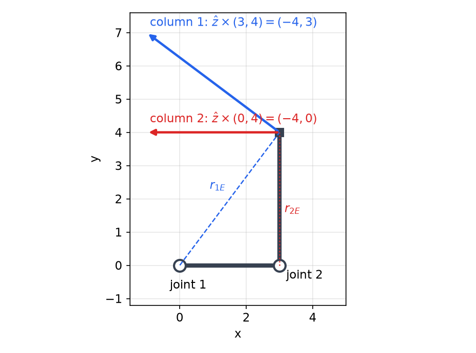
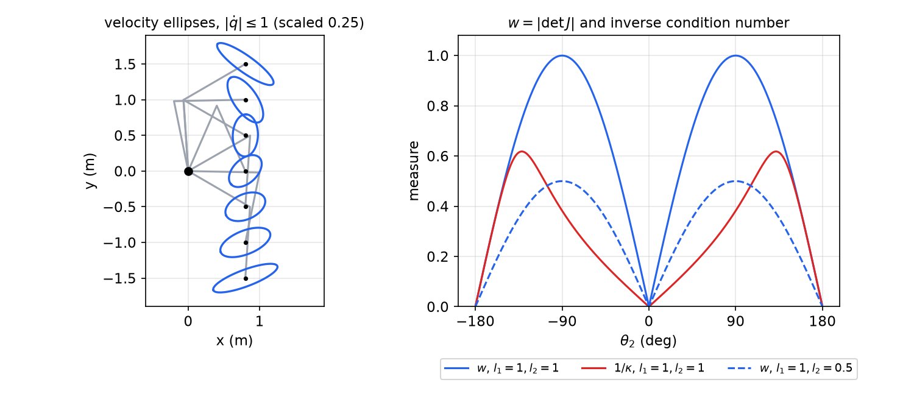
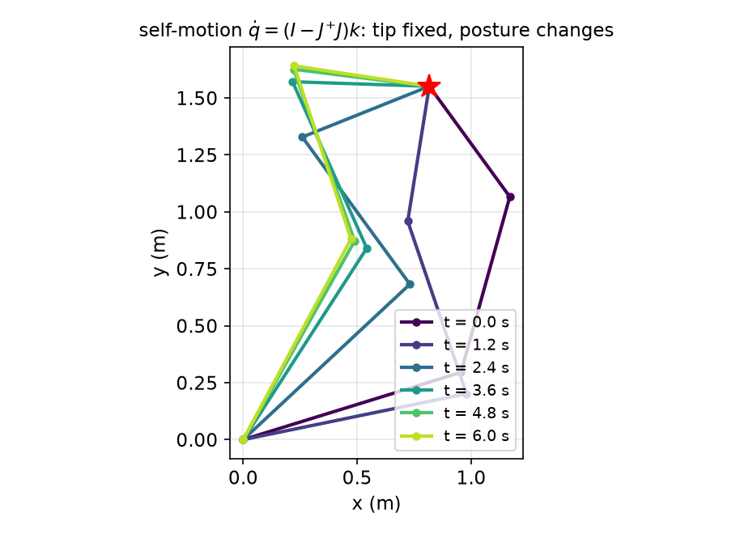
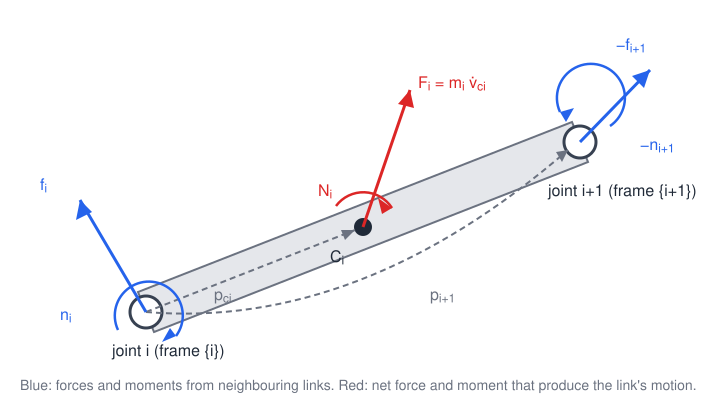
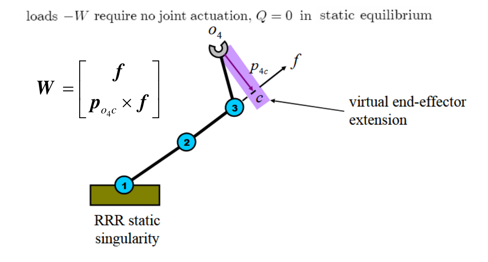
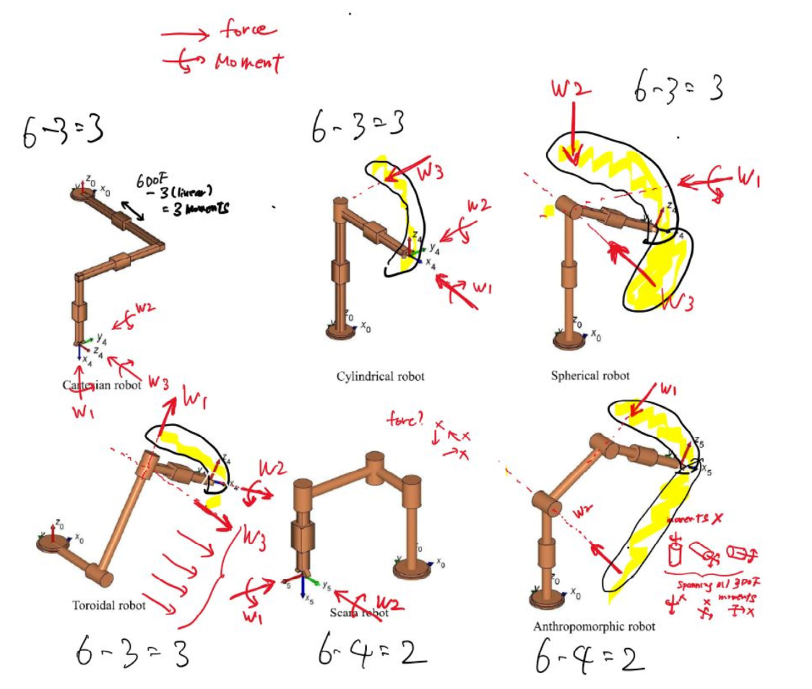

# Jacobians, Singularities and Statics

Forward kinematics maps joint positions to the pose of the tool. Almost everything a manipulator does in motion or in contact also needs the *differential* version of that map: how joint velocities turn into tool velocities, and how forces at the tool turn into joint torques. Both relations are carried by one matrix, the **Jacobian**. This chapter builds the Jacobian three ways (by velocity propagation, by a column formula, and by differentiation). It then studies the configurations where the Jacobian loses rank, measures how far a posture is from them, and inverts the velocity map for square and redundant arms. It closes with statics: the transpose of the Jacobian maps tool wrenches to joint torques, and wrenches that the structure carries without any joint torque, the reciprocal wrenches, explain much of what follows in dynamics and control.

Notation follows Craig's book: \\({}^{A}p\\) is a vector expressed in frame \\(\\{A\\}\\), \\({}^{A}R\_{B}\\) is the rotation from \\(\\{B\\}\\) to \\(\\{A\\}\\), and \\(\hat Z\_i\\) is the joint axis of joint \\(i\\), which is the \\(z\\) axis of frame \\(\\{i\\}\\). We abbreviate \\(S\_1=\sin\theta\_1\\), \\(C\_{12}=\cos(\theta\_1+\theta\_2)\\) and so on.

## The Jacobian as a Derivative

Consider the planar 3R arm with link lengths \\(a\_1,a\_2,a\_3\\). Its forward kinematics, giving the tool position and orientation, is

\\[
x\_e=a\_1C\_1+a\_2C\_{12}+a\_3C\_{123},\qquad
y\_e=a\_1S\_1+a\_2S\_{12}+a\_3S\_{123},\qquad
\theta\_e=\theta\_1+\theta\_2+\theta\_3 .
\\]

Differentiating with respect to time with the chain rule,

\\[
\begin{aligned}
\dot x\_e&=-a\_1S\_1\dot\theta\_1-a\_2S\_{12}(\dot\theta\_1+\dot\theta\_2)-a\_3S\_{123}(\dot\theta\_1+\dot\theta\_2+\dot\theta\_3),\\\\
\dot y\_e&=a\_1C\_1\dot\theta\_1+a\_2C\_{12}(\dot\theta\_1+\dot\theta\_2)+a\_3C\_{123}(\dot\theta\_1+\dot\theta\_2+\dot\theta\_3),\\\\
\dot\theta\_e&=\dot\theta\_1+\dot\theta\_2+\dot\theta\_3 .
\end{aligned}
\\]

Collecting the coefficients of each joint rate gives a matrix-vector product:

\\[
\begin{bmatrix}\dot x\_e\\\\ \dot y\_e\\\\ \dot\theta\_e\end{bmatrix}=
\begin{bmatrix}
-a\_1S\_1-a\_2S\_{12}-a\_3S\_{123} & -a\_2S\_{12}-a\_3S\_{123} & -a\_3S\_{123}\\\\
a\_1C\_1+a\_2C\_{12}+a\_3C\_{123} & a\_2C\_{12}+a\_3C\_{123} & a\_3C\_{123}\\\\
1&1&1
\end{bmatrix}
\begin{bmatrix}\dot\theta\_1\\\\ \dot\theta\_2\\\\ \dot\theta\_3\end{bmatrix}
=J(\theta)\\,\dot\theta .
\\]

In general, for a smooth map \\(y=f(x)\\) the **Jacobian** \\(\partial f/\partial x\\) is the matrix of partial derivatives, \\(J\_{ij}=\partial f\_i/\partial x\_j\\). It gives the first-order change \\(\delta y=(\partial f/\partial x)\\,\delta x\\), and dividing by \\(\delta t\\) gives the velocity relation \\(\dot y=(\partial f/\partial x)\dot x\\). The Jacobian is a function of the configuration, so the velocity map is linear in \\(\dot\theta\\) but changes from posture to posture.

Differentiating forward kinematics works whenever the tool pose can be written as a vector of coordinates. For orientation in three dimensions this is awkward: there is no three-number vector whose time derivative is the angular velocity. That is why we next build velocities from the geometry of rotating frames.

## Linear and Angular Velocity of Frames

### Linear velocity

The linear velocity of the origin of frame \\(\\{B\\}\\) relative to frame \\(\\{A\\}\\) is \\({}^{A}\dot p\_{B}=\frac{d}{dt}{}^{A}p\_{B}\\). It matters which frame the derivative is taken in: a point fixed in a rotating frame has zero velocity in that frame but not in the base frame. Relating the two is the job of the angular velocity.

### Angular velocity and the derivative of a rotation matrix

Orientation can be described by three angles (Euler angles, roll-pitch-yaw) whose time derivatives give one description of rotational motion. The more fundamental description is the **angular velocity vector** \\({}^{A}\omega\_{B}\\): at each instant, frame \\(\\{B\\}\\) is rotating about the axis \\({}^{A}\omega\_{B}/\lVert{}^{A}\omega\_{B}\rVert\\) at the rate \\(\lVert{}^{A}\omega\_{B}\rVert\\). It is the *instantaneous* axis of rotation. Unlike angle rates, the angular velocity vector cannot in general be integrated to an orientation; the integral of \\(\omega\\) has no direct physical meaning because rotations do not commute.

A **skew-symmetric** matrix satisfies \\(S+S^T=0\\). In three dimensions it has three independent entries, and we write

\\[
S(a)=\begin{bmatrix}0&-a\_z&a\_y\\\\ a\_z&0&-a\_x\\\\ -a\_y&a\_x&0\end{bmatrix},
\qquad S(a)\\,p=a\times p .
\\]

The map \\(a\mapsto S(a)\\) is linear, \\(x^TSx=0\\) for every skew \\(S\\), and for any rotation \\(R\\)

\\[
R\\,S(a)\\,R^T=S(Ra). \tag{1}
\\]

Property (1) says the cross product commutes with rotation, \\(R(a\times b)=(Ra)\times(Rb)\\). A short proof uses the triple product: the \\(j\\)-th component of \\(R(a\times b)\\) is \\(e\_j^TR(a\times b)=(R^Te\_j)\cdot(a\times b)=\det[R^Te\_j,\\,a,\\,b]\\). Multiplying by \\(\det R=1\\) and using \\(\det(RM)=\det R\det M\\) gives \\(\det[e\_j,\\,Ra,\\,Rb]=e\_j\cdot(Ra\times Rb)\\).

**Theorem (derivative of a rotation).** If \\(R(t)\\) is a differentiable rotation matrix, then \\(\dot R R^T\\) is skew-symmetric, and writing \\(\dot RR^T=S(\omega)\\) defines the angular velocity:

\\[
\dot R(t)=S(\omega(t))\\,R(t).
\\]

*Proof.* Differentiate \\(RR^T=I\\): \\(\dot RR^T+R\dot R^T=0\\), that is \\(\dot RR^T+(\dot RR^T)^T=0\\). So \\(\dot RR^T\\) is skew and equals \\(S(\omega)\\) for a unique \\(\omega\\). Multiplying on the right by \\(R\\) gives the result. ∎

For example, for the elementary rotation about \\(x\\),

\\[
\frac{dR\_{x,\theta}}{d\theta}R\_{x,\theta}^T=
\begin{bmatrix}0&0&0\\\\0&-S\_\theta&-C\_\theta\\\\0&C\_\theta&-S\_\theta\end{bmatrix}
\begin{bmatrix}1&0&0\\\\0&C\_\theta&S\_\theta\\\\0&-S\_\theta&C\_\theta\end{bmatrix}
=\begin{bmatrix}0&0&0\\\\0&0&-1\\\\0&1&0\end{bmatrix}=S(\hat x),
\\]

so \\(\dot R\_{x,\theta}=\dot\theta\\,S(\hat x)R\_{x,\theta}\\) and the angular velocity is \\(\dot\theta\hat x\\), as expected. The same holds for any fixed axis \\(\hat l\\): \\(\frac{d}{d\theta}R\_{l,\theta}=S(\hat l)R\_{l,\theta}\\).

Equivalently, each column of \\({}^{A}R\_{B}\\) is a unit vector \\({}^{A}\hat X\_B\\), \\({}^{A}\hat Y\_B\\), \\({}^{A}\hat Z\_B\\) fixed in \\(\\{B\\}\\), and each moves with velocity \\(\frac{d}{dt}{}^{A}\hat X\_B={}^{A}\omega\_B\times{}^{A}\hat X\_B\\).

### A point moving in a moving frame

Let \\(Q\\) have coordinates \\({}^{B}p\\) in \\(\\{B\\}\\), and suppose first that the origins of \\(\\{A\\}\\) and \\(\\{B\\}\\) coincide. Then \\({}^{A}p={}^{A}R\_B{}^{B}p\\) and

\\[
\frac{d}{dt}\left({}^{A}R\_B{}^{B}p\right)={}^{A}R\_B{}^{B}\dot p+\dot{\left({}^{A}R\_B\right)}{}^{B}p
={}^{A}R\_B{}^{B}\dot p+{}^{A}\omega\_B\times{}^{A}R\_B{}^{B}p . \tag{2}
\\]

The second step can be read column by column: \\(\dot{({}^{A}R\_B)}{}^{B}p=\frac{d}{dt}({}^{A}\hat X\_B){}^{B}p\_x+\frac{d}{dt}({}^{A}\hat Y\_B){}^{B}p\_y+\frac{d}{dt}({}^{A}\hat Z\_B){}^{B}p\_z={}^{A}\omega\_B\times({}^{A}\hat X\_B{}^{B}p\_x+{}^{A}\hat Y\_B{}^{B}p\_y+{}^{A}\hat Z\_B{}^{B}p\_z)\\). If \\(Q\\) is fixed in \\(\\{B\\}\\), the first term vanishes and \\({}^{A}\dot p=\omega\times{}^{A}p\\): every point of a body rotating about a fixed axis moves on a circle with velocity \\(\omega\times r\\), \\(r\\) measured from any point on the axis.

If the origin of \\(\\{B\\}\\) also moves, add its velocity: \\({}^{A}\dot p={}^{A}\dot p\_{B}+{}^{A}R\_B{}^{B}\dot p+{}^{A}\omega\_B\times{}^{A}R\_B{}^{B}p\\).

### Three frames: adding angular velocities

For frames \\(\\{A\\}\\), \\(\\{B\\}\\), \\(\\{C\\}\\), positions and angular velocities compose as

\\[
{}^{A}p\_C={}^{A}p\_B+{}^{A}R\_B{}^{B}p\_{BC},\qquad
{}^{A}\omega\_C={}^{A}\omega\_B+{}^{A}R\_B{}^{B}\omega\_{BC},
\\]
\\[
{}^{A}\dot p\_C={}^{A}\dot p\_B+{}^{A}R\_B\frac{d}{dt}\left({}^{B}p\_{BC}\right)+{}^{A}\omega\_B\times\left({}^{A}R\_B{}^{B}p\_{BC}\right).
\\]

The angular-velocity addition follows from the theorem. With \\(R^0\_2=R^0\_1R^1\_2\\),

\\[
\dot R^0\_2=\dot R^0\_1R^1\_2+R^0\_1\dot R^1\_2
=S(\omega^0\_{0,1})R^0\_2+R^0\_1S(\omega^1\_{1,2})(R^0\_1)^TR^0\_1R^1\_2
=\left[S(\omega^0\_{0,1})+S(R^0\_1\omega^1\_{1,2})\right]R^0\_2,
\\]

using (1). Since \\(S\\) is linear, \\(\omega^0\_{0,2}=\omega^0\_{0,1}+R^0\_1\omega^1\_{1,2}\\). Angular velocities add as vectors once they are expressed in a common frame, and for a chain of \\(n\\) frames \\(\omega^0\_{0,n}=\omega^0\_{0,1}+R^0\_1\omega^1\_{1,2}+\cdots+R^0\_{n-1}\omega^{n-1}\_{n-1,n}\\).

## Velocity Propagation from Link to Link

A serial manipulator is exactly such a chain. Attach frame \\(\\{i\\}\\) to link \\(i\\) with its \\(z\\) axis along joint axis \\(i\\). Let \\({}^{i}\omega\_i\\) and \\({}^{i}v\_i\\) be the angular velocity of link \\(i\\) and the linear velocity of the origin of \\(\\{i\\}\\), both expressed in \\(\\{i\\}\\), and let \\({}^{i}p\_{i+1}\\) be the (constant) position of the origin of \\(\\{i+1\\}\\) in \\(\\{i\\}\\).

**Revolute joint \\(i+1\\).** Link \\(i+1\\) rotates relative to link \\(i\\) about \\(\hat Z\_{i+1}\\) at rate \\(\dot\theta\_{i+1}\\). Expressed in \\(\\{i\\}\\), \\({}^{i}\omega\_{i+1}={}^{i}\omega\_i+{}^{i}R\_{i+1}\dot\theta\_{i+1}{}^{i+1}\hat Z\_{i+1}\\), with \\(\dot\theta\_{i+1}{}^{i+1}\hat Z\_{i+1}=[0,\ 0,\ \dot\theta\_{i+1}]^T\\). The origin of \\(\\{i+1\\}\\) is a point fixed on link \\(i\\), so \\({}^{i}v\_{i+1}={}^{i}v\_i+{}^{i}\omega\_i\times{}^{i}p\_{i+1}\\). Premultiplying both by \\({}^{i+1}R\_i\\):

\\[
\boxed{{}^{i+1}\omega\_{i+1}={}^{i+1}R\_i{}^{i}\omega\_i+\dot\theta\_{i+1}{}^{i+1}\hat Z\_{i+1},\qquad
{}^{i+1}v\_{i+1}={}^{i+1}R\_i\left({}^{i}v\_i+{}^{i}\omega\_i\times{}^{i}p\_{i+1}\right).}
\\]

**Prismatic joint \\(i+1\\).** The link does not rotate relative to its predecessor but slides along \\(\hat Z\_{i+1}\\) at rate \\(\dot d\_{i+1}\\):

\\[
\boxed{{}^{i+1}\omega\_{i+1}={}^{i+1}R\_i{}^{i}\omega\_i,\qquad
{}^{i+1}v\_{i+1}={}^{i+1}R\_i\left({}^{i}v\_i+{}^{i}\omega\_i\times{}^{i}p\_{i+1}\right)+\dot d\_{i+1}{}^{i+1}\hat Z\_{i+1}.}
\\]

Starting from the fixed base, \\({}^{0}\omega\_0=0\\) and \\({}^{0}v\_0=0\\), these formulas are applied outward link by link. The same recursion expressed in the base frame reads, for a revolute joint, \\({}^{0}\omega\_{i+1}={}^{0}\omega\_i+\dot\theta\_{i+1}{}^{0}\hat Z\_{i+1}\\) and \\({}^{0}v\_{i+1}={}^{0}v\_i+{}^{0}\omega\_i\times({}^{0}R\_i{}^{i}p\_{i+1})\\), where the rotation was moved inside the cross product using (1). For a prismatic joint, \\({}^{0}\omega\_{i+1}={}^{0}\omega\_i\\) and \\({}^{0}v\_{i+1}={}^{0}v\_i+{}^{0}\omega\_i\times({}^{0}R\_i{}^{i}p\_{i+1})+\dot d\_{i+1}{}^{0}\hat Z\_{i+1}\\).

**Example 1 (Planar 2R by propagation).** Links of length \\(l\_1,l\_2\\); frames \\(\\{1\\}\\), \\(\\{2\\}\\) at the joints and a tool frame \\(\\{3\\}\\) at the tip, with \\({}^{1}p\_2=[l\_1,0,0]^T\\), \\({}^{2}p\_3=[l\_2,0,0]^T\\), \\({}^{2}R\_3=I\\) and \\({}^{1}R\_2=R\_z(\theta\_2)\\).

*Link 1:* \\({}^{1}\omega\_1=[0,0,\dot\theta\_1]^T\\), \\({}^{1}v\_1=0\\).

*Link 2:* \\({}^{2}\omega\_2=[0,0,\dot\theta\_1+\dot\theta\_2]^T\\). Since \\({}^{1}\omega\_1\times{}^{1}p\_2=[0,\ l\_1\dot\theta\_1,\ 0]^T\\) and \\({}^{2}R\_1=R\_z(\theta\_2)^T\\),

\\[
{}^{2}v\_2=\begin{bmatrix}C\_2&S\_2&0\\\\-S\_2&C\_2&0\\\\0&0&1\end{bmatrix}\begin{bmatrix}0\\\\ l\_1\dot\theta\_1\\\\0\end{bmatrix}
=\begin{bmatrix}l\_1S\_2\dot\theta\_1\\\\ l\_1C\_2\dot\theta\_1\\\\0\end{bmatrix}.
\\]

*Tool:* \\({}^{3}\omega\_3={}^{2}\omega\_2\\) and \\({}^{3}v\_3={}^{2}v\_2+{}^{2}\omega\_2\times{}^{2}p\_3=[\\,l\_1S\_2\dot\theta\_1,\ \ l\_1C\_2\dot\theta\_1+l\_2(\dot\theta\_1+\dot\theta\_2),\ \ 0\\,]^T\\).

Reading off the coefficients, the Jacobian *expressed in the tool frame* is

\\[
{}^{3}J(\theta)=\begin{bmatrix}l\_1S\_2&0\\\\ l\_1C\_2+l\_2&l\_2\end{bmatrix}.
\\]

Rotating into the base with \\({}^{0}R\_3=R\_z(\theta\_1+\theta\_2)\\) gives

\\[
{}^{0}J={}^{0}R\_3\\,{}^{3}J=
\begin{bmatrix}C\_{12}&-S\_{12}\\\\S\_{12}&C\_{12}\end{bmatrix}
\begin{bmatrix}l\_1S\_2&0\\\\ l\_1C\_2+l\_2&l\_2\end{bmatrix}
=\begin{bmatrix}-l\_1S\_1-l\_2S\_{12}&-l\_2S\_{12}\\\\ l\_1C\_1+l\_2C\_{12}&l\_2C\_{12}\end{bmatrix},
\\]

where \\(l\_1(C\_{12}S\_2-S\_{12}C\_2)=-l\_1S\_1\\) and \\(l\_1(S\_{12}S\_2+C\_{12}C\_2)=l\_1C\_1\\). This is the matrix one gets by differentiating \\(x\_e=l\_1C\_1+l\_2C\_{12}\\), \\(y\_e=l\_1S\_1+l\_2S\_{12}\\). Note that \\(\det{}^{3}J=\det{}^{0}J=l\_1l\_2S\_2\\): rotating the frame of expression cannot change whether the Jacobian is singular.

## The Jacobian

### Definition and change of frame

Stacking the linear velocity of the tool point and the angular velocity of the tool gives the six-vector called the **twist** (or spatial velocity) of the tool. The manipulator Jacobian maps the joint rates to it:

\\[
\begin{bmatrix}{}^{0}\dot p\_E\\\\ {}^{0}\omega\_E\end{bmatrix}={}^{0}J(q)\\,\dot q,
\qquad {}^{0}J\in\mathbb R^{6\times n}.
\\]

The upper three rows \\(J\_v\\) give linear velocity, the lower three \\(J\_\omega\\) angular velocity. A Jacobian expressed in frame \\(\\{B\\}\\) is converted to frame \\(\\{A\\}\\) by rotating both parts:

\\[
{}^{A}J=\begin{bmatrix}{}^{A}R\_B&0\\\\0&{}^{A}R\_B\end{bmatrix}{}^{B}J ,
\\]

because \\({}^{A}J\dot\theta=\mathrm{diag}({}^{A}R\_B,{}^{A}R\_B)\\,{}^{B}J\dot\theta\\) for every \\(\dot\theta\\). Example 1 used exactly this.

### The column formula

The recursion can be summed in closed form. Let all joints be revolute, let \\(E\\) be the tool point and \\({}^{n}p\_E\\) its position in the last link frame (write \\({}^{n}p\_{n+1}={}^{n}p\_E\\)). The tool's angular velocity is the sum of the joint contributions,

\\[
{}^{0}\omega\_E={}^{0}\omega\_n=\sum\_{i=1}^{n}{}^{0}R\_i\\,\dot\theta\_i\\,{}^{i}\hat Z\_i .
\\]

Each joint \\(j\\) rotates everything outboard of it about its axis, so it contributes to the tip velocity the term \\(\omega\_j\times r\_{j\to E}\\), where \\(r\_{j\to E}\\) runs from any point on axis \\(j\\) to \\(E\\):

\\[
{}^{0}\dot p\_E=\sum\_{j=1}^{n}\left[\left({}^{0}R\_j\dot\theta\_j{}^{j}\hat Z\_j\right)\times\left(\sum\_{i=j}^{n}{}^{0}R\_i{}^{i}p\_{i+1}\right)\right].
\\]

Define the axis of joint \\(i\\) and the vector from joint \\(i\\) to the tool, both in base coordinates:

\\[
{}^{0}z\_i={}^{0}R\_i{}^{i}\hat Z\_i,\qquad
{}^{0}p\_{E,i}=\sum\_{j=i}^{n}{}^{0}R\_j{}^{j}p\_{j+1}={}^{0}p\_{E,i+1}+{}^{0}R\_i{}^{i}p\_{i+1}.
\\]

Then the Jacobian has one column per joint:

\\[
\boxed{{}^{0}J=\begin{bmatrix}{}^{0}z\_1\times{}^{0}p\_{E,1}&{}^{0}z\_2\times{}^{0}p\_{E,2}&\cdots&{}^{0}z\_n\times{}^{0}p\_{E,n}\\\\
{}^{0}z\_1&{}^{0}z\_2&\cdots&{}^{0}z\_n\end{bmatrix}}
\\]

With prismatic joints, the column of a sliding joint is the velocity it produces at the tip, a translation along its axis with no rotation:

\\[
{}^{0}J\_i=\begin{bmatrix}{}^{0}z\_i\times{}^{0}p\_{E,i}\\\\ {}^{0}z\_i\end{bmatrix}\ \ \text{(revolute)},\qquad
{}^{0}J\_i=\begin{bmatrix}{}^{0}z\_i\\\\ 0\end{bmatrix}\ \ \text{(prismatic)}.
\\]

In the standard (distal) DH convention, where joint \\(i\\) moves about \\(z\_{i-1}\\) through origin \\(o\_{i-1}\\), the same formula reads

\\[
J\_{v\_i}=\begin{cases}z\_{i-1}\times(o\_n-o\_{i-1})&\text{revolute}\\\\ z\_{i-1}&\text{prismatic}\end{cases},\qquad
J\_{\omega\_i}=\begin{cases}z\_{i-1}&\text{revolute}\\\\ 0&\text{prismatic}\end{cases}.
\\]

Both versions say the same thing, since \\(o\_n-o\_{i-1}\\) is the vector from a point on joint \\(i\\)'s axis to the tool. In practice the formula is the fastest route to the Jacobian once forward kinematics is known: \\(z\_i\\) is the first three entries of the third column of \\({}^{0}T\_i\\), and the joint origin is the first three entries of its fourth column.

The formula also gives a way to write Jacobians **by inspection**. Freeze all joints but one, rotate it at unit rate, and ask how the tool moves. For a revolute joint about \\(\hat z\\) in a planar arm, the tip moves with velocity \\(\hat z\times r\\), which is \\(r\\) rotated by \\(90^\circ\\) counterclockwise: \\(\hat z\times(r\_x,r\_y)=(-r\_y,r\_x)\\).



*Figure: the planar 2R arm of Example 2 with \\(a\_1=3\\), \\(a\_2=4\\), \\(\theta\_1=0\\), \\(\theta\_2=90^\circ\\). Rotating joint 1 alone moves the tip perpendicular to the dashed vector \\(r\_{1E}=(3,4)\\), giving the first column \\((-4,3)\\). Rotating joint 2 alone moves it perpendicular to \\(r\_{2E}=(0,4)\\), giving \\((-4,0)\\).*

**Example 2 (Three ways to the same Jacobian).** Planar 2R with \\(a\_1=3\\), \\(a\_2=4\\) at \\(\theta\_1=0\\), \\(\theta\_2=\pi/2\\): link 1 lies along \\(x\\), link 2 points straight up, and the tip is at \\((3,4)\\).

*Differentiation.* From \\(x\_e=3C\_1+4C\_{12}\\), \\(y\_e=3S\_1+4S\_{12}\\): \\(\dot x\_e=-3S\_1\dot\theta\_1-4S\_{12}(\dot\theta\_1+\dot\theta\_2)=-4(\dot\theta\_1+\dot\theta\_2)\\) and \\(\dot y\_e=3C\_1\dot\theta\_1+4C\_{12}(\dot\theta\_1+\dot\theta\_2)=3\dot\theta\_1\\), so

\\[
J=\begin{bmatrix}-4&-4\\\\3&0\end{bmatrix}.
\\]

*Inspection.* Joint 1 swings the radius vector \\((3,4)\\): velocity \\(\hat z\times(3,4,0)\dot\theta\_1=(-4,3)\dot\theta\_1\\). Joint 2 swings the tip, 4 above it: \\((-4,0)\dot\theta\_2\\). Same result.

*Column formula, full \\(6\times2\\).* Both axes are \\(\hat z\\), \\({}^{0}p\_{E,1}=(3,4,0)\\), \\({}^{0}p\_{E,2}=(0,4,0)\\):

\\[
{}^{0}J=\begin{bmatrix}-4&-4\\\\3&0\\\\0&0\\\\0&0\\\\0&0\\\\1&1\end{bmatrix}.
\\]

The planar Jacobian sits in rows 1–2 and the angular velocity \\(\omega\_z=\dot\theta\_1+\dot\theta\_2\\) in row 6; rows 3–5 are zero because a planar arm cannot produce \\(\dot z\\), \\(\omega\_x\\) or \\(\omega\_y\\).

**Example 3 (Planar 2R with unequal links).** \\(L\_1=1\\), \\(L\_2=\sqrt3\\), \\(\theta\_1=30^\circ\\), \\(\theta\_2=90^\circ\\). Joint 2 is at \\((\tfrac{\sqrt3}{2},\tfrac12)\\); link 2 points at \\(120^\circ\\), adding \\((-\tfrac{\sqrt3}{2},\tfrac32)\\), so the tip is at \\((0,2)\\). With \\(\hat z\times(0,2,0)=(-2,0,0)\\) and \\(\hat z\times(-\tfrac{\sqrt3}2,\tfrac32,0)=(-\tfrac32,-\tfrac{\sqrt3}2,0)\\),

\\[
J=\begin{bmatrix}-2&-1.5\\\\0&-\tfrac{\sqrt3}{2}\\\\0&0\\\\0&0\\\\0&0\\\\1&1\end{bmatrix}.
\\]

**Example 4 (Simplified PUMA).** A 3R arm with a vertical waist (joint 1, axis \\(z\_1=(0,0,1)\\)), a shoulder and an elbow with parallel horizontal axes, shoulder offset \\(l\_b\\), upper arm \\(l\_a\\), forearm \\(l\_c\\). In the posture \\((\theta\_1,\theta\_2,\theta\_3)=(0,-90^\circ,90^\circ)\\) the upper arm points straight up and the forearm horizontally forward; the tool is at \\(p=(l\_c,l\_b,l\_a)\\). The axes are \\(z\_2=z\_3=(0,1,0)\\), with joint origins \\(o\_1=o\_2=0\\) and \\(o\_3=(0,0,l\_a)\\). Then

\\[
z\_1\times p=(-l\_b,\ l\_c,\ 0),\quad
z\_2\times p=(l\_a,\ 0,\ -l\_c),\quad
z\_3\times(p-o\_3)=(0,1,0)\times(l\_c,l\_b,0)=(0,\ 0,\ -l\_c),
\\]
\\[
J=\begin{bmatrix}-l\_b&l\_a&0\\\\ l\_c&0&0\\\\0&-l\_c&-l\_c\\\\0&0&0\\\\0&1&1\\\\1&0&0\end{bmatrix}.
\\]

**Example 5 (A \\(6\times3\\) Jacobian with numbers).** Take the same arm with the base frame at the intersection of joints 1 and 2, \\(L\_2=L\_3=1\\), and the tool at \\(x\_e=y\_e=\sqrt6/2\\), \\(z\_e=0\\) (distance \\(\sqrt3\\) from the shoulder). Inverse kinematics gives the isosceles posture \\(\theta\_2=30^\circ\\), \\(\theta\_3=-60^\circ\\) with the elbow \\(1/2\\) above the plane. Joint origins: \\(O\_1=O\_2=0\\), \\(O\_3=(\tfrac{\sqrt6}{4},\tfrac{\sqrt6}{4},\tfrac12)\\), tool \\(O\_4=(\tfrac{\sqrt6}{2},\tfrac{\sqrt6}{2},0)\\). Axes: \\(z\_1=(0,0,1)\\), \\(z\_2=z\_3=(\tfrac{\sqrt2}{2},-\tfrac{\sqrt2}{2},0)\\), horizontal and perpendicular to the arm's vertical plane. The columns \\(z\_i\times(O\_4-O\_i)\\) over \\(z\_i\\) give

\\[
J=\begin{bmatrix}-\frac{\sqrt6}{2}&0&\frac{\sqrt2}{4}\\\\ \frac{\sqrt6}{2}&0&\frac{\sqrt2}{4}\\\\0&\sqrt3&\frac{\sqrt3}{2}\\\\0&\frac{\sqrt2}{2}&\frac{\sqrt2}{2}\\\\0&-\frac{\sqrt2}{2}&-\frac{\sqrt2}{2}\\\\1&0&0\end{bmatrix}.
\\]

The waist moves the tool horizontally and tangentially; the shoulder, whose lever arm to the tool is horizontal, moves it straight up.

### Analytic versus geometric Jacobian

The matrix built from \\(z\_i\\) and \\(z\_i\times p\_{E,i}\\) is the **geometric Jacobian**; its lower block gives the angular velocity vector. If instead the orientation is described by three angles \\(\phi\\) (say ZYZ Euler angles) and the forward kinematics is differentiated directly, one obtains the **analytic Jacobian** \\(J\_a=\partial(p,\phi)/\partial q\\). The two are related by the kinematic map between angle rates and angular velocity, \\(\omega=B(\phi)\dot\phi\\):

\\[
J\_a(q)=\begin{bmatrix}I&0\\\\0&B(\phi)^{-1}\end{bmatrix}J(q),
\\]

valid wherever \\(B(\phi)\\) is invertible. The analytic Jacobian has extra, purely representational singularities where the angle parametrization degenerates (for ZYZ angles, when the middle angle is \\(0\\) or \\(\pi\\)). For planar arms the two coincide, since \\(\omega\_z=\dot\theta\_e\\).

### Moving the reference point

Two frames \\(\\{B\\}\\) and \\(\\{C\\}\\) fixed to the same body have the same angular velocity, and their origins' velocities differ by a rigid-body term:

\\[
{}^{A}\omega\_C={}^{A}\omega\_B,\qquad
{}^{A}\dot p\_C={}^{A}\dot p\_B+{}^{A}\omega\_B\times{}^{A}p\_{BC}.
\\]

In matrix form, with \\([p\times]=S(p)\\) and \\(\omega\times p=-p\times\omega\\),

\\[
\begin{bmatrix}{}^{A}\dot p\_C\\\\ {}^{A}\omega\_C\end{bmatrix}=
\begin{bmatrix}I&-[{}^{A}p\_{BC}\times]\\\\0&I\end{bmatrix}
\begin{bmatrix}{}^{A}\dot p\_B\\\\ {}^{A}\omega\_B\end{bmatrix}.
\\]

Expressing the twist of \\(C\\) in \\(\\{C\\}\\) and that of \\(B\\) in \\(\\{B\\}\\) adds the rotations:

\\[
\begin{bmatrix}{}^{C}v\_C\\\\ {}^{C}\omega\_C\end{bmatrix}=
\begin{bmatrix}{}^{C}R\_B&-{}^{C}R\_B[{}^{B}p\_{BC}\times]\\\\0&{}^{C}R\_B\end{bmatrix}
\begin{bmatrix}{}^{B}v\_B\\\\ {}^{B}\omega\_B\end{bmatrix}.
\\]

This **velocity transformation** moves a Jacobian from one tool point to another: if \\(J\_B\\) gives the twist at \\(B\\), the twist at \\(C\\) is obtained by premultiplying \\(J\_B\\) by the \\(6\times6\\) matrix above. Its transpose will reappear as the transformation of forces.

## Singularities

### Rank deficiency

The velocity relation \\(\xi=J(q)\dot q\\) writes the tool twist as a combination of the Jacobian's columns, \\(\xi=J\_1\dot q\_1+\cdots+J\_n\dot q\_n\\). Its rank is at most \\(\min(6,n)\\) (or \\(\min(m,n)\\) for an \\(m\\)-dimensional task). When \\(J\\) is square the arm is **non-redundant**; when \\(n>m\\) it is **redundant**, and when \\(n<m\\) it is under-actuated for that task.

**Definition (velocity singularity).** A configuration \\(q\\) is singular when \\(\operatorname{rank}J(q)<\min(m,n)\\); for a square Jacobian, when \\(\det J(q)=0\\).

At a singular configuration:

1. some directions of tool motion cannot be produced by any joint velocity;
2. bounded tool velocities may require unbounded joint velocities when the arm is driven near, but not at, the singularity;
3. bounded joint torques may balance unbounded tool forces in some directions (the arm "locks" against loads along those directions).

Singularities come in two families. **Workspace-boundary singularities** occur when the arm is fully stretched or folded back so the tool sits on the outer or inner boundary of the reachable region. **Workspace-interior singularities** occur inside the workspace, typically when two or more joint axes line up. Standard examples on six-axis arms are the **wrist singularity** (spherical wrist with \\(\theta\_5=0\\), which makes the axes of joints 4 and 6 collinear so their motions duplicate), the **elbow singularity** (\\(\theta\_3=0\\) or \\(180^\circ\\), arm stretched or folded), and the **shoulder singularity** (wrist centre on the waist axis \\(z\_0\\)).

These *velocity* singularities are different, by definition, from the **displacement singularities** met in inverse kinematics, where some joint angle becomes indeterminate (the tool on the waist axis makes \\(\theta\_1\\) undefined). The two often coincide: a displacement singularity is a configuration where a whole family of joint values gives the same tool position, so the Jacobian must lose rank there. The converse fails: the stretched 2R arm is velocity-singular, yet its inverse kinematics is unique.

**Example 6 (Planar 2R).** With \\(x\_e=a\_1C\_1+a\_2C\_{12}\\), \\(y\_e=a\_1S\_1+a\_2S\_{12}\\),

\\[
J=\begin{bmatrix}-a\_1S\_1-a\_2S\_{12}&-a\_2S\_{12}\\\\ a\_1C\_1+a\_2C\_{12}&a\_2C\_{12}\end{bmatrix},
\\]
\\[
\det J=(-a\_1S\_1-a\_2S\_{12})a\_2C\_{12}+a\_2S\_{12}(a\_1C\_1+a\_2C\_{12})=a\_1a\_2(S\_{12}C\_1-C\_{12}S\_1)=a\_1a\_2S\_2 .
\\]

The arm is singular at \\(\theta\_2=0\\) (fully stretched, outer boundary) and \\(\theta\_2=180^\circ\\) (folded, inner boundary). In both, the two columns are parallel: each joint can only move the tip perpendicular to the line of the arm. If \\(a\_1=a\_2\\), the folded posture also puts the tip on the base axis, a displacement singularity with \\(\theta\_1\\) indeterminate.

**Example 7 (PR arm).** A prismatic joint \\(X\\) along \\(x\\) carries a revolute joint \\(\theta\\) with a link of length \\(L\\): \\(x=X+L\cos\theta\\), \\(y=L\sin\theta\\), so

\\[
\begin{bmatrix}\dot x\\\\ \dot y\end{bmatrix}=\begin{bmatrix}1&-L\sin\theta\\\\0&L\cos\theta\end{bmatrix}\begin{bmatrix}\dot X\\\\ \dot\theta\end{bmatrix},\qquad \det J=L\cos\theta .
\\]

(a) The arm is singular at \\(\theta=\pm\pi/2\\), when the link is perpendicular to the rail: both joints then move the tip along \\(x\\).
(b) With \\(L=1\\), \\(X=1\\), \\(\dot X=2\\), \\(\theta=\pi/4\\), \\(\dot\theta=2\\): \\(\dot x=2-2\cdot\tfrac{\sqrt2}{2}=2-\sqrt2\\), \\(\dot y=2\cdot\tfrac{\sqrt2}{2}=\sqrt2\\).
(c) With \\(\dot X=1\\), \\(\dot\theta=2\\), the tip has no \\(x\\) velocity when \\(1-2\sin\theta=0\\), that is \\(\theta=30^\circ\\) or \\(150^\circ\\).

**Example 8 (RP arm with a perpendicular slide).** A revolute joint carries link \\(L\_1\\), at whose end a prismatic joint slides perpendicular to the link: \\(x=L\_1C\_1+d\_2S\_1\\), \\(y=L\_1S\_1-d\_2C\_1\\). Then

\\[
J=\begin{bmatrix}-L\_1S\_1+d\_2C\_1&S\_1\\\\ L\_1C\_1+d\_2S\_1&-C\_1\end{bmatrix},\qquad
\det J=L\_1S\_1C\_1-d\_2C\_1^2-L\_1S\_1C\_1-d\_2S\_1^2=-d\_2 .
\\]

The only singularity is \\(d\_2=0\\): the tip sits at the end of link 1, and both joints move it perpendicular to link 1. With \\(L\_1=1\\) at \\(\theta=45^\circ\\), \\(d\_2=1\\): \\(J=\begin{bmatrix}0&\frac{\sqrt2}{2}\\\\ \sqrt2&-\frac{\sqrt2}{2}\end{bmatrix}\\), \\(\det J=-1\\), \\(J^{-1}=\begin{bmatrix}\frac{\sqrt2}{2}&\frac{\sqrt2}{2}\\\\ \sqrt2&0\end{bmatrix}\\), and a desired tip velocity \\((\dot x,\dot y)=(0,1)\\) requires \\((\dot\theta,\dot d\_2)=(\tfrac{\sqrt2}{2},0)\\).

**Example 9 (RP arm with a \\(45^\circ\\) slide).** Now the slide makes \\(45^\circ\\) with link 1 and \\(d\_2\\) may be negative:
\\(x\_e=L\_1C\_1+d\_2\cos(\theta\_1+\pi/4)\\), \\(y\_e=L\_1S\_1+d\_2\sin(\theta\_1+\pi/4)\\), and

\\[
J=\begin{bmatrix}-L\_1S\_1-\frac{d\_2}{\sqrt2}(S\_1+C\_1)&\frac{C\_1-S\_1}{\sqrt2}\\\\ L\_1C\_1+\frac{d\_2}{\sqrt2}(C\_1-S\_1)&\frac{S\_1+C\_1}{\sqrt2}\end{bmatrix},\qquad
\lvert\det J\rvert=\left\lvert\frac{L\_1}{\sqrt2}+d\_2\right\rvert .
\\]

(At \\(\theta\_1=0\\) the determinant is \\(-\tfrac{d\_2}{2}-\tfrac{1}{\sqrt2}(L\_1+\tfrac{d\_2}{\sqrt2})\\), which simplifies to the expression shown.) The arm is singular for \\(d\_2=-L\_1/\sqrt2\\) at every \\(\theta\_1\\): the tip is then at the foot of the perpendicular from the base onto the slide line, so rotating joint 1 moves the tip along the slide, the same direction joint 2 does. Changing the slide angle to \\(90^\circ\\) does not remove the singularity; by Example 8 it just moves to \\(d\_2=0\\).

### Manipulability

Rank is a yes/no test. To measure *how close* a posture is to singular, consider the set of tool velocities produced by joint velocities of unit norm, \\(\lVert\dot q\rVert\le1\\). For a full-rank \\(m\times n\\) Jacobian (\\(m\le n\\)), every \\(v\\) in the range is reached by the minimum-norm solution \\(\dot q=J^+v\\) plus any null-space term \\((I-J^+J)k\\) (both defined in the next section). Because \\((I-J^+J)J^+=0\\) the cross term vanishes, and

\\[
\lVert\dot q\rVert^2=v^T(J^+)^TJ^+v+k^T(I-J^+J)^T(I-J^+J)k\ \ge\ v^T(J^+)^TJ^+v .
\\]

So \\(\lVert\dot q\rVert\le1\\) is achievable exactly when

\\[
v^T(J^+)^TJ^+v\le1 ,
\\]

which is an ellipsoid in task space, the **manipulability (velocity) ellipsoid**. Take the singular value decomposition \\(J=U\Sigma V^T\\) with \\(U\in\mathbb R^{m\times m}\\), \\(V\in\mathbb R^{n\times n}\\) orthogonal and \\(\Sigma=[\mathrm{diag}(\sigma\_1,\dots,\sigma\_m)\ \ 0]\\), \\(\sigma\_1\ge\cdots\ge\sigma\_m\ge0\\). The \\(\sigma\_i\\) are the square roots of the eigenvalues of \\(JJ^T\\). The ellipsoid's principal axes are \\(\sigma\_1u\_1,\dots,\sigma\_mu\_m\\): the arm moves fastest along \\(u\_1\\) and slowest along \\(u\_m\\), and the ellipsoid flattens to zero thickness along \\(u\_m\\) at a singularity. (See [Singular Value Decomposition](../../../math/linear-algebra/svd.md).)

Since the volume of the ellipsoid is a constant times \\(\sigma\_1\sigma\_2\cdots\sigma\_m\\), a natural scalar measure is

\\[
\boxed{w(q)=\sigma\_1\sigma\_2\cdots\sigma\_m=\sqrt{\det J(q)J(q)^T}},\qquad w=\lvert\det J(q)\rvert\ \text{ for a square }J,
\\]

the **manipulability measure** (Yoshikawa). It is zero exactly at singularities. A second common measure is the **condition number** \\(\kappa=\sigma\_1/\sigma\_m\\), which measures the ellipsoid's elongation (isotropy) rather than its size and is unaffected by scaling the arm.

**Example 10 (Best posture of a 2R arm).** From Example 6, \\(w=\lvert a\_1a\_2S\_2\rvert\\), maximal at \\(\theta\_2=\pm90^\circ\\) and zero at \\(\theta\_2=0,180^\circ\\). By this measure the elbow should be kept near a right angle. If \\(a\_1=a\_2\\), the folded posture \\(\theta\_2=180^\circ\\) is also a displacement singularity, and \\(w=0\\) there as at any velocity singularity.



*Figure: left, a 2R arm with unit links (elbow-up branch) placed at points on the line \\(x=0.8\\); each blue ellipse is the set of tip velocities reachable with \\(\lVert\dot q\rVert\le1\\), scaled by 0.25. Ellipses become thin needles near the workspace boundary. Right, \\(w=\lvert l\_1l\_2\sin\theta\_2\rvert\\) for two link ratios (blue) and the inverse condition number \\(1/\kappa\\) for equal links (red). The two measures disagree on the "best" posture: volume peaks at \\(90^\circ\\), isotropy elsewhere.*

**Example 11 (Constant manipulability).** Among the planar two-joint arms (2R, RP, PR, PP), only the Cartesian PP arm has constant manipulability: its Jacobian is the identity and \\(w=1\\). For the RP arm of Example 8, \\(w=\lvert d\_2\rvert\\) depends only on the slide, vanishes at \\(d\_2=0\\), and grows without bound as the slide extends.

**Force and dynamic ellipsoids.** By the statics relation \\(\tau=J^TF\\) derived below, unit joint torques \\(\lVert\tau\rVert\le1\\) produce tool forces in the **force ellipsoid** \\(F^TJJ^TF\le1\\). Its axes are those of the velocity ellipsoid with lengths \\(1/\sigma\_i\\): directions in which the arm moves easily are directions in which it pushes weakly, and vice versa. Including the inertia matrix \\(M\\) and ignoring velocity terms, unit torques produce tool accelerations in the **dynamic manipulability ellipsoid** \\(\dot v^T(J^+)^TM^TMJ^+\dot v\le1\\), with measure \\(w\_d=\sqrt{\det[J(M^TM)^{-1}J^T]}\\).

## Inverse Velocity Kinematics

### Square, nonsingular Jacobian

To move the tool with a desired twist \\(\xi\\), solve \\(J\dot q=\xi\\). For \\(n=m\\) and \\(\det J\ne0\\) the answer is unique, \\(\dot q=J^{-1}\xi\\). Commanding these joint rates to velocity-controlled joints is **Jacobian (resolved-rate) velocity control**. Near a singularity, \\(\lVert J^{-1}\rVert=1/\sigma\_m\\) blows up, and so do the commanded joint rates.

In general, a solution exists if and only if \\(\xi\\) lies in the range of \\(J\\), that is \\(\operatorname{rank}J=\operatorname{rank}[J\ \ \xi]\\).

**Example 12 (Two-finger grasp).** Each finger of a planar hand is a 2R chain with links \\(1\\) and \\(\sqrt2\\), at \\(\theta\_1=0\\), \\(\theta\_2=45^\circ\\), contacting an object of length 2. Then \\(x\_{e1}=\cos\theta\_1+\sqrt2\cos(\theta\_1+\theta\_2)\\), \\(y\_{e1}=\sin\theta\_1+\sqrt2\sin(\theta\_1+\theta\_2)\\), and at this posture \\(\dot x\_{e1}=-\dot\theta\_1-\dot\theta\_2\\), \\(\dot y\_{e1}=2\dot\theta\_1+\dot\theta\_2\\):

\\[
J=\begin{bmatrix}-1&-1\\\\2&1\end{bmatrix},\qquad J^{-1}=\begin{bmatrix}1&1\\\\-2&-1\end{bmatrix}.
\\]

To rotate the object counterclockwise at 1 rad/s about its centre, the lower contact must move at \\((1,0)\\) and the upper one at \\((-1,0)\\). The lower finger needs \\((\dot\theta\_1,\dot\theta\_2)=J^{-1}(1,0)=(1,-2)\\); the mirrored upper finger needs \\((-1,2)\\). Link 2 of the lower finger then turns at \\(\dot\theta\_1+\dot\theta\_2=-1\\) rad/s while the object turns at \\(+1\\), so the object rolls or slides on the fingertip at a relative 2 rad/s. A point contact must allow that relative rotation.

### Redundant arms and the pseudoinverse

When \\(n>m\\) and \\(J\\) has full row rank \\(m\\), \\(J\dot q=\xi\\) has infinitely many solutions. The **Moore–Penrose pseudoinverse** picks the one of least norm.

**Theorem (minimum-norm solution).** If \\(J\in\mathbb R^{m\times n}\\) has rank \\(m\\), then \\(JJ^T\\) is invertible, \\(J^+=J^T(JJ^T)^{-1}\\) satisfies \\(JJ^+=I\\), and \\(\dot q=J^+\xi\\) is the solution of \\(J\dot q=\xi\\) with the smallest \\(\lVert\dot q\rVert\\). Every solution has the form

\\[
\dot q=J^+\xi+(I-J^+J)k,\qquad k\in\mathbb R^n\ \text{arbitrary}.
\\]

*Proof.* \\(J(J^+\xi)=JJ^T(JJ^T)^{-1}\xi=\xi\\), so \\(J^+\xi\\) is a solution, and \\(J(I-J^+J)k=(J-J)k=0\\), so adding the second term keeps it one. Conversely, any two solutions differ by a vector \\(z\\) in the null space of \\(J\\), and \\((I-J^+J)z=z\\) for such \\(z\\). Finally \\(J^+\xi=J^T\lambda\\) lies in the row space of \\(J\\), which is orthogonal to the null space, so \\(\lVert J^+\xi+z\rVert^2=\lVert J^+\xi\rVert^2+\lVert z\rVert^2\\) is smallest at \\(z=0\\). ∎

The matrix \\(I-J^+J\\) projects onto the null space of \\(J\\). Choosing \\(k\\) does not move the tool but changes the posture, a **self-motion**. It is used to avoid obstacles, joint limits or singularities while the tool follows its path; a common choice is \\(k=\nabla H(q)\\) for a posture-quality function \\(H\\), such as the manipulability \\(w\\).



*Figure: a planar 3R arm (links 1.0, 0.8, 0.6 m) with its tip held at the red star while the joint rates are \\(\dot q=(I-J^+J)k\\), \\(k=(0,0,-1.5)\\). Postures at six instants show the arm folding its last joint without moving the tip.*

For a matrix of full *column* rank (more equations than unknowns) the pseudoinverse is \\(X^+=(X^TX)^{-1}X^T\\), the least-squares inverse. Both cases, and rank-deficient ones, follow from the SVD:

\\[
J^+=V\Sigma^+U^T,\qquad \Sigma^+=\left[\mathrm{diag}(\sigma\_1^{-1},\dots,\sigma\_r^{-1},0,\dots)\right]^T ,
\\]

inverting only the nonzero singular values. In MATLAB this is `pinv(J)`, in NumPy `np.linalg.pinv(J)`.

Near a singularity, \\(1/\sigma\_m\\) is huge and the pseudoinverse still commands huge joint rates. A standard remedy is the **damped least-squares** (Levenberg–Marquardt) inverse \\(J^T(JJ^T+\lambda^2I)^{-1}\\), which minimizes \\(\lVert J\dot q-\xi\rVert^2+\lambda^2\lVert\dot q\rVert^2\\). It replaces each \\(1/\sigma\_i\\) by \\(\sigma\_i/(\sigma\_i^2+\lambda^2)\\), bounded by \\(1/(2\lambda)\\), at the cost of a small tracking error near the singularity.

```python
import numpy as np
def resolved_rate(J, xi, k=None, lam=0.0):
    """Joint rates for tool twist xi: minimum norm (lam=0) or damped, plus null-space term."""
    m, n = J.shape
    Jp = J.T @ np.linalg.inv(J @ J.T + lam**2 * np.eye(m))
    qd = Jp @ xi
    if k is not None:
        qd += (np.eye(n) - np.linalg.pinv(J) @ J) @ k
    return qd
```

## Statics

### Force and moment propagation

Now hold the arm still against a load. Let \\(f\_i\\) and \\(n\_i\\) be the force and moment exerted on link \\(i\\) by link \\(i-1\\), acting at the origin of \\(\\{i\\}\\). Link \\(i\\) is also acted on by link \\(i+1\\), with \\(-f\_{i+1}\\) and \\(-n\_{i+1}\\) at the origin of \\(\\{i+1\\}\\). Moments are vectors, with \\(n=r\times f\\) for a force \\(f\\) acting at \\(r\\). Ignoring gravity on the links, the static balance of link \\(i\\), written in frame \\(\\{i\\}\\), is

\\[
{}^{i}f\_i-{}^{i}f\_{i+1}=0,\qquad {}^{i}n\_i-{}^{i}n\_{i+1}-{}^{i}p\_{i+1}\times{}^{i}f\_{i+1}=0 .
\\]

Writing \\({}^{i}f\_{i+1}={}^{i}R\_{i+1}{}^{i+1}f\_{i+1}\\) gives the inward recursion

\\[
\boxed{{}^{i}f\_i={}^{i}R\_{i+1}{}^{i+1}f\_{i+1},\qquad
{}^{i}n\_i={}^{i}R\_{i+1}{}^{i+1}n\_{i+1}+{}^{i}p\_{i+1}\times{}^{i}f\_i,}
\\]

started at the tool with the force and moment the arm exerts on the environment, \\(f\_{n+1}\\) and \\(n\_{n+1}\\). Only one component of each joint reaction must be supplied by the actuator; the structure (bearings, the rigidity of the joint) supplies the other five. The actuator supplies the component along the joint's free direction:

\\[
\tau\_i={}^{i}n\_i^T\\,{}^{i}\hat Z\_i\quad\text{(revolute)},\qquad
\tau\_i={}^{i}f\_i^T\\,{}^{i}\hat Z\_i\quad\text{(prismatic)}.
\\]

**Example 13 (2R statics by propagation).** The 2R arm of Example 1 pushes on the environment with a force \\({}^{3}F=[f\_x,f\_y,0]^T\\) at the tip, expressed in the tool frame. Then \\({}^{2}f\_2={}^{3}F\\) and \\({}^{2}n\_2={}^{2}p\_3\times{}^{2}f\_2=[0,0,l\_2f\_y]^T\\), so \\(\tau\_2=l\_2f\_y\\). One step inward, \\({}^{1}f\_1={}^{1}R\_2\\,{}^{2}f\_2=[C\_2f\_x-S\_2f\_y,\ S\_2f\_x+C\_2f\_y,\ 0]^T\\) and

\\[
{}^{1}n\_1={}^{1}R\_2{}^{2}n\_2+{}^{1}p\_2\times{}^{1}f\_1
=\begin{bmatrix}0\\\\0\\\\ l\_2f\_y+l\_1(S\_2f\_x+C\_2f\_y)\end{bmatrix},
\\]

so \\(\tau\_1=l\_1S\_2f\_x+(l\_2+l\_1C\_2)f\_y\\). In matrix form

\\[
\begin{bmatrix}\tau\_1\\\\ \tau\_2\end{bmatrix}=\begin{bmatrix}l\_1S\_2&l\_2+l\_1C\_2\\\\0&l\_2\end{bmatrix}\begin{bmatrix}f\_x\\\\ f\_y\end{bmatrix}=\left({}^{3}J\right)^T\\,{}^{3}F ,
\\]

the transpose of the Jacobian found in Example 1. This is no coincidence.



*Figure: free-body diagram of link \\(i\\). The neighbouring links act through \\(f\_i,n\_i\\) at joint \\(i\\) and \\(-f\_{i+1},-n\_{i+1}\\) at joint \\(i+1\\). In statics the red inertial terms are zero; in dynamics they are the net force and moment that accelerate the link.*

### The principle of virtual work: \\(\tau=J^TF\\)

**Theorem (Jacobian transpose).** Let a manipulator be in static equilibrium (no motion, no friction) while its tool exerts the wrench \\(F\\) on the environment, and let \\(J\\) be the Jacobian relating joint rates to the tool twist at the point where \\(F\\) is defined, in the same frame. Then the joint torques that maintain equilibrium are

\\[
\boxed{\tau=J^T(q)\\,F .}
\\]

*Proof.* Consider a virtual displacement \\(\delta q\\) and the induced tool displacement \\(\delta x=J\delta q\\). The work done at the joints must equal the work done at the tool, since a static, frictionless mechanism stores and dissipates nothing: \\(F\cdot\delta x=\tau\cdot\delta q\\). Substituting, \\(F^TJ\delta q=\tau^T\delta q\\) for every \\(\delta q\\), so \\(F^TJ=\tau^T\\). ∎

The transpose needs no inversion and is defined even at singularities. It is the reason the Jacobian is equally a velocity map and a force map: velocities go *out* through \\(J\\), forces come *in* through \\(J^T\\). Two practical cautions:

- **Sign.** \\(\tau=J^TF\\) gives the torques that make the tool *exert* \\(F\\). If \\(F\\) is an external load *applied to* the tool, the torques that hold the arm still are \\(\tau=-J^TF\\), and \\(J^TF\\) is the torque the load induces at the joints. To hold a 1 kg mass the tool must exert \\(F=(0,+mg)\\), upward, not \\((0,-mg)\\).
- **Consistency.** \\(F\\) must be expressed in the frame of \\(J\\) and about the same reference point.

**Example 14 (Holding a mass).** The RP arm of Example 8 at \\(\theta=45^\circ\\), \\(d\_2=1\\) holds a 1 kg mass statically. With \\(F=(0,g)\\),

\\[
\begin{bmatrix}\tau\\\\ f\end{bmatrix}=J^T\begin{bmatrix}0\\\\ g\end{bmatrix}=\begin{bmatrix}0&\sqrt2\\\\ \frac{\sqrt2}{2}&-\frac{\sqrt2}{2}\end{bmatrix}\begin{bmatrix}0\\\\ g\end{bmatrix}=\begin{bmatrix}\sqrt2\\,g\\\\ -\frac{\sqrt2}{2}g\end{bmatrix}.
\\]

**Example 15 (Pushing walls, Jacobians by inspection).** The joint angles are multiples of \\(45^\circ\\); each column of \\(J\\) is \\(\hat z\times r\_{i\to\text{tip}}\\), and \\(F\\) is the force the tip exerts on the wall.

(a) 2R, links \\(\sqrt2\\) and \\(\sqrt2\\), link 1 at \\(45^\circ\\), elbow \\(90^\circ\\) clockwise, so joint 2 is at \\((1,1)\\) and the tip at \\((2,0)\\). Columns \\(\hat z\times(2,0)=(0,2)\\), \\(\hat z\times(1,-1)=(1,1)\\):

\\[
J=\begin{bmatrix}0&1\\\\2&1\end{bmatrix},\qquad
F=(0,-10):\ \ \tau=\begin{bmatrix}0&2\\\\1&1\end{bmatrix}\begin{bmatrix}0\\\\-10\end{bmatrix}=\begin{bmatrix}-20\\\\-10\end{bmatrix};\qquad
F=(10,0):\ \ \tau=\begin{bmatrix}0\\\\10\end{bmatrix}.
\\]

The horizontal push needs no torque at joint 1 because its line of action passes through joint 1.

(b) 4R: \\(\sqrt2\\) up at \\(45^\circ\\), 1 horizontal, \\(\sqrt2\\) down at \\(-45^\circ\\), 1 horizontal. Joints at \\((0,0)\\), \\((1,1)\\), \\((2,1)\\), \\((3,0)\\), tip at \\((4,0)\\):

\\[
J=\begin{bmatrix}0&1&1&0\\\\4&3&2&1\end{bmatrix};\qquad
F=(10,10):\ \tau=(40,40,30,10);\qquad F=(10,0):\ \tau=(0,10,10,0).
\\]

(c) 4R: 1 right, 1 up, 1 right, 1 right. Joints at \\((0,0)\\), \\((1,0)\\), \\((1,1)\\), \\((2,1)\\), tip at \\((3,1)\\):

\\[
J=\begin{bmatrix}-1&-1&0&0\\\\3&2&2&1\end{bmatrix};\qquad
F=(10,-10):\ \tau=(-40,-30,-20,-10);\qquad F=(10,0):\ \tau=(-10,-10,0,0).
\\]

(d) A straight 3R with unit links along \\(x\\): \\(J=\begin{bmatrix}0&0&0\\\\3&2&1\end{bmatrix}\\), and \\(F=(0,10)\\) needs \\(\tau=(30,20,10)\\), each torque the force times the lever arm.

For Example 3 (\\(L\_1=1\\), \\(L\_2=\sqrt3\\), tip at \\((0,2)\\)), pushing with \\(F=(-2,0)\\) needs \\(\tau=J\_{xy}^TF=\begin{bmatrix}-2&0\\\\-1.5&-\frac{\sqrt3}{2}\end{bmatrix}\begin{bmatrix}-2\\\\0\end{bmatrix}=(4,3)\\).

**Example 16 (Inverse statics with an unknown).** The PR arm of Example 7 (\\(L=1\\)) pushes a wall with a force of magnitude 2 at \\(30^\circ\\) to the \\(x\\) axis, \\(F=(\sqrt3,1)\\), with joint-2 torque 1 N·m. Then

\\[
\begin{bmatrix}f\\\\ \tau\end{bmatrix}=J^TF=\begin{bmatrix}1&0\\\\-\sin\theta&\cos\theta\end{bmatrix}\begin{bmatrix}\sqrt3\\\\1\end{bmatrix}
\ \Rightarrow\ f=\sqrt3,\quad 1=-\sqrt3\sin\theta+\cos\theta=2\cos(\theta+60^\circ).
\\]

So \\(\theta+60^\circ=\pm60^\circ\\): \\(\theta=0\\) (link along \\(+x\\)) or \\(\theta=-120^\circ\\), with \\(X\\) arbitrary. Statics fixes the posture only up to these two branches.

**Example 17 (Load on the simplified PUMA).** A wrench \\({}^{0}f\_e=(0,0,-1)\\) N, \\({}^{0}n\_e=(0,1,0)\\) N·m acts on the tool of the simplified PUMA (unit-scale link lengths) at four postures. The geometric Jacobian at the tool point gives the induced torques \\(J^TW\\); the actuators must supply \\(\tau=-J^TW\\):

| \\((\theta\_1,\theta\_2,\theta\_3)\\) (deg) | tool position | \\(J^TW\\) | holding \\(\tau=-J^TW\\) (N·m) |
|---|---|---|---|
| (45, −60, 120) | (0.566, 0.849, 0) | (0, 1.707, 1.207) | (0, −1.707, −1.207) |
| (45, 60, −120) | (0.566, 0.849, 0) | (0, 1.707, 1.207) | (0, −1.707, −1.207) |
| (90, 45, 90) | (−0.2, 0, −1.414) | (0, 0, −0.707) | (0, 0, 0.707) |
| (180, −30, −60) | (−0.866, −0.2, 1.5) | (0, −0.134, −1.0) | (0, 0.134, 1.0) |

Joint 1 never carries load: the vertical force is parallel to the waist axis and the moment is horizontal, perpendicular to it. Both are "invisible" to joint 1, an instance of the reciprocity studied below.

**Example 18 (Internal force in a grasp).** In the grasp of Example 12, each finger squeezes the object along \\(y\\) with force 2. For the lower finger, \\(\tau=J^TF=\begin{bmatrix}-1&2\\\\-1&1\end{bmatrix}\begin{bmatrix}0\\\\2\end{bmatrix}=\begin{bmatrix}4\\\\2\end{bmatrix}\\). The two fingers' forces cancel on the object: an **internal force** that holds it without moving it. A point contact transmits no moment, so the moment at the fingertip is zero.

### Transforming forces between frames

The transpose relation applies to any velocity map, including the frame change of the previous section. If twists transform as \\(\xi\_C=T\_{CB}\\,\xi\_B\\), then equal power \\(F\_B^T\xi\_B=F\_C^T\xi\_C\\) for all motions forces \\(F\_B=T\_{CB}^TF\_C\\). Writing wrenches as \\([f;\ n]\\):

\\[
\begin{bmatrix}{}^{B}f\_B\\\\ {}^{B}n\_B\end{bmatrix}=
\begin{bmatrix}{}^{C}R\_B&-{}^{C}R\_B[{}^{B}p\_{BC}\times]\\\\0&{}^{C}R\_B\end{bmatrix}^T
\begin{bmatrix}{}^{C}f\_C\\\\ {}^{C}n\_C\end{bmatrix}
=\begin{bmatrix}{}^{B}R\_C&0\\\\ [{}^{B}p\_{BC}\times]\\,{}^{B}R\_C&{}^{B}R\_C\end{bmatrix}
\begin{bmatrix}{}^{C}f\_C\\\\ {}^{C}n\_C\end{bmatrix},
\\]

using \\([p\times]^T=-[p\times]\\). The force is just rotated; the moment picks up the extra term \\(p\_{BC}\times f\\) from moving the reference point. The two wrenches are **equivalent**: they have the same effect on a rigid body. A wrist force sensor uses this to report the force at the tool tip from the force it measures at its own centre.

## Wrenches and Twists

A rigid-body velocity is a **twist** \\(V=[v\_A;\ \omega]\\), the velocity of a reference point \\(A\\) and the angular velocity. A system of forces on a rigid body is a **wrench** \\(W(A)=[F;\ M\_A]\\), the resultant force \\(F=\sum f\_i\\) and the resultant moment about \\(A\\), \\(M\_A=\sum(r\_i-r\_A)\times f\_i\\). Moving the reference point changes the moment but not the force:

\\[
M\_B=M\_A+(r\_A-r\_B)\times F .
\\]

The power delivered by a wrench to a moving body is the pairing \\(P=F\cdot v\_A+M\_A\cdot\omega\\), which is independent of \\(A\\).

Every wrench is equivalent to a force along a line plus a couple parallel to it, a **screw**. Its **pitch** \\(h=\dfrac{F\cdot M}{F\cdot F}\\) does not depend on the reference point (since \\(F\cdot[(r\_A-r\_B)\times F]=0\\)), and its axis has direction \\(F\\) and passes through \\(r\_A+\dfrac{F\times M\_A}{F\cdot F}\\). Three special cases matter most:

- \\(F=0\\): a pure **couple**, the same moment about every point (pitch \\(\infty\\), no axis);
- \\(h=0\\): a **pure force**, a single force along a line of action;
- \\(h\ne0\\), finite: a general screw, a force plus a couple along the same line.

**Example 19 (Two forces).** Points on the \\(x\_0\\) axis: \\(O=(0,0,0)\\), \\(P=(1,0,0)\\), \\(Q=(2,0,0)\\), \\(R=(3,0,0)\\); force \\(f\_1\\) acts at \\(P\\) and \\(f\_2\\) at \\(R\\).

| Case | \\(f\_1\\) at \\(P\\) | \\(f\_2\\) at \\(R\\) | \\(F\\) | \\(M\_P\\) | \\(M\_O\\) | type |
|---|---|---|---|---|---|---|
| 1 | \\(-5z\_0\\) | \\(+5z\_0\\) | 0 | \\((0,-10,0)\\) | \\((0,-10,0)\\) | couple |
| 2 | \\(-10z\_0\\) | \\(+5z\_0\\) | \\((0,0,-5)\\) | \\((0,-10,0)\\) | \\((0,-5,0)\\) | pure force, line \\(x=-1\\) |
| 3 | \\(-5z\_0\\) | \\(+5x\_0\\) | \\((5,0,-5)\\) | 0 | \\((0,5,0)\\) | pure force through \\(P\\) |
| 4 | \\(-5z\_0\\) | \\(+5y\_0\\) | \\((0,5,-5)\\) | \\((0,0,10)\\) | \\((0,5,15)\\) | screw, pitch \\(-1\\), axis through \\(Q\\) |

Case 2: \\(F\cdot M\_O=0\\), so \\(h=0\\); the axis passes through \\(F\times M\_O/\lVert F\rVert^2=(0,0,-5)\times(0,-5,0)/25=(-1,0,0)\\), outside the segment, as for unequal antiparallel forces. Its distance is 1 from \\(O\\) and 2 from \\(P\\). Case 3: both forces pass through \\(P\\), so \\(M\_P=0\\); the line runs along \\((1,0,-1)/\sqrt2\\) and passes at distance \\(1/\sqrt2\\) from \\(O\\). Case 4: \\(h=F\cdot M\_O/\lVert F\rVert^2=(25-75)/50=-1\\), and the same value from \\(M\_P\\). The axis passes through \\(P+F\times M\_P/\lVert F\rVert^2=(1,0,0)+(1,0,0)=Q\\), and indeed \\(M\_Q=M\_P+(P-Q)\times F=(0,0,10)+(0,-5,-5)=(0,-5,5)=-F\\). Two skew forces never reduce to a single force.

## Reciprocal Wrenches

### Definition

The columns of a Jacobian at the tool point are twists, \\(J\_i=[v\_i;\ \omega\_i]\\), the tool motion produced by unit rate of joint \\(i\\). For a tool wrench \\(W=[f;\ n]\\) about the same point, the statics relation gives \\(\tau\_i=J\_i^TW=v\_i\cdot f+\omega\_i\cdot n\\), the power the wrench would deliver through joint \\(i\\)'s motion.

**Definition (reciprocal wrench).** A wrench \\(W\ne0\\) is **reciprocal** to the manipulator at configuration \\(q\\) if

\\[
J(q)^TW=0 ,
\\]

that is, it can be applied to the tool in static equilibrium with zero joint torques. The structure carries it entirely.

The solutions form the null space of \\(J^T\\), whose dimension is \\(6-\operatorname{rank}J\\). Hence:

- an arm with \\(n<6\\) joints and a full-rank Jacobian has exactly \\(6-n\\) independent reciprocal wrenches in every configuration (a 3-DOF arm cannot resist three directions of load with its motors, and does not need to: its structure does);
- a six-axis arm has none, except at a singularity, where \\(\det J=0\\) and nontrivial solutions of \\(0=J^TW\\) appear. A singular configuration is therefore also a **static singularity**: certain loads need no actuation. Displacement singularities are a special case.

### Recognizing reciprocal wrenches by inspection

From \\(\tau\_i=v\_i\cdot f+\omega\_i\cdot n\\), with the moment of a force about a joint axis equal to the force times the distance between the line of action and the axis:

- a **force** is reciprocal to a **revolute** joint iff its line of action intersects the joint axis or is parallel to it (zero moment arm);
- a **couple** is reciprocal to a **revolute** joint iff it is perpendicular to the axis;
- a **couple** is always reciprocal to a **prismatic** joint (a slider does not resist rotation through its actuator);
- a **force** is reciprocal to a **prismatic** joint iff it is perpendicular to the sliding direction.

A wrench is reciprocal to the *arm* only if it is reciprocal to *every* joint.



*Figure: a planar RRR arm with its three joints in line. A force \\(f\\) whose line of action passes through all three joint axes, applied through a virtual extension of the end effector at point \\(c\\), is equivalent to the tool wrench \\(W=[f;\ p\_{o\_4c}\times f]\\) about \\(o\_4\\). Loads \\(-W\\) need no joint actuation, \\(Q=0\\).*

**Example 20 (Counting and sketching).** For each arm the number of independent reciprocal wrenches is \\(6-\operatorname{rank}J\\).

- *Cartesian (PPP):* \\(6-3=3\\). Three prismatic joints resist every force, so the reciprocal wrenches are three independent **couples**.
- *Cylindrical (vertical slide, revolute about the vertical column, horizontal slide):* 3. Two horizontal couples (perpendicular to the revolute axis), and one force whose line of action intersects the column axis and is perpendicular to both slides.
- *Spherical and toroidal (two revolutes, one prismatic):* 3. Forces whose lines meet both revolute axes and are perpendicular to the slide, plus a couple about the slide direction.
- *SCARA (three vertical revolutes and a vertical slide):* \\(6-4=2\\): the two horizontal couples. Every force is resisted by some joint.
- *Anthropomorphic 4-DOF (waist, shoulder, elbow, forearm roll):* 2. Both are forces whose lines intersect all four axes. No couple is reciprocal, because the joints span all three rotational directions.



*Figure: reciprocal wrenches drawn on six 3- and 4-DOF robots (straight arrows are forces, curled arrows couples; the yellow loops mark virtual extensions that carry a force line through the joint axes). The count above each robot is \\(6-\operatorname{rank}J\\).*

**Example 21 (Formal check: cylindrical robot).** With the tool at \\(o\_4\\), joint 1 prismatic along \\(z\_0\\), joint 2 revolute about \\(z\_0\\) at horizontal distance \\(d\\) from the tool, joint 3 prismatic along \\(-y\_0\\), the column formula gives

\\[
J(o\_4)=\begin{bmatrix}z\_0&d\\,x\_0&-y\_0\\\\0&z\_0&0\end{bmatrix},
\\]

where \\(p(o\_4o\_2)\times z\_0=d\\,y\_0\times z\_0=d\\,x\_0\\). It has rank 3. The reciprocal wrenches are \\(W\_1=[0;\ x\_0]\\), \\(W\_2=[0;\ y\_0]\\) (horizontal couples) and a force along \\(x\_0\\) through the column axis, \\(W\_3(o\_2)=[x\_0;\ 0]\\). Transferred to the tool, \\(W\_3(o\_4)=[x\_0;\ d\\,y\_0\times x\_0]=[x\_0;\ -d\\,z\_0]\\). Check: \\(J^TW\_3=(z\_0\cdot x\_0,\ \ d\\,x\_0\cdot x\_0-d\\,z\_0\cdot z\_0,\ \ -y\_0\cdot x\_0)=(0,\ d-d,\ 0)=0\\). For the Cartesian robot, \\(J=[z\_1\ z\_2\ z\_3;\ 0\ 0\ 0]\\) and the three couples satisfy \\(J^TW=0\\) trivially. For the SCARA, \\(J(o\_5)=\begin{bmatrix}a&b&0&z\_0\\\\z\_0&z\_0&z\_0&0\end{bmatrix}\\) with horizontal \\(a,b\\), rank 4, and the horizontal couples \\([0;x\_0]\\), \\([0;y\_0]\\) are reciprocal.

**Example 22 (Simplified PUMA).** The 3R arm of Example 4 has \\(6-3=3\\) reciprocal wrenches in any nonsingular posture: (1) a horizontal force through the base, parallel to the shoulder and elbow axes, whose line meets the waist axis; (2) a force along link 1 (upper arm), whose line passes through the shoulder and elbow axes and meets the waist axis; (3) a horizontal couple perpendicular to the shoulder axis. They have the same form in every posture, but (2) rotates with the upper arm, since its direction is set by \\(\theta\_2\\). The elbow RRR with an offset shoulder has the same structure: two forces through all three axes and one couple orthogonal to \\(z\_0\\) and to the joint-2 axis.

**Example 23 (Two-joint toroidal arm).** A vertical waist on a column of height 4 carries a horizontal arm of length 3 to a horizontal-axis joint 2, followed by a link of length 2. Its workspace is the surface of a torus (tube-centre radius 3, tube radius 2). It has \\(6-2=4\\) reciprocal wrenches: three forces, (i) horizontal through the column axis at joint height, parallel to joint 2's axis, (ii) vertical through joint 2's axis (parallel to the waist), (iii) along link 2 (through joint 2 and, extended, the waist axis), and one couple orthogonal to both joint axes.

### Virtual extensions and a common trap

A force applied through a rigid "virtual extension" of the tool is equivalent to a tool wrench, \\(W=[f;\ p\times f]\\), and the test is still \\(J^TW=0\\). The line of action must meet **every** revolute axis.

**Example 24 (Virtual extension on a 2R arm).** Planar 2R with \\(l\_1=l\_2=1\\), stretched along \\(x\\) (\\(\theta\_2=0\\), a singularity). With twist coordinates \\((v\_x,v\_y,\omega\_z)\\),

\\[
J=\begin{bmatrix}0&0\\\\2&1\\\\1&1\end{bmatrix}.
\\]

*A force along the arm,* \\(W=(f\_x,f\_y,n\_z)=(-10,0,0)\\): \\(J^TW=\begin{bmatrix}0&2&1\\\\0&1&1\end{bmatrix}(-10,0,0)^T=(0,0)\\). It is reciprocal, since its line passes through both joints.

*A vertical force on an extension directly above joint 1,* \\(f=(0,-10)\\) at \\(x=0\\): about the tip, 2 units away, it is \\(W=(0,-10,20)\\). Then \\(J^TW=(2(-10)+20,\ 1(-10)+20)=(0,10)\\). The force is reciprocal to joint 1 but induces 10 N·m at joint 2, because its line misses joint 2's axis by 1 m.

**Example 25 (The same trap on a 3R arm).** Straight 3R with unit links, \\(J=\begin{bmatrix}0&0&0\\\\3&2&1\\\\1&1&1\end{bmatrix}\\). The axial force \\(W=(-10,0,0)\\) gives \\(J^TW=0\\): reciprocal. A force \\((0,-10)\\) on a virtual extension above joint 1 is \\(W\_{eq}=(0,-10,30)\\) at the tip, and \\(J^TW\_{eq}=(0,\ -20+30,\ -10+30)=(0,10,20)\ne0\\): it passes through joint 1 only, and its moment arms of 1 m and 2 m to joints 2 and 3 induce 10 and 20 N·m.

A related misconception: "at a singular configuration every wrench is reciprocal." False. At the stretched singularity of a planar 2R arm, forces perpendicular to link 2 still induce joint torques; only the wrenches in the (now larger) null space of \\(J^T\\) are carried for free.

### Why centrifugal forces need no torque

A single link rotating at constant rate about a fixed revolute joint feels a centrifugal force along the link, pointing away from the joint. Its line of action passes through the joint axis, so it is a reciprocal wrench: the bearing carries it, and it does not appear in the joint's equation of motion. The same reasoning explains which velocity-product terms survive in multi-link [dynamics](dynamics.md).

## Summary

- Rotation rates: \\(\dot R=S(\omega)R\\), \\(R\\,S(a)R^T=S(Ra)\\); angular velocities add in a common frame.
- Outward velocity recursion: \\({}^{i+1}\omega\_{i+1}={}^{i+1}R\_i{}^{i}\omega\_i+\dot\theta\_{i+1}\hat Z\\), \\({}^{i+1}v\_{i+1}={}^{i+1}R\_i({}^{i}v\_i+{}^{i}\omega\_i\times{}^{i}p\_{i+1})\\) (plus \\(\dot d\_{i+1}\hat Z\\) for a prismatic joint).
- Column formula: revolute \\(J\_i=[z\_i\times p\_{E,i};\ z\_i]\\), prismatic \\(J\_i=[z\_i;\ 0]\\); change of frame \\({}^{A}J=\mathrm{diag}({}^{A}R\_B,{}^{A}R\_B){}^{B}J\\).
- Singular when \\(\operatorname{rank}J<\min(m,n)\\). Planar 2R: \\(\det J=a\_1a\_2\sin\theta\_2\\).
- Manipulability ellipsoid \\(v^T(J^+)^TJ^+v\le1\\), axes \\(\sigma\_iu\_i\\); measure \\(w=\sqrt{\det JJ^T}\\) (\\(=\lvert\det J\rvert\\) if square); force ellipsoid \\(F^TJJ^TF\le1\\).
- Redundancy: \\(\dot q=J^+\xi+(I-J^+J)k\\), \\(J^+=J^T(JJ^T)^{-1}\\), minimum norm; damped least squares near singularities.
- Statics: \\(\tau=J^TF\\) (virtual work); force propagation \\({}^{i}f\_i={}^{i}R\_{i+1}{}^{i+1}f\_{i+1}\\), \\({}^{i}n\_i={}^{i}R\_{i+1}{}^{i+1}n\_{i+1}+{}^{i}p\_{i+1}\times{}^{i}f\_i\\), \\(\tau\_i=n\_i\cdot\hat Z\_i\\).
- Wrenches: \\(M\_B=M\_A+(r\_A-r\_B)\times F\\), pitch \\(h=F\cdot M/F\cdot F\\).
- Reciprocal wrenches: \\(J^TW=0\\), \\(6-\operatorname{rank}J\\) of them; a force must meet every revolute axis, a couple must be perpendicular to every revolute axis.

## See Also

- [Forward Kinematics and the Denavit–Hartenberg Convention](forward-kinematics.md) and [Inverse Kinematics](inverse-kinematics.md): the maps this chapter differentiates.
- [Spatial Descriptions and Transformations](spatial-descriptions.md): rotation matrices and frames.
- [Trajectory Generation](trajectory.md): Cartesian paths need \\(J\\) and \\(\dot J\\).
- [Manipulator Dynamics](dynamics.md): the velocity recursion extended to accelerations and forces.
- [Actuation, Transmissions and Redundancy](actuation.md) and [Manipulator Control](control.md): Jacobian velocity and transpose control.
- [Force Control, Haptics and Teleoperation](force-control.md): \\(\tau=J^TF\\) as a control law.
- [Kinematics overview](../kinematics.md) and [Manipulation and Grasping](../manipulation.md).
- [Singular Value Decomposition](../../../math/linear-algebra/svd.md) and [Rigid-Body Kinematics](../../../eng/dynamics/kinematics.md).
