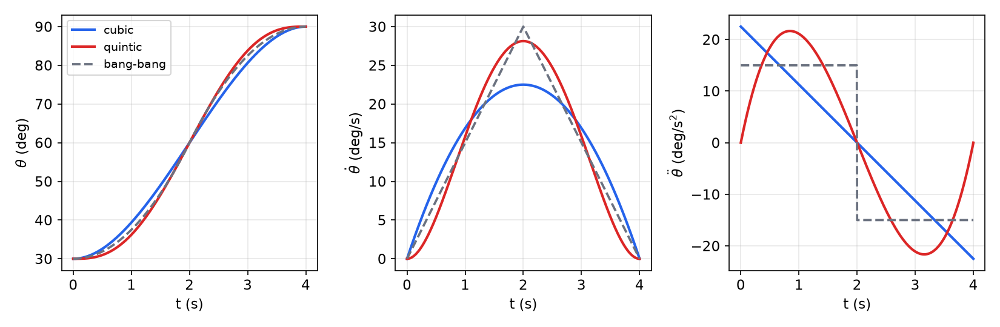
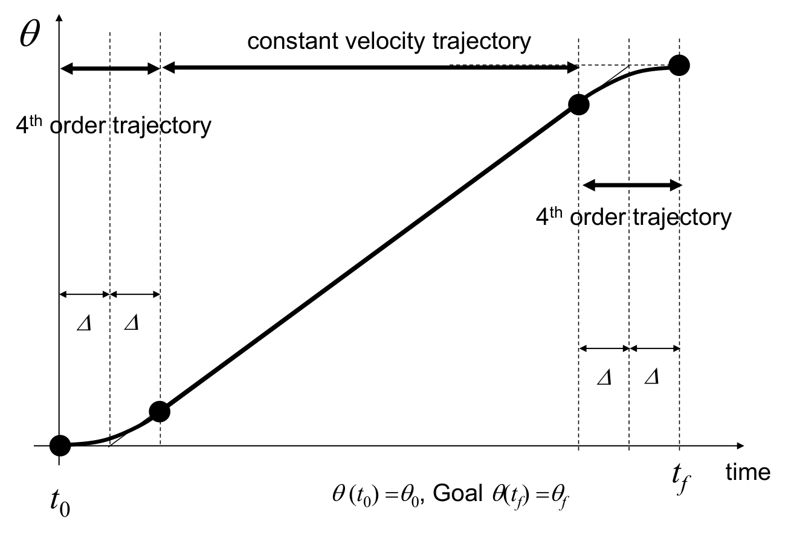
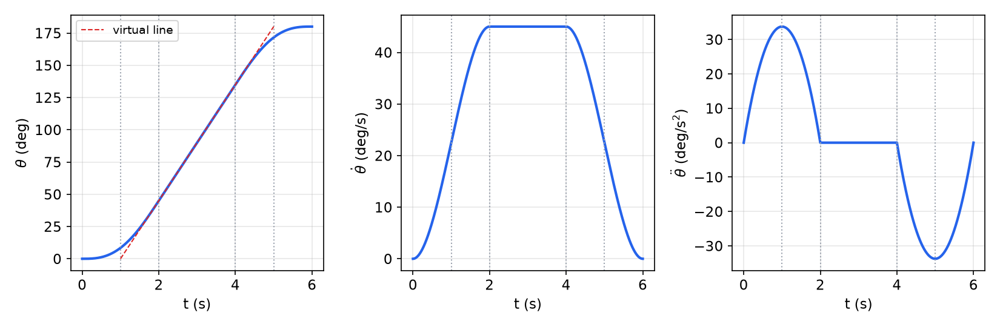
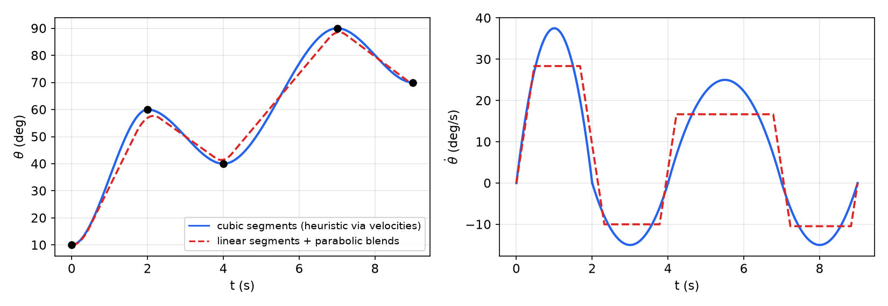
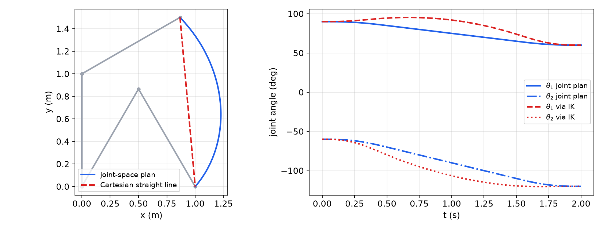

# Trajectory Generation

Kinematics tells us which joint angles put the tool at a goal; it says nothing about how to get there. A **trajectory** is a path plus its timing: the time history of position, velocity and acceleration of every joint (or of the tool) between a start and a goal, possibly through intermediate via points and around obstacles. Trajectories have to be smooth, because a step in velocity needs infinite acceleration and a step in acceleration needs a step in torque, which excites vibration in the gears and links. This chapter derives the polynomial building blocks (cubic, quintic and quartic), assembles them into point-to-point motions with constant-velocity cruise segments and via points, and then plans in Cartesian space, where the path itself is prescribed and inverse kinematics turns it into joint motions. Motion controllers of industrial robots do exactly this, many times per second, before handing the result to the servo loops of [Manipulator Control](control.md).

## Joint Space or Task Space?

There are two places to plan.

- **Joint-space planning** shapes each \\(\theta\_i(t)\\) directly from the joint values at the start, at via points and at the goal (computed once by [inverse kinematics](inverse-kinematics.md)). It is cheap, never meets a singularity along the way, and respects joint velocity and acceleration limits directly. The tool path between the knots, however, is whatever curve the joint motions happen to produce.
- **Task-space (Cartesian) planning** shapes the tool pose \\(x(t)\\): a straight line, a circle, a contour to follow with a welding torch or a polishing pad. Each sample must then be converted to joint values by inverse kinematics, with the extra cost and the risks that come with it.

In both cases the one-dimensional problem is the same: move a scalar coordinate (a joint angle, or the arc length along a path) from one value to another smoothly in a given time. The rest of the chapter solves this problem.

## Point-to-Point Motion of a Single Joint

A joint must go from \\(\theta(t\_0)=\theta\_0\\) to \\(\theta(t\_f)=\theta\_f\\). Infinitely many smooth functions connect two points, so we add conditions on the endpoints and pick the simplest function, a polynomial with as many coefficients as conditions,

\\[
\theta(t)=a\_0+a\_1(t-t\_0)+a\_2(t-t\_0)^2+a\_3(t-t\_0)^3+\cdots,\qquad t\_0\le t\le t\_f .
\\]

Without loss of generality shift time so that \\(t\_0=0\\), and write \\(T=t\_f-t\_0\\) for the duration.

### Cubic polynomials

Starting and ending at rest gives four conditions: \\(\theta(0)=\theta\_0\\), \\(\theta(T)=\theta\_f\\), \\(\dot\theta(0)=0\\), \\(\dot\theta(T)=0\\). A cubic has four coefficients. With

\\[
\theta(t)=a\_0+a\_1t+a\_2t^2+a\_3t^3,\qquad \dot\theta=a\_1+2a\_2t+3a\_3t^2,\qquad \ddot\theta=2a\_2+6a\_3t,
\\]

the conditions read

\\[
a\_0=\theta\_0,\qquad a\_0+a\_1T+a\_2T^2+a\_3T^3=\theta\_f,\qquad a\_1=0,\qquad a\_1+2a\_2T+3a\_3T^2=0 .
\\]

The last equation gives \\(a\_2=-\tfrac32a\_3T\\); substituting into the second, \\(\theta\_0-\tfrac32a\_3T^3+a\_3T^3=\theta\_f\\), so

\\[
\boxed{a\_0=\theta\_0,\quad a\_1=0,\quad a\_2=\frac{3}{T^2}(\theta\_f-\theta\_0),\quad a\_3=-\frac{2}{T^3}(\theta\_f-\theta\_0).}
\\]

The velocity \\(\dot\theta=\frac{6(\theta\_f-\theta\_0)}{T^2}\\,t\left(1-\frac tT\right)\\) is a parabola peaking at \\(\frac{3}{2}\frac{\theta\_f-\theta\_0}{T}\\) at mid-motion, 1.5 times the average speed. The acceleration is linear, from \\(+6(\theta\_f-\theta\_0)/T^2\\) to \\(-6(\theta\_f-\theta\_0)/T^2\\). It is *not zero at the ends*: starting from rest, the commanded acceleration jumps from 0 to its maximum at \\(t=0\\), and the motor torque must jump with it.

If the endpoints have prescribed velocities \\(\dot\theta\_0\\), \\(\dot\theta\_f\\) (useful at via points), the same four equations give

\\[
a\_0=\theta\_0,\quad a\_1=\dot\theta\_0,\quad
a\_2=\frac{3}{T^2}(\theta\_f-\theta\_0)-\frac{2}{T}\dot\theta\_0-\frac1T\dot\theta\_f,\quad
a\_3=-\frac{2}{T^3}(\theta\_f-\theta\_0)+\frac{1}{T^2}(\dot\theta\_f+\dot\theta\_0).
\\]

**Example 1 (Cubic, 30° to 90° in 4 s).** \\(a\_2=3\cdot60/16=11.25\\ ^\circ/\mathrm s^2\\), \\(a\_3=-2\cdot60/64=-1.875\\ ^\circ/\mathrm s^3\\), so \\(\theta(t)=30+11.25t^2-1.875t^3\\) degrees. The peak velocity is \\(22.5\\ ^\circ/\mathrm s\\) at \\(t=2\\) s, and the acceleration ramps linearly from \\(+22.5\\) to \\(-22.5\\ ^\circ/\mathrm s^2\\), with jumps at both ends.

```matlab
% cubic rest-to-rest trajectory
th0 = 30; thf = 90; T = 4; t = 0:0.01:T;
a2 = 3/T^2*(thf-th0); a3 = -2/T^3*(thf-th0);
th = th0 + a2*t.^2 + a3*t.^3;  thd = 2*a2*t + 3*a3*t.^2;  thdd = 2*a2 + 6*a3*t;
```

### Bang-bang: the time-optimal profile

If the only limit is a maximum acceleration \\(\ddot\theta\_{\max}\\), the fastest rest-to-rest motion accelerates at full positive effort for half the time and decelerates at full negative effort for the other half:

\\[
\theta(t)=\begin{cases}\theta\_0+\tfrac12\ddot\theta\_{\max}t^2,&0\le t\le T/2,\\\\
\theta\_f-\tfrac12\ddot\theta\_{\max}(T-t)^2,&T/2\le t\le T,\end{cases}
\qquad T\_{\min}=2\sqrt{\frac{\lvert\theta\_f-\theta\_0\rvert}{\ddot\theta\_{\max}}} .
\\]

The velocity is a triangle with peak \\(2(\theta\_f-\theta\_0)/T\\). This profile is time-optimal and trivial to compute, but its acceleration is discontinuous at the start, at mid-motion and at the end. Those steps excite vibration, and the profile is not energy-optimal either. For 30° to 90° in 4 s it needs \\(\ddot\theta\_{\max}=4\cdot60/16=15\\ ^\circ/\mathrm s^2\\) and peaks at \\(30\\ ^\circ/\mathrm s\\).

### Quintic polynomials

To make the acceleration continuous at the endpoints as well, prescribe it there: six conditions \\(\theta,\dot\theta,\ddot\theta\\) at \\(t=0\\) and at \\(t=T\\), and a fifth-order polynomial with six coefficients,

\\[
\theta(t)=a\_0+a\_1t+a\_2t^2+a\_3t^3+a\_4t^4+a\_5t^5 .
\\]

The conditions at \\(t=0\\) give the first three coefficients at once: \\(a\_0=\theta\_0\\), \\(a\_1=\dot\theta\_0\\), \\(a\_2=\tfrac12\ddot\theta\_0\\). Moving their contributions to the right-hand side, the conditions at \\(t=T\\) become a \\(3\times3\\) system

\\[
\begin{bmatrix}T^3&T^4&T^5\\\\3T^2&4T^3&5T^4\\\\6T&12T^2&20T^3\end{bmatrix}
\begin{bmatrix}a\_3\\\\a\_4\\\\a\_5\end{bmatrix}=
\begin{bmatrix}A\\\\B\\\\C\end{bmatrix},\qquad
\begin{aligned}A&=\theta\_f-\theta\_0-\dot\theta\_0T-\tfrac12\ddot\theta\_0T^2,\\\\
B&=\dot\theta\_f-\dot\theta\_0-\ddot\theta\_0T,\\\\
C&=\ddot\theta\_f-\ddot\theta\_0 .\end{aligned}
\\]

Its solution is

\\[
a\_3=\frac{20A-8BT+CT^2}{2T^3},\qquad a\_4=\frac{-30A+14BT-2CT^2}{2T^4},\qquad a\_5=\frac{12A-6BT+CT^2}{2T^5},
\\]

which can be checked column by column. With \\(A\\) alone, \\((a\_3,a\_4,a\_5)T^3=(10,-15,6)A\\) satisfies \\(10-15+6=1\\), \\(30-60+30=0\\), \\(60-180+120=0\\). Substituting \\(A,B,C\\) and collecting terms gives the general solution in the boundary values:

\\[
\boxed{\begin{aligned}
a\_0&=\theta\_0,\qquad a\_1=\dot\theta\_0,\qquad a\_2=\tfrac12\ddot\theta\_0,\\\\
a\_3&=\frac{1}{2T^3}\left[20\theta\_f-20\theta\_0-(8\dot\theta\_f+12\dot\theta\_0)T-(3\ddot\theta\_0-\ddot\theta\_f)T^2\right],\\\\
a\_4&=\frac{1}{2T^4}\left[30\theta\_0-30\theta\_f+(14\dot\theta\_f+16\dot\theta\_0)T+(3\ddot\theta\_0-2\ddot\theta\_f)T^2\right],\\\\
a\_5&=\frac{1}{2T^5}\left[12\theta\_f-12\theta\_0-(6\dot\theta\_f+6\dot\theta\_0)T-(\ddot\theta\_0-\ddot\theta\_f)T^2\right].
\end{aligned}}
\\]

For rest-to-rest motion with zero end accelerations this collapses to the familiar

\\[
\theta(t)=\theta\_0+(\theta\_f-\theta\_0)\left(10\tau^3-15\tau^4+6\tau^5\right),\qquad \tau=t/T,
\\]

with peak velocity \\(\tfrac{15}{8}(\theta\_f-\theta\_0)/T\\) and peak acceleration \\(\tfrac{10}{\sqrt3}(\theta\_f-\theta\_0)/T^2\\). For Example 1's motion these are \\(28.1\\ ^\circ/\mathrm s\\) and \\(21.7\\ ^\circ/\mathrm s^2\\): a slightly higher peak speed than the cubic buys an acceleration that starts and ends at zero.



*Figure: position, velocity and acceleration for 30° to 90° in 4 s. The cubic (blue) has the lowest peak speed but jumps in acceleration at both ends; the quintic (red) starts and stops with zero acceleration; bang-bang (gray) has the lowest peak acceleration and the shortest possible time for it, but its acceleration switches abruptly three times.*

### Quartic polynomials

A useful special case arises when the end accelerations are zero and the end velocities need not be. Setting \\(\ddot\theta\_0=\ddot\theta\_f=0\\) in the quintic,

\\[
a\_5=\frac{1}{2T^5}\left[12(\theta\_f-\theta\_0)-6(\dot\theta\_f+\dot\theta\_0)T\right],
\\]

which vanishes exactly when

\\[
\boxed{\theta\_f-\theta\_0=\frac{T}{2}\left(\dot\theta\_0+\dot\theta\_f\right).}
\\]

Under this condition the trajectory is a **quartic**:

\\[
a\_0=\theta\_0,\quad a\_1=\dot\theta\_0,\quad a\_2=0,\quad
a\_3=\frac{1}{2T^3}\left[20\theta\_f-20\theta\_0-(8\dot\theta\_f+12\dot\theta\_0)T\right],\quad
a\_4=\frac{1}{2T^4}\left[30\theta\_0-30\theta\_f+(14\dot\theta\_f+16\dot\theta\_0)T\right].
\\]

The condition has a geometric meaning. Draw the tangent lines at the start (slope \\(\dot\theta\_0\\)) and at the end (slope \\(\dot\theta\_f\\)); the condition says they meet at mid-time \\(T/2\\). It also has a short proof. With zero end accelerations, \\(\dot\theta\\) is a cubic in \\(\tau=t/T\\) with zero slope at both ends, hence \\(\dot\theta=\dot\theta\_0+(\dot\theta\_f-\dot\theta\_0)(3\tau^2-2\tau^3)\\). Integrating over the interval,

\\[
\theta\_f-\theta\_0=T\int\_0^1\dot\theta\\,d\tau=T\left[\dot\theta\_0+(\dot\theta\_f-\dot\theta\_0)\left(1-\tfrac12\right)\right]=\frac{T}{2}(\dot\theta\_0+\dot\theta\_f),
\\]

the trapezoid rule, exactly. Conversely, any boundary data satisfying it are matched by a quartic. The quartic is therefore the natural **blend** between rest and a constant velocity \\(V\\): with \\(\dot\theta\_0=0\\), \\(\dot\theta\_f=V\\) over a blend of length \\(T\\), it covers \\(VT/2\\), half what the cruise line would have covered. That is precisely the geometry of the construction below.

## Linear Segments with Polynomial Blends

A long motion is best done mostly at constant velocity, which minimizes the peak speed for a given duration, with smooth transitions at the ends.

### Quartic blends

The construction (figure below) proceeds as follows.

1. Pick a blend half-width \\(\Delta\\). Draw the straight **virtual line** from \\((t\_0+\Delta,\ \theta\_0)\\) to \\((t\_f-\Delta,\ \theta\_f)\\). Its slope is the cruise velocity \\(V=(\theta\_f-\theta\_0)/(t\_f-t\_0-2\Delta)\\).
2. Over \\([t\_0,\ t\_0+2\Delta]\\) replace the line by a quartic from rest to velocity \\(V\\), with zero acceleration at both ends. It must arrive at the line's value at \\(t\_0+2\Delta\\), namely \\(\theta\_0+V\Delta\\). The quartic condition requires a displacement \\(\tfrac{2\Delta}{2}(0+V)=V\Delta\\): it holds automatically, because the line starts at \\(t\_0+\Delta\\), the midpoint of the blend.
3. Do the same, mirrored, over \\([t\_f-2\Delta,\ t\_f]\\).

The result, quartic, then constant velocity, then quartic, has continuous position, velocity and acceleration everywhere. For the acceleration blend with \\(t\_0=0\\), the coefficients reduce to

\\[
\theta(t)=\theta\_0+V\left(\frac{t^3}{4\Delta^2}-\frac{t^4}{16\Delta^3}\right),\qquad 0\le t\le2\Delta,
\\]

whose peak acceleration, at \\(t=\Delta\\), is \\(\tfrac34V/\Delta\\). Shorter blends mean harder acceleration.



*Figure: the construction. The virtual straight line runs from \\(\theta\_0\\) at \\(t\_0+\Delta\\) to \\(\theta\_f\\) at \\(t\_f-\Delta\\). Over the first and last \\(2\Delta\\) it is replaced by fourth-order polynomials that are tangent to the line where they join it (black dots) and start and end at rest.*

**Example 2 (0° to 180° in 6 s).** A single joint moves rest to rest from 0 to \\(\pi\\) in 6 s, with quartic blends on \\([0,2]\\) and \\([4,6]\\) (\\(\Delta=1\\) s) and constant velocity on \\([2,4]\\). The cruise speed is \\(V=\pi/(6-2\Delta)=\pi/4\\) rad/s, so the first blend ends at \\(\theta(2)=V\Delta=\pi/4\\) (45°). With \\(T=2\\), \\(\theta\_f=\pi/4\\), \\(\dot\theta\_0=0\\), \\(\dot\theta\_f=\pi/4\\):

\\[
a\_3=\frac{1}{16}\left[5\pi-4\pi\right]=\frac{\pi}{16},\qquad
a\_4=\frac{1}{32}\left[-\frac{15\pi}{2}+\frac{14\pi}{2}\right]=-\frac{\pi}{64},\qquad
\theta(t)=\frac{\pi}{16}t^3-\frac{\pi}{64}t^4\quad(0\le t\le 2).
\\]

Check: \\(\theta(0)=0\\); \\(\theta(2)=\pi/2-\pi/4=\pi/4\\); \\(\dot\theta=\tfrac{3\pi}{16}t^2-\tfrac{\pi}{16}t^3\\) gives \\(\dot\theta(0)=0\\), \\(\dot\theta(2)=\tfrac{3\pi}{4}-\tfrac{\pi}{2}=\tfrac{\pi}{4}\\); and \\(\ddot\theta(2)=\tfrac{3\pi}{8}\cdot2-\tfrac{3\pi}{16}\cdot4=0\\), so the join with the cruise segment is smooth in acceleration. The cruise segment is \\(\theta=\pi/4+\tfrac{\pi}{4}(t-2)\\) on \\([2,4]\\) (45° to 135°), and the final blend mirrors the first.



*Figure: Example 2 in degrees. Position follows the virtual line (dashed) except in the blends; velocity rises smoothly to 45°/s and returns to zero; acceleration is continuous, peaking at \\(\tfrac34V/\Delta=33.75\\ ^\circ/\mathrm s^2\\) in the middle of each blend.*

**Example 3 (Joint-space plan for a 2R arm).** A 2R arm with \\(L\_1=L\_2=1\\) moves rest to rest in 2 s from \\((\theta\_1,\theta\_2)=(90^\circ,-60^\circ)\\) to \\((60^\circ,-120^\circ)\\), each joint following quartic, linear, quartic with \\(\Delta=0.25\\) s.

*Joint 1.* The virtual line passes through 90° at \\(t=0.25\\) and 60° at \\(t=1.75\\): slope \\((60-90)/1.5=-20\\ ^\circ/\mathrm s\\). So \\(\theta\_1(0.5)=90-20(0.25)=85^\circ\\) and \\(\theta\_1(1.5)=65^\circ\\). For the first blend (\\(T=2\Delta=0.5\\)):

\\[
a\_3=\frac{1}{2(0.5)^3}\left[20\cdot85-20\cdot90-0.5\left(8(-20)\right)\right]=4(1700-1800+80)=-80,
\\]
\\[
a\_4=\frac{1}{2(0.5)^4}\left[30\cdot90-30\cdot85+0.5\left(14(-20)\right)\right]=8(2700-2550-140)=80 .
\\]

For the final blend on \\([1.5,2]\\), with \\(a\_0=65\\), \\(a\_1=-20\\), \\(\theta\_f=60\\), \\(\dot\theta\_f=0\\): \\(a\_3=4[1200-1300-0.5(-240)]=80\\), \\(a\_4=8[1950-1800-0.5(320)]=-80\\). Altogether

\\[
\theta\_1(t)=\begin{cases}90-80t^3+80t^4,&0\le t\le0.5,\\\\
85-20(t-0.5),&0.5\le t\le1.5,\\\\
65-20(t-1.5)+80(t-1.5)^3-80(t-1.5)^4,&1.5\le t\le2.\end{cases}
\\]

Checks: \\(\dot\theta\_1(0.5)=-240(0.25)+320(0.125)=-20\\) ✓, and \\(\theta\_1(2)=65-10+10-5=60\\) ✓.

*Joint 2* (slope \\(-40\\ ^\circ/\mathrm s\\)): \\(\theta\_2=-60-160t^3+160t^4\\) on \\([0,0.5]\\); \\(-70-40(t-0.5)\\) on \\([0.5,1.5]\\); \\(-110-40(t-1.5)+160(t-1.5)^3-160(t-1.5)^4\\) on \\([1.5,2]\\).

*Does the tip move in a straight line?* No, whatever \\(\Delta\\) is. The joints are planned independently and no inverse kinematics is used between the endpoints, so the tip traces the curve the forward kinematics makes of two smoothly ramping angles (figure at the end of the chapter).

```python
import numpy as np
def quartic_blend_plan(q0, qf, tf, D):
    """Rest-to-rest: quartic on [0,2D], cruise, mirrored quartic on [tf-2D, tf]."""
    V = (qf - q0) / (tf - 2*D)
    a3, a4 = V/(4*D**2), -V/(16*D**3)
    def q(t):
        t = np.asarray(t, float)
        up = q0 + a3*t**3 + a4*t**4
        s = tf - t
        down = qf - (a3*s**3 + a4*s**4)
        cruise = q0 + V*D + V*(t - 2*D)
        return np.where(t <= 2*D, up, np.where(t >= tf - 2*D, down, cruise))
    return q
q1 = quartic_blend_plan(90, 60, 2.0, 0.25)
print(q1([0.5, 1.5, 2.0]))   # [85. 65. 60.]
```

### Parabolic blends (LSPB)

The classical alternative blends with constant-acceleration parabolas: a **linear segment with parabolic blends**. Take a symmetric rest-to-rest move with blend duration \\(t\_b\\) at each end and acceleration \\(\ddot\theta\\) in the blends. At the end of the first blend the velocity \\(\ddot\theta t\_b\\) must equal the slope of the line from the blend's end, \\(\theta\_b=\theta\_0+\tfrac12\ddot\theta t\_b^2\\), to the midpoint \\(\theta\_h=\tfrac12(\theta\_0+\theta\_f)\\) at \\(t\_h=T/2\\):

\\[
\ddot\theta t\_b=\frac{\theta\_h-\theta\_b}{t\_h-t\_b}
\quad\Longrightarrow\quad
\ddot\theta t\_b^2-\ddot\theta Tt\_b+(\theta\_f-\theta\_0)=0,
\\]
\\[
t\_b=\frac{T}{2}-\frac{\sqrt{\ddot\theta^2T^2-4\ddot\theta(\theta\_f-\theta\_0)}}{2\ddot\theta}.
\\]

A real solution needs \\(\ddot\theta\ge4(\theta\_f-\theta\_0)/T^2\\). At equality the linear segment shrinks to nothing and the profile becomes bang-bang; larger accelerations give shorter blends and longer cruise. Position and velocity are continuous, but acceleration still jumps at the blend boundaries, the price of using parabolas instead of quartics.

## Via Points

Real tasks pass through intermediate **via points**, for instance to clear an obstacle. Three standard ways to handle them:

1. **Cubic segments with assigned velocities.** Between consecutive knots use the cubic with end velocities. The via velocities can be specified by the user, or chosen by a heuristic: zero where the path changes direction (the slopes of neighbouring segments have opposite signs), otherwise the average of the neighbouring slopes. Position and velocity are continuous; acceleration is not.
2. **Cubic splines.** Choose the via velocities so that acceleration is also continuous at each via point. This couples the segments: the conditions form a tridiagonal linear system in the unknown velocities, cheap to solve. The result is the cubic spline through the knots.
3. **Linear segments with parabolic blends through via points.** Each knot gets a parabolic blend of chosen acceleration magnitude, and the straight segments in between have slopes \\(\dot\theta\_{jk}=(\theta\_k-\theta\_j)/t\_{djk}\\), where \\(t\_{djk}\\) is the segment duration. At an interior knot \\(k\\), the blend acceleration is \\(\ddot\theta\_k=\mathrm{sgn}(\dot\theta\_{kl}-\dot\theta\_{jk})\lvert\ddot\theta\_k\rvert\\), its duration \\(t\_k=(\dot\theta\_{kl}-\dot\theta\_{jk})/\ddot\theta\_k\\), and the straight part of segment \\(jk\\) lasts \\(t\_{djk}-\tfrac12t\_j-\tfrac12t\_k\\). The first and last segments are adjusted so the whole blend lies inside them: \\(t\_1=t\_{d12}-\sqrt{t\_{d12}^2-2(\theta\_2-\theta\_1)/\ddot\theta\_1}\\) and \\(\dot\theta\_{12}=(\theta\_2-\theta\_1)/(t\_{d12}-\tfrac12t\_1)\\), and symmetrically at the end. The trajectory passes *near* the interior via points but not through them: the blend rounds the corner. If a via point must be hit exactly, insert two pseudo via points on either side of it.



*Figure: a single joint through knots at 0, 2, 4, 7 and 9 s. Blue: cubic segments with heuristic via velocities, zero where the motion reverses. It passes through every knot, with kinks in the velocity profile at the knots (acceleration jumps). Red dashed: linear segments with parabolic blends (\\(\lvert\ddot\theta\rvert=60\\ ^\circ/\mathrm s^2\\)). Its velocity is trapezoidal, and it rounds the interior knots instead of passing through them.*

## Cartesian Paths

### Straight lines and orientation

When the tool must follow a prescribed geometric path, plan a scalar path parameter \\(s(t)\in[0,1]\\) with any of the profiles above (quartic blend plus cruise is a good default) and map it to the pose. For a straight line from \\(p\_0\\) to \\(p\_f\\),

\\[
p(t)=p\_0+s(t)\\,(p\_f-p\_0),\qquad \dot p=\dot s\\,(p\_f-p\_0),\qquad \ddot p=\ddot s\\,(p\_f-p\_0).
\\]

Orientation cannot be interpolated entry by entry in the rotation matrix, since intermediate matrices would not be rotations. Instead, write the relative rotation as one rotation about a fixed axis, \\(R\_0^TR\_f=\mathrm{Rot}(\hat k,\phi)\\), and interpolate the angle: \\(R(t)=R\_0\\,\mathrm{Rot}(\hat k,\\,s(t)\phi)\\). The angular velocity is then \\(\dot s\\,\phi\\,R\_0\hat k\\), about a fixed axis. (Unit quaternions with spherical linear interpolation do the same thing.)

Each sample is converted to joints by inverse kinematics, and joint velocities and accelerations follow from the [Jacobian](jacobians-statics.md):

\\[
\dot q=J^{-1}\dot x,\qquad \ddot x=J\ddot q+\dot J\dot q\ \Rightarrow\ \ddot q=J^{-1}\left(\ddot x-\dot J\dot q\right).
\\]



*Figure: the 2R arm of Example 3 (unit links) moving from \\((90^\circ,-60^\circ)\\) to \\((60^\circ,-120^\circ)\\) in 2 s. Blue: joint-space quartic-linear-quartic plan; the tip bows out along a curve. Red: the same profile applied to the arc length of the straight segment between the two tip positions, converted by elbow-up inverse kinematics. The joint histories on the right show what the straight line costs: \\(\theta\_1\\) first increases before decreasing, and both joints move faster mid-motion.*

### Pitfalls of Cartesian planning

- **Unreachable intermediate points.** Both endpoints can be in the workspace while part of the straight line between them is not (it may pass through the hole near the base of a 2R arm with \\(l\_1\ne l\_2\\)).
- **High joint rates near singularities.** A straight line that passes close to a singularity demands huge joint velocities, since \\(\lVert J^{-1}\rVert\\) is large there, even though the tool speed is modest.
- **Different solution branches.** Start and goal may be reachable only in different inverse-kinematics branches (elbow up versus elbow down). No continuous Cartesian path can connect them without passing through a singularity.
- **Cost.** Inverse kinematics (and the Jacobian) must be evaluated at every sample.

**Example 4 (Horizontal line with a 2R arm).** The task-space pipeline is: trajectory parameters (initial and final positions, durations) → task-space trajectory generation → inverse kinematics → joint variables. A 2R tool moves from \\((x,y)=(-0.1,0.2)\\) to \\((0.2,0.2)\\) in 2 s along the horizontal line \\(y=0.2\\). The planned \\(x(t)\\) is a smooth ramp and \\(y\\) is constant. Through inverse kinematics, joint 1 decreases smoothly while joint 2 rises and then falls, a bump that a joint-space plan would never produce.

**Example 5 (Polishing a curved wall).** A planar 3R arm (\\(a\_1=0.2\\), \\(a\_2=0.15\\), \\(a\_3=0.12\\) m) polishes a quarter-circular wall of radius \\(R=0.25\\) m centred at \\(c=(0.1,0.25)\\), from \\((0.35,0.25)\\) down to \\((0.1,0)\\) in \\(t\_f=2\\) s. The tool must stay normal to the wall, and the tangential motion must start and end at rest with a constant-speed segment of at least 1 s.

*Plan in polar coordinates.* Let \\(\phi(t)\\) be the polar angle about \\(c\\), from 0 to \\(-\pi/2\\). Use quartic blends of length \\(t\_b=0.5\\) s (\\(\Delta=0.25\\) s) and a 1 s cruise. The cruise rate satisfies \\(V(t\_f-t\_b)=\pi/2\\), so \\(V=\pi/3=1.047\\) rad/s, a tangential speed \\(RV=0.262\\) m/s.

*Pose.* Tool normal to the wall: \\(\theta\_e=\phi\\), tool point \\(c+R(\cos\phi,\sin\phi)\\). The wrist (joint 3) is \\(a\_3\\) back along the normal, at \\(c+(R-a\_3)(\cos\phi,\sin\phi)=c+0.13(\cos\phi,\sin\phi)\\).

*Inverse kinematics.* Solve the 2R problem for the wrist with the branch \\(\theta\_2<0\\), which keeps the links away from the wall; then \\(\theta\_3=\theta\_e-\theta\_1-\theta\_2\\). At \\(t=0\\) the wrist is at \\((0.23,0.25)\\): \\(\cos\theta\_2=(0.1154-0.0625)/0.06=0.882\\), so \\(\theta\_2=-0.491\\), \\(\theta\_1=0.827+0.210=1.037\\), \\(\theta\_3=-0.546\\) rad. At \\(t=2\\) s the wrist is at \\((0.1,0.12)\\): \\(\cos\theta\_2=(0.0244-0.0625)/0.06=-0.635\\), \\(\theta\_2=-2.258\\), \\(\theta\_1=0.876+0.836=1.711\\), \\(\theta\_3=-1.571-1.711+2.258=-1.024\\) rad.

*Check.* Joint velocities from numerical differentiation, multiplied by the 3R Jacobian, reproduce the tool velocity: \\(\lvert v\rvert\\) is 0.262 m/s during the cruise. At \\(t=1\\) s, halfway around, \\(v\_x=v\_y\approx-0.185\\) m/s.

**Example 6 (Straight line with a polar RP arm).** A planar RP arm (\\(x=d\_2C\_1\\), \\(y=d\_2S\_1\\)) in a horizontal plane moves its tip from \\((1,2)\\) to \\((2,1)\\) in 2 s, quartic-linear-quartic along the line with \\(\Delta=0.25\\) s.

*(a) Path.* Let \\(s\\) be the distance along the segment, of length \\(\sqrt2\\). Cruise slope \\(\sqrt2/1.5=2\sqrt2/3\\); \\(s(0.5)=\sqrt2/6\\), \\(s(1.5)=5\sqrt2/6\\). Blend coefficients: \\(a\_3=V/(4\Delta^2)=\tfrac{8\sqrt2}{3}\\), \\(a\_4=-V/(16\Delta^3)=-\tfrac{8\sqrt2}{3}\\). So

\\[
s(t)=\begin{cases}\tfrac{8\sqrt2}{3}(t^3-t^4),&0\le t\le0.5,\\\\
\tfrac{\sqrt2}{6}+\tfrac{2\sqrt2}{3}(t-0.5),&0.5\le t\le1.5,\\\\
\tfrac{5\sqrt2}{6}+\tfrac{2\sqrt2}{3}(t-1.5)-\tfrac{8\sqrt2}{3}\left[(t-1.5)^3-(t-1.5)^4\right],&1.5\le t\le2,\end{cases}
\\]

and with \\(x=1+s/\sqrt2\\), \\(y=2-s/\sqrt2\\): \\(x=1+\tfrac83(t^3-t^4)\\), \\(y=2-\tfrac83(t^3-t^4)\\) in the first blend and \\(x=\tfrac76+\tfrac23(t-0.5)\\), \\(y=\tfrac{11}{6}-\tfrac23(t-0.5)\\) in the cruise.

*(b) Joints.* \\(d\_2=\sqrt{x^2+y^2}\\), \\(\theta\_1=\operatorname{atan2}(y,x)\\).

*(c) Midpoint, \\(t=1\\).* The tip is at \\((1.5,1.5)\\): \\(\theta\_1=45^\circ\\), \\(d\_2=3\sqrt2/2\\), the closest approach to the origin. With \\(J=\begin{bmatrix}-d\_2S\_1&C\_1\\\\d\_2C\_1&S\_1\end{bmatrix}=\begin{bmatrix}-\frac32&\frac{\sqrt2}{2}\\\\ \frac32&\frac{\sqrt2}{2}\end{bmatrix}\\) and \\(\dot x=(\tfrac23,-\tfrac23)\\), \\(\dot q=J^{-1}\dot x=(-\tfrac49,\ 0)\\): \\(\dot\theta\_1=-4/9\\) rad/s, \\(\dot d\_2=0\\). In polar coordinates a straight line at constant speed has \\(\ddot\theta\_1=0\\) and \\(\ddot d\_2=d\_2\dot\theta\_1^2=\tfrac{8\sqrt2}{27}\\) at this point; the radial acceleration is pure kinematics of the line. The joint efforts at this instant are computed in [Manipulator Dynamics](dynamics.md), where they turn out to be zero.

*(d) Middle of the first blend, \\(t=\Delta\\).* \\(x=1.03\\), \\(y=1.97\\), \\(\dot x=0.33\\), \\(\dot y=-0.33\\), \\(\ddot x=2\\), \\(\ddot y=-2\\); hence \\(d\_2=2.22\\), \\(\theta\_1=1.088\\) rad, and \\(\dot q=J^{-1}\dot x\\), \\(\ddot q=J^{-1}(\ddot x-\dot J\dot q)\\):

```matlab
xe = 1+8/3*t^3-8/3*t^4;  ye = 2-8/3*t^3+8/3*t^4;
d2 = sqrt(xe^2+ye^2);    th = atan2(ye,xe);
ved = [8*t^2-32/3*t^3; -8*t^2+32/3*t^3];      % tip velocity
aed = [16*t-32*t^2;    -16*t+32*t^2];         % tip acceleration
J  = [-d2*sin(th) cos(th); d2*cos(th) sin(th)];
v  = J\ved;                                   % [th_dot; d2_dot]
dJ = [-v(2)*sin(th)-d2*v(1)*cos(th), -v(1)*sin(th);
       v(2)*cos(th)-d2*v(1)*sin(th),  v(1)*cos(th)];
a  = J\(aed - dJ*v);                          % [th_ddot; d2_ddot]
```

The result is \\(\dot\theta\_1=-0.202\\), \\(\dot d\_2=-0.141\\), \\(\ddot\theta\_1=-1.24\\), \\(\ddot d\_2=-0.753\\).

## Summary

- Trajectory = path + timing; plan a scalar profile and map it to joints (joint space) or to the tool pose (task space, followed by inverse kinematics).
- Cubic rest-to-rest: \\(a\_2=3\Delta\theta/T^2\\), \\(a\_3=-2\Delta\theta/T^3\\); peak speed \\(1.5\Delta\theta/T\\); acceleration jumps at the ends.
- Bang-bang: time-optimal for an acceleration limit, \\(T\_{\min}=2\sqrt{\Delta\theta/\ddot\theta\_{\max}}\\), discontinuous acceleration.
- Quintic: matches position, velocity and acceleration at both ends; rest-to-rest \\(\Delta\theta(10\tau^3-15\tau^4+6\tau^5)\\).
- Quartic with zero end accelerations exists exactly when \\(\theta\_f-\theta\_0=\tfrac T2(\dot\theta\_0+\dot\theta\_f)\\): the natural blend into a cruise segment.
- Quartic–linear–quartic: virtual line from \\((\Delta,\theta\_0)\\) to \\((t\_f-\Delta,\theta\_f)\\), \\(V=\Delta\theta/(t\_f-2\Delta)\\), blend \\(V(t^3/4\Delta^2-t^4/16\Delta^3)\\), peak acceleration \\(\tfrac34V/\Delta\\).
- LSPB: \\(t\_b=\tfrac T2-\sqrt{\ddot\theta^2T^2-4\ddot\theta\Delta\theta}/(2\ddot\theta)\\), needs \\(\ddot\theta\ge4\Delta\theta/T^2\\).
- Via points: cubics with heuristic velocities, cubic splines, or LSPB (which rounds the via points).
- Cartesian: \\(p=p\_0+s(p\_f-p\_0)\\), angle-axis orientation interpolation, \\(\dot q=J^{-1}\dot x\\), \\(\ddot q=J^{-1}(\ddot x-\dot J\dot q)\\); beware unreachable points, singularities and branch changes.

## See Also

- [Inverse Kinematics](inverse-kinematics.md): turning task-space samples into joint values.
- [Jacobians, Singularities and Statics](jacobians-statics.md): velocity and acceleration mapping, and why lines near singularities are dangerous.
- [Manipulator Dynamics](dynamics.md): the torques a planned trajectory demands.
- [Manipulator Control](control.md): tracking the planned \\(q\_d,\dot q\_d,\ddot q\_d\\).
- [Motion Planning](../planning.md): planning collision-free paths before timing them.
- [Ordinary Differential Equations (numerical)](../../../math/numerical/odes.md).
