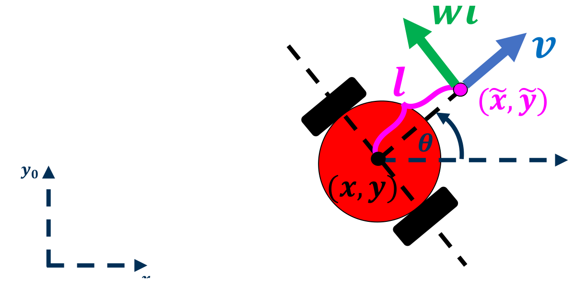
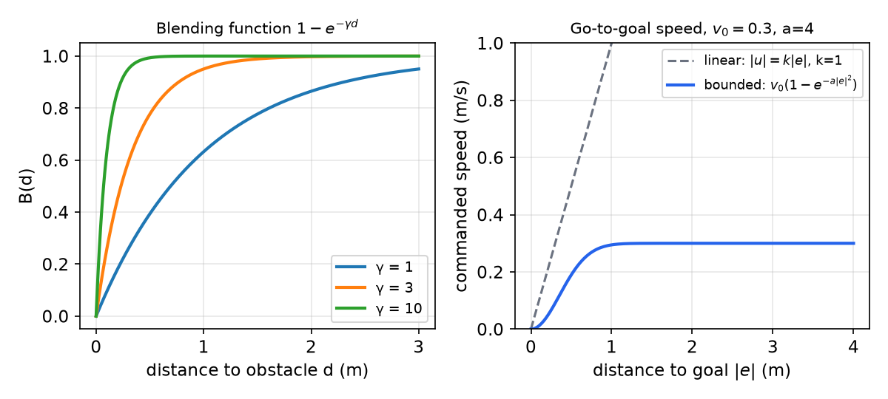
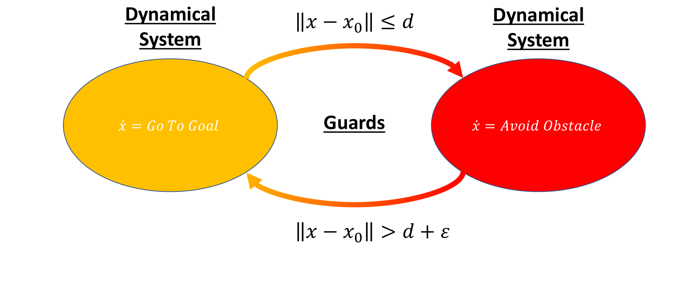
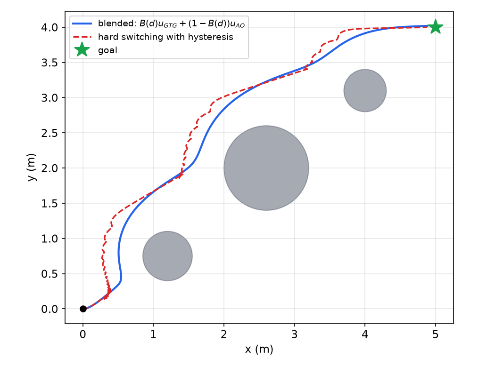
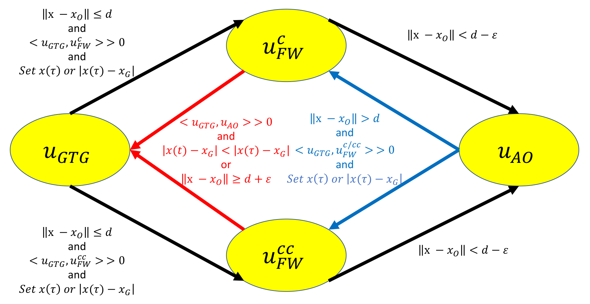
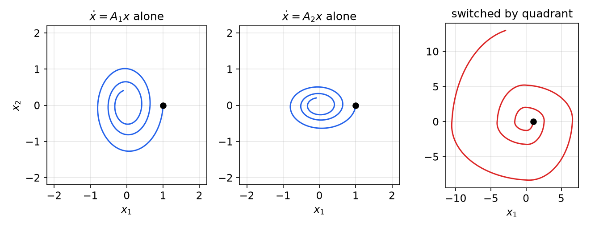

# Behavior-Based Control: Go-to-Goal, Obstacle Avoidance and Switching

A mobile robot rarely knows its world in advance, so there is little point in computing an elaborate optimal motion and then executing it blindly. Behavior-based control instead equips the robot with a few simple, reactive **behaviors** (go to the goal, avoid the obstacle, follow the wall) and combines them, either by blending their commands or by switching between them according to logical rules. This chapter derives each behavior as a feedback law, shows how to turn single-integrator commands into unicycle commands through a look-ahead point, analyses stability with eigenvalues and Lyapunov functions, and builds a complete hybrid navigation automaton. It closes with a warning: switching between stable behaviors can produce an unstable system. The chapter builds on the [unicycle model](transforms-kinematics.md) and [PID control](feedback-control.md).

## Behaviors and Layered Architecture

Industrial robots in standardized, repeatable settings can afford to plan every motion exactly. A mobile robot facing unknown furniture and moving people cannot, and over-planning wastes effort on a world that will change. A **layered architecture** separates concerns by time scale:

- **High level: planning.** Where should the robot ultimately go? Long time scales, global information (A\*, D\*, RRT, dynamic programming; see [Path Planning](path-planning.md)).
- **Mid level: behaviors.** Where should the robot go *next*? A short-term goal point and a velocity vector toward it, usually computed for the abstract model \\(\dot x = u\\).
- **Low level: actuation.** How should the wheels turn to realize that velocity? Unicycle conversion, wheel inverse kinematics, and motor PID loops.

No real robot has just one controller; several always interact. Lower-level (direct actuation) controllers must run much faster than the planning controllers that command them, so that each layer can treat the one beneath it as ideal. Be aware of every controller in the system: a lower-level loop can remove disturbances that a higher-level design never considered, and it can also introduce lag that the higher level did not expect.

A typical pipeline:

1. **Mid-level control:** which direction, and how fast? A proportional law \\(\dot x = u = K(x\_G - x)\\) produces a velocity vector toward the goal \\(x\_G\\).
2. **Unicycle conversion:** turn the vector into a forward speed \\(v\\) and turn rate \\(\omega\\) (via the look-ahead point below), then into wheel rates \\(\dot\varphi\_R = \frac{2v + \omega b}{2R}\\), \\(\dot\varphi\_L = \frac{2v - \omega b}{2R}\\), with \\(R\\) the wheel radius and \\(b\\) the track width.
3. **Motor control:** a full PID loop in each wheel drive makes the motor spin at the required rate.

A simple proportional law suffices at the mid level because the motor loops already reject torque disturbances; the price is that the behavior layer has no direct notion of wheel slip or saturation.

## Go to Goal

### The models

The full differential-drive model, with wheel rates as inputs, is
\\[
\dot x = \tfrac R2(\dot\varphi\_R + \dot\varphi\_L)\cos\theta, \qquad \dot y = \tfrac R2(\dot\varphi\_R + \dot\varphi\_L)\sin\theta, \qquad \dot\theta = \tfrac Rb(\dot\varphi\_R - \dot\varphi\_L).
\\]
The unicycle model hides the wheels behind the more intuitive inputs \\(v\\) and \\(\omega\\):
\\[
\dot x = v\cos\theta, \qquad \dot y = v\sin\theta, \qquad \dot\theta = \omega, \qquad\text{with}\qquad \dot\varphi\_R = \frac{2v + \omega b}{2R}, \quad \dot\varphi\_L = \frac{2v - \omega b}{2R}.
\\]
We design in terms of \\(v\\) and \\(\omega\\).

### Heading control at constant speed

The simplest go-to-goal controller drives at constant speed \\(v = v\_0\\) and steers toward the goal:
\\[
\dot x = v\_0\cos\theta, \qquad \dot y = v\_0\sin\theta, \qquad \dot\theta = \omega .
\\]
Map this onto the generic feedback loop of the previous chapter: the reference is the desired heading \\(r = \theta\_d\\), the controlled state is \\(\theta\\), the error is \\(e = \theta\_d - \theta\\), and the input is \\(u = \omega\\). Since \\(\dot\theta = \omega\\) is an integrator, a proportional law \\(\omega = K\_pe\\) gives \\(\dot e = -K\_pe\\) when \\(\theta\_d\\) is constant: the heading converges exponentially. The remaining question is where \\(\theta\_d\\) comes from.

**Choosing \\(\theta\_d\\) locally, from a camera.** If the goal is seen in a camera image at horizontal pixel offset \\(x\_g\\) from the image centre, and the lens is assumed linear with horizontal field of view \\(\alpha\\) spread over \\(i\\) pixels, each pixel subtends \\(\alpha/i\\) and the bearing of the goal relative to the robot heading is approximately \\(x\_g\alpha/i\\) (with sign: a goal to the right of centre is a *negative*, clockwise bearing). The pinhole model gives the exact value \\(\arctan(x\_g/f\_{px})\\), where the focal length in pixels is \\(f\_{px} = (i/2)/\tan(\alpha/2)\\).

**Example 1 (Camera bearing).** A camera with \\(\alpha = 62.2°\\) and \\(i = 640\\) pixels sees a ball 100 px right of centre. The linear model gives \\(100 \times 62.2/640 = 9.7°\\). The pinhole model gives \\(f\_{px} = 320/\tan 31.1° = 530.5\\) px and \\(\arctan(100/530.5) = 10.7°\\). The linear approximation underestimates bearings toward the edge of the image, which is harmless for a feedback loop (it only lowers the effective gain) but matters for one-shot pointing. The heading error is \\(e\approx -10°\\): turn clockwise.

**Choosing \\(\theta\_d\\) globally, from a pose estimate.** If odometry or localization gives the robot position \\((x, y)\\) and the goal is at \\((x\_g, y\_g)\\) in the same world frame,
\\[
\theta\_d = \arctan\frac{y\_g - y}{x\_g - x},
\\]
computed in practice as `atan2(y_g - y, x_g - x)`, which uses the signs of both arguments to return the correct quadrant in \\((-\pi, \pi]\\). Plain `atan` cannot distinguish a goal ahead-right from one behind-left.

### Beware of angles

Will a plain PID on \\(e = \theta\_d - \theta\\) work as is? No. Angles are not ordinary numbers: \\(\theta\\) and \\(\theta + 2\pi k\\) are the same physical heading. Suppose odometry integrates \\(\dot\theta\\) without wrapping and the robot has turned around many times, so that \\(\theta = 50\pi\\) while \\(\theta\_d = 0\\). The physical heading error is zero, but \\(e = -50\pi\\) and the controller spins the robot 25 full turns. Even within one revolution, \\(\theta\_d = 170°\\) and \\(\theta = -170°\\) give \\(e = 340°\\), so the robot turns the long way round instead of 20° the short way.

The fix is to **wrap** the error into \\([-\pi, \pi)\\) before using it:
\\[
\hat e = \operatorname{atan2}(\sin e, \cos e),
\\]
or, equivalently, with loops:

```text
while (e <= -pi):  e = e + 2*pi
while (e >  pi):   e = e - 2*pi
```

(The loop version returns \\((-\pi, \pi]\\); either convention is fine as long as it is consistent.) Wrap the *error*, not just the heading: wrapping \\(\theta\\) and \\(\theta\_d\\) individually still leaves differences up to \\(2\pi\\). Never average angles arithmetically either; average their unit vectors and take `atan2`. An integral term on a heading error also needs care, since it accumulates through wraps.

### Two common failure modes

- **No angle wrapping.** The robot circles the wrong (long) way, or spins repeatedly, as just explained.
- **Gain too small for the speed: orbiting.** With \\(v = v\_0\\) fixed and \\(\omega = K\_p\hat e\\), the robot can circle the goal forever. On a circular orbit of radius \\(\rho\\) about the goal, the goal is always exactly abeam (\\(\hat e = \pm\pi/2\\)), and the turn rate required is \\(v\_0/\rho\\). The controller supplies \\(K\_p\pi/2\\), so a steady orbit exists at
\\[
\rho^\ast = \frac{2v\_0}{\pi K\_p}.
\\]
If \\(\rho^\ast\\) is larger than the goal tolerance, the robot may never arrive. Remedies: raise \\(K\_p\\) (subject to turn-rate limits), or, better, slow down as the goal approaches and when the heading error is large, e.g. \\(v = \min(v\_0, k\_v d)\cos\hat e\\) with \\(d\\) the distance to goal (clipped at zero so the robot does not reverse). In practice both speed and turn rate are often PID-controlled: \\(v = \text{pid}(e\_v)\\), \\(\omega = \text{pid}(e\_\omega)\\).

## Sensing Obstacles

To avoid an obstacle the robot must know where it is. A camera that tracks colored blobs can identify objects (a red ball, a blue box) but a single image does not directly give range.

**Size cue.** A ball of known radius \\(r\_b\\) at distance \\(z\\), imaged by a camera with focal length \\(f\\) (in pixels), appears with image radius \\(r\_i\\). Similar triangles give
\\[
z \approx \frac{f\\,r\_b}{r\_i}.
\\]
For example, \\(f = 530\\) px, \\(r\_b = 3.5\\) cm and \\(r\_i = 20\\) px give \\(z \approx 0.93\\) m. Problems: the object may not be symmetric or of known size, and if it is off-axis the apparent size is distorted.

**Motion parallax.** Observe the same object from two robot positions separated by a known baseline \\(D\\) at times \\(t\_1\\) and \\(t\_2\\); the two bearings and the baseline define a triangle whose solution (law of sines) gives the depth. Problems: the object may move between observations, bearings are noisy, and the robot does not move exactly as commanded.

**Stereo.** Two cameras a baseline \\(D\\) apart do the same thing simultaneously; for rectified cameras the depth is \\(Z = fD/\delta\\), where \\(\delta\\) is the horizontal disparity in pixels. Problems: a second camera, calibration, and the computation to match pixels.

**Range-sensor skirt.** The practical solution is a ring of range sensing around the robot. Three technologies dominate (see [Robot Sensors](sensors.md) for details):

| Sensor | Principle | Pros | Cons |
|---|---|---|---|
| IR distance | emit infrared, measure the reflection | cheap, effective | dark surfaces absorb (no reading); sunlight and other light interfere; reflects off rain, fog, snow; need many for coverage |
| Sonar (ultrasonic) | emit sound, time the echo | wide beam, works in fog, rain, snow; inexpensive | poor at long range; slow (speed of sound); need many for coverage |
| LiDAR | spinning laser rangefinder | high resolution, fast, long range | expensive; degraded by rain, snow, fog |

A range sensor returns ranges and bearings \\((d\_1, \theta\_1), (d\_2, \theta\_2), \ldots\\) but cannot tell an obstacle from the goal. The practical answer is a simple form of sensor fusion: use the range sensor for distance and bearing, and another sensor (the camera) to identify what each return is.

### From range and bearing to world coordinates

A return \\((d\_i, \theta\_i)\\) is a point in the robot frame, \\({}^RP = (d\_i\cos\theta\_i, d\_i\sin\theta\_i)\\). If the robot's pose is \\((x\_R, y\_R, \theta\_R)\\), the [homogeneous transform](transforms-kinematics.md) \\({}^0T\_R\\) maps it to the world frame:
\\[
\begin{bmatrix} x\_i \\\\ y\_i \\\\ 1 \end{bmatrix} = \begin{bmatrix} \cos\theta\_R & -\sin\theta\_R & x\_R \\\\ \sin\theta\_R & \cos\theta\_R & y\_R \\\\ 0 & 0 & 1\end{bmatrix}\begin{bmatrix} d\_i\cos\theta\_i \\\\ d\_i\sin\theta\_i \\\\ 1\end{bmatrix}
\quad\Longrightarrow\quad
\boxed{x\_i = x\_R + d\_i\cos(\theta\_R + \theta\_i), \quad y\_i = y\_R + d\_i\sin(\theta\_R + \theta\_i).}
\\]
The simplification uses the angle-addition formulas. **Example 2.** A robot at \\((2, 1)\\) facing \\(\theta\_R = \pi/2\\) detects an obstacle at \\(d = 1.5\\) m, \\(\theta\_i = -\pi/6\\). The world bearing is \\(\pi/3\\), so the obstacle is at \\((2 + 1.5\cdot0.5,\\; 1 + 1.5\cdot0.866) = (2.75, 2.30)\\).

**Extended obstacles.** A wall or a box returns many points. Options, in increasing sophistication: (1) avoid the closest return only; (2) take a weighted average of all returns, weighting closer ones more; (3) weight by both distance and direction of travel, so obstacles behind the robot count less; (4) map the obstacle and plan around it.

## Obstacle Avoidance as Heading Control

Obstacle avoidance can reuse the go-to-goal machinery: pick a desired heading and regulate to it. With the obstacle at bearing \\(\theta\_O\\) and the goal at \\(\theta\_G\\), the candidates are:

1. **Run away** (super skittish): \\(\theta\_1 = \theta\_O \pm \pi\\). Use the atan2 wrap; angles are scary beasts.
2. **Go tangentially** (less scared): \\(\theta\_2 = \theta\_O \pm \pi/2\\). Already a mixed strategy, because the sign should be chosen by where the goal is.
3. **Ignore the obstacle**: \\(\theta\_3 = \theta\_G\\), pure go-to-goal.
4. **Weigh all information**: \\(\theta\_4 = f(\theta\_O, \theta\_G)\\), the mixed strategy normally used.

This exposes the central design choice of behavior-based control. **Switching** between pure behaviors (go to goal *or* avoid the obstacle) is easier to analyse but, as is, performs poorly in practice (chattering, abrupt turns). **Blending** (move away from the obstacle *while* moving toward the goal) is harder to analyse but performs smoothly.

## The Single-Integrator Abstraction

Behaviors are cleanest when the robot is modelled as a point that moves wherever it is told:
\\[
\dot x = u, \qquad x, u\in\mathbb{R}^2 .
\\]
Then each behavior is a vector field:
\\[
u\_{GTG} = K\_{GTG}(x\_G - x) \quad\text{(toward the goal)}, \qquad u\_{AO} = -K\_{AO}(x\_O - x) = K\_{AO}(x - x\_O) \quad\text{(away from the obstacle)}.
\\]
(The sign of the avoidance law matters: it must point from the obstacle \\(x\_O\\) toward the robot. Writing \\(K\_{AO}(x\_G - x)\\), as one sometimes sees, would be a second go-to-goal law.) We must then answer two questions: how to make a unicycle follow such a vector, and how to combine the two vectors.

### From single integrator to unicycle: the look-ahead point

A differential-drive robot cannot follow an arbitrary \\(u\\), because it cannot move sideways (\\(\dot x = v\cos\theta\\), \\(\dot y = v\sin\theta\\)). The trick is to control a different point: one that *can* move in any direction.



*Figure: the look-ahead point \\((\tilde x, \tilde y)\\) at distance l ahead of the axle midpoint (x, y), along the heading θ. Its velocity has a component v along the heading and a component ωl perpendicular to it, so it can move in any direction.*

Consider the point a distance \\(l>0\\) ahead of the axle midpoint, on the line through the midpoint along the heading (the perpendicular bisector of the axle):
\\[
\tilde x = x + l\cos\theta, \qquad \tilde y = y + l\sin\theta .
\\]
Differentiate with the chain rule, \\(\frac{d}{dt}\cos\theta = -\dot\theta\sin\theta\\) and \\(\frac{d}{dt}\sin\theta = \dot\theta\cos\theta\\), and substitute the unicycle model:
\\[
\dot{\tilde x} = \dot x - l\dot\theta\sin\theta = v\cos\theta - l\omega\sin\theta, \qquad
\dot{\tilde y} = \dot y + l\dot\theta\cos\theta = v\sin\theta + l\omega\cos\theta .
\\]
(Some lecture slides print these with the trigonometric functions in the \\(l\\)-terms swapped; the version here is the correct derivative and agrees with the matrix form below.) In matrix form,
\\[
\begin{bmatrix}\dot{\tilde x} \\\\ \dot{\tilde y}\end{bmatrix} = \begin{bmatrix} \cos\theta & -l\sin\theta \\\\ \sin\theta & l\cos\theta\end{bmatrix}\begin{bmatrix} v \\\\ \omega\end{bmatrix} = R(\theta)\begin{bmatrix} 1 & 0 \\\\ 0 & l\end{bmatrix}\begin{bmatrix} v \\\\ \omega\end{bmatrix},
\\]
which reads: the point moves with speed \\(v\\) along the heading and \\(l\omega\\) perpendicular to it, rotated into the world frame. The matrix has determinant \\(l\\), so for every \\(l\neq0\\) it is invertible, and using \\(R(\theta)^{-1} = R(-\theta)\\):
\\[
\boxed{\begin{bmatrix} v \\\\ \omega\end{bmatrix} = \begin{bmatrix} 1 & 0 \\\\ 0 & \frac1l\end{bmatrix}R(-\theta)\begin{bmatrix} u\_1 \\\\ u\_2\end{bmatrix}, \qquad\text{i.e.}\qquad v = u\_1\cos\theta + u\_2\sin\theta, \quad \omega = \frac{-u\_1\sin\theta + u\_2\cos\theta}{l}.}
\\]
Commanding \\((v, \omega)\\) this way makes the look-ahead point obey \\(\dot{\tilde x} = u\\) *exactly*. The map \\((x, y, \theta)\mapsto(\tilde x, \tilde y, \theta)\\) is a **near-identity diffeomorphism**: smooth, smoothly invertible, and close to the identity for small \\(l\\). The forward speed is the component of \\(u\\) along the heading; the turn rate is the sideways component divided by \\(l\\).

What is lost? The heading \\(\theta\\) is no longer directly controlled; it evolves as internal dynamics, \\(\dot\theta = (-u\_1\sin\theta + u\_2\cos\theta)/l\\), turning the robot to face the commanded direction. Small \\(l\\) makes the tracking tighter but the turn rates larger (\\(\omega\\) scales as \\(1/l\\)); at the goal, \\(u\to0\\) and the axle midpoint stops a distance \\(l\\) behind the goal. This mapping is used, for example, on the Georgia Tech Robotarium, a remotely accessible swarm of small differential-drive robots, to run single-integrator algorithms on unicycle hardware.

## Stability and Gain Selection

### Design objectives

1. **Stability**: states do not go off to infinity.
2. **Tracking**: states match the desired reference.
3. **Robustness**: achieve 1 and 2 despite unknown disturbances and modelling errors.
4. **Other**: speed, overshoot, smooth inputs, optimality, and so on.

### Scalar linear systems

The scalar system \\(\dot x = ax\\) has solution \\(x(t) = e^{at}x(0)\\). If \\(a<0\\) the state decays to zero; if \\(a>0\\) it grows without bound; if \\(a = 0\\) it stays constant.

**Definition (Stability of the origin of \\(\dot x = f(x)\\), informal).** The origin is **asymptotically stable** if \\(x(t)\to0\\) for all initial conditions (globally) or for all near the origin (locally); **unstable** if there exists \\(x(0)\\) with \\(\lVert x(t)\rVert\to\infty\\) (for linear systems; in general, if trajectories starting arbitrarily close leave a neighbourhood); and **marginally stable** in between: trajectories neither blow up nor converge (they stay constant or oscillate).

### Matrix systems and eigenvalues

For \\(\dot x = Ax\\) with \\(x\in\mathbb{R}^n\\), the solution is \\(x(t) = e^{At}x(0)\\). We cannot ask whether "\\(A<0\\)"; the right generalization of the sign of \\(a\\) is the eigenvalues. An eigenvector \\(v\\) with \\(Av = \lambda v\\) spans a direction along which \\(A\\) acts like the scalar \\(\lambda\\): if \\(x(0) = v\\) then \\(x(t) = e^{\lambda t}v\\). Eigenvalues solve \\(\det(\lambda I - A) = 0\\) (in MATLAB, `eig(A)`).

**Example 3.** \\(A = \begin{bmatrix} 1 & 0 \\\\ 0 & -1\end{bmatrix}\\) has \\(\lambda\_1 = 1\\) with \\(v\_1 = (1, 0)^T\\) and \\(\lambda\_2 = -1\\) with \\(v\_2 = (0, 1)^T\\). Along \\(x\_2\\) states decay; along \\(x\_1\\) they grow. The origin is an unstable saddle.

**Theorem (Eigenvalue test for \\(\dot x = Ax\\)).**

- The origin is asymptotically stable **if and only if** \\(\operatorname{Re}\lambda<0\\) for every eigenvalue \\(\lambda\\) of \\(A\\).
- It is marginally stable **only if** \\(\operatorname{Re}\lambda\le0\\) for every eigenvalue (and, in addition, eigenvalues on the imaginary axis must have as many independent eigenvectors as their multiplicity).
- It is unstable **if** some eigenvalue has \\(\operatorname{Re}\lambda>0\\).

We design for asymptotic stability. Proofs are in [linear stability](../../../eng/control/linear/stability.md); the idea is that \\(e^{At}\\) is a combination of terms \\(t^ke^{\lambda t}\\).

### Go-to-goal gains

For the single integrator with \\(e = x\_G - x\\) (goal fixed) and \\(u = Ke\\):
\\[
\dot e = -\dot x = -Ke .
\\]
**Scalar gain:** any \\(k>0\\) gives \\(e(t) = e^{-kt}e(0)\to0\\), guaranteed in theory. **Matrix gain:** choose \\(K\\) with \\(\operatorname{Re}(\operatorname{eig}K)>0\\), so that \\(-K\\) has eigenvalues with negative real part. For example \\(K = \begin{bmatrix} 2 & 1 \\\\ 0 & 3\end{bmatrix}\\) (eigenvalues 2 and 3) is fine; the usual choice is simply \\(K = kI\\).

Is stability guaranteed in practice? Not exactly. The single integrator is an abstraction of the real robot, proportional control alone cannot reject constant disturbances (that is the job of the lower-level loops, or of integral action), and actuators saturate. We use the P law anyway because it is simple, the abstraction is good when the lower loops are fast, and its behavior is easy to predict.

### Bounded gains

A practical defect of the linear law is that \\(\lVert u\rVert = k\lVert e\rVert\\) is **unbounded**: far from the goal it commands absurd speeds. Make the gain a strictly positive function of the error magnitude, \\(\dot e = -K(\lVert e\rVert)e\\). A common choice is
\\[
K(\lVert e\rVert) = \frac{v\_0\big(1 - e^{-a\lVert e\rVert^2}\big)}{\lVert e\rVert}, \qquad \lVert u\rVert = v\_0\big(1 - e^{-a\lVert e\rVert^2}\big) \le v\_0 .
\\]
Far from the goal the robot travels at nearly constant speed \\(v\_0\\). Stability is shown with the Lyapunov function \\(V = \frac12\lVert e\rVert^2\\): \\(\dot V = e^T\dot e = -K(\lVert e\rVert)\lVert e\rVert^2 < 0\\) for all \\(e\neq0\\), so the origin is globally asymptotically stable (see [Lyapunov stability](../../../eng/control/nonlinear/lyapunov.md)).

Note the behavior near the goal. For small \\(\lVert e\rVert\\), \\(1 - e^{-a\lVert e\rVert^2}\approx a\lVert e\rVert^2\\), so \\(K\approx v\_0a\lVert e\rVert\to0\\) and the speed is *quadratic* in the distance. Convergence is asymptotic but no longer exponential: \\(\frac{d}{dt}\lVert e\rVert \approx -v\_0a\lVert e\rVert^2\\) gives \\(\lVert e\rVert\sim 1/(v\_0at)\\), and the final approach is slow. If linear behavior near the goal is wanted, use \\(\lVert u\rVert = v\_0(1 - e^{-a\lVert e\rVert})\\) instead, for which \\(K\to v\_0a\\) as \\(e\to0\\).



*Figure: left, the blending weight \\(B(d) = 1 - e^{-\gamma d}\\) for three values of γ: it is 0 at the obstacle and approaches 1 far away, faster for larger γ. Right, commanded go-to-goal speed versus distance to the goal for the linear law (unbounded) and the bounded law \\(v\_0(1 - e^{-a\lVert e\rVert^2})\\), which saturates at \\(v\_0\\).*

### Avoid-obstacle gains

Flipping the go-to-goal law gives an avoidance law. With \\(e = x\_O - x\\) and \\(u = -Ke\\), \\(\dot e = -\dot x = Ke\\): **this is unstable!** Is that bad? Instability means the distance to the obstacle grows without bound, which is the point of running away. But the linear version has two flaws. It is overly cautious, pushing away even from obstacles far behind the robot. Worse, it acts *less* the closer the obstacle is, since \\(\lVert u\rVert\\) is proportional to the distance. A better gain makes the push grow as the obstacle approaches:
\\[
K(\lVert e\rVert) = \frac{1}{\lVert e\rVert}\left(\frac{c}{\lVert e\rVert^2 + \varepsilon}\right), \qquad \lVert u\_{AO}\rVert = \frac{c}{\lVert e\rVert^2 + \varepsilon},
\\]
which is large near the obstacle, bounded by \\(c/\varepsilon\\) at contact, and fades to nothing far away. On its own, avoidance still fails in front of a U-shaped obstacle: the robot is pushed into the cup and stays there.

## Combining Behaviors

### Hybrid systems

**Definition (Hybrid system).** A hybrid system combines continuous dynamics with discrete switching logic. It is described by a **hybrid automaton**: a finite-state machine whose discrete states (modes) each contain a continuous dynamical system, with **guards** (conditions on the continuous state) that trigger transitions between modes and optional **resets** that modify the state on a transition.

In robotics the plant dynamics are continuous while the controller in each mode runs in discrete time, so the "continuous" part is itself sampled.



*Figure: a two-mode hybrid automaton. In the go-to-goal mode, \\(\dot x = u\_{GTG}\\); when the robot comes within distance d of the obstacle it switches to avoid-obstacle, and it switches back only once the distance exceeds d + ε.*

The guards are \\(\lVert x - x\_O\rVert\le d\\) (GTG to AO) and \\(\lVert x - x\_O\rVert > d + \varepsilon\\) (AO to GTG). The **hysteresis** band \\(\varepsilon>0\\) matters: with a single threshold \\(d\\) in both directions, a robot hovering at distance \\(d\\) switches back and forth at every sample, which is called **chattering** (or Zeno behavior in the idealized continuous-time limit, infinitely many switches in finite time).

**Switching implementation.** With \\(\dot x = u\\): \\(u = K\_{GTG}(x\_G - x)\\) in GTG mode and \\(u = K\_{AO}(x - x\_O)\\) in AO mode.

**Blending implementation.** Mix the two vectors with a weight \\(B(d)\in[0, 1]\\) that depends on the distance \\(d\\) to the obstacle:
\\[
\dot x = u = B(d)\\,u\_{GTG} + \big(1 - B(d)\big)u\_{AO}, \qquad B(d) = 1 - e^{-\gamma d}.
\\]
Near the obstacle \\(B\to0\\) (pure avoidance); far away \\(B\to1\\) (pure go-to-goal); \\(\gamma\\) sets the transition distance. With \\(B = 0.6\\), for instance, the commanded vector is 60 % of the goal vector plus 40 % of the avoidance vector.

### Simulation: go-to-goal with obstacle avoidance

The following simulation puts the pieces together for a unicycle: a bounded go-to-goal law (\\(v\_0 = 0.3\\) m/s, \\(a = 4\\)), the inverse-square avoidance law (\\(c = 0.08\\), \\(\varepsilon = 0.05\\)) computed from the closest point on the nearest obstacle, a saturation at 0.4 m/s, and the look-ahead conversion with \\(l = 0.1\\) m.

```python
import numpy as np
goal = np.array([5.0, 4.0]); l = 0.1; v0, a, c, eps, gamma = 0.3, 4.0, 0.08, 0.05, 3.0
obs = [(np.array([1.2, 0.75]), 0.35), (np.array([2.6, 2.0]), 0.6), (np.array([4.0, 3.1]), 0.3)]

def u_gtg(p):
    e = goal - p; n = np.linalg.norm(e)
    return v0 * (1 - np.exp(-a * n**2)) / n * e if n > 1e-9 else 0 * e

def u_ao(p):                                   # push away from the closest obstacle surface point
    ctr, rad = min(obs, key=lambda o: np.linalg.norm(p - o[0]) - o[1])
    xo = ctr + rad * (p - ctr) / np.linalg.norm(p - ctr)
    e = xo - p; n = np.linalg.norm(e)
    return -(c / (n**2 + eps)) * e / n, n

q, dt = np.zeros(3), 0.01                      # (x, y, theta)
for k in range(9000):
    p = q[:2] + l * np.array([np.cos(q[2]), np.sin(q[2])])   # look-ahead point
    ua, d = u_ao(p); B = 1 - np.exp(-gamma * d)
    u = B * u_gtg(p) + (1 - B) * ua
    u *= min(1, 0.4 / max(np.linalg.norm(u), 1e-9))           # speed limit
    v = u[0] * np.cos(q[2]) + u[1] * np.sin(q[2])             # look-ahead inverse map
    w = (-u[0] * np.sin(q[2]) + u[1] * np.cos(q[2])) / l
    q += dt * np.array([v * np.cos(q[2]), v * np.sin(q[2]), w])
    if np.linalg.norm(goal - q[:2]) < 0.12: break
```



*Figure: unicycle trajectories from (0, 0) to the goal (star) past three circular obstacles. Blue: blended control, a smooth path that bends around each obstacle while still progressing toward the goal. Red dashed: hard switching between pure go-to-goal and pure avoidance with a hysteresis band (switch at 0.5 m from an obstacle surface, back at 0.65 m). The switched path zig-zags as the mode toggles: it is easier to analyse, but less smooth.*

### Failure cases

Both strategies are **local**: they react to what is near, with no memory or global map. Two obstacle shapes illustrate the consequences.

- A **convex obstacle** (say, a rectangle) between the robot and the goal: the go-to-goal and avoidance vectors can point in nearly opposite directions directly in front of it, and the robot may stall at a point where they cancel or slide slowly around the edge.
- A **non-convex (U-shaped, cup) obstacle** opening toward the robot with the goal behind it: far worse. The robot enters the cup, following the goal direction, and every point inside is a local minimum where avoidance and go-to-goal balance. It is trapped. (Some slides label these the other way round; the U-shaped obstacle is the non-convex one.)

Escaping such traps needs either memory and a different behavior (following the boundary, next) or global planning.

## Following Boundaries

### The follow-wall vector

To go *around* an obstacle rather than away from it, move perpendicular to the avoidance direction. Rotating \\(u\_{AO}\\) by \\(\mp90°\\) gives two follow-wall vectors:
\\[
u\_{FW}^{c} = \alpha R\big(-\tfrac{\pi}{2}\big)u\_{AO} \ \ \text{(clockwise around the obstacle)}, \qquad u\_{FW}^{cc} = \alpha R\big(\tfrac{\pi}{2}\big)u\_{AO} \ \ \text{(counter-clockwise)},
\\]
with \\(\alpha>0\\) a scaling and \\(R(\pm\pi/2) = \begin{bmatrix} 0 & \mp1 \\\\ \pm1 & 0\end{bmatrix}\\).

**Which way?** Let the goal decide. The inner product \\(\langle u, w\rangle = \lVert u\rVert\\,\lVert w\rVert\cos\angle(u, w)\\) is positive when two vectors point within 90° of each other. Use \\(u\_{FW}^c\\) if \\(\langle u\_{GTG}, u\_{FW}^c\rangle>0\\) and \\(u\_{FW}^{cc}\\) if \\(\langle u\_{GTG}, u\_{FW}^{cc}\rangle>0\\). The two follow-wall vectors are opposite, so exactly one test succeeds unless both inner products are zero (goal directly behind or ahead of the obstacle), in which case either choice will do. This is still a local decision: a naïve choice can still circle a U-shaped obstacle the wrong way.

### When to stop following

Leave the wall when there is a clear shot at the goal and the robot has made progress. Let \\(\tau\\) be the time of the last switch into wall following.

- **Progress:** \\(\lVert x(t) - x\_G\rVert < \lVert x(\tau) - x\_G\rVert\\), i.e. the robot is now closer to the goal than when it started following the wall. Without this, a robot can leave the wall, be driven back, and loop forever.
- **Clear shot:** \\(\langle u\_{GTG}, u\_{AO}\rangle>0\\), i.e. heading for the goal also moves away from the obstacle.

This is the logic of the classical "bug" algorithms.

### The navigation automaton, and fat guards

Combine four modes, \\(u\_{GTG}\\), \\(u\_{FW}^c\\), \\(u\_{FW}^{cc}\\) and \\(u\_{AO}\\). A first design uses equality guards such as "switch to wall following when \\(\lVert x - x\_O\rVert = d\\)". Will this work as is? No: in a sampled system the distance jumps from one sample to the next and *never equals* \\(d\\) exactly, so the guard is never triggered. Guards must be inequalities, with hysteresis margins: **add fat guards**.



*Figure: the full navigation automaton with fat guards. Black arrows: GTG to wall following when within distance d of the obstacle and the follow direction agrees with the goal (record \\(x(\tau)\\)); wall following to AO when closer than d − ε. Blue: AO back to wall following once beyond d. Red: wall following back to GTG when there is a clear shot and progress has been made, or when the obstacle is more than d + ε away.*

The final guards are:

| Transition | Guard (and reset) |
|---|---|
| GTG → FW\\(^{c}\\) / FW\\(^{cc}\\) | \\(\lVert x - x\_O\rVert\le d\\) and \\(\langle u\_{GTG}, u\_{FW}^{c/cc}\rangle>0\\); set \\(x(\tau)\\) (or store \\(\lVert x(\tau) - x\_G\rVert\\)) |
| FW → AO | \\(\lVert x - x\_O\rVert < d - \varepsilon\\) |
| AO → FW\\(^{c}\\) / FW\\(^{cc}\\) | \\(\lVert x - x\_O\rVert > d\\) and \\(\langle u\_{GTG}, u\_{FW}^{c/cc}\rangle>0\\); set \\(x(\tau)\\) |
| FW → GTG | (\\(\langle u\_{GTG}, u\_{AO}\rangle>0\\) **and** \\(\lVert x(t) - x\_G\rVert < \lVert x(\tau) - x\_G\rVert\\)) **or** \\(\lVert x - x\_O\rVert\ge d + \varepsilon\\) |

Two details deserve comment. The return condition requires a clear shot *and* progress; an earlier draft with "or" between them lets the robot abandon the wall as soon as the goal direction points away from the obstacle, which happens on the near side of a cup and leads straight back into the trap. And each pair of opposite transitions is separated by a band of width \\(\varepsilon\\), which prevents chattering.

## Switching Can Destabilize

Each mode in the automaton was designed to be stable (or deliberately unstable, for avoidance). Does that make the whole switched system well behaved? Not necessarily.

**Warning.** A switched system built from stable subsystems can be unstable, and a switched system built from unstable subsystems can be stable. Stability of each mode is neither necessary nor sufficient.

**Example 4 (Two stable spirals).** Consider, for small \\(\varepsilon>0\\),
\\[
\dot x = A\_1x = \begin{bmatrix} -\varepsilon & 1 \\\\ -2 & -\varepsilon\end{bmatrix}x, \qquad \dot x = A\_2x = \begin{bmatrix} -\varepsilon & 2 \\\\ -1 & -\varepsilon\end{bmatrix}x .
\\]
Both have trace \\(-2\varepsilon\\) and determinant \\(\varepsilon^2 + 2\\), so \\(\operatorname{eig}(A\_{1}) = \operatorname{eig}(A\_2) = -\varepsilon\pm j\sqrt2\\): each is a stable, slowly decaying spiral. But the spirals are elongated along different axes: \\(A\_1\\) along \\(x\_2\\), \\(A\_2\\) along \\(x\_1\\).

To see how switching can pump energy in, look at the rate of change of the squared norm, \\(\frac{d}{dt}\lVert x\rVert^2 = 2x^TAx\\):
\\[
x^TA\_1x = -\varepsilon\lVert x\rVert^2 + (1 - 2)x\_1x\_2 = -\varepsilon\lVert x\rVert^2 - x\_1x\_2, \qquad x^TA\_2x = -\varepsilon\lVert x\rVert^2 + (2 - 1)x\_1x\_2 = -\varepsilon\lVert x\rVert^2 + x\_1x\_2 .
\\]
Under \\(A\_1\\) the norm grows in the second and fourth quadrants (\\(x\_1x\_2<0\\)); under \\(A\_2\\) in the first and third. Each system alone spends half its time growing and half shrinking, with net decay. Now switch by quadrant: use \\(A\_1\\) when \\(x\_1x\_2<0\\) and \\(A\_2\\) when \\(x\_1x\_2>0\\). Then
\\[
\frac{d}{dt}\lVert x\rVert^2 = 2\big(\lvert x\_1x\_2\rvert - \varepsilon\lVert x\rVert^2\big),
\\]
which is positive except near the axes when \\(\varepsilon\\) is small. The trajectory spirals outward: unstable.



*Figure: ε = 0.1, starting at (1, 0) and running for 12 s. Left and centre: each linear system alone spirals into the origin (final norm 0.42 and 0.22). Right: switching by quadrant between the same two systems makes the state spiral outward, reaching a norm of about 13 (note the different axis scale).*

Sufficient conditions for stability under switching do exist. The most useful: if all modes share a **common Lyapunov function**, for instance a matrix \\(P = P^T>0\\) with \\(A\_i^TP + PA\_i<0\\) for every mode \\(i\\), then the switched system is asymptotically stable under arbitrary switching. Another is a minimum **dwell time**: if each mode is stable and the system stays in each mode long enough, transients decay between switches. Multiple-Lyapunov-function arguments (M. S. Branicky, "Stability of switched and hybrid systems," *Proc. IEEE CDC*, 1994) generalize both. For practical robot design: build stable subsystems, add hysteresis so that switches are infrequent, and be aware that the combination needs its own check, in simulation at the very least.

## Summary

- Layered control: planning (slow, global) → behaviors (\\(\dot x = u\\)) → unicycle conversion → motor PID (fast). Lower layers must be faster.
- Go-to-goal as heading control: \\(\theta\_d = \operatorname{atan2}(y\_g - y, x\_g - x)\\) or a camera bearing \\(\approx x\_g\alpha/i\\); \\(\omega = K\_p\hat e\\) with the error wrapped, \\(\hat e = \operatorname{atan2}(\sin e, \cos e)\\). Constant speed with low gain orbits at \\(\rho^\ast = 2v\_0/(\pi K\_p)\\).
- Range-bearing to world: \\(x\_i = x\_R + d\_i\cos(\theta\_R + \theta\_i)\\), \\(y\_i = y\_R + d\_i\sin(\theta\_R + \theta\_i)\\).
- Single-integrator behaviors: \\(u\_{GTG} = K(x\_G - x)\\), \\(u\_{AO} = K\_{AO}(x - x\_O)\\); blending \\(u = B(d)u\_{GTG} + (1 - B(d))u\_{AO}\\), \\(B = 1 - e^{-\gamma d}\\); switching via a hybrid automaton with hysteresis.
- Look-ahead point \\(\tilde x = x + l\cos\theta\\), \\(\tilde y = y + l\sin\theta\\): \\(v = u\_1\cos\theta + u\_2\sin\theta\\), \\(\omega = (-u\_1\sin\theta + u\_2\cos\theta)/l\\) makes \\(\dot{\tilde x} = u\\) exactly.
- \\(\dot x = Ax\\) is asymptotically stable iff all eigenvalues have negative real part; GTG with \\(\dot e = -Ke\\) needs \\(\operatorname{Re}\operatorname{eig}K>0\\).
- Bounded GTG gain \\(K = v\_0(1 - e^{-a\lVert e\rVert^2})/\lVert e\rVert\\) caps the speed at \\(v\_0\\) (with slow, quadratic final approach); AO gain \\(\frac{1}{\lVert e\rVert}\frac{c}{\lVert e\rVert^2 + \varepsilon}\\) pushes harder when closer.
- Follow wall: \\(u\_{FW} = \alpha R(\mp\pi/2)u\_{AO}\\), direction chosen by \\(\langle u\_{GTG}, u\_{FW}\rangle>0\\); leave on clear shot and progress. Use inequality ("fat") guards with hysteresis.
- Switching between stable systems can be unstable (\\(A\_1, A\_2\\) example); a common Lyapunov function or dwell time restores guarantees.

## See Also

- [Coordinate Transforms and Differential-Drive Kinematics](transforms-kinematics.md)
- [Feedback Control for Mobile Robots](feedback-control.md)
- [Path Planning](path-planning.md) and [Motion Planning](../planning.md)
- [Robot Sensors](sensors.md)
- [Linear stability](../../../eng/control/linear/stability.md), [Lyapunov stability](../../../eng/control/nonlinear/lyapunov.md) and [phase-plane analysis](../../../eng/control/nonlinear/phase-plane.md)
- [Eigenvalues and eigenvectors](../../../math/linear-algebra/eigen.md)
- [Nonlinear control](../../../eng/control/nonlinear/README.md)
