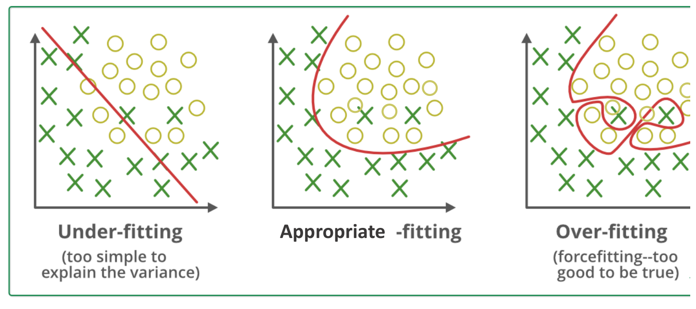
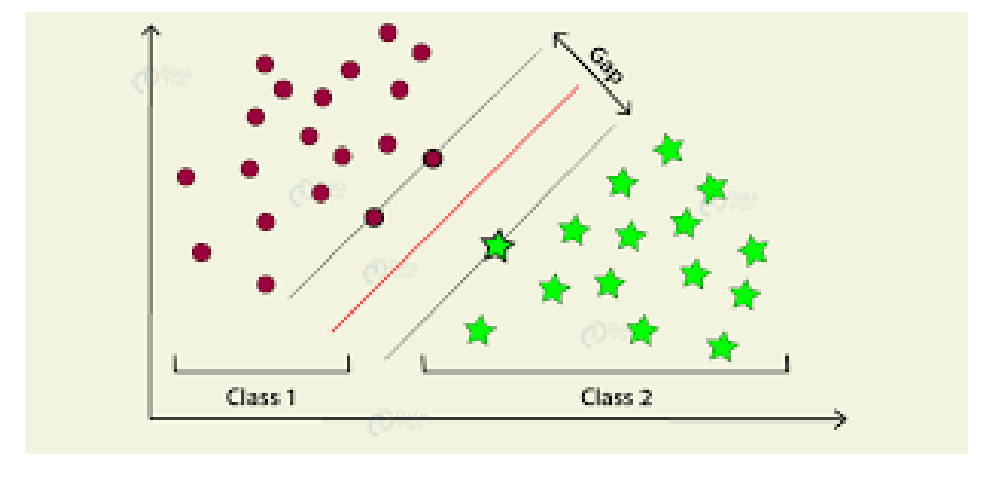
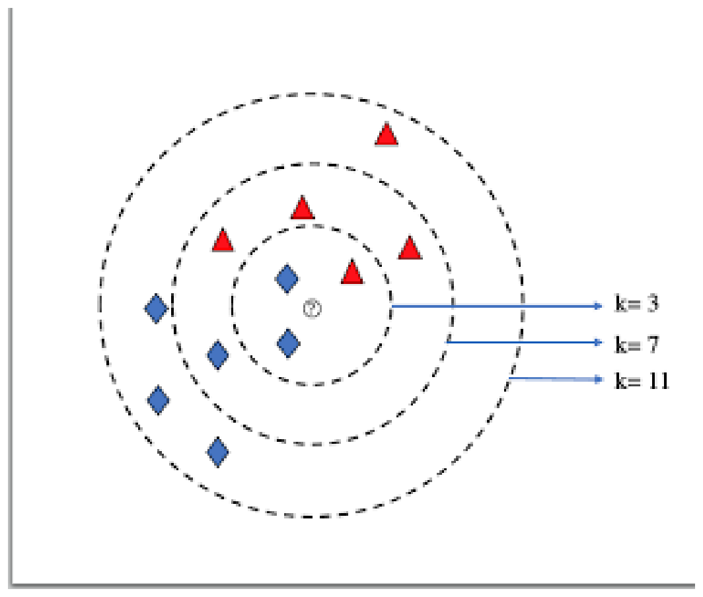
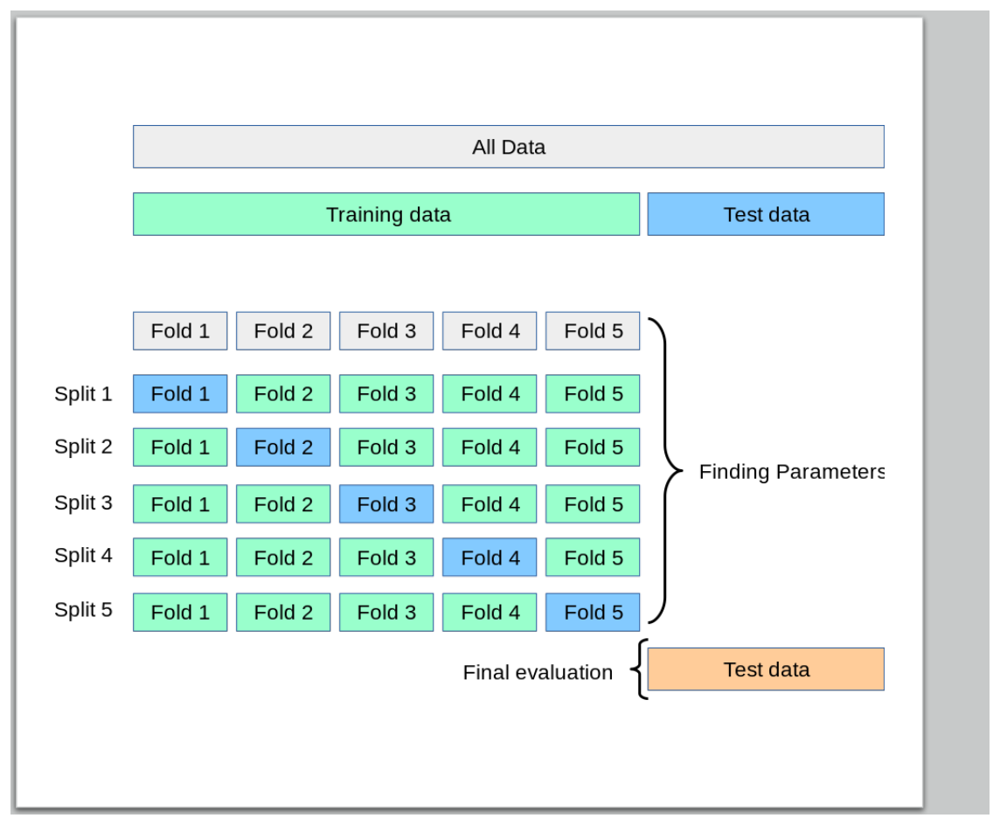
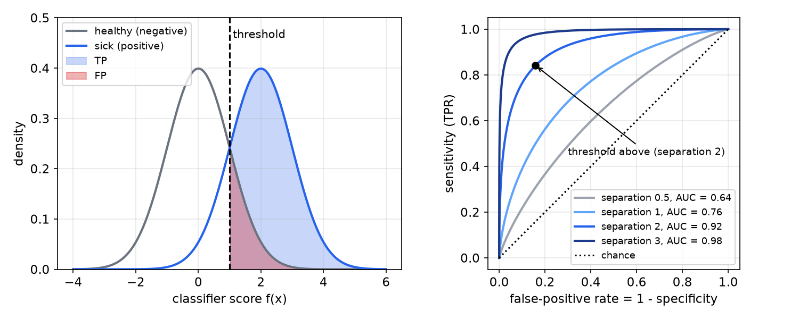

# Introduction to Machine Learning for Robotics

Many robot competences resist hand-written rules: recognizing a stop sign in a blurry image, telling a person from a coat rack in a laser scan, judging whether terrain is traversable. Machine learning builds such functions from examples instead. This chapter is a compact orientation: the vocabulary of learning problems, four classical methods (decision trees, support vector machines, k-nearest neighbours, neural networks) with the inductive bias each embodies, and how to evaluate a classifier honestly. The [Machine Learning](../../../cs/ml/README.md) section develops each topic in depth.

## Why and What

Machine learning is useful when (1) humans cannot explain their expertise (we recognize handwritten digits effortlessly but cannot write down the rules), (2) human expertise does not exist (a new sensor, a new environment), or (3) the patterns are hidden in datasets too large for people to inspect. A working definition: **machine learning is the study of computational algorithms that learn from data and make predictions**.

The field divides into three branches:

- **Supervised learning**: learn from labelled examples. *Classification* predicts a discrete label (fraud detection, medical diagnosis, object recognition); *regression* predicts a continuous value (weather, market or population forecasts, life expectancy).
- **Unsupervised learning**: find structure in unlabelled data. *Clustering* (customer segmentation, recommender systems) and *dimensionality reduction* (visualizing big data, extracting features).
- **Reinforcement learning**: learn to act from rewards, for real-time decisions and game play; see [Reinforcement Learning](../../../cs/ml/rl.md).

Most of the classical methods are older than they seem: decision trees, nearest neighbours and neural networks date from the 1950s–1960s; backpropagation, convolutional and recurrent networks from the 1980s; support vector machines and random forests from the 1990s; and the deep-learning era was enabled by large datasets (ImageNet), GPUs and libraries (scikit-learn, Torch/PyTorch, TensorFlow, XGBoost). Applications in robotics include feature detection in images, perception for autonomous driving, and learned models of dynamics and terrain.

**Advantages.** Learned models are often more accurate than hand-crafted rules; they capture knowledge humans are bad at expressing; they are good at finding underlying patterns; they solve problems too complex to code directly. **Disadvantages.** They need a lot of (often labelled) data; they make errors, since perfect accuracy is usually impossible; even with perfect accuracy on the data, bias *in* the data degrades what is learned; and many models are black boxes.

## Vocabulary

A dataset is a table. Each row is an **example** (an instance); each column a **feature** (attribute); in supervised learning one column is the **label** (target). For house-price prediction the features might be size, bedrooms, bathrooms and postcode, and the label the price.

**Supervised learning** is given \\(\\{(x\_i, y\_i)\\}\_{i=1}^N\\) with \\(y\_i = f(x\_i)\\) for an unknown function \\(f\\), and seeks a **hypothesis** \\(h: X\to Y\\) that approximates \\(f\\), not only on the training examples but on new inputs. **Unsupervised learning** is given only \\(\\{x\_i\\}\_{i=1}^N\\) and seeks hidden structure, such as clusters. In classification the output is discrete (binary or multi-class, often with class probabilities from a softmax); in regression it is continuous (univariate or multivariate).

### Induction and inductive bias

**Deduction** goes from a general rule to specific instances (theory → hypothesis → observation → confirmation). **Induction** goes from examples to a general rule (observation → pattern → tentative hypothesis → theory), and learning is induction. Infinitely many hypotheses agree with any finite training set, so every learner needs an **inductive bias**: the set of assumptions it uses to predict outputs for inputs it has not seen. Examples: Occam's razor (prefer the simplest consistent hypothesis); SVMs prefer the boundary with the largest margin; k-nearest neighbours assume that points close in feature space have similar labels.

**Inductive learning** constructs or adjusts \\(h\\) to agree with \\(f\\) on the training data, as in curve fitting. A straight line may be too simple; a smooth curve may capture the trend; a high-degree polynomial through every point fits the data perfectly and the truth badly.



*Figure: under-fitting (a linear boundary too simple to explain the variance), an appropriate fit, and over-fitting (a contorted boundary enclosing individual points: forced fitting, too good to be true).*

## Decision Trees

A **decision tree** classifies an example by a sequence of questions: each internal node tests one attribute, each branch is an answer, each leaf a class. Trees are simple and explainable.

**ID3** builds the tree top-down. At each node it chooses the attribute that best separates the classes, measured by **information gain**: the reduction in entropy of the labels. For a set \\(S\\) with fraction \\(p\\) of positive examples, the entropy is
\\[
H(S) = -p\log\_2 p - (1 - p)\log\_2(1 - p),
\\]
zero for a pure set and one bit for a 50/50 set. Splitting on attribute \\(A\\) into subsets \\(S\_v\\) gives
\\[
\operatorname{Gain}(S, A) = H(S) - \sum\_v\frac{\lvert S\_v\rvert}{\lvert S\rvert}H(S\_v).
\\]
ID3 puts the highest-gain attribute at the root, partitions the data, and recurses on each branch with the remaining attributes, stopping when a node is pure or no attributes remain (the leaf then predicts the majority class).

**Example 1 (Infection from symptoms).** Fourteen patients:

| ID | Fever | Cough | Breathing issues | Infected |
|---|---|---|---|---|
| 1 | no | no | no | no |
| 2 | yes | yes | yes | yes |
| 3 | yes | yes | no | no |
| 4 | yes | no | yes | yes |
| 5 | yes | yes | yes | yes |
| 6 | no | yes | no | no |
| 7 | yes | no | yes | yes |
| 8 | yes | no | yes | yes |
| 9 | no | yes | yes | yes |
| 10 | yes | yes | no | yes |
| 11 | no | yes | no | no |
| 12 | no | yes | yes | yes |
| 13 | no | yes | yes | no |
| 14 | yes | yes | no | no |

Eight of 14 are infected, so \\(H(S) = -\tfrac8{14}\log\_2\tfrac8{14} - \tfrac6{14}\log\_2\tfrac6{14} = 0.985\\) bits.

*Breathing issues.* Yes: 8 patients, 7 infected, \\(H = 0.544\\). No: 6 patients, 1 infected, \\(H = 0.650\\). Gain \\(= 0.985 - \tfrac8{14}(0.544) - \tfrac6{14}(0.650) = 0.985 - 0.589 = 0.396\\).

*Fever.* Yes: 8 patients, 6 infected; no: 6 patients, 2 infected. Gain \\(= 0.128\\).

*Cough.* Yes: 10 patients, 5 infected; no: 4 patients, 3 infected. Gain \\(= 0.039\\).

**Breathing issues** has by far the largest gain and becomes the root. In the "yes" branch, Fever gives the larger gain (0.199): all 5 with fever are infected, and 2 of the 3 without fever. In the "no" branch, Fever again gives the larger gain (0.191): none of the 3 without fever is infected, and 1 of the 3 with fever. Note that in each branch both children have the same majority class, so these splits do not change any prediction: the tree effectively says *infected if and only if breathing issues*, which classifies 12 of 14 patients correctly.

The two errors, patients 10 and 13, cannot be fixed by any tree on these attributes: patient 10 has exactly the same symptoms as patients 3 and 14 but a different label, and patient 13 the same as 9 and 12. Such inconsistent examples are label noise (or evidence of a missing attribute), and a tree that tried to fit them would over-fit. (A tree that predicts "infected" for every cough without breathing issues, or "not infected" for every patient with breathing issues but no fever, contradicts most of the corresponding rows; computing the gains is the reliable way to build the tree.)

**Pros**: explainable; interpretable features; little data preprocessing (no scaling needed); few hyperparameters. **Cons**: mainly used for classification; trees tend to over-fit, which is controlled by pruning or by averaging many trees (random forests, boosting). **Inductive bias**: shorter trees are preferred, and attributes with high information gain are placed near the root.

## Support Vector Machines

For two linearly separable classes in the plane, infinitely many lines achieve zero training error. Which one generalizes best? The **support vector machine** (SVM) chooses the hyperplane that **maximizes the margin**, the distance to the nearest training points of either class. Those nearest points are the **support vectors**; the solution depends on them alone.



*Figure: an SVM separating two classes. The red hyperplane lies midway in the widest gap between the classes; the parallel lines through the closest points (the support vectors) bound the margin.*

With labels \\(y\_i\in\\{-1, +1\\}\\) and hyperplane \\(w^Tx + b = 0\\), scale \\(w, b\\) so that the closest points satisfy \\(y\_i(w^Tx\_i + b) = 1\\). The margin is then \\(2/\lVert w\rVert\\), and maximizing it is the convex quadratic program
\\[
\min\_{w, b}\ \tfrac12\lVert w\rVert^2 \quad\text{subject to}\quad y\_i(w^Tx\_i + b)\ge1, \quad i = 1, \dots, N .
\\]
The **soft-margin** SVM adds slack variables, penalized by a constant \\(C\\), to tolerate overlapping classes.

**Feature maps and the kernel trick.** Data that are not linearly separable may become separable in a higher-dimensional feature space. One-dimensional points with one class in the middle (say \\(\lvert x\rvert < 2\\)) and the other on both sides cannot be split by a single threshold, but mapping \\(\phi(x) = (x, x^2)\\) lifts them onto a parabola, where the horizontal line \\(x^2 = 4\\) separates them. The SVM's dual problem and its predictions depend on the data only through inner products \\(x\_i^Tx\_j\\), so they can be replaced by a **kernel** \\(k(x, x') = \phi(x)^T\phi(x')\\) computed without ever forming \\(\phi\\), for example the polynomial kernel \\((x^Tx' + 1)^p\\) or the Gaussian (RBF) kernel \\(\exp(-\gamma\lVert x - x'\rVert^2)\\), whose feature space is infinite-dimensional. This is the **kernel trick**.

**Pros**: handles complex boundaries via kernels; less prone to over-fitting thanks to margin maximization. **Cons**: training scales poorly to very large datasets; choosing the kernel and its parameters is hard; not interpretable. **Inductive bias**: prefer the hypothesis that maximizes the margin.

## k-Nearest Neighbours

**k-nearest neighbours** (kNN) is distance-based and lazy. *Learning* stores all training examples. *Prediction* for a new \\(x\_{\text{new}}\\) finds the \\(k\\) most similar training examples (usually by Euclidean distance) and returns the majority vote of their labels (classification) or their average (regression). With \\(k = 1\\) it returns the label of the single nearest example.



*Figure: a query point (?) among two classes. The predicted class depends on k: the circles enclosing the 3, 7 and 11 nearest neighbours contain different majorities.*

The choice of \\(k\\) depends on the data: small \\(k\\) follows noise (high variance), large \\(k\\) blurs the boundary (high bias). kNN is also sensitive to noisy and borderline examples near the class boundary, and to the choice of features.

**Pitfall: feature scales.** Distances are dominated by the feature with the largest numeric range. With ages 25–40 and incomes 50,000–110,000, two people differing by 5 years and 20,000 in income are 20,000 apart, essentially only by income. **Normalize** the features first, e.g. to zero mean and unit variance (\\(x\leftarrow(x - \mu)/\sigma\\)) or to \\([0, 1]\\).

**Pros**: no training phase; new data are easily added; simple. **Cons**: slow and memory-hungry with large datasets (every prediction searches the training set); sensitive to noise and irrelevant features. **Inductive bias**: similar points have similar labels.

## Neural Networks

A (feed-forward) **neural network** stacks layers of units. Each unit computes a weighted sum of its inputs plus a bias and passes it through a nonlinear **activation** (ReLU, sigmoid, tanh); the weights are learned by minimizing a cost function (cross-entropy for classification, squared error for regression) with gradient descent, the gradients computed by backpropagation. A classifier's final softmax layer outputs class probabilities, e.g. cat 0.97, dog 0.01, other 0.02 for an image.

**Pros**: robust to noise in the training data; can represent linearly inseparable functions (a single hidden layer with enough units can approximate any continuous function on a compact set); knowledge is distributed over many weights. **Cons**: black box; many hyperparameters (architecture, learning rate, regularization); needs large datasets. **Inductive bias**: roughly, smooth interpolation between examples, toward the minima that gradient descent can reach. See [Neural Networks](../../../cs/ml/neural-networks.md) and [Deep Learning](../../../cs/ml/deep-learning.md).

## Evaluating a Classifier

### Data splits and cross-validation

Split the data into a **training set** (fit the model), a **validation set** (tune hyperparameters and choose between models) and a **test set** (measure the final ability to generalize). **Do not evaluate the model on the training data**: a model that memorized it would look perfect.

**k-fold cross-validation** uses the data more efficiently. Hold out the test data. Split the remaining training data into \\(k\\) folds (say 5). For split \\(j\\), train on the other \\(k - 1\\) folds and validate on fold \\(j\\); average the \\(k\\) validation scores to choose parameters. Finally, retrain and evaluate once on the held-out test data. Every example is used for both training and validation, which reduces the variance of the estimate and improves generalizability.



*Figure: five-fold cross-validation. The training data are split into five folds; each split uses one fold (blue) for validation and the other four for training, to find parameters; the separate test data are used only for the final evaluation.*

### Metrics

**Accuracy** is the fraction of examples classified correctly. It is misleading for imbalanced classes. With 10,000 healthy and 10 sick patients, a model that always predicts "no disease" has accuracy \\(10000/10010 = 99.9\\%\\) and is useless.

Count true and false positives and negatives (TP, FP, FN, TN), the four cells of the binary **confusion matrix** (sick predicted sick = TP; healthy predicted sick = FP; sick predicted healthy = FN; healthy predicted healthy = TN). Then
\\[
\text{sensitivity (recall)} = \frac{TP}{TP + FN}, \qquad \text{specificity} = \frac{TN}{TN + FP}, \qquad PPV\ (\text{precision}) = \frac{TP}{TP + FP}, \qquad NPV = \frac{TN}{TN + FN}.
\\]
For the always-healthy model, sensitivity \\(= 0/(0 + 10) = 0\\) and specificity \\(= 10000/(10000 + 0) = 1\\): the metrics expose what accuracy hid. The PPV is the quantity a patient cares about after a positive result, and it depends on prevalence: it is exactly the posterior \\(P(\text{disease}\mid\text{positive})\\) computed with Bayes' rule in [Bayesian State Estimation](bayes-filters.md), where a 90 %-sensitive test had a PPV of only 31 %. For multi-class problems the confusion matrix is \\(C\times C\\) (true label versus predicted label); for ten handwritten digits its diagonal holds the correct counts for each digit, and the off-diagonal entries show which digits are confused with which.

**ROC curves.** Most classifiers output a score \\(f(x)\\) and predict "positive" if \\(f(x)\\) exceeds a threshold. Raising the threshold trades sensitivity for specificity. The **receiver operating characteristic** (ROC) curve plots sensitivity against the false-positive rate \\(1 - \text{specificity}\\) as the threshold varies; the area under it (AUC) summarizes how well the scores separate the classes (0.5 is chance, 1 is perfect). The threshold is then tuned for the application's costs of false positives and false negatives.



*Figure: left, score distributions of the negative and positive classes with a threshold; the shaded areas are the true positives and false positives. Right, the ROC curves for increasing separation between the two distributions; the dot is the threshold on the left (sensitivity = specificity = 0.84). Better separation pushes the curve toward the top-left corner.*

### The bias–variance trade-off

The expected test error of a model decomposes into three parts. **Bias** is the error from erroneous assumptions: a model too simple to capture the pattern under-fits and has high *training* error. **Variance** is the sensitivity to small fluctuations in the training data: a model too flexible over-fits, with low training error but high *test* error. **Irreducible error** is the noise in the data itself. As model complexity grows, training error decreases steadily while test error first falls, then rises; the best model sits at the minimum of the test (or validation) error. Regularization, more data and ensembling move that minimum; see [Regularization](../../../cs/ml/regularization.md).

## Practical Advice

- **Garbage in, garbage out.** Bad data with a good model gives bad results, and so does good data with a bad model. Blurry, low-resolution images of a stop sign will not train a reliable sign detector.
- **Use domain knowledge** to choose features and models; let the dataset's size and type guide the choice (scikit-learn's "choosing the right estimator" flowchart walks from sample count and whether labels exist to linear SVC, kNN, ensembles, regressors, clustering or dimensionality reduction).
- **Prefer simple models** first (Occam's razor), and beware imbalanced datasets.

```python
from sklearn.model_selection import train_test_split, cross_val_score
from sklearn.preprocessing import StandardScaler
from sklearn.pipeline import make_pipeline
from sklearn.neighbors import KNeighborsClassifier
from sklearn.svm import SVC
from sklearn.tree import DecisionTreeClassifier

X_tr, X_te, y_tr, y_te = train_test_split(X, y, test_size=0.2, stratify=y)
models = {'kNN': make_pipeline(StandardScaler(), KNeighborsClassifier(5)),   # scale first
          'SVM': make_pipeline(StandardScaler(), SVC(kernel='rbf', C=1.0)),
          'tree': DecisionTreeClassifier(max_depth=4)}                       # pruned by depth
for name, m in models.items():
    print(name, cross_val_score(m, X_tr, y_tr, cv=5).mean())                # 5-fold CV
best = models['SVM'].fit(X_tr, y_tr); print('test accuracy', best.score(X_te, y_te))
```

## Summary

- Supervised (classification, regression), unsupervised (clustering, dimensionality reduction) and reinforcement learning. Supervised learning seeks \\(h\approx f\\) from examples \\((x\_i, y\_i)\\).
- Every learner has an inductive bias; fitting too simple a model under-fits, too complex a model over-fits.
- Decision trees (ID3): split on maximum information gain \\(H(S) - \sum\_v\frac{\lvert S\_v\rvert}{\lvert S\rvert}H(S\_v)\\); in the symptoms example the root is Breathing issues (gain 0.396).
- SVM: maximize the margin \\(2/\lVert w\rVert\\); kernels give nonlinear boundaries. kNN: vote of the \\(k\\) nearest examples; normalize features. Neural networks: layered nonlinear functions trained by gradient descent.
- Evaluate on held-out data; use k-fold cross-validation for model selection. Accuracy misleads with imbalance; use sensitivity \\(TP/(TP + FN)\\), specificity \\(TN/(TN + FP)\\), precision, the confusion matrix and ROC curves. Test error = bias² + variance + noise.

## See Also

- [Machine Learning](../../../cs/ml/README.md): [Supervised Learning](../../../cs/ml/supervised.md), [Unsupervised Learning](../../../cs/ml/unsupervised.md), [Evaluation](../../../cs/ml/evaluation.md), [Features](../../../cs/ml/features.md), [Regularization](../../../cs/ml/regularization.md), [Neural Networks](../../../cs/ml/neural-networks.md)
- [Bayesian State Estimation](bayes-filters.md), for Bayes' rule and the diagnostic-test example
- [Image Processing for Robots](robot-vision.md) and [Computer Vision](../../../cs/vision/README.md)
- [Hypothesis Testing](../../../math/probability/hypothesis-testing.md)
