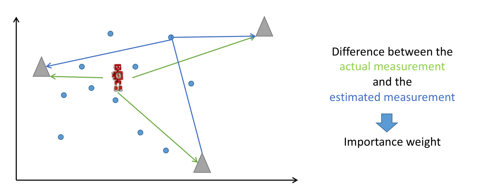
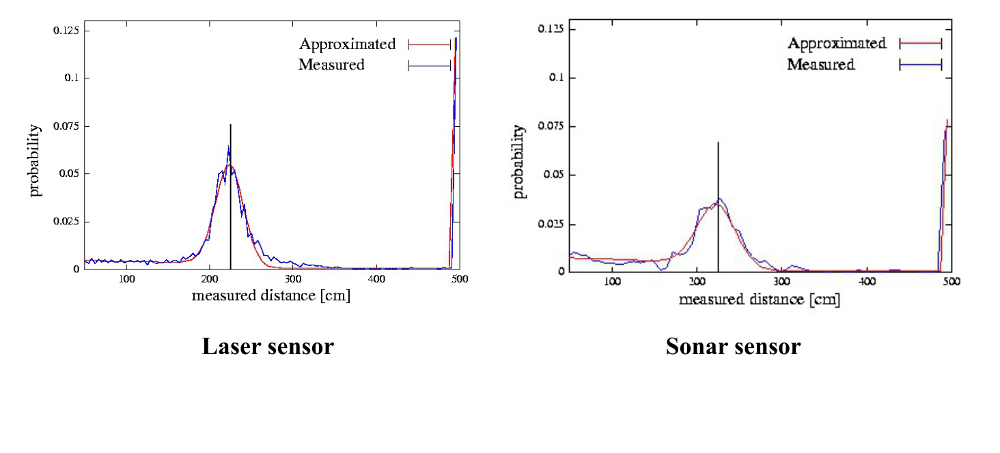
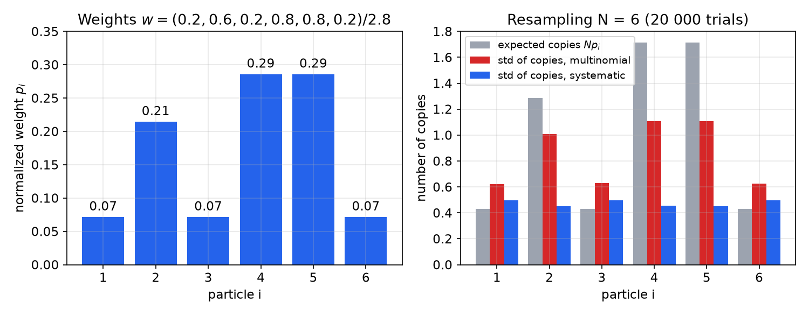
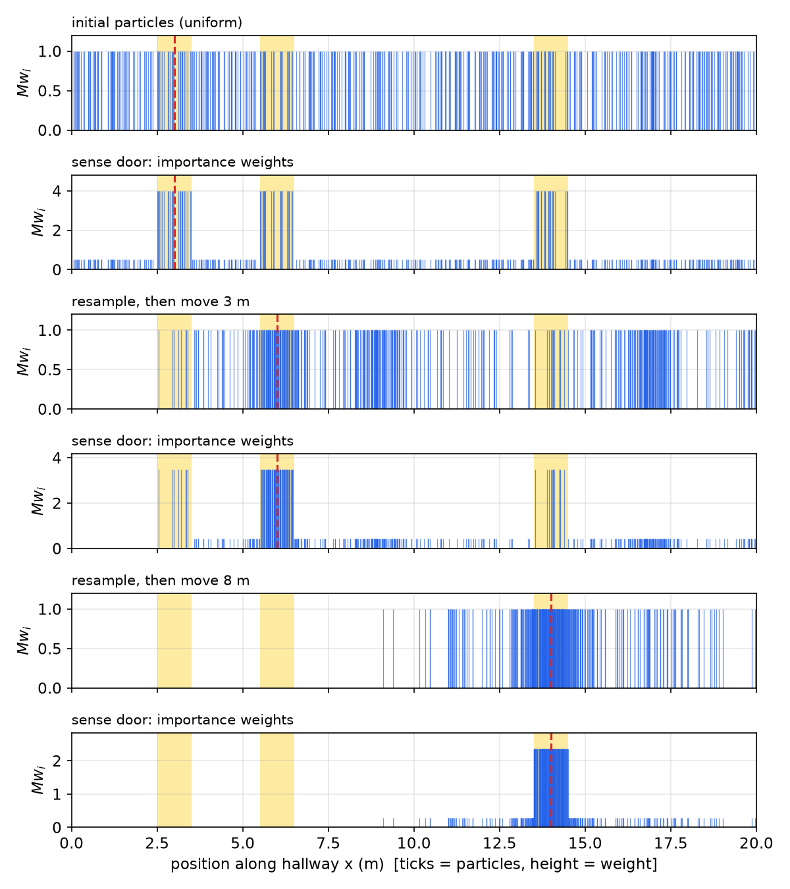
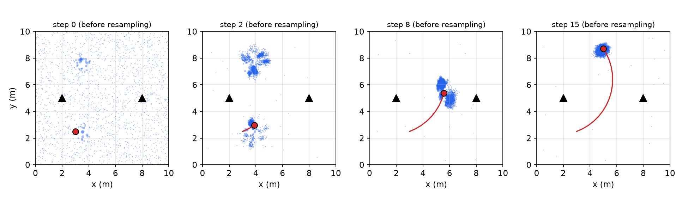

# Particle Filters and Monte Carlo Localization

The Bayes filter of the [previous chapter](bayes-filters.md) is exact but, for a continuous state such as a robot pose \\((x, y, \theta)\\), its prediction integral rarely has a closed form, and a fine grid over three dimensions is expensive. The **particle filter** represents the belief by a set of random samples and performs the prediction and correction by simulation and weighting. It handles nonlinear motion and sensor models, non-Gaussian and multimodal beliefs, and both global localization and tracking. Applied to robot localization it is called **Monte Carlo localization** (MCL). This chapter develops the method from importance sampling, works the resampling example, implements MCL in one and two dimensions, and collects the practical lessons.

## From the Bayes Filter to Samples

Recall the Bayes filter
\\[
\mathrm{bel}(x\_t) = \eta\\,p(z\_t\mid x\_t)\int p(x\_t\mid u\_t, x\_{t-1})\\,\mathrm{bel}(x\_{t-1})\\,dx\_{t-1}.
\\]
For continuous spaces there is often no analytical formula for this update. The Kalman filter obtains one by assuming everything is linear and Gaussian. The particle filter instead approximates the belief by samples. It:

- represents the belief by random samples, and so works for non-Gaussian, multimodal beliefs and nonlinear processes;
- uses the actual (nonlinear) motion and measurement models, without linearization;
- allocates computation where it is needed: samples concentrate in likely regions, and the number of samples can adapt.

The idea has been rediscovered under many names: Monte Carlo filter, survival of the fittest, Condensation (in computer vision), bootstrap filter, sequential importance resampling (SIR). They are different flavours of the same algorithm.

### Two localization problems

- **Position tracking**: the initial pose is known (approximately), and the task is to follow it as the robot moves. The belief stays unimodal and local.
- **Global localization**: the initial pose is unknown, and the robot must find where it is from scratch. A harder relative is the **kidnapped robot problem**: a well-localized robot is carried to an unknown place without being told, and must notice and recover.

MCL solves both. A Kalman filter handles only tracking, because a single Gaussian cannot represent "I am at one of these three doors".

## Particle Representation

A belief \\(p(x)\\) is represented by \\(M\\) weighted samples, the **particles**,
\\[
\mathcal X = \\{\langle x^{[i]}, w^{[i]}\rangle\\}\_{i=1}^{M}, \qquad x^{[i]} = (p\_x, p\_y, \theta)^{[i]}, \qquad \sum\_{i=1}^M w^{[i]} = 1 .
\\]
Each particle is one hypothesis of the pose, a guess about where the robot might be, and its weight says how plausible that guess is. The approximation means that for any function \\(g\\),
\\[
E\_{p}[g(x)] = \int g(x)\\,p(x)\\,dx \approx \sum\_{i=1}^M w^{[i]}g(x^{[i]}),
\\]
and the probability of a region is approximately the total weight of the particles in it. With equal weights, the density of particles in a region is proportional to the probability of that region. The approximation improves as \\(M\\) grows (the error of a Monte Carlo average decreases as \\(1/\sqrt M\\)).

## Importance Sampling

We usually cannot sample directly from the distribution we want, the **target** \\(f\\), but we can sample from some other **proposal** distribution \\(g\\) and correct for the difference by weighting. If \\(g(x) > 0\\) wherever \\(f(x) > 0\\),
\\[
E\_f[h(x)] = \int h(x)f(x)\\,dx = \int h(x)\frac{f(x)}{g(x)}g(x)\\,dx = E\_g\\!\left[\frac{f(x)}{g(x)}h(x)\right] \approx \frac1M\sum\_{i=1}^M \frac{f(x^{[i]})}{g(x^{[i]})}h(x^{[i]}), \quad x^{[i]}\sim g .
\\]
The ratio \\(w = f/g\\) is the **importance weight**: samples drawn where the proposal over-represents the target are down-weighted, and vice versa. If \\(f\\) is known only up to a constant, the weights are normalized to sum to one (self-normalized importance sampling).

### Importance sampling in the Bayes filter

Apply this to one filter step. Suppose the particles \\(x\_{t-1}^{[i]}\\) are distributed according to \\(\mathrm{bel}(x\_{t-1})\\). Propagate each through the motion model by **sampling**, \\(x\_t^{[i]}\sim p(x\_t\mid u\_t, x\_{t-1}^{[i]})\\). The new particles are then distributed according to the predicted belief
\\[
g(x\_t) = \overline{\mathrm{bel}}(x\_t) = \int p(x\_t\mid u\_t, x\_{t-1})\\,\mathrm{bel}(x\_{t-1})\\,dx\_{t-1},
\\]
because sampling a previous state and then a transition is exactly sampling from this mixture. This is the proposal. The target is the corrected belief \\(f(x\_t) = \eta\\,p(z\_t\mid x\_t)\\,\overline{\mathrm{bel}}(x\_t)\\). The importance weight is their ratio:
\\[
w\_t^{[i]} = \frac{f(x\_t^{[i]})}{g(x\_t^{[i]})} = \eta\\,p(z\_t\mid x\_t^{[i]}).
\\]
So the prediction integral is performed by **simulation**, and the correction by **weighting each particle by the measurement likelihood**. No integral is ever evaluated. This is the whole particle filter, apart from resampling.

## The Particle Filter Algorithm

### Motion update

When an odometry reading \\(u\_t\\) arrives, each particle is moved by sampling from \\(p(x\_t\mid x\_{t-1}, u\_t)\\): apply the measured motion plus a random perturbation drawn from the motion-noise model. For a unicycle with measured speed \\(v\\) and turn rate \\(\omega\\) over \\(\Delta t\\):
\\[
\hat v = v + \epsilon\_v, \quad \hat\omega = \omega + \epsilon\_\omega, \qquad \theta^{[i]}\leftarrow\theta^{[i]} + \hat\omega\Delta t, \quad x^{[i]}\leftarrow x^{[i]} + \hat v\Delta t\cos\theta^{[i]}, \quad y^{[i]}\leftarrow y^{[i]} + \hat v\Delta t\sin\theta^{[i]},
\\]
with fresh \\(\epsilon\_v, \epsilon\_\omega\\) drawn for every particle. Because each particle receives a different perturbation, the cloud spreads. Driven around a long path, the sample cloud starts tight and grows steadily, with the banana-shaped spread across the direction of travel derived in [Internal Sensors and Odometry](sensors.md): uncertainty accumulates with distance. At this stage all particles usually carry equal weight \\(w = 1/M\\).

### Sensor update

When a measurement \\(z\\) arrives, each particle is re-weighted so that its weight represents the likelihood that the robot's pose matches the particle's, given the reading:
\\[
w^{[i]}\leftarrow\eta\\,p(z\mid x^{[i]}),
\\]
with \\(\eta\\) the normalization making the weights sum to one. The particle predicts what the robot *should* measure if it were at \\(x^{[i]}\\); the weight measures how well that prediction agrees with what the robot actually measured.



*Figure: computing an importance weight. For each particle (blue dots) the estimated measurements to the landmarks (blue lines) are compared with the robot's actual measurements (green lines). The difference determines the particle's importance weight: particles whose predicted view matches the actual view get large weights.*

**Example 1 (Landmark-range weight).** With known landmarks at positions \\(m\_k\\) and a range sensor with Gaussian noise of standard deviation \\(\sigma\\), the robot measures ranges \\(d\_k\\). For a particle at \\(x^{[i]}\\), the predicted range is \\(\hat d\_k = \lVert m\_k - x^{[i]}\rVert\\), and, assuming independent noise on each range,
\\[
w^{[i]} \propto \prod\_k \mathcal N(d\_k;\\,\hat d\_k, \sigma^2) \propto \exp\\!\left(-\sum\_k\frac{(d\_k - \hat d\_k)^2}{2\sigma^2}\right).
\\]
In pseudocode:

```
prob = 1.0
for each landmark k:
    d_hat = Euclidean distance from this particle to landmark k
    prob *= Gaussian(d_k; mean = d_hat, std = sigma)   # likelihood of the actual reading
return prob
```

In practice one sums log-likelihoods and subtracts the maximum before exponentiating, to avoid numerical underflow when many readings are multiplied.

**Range-sensor models.** For a laser or sonar beam, the likelihood of a measured distance given the expected distance (from ray-casting the map at the particle's pose) is not a single Gaussian. Measured histograms show a peak around the true distance, narrow for a laser and wider for a sonar; a spike at the maximum range, where the beam returned nothing; and a small uniform floor of random readings. The standard **beam model** is a mixture of these components (plus an exponential component for unexpected short readings caused by people and other unmapped objects). The uniform floor matters: it keeps a single wild reading from driving the weight of the correct particle to zero.



*Figure: measured and approximated range likelihoods for a laser and a sonar sensor, with the expected distance near 230 cm. Both show a peak at the expected range (narrow for laser, broad for sonar), a spike at the 500 cm maximum range, and a small floor of random readings.*

### Resampling

After the motion and sensor updates the particles have new positions and unequal weights. Many particles may carry negligible weight: they describe places the robot almost certainly is not, yet they cost as much computation as the good ones. **Resampling** fixes this: draw \\(M\\) new particles from the current set, each chosen with probability equal to its normalized weight, **with replacement**, and give all of them weight \\(1/M\\). Particles in likely regions are duplicated; unlikely ones die out. Resampling is "survival of the fittest" for hypotheses.

Two refinements are standard:

- Add a little random noise (**jitter**) to each resampled particle, so that duplicates of the same particle do not stay identical and the cloud keeps exploring.
- Replace a few particles with **uniformly distributed random samples**. This is very helpful if the robot completely loses track of its location (or is kidnapped): without them, no particle may be near the true pose, and resampling can never create one.

**Example 2 (Resampling six particles).** Six particles have importance weights
\\[
w = (0.2,\ 0.6,\ 0.2,\ 0.8,\ 0.8,\ 0.2), \qquad \sum w = 2.8, \qquad \eta = \frac1{2.8} .
\\]
The normalized probabilities are \\(p = w/2.8 = (0.07, 0.21, 0.07, 0.29, 0.29, 0.07)\\) (exactly \\(\tfrac1{14}, \tfrac3{14}, \tfrac1{14}, \tfrac4{14}, \tfrac4{14}, \tfrac1{14}\\)). We draw six new particles with replacement, picture a bag holding balls whose sizes are the weights.

*Can a particle never be chosen?* Yes. *Can a particle be chosen more than once?* Yes. The expected number of copies of particle \\(i\\) is \\(Mp\_i\\): 1.71 for each heavy particle, 1.29 for particle 2, and 0.43 for each light one.

*Probability that a heavy particle (\\(p = 0.29\\)) is never chosen in six independent draws*:
\\[
(1 - \tfrac4{14})^6 = (0.714)^6 = 0.13 .
\\]
*Probability that a light particle (\\(p = 0.07\\)) is never chosen*:
\\[
(1 - \tfrac1{14})^6 = (0.929)^6 = 0.64 .
\\]
(Rounding \\(p\\) to 0.07 first gives \\(0.93^6 = 0.65\\).) Even the best hypothesis has a 13 % chance of being lost by independent (multinomial) resampling, a randomness that adds noise to the filter.

**Systematic (low-variance) resampling.** Instead of \\(M\\) independent random numbers, draw one \\(r\sim U[0, 1/M)\\) and select the particles at the cumulative-weight positions \\(r, r + 1/M, \dots, r + (M-1)/M\\). Each particle then receives either \\(\lfloor Mp\_i\rfloor\\) or \\(\lceil Mp\_i\rceil\\) copies. In Example 2 a heavy particle (\\(Mp\_i = 1.71\\)) is always kept, receiving one or two copies, and a light one (\\(Mp\_i = 0.43\\)) survives with probability exactly 0.43. Systematic resampling runs in \\(O(M)\\), and if all weights are equal it returns the set unchanged, so it does not destroy information when the measurement was uninformative.



*Figure: left, the normalized weights of Example 2. Right, over 20 000 simulated resamplings, the expected number of copies \\(Mp\_i\\) (gray) and the standard deviation of the actual number of copies for multinomial (red) and systematic (blue) resampling. Systematic resampling gives each particle almost exactly its expected share.*

```python
import numpy as np

def systematic_resample(weights, rng=np.random.default_rng()):
    """Return indices of the particles to keep (low-variance resampling)."""
    M = len(weights)
    positions = (rng.random() + np.arange(M)) / M
    return np.searchsorted(np.cumsum(weights), positions)
```

### The complete algorithm

```
initialize M particles (uniform over the map for global localization), weights 1/M
repeat:
    for each particle: sample the motion update  x ~ p(x_t | u_t, x_{t-1})
    for each particle: weight w = p(z_t | x)      (sensor update)
    normalize the weights
    estimate the current pose from the weighted particles
    resample (with jitter and a few random particles)
```

Each iteration costs \\(O(M)\\) times the cost of one motion sample and one likelihood evaluation, which for a laser means ray-casting every beam for every particle; this is why the number of particles matters.

## Monte Carlo Localization at Work

A laser-equipped robot in a large building with long corridors and many rooms illustrates the behaviour. Initially the particles are spread uniformly over the free space of the map (global uncertainty). After the first scan, particles whose predicted scan matches the actual one receive high weight; after resampling the particles concentrate in several clusters, every place in the building where the scan looks plausible (the robot sees a corridor, and the building has several corridors). The robot moves; every cluster moves with it, spreading. The next scan is inconsistent with most clusters, and after resampling fewer clusters remain. After a few cycles a single tight cluster tracks the robot. The filter has passed from global localization to position tracking without changing anything in the algorithm.

### One-dimensional illustration

The corridor with three doors from the [Bayes filter chapter](bayes-filters.md) shows the same process with particles, drawn as vertical ticks whose height is the weight.

```python
import numpy as np
rng = np.random.default_rng(7)

L, doors, dw, M = 20.0, np.array([3.0, 6.0, 14.0]), 0.5, 500
def p_door(x):
    return np.where(np.min(abs(x[:, None] - doors), axis=1) < dw, 0.8, 0.1)

x = rng.uniform(0, L, M)                               # global uncertainty
for u, sig in [(0.0, 0.0), (3.0, 0.3), (8.0, 0.5)]:    # move, then sense a door
    x = x + u + rng.normal(0, sig, M) if u else x      # motion update (sampling)
    w = p_door(x); w /= w.sum()                        # sensor update (weighting)
    print('estimate %.2f' % np.sum(w * x))
    idx = systematic_resample(w, rng)                  # resampling
    x = x[idx] + rng.normal(0, 0.05, M)                # jitter
```



*Figure: 1-D Monte Carlo localization (500 particles; tick height = M × weight; yellow = doors; red dashed = true position). Initially uniform; sensing a door weights the particles at all three doors; after resampling and a 3 m move the particles form clusters shifted from each door; sensing a door again favours only the cluster that is now at a door; after an 8 m move and a third door reading a single cluster remains.*

Compare this figure with the histogram-filter figure of the previous chapter: the particle densities track the grid probabilities, but the particle filter spends its samples only where probability mass is, instead of on all 200 cells.

### Two-dimensional implementation

The second example localizes a robot in a 10 m × 10 m field with two landmarks at \\((2, 5)\\) and \\((8, 5)\\), measuring the range to each with noise \\(\sigma = 0.3\\) m. Two ranges determine the position only up to a reflection about the line through the landmarks, so the problem is genuinely ambiguous at first; and the heading is not measured at all, only inferred from how the ranges change as the robot moves. The robot drives an arc at \\(v = 0.5\\) m/s, \\(\omega = 0.12\\) rad/s, with odometry noise.

```python
import numpy as np
rng = np.random.default_rng(7)

lm = np.array([[2.0, 5.0], [8.0, 5.0]]); W, sr, M, dt = 10.0, 0.3, 2000, 1.0

def ranges(P):                       # predicted range to every landmark, shape (M, K)
    return np.hypot(P[:, None, 0] - lm[None, :, 0], P[:, None, 1] - lm[None, :, 1])

def motion(P, v, om, sv=0.1, so=0.05):
    n = len(P)
    vv, oo = v + rng.normal(0, sv, n), om + rng.normal(0, so, n)
    Q = P.copy(); Q[:, 2] += oo * dt
    Q[:, 0] += vv * dt * np.cos(Q[:, 2]); Q[:, 1] += vv * dt * np.sin(Q[:, 2])
    return Q

P = np.column_stack([rng.uniform(0, W, M), rng.uniform(0, W, M), rng.uniform(-np.pi, np.pi, M)])
X = np.array([[3.0, 2.5, 0.3]])                                  # true pose
for k in range(16):
    if k > 0:
        X = motion(X, 0.5, 0.12, 0, 0); P = motion(P, 0.5, 0.12)  # truth and particles move
    z = ranges(X)[0] + rng.normal(0, sr, len(lm))                 # actual measurement
    logw = -0.5 * np.sum((ranges(P) - z) ** 2, axis=1) / sr**2    # Gaussian likelihood
    w = np.exp(logw - logw.max()); w /= w.sum()
    est = w @ P[:, :2]                                            # weighted-mean estimate
    P = P[systematic_resample(w, rng)] + rng.normal(0, [0.05, 0.05, 0.02], (M, 3))
    P[:20] = np.column_stack([rng.uniform(0, W, 20), rng.uniform(0, W, 20),
                              rng.uniform(-np.pi, np.pi, 20)])     # random injection
```



*Figure: 2-D MCL with range-only measurements to two landmarks (black triangles); particles are blue (size ∝ weight), the true path and pose red. Step 0: uniform particles, with high weight only where the two range circles intersect, at the true position and at its mirror image. Step 2: two clusters survive, mirror images about the landmark line. Step 8: the mirror cluster has died, because only the true hypothesis turns the way the odometry says; the remaining cloud is elongated while the robot crosses the landmark baseline, where range measurements are least informative about y. Step 15: a tight cluster tracks the robot.*

The estimate error falls from over 3 m (the weighted mean of two mirror clusters lies between them, a reminder that the mean of a multimodal belief can be a pose no particle supports) to about 0.1–0.2 m once the ambiguity is resolved.

### Landmark detections as arcs

The mirror ambiguity is a special case of a general picture. On a robot-soccer field with coloured beacon landmarks, a single range-and-bearing detection of one landmark constrains the robot to a circular arc band around that landmark; each further detection contributes another arc, and the posterior given all detections is concentrated where the arcs intersect. Particles can be drawn directly from a single detection's arc (by adding noise to the detection parameters) and weighted by the others, which is a smarter proposal than the motion model when the robot is lost. After importance weighting and resampling, the particles concentrate at the intersection.

## Estimating the Pose from Particles

The filter maintains a distribution; a controller usually needs one pose. Common choices:

- the particle with **maximum weight** (simple, but subject to discretization error: the best particle is only as close as the nearest sample);
- the **weighted mean** of all particles, \\(\hat x = \sum\_i w^{[i]}x^{[i]}\\) (good for a unimodal cloud, misleading for a multimodal one; headings must be averaged as unit vectors, \\(\hat\theta = \operatorname{atan2}(\sum w\sin\theta, \sum w\cos\theta)\\));
- the **robust mean**: the weighted mean of the particles within \\(\epsilon\\) of the maximum-weight particle, which combines the mode's robustness with the mean's reduced discretization error.

## Failure Detection and Recovery

If no particle is near the true location, the estimate is very bad, and resampling cannot fix it. The weights reveal this. The **coefficient of variation** of the normalized weights,
\\[
cv\_t^2 = \frac1M\sum\_{i=1}^M\left(Mw^{[i]} - 1\right)^2 = M\sum\_{i=1}^M\left(w^{[i]}\right)^2 - 1,
\\]
measures how unequal the weights are (some texts quote the unnormalized \\(\sqrt{\sum\_i(Mw^{[i]} - 1)^2}\\), which is \\(\sqrt M\\) times larger). It is related to the **effective sample size**
\\[
M\_{\text{eff}} = \frac1{\sum\_i (w^{[i]})^2} = \frac{M}{1 + cv\_t^2},
\\]
the number of equally weighted particles that would carry the same information. In Example 2, \\(\sum p\_i^2 = 44/196 = 0.224\\), so \\(M\_{\text{eff}} = 4.45\\) of 6 and \\(cv = 0.59\\).

What if all weights are equal? Then \\(cv\_t = 0\\) and \\(M\_{\text{eff}} = M\\): the measurement preferred no particle, either because all are equally good or because all are equally *poor*. To tell these apart, monitor the *unnormalized* average likelihood \\(\frac1M\sum\_i p(z\mid x^{[i]})\\): if it collapses compared with its typical value, the measurement is implausible for every particle, and the filter has probably lost track.

Recovery strategies increase the chance that some particle lands near the robot:

- add \\(m\\) random particles every cycle;
- add \\(m\\) random particles, with \\(m\\) proportional to the average measurement error (more random particles when the measurements fit badly; this is the idea of "augmented MCL", which compares short- and long-term averages of the likelihood);
- resample only when \\(M\_{\text{eff}}\\) drops below a threshold such as \\(M/2\\), to avoid needless loss of diversity.

**Number of samples.** The number of particles needed varies dramatically with the situation: global localization in a large building needs many thousands; position tracking needs only a few hundred. Adaptive variants such as **KLD sampling** choose the number of particles on the fly so that the sample-based approximation stays within a bound on the Kullback–Leibler divergence from the true posterior: many particles while the belief is spread out, few once it has converged.

## Problems and Good Practice

**Bad motion model.** If the motion model is wrong, particles move to the wrong places, and the sensor model then has to rescue them. A related failure: if the same object is detected repeatedly without being recognized as the same object, its evidence is counted many times and gives large weights to many particles that agree with it, overconfidently.

**A sensor model that is too good.** Suppose the sensor model claims the sensor is extremely accurate, so that false measurements are very unlikely. Then the one particle nearest the measurement gets \\(p(z\mid x)\approx1\\) and every other \\(\approx0\\). After resampling only that particle (plus a little jitter) survives. If the situation changes, say the reading came from a person temporarily standing in the corridor, there are not enough particles spread around to adjust. Worse, if no particle is near the measurement, \\(p(z\mid x)\approx0\\) for *all* particles; the normalized weights are then dominated by numerical noise, resampling is essentially random, and the filter will most likely never converge.

**Good practice.**

1. **Overestimate the noise.** It is better that the model's uncertainty covers possible disturbances than to have a more accurate estimate that cannot recover. This is admittedly a hack, but an effective one; it also compensates for the independence assumptions (laser beams are not really independent, so multiplying 360 beam likelihoods is overconfident).
2. **Use more particles.** More particles approximate the continuous distribution better and capture its extremes, at the cost of computation, since every particle is processed every step.
3. **Improve the motion model.** An incorrect or oversimplified motion model will cause the estimate to be wrong more often than not.

## Particle Filter or Kalman Filter?

| | Kalman filter | Particle filter |
|---|---|---|
| Belief | continuous, unimodal (Gaussian) | continuous, multimodal (samples) |
| Models | linear (KF) or linearized (EKF) | arbitrary nonlinear |
| Implementation | harder (Jacobians, matrix algebra) | easier |
| Efficiency | very efficient | less efficient; cost ∝ number of particles |
| Initial estimate | requires a good starting guess | no accurate prior needed (global localization) |

A common architecture uses both: MCL to localize globally and recover from failures, and a Kalman filter for smooth, cheap tracking once the pose is known.

## Summary

- The particle filter represents a belief by weighted samples \\(\langle x^{[i]}, w^{[i]}\rangle\\); expectations become weighted sums.
- Importance sampling: draw from a proposal \\(g\\), weight by \\(f/g\\). With the motion model as proposal, the weight is the measurement likelihood \\(w^{[i]} = \eta p(z\_t\mid x\_t^{[i]})\\).
- One cycle: sample the motion model for every particle, weight by the sensor model, normalize, estimate, resample (with jitter and a few random particles).
- Resampling with replacement: a particle with probability \\(p\\) is missed by all \\(M\\) independent draws with probability \\((1-p)^M\\) (0.13 for \\(p = 4/14\\), 0.64 for \\(p = 1/14\\), \\(M = 6\\)); systematic resampling gives each particle \\(\lfloor Mp\rfloor\\) or \\(\lceil Mp\rceil\\) copies.
- Pose estimates: max weight, weighted mean, robust mean. Failure detection: \\(cv\_t^2 = M\sum w^2 - 1\\), \\(M\_{\text{eff}} = 1/\sum w^2\\), and the average unnormalized likelihood.
- Overestimate noise, use enough particles, improve the motion model; inject random particles for recovery.

## See Also

- [Bayesian State Estimation](bayes-filters.md), the recursion that the particle filter approximates
- [Kalman and Extended Kalman Filters for Robots](kalman-filters.md)
- [Internal Sensors and Odometry](sensors.md), for the motion-noise model
- [Localization and SLAM](../slam.md), including particle-filter SLAM
- [Random Variables](../../../math/probability/random-variables.md) and [Estimation](../../../math/probability/estimation.md)
