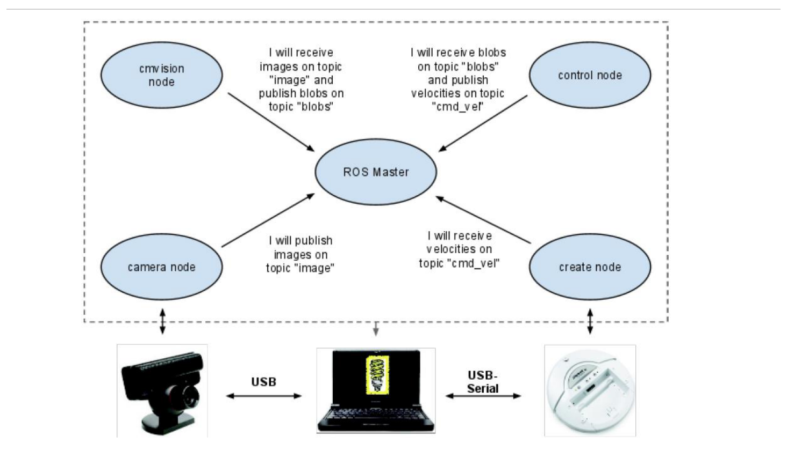
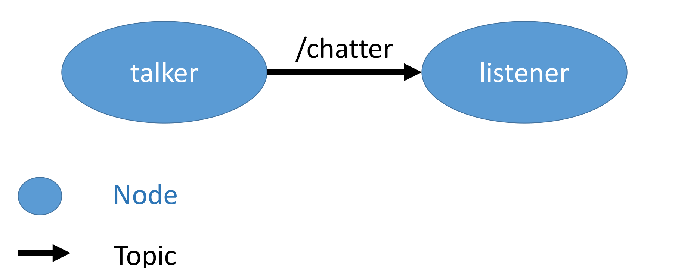
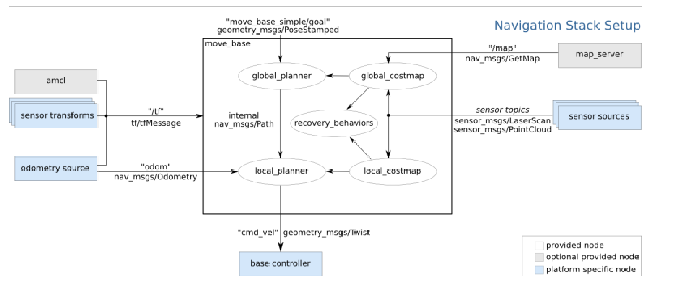
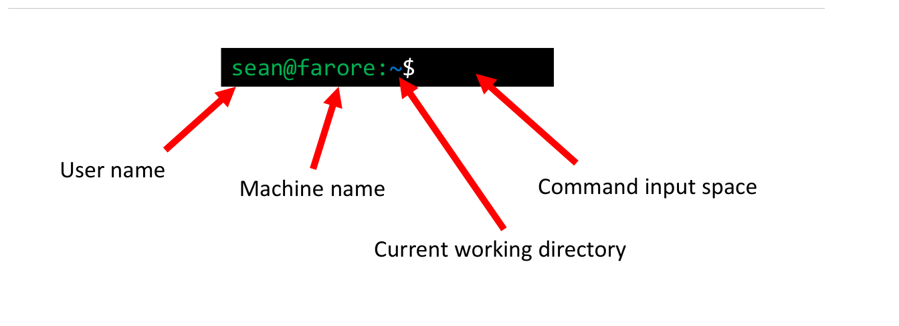

# ROS and Linux for Robotics

A robot that perceives, plans and acts is a distributed software system: device drivers, estimators, planners and controllers running at different rates, often on different computers, all exchanging data. The **Robot Operating System (ROS)** is the de facto standard framework for wiring such systems together. This chapter is a practical introduction: why ROS exists, its core concepts (nodes, topics, messages, services, parameters, launch files, `tf`), the standard Python code patterns, and the Linux and ROS command-line tools needed to work with a robot such as the TurtleBot 3. Examples use ROS 1 (`rospy`, `catkin`); the ROS 2 equivalents are noted at the end.

## Why a Robot Middleware?

Consider a hospital delivery robot that must interact with users, navigate a building to fetch and deliver supplies (alternating between obtaining supplies, delivering, and waiting), avoid stationary obstacles (walls, with a small safety margin) and avoid moving obstacles (people, with a larger margin). A reasonable software architecture has layers: a user interface talking to a path planner; the planner fed by localization and talking to collision avoidance; localization and collision avoidance fed by sensor interfaces; collision avoidance commanding a base interface, base driver and the hardware; and the hardware feeding sensor drivers.



*Figure: a small ROS system. A camera node publishes images on topic `image`; a color-blob vision node (cmvision) subscribes to `image` and publishes `blobs`; a control node subscribes to `blobs` and publishes velocity commands on `cmd_vel`; the base node (an iRobot Create) subscribes to `cmd_vel`. Each node registers with the ROS Master, which matches publishers to subscribers. Below, the hardware: USB camera, laptop, USB-serial link to the base.*

How do all these pieces talk to one another, and must every lab rewrite the standard algorithms? Before ROS, they usually did. Each group developed its own logging system, messaging protocols, coordinate-transform library, joystick driver, basic navigation and basic vision, with software hard-coded for specific devices. The result lacked **scalability** (growth in functionality), **portability** (to other robots), **reusability** (in other projects) and **interoperability** (across functions and languages). A familiar cycle followed: a paper is published with a proof-of-concept robot; another lab tries to build on it, cannot get the software details, finds the inherited code a mess, embarks on a grandiose new software API, runs out of time, and publishes with code that barely works. ROS breaks the cycle by standardizing the plumbing, and hundreds of robots (PR2, TurtleBot, Baxter, Fetch, many arms and quadrupeds) ship with ROS drivers.

**What ROS is.** A "meta" operating system for robots; a middleware; a collection of packaging and build tools; an architecture for distributed inter-process and inter-machine communication and configuration; a set of development tools for runtime inspection and data analysis; and language-independent (C++, Python, and others).

**What ROS is not.** An actual operating system (it runs on Linux, mainly Ubuntu); a programming language; an IDE; or a hard real-time architecture (time-critical loops such as motor current control run on microcontrollers below ROS, for example the TurtleBot's OpenCR board).

ROS 1 runs on Unix-like platforms, in practice Ubuntu. ROS 2 adds native Windows and macOS support, real-time-friendly communication, and no central master; the community has largely moved to it, and ROS 1 reached end of life with its final distribution, Noetic. The concepts below carry over almost unchanged.

## Core Concepts

### Nodes, topics and the master

ROS is a **peer-to-peer** middleware whose main purposes are **hardware abstraction** and **code reuse**.

- A **node** is a process that performs one piece of computation: a camera driver, a blob detector, a controller. A robot runs many.
- Nodes communicate by passing **messages**: typed data structures.
- A **topic** is a named bus over which messages flow. A node **publishes** on topics and **subscribes** to topics; publishers and subscribers do not know about each other, only the topic name and message type.
- The **ROS Master** does the matchmaking. Each node tells the master which topics it publishes and subscribes to; the master introduces matching nodes, and from then on data flows **directly between nodes** (peer-to-peer over TCP), not through the master.

This decoupling is the point. The control node in the figure does not care whether `blobs` comes from cmvision, a neural network, or a recorded log file; the base node does not care who sends `cmd_vel`. Swapping a component means launching a different node with the same topic interface.



*Figure: the smallest ROS graph, as drawn by `rqt_graph`: node `talker` publishes `std_msgs/String` messages on topic `/chatter`, and node `listener` subscribes to it. Ellipses are nodes, arrows are topics.*

### Messages

Nodes pass **serialized** messages over TCP/IP or UDP (in C++, **nodelets** in the same process can share pointers and skip serialization, useful for images and point clouds). A message type is defined in a simple text file, one `fieldtype fieldname` per line:

```text
# Example.msg
int32 x
int32 y
bool active
```

Messages can contain other messages:

```text
# Target.msg
geometry_msgs/Point state
int32 distance
bool active
```

Many standard types exist and should be used whenever possible, so that your nodes interoperate with others: `std_msgs/Bool`, `Int32`, `Float64`, `String`; `geometry_msgs/Pose`, `Twist`, `PoseStamped`; `sensor_msgs/Image`, `LaserScan`, `PointCloud2`; `nav_msgs/Odometry`, `Path`, `OccupancyGrid`; `trajectory_msgs/JointTrajectory`. "Stamped" types carry a `std_msgs/Header` with a timestamp and a `frame_id` naming the coordinate frame the data is expressed in, which is what lets `tf` transform it.

For a differential-drive robot, the two most important types are `geometry_msgs/Twist`, the velocity command on `cmd_vel` (`linear.x` is the forward speed \\(v\\) and `angular.z` the turn rate \\(\omega\\) of the [unicycle model](transforms-kinematics.md); the other four fields are zero), and `nav_msgs/Odometry` on `odom`, the pose and velocity estimate from [odometry](transforms-kinematics.md).

### Services, actions and parameters

Topics are many-to-many, one-way and asynchronous: ideal for streams of sensor data and commands. Three other mechanisms cover other needs.

- **Services** are synchronous request/response calls between two nodes, defined in a `.srv` file (request fields, `---`, response fields). Use them for quick queries or one-off commands ("reset odometry", "get the map"). Do not use them for anything long-running: the caller blocks.
- **Actions** (`actionlib`) are for long-running goals with feedback and cancellation, such as "navigate to this pose". The navigation stack's `move_base` is an action server.
- **Parameters** live on the **parameter server** (part of the master): a shared dictionary of configuration values (gains, thresholds, frame names), set from launch files or the command line and read by nodes at startup with `rospy.get_param('~kp', 1.0)`.

### Packages and workspaces

ROS software is organized into **packages**: folders containing code, build files, launch files, message and service definitions, and configuration. A package can hold any number of nodes but should contain code for a *single* functionality (a laser pipeline, motor controllers, localization, SLAM, forward kinematics, a Hokuyo driver). Historically, named collections of packages for distribution were **stacks** (later *metapackages*), and **repositories** hold stacks or packages. Every package has a `package.xml` (name, version, dependencies) and, for the `catkin` build system, a `CMakeLists.txt`.

Packages live in a **catkin workspace**, conventionally `~/catkin_ws`, with sources in `src/`. Building produces `devel/` (and `build/`), including a `setup.bash` that makes the workspace's packages visible.

ROS 1 distributions are named alphabetically: Electric (2011), Fuerte (2012), Groovy (2012), Hydro (2013), Indigo (2014), Jade (2015), Kinetic (2016), Lunar (2017), Melodic (2018), Noetic (2020). Each targets a specific Ubuntu release (Kinetic on 16.04, Melodic on 18.04, Noetic on 20.04). In the commands below, replace `<distro>` with yours.

### Launch files

Starting a robot by hand means a dozen terminals. A **launch file** (XML) starts several nodes at once, sets parameters, remaps topic names, and includes other launch files. `roslaunch` also starts a master automatically if none is running.

```xml
<launch>
  <include file="$(find turtlebot3_bringup)/launch/turtlebot3_robot.launch"/>
  <node pkg="ball_follower" type="find_ball.py" name="find_ball" output="screen">
    <param name="hue_low" value="0"/>
    <remap from="image" to="/raspicam_node/image/compressed"/>
  </node>
  <node pkg="ball_follower" type="rotate_robot.py" name="rotate_robot">
    <param name="kp" value="0.005"/>
  </node>
</launch>
```

Remapping is how generic nodes are connected to a specific robot: the node subscribes to `image`, and the launch file says which real topic that is.

### tf: the transform tree

Every sensor reports data in its own frame, and controllers need it in another. The **tf** library (tf2 in current code) maintains a tree of coordinate frames over time, for example `map → odom → base_link → base_scan` and `base_link → camera_link`. Each edge is a [homogeneous transform](transforms-kinematics.md) published by some node: the robot description (via `robot_state_publisher`) for fixed mounting offsets, odometry for `odom → base_link`, a localization node (such as `amcl`) for `map → odom`. Any node can then ask for the transform between any two frames at any recent time, and tf composes the chain, \\({}^AT\_C = {}^AT\_B\\,{}^BT\_C\\), interpolating in time. Rotations are stored as quaternions.

```python
import rospy, tf2_ros, tf2_geometry_msgs
from geometry_msgs.msg import PointStamped

buf = tf2_ros.Buffer(); listener = tf2_ros.TransformListener(buf)
p = PointStamped(); p.header.frame_id = 'base_scan'; p.header.stamp = rospy.Time(0)  # latest
p.point.x = 1.5                                       # an obstacle 1.5 m ahead of the LiDAR
p_odom = buf.transform(p, 'odom', rospy.Duration(0.5))
```

### The navigation stack



*Figure: the ROS navigation stack. The `move_base` node contains a global planner and global costmap, a local planner and local costmap, and recovery behaviors; the global planner passes a `nav_msgs/Path` to the local planner. Inputs: a goal (`move_base_simple/goal`, `geometry_msgs/PoseStamped`), transforms on `/tf` (from `amcl` and the sensor transforms), odometry on `odom` (`nav_msgs/Odometry`), the map from `map_server`, and sensor topics (`sensor_msgs/LaserScan` or point clouds). Output: velocity commands on `cmd_vel` (`geometry_msgs/Twist`) to a platform-specific base controller.*

The navigation stack is a good example of ROS's value: a complete map-based navigation system that works on any robot providing odometry, a range sensor, tf, and a base that obeys `cmd_vel`. The [path planning](path-planning.md) and [particle filter](particle-filters.md) chapters explain what its planners and `amcl` do inside.

## Code Patterns (rospy)

### Publisher and subscriber

The canonical publisher, from the ROS tutorials:

```python
#!/usr/bin/env python
import rospy
from std_msgs.msg import String

def talker():
    pub = rospy.Publisher('chatter', String, queue_size=10)
    rospy.init_node('talker', anonymous=True)
    rate = rospy.Rate(10)  # 10 Hz
    while not rospy.is_shutdown():
        hello_str = "hello world %s" % rospy.get_time()
        rospy.loginfo(hello_str)
        pub.publish(hello_str)
        rate.sleep()

if __name__ == '__main__':
    try:
        talker()
    except rospy.ROSInterruptException:
        pass
```

and the matching subscriber:

```python
#!/usr/bin/env python
import rospy
from std_msgs.msg import String

def callback(data):
    rospy.loginfo(rospy.get_caller_id() + " I heard %s", data.data)

def listener():
    # Node names are unique: launching a second node with the same name kicks off the first.
    # anonymous=True appends a random suffix so several listeners can run at once.
    rospy.init_node('listener', anonymous=True)
    rospy.Subscriber("chatter", String, callback)
    rospy.spin()   # keep python from exiting until the node is stopped

if __name__ == '__main__':
    listener()
```

Points to remember: call `init_node` once, before creating publishers in most code; `queue_size` bounds the outgoing buffer (old messages are dropped when it fills); `Rate.sleep()` keeps a loop at a fixed frequency; callbacks run in a separate thread, so share data with the main loop carefully and keep callbacks short.

### A reactive robot node

The common shape of a behavior node is: subscribe to sensors, store the latest data in callbacks, and run a fixed-rate control loop that publishes `cmd_vel`. The following node drives forward and stops (turning in place) when the LiDAR sees something closer than 0.4 m in a ±30° cone ahead.

```python
#!/usr/bin/env python
import math, rospy
from sensor_msgs.msg import LaserScan
from geometry_msgs.msg import Twist

class Avoider:
    def __init__(self):
        rospy.init_node('avoider')
        self.stop_dist = rospy.get_param('~stop_dist', 0.4)
        self.min_ahead = float('inf')
        self.pub = rospy.Publisher('cmd_vel', Twist, queue_size=1)
        rospy.Subscriber('scan', LaserScan, self.on_scan, queue_size=1)

    def on_scan(self, msg):
        ahead = []
        for i, r in enumerate(msg.ranges):
            ang = math.atan2(math.sin(msg.angle_min + i * msg.angle_increment),
                             math.cos(msg.angle_min + i * msg.angle_increment))   # wrap to [-pi, pi]
            if abs(ang) < math.radians(30) and msg.range_min < r < msg.range_max:
                ahead.append(r)                       # skip inf/0 (no return)
        self.min_ahead = min(ahead) if ahead else float('inf')

    def run(self):
        rate = rospy.Rate(10)
        while not rospy.is_shutdown():
            cmd = Twist()
            if self.min_ahead < self.stop_dist:
                cmd.angular.z = 0.8                   # turn in place
            else:
                cmd.linear.x = 0.15
            self.pub.publish(cmd)
            rate.sleep()
        self.pub.publish(Twist())                     # stop on shutdown

if __name__ == '__main__':
    Avoider().run()
```

Note the defensive details: invalid ranges are skipped, the angle is wrapped (the TurtleBot's scan runs from 0 to \\(2\pi\\), so "straight ahead" straddles the wrap), the queue size is 1 so the loop always sees the newest scan, and a zero `Twist` is sent at shutdown.

### Reading odometry

```python
from nav_msgs.msg import Odometry
def on_odom(msg):
    p, q = msg.pose.pose.position, msg.pose.pose.orientation
    yaw = math.atan2(2 * (q.w * q.z + q.x * q.y), 1 - 2 * (q.y**2 + q.z**2))
    # (p.x, p.y, yaw) is the robot pose in the odom frame
```

Odometry starts at zero wherever the robot was powered on. To measure relative to a chosen start pose, store the first pose and express later ones in its frame with the inverse transform \\(({}^{odom}T\_{start})^{-1}\\,{}^{odom}T\_{now}\\).

### Images and OpenCV

Camera images arrive as `sensor_msgs/Image` or `sensor_msgs/CompressedImage`. `cv_bridge` converts them to NumPy arrays for [OpenCV processing](robot-vision.md):

```python
from cv_bridge import CvBridge
bridge = CvBridge()
def on_image(msg):                       # sensor_msgs/CompressedImage
    bgr = bridge.compressed_imgmsg_to_cv2(msg, 'bgr8')
```

Process images in the callback only if processing is fast; otherwise store the latest frame and process it in the main loop, so stale frames are dropped rather than queued.

## Linux Essentials

ROS work happens in a terminal, usually on Ubuntu. A few commands cover most needs.



*Figure: the bash prompt `sean@farore:~$` shows the user name, the machine name, and the current working directory (`~`, the home directory `/home/sean`), followed by the command input space.*

`~` is the home directory and `/` the root of the file system. Paths starting with `/` are **absolute**; others are **relative** to the current directory.

| Command | Meaning |
|---|---|
| `cd test`, `cd test/example` | move into a subdirectory (one or several levels) |
| `cd ..`, `cd ../..` | up one or two levels |
| `cd /other/directory` | absolute path |
| `cd -` | back to the previous directory |
| `cd`, `cd ~` | home |
| `ls`, `ls <dir>`, `ls -la` | list files (blue = directory, green = executable, white = file); `-la` shows hidden files and details |
| `cp a.py b.py`, `cp a.py ~/dir`, `cp -r dir1 dir2` | copy a file, into a directory, or recursively |
| `scp burger@<ip>:~/a.py ~/burger` | secure copy from a remote machine (e.g. the robot) |
| `scp a.py burger@<ip>:~`, `scp -r dir burger@<ip>:~` | copy a file or directory to the remote machine |
| `mv a.py b.py`, `mv a.py dir`, `mv *.py dir` | rename, move, move with a wildcard |
| `rm a.py`, `rm -r dir` | delete a file or a directory |
| `rm -rf <path>` | force-delete without asking: only if you know exactly what you are deleting |
| `grep "test" file.txt` | print lines matching a regular expression ("globally search for a regular expression and print") |
| `ssh burger@<ip>` | log in to the robot remotely |
| `chmod +x node.py` | make a Python node executable (required by `rosrun`) |

**Tips.** Press **Tab** once to complete a unique prefix (`cd ex` becomes `cd example`), twice to list the candidates. `c1; c2; c3` runs all three regardless of failures; `c1 && c2 && c3` runs each only if the previous one succeeded, e.g. `cd /example && cp amazing.py ~ && cd && ls`. `scp` may fail across firewalls or restrictive networks.

### Sourcing and ~/.bashrc

ROS commands only work in a shell that has been **sourced**: the terminal must know where the ROS executables, libraries and your packages are.

- `source /opt/ros/<distro>/setup.bash` loads a ROS distribution (you could have several installed).
- `source ~/catkin_ws/devel/setup.bash` overlays your workspace and the packages built in it.

`~/.bashrc` is a shell script that runs, line by line, every time a new terminal opens, so these lines belong there. A typical robot-development `.bashrc` adds:

```bash
alias sb='source ~/.bashrc'            # convenience aliases
alias cw='cd ~/catkin_ws'
alias cs='cd ~/catkin_ws/src'
alias cm='cd ~/catkin_ws && catkin_make'
source /opt/ros/<distro>/setup.bash     # ROS environment
source ~/catkin_ws/devel/setup.bash     # your workspace
export ROS_MASTER_URI=http://<master-ip>:11311   # where roscore runs
export ROS_HOSTNAME=<this-machine-ip>            # how others reach this machine
export TURTLEBOT3_MODEL=burger                   # robot model for TurtleBot3 packages
```

Terminals opened before an edit do not see it until they re-source (`source ~/.bashrc`, or the `sb` alias). **Networking rules:** `ROS_MASTER_URI` must be the address of the machine running the master (port 11311) on *every* machine, while `ROS_HOSTNAME` (or `ROS_IP`) must be the address of *the machine whose `.bashrc` it is*. All machines must be on the same network and able to reach each other in both directions; a laptop on one Wi-Fi network and a robot on another cannot communicate, and then nothing works, often silently (topics appear in `rostopic list` but no data arrives).

## ROS Command-Line Tools

**Filesystem.** `roscd <package>` (cd into a package), `rosls <package>` (list it), `roscp <package> <file> <dest>` (copy a file out of it).

**Creating and building a package.**

```bash
cd ~/catkin_ws/src
catkin_create_pkg my_pkg rospy std_msgs geometry_msgs sensor_msgs   # creates package.xml, CMakeLists.txt
cd ~/catkin_ws && catkin_make
source ~/catkin_ws/devel/setup.bash      # or: source ~/.bashrc
```

New packages are invisible until the workspace is rebuilt and re-sourced.

**Running.** `roscore` (start a master by hand), `rosrun <package> <executable>` (one node), `roslaunch <package> <file>.launch` (a launch file).

| Tool | Commands |
|---|---|
| Nodes | `rosnode list` (nodes known to the master); `rosnode info /node` (its publications, subscriptions, services); `rosnode kill /node` (not guaranteed to work); `rosnode ping /node` (connectivity) |
| Topics | `rostopic list`; `rostopic info /topic` (type, publishers, subscribers); `rostopic echo /topic` (print messages); `rostopic hz /topic` (rate); `rostopic pub /topic pkg/Type "data: value"` |
| Messages | `rosmsg show geometry_msgs/Twist` (field layout) |
| Services | `rosservice list`; `rosservice call /service args`; `rossrv show pkg/Srv` |
| Parameters | `rosparam list`; `rosparam get /name`; `rosparam set /name value` |
| Logging | `rosbag record -a` (or selected topics); `rosbag play file.bag` (replay data to develop offline) |
| Transforms | `rosrun tf view_frames` (draw the tf tree); `rosrun tf tf_echo frameA frameB` |

A quick test of a robot from the command line, driving forward slowly:

```bash
rostopic pub -r 10 /cmd_vel geometry_msgs/Twist '{linear: {x: 0.1}, angular: {z: 0.0}}'
```

### Visualization and simulation

- **rqt tools:** `rqt_image_view` shows images from any image topic; `rqt_plot /turtle1/pose/x:y:z` plots numeric fields over time (excellent for tuning a [PID loop](feedback-control.md)); `rqt_graph` draws the computation graph of nodes and topics, the first thing to check when "nothing happens".
- **RViz** visualizes sensor data, transforms, maps, paths and robot models in 3-D. Premade configurations exist for the TurtleBot 3, e.g. `roslaunch turtlebot3_gazebo turtlebot3_gazebo_rviz.launch`.
- **Gazebo** is a physics simulator with ROS interfaces: the simulated robot publishes the same topics as the real one, so the same nodes run unchanged. The TurtleBot 3 packages include worlds such as a hexagonal arena with cylindrical pillars, `roslaunch turtlebot3_gazebo turtlebot3_world.launch`. Simulation is for debugging logic; the gap to hardware (noise, latency, slip, lighting) still has to be closed on the real robot.

## ROS 2 in One Paragraph

ROS 2 keeps nodes, topics, messages, services, actions, parameters, launch files and tf2, but replaces the master with DDS-based peer discovery, adds quality-of-service settings, and uses `rclpy`/`rclcpp`, the `colcon` build tool, and Python launch files. The command-line tools become subcommands: `ros2 node list`, `ros2 topic echo /scan`, `ros2 run pkg exe`, `ros2 launch pkg file.launch.py`, `ros2 bag record`. The publisher above becomes `node = rclpy.create_node('talker'); pub = node.create_publisher(String, 'chatter', 10)`, with a timer callback in place of the `Rate` loop.

## Summary

- ROS is middleware: nodes (processes) exchange typed messages over named topics; the master matches publishers and subscribers, then data flows peer-to-peer.
- Services are blocking request/response calls; actions are long-running goals with feedback; parameters configure nodes.
- Code lives in packages inside a catkin workspace; build with `catkin_make`, then source `devel/setup.bash`.
- Launch files start and configure many nodes, with remapping to connect generic nodes to a specific robot.
- tf2 keeps the tree of frames and composes homogeneous transforms; stamped messages carry a `frame_id`.
- Robot interface: `geometry_msgs/Twist` on `cmd_vel` (`linear.x` = \\(v\\), `angular.z` = \\(\omega\\)), `nav_msgs/Odometry` on `odom`, `sensor_msgs/LaserScan` on `scan`, images via `cv_bridge`.
- Source the ROS setup and the workspace in `~/.bashrc`; `ROS_MASTER_URI` points to the master, `ROS_HOSTNAME` to this machine; all machines on one network.
- Inspect with `rosnode`, `rostopic`, `rqt_graph`, `rqt_plot`, RViz; record with `rosbag`; simulate with Gazebo.

## See Also

- [Coordinate Transforms and Differential-Drive Kinematics](transforms-kinematics.md) (the math behind tf and odometry)
- [Feedback Control for Mobile Robots](feedback-control.md) and [Behavior-Based Control](behavior-control.md)
- [Image Processing for Robots](robot-vision.md)
- [Path Planning](path-planning.md) and [Particle Filters](particle-filters.md) (inside the navigation stack)
- [Robotics overview](../README.md) and [Mobile Robots and Locomotion](../mobile.md)
