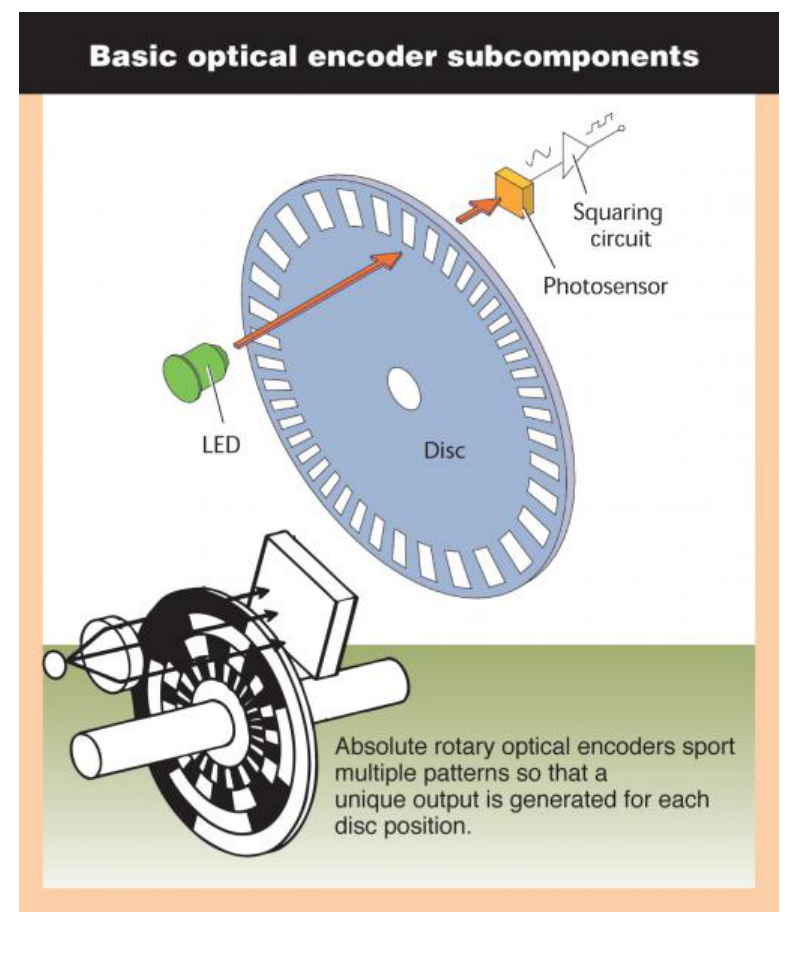
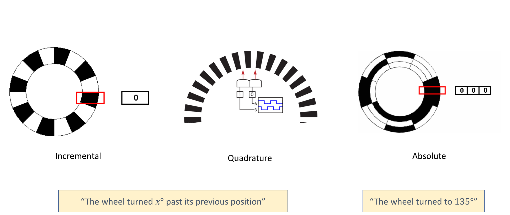
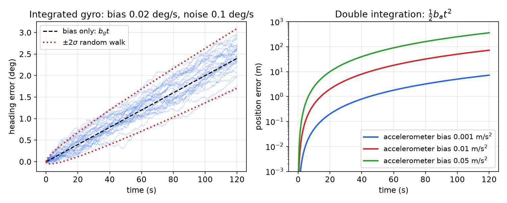
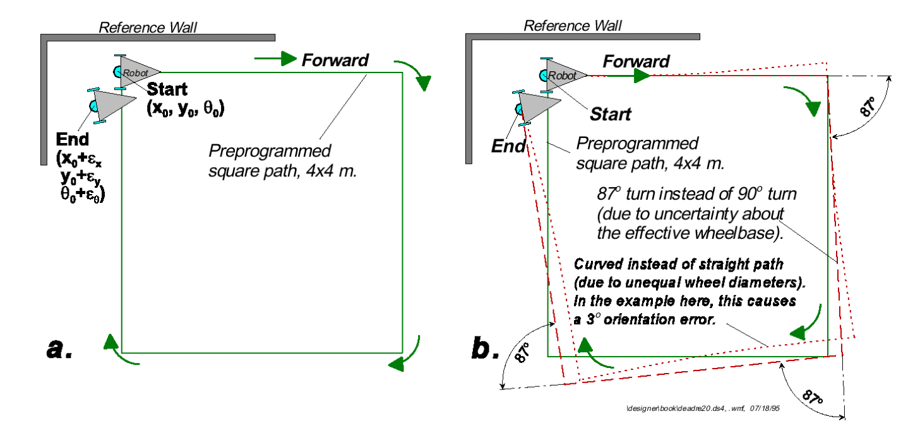
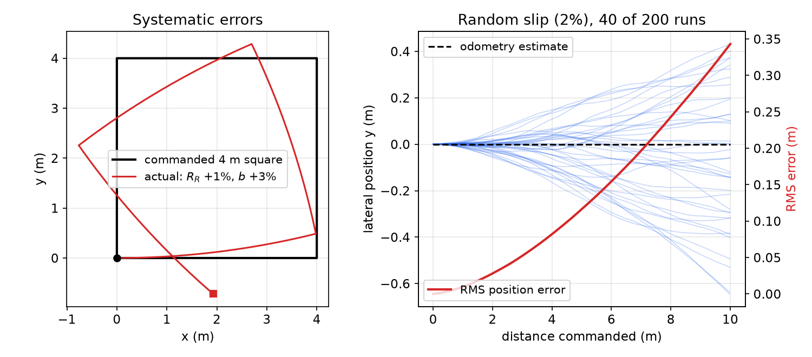
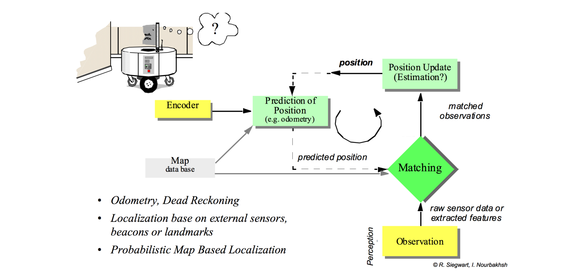

# Internal Sensors and Odometry

The behaviour controllers of the earlier chapters (go-to-goal, avoid-obstacle, follow-wall) all assume that the robot knows its own pose \\((x, y, \theta)\\) in a global frame. Where does that pose come from? This chapter surveys the ways a robot can know where it is, then studies in detail the sensors that measure the robot's own motion: wheel encoders, accelerometers, gyroscopes and magnetometers. Integrating their readings gives **odometry**, a pose estimate that is excellent over a few metres and useless over a few hundred. Quantifying *how* the error grows is the bridge to the probabilistic estimators of the following chapters.

## How Does a Robot Know Where It Is?

There are three broad options.

1. **An external observer** tells the robot where it is: an overhead camera, a motion-capture system or a satellite constellation measures the pose directly.
2. **Onboard sensors estimate motion** using only onboard information: encoders and inertial sensors measure how the robot moved, and the motion is integrated from a known start.
3. **Onboard sensors estimate position from offboard information**: the robot observes landmarks or matches its range scans to a map, and infers where it must be.

In practice a robot almost always combines options 2 and 3: motion sensing gives a smooth, high-rate, drift-prone prediction, and map-based observation corrects it at a lower rate. That combination is the localization loop of the next chapters.

### Option 1: external observers

**Overhead cameras with fiducial tags.** In a laboratory arena a ceiling camera can track each robot by an ArUco tag (a square binary marker whose pattern encodes an ID and whose corners give pose). Motion-capture systems such as Vicon do the same with constellations of retro-reflective markers and many infrared cameras, reaching sub-millimetre accuracy; robot-soccer leagues and shared research arenas use such "global vision". The advantages are a direct measurement of position and (relatively) easy setup. The disadvantages are decisive outside the lab: such infrastructure does not exist in the real world, and markers can be occluded.

**GPS.** A receiver measures its range to four or more satellites by timing their signals and solves for its position (three coordinates plus its own clock offset, hence the need for four). In **differential GPS** a base-station receiver at known coordinates \\((X\_1, Y\_1, Z\_1)\\) computes the error in its own fix and broadcasts a correction to a nearby rover receiver at \\((X, Y, Z)\\); because both see nearly the same atmospheric delays, the rover's error is largely cancelled. GPS works in the real world and measures position directly, but signals are blocked by buildings, bridges and trees, are unavailable indoors, underground and underwater, and suffer **multipath** error when they bounce off walls and buildings. A standard smartphone fix is accurate to about 4.9 m (16 ft), far too coarse for a robot navigating a corridor.

## Option 2: Internal Sensors

Internal (proprioceptive) sensors measure the robot's own state: wheel encoders measure wheel rotation; an **inertial measurement unit (IMU)** combines accelerometers, gyroscopes and usually a magnetometer.

### Wheel encoders

An encoder attaches a disk with known properties to the motor shaft and senses changes in the disk material as it turns, counting shaft rotations. **Optical** encoders shine an LED through a slotted disk onto a photosensor; a squaring circuit turns the light pulses into a clean square wave. **Magnetic** encoders sense a magnetized ring with a Hall-effect sensor.



*Figure: an optical shaft encoder. Light from the LED passes through the slots of the rotating disk to a photosensor; a squaring circuit converts the light pulses into digital ticks. Absolute encoders carry several concentric patterns so that every disk position produces a unique code.*

Three types are common.

- **Incremental**: a single ring of slots and a counter. The output says "the wheel turned \\(x^\circ\\) past its previous position", but not in which direction.
- **Quadrature**: two sensors offset by a quarter of a slot period produce two square waves 90° out of phase. Which wave leads tells the direction, and counting every edge of both waves gives four times the resolution of one channel.
- **Absolute**: several concentric tracks form a binary (usually Gray) code word for each angular sector, so the output says "the wheel is at 135°" even after power-up.



*Figure: incremental (one track, counts only), quadrature (two offset channels give direction) and absolute (concentric tracks give a code word for each position) encoders.*

An encoder with \\(N\\) ticks per wheel revolution that counts \\(\Delta n\\) ticks in one sample reports a wheel rotation \\(\Delta\varphi = 2\pi\\,\Delta n/N\\). Encoders can have very high resolution and are very fast. Paradoxically, speed is also a weakness: at high shaft speed a slow processor can miss counts. The decisive limitation is that **shaft rotation need not translate into wheel motion over the ground**: an encoder cannot detect wheel slip.

### Pose and velocity from encoders

For a differential-drive robot with wheel radius \\(r\\) and track width (wheel separation) \\(b\\), let \\(\Delta\varphi\_R\\) and \\(\Delta\varphi\_L\\) be the wheel rotations measured over the last time step \\(\Delta t\\). The wheels' contact points travel \\(\Delta s\_R = r\Delta\varphi\_R\\) and \\(\Delta s\_L = r\Delta\varphi\_L\\), and the [kinematics chapter](transforms-kinematics.md) shows that the axle midpoint moves and turns by
\\[
\Delta s = \frac r2(\Delta\varphi\_R + \Delta\varphi\_L), \qquad \Delta\theta = \frac rb(\Delta\varphi\_R - \Delta\varphi\_L).
\\]
Resolving the forward motion in the world frame gives the per-step pose increments
\\[
\Delta x = \frac r2(\Delta\varphi\_R + \Delta\varphi\_L)\cos\theta, \qquad \Delta y = \frac r2(\Delta\varphi\_R + \Delta\varphi\_L)\sin\theta, \qquad \Delta\theta = \frac rb(\Delta\varphi\_R - \Delta\varphi\_L),
\\]
which are *summed* to obtain the pose: \\(x\_k = x\_{k-1} + \Delta x\_k\\), and so on. (A frequent shorthand writes \\(x, y, \theta\\) on the left; it must be read as increments, since \\(x\\) itself is not a function of the last step's wheel rotation.) Dividing by the sample time, with \\(\dot\varphi\_i \approx \Delta\varphi\_i/\Delta t\\), gives the velocity estimate
\\[
\dot x = \frac r2(\dot\varphi\_R + \dot\varphi\_L)\cos\theta, \qquad \dot y = \frac r2(\dot\varphi\_R + \dot\varphi\_L)\sin\theta, \qquad \dot\theta = \frac rb(\dot\varphi\_R - \dot\varphi\_L).
\\]
Using the heading at the middle of the step, \\(\theta\_{k-1} + \Delta\theta/2\\), in the cosine and sine is a free accuracy improvement; the kinematics chapter compares Euler, midpoint and exact-arc updates.

Encoders fail in two characteristic ways:

- **Wheel slip**: an aggressive motor controller (large accelerations), a slippery surface or rough terrain makes the wheel turn without the robot moving correspondingly.
- **3-D motion**: the formulas assume a flat floor. Driving over a ramp or bump, the wheels travel further than the projection of the motion onto the plane.

### Accelerometers

An accelerometer measures **specific force**, the acceleration of the sensor relative to free fall. A MEMS accelerometer suspends a tiny proof mass on springs and measures its deflection capacitively. A common measurement model for one axis is
\\[
a\_m = a + g\_{\parallel} + b\_a + n\_a,
\\]
where \\(a\\) is the true kinematic acceleration, \\(g\_{\parallel}\\) the component of gravity along the axis (the sensor cannot distinguish gravity from acceleration), \\(b\_a\\) a slowly varying bias and \\(n\_a\\) white noise. Accelerometers are inexpensive and measure *all* accelerations, including the ones you want (the robot speeding up) and the ones you don't (vibration, bumps, and gravity). They must be calibrated, and the gravity component removed using the estimated attitude. In particular, **don't start your robot tilted**: if the robot is tilted by a small angle \\(\epsilon\\) during calibration, a component \\(g\sin\epsilon \approx g\epsilon\\) of gravity is mistaken for forward acceleration. One degree of tilt gives \\(9.81 \times 0.0175 = 0.17\\) m/s² of false acceleration.

### Gyroscopes

A MEMS gyroscope measures angular velocity through the **Coriolis force**: a proof mass is driven to vibrate along one axis, and when the sensor rotates at rate \\(\omega\\) the mass, moving with velocity \\(v\\) in the rotating frame, feels a force \\(-2m\\,\omega\times v\\) perpendicular to its vibration, whose amplitude is proportional to \\(\omega\\). The measurement model is
\\[
\omega\_m = \omega + b\_g + n\_g,
\\]
with a bias \\(b\_g\\) that drifts with temperature and time and white noise \\(n\_g\\). Gyros are inexpensive and give an excellent short-term heading change, but integrating them makes the heading **drift**.

### Magnetometers

A magnetometer (electronic compass) measures the local magnetic field vector and hence orientation relative to magnetic north. It is the only internal sensor that measures heading *directly*, without integration, so its error does not grow with time. But the Earth's field is weak (about 25–65 µT), and steel structure, motors and currents nearby distort it: indoors and on a robot with electric motors, magnetometer heading can be wrong by tens of degrees.

Combined, the three give the robot's attitude (roll and pitch from the gravity direction, heading from the magnetometer), linear acceleration and angular velocity. IMUs are everywhere: game controllers, smartphones, drones and legged robots such as Boston Dynamics' Spot and Atlas all carry one.

### How inertial errors grow

The key difference between these sensors is how many integrations separate the measurement from the quantity we need. Heading is one integration of the gyro rate:
\\[
\theta(t) = \theta\_0 + \int\_0^t \omega\_m\\,d\tau \quad\Rightarrow\quad \delta\theta(t) = b\_g t + \int\_0^t n\_g\\,d\tau .
\\]
A constant bias gives a heading error growing **linearly**, \\(b\_g t\\). White noise of spectral density \\(\sigma\_g^2\\) integrates to a random walk whose standard deviation grows as \\(\sigma\_g\sqrt t\\) (the **angle random walk**). For a sampled gyro with per-sample noise standard deviation \\(\sigma\\) at period \\(\Delta t\\), the heading after \\(N = t/\Delta t\\) samples is a sum of \\(N\\) independent errors \\(n\_i\Delta t\\), so its variance is \\(N\sigma^2\Delta t^2 = \sigma^2\Delta t\\,t\\).

Position is *two* integrations of the accelerometer:
\\[
\delta p(t) = \int\_0^t\\!\\!\int\_0^{\tau} b\_a\\,ds\\,d\tau = \tfrac12 b\_a t^2 ,
\\]
so a constant accelerometer bias gives a **quadratic** position error, and white noise a position error growing as \\(t^{3/2}\\). A bias of only 0.01 m/s² (about 1 milli-g) gives \\(\frac12(0.01)(60)^2 = 18\\) m of error after one minute. This is why low-cost IMUs are used for attitude and short-term motion, not for position.



*Figure: left, 30 simulated runs of an integrated gyro with bias 0.02 deg/s and noise 0.1 deg/s per 0.1 s sample. The heading error follows the linear bias trend \\(b\_g t\\), and the spread grows as \\(\sqrt t\\) (red dotted ±2σ). Right, position error from a constant accelerometer bias, \\(\frac12 b\_a t^2\\), on a log scale: even a 1 milli-g bias gives metres of error within a minute.*

## Odometry and Dead Reckoning

**Odometry** is the problem: given a starting pose \\((x\_0, y\_0, \theta\_0)\\), determine \\((x\_t, y\_t, \theta\_t)\\), i.e. "how far and in what direction have I travelled during time \\(t\\)?", using only onboard sensors (encoders, IMU, and sometimes a camera, in **visual odometry**, which tracks image features between frames to estimate camera motion). **Dead reckoning** is the general navigation term: computing the current position from a previously determined position and estimated speeds over the elapsed time. Both integrate increments, so both inherit every error of every increment.

### Systematic and non-systematic errors

Odometry errors fall into two classes.

- **Deterministic (systematic)** errors are the same every time and can in principle be eliminated by calibration: misalignment of the wheels; unequal wheel diameters; uncertainty about the effective wheelbase (the tyre contact patch is not a point); limited encoder resolution and sampling rate.
- **Non-deterministic (non-systematic)** errors are random. They must be described by error models and always leave an uncertain position estimate: variation in the wheel contact point; unequal floor contact (slippage, non-planar floors); bumps and cracks.

The classic test of systematic error is the **UMBmark** (University of Michigan benchmark). The robot drives a preprogrammed 4 m × 4 m square from a start pose near a reference wall, and the end pose \\((x\_0 + \epsilon\_x, y\_0 + \epsilon\_y, \theta\_0 + \epsilon\_\theta)\\) is measured. Two systematic errors dominate. If the effective wheelbase is larger than assumed, every commanded 90° turn becomes, say, 87°, because \\(\Delta\theta = (\Delta s\_R - \Delta s\_L)/b\\) is smaller for a larger true \\(b\\). If the wheel diameters are unequal, the "straight" legs are arcs. Running the square both clockwise and counter-clockwise separates the two effects, because the turn error changes sign with the direction while the curvature error does not.



*Figure: the UMBmark test. (a) The preprogrammed 4 × 4 m square path. (b) With systematic errors: 87° turns instead of 90° (wrong effective wheelbase) and curved instead of straight legs (unequal wheel diameters, here causing a 3° orientation error), so the robot ends far from its start.*

The left panel of the next figure reproduces this with a simulation: the right wheel is 1% larger than nominal and the true track is 3% wider than the value used by odometry. The odometry, which uses the nominal values, reports a perfect square; the robot actually turns about \\(90°/1.03 \approx 87.4°\\) at each corner, curves to the left on every leg, and ends nearly 2 m from its start.



*Figure: left, a 4 m square commanded with a 1 % wheel-radius mismatch and a 3 % track-width error; odometry believes it drove the black square, the robot actually drove the red path. Right, 200 straight 10 m runs with 2 % random slip on each wheel increment (40 shown): the dead-reckoned estimate stays on the dashed line while the true paths fan out; the RMS position error (red, right axis) grows faster than linearly with distance.*

### Why random errors grow faster than linearly

The right panel shows a striking feature: the position error grows *faster* than the distance travelled. The reason is that heading errors feed position errors. Suppose each step of length \\(\Delta s\\) adds an independent heading error with variance \\(\sigma\_\theta^2\\) per step. After \\(k\\) steps the heading error is a random walk with variance \\(k\sigma\_\theta^2\\). The lateral position error is the sum of the lateral displacements \\(\Delta s\\,\delta\theta\_j\\) over all steps:
\\[
\delta y\_n = \Delta s\sum\_{j=1}^{n}\delta\theta\_j, \qquad \delta\theta\_j = \sum\_{i=1}^{j} e\_i ,
\\]
so \\(\delta y\_n = \Delta s\sum\_{i=1}^n (n - i + 1)e\_i\\) and
\\[
\operatorname{Var}(\delta y\_n) = \Delta s^2\sigma\_\theta^2\sum\_{m=1}^{n} m^2 \approx \frac{\Delta s^2\sigma\_\theta^2\\,n^3}{3}.
\\]
With distance \\(s = n\Delta s\\), the lateral standard deviation grows as \\(s^{3/2}\\), while the along-track error (from the random scale of each step) grows only as \\(s^{1/2}\\). The uncertainty region is therefore a banana-shaped cloud elongated *across* the direction of travel, the shape that particle filters represent naturally (see [Particle Filters](particle-filters.md)).

Real dead-reckoned maps show the consequences. Driving around the perimeter of a building, a robot relying on odometry alone produces a "rectangle" that fails to close, with skewed, doubled and drifting walls.

### Propagating odometry uncertainty

The error growth can be computed without simulation by linearizing the odometry update, the same step an [extended Kalman filter](kalman-filters.md) performs. Write the midpoint update as \\(p\_k = f(p\_{k-1}, \Delta s\_R, \Delta s\_L)\\) with \\(p = (x, y, \theta)\\):
\\[
f = \begin{bmatrix} x + \Delta s\cos(\theta + \Delta\theta/2) \\\\ y + \Delta s\sin(\theta + \Delta\theta/2) \\\\ \theta + \Delta\theta\end{bmatrix}, \qquad \Delta s = \frac{\Delta s\_R + \Delta s\_L}{2}, \quad \Delta\theta = \frac{\Delta s\_R - \Delta s\_L}{b}.
\\]
A common error model (after Siegwart and Nourbakhsh) treats the two wheel increments as independent with variances proportional to the distance each wheel travels:
\\[
\Sigma\_\Delta = \begin{bmatrix} k\_R\lvert\Delta s\_R\rvert & 0 \\\\ 0 & k\_L\lvert\Delta s\_L\rvert\end{bmatrix},
\\]
with constants \\(k\_R, k\_L\\) found experimentally. Proportionality to distance is what random slip per unit of rolling would produce. First-order error propagation then gives
\\[
\Sigma\_{p,k} = F\_p\\,\Sigma\_{p,k-1}F\_p^T + F\_\Delta\\,\Sigma\_\Delta F\_\Delta^T ,
\\]
where, with \\(\phi = \theta + \Delta\theta/2\\),
\\[
F\_p = \frac{\partial f}{\partial p} = \begin{bmatrix} 1 & 0 & -\Delta s\sin\phi \\\\ 0 & 1 & \Delta s\cos\phi \\\\ 0 & 0 & 1\end{bmatrix},
\\]
\\[
F\_\Delta = \frac{\partial f}{\partial(\Delta s\_R, \Delta s\_L)} = \begin{bmatrix} \tfrac12\cos\phi - \tfrac{\Delta s}{2b}\sin\phi & \tfrac12\cos\phi + \tfrac{\Delta s}{2b}\sin\phi \\\\ \tfrac12\sin\phi + \tfrac{\Delta s}{2b}\cos\phi & \tfrac12\sin\phi - \tfrac{\Delta s}{2b}\cos\phi \\\\ \tfrac1b & -\tfrac1b\end{bmatrix}.
\\]
The first term carries the old uncertainty forward. Its off-diagonal entries \\(-\Delta s\sin\phi\\) and \\(\Delta s\cos\phi\\) are where heading uncertainty is converted into position uncertainty, which produces the \\(s^{3/2}\\) growth derived above. The second term adds the new uncertainty of this step. Nothing in the recursion ever *reduces* \\(\Sigma\_p\\): without an external measurement, uncertainty only grows.

```python
import numpy as np

def odom_cov_step(p, P, dsr, dsl, b=0.160, kr=1e-4, kl=1e-4):
    """Midpoint odometry update with first-order covariance propagation."""
    ds, dth = 0.5 * (dsr + dsl), (dsr - dsl) / b
    phi = p[2] + 0.5 * dth
    c, s = np.cos(phi), np.sin(phi)
    p_new = p + np.array([ds * c, ds * s, dth])
    Fp = np.array([[1, 0, -ds * s], [0, 1, ds * c], [0, 0, 1]])
    Fd = np.array([[0.5 * c - ds / (2 * b) * s, 0.5 * c + ds / (2 * b) * s],
                   [0.5 * s + ds / (2 * b) * c, 0.5 * s - ds / (2 * b) * c],
                   [1 / b, -1 / b]])
    Sd = np.diag([kr * abs(dsr), kl * abs(dsl)])
    return p_new, Fp @ P @ Fp.T + Fd @ Sd @ Fd.T
```

### Summary of error sources

| Source | Type | Remedy |
|---|---|---|
| Finite time step and encoder resolution | systematic (integration) | faster sampling, midpoint or arc update |
| Wheel misalignment | systematic | mechanical alignment, calibration |
| Unequal wheel diameters | systematic | calibration (UMBmark) |
| Uncertain effective wheelbase | systematic | calibration (UMBmark) |
| Variation of the wheel contact point | random | error model, external correction |
| Slip, uneven or non-planar floor | random | error model, IMU fusion, external correction |

## Closing the Loop: Localization

Odometry alone accumulates "a lot of error". Can we get by without localization at all? Sometimes the environment is engineered so that we can: warehouse robots of the Kiva (Amazon Robotics) type drive over a floor grid of fiducial markers, re-zeroing their odometry at each marker, so they never drift far. In unstructured environments the answer is **localization**: use knowledge of the environment (a map, landmarks) to correct the prediction.



*Figure: the map-based localization loop (after Siegwart and Nourbakhsh). Encoder data drive a prediction of the position (odometry). Perception produces observations, raw sensor data or extracted features, which are matched against the map database using the predicted position. The matched observations then update the position estimate, which feeds the next prediction.*

The loop raises three questions that the next chapters answer.

1. Can we use knowledge of the environment to localize? Yes: by comparing what the robot *should* see from a hypothesized pose with what it *does* see.
2. Can we use the system model to reduce sensor errors? Yes: the motion model predicts, the sensor corrects, and the combination is better than either.
3. Can we include the known errors, so that the robot has "an idea of what it doesn't know"? Yes: by representing the pose not as a point but as a probability distribution, the **belief**, whose spread grows with odometry and shrinks with observations.

This is the program of [Bayesian State Estimation](bayes-filters.md), implemented by [particle filters](particle-filters.md) and [Kalman filters](kalman-filters.md).

## Summary

- Pose can come from an external observer (camera, motion capture, GPS), from integrating internal motion sensors, or from matching observations to a map; robots combine the last two.
- Encoders: incremental (count only), quadrature (count and direction, 4× resolution), absolute (code word per position). Encoder odometry increments: \\(\Delta s = \frac r2(\Delta\varphi\_R + \Delta\varphi\_L)\\), \\(\Delta\theta = \frac rb(\Delta\varphi\_R - \Delta\varphi\_L)\\), \\(\Delta x = \Delta s\cos\theta\\), \\(\Delta y = \Delta s\sin\theta\\), summed over steps. Encoders cannot see slip or 3-D motion.
- Accelerometer: \\(a\_m = a + g\_{\parallel} + b\_a + n\_a\\); a bias gives a position error \\(\frac12 b\_a t^2\\). Gyroscope (Coriolis): \\(\omega\_m = \omega + b\_g + n\_g\\); heading error \\(b\_g t\\) plus a \\(\sqrt t\\) random walk. Magnetometer: absolute heading, easily disturbed.
- Systematic odometry errors (wheel diameters, wheelbase, alignment) are calibrated out (UMBmark); random errors (slip, contact point, floor) must be modelled.
- Random heading errors make the lateral position error grow as \\(s^{3/2}\\). Covariance propagation: \\(\Sigma\_{p,k} = F\_p\Sigma\_{p,k-1}F\_p^T + F\_\Delta\Sigma\_\Delta F\_\Delta^T\\), which never shrinks without external measurements.
- Localization closes the loop: predict with odometry, correct with observations matched to a map.

## See Also

- [Coordinate Transforms and Differential-Drive Kinematics](transforms-kinematics.md), for the kinematics and odometry update rules
- [Behavior-Based Control](behavior-control.md), whose controllers consume the pose estimate
- [Bayesian State Estimation](bayes-filters.md), [Particle Filters](particle-filters.md) and [Kalman Filters](kalman-filters.md)
- [Sensing and Perception](../sensing.md) and [Localization and SLAM](../slam.md)
- [Mobile Robots and Locomotion](../mobile.md)
