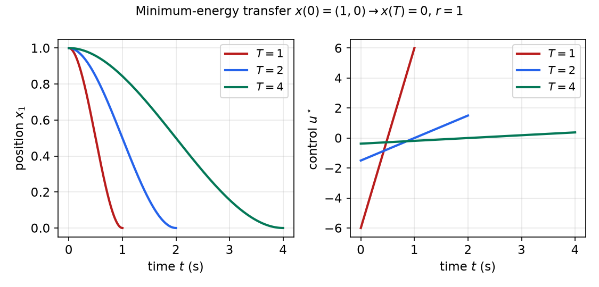
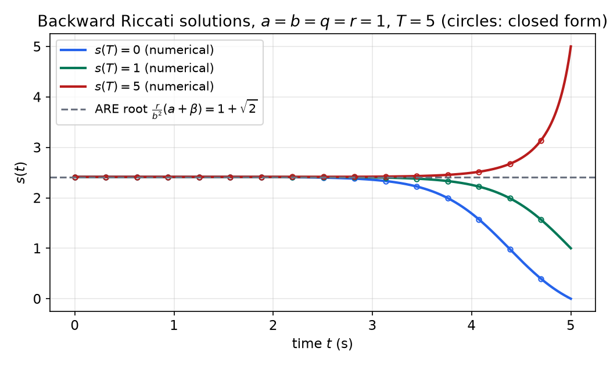
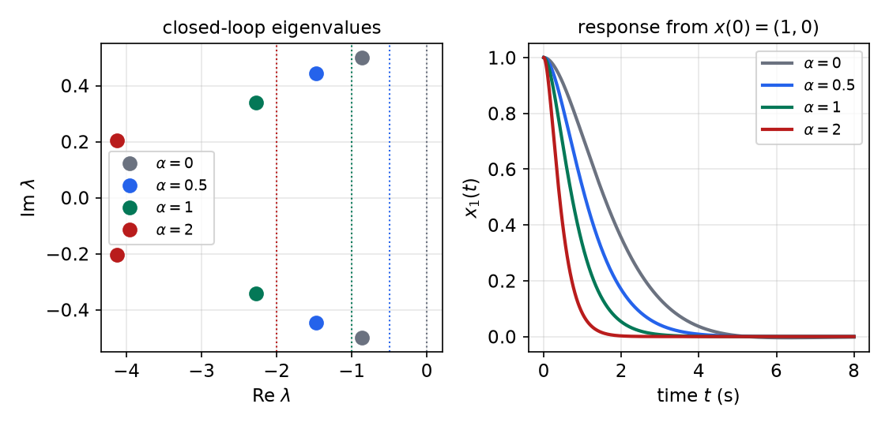
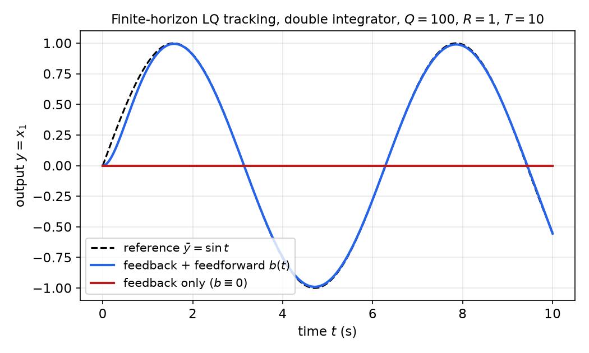

# Continuous-Time LQR and Its Extensions

The general continuous-time optimal control problem leads to a nonlinear two-point boundary-value problem that usually has to be solved numerically. When the plant is linear and the cost quadratic, the necessary conditions become linear, and the boundary-value problem can be solved in closed form. This chapter works out that case from the variational (costate) point of view. A fixed final state gives an open-loop *minimum-energy* control built from a controllability Gramian. A free final state with a terminal penalty gives time-varying state feedback built from the differential Riccati equation, and its steady state is the algebraic Riccati equation. The last part shows that three practically important variants (cross terms in the cost, a prescribed degree of stability, and tracking or servo problems) all reduce to the same Riccati machinery.

The linear-systems chapter [Linear Quadratic Regulator](../me6401-linear-control/lqr.md) treats infinite-horizon LQR from the state-space point of view (the ARE, its Hamiltonian-matrix solution, stability margins and design rules). Here the emphasis is on what that treatment does not cover: the finite-horizon problem, the Lyapunov and Riccati *differential* equations, the open-loop fixed-endpoint solution, the convergence theorems for the Riccati equation, and the extensions. The discrete-time counterpart is [Discrete-Time Optimal Control and LQR](discrete-optimal-control.md), and the general necessary conditions used below are derived in [Continuous-Time Optimal Control](continuous-optimal-control.md).

## Problem Statement and the Hamiltonian System

Consider the linear time-varying plant
\\[
\dot x = A(t)x + B(t)u, \qquad x(t\_0) \text{ given},
\\]
with \\(x\in\mathbb{R}^n\\), \\(u\in\mathbb{R}^m\\), and the quadratic cost on a fixed, known horizon \\([t\_0,T]\\):
\\[
J(t\_0) = \tfrac12 x^\top(T)S(T)x(T) + \tfrac12\int\_{t\_0}^{T}\big(x^\top Q(t)x + u^\top R(t)u\big)\\,dt,
\qquad S(T)\succeq 0,\ Q(t)\succeq 0,\ R(t)\succ 0 .
\\]
Here \\(\succeq 0\\) means positive semidefinite and \\(\succ 0\\) positive definite. \\(Q\\) penalizes state excursions, \\(R\\) penalizes control effort, and \\(S(T)\\) penalizes the final state. \\(R\\) must be positive *definite*: if some control direction were free, the minimization over \\(u\\) would have no solution.

The Hamiltonian is
\\[
H = \tfrac12\big(x^\top Qx + u^\top Ru\big) + \lambda^\top(Ax + Bu),
\\]
and the necessary conditions of [Continuous-Time Optimal Control](continuous-optimal-control.md) read
\\[
\dot x = \frac{\partial H}{\partial\lambda} = Ax + Bu, \qquad
-\dot\lambda = \frac{\partial H}{\partial x} = Qx + A^\top\lambda, \qquad
0 = \frac{\partial H}{\partial u} = Ru + B^\top\lambda .
\\]
The stationarity condition can be solved for the control because \\(R\\) is invertible:
\\[
u = -R^{-1}B^\top\lambda .
\\]
Substituting eliminates \\(u\\) and leaves the linear **Hamiltonian system**
\\[
\begin{bmatrix}\dot x \\\\ \dot\lambda\end{bmatrix}
= \begin{bmatrix} A & -BR^{-1}B^\top \\\\ -Q & -A^\top\end{bmatrix}
\begin{bmatrix} x \\\\ \lambda\end{bmatrix}.
\\]
It has \\(2n\\) states and needs \\(2n\\) boundary conditions: \\(n\\) are the given \\(x(t\_0)\\), and the other \\(n\\) sit at the final time and depend on how the final state is specified. Two cases are treated below:

- **Fixed final state**, \\(x(T) = x\_T\\) prescribed. The final costate is free and is chosen to hit the target. The result is an open-loop control.
- **Free final state** with the terminal penalty \\(\tfrac12x^\top(T)S(T)x(T)\\). The transversality condition gives \\(\lambda(T) = S(T)x(T)\\). The result is a state-feedback control.

Before solving either, it pays to compute the cost of doing nothing, because the same "add zero and integrate a derivative" argument underlies everything that follows.

## The Zero-Input Cost and the Lyapunov Equation

**Theorem (cost of the free motion).** Let \\(u\equiv 0\\), so \\(\dot x = Ax\\), and let \\(S(t)\\) solve the **differential Lyapunov equation**
\\[
-\dot S = A^\top S + SA + Q, \qquad t\le T,\quad S(T)\text{ given}.
\\]
Then the cost-to-go from any time \\(t\\) is \\(J(t) = \tfrac12x^\top(t)S(t)x(t)\\).

*Proof.* By the fundamental theorem of calculus,
\\[
\tfrac12\int\_{t\_0}^{T}\frac{d}{dt}\big(x^\top Sx\big)\\,dt = \tfrac12x^\top(T)S(T)x(T) - \tfrac12x^\top(t\_0)S(t\_0)x(t\_0).
\\]
Use this to replace the terminal term in \\(J\\) ("adding zero"):
\\[
J(t\_0) = \tfrac12x^\top(t\_0)S(t\_0)x(t\_0) + \tfrac12\int\_{t\_0}^{T}\Big(x^\top Qx + \frac{d}{dt}\big(x^\top Sx\big)\Big)dt .
\\]
With \\(\dot x = Ax\\), \\(\frac{d}{dt}(x^\top Sx) = x^\top(A^\top S + \dot S + SA)x\\), so
\\[
J(t\_0) = \tfrac12x^\top(t\_0)S(t\_0)x(t\_0) + \tfrac12\int\_{t\_0}^{T}x^\top\big(A^\top S + \dot S + SA + Q\big)x\\,dt .
\\]
The integrand vanishes identically by the Lyapunov equation. The same argument works from any starting time \\(t\\). \\(\blacksquare\\)

For constant \\(A\\) and \\(Q\\) the Lyapunov equation is linear and can be integrated explicitly:
\\[
S(t) = e^{A^\top(T-t)}S(T)\\,e^{A(T-t)} + \int\_t^{T}e^{A^\top(\tau-t)}Q\\,e^{A(\tau-t)}\\,d\tau .
\\]
(The integrand depends on the integration variable \\(\tau\\); it is the cost \\(\tfrac12x^\top Qx\\) accumulated at time \\(\tau\\) along \\(x(\tau) = e^{A(\tau-t)}x(t)\\).) Differentiating with respect to \\(t\\) confirms it: the lower limit contributes \\(-Q\\) and the exponentials contribute \\(-A^\top S - SA\\).

**Infinite horizon.** As \\(T - t\to\infty\\) the first term dies out if \\(A\\) is asymptotically stable (Hurwitz), and
\\[
S\_\infty = \int\_0^{\infty}e^{A^\top\tau}Q\\,e^{A\tau}\\,d\tau ,
\\]
which converges because the exponentials decay. If \\(A\\) is unstable and the unstable modes are seen by \\(Q\\), the cost grows without bound. In steady state \\(\dot S = 0\\), and \\(S\_\infty\\) satisfies the **algebraic Lyapunov equation**
\\[
0 = A^\top S + SA + Q .
\\]

**Theorem (algebraic Lyapunov equation).** If \\(A\\) is Hurwitz, the algebraic Lyapunov equation has the unique solution \\(S\_\infty\succeq 0\\) given by the integral above. If in addition \\((A,\sqrt Q)\\) is observable, \\(S\_\infty\succ 0\\).

The positive-definiteness part follows from the integral: \\(x\_0^\top S\_\infty x\_0 = \int\_0^\infty\lVert\sqrt Q\\,e^{A\tau}x\_0\rVert^2d\tau\\) is zero only if the output \\(\sqrt Q\\,e^{A\tau}x\_0\\) vanishes identically, which observability rules out for \\(x\_0\ne 0\\). The same equation is the starting point of Lyapunov stability analysis of linear systems; see [Stability of Linear Systems](../me6401-linear-control/stability.md).

**Example 1 (scalar zero-input cost).** Take \\(\dot x = ax\\) and \\(J(t) = \tfrac12s(T)x^2(T) + \tfrac12\int\_t^{T}qx^2(\tau)\\,d\tau\\). The Lyapunov equation is the scalar linear ODE \\(-\dot s = 2as + q\\). Its equilibrium is \\(-q/(2a)\\), and the deviation from it grows like \\(e^{2a(T-t)}\\) backward in time:
\\[
s(t) = \Big(s(T) + \frac{q}{2a}\Big)e^{2a(T-t)} - \frac{q}{2a}.
\\]
Check: \\(\dot s = -2a\big(s(T) + \tfrac{q}{2a}\big)e^{2a(T-t)} = -2a\big(s + \tfrac{q}{2a}\big) = -2as - q\\).

- If \\(a<0\\) (stable), \\(e^{2a(T-t)}\to 0\\) and \\(s\_\infty = -q/(2a) > 0\\). The infinite-horizon cost is \\(J\_\infty = \tfrac12s\_\infty x^2(0) = -\dfrac{q}{4a}x^2(0)\\). This is just \\(\tfrac12\int\_0^\infty q\\,x\_0^2e^{2at}dt\\).
- If \\(a>0\\) (unstable), \\(s(t)\to\infty\\): letting an unstable plant run free costs an unbounded amount.

## Fixed Final State: Minimum-Energy Control

### Derivation

Prescribe the final state, \\(x(T) = x\_T\\), and penalize only the control, \\(Q = 0\\), \\(S(T)\\) irrelevant. Then the costate equation decouples from the state:
\\[
\dot\lambda = -A^\top\lambda \quad\Rightarrow\quad \lambda(t) = e^{A^\top(T-t)}\lambda(T),
\\]
with \\(\lambda(T)\\) unknown. The control is \\(u = -R^{-1}B^\top e^{A^\top(T-t)}\lambda(T)\\), and the variation-of-constants formula gives the state:
\\[
x(t) = e^{A(t-t\_0)}x\_0 - \int\_{t\_0}^{t}e^{A(t-\tau)}BR^{-1}B^\top e^{A^\top(T-\tau)}\\,d\tau\\;\lambda(T).
\\]
At \\(t = T\\):
\\[
x(T) = e^{A(T-t\_0)}x\_0 - G(t\_0,T)\\,\lambda(T), \qquad
G(t\_0,T) := \int\_{t\_0}^{T}e^{A(T-\tau)}BR^{-1}B^\top e^{A^\top(T-\tau)}\\,d\tau .
\\]
\\(G\\) is the **weighted reachability (controllability) Gramian**; with \\(R = I\\) it is the Gramian of [Controllability](../me6401-linear-control/controllability.md). It is symmetric and positive semidefinite, and it is invertible if and only if the pair \\((A,B)\\) is controllable on \\([t\_0,T]\\). Requiring \\(x(T) = x\_T\\) and solving for the final costate,
\\[
\lambda(T) = -G^{-1}(t\_0,T)\big(x\_T - e^{A(T-t\_0)}x\_0\big),
\\]
so the optimal control is
\\[
\boxed{u^\star(t) = R^{-1}B^\top e^{A^\top(T-t)}\\,G^{-1}(t\_0,T)\big(x\_T - e^{A(T-t\_0)}x\_0\big)}.
\\]
The sign is positive: \\(u = -R^{-1}B^\top\lambda\\) and \\(\lambda(T)\\) carries a minus sign. The vector \\(e^{A(T-t\_0)}x\_0\\) is where the state would end up with no control, so \\(x\_T - e^{A(T-t\_0)}x\_0\\) is the "miss distance" the control must remove.

Several features deserve comment.

- **Controllability is necessary.** Without it \\(G\\) is singular, and some targets cannot be reached at all.
- **It is open loop.** \\(u^\star(t)\\) is a precomputed time function. Any disturbance or model error during the transfer goes uncorrected. A closed-loop version is obtained by re-solving from the current state, i.e. replacing \\(t\_0, x\_0\\) by \\(t, x(t)\\).
- **It is the minimum-energy control.** Substituting back, the minimal cost is
\\[
J^\star = \tfrac12\int\_{t\_0}^{T}u^{\star\top}Ru^\star\\,dt = \tfrac12\big(x\_T - e^{A(T-t\_0)}x\_0\big)^\top G^{-1}(t\_0,T)\big(x\_T - e^{A(T-t\_0)}x\_0\big),
\\]
because \\(\int u^{\star\top}Ru^\star dt = d^\top G^{-1}\Big(\int e^{A(T-t)}BR^{-1}B^\top e^{A^\top(T-t)}dt\Big)G^{-1}d = d^\top G^{-1}d\\) with \\(d\\) the miss distance. Directions in which \\(G\\) is small (weakly controllable directions) are expensive to reach.

### Computing the Gramian

The Gramian integral is awkward to evaluate directly. Instead, define \\(P(t)\\) by the forward **Lyapunov differential equation**
\\[
\dot P = AP + PA^\top + BR^{-1}B^\top, \qquad P(t\_0) = 0 .
\\]
Its solution is
\\[
P(t) = e^{A(t-t\_0)}P(t\_0)e^{A^\top(t-t\_0)} + \int\_{t\_0}^{t}e^{A(t-\tau)}BR^{-1}B^\top e^{A^\top(t-\tau)}\\,d\tau ,
\\]
and with \\(P(t\_0) = 0\\) this is exactly \\(G(t\_0,t)\\). So \\(G(t\_0,T) = P(T)\\): integrate a linear matrix ODE forward, no matrix exponentials inside integrals needed. Note the transposes: the reachability Gramian equation has \\(AP + PA^\top\\), while the cost equation of the previous section has \\(A^\top S + SA\\). The two are dual.

**Example 2 (scalar minimum-energy transfer).** Plant \\(\dot x = ax + bu\\), cost \\(J = \tfrac12\int\_0^{T}ru^2\\,dt\\), target \\(x(T) = x\_T\\). The Gramian equation is \\(\dot p = 2ap + b^2/r\\), \\(p(0) = 0\\), so
\\[
G(0,t) = p(t) = \frac{b^2}{2ar}\big(e^{2at} - 1\big).
\\]
Then
\\[
u^\star(t) = \frac{b}{r}e^{a(T-t)}\cdot\frac{2ar}{b^2\big(e^{2aT}-1\big)}\big(x\_T - e^{aT}x\_0\big)
= \frac{2a}{b}\\,\frac{e^{-at}\\,e^{aT}}{e^{2aT} - 1}\big(x\_T - e^{aT}x\_0\big),
\\]
and since \\(e^{aT}/(e^{2aT}-1) = 1/(2\sinh aT)\\),
\\[
u^\star(t) = \frac{a}{b}\\,\frac{e^{-at}}{\sinh aT}\big(x\_T - e^{aT}x\_0\big).
\\]
For \\(a>0\\) the control is largest at the start, where it is most effective, because an unstable plant amplifies early inputs by \\(e^{a(T-t)}\\).

**Example 3 (double integrator, fixed final state).** Take
\\[
\dot x = \begin{bmatrix}0&1\\\\0&0\end{bmatrix}x + \begin{bmatrix}0\\\\1\end{bmatrix}u, \qquad J = \tfrac12\int\_0^{T}ru^2\\,dt .
\\]
With \\(P = \begin{bmatrix}p\_1&p\_2\\\\p\_2&p\_3\end{bmatrix}\\), \\(AP = \begin{bmatrix}p\_2&p\_3\\\\0&0\end{bmatrix}\\) and \\(PA^\top = \begin{bmatrix}p\_2&0\\\\p\_3&0\end{bmatrix}\\), so the Gramian equation in components is
\\[
\dot p\_3 = \frac1r, \qquad \dot p\_2 = p\_3, \qquad \dot p\_1 = 2p\_2, \qquad P(0) = 0 .
\\]
Integrating in that order, \\(p\_3 = t/r\\), \\(p\_2 = t^2/(2r)\\), \\(p\_1 = t^3/(3r)\\):
\\[
G(0,t) = \begin{bmatrix}\dfrac{t^3}{3r} & \dfrac{t^2}{2r}\\\\ \dfrac{t^2}{2r} & \dfrac{t}{r}\end{bmatrix},
\qquad
G^{-1}(0,T) = \begin{bmatrix}\dfrac{12r}{T^3} & -\dfrac{6r}{T^2}\\\\ -\dfrac{6r}{T^2} & \dfrac{4r}{T}\end{bmatrix},
\\]
using \\(\det G(0,T) = T^4/(12r^2)\\). With \\(e^{At} = \begin{bmatrix}1&t\\\\0&1\end{bmatrix}\\) we have \\(B^\top e^{A^\top(T-t)} = \begin{bmatrix}T-t & 1\end{bmatrix}\\), and
\\[
u^\star(t) = r^{-1}\begin{bmatrix}T-t & 1\end{bmatrix}
\begin{bmatrix}\dfrac{12r}{T^3} & -\dfrac{6r}{T^2}\\\\ -\dfrac{6r}{T^2} & \dfrac{4r}{T}\end{bmatrix}
\left(x\_T - \begin{bmatrix}1&T\\\\0&1\end{bmatrix}x\_0\right).
\\]
The control is affine in \\(t\\), so the position follows a cubic polynomial. For \\(x\_0 = (1,0)\\), \\(x\_T = 0\\), \\(r = 1\\) the miss distance is \\((-1,0)\\) and \\(u^\star(t) = -\tfrac{12}{T^3}(T-t) + \tfrac{6}{T^2}\\), which runs linearly from \\(-6/T^2\\) to \\(+6/T^2\\). The minimal energy is \\(J^\star = \tfrac12\cdot 12/T^3 = 6/T^3\\): halving the time multiplies the energy by eight.



*Figure: minimum-energy transfer of the double integrator from rest at x₁ = 1 to the origin in T = 1, 2, 4 s (r = 1). Left: the position follows a cubic and arrives with zero velocity. Right: the control is a straight line, decelerating first and braking at the end; its amplitude scales as 1/T². The computed energies are 6, 0.75 and 0.094, matching 6/T³.*

## Free Final State: The Riccati Equation

### The sweep method

Now let the final state be free, weighted by \\(\phi = \tfrac12x^\top(T)S(T)x(T)\\). The terminal boundary condition from the transversality condition is
\\[
\lambda(T) = S(T)x(T),
\\]
a linear relation between costate and state at the final time. The **sweep method** guesses that the same relation holds at every time, with a matrix that must be found:
\\[
\lambda(t) = S(t)x(t) .
\\]
Differentiate:
\\[
\dot\lambda = \dot Sx + S\dot x = \dot Sx + S\big(Ax - BR^{-1}B^\top Sx\big).
\\]
The costate equation says \\(\dot\lambda = -Qx - A^\top\lambda = -Qx - A^\top Sx\\). Equate the two:
\\[
-\dot Sx = \big(A^\top S + SA - SBR^{-1}B^\top S + Q\big)x .
\\]
This must hold for every \\(x(t)\\) (the initial state is arbitrary), so the matrices must agree:
\\[
\boxed{-\dot S = A^\top S + SA - SBR^{-1}B^\top S + Q, \qquad t\le T,\quad S(T)\text{ given}.}
\\]
This is the **differential (matrix) Riccati equation**. It is integrated *backward* from the known \\(S(T)\\), and it does not involve \\(x\\), so it can be solved off-line before the system runs. The optimal control is then linear state feedback with a time-varying gain:
\\[
u^\star(t) = -K(t)x(t), \qquad K(t) = R^{-1}B^\top S(t), \qquad \dot x = \big(A - BK(t)\big)x,
\\]
and the optimal cost is
\\[
J^\star(t\_0) = \tfrac12x^\top(t\_0)S(t\_0)x(t\_0).
\\]
\\(K(t)\\) is often called the **Kalman gain**, after Kalman's 1960 solution of the LQ problem. Comparing with the Lyapunov equation, the Riccati equation has the extra term \\(-SBR^{-1}B^\top S\\): it accounts for what control can do to reduce the cost.

### Sufficiency by completing the square

The derivation gives a candidate. That it is truly the minimum follows by the same "add zero" device as for the Lyapunov equation. For any control \\(u\\) (not just the optimal one), integrate \\(\frac{d}{dt}(x^\top Sx)\\) with \\(\dot x = Ax + Bu\\) and use the Riccati equation to eliminate \\(\dot S\\):
\\[
J(t) = \tfrac12x^\top(t)S(t)x(t) + \tfrac12\int\_t^{T}\big(u + R^{-1}B^\top Sx\big)^\top R\big(u + R^{-1}B^\top Sx\big)\\,d\tau .
\\]
(Expand the square to check: the cross terms \\(u^\top B^\top Sx + x^\top SBu\\) come from \\(\frac{d}{dt}(x^\top Sx)\\), and the term \\(x^\top SBR^{-1}B^\top Sx\\) is the one the Riccati equation supplies.) The first term does not depend on the control. The integrand is nonnegative because \\(R\succ0\\) and is zero only when \\(u = -R^{-1}B^\top Sx\\). So that control is the unique global minimizer, and the minimum is \\(\tfrac12x^\top(t)S(t)x(t)\\). Equivalently, the second-order condition \\(\partial^2H/\partial u^2 = R\succ 0\\) holds everywhere.

The same identity shows that, if \\(S(T)\\) is symmetric, \\(S(t)\\) stays symmetric (the right side of the Riccati equation is symmetric) and positive semidefinite for all \\(t\le T\\) (it is twice a minimal cost of nonnegative terms).

### Example 4 (scalar closed-loop LQR)

Plant \\(\dot x = ax + bu\\), cost \\(J(t\_0) = \tfrac12s(T)x^2(T) + \tfrac12\int\_{t\_0}^{T}(qx^2 + ru^2)dt\\). The Riccati equation is
\\[
-\dot s = 2as + q - \frac{b^2}{r}s^2 .
\\]
Its equilibria are the roots of \\(\frac{b^2}{r}s^2 - 2as - q = 0\\):
\\[
s\_{1,2} = \frac{r}{b^2}\big(a\pm\beta\big), \qquad \beta := \sqrt{a^2 + \frac{b^2q}{r}} .
\\]
Since \\(\beta > \lvert a\rvert\\) when \\(q>0\\), \\(s\_1 = \frac{r}{b^2}(a+\beta) > 0\\) and \\(s\_2 = \frac{r}{b^2}(a-\beta) < 0\\). Write the equation as \\(\dot s = \frac{b^2}{r}(s - s\_1)(s - s\_2)\\) and separate variables. Using partial fractions,
\\[
\frac{d}{dt}\ln\frac{s - s\_1}{s - s\_2} = \frac{\dot s\\,(s\_1 - s\_2)}{(s - s\_1)(s - s\_2)} = \frac{b^2}{r}(s\_1 - s\_2) = 2\beta ,
\\]
so \\(\frac{s - s\_1}{s - s\_2}\\) decays like \\(e^{-2\beta(T-t)}\\) backward in time. Solving for \\(s\\):
\\[
s(t) = \frac{r}{b^2}(a+\beta) + \cfrac{\dfrac{2r\beta}{b^2}}{\left[\dfrac{s(T) - \frac{r}{b^2}(a-\beta)}{s(T) - \frac{r}{b^2}(a+\beta)}\right]e^{2\beta(T-t)} - 1}.
\\]
At \\(t = T\\) the fraction reduces to \\(s(T) - s\_1\\), so \\(s(T)\\) is recovered. As \\(T - t\to\infty\\) the second term vanishes and
\\[
s(t)\to\frac{r}{b^2}(a+\beta),
\\]
the **positive** root of the scalar ARE, whatever \\(s(T)\ge0\\) is. The steady-state gain is \\(k = bs/r = (a+\beta)/b\\), and the closed-loop pole is \\(a - bk = -\beta < 0\\): stable even if the plant is unstable. (The negative root \\(s\_2\\) would give the pole \\(+\beta\\).)



*Figure: scalar Riccati solutions for a = b = q = r = 1 (unstable plant), T = 5, and three terminal weights. Read the plot right to left: starting from s(T), each solution settles onto the positive ARE root 1 + √2 within about 2 s (the rate is 2β = 2√2). Circles: the closed-form solution, agreeing with numerical integration to 10⁻⁹. Over most of a long horizon the optimal gain is constant.*

### Example 5 (damped harmonic oscillator)

Take a second-order plant with natural frequency \\(\omega\_n\\) and damping ratio \\(\delta\\),
\\[
\dot x = \begin{bmatrix}0 & 1\\\\ -\omega\_n^2 & -2\delta\omega\_n\end{bmatrix}x + \begin{bmatrix}0\\\\ b\end{bmatrix}u,
\\]
with diagonal weights
\\[
J(t\_0) = \tfrac12x^\top(T)\begin{bmatrix}s\_1(T)&0\\\\0&s\_3(T)\end{bmatrix}x(T) + \tfrac12\int\_{t\_0}^{T}\left(x^\top\begin{bmatrix}q\_1&0\\\\0&q\_2\end{bmatrix}x + ru^2\right)dt .
\\]
Write \\(S = \begin{bmatrix}s\_1&s\_2\\\\s\_2&s\_3\end{bmatrix}\\). Then
\\[
SA = \begin{bmatrix}-\omega\_n^2s\_2 & s\_1 - 2\delta\omega\_ns\_2\\\\ -\omega\_n^2s\_3 & s\_2 - 2\delta\omega\_ns\_3\end{bmatrix},
\qquad
SBR^{-1}B^\top S = \frac{b^2}{r}\begin{bmatrix}s\_2^2 & s\_2s\_3\\\\ s\_2s\_3 & s\_3^2\end{bmatrix},
\\]
and \\(A^\top S = (SA)^\top\\). The three distinct entries of the Riccati equation are
\\[
\begin{aligned}
-\dot s\_1 &= -2\omega\_n^2s\_2 - \frac{b^2}{r}s\_2^2 + q\_1,\\\\
-\dot s\_2 &= s\_1 - 2\delta\omega\_ns\_2 - \omega\_n^2s\_3 - \frac{b^2}{r}s\_2s\_3,\\\\
-\dot s\_3 &= 2s\_2 - 4\delta\omega\_ns\_3 - \frac{b^2}{r}s\_3^2 + q\_2 .
\end{aligned}
\\]
The gain is \\(K = R^{-1}B^\top S = \frac{b}{r}\begin{bmatrix}s\_2 & s\_3\end{bmatrix}\\), i.e. \\(u = -k\_1x\_1 - k\_2x\_2\\) with \\(k\_1 = bs\_2/r\\), \\(k\_2 = bs\_3/r\\). These three coupled nonlinear ODEs are integrated backward from \\(\big(s\_1(T),0,s\_3(T)\big)\\); in practice they are solved numerically (for example with `ode45` on the reversed time variable).

### Implementation

The finite-horizon regulator therefore has two parts: an **off-line** backward integration of the Riccati equation, storing \\(K(t)\\), and an **on-line** feedback loop \\(u = -K(t)x\\). The discrete-time version and its block diagram are in [Discrete-Time Optimal Control and LQR](discrete-optimal-control.md).

```python
import numpy as np
from scipy.integrate import solve_ivp

def riccati_backward(A, B, Q, R, ST, T, t0=0.0):
    """Integrate -dS/dt = A'S + SA - S B R^-1 B' S + Q backward from S(T)."""
    n = A.shape[0]; Rinv = np.linalg.inv(R)
    def rhs(t, s):
        S = s.reshape(n, n)
        return -(A.T @ S + S @ A - S @ B @ Rinv @ B.T @ S + Q).ravel()
    sol = solve_ivp(rhs, [T, t0], ST.ravel(), dense_output=True, rtol=1e-9)
    K = lambda t: Rinv @ B.T @ sol.sol(t).reshape(n, n)   # gain K(t)
    return sol, K
```

## Steady-State Control and the Algebraic Riccati Equation

### Cost of a constant gain

Storing \\(K(t)\\) is inconvenient, and Example 4 shows that the optimal gain is essentially constant except near \\(T\\). So consider a time-invariant plant with an arbitrary *constant* gain, \\(u = -Kx\\), \\(\dot x = (A - BK)x\\). Its cost follows from the zero-input theorem with \\(A\\) replaced by \\(A - BK\\) and \\(Q\\) by \\(Q + K^\top RK\\) (the integrand is \\(x^\top Qx + x^\top K^\top RKx\\)):
\\[
J(t) = \tfrac12x^\top(t)S(t)x(t), \qquad -\dot S = (A - BK)^\top S + S(A - BK) + K^\top RK + Q, \quad t\le T .
\\]
This Lyapunov equation evaluates any suboptimal constant gain. The comparison of optimal and steady-state gains in discrete time ([Discrete-Time Optimal Control and LQR](discrete-optimal-control.md)) shows that the constant steady-state gain is typically almost optimal.

### The ARE and the convergence theorems

As \\(T - t\to\infty\\), the Riccati solution may grow without bound, or it may converge to a limit \\(S(\infty)\\), which can be zero, positive semidefinite or positive definite. If it converges, \\(\dot S\to 0\\) and the limit satisfies the **algebraic Riccati equation (ARE)**
\\[
\boxed{0 = A^\top S + SA - SBR^{-1}B^\top S + Q}
\\]
with the steady-state gain \\(K(\infty) = R^{-1}B^\top S(\infty)\\).

The ARE is a quadratic matrix equation and has many solutions in general: real or complex, definite or indefinite. Example 4 already has two, \\(s\_1>0\\) and \\(s\_2<0\\). Every limiting solution \\(S(\infty)\\) solves the ARE, but not every ARE solution is the limit of the Riccati equation for some \\(S(T)\succeq0\\) (\\(s\_2\\) is not). Two theorems say when the limit exists and when it is the right one.

**Theorem 1 (existence of a bounded limit).** If \\((A,B)\\) is stabilizable, then for every \\(S(T)\succeq 0\\) the Riccati solution has a bounded limit \\(S(\infty)\\) as \\(T - t\to\infty\\), and \\(S(\infty)\\) is a positive semidefinite solution of the ARE.

*Proof sketch.* Stabilizability gives a constant gain \\(K\_0\\) with \\(A - BK\_0\\) Hurwitz. Its cost over any horizon is bounded by the cost over an infinite horizon, which is finite by the algebraic Lyapunov theorem. The optimal cost \\(\tfrac12x^\top S(t)x\\) is no larger, so \\(S(t)\\) is bounded. With \\(S(T) = 0\\) it is also nondecreasing as the horizon lengthens (a longer horizon cannot cost less), and a bounded monotone matrix function converges. (For general \\(S(T)\\) see Lewis, Vrabie and Syrmos, *Optimal Control*.)

**Theorem 2 (stabilizing solution).** Let \\(Q = C^\top C\\) with \\((A,C)\\) observable. Then \\((A,B)\\) is stabilizable if and only if both of the following hold:

1. there is a unique positive definite limiting solution \\(S(\infty)\\) of the Riccati equation, and it is also the unique positive definite solution of the ARE;
2. the closed loop \\(\dot x = \big(A - BK(\infty)\big)x\\) with \\(K(\infty) = R^{-1}B^\top S(\infty)\\) is asymptotically stable.

The observability hypothesis can be weakened to detectability, in which case \\(S(\infty)\\) is the unique positive *semi*definite (stabilizing) solution. The role of observability is intuitive: every unstable mode must show up in the cost \\(\int x^\top C^\top Cx\\), or the optimizer has no reason to stabilize it. In practice the ARE is solved by `care` / `icare` in MATLAB or `scipy.linalg.solve_continuous_are`, which compute the stable invariant subspace of the Hamiltonian matrix; that algorithm is described in [Linear Quadratic Regulator](../me6401-linear-control/lqr.md).

The regulator design procedure for time-invariant plants is: check stabilizability of \\((A,B)\\) and detectability of \\((A,\sqrt Q)\\); solve the ARE for the stabilizing \\(S\\); use \\(u = -R^{-1}B^\top Sx\\); evaluate \\(J = \tfrac12x\_0^\top Sx\_0\\).

### Example 6 (steady-state double integrator)

For the double integrator of Example 3 with
\\[
J(0) = \tfrac12\int\_0^{\infty}\left(x^\top\begin{bmatrix}q\_d & 0\\\\ 0 & q\_v\end{bmatrix}x + ru^2\right)dt,
\\]
\\(A^\top S + SA = \begin{bmatrix}0 & s\_1\\\\ s\_1 & 2s\_2\end{bmatrix}\\) and \\(SBR^{-1}B^\top S = \frac1r\begin{bmatrix}s\_2^2 & s\_2s\_3\\\\ s\_2s\_3 & s\_3^2\end{bmatrix}\\). The ARE in components:
\\[
0 = q\_d - \frac{s\_2^2}{r}, \qquad 0 = s\_1 - \frac{s\_2s\_3}{r}, \qquad 0 = q\_v + 2s\_2 - \frac{s\_3^2}{r}.
\\]
Solve in order, choosing signs so that \\(S\succ0\\): \\(s\_2 = \sqrt{rq\_d}\\), then \\(s\_3 = \sqrt{r\big(q\_v + 2\sqrt{rq\_d}\big)}\\), then \\(s\_1 = s\_2s\_3/r\\). The gain is
\\[
K = \frac1r\begin{bmatrix}s\_2 & s\_3\end{bmatrix} = \begin{bmatrix}\sqrt{\dfrac{q\_d}{r}} & \sqrt{\dfrac{q\_v + 2\sqrt{rq\_d}}{r}}\end{bmatrix}.
\\]
With \\(q\_d = q\_v = r = 1\\), \\(K = [1,\ \sqrt3]\\), and the closed-loop characteristic polynomial \\(s^2 + \sqrt3s + 1\\) has \\(\omega\_n = 1\\), \\(\zeta = \sqrt3/2\\). The choice \\(s\_2 = -\sqrt{rq\_d}\\) also solves the ARE but gives a negative position gain and an unstable loop.

```matlab
A = [0 1; 0 0]; B = [0; 1];
[S, K, cl] = care(A, B, diag([1 1]), 1)   % K = [1 1.7321], cl = -0.866 +/- 0.5j
```

## Extensions of LQR

Standard LQR minimizes \\(J\\), but the result is not always what the designer wants: the state may decay too slowly, or the real objective (an output to be made small, or a reference to be followed) does not fit the form \\(x^\top Qx + u^\top Ru\\). Each of the following reformulates such a problem so that the Riccati equation still applies. Following common practice for these problems, the costs below omit the factor \\(\tfrac12\\); this scales \\(J\\) but changes neither the optimal control nor the Riccati equation.

### Cross terms in the cost

Consider \\(\dot x = Ax + Bu\\), \\(x(0) = x\_0\\), and
\\[
J(x\_0) = \int\_0^{\infty}\big(x^\top Qx + u^\top Ru + 2x^\top Nu\big)\\,dt ,
\\]
with a cross-weighting matrix \\(N\in\mathbb{R}^{n\times m}\\). Such terms arise naturally when the cost penalizes an output with direct feedthrough: for \\(y = Cx + Du\\), \\(\lVert y\rVert^2 = x^\top C^\top Cx + 2x^\top C^\top Du + u^\top D^\top Du\\).

Complete the square in \\(u\\):
\\[
x^\top Qx + u^\top Ru + 2x^\top Nu = \big(u + R^{-1}N^\top x\big)^\top R\big(u + R^{-1}N^\top x\big) + x^\top\big(Q - NR^{-1}N^\top\big)x .
\\]
Define the new control \\(\bar u = u + R^{-1}N^\top x\\). Then \\(u = \bar u - R^{-1}N^\top x\\), the dynamics become
\\[
\dot x = \big(A - BR^{-1}N^\top\big)x + B\bar u ,
\\]
and the cost is \\(J = \int\_0^\infty\big(x^\top(Q - NR^{-1}N^\top)x + \bar u^\top R\bar u\big)dt\\), a standard LQR problem in \\((x,\bar u)\\). Its ARE is
\\[
P\big(A - BR^{-1}N^\top\big) + \big(A - BR^{-1}N^\top\big)^\top P - PBR^{-1}B^\top P + Q - NR^{-1}N^\top = 0,
\\]
which expands to the equivalent compact form \\(A^\top P + PA - (PB + N)R^{-1}(B^\top P + N^\top) + Q = 0\\). The optimal \\(\bar u = -R^{-1}B^\top Px\\) translates back to
\\[
u = \bar u - R^{-1}N^\top x = -R^{-1}\big(B^\top P + N^\top\big)x .
\\]
Two assumptions make this meaningful:

1. \\(N\\) is small enough that \\(Q - NR^{-1}N^\top\succeq 0\\). Otherwise the cost can be made negative and the problem is not a minimization of a nonnegative quantity.
2. \\(\big(A - BR^{-1}N^\top,\ (Q - NR^{-1}N^\top)^{1/2}\big)\\) is observable (detectable suffices) and \\((A,B)\\) is controllable (stabilizable suffices). These are the hypotheses of Theorem 2 for the transformed problem, and they guarantee closed-loop stability. State feedback \\(\bar u = u + R^{-1}N^\top x\\) does not change controllability, so \\((A - BR^{-1}N^\top, B)\\) inherits it from \\((A,B)\\).

Both hold for all sufficiently small \\(N\\) if \\(Q\succ0\\). In the textbook literature \\(N\\) is often written \\(S\\); the letter is changed here to avoid confusion with the Riccati matrix.

### Prescribed degree of stability: the alpha-shift

Steady-state LQR trades the choice of a terminal time for an easily solved ARE, but the resulting regulator may drive the state to zero too slowly. To guarantee that the state decays at least as fast as \\(e^{-\alpha t}\\), weight the cost exponentially:
\\[
J(x\_0) = \int\_0^{\infty}e^{2\alpha t}\big(x^\top Qx + u^\top Ru\big)\\,dt, \qquad \alpha\ge 0 .
\\]
Late errors are now expensive, so any finite-cost trajectory must have \\(e^{\alpha t}x(t)\\) square-integrable. Define the scaled variables
\\[
\bar x := e^{\alpha t}x, \qquad \bar u := e^{\alpha t}u .
\\]
Then \\(J = \int\_0^\infty\big(\bar x^\top Q\bar x + \bar u^\top R\bar u\big)dt\\), and by the product rule
\\[
\dot{\bar x} = \alpha e^{\alpha t}x + e^{\alpha t}\dot x = \alpha\bar x + A\bar x + B\bar u = (A + \alpha I)\bar x + B\bar u, \qquad \bar x(0) = x\_0 .
\\]
This is standard LQR for the shifted matrix \\(\bar A = A + \alpha I\\). Its ARE is
\\[
P\_\alpha(A + \alpha I) + (A + \alpha I)^\top P\_\alpha - P\_\alpha BR^{-1}B^\top P\_\alpha + Q = 0, \qquad P\_\alpha\succ 0,
\\]
and \\(\bar u = -R^{-1}B^\top P\_\alpha\bar x\\). Multiplying by \\(e^{-\alpha t}\\) removes the time dependence:
\\[
u = e^{-\alpha t}\bar u = -R^{-1}B^\top P\_\alpha x .
\\]
The controller is still a constant gain; only the ARE has changed. Controllability and observability are unaffected by \\(A\to A + \alpha I\\) (the PBH tests just shift every eigenvalue by \\(\alpha\\)), so Theorem 2 applies whenever it applies to the original problem. It guarantees that \\(A + \alpha I - BK\\) is Hurwitz, i.e. every closed-loop eigenvalue of \\(A - BK\\) has real part **less than \\(-\alpha\\)**. The controller "works harder": it is the optimal regulator subject to a guaranteed decay rate.

**Example 7 (alpha-shift on the double integrator).** With \\(Q = I\\), \\(R = 1\\): \\(\alpha = 0\\) gives \\(K = [1,\ 1.732]\\) and eigenvalues \\(-0.866\pm0.5j\\); \\(\alpha = 0.5\\) gives \\(K = [2.37,\ 2.95]\\), eigenvalues \\(-1.47\pm0.44j\\); \\(\alpha = 1\\) gives \\(K = [5.27,\ 4.54]\\), eigenvalues \\(-2.27\pm0.34j\\); \\(\alpha = 2\\) gives \\(K = [17.1,\ 8.26]\\), eigenvalues \\(-4.13\pm0.20j\\). In each case the eigenvalues lie to the left of \\(-\alpha\\), and the gains grow quickly with \\(\alpha\\).



*Figure: LQR on the double integrator (Q = I, R = 1) with the α-shift. Left: closed-loop eigenvalues for α = 0, 0.5, 1, 2; the dotted vertical lines mark Re λ = −α, and every pair lies to the left of its line. Right: position response from x(0) = (1, 0); larger α gives faster decay at the price of larger gains.*

### Tracking and servo problems

Let \\(\dot x = Ax + Bu\\), \\(y = Cx\\), with \\(C\in\mathbb{R}^{p\times n}\\) of full row rank. The goal is to make \\(y\\) follow a reference \\(\bar y(t)\\) on \\([0,T]\\):
\\[
J(x\_0) = \int\_0^{T}\Big((y - \bar y)^\top Q(y - \bar y) + u^\top Ru\Big)dt .
\\]
A more general cost also penalizes the part of the state that the output does not see:
\\[
J(x\_0) = \int\_0^{T}\Big((y - \bar y)^\top Q\_2(y - \bar y) + \tilde y^\top Q\_1\tilde y + u^\top Ru\Big)dt, \qquad Q\_1, Q\_2\succeq 0,
\\]
where
\\[
\tilde y = \bar Cx, \qquad \bar C = I - LC, \qquad L = C^\top(CC^\top)^{-1}.
\\]
Setting \\(Q\_1 = 0\\) recovers the original cost.

**The geometry.** \\(L\\) is a right inverse of \\(C\\): \\(CL = CC^\top(CC^\top)^{-1} = I\\). Hence \\(C\bar C = C - CLC = 0\\), so \\(C\tilde y = 0\\), and every state splits as \\(x = \tilde y + LCx\\) with \\(LCx\in\operatorname{Range}(C^\top)\\). The matrix \\(LC = C^\top(CC^\top)^{-1}C\\) is the orthogonal projector onto \\(\operatorname{Range}(C^\top)\\), and \\(\bar C = I - LC\\) is the orthogonal projector onto its orthogonal complement, \\(\operatorname{Null}(C)\\). So \\(\tilde y\\) is exactly the component of the state invisible in \\(y = Cx\\). (See Vector Spaces for projectors.)

**Desired state.** Define \\(\bar x = L\bar y\\). It reproduces the reference, \\(C\bar x = \bar y\\), and it is invisible to \\(\bar C\\): \\(\bar CL = L - LCL = 0\\). Therefore \\(y - \bar y = C(x - \bar x)\\) and \\(\tilde y = \bar C(x - \bar x)\\), and the cost becomes a weighted distance to the desired state:
\\[
J(x\_0) = \int\_0^{T}\Big((x - \bar x)^\top\big[C^\top Q\_2C + \bar CQ\_1\bar C\big] (x - \bar x) + u^\top Ru\Big)dt
= \int\_0^{T}\Big((x - \bar x)^\top\mathcal{Q}(x - \bar x) + u^\top Ru\Big)dt .
\\]

**Servo problem: reference from an exosystem.** Suppose the reference is generated by a known autonomous system (an *exosystem*)
\\[
\dot z = Fz, \qquad \bar y = Hz, \qquad (F,H)\text{ observable},
\\]
and first suppose \\(z\\) is measured. Then \\(\bar x = LHz\\), and augmenting the state with \\(z\\) turns tracking into regulation. With \\(\bar x\_a = \begin{bmatrix}x\\\\z\end{bmatrix}\\),
\\[
\dot{\bar x}\_a = \bar A\bar x\_a + \bar Bu, \qquad \bar A = \begin{bmatrix}A & 0\\\\ 0 & F\end{bmatrix}, \quad \bar B = \begin{bmatrix}B\\\\0\end{bmatrix},
\\]
\\[
\bar J = \int\_0^{T}\big(\bar x\_a^\top\bar Q\bar x\_a + u^\top Ru\big)dt, \qquad
\bar Q = \begin{bmatrix}\mathcal{Q} & -\mathcal{Q}LH\\\\ -H^\top L^\top\mathcal{Q} & H^\top L^\top\mathcal{Q}LH\end{bmatrix},
\\]
since \\((x - LHz)^\top\mathcal{Q}(x - LHz)\\) expands to exactly this quadratic form. Finite-horizon LQR on the augmented system gives \\(u^\star = -R^{-1}\bar B^\top\bar P(t)\bar x\_a\\), where
\\[
-\dot{\bar P} = \bar A^\top\bar P + \bar P\bar A - \bar P\bar BR^{-1}\bar B^\top\bar P + \bar Q, \qquad \bar P(T) = 0 .
\\]
Partition \\(\bar P = \begin{bmatrix}P & P\_{12}\\\\ P\_{12}^\top & P\_{22}\end{bmatrix}\\). Because \\(\bar B\\) has a zero lower block, \\(\bar B^\top\bar P = \begin{bmatrix}B^\top P & B^\top P\_{12}\end{bmatrix}\\), and
\\[
u^\star = K\_1x + K\_2z, \qquad K\_1 = -R^{-1}B^\top P(t), \qquad K\_2 = -R^{-1}B^\top P\_{12}(t).
\\]
Writing out the blocks of the augmented Riccati equation:
\\[
\begin{aligned}
-\dot P &= PA + A^\top P - PBR^{-1}B^\top P + \mathcal{Q},\\\\
-\dot P\_{12} &= P\_{12}F + A^\top P\_{12} - PBR^{-1}B^\top P\_{12} - \mathcal{Q}LH,\\\\
-\dot P\_{22} &= P\_{22}F + F^\top P\_{22} - P\_{12}^\top BR^{-1}B^\top P\_{12} + H^\top L^\top\mathcal{Q}LH,
\end{aligned}
\qquad P(T) = P\_{12}(T) = P\_{22}(T) = 0,
\\]
and the optimal cost is
\\[
J\_0^\star = x\_0^\top P(0)x\_0 + 2x\_0^\top P\_{12}(0)z(0) + z^\top(0)P\_{22}(0)z(0).
\\]
The structure is informative. The \\(P\\) equation is the ordinary regulator Riccati equation, independent of the reference: \\(K\_1x\\) is the standard LQR feedback, as if there were nothing to track. The reference enters only through \\(P\_{12}\\), giving a **feedforward** term \\(K\_2z\\). \\(P\_{22}\\) affects only the cost value, not the control. Because the horizon is finite, the gains are time-varying. The initial time 0 and the absence of a terminal penalty are only for simplicity; both generalize directly. If \\(z\\) is not measured, it can be estimated with an observer for the (observable) exosystem, and nothing else changes.

**Tracking problem: unknown exosystem, known reference history.** Often the reference is a known function \\(\bar y(t)\\) on \\([0,T]\\) but no exosystem model \\((F,H)\\) is available. The feedback part is unaffected. For the feedforward, introduce
\\[
b(t) := P\_{12}(t)z(t), \qquad u\_{ff} = -R^{-1}B^\top b(t).
\\]
Differentiate, using the \\(P\_{12}\\) equation and \\(\dot z = Fz\\):
\\[
\dot b = \dot P\_{12}z + P\_{12}Fz = -\big(A^\top P\_{12} - PBR^{-1}B^\top P\_{12} - \mathcal{Q}LH\big)z
= -\big(A - BR^{-1}B^\top P\big)^\top b + \mathcal{Q}L\bar y .
\\]
The exosystem matrices have disappeared; only the reference itself is left. So
\\[
\boxed{-\dot b = \big(A - BR^{-1}B^\top P(t)\big)^\top b - \mathcal{Q}L\bar y(t), \qquad b(T) = 0,}
\\]
integrated backward from \\(T\\) together with \\(P(t)\\), and the control is
\\[
u^\star(t) = -R^{-1}B^\top\big[P(t)x(t) + b(t)\big].
\\]
The backward equation for \\(b\\) is driven by the *future* reference, which is why the tracker anticipates: it starts moving before the reference changes. Since \\(A - BR^{-1}B^\top P\\) is the closed-loop matrix, the equation for \\(b\\) is stable in backward time when the closed loop is stable in forward time, so for long horizons the backward integration is well behaved. If \\(\bar y\\) is constant, \\(b(t)\\) converges to a constant away from \\(T\\), and the feedforward is a constant offset.

**Example 8 (tracking a sinusoid).** Double integrator with \\(y = x\_1\\), \\(\bar y(t) = \sin t\\), \\(Q = 100\\) (scalar output weight, \\(Q\_1 = 0\\)), \\(R = 1\\), \\(T = 10\\). Here \\(L = [1,\ 0]^\top\\) and \\(\mathcal{Q} = C^\top QC = \operatorname{diag}(100, 0)\\). Integrating \\(P\\) and \\(b\\) backward and then simulating forward from \\(x(0) = 0\\) gives the response below.



*Figure: finite-horizon LQ tracking. With the feedforward b(t) (blue) the output locks onto sin t within about 1.5 s and stays on it; the small lag near t = 10 is the end effect of b(T) = 0 and P(T) = 0. Without feedforward (red) the same feedback gain simply regulates the state to zero, because the reference enters the control only through b.*

The three extensions share one conclusion: cross terms, prescribed degree of stability, and trajectory tracking all reduce to solving matrix Riccati equations, differential or algebraic, for a suitably transformed problem.

## Summary

- **Hamiltonian system.** For \\(\dot x = Ax + Bu\\) and quadratic cost, \\(u = -R^{-1}B^\top\lambda\\) and \\(\begin{bmatrix}\dot x\\\\\dot\lambda\end{bmatrix} = \begin{bmatrix}A & -BR^{-1}B^\top\\\\ -Q & -A^\top\end{bmatrix}\begin{bmatrix}x\\\\\lambda\end{bmatrix}\\).
- **Zero-input cost.** \\(J(t) = \tfrac12x^\top Sx\\) with \\(-\dot S = A^\top S + SA + Q\\); the steady state is the algebraic Lyapunov equation, solvable with \\(S\succ0\\) when \\(A\\) is Hurwitz and \\((A,\sqrt Q)\\) observable.
- **Fixed final state (minimum energy).** \\(u^\star = R^{-1}B^\top e^{A^\top(T-t)}G^{-1}(t\_0,T)\big(x\_T - e^{A(T-t\_0)}x\_0\big)\\), with the Gramian \\(G = P(T)\\) from \\(\dot P = AP + PA^\top + BR^{-1}B^\top\\), \\(P(t\_0) = 0\\). Requires controllability; it is open loop.
- **Free final state.** \\(\lambda = Sx\\), \\(-\dot S = A^\top S + SA - SBR^{-1}B^\top S + Q\\), \\(u = -R^{-1}B^\top S(t)x\\), \\(J^\star = \tfrac12x\_0^\top S(t\_0)x\_0\\). Completing the square proves global optimality.
- **ARE.** \\(0 = A^\top S + SA - SBR^{-1}B^\top S + Q\\). Stabilizability gives a bounded limit; with \\((A,C)\\) observable, \\(Q = C^\top C\\), the limit is the unique positive definite solution and the closed loop is stable.
- **Cross terms.** \\(u = -R^{-1}(B^\top P + N^\top)x\\), with \\(P\\) from the ARE for \\(\big(A - BR^{-1}N^\top, B, Q - NR^{-1}N^\top, R\big)\\).
- **Alpha-shift.** Weight \\(e^{2\alpha t}\\) ⇔ replace \\(A\\) by \\(A + \alpha I\\) in the ARE; all closed-loop eigenvalues then have real part \\(< -\alpha\\).
- **Tracking.** \\(u = -R^{-1}B^\top(Px + b)\\), with \\(-\dot b = (A - BR^{-1}B^\top P)^\top b - \mathcal{Q}L\bar y\\), \\(b(T) = 0\\): feedback plus anticipatory feedforward.

## See Also

- [Linear Quadratic Regulator](../me6401-linear-control/lqr.md): the infinite-horizon LQR, Hamiltonian-matrix solution of the ARE, and design guidelines.
- [Continuous-Time Optimal Control](continuous-optimal-control.md): the general necessary conditions and the numerical solution of two-point boundary-value problems.
- [Discrete-Time Optimal Control and LQR](discrete-optimal-control.md): the discrete Riccati recursion and steady-state gains.
- [Dynamic Programming and the HJB Equation](dynamic-programming.md): the same Riccati equation derived from the value function.
- [Pontryagin's Minimum Principle](pontryagin.md): what changes when the control is bounded.
- [LQG and Loop Transfer Recovery](../me6401-linear-control/lqg.md) and [The Kalman Filter](../me6401-linear-control/kalman-filter.md): the dual estimation problem.
- [Controllability](../me6401-linear-control/controllability.md): the Gramian and its invertibility.
- Optimal Control (overview) and [Digital LQR](../me6403-digital-control/lqr.md).
