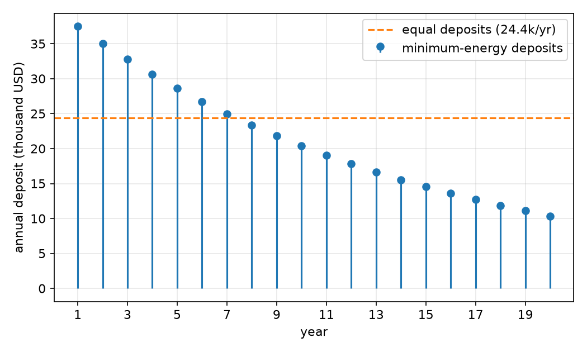
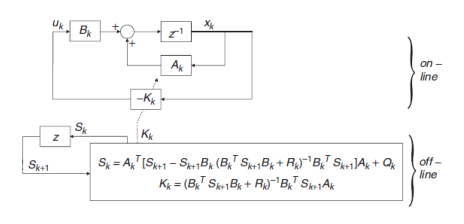
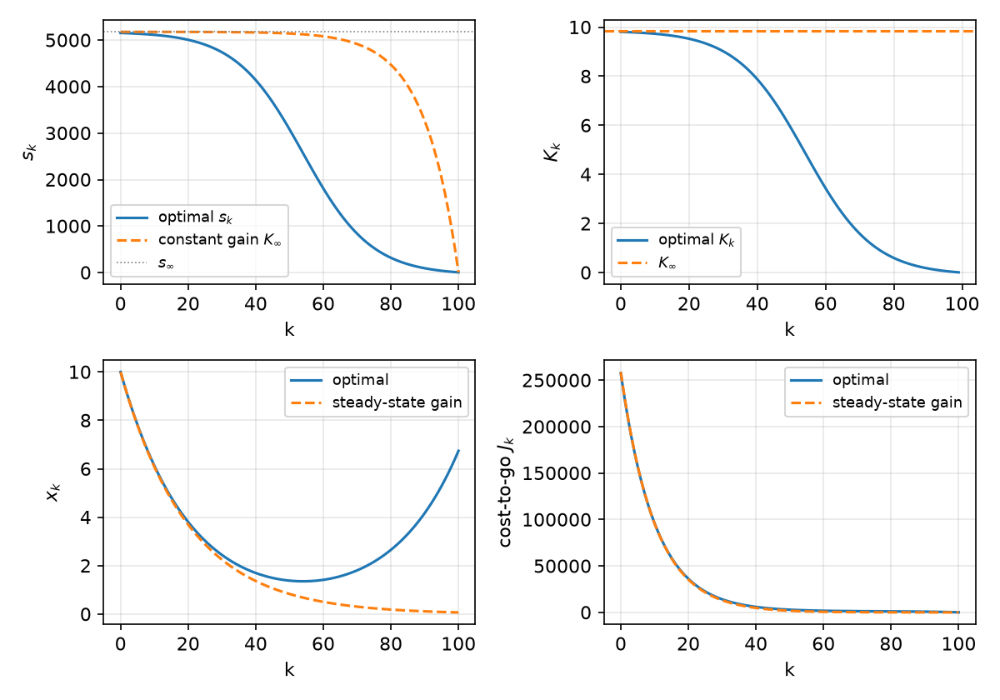
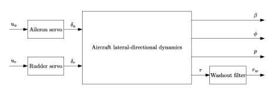
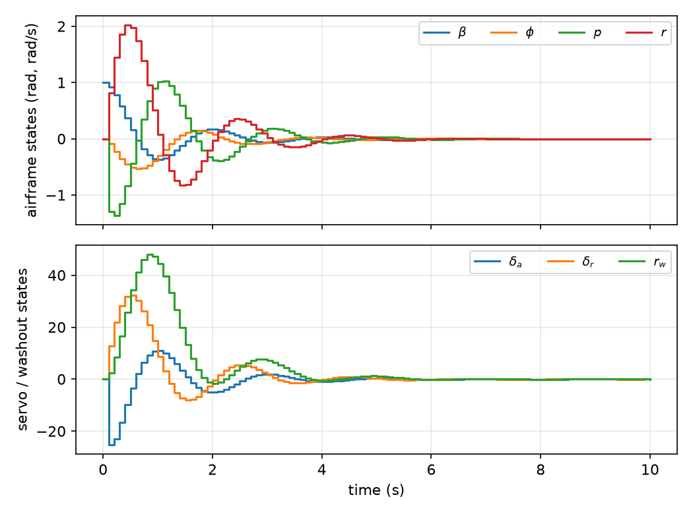

# Discrete-Time Optimal Control and LQR

Most controllers run on digital computers, so the natural first setting for optimal control is a system that evolves in discrete steps. Discrete time is also the cleanest bridge between the finite-dimensional constrained optimization of [Optimization](optimization.md) and the infinite-dimensional calculus of variations: a discrete optimal-control problem *is* a static optimization problem with a long chain of equality constraints, one per time step, and the Lagrange multipliers of those constraints become the **costate**. This chapter derives the discrete Hamiltonian and its necessary conditions, works scalar and nonlinear examples, and then specializes to linear plants with quadratic cost. There the two-point boundary-value problem can be solved exactly, either with a reachability Gramian (fixed final state, open-loop control) or with a backward Riccati recursion (free final state, time-varying state feedback). The chapter ends with the steady-state regulator, the algebraic Riccati equation, and an autopilot design for the F-16.

## The Discrete-Time Optimal Control Problem

The plant is a possibly nonlinear, time-varying difference equation
\\[
x\_{k+1} = f^k(x\_k, u\_k), \qquad x\_i \text{ given}, \qquad x\_k \in \mathbb{R}^n,\ u\_k \in \mathbb{R}^m .
\\]
The superscript \\(k\\) on \\(f^k\\) allows the dynamics to change with time. The continuous-time cost \\(J = \phi(x(T),T) + \int L\\,dt\\) becomes a sum of stage costs plus a terminal cost:
\\[
J\_i = \phi(N, x\_N) + \sum\_{k=i}^{N-1} L^k(x\_k, u\_k).
\\]
The problem is to find the control sequence \\(u\_i^\star, \dots, u\_{N-1}^\star\\), and with it the optimal trajectory \\(x\_k^\star\\), that minimizes \\(J\_i\\) subject to the dynamics. We write \\(J^\star = \min\_{u} J\_i\\) and \\(u^\star = \arg\min\_{u} J\_i\\). The horizon \\(N\\) is fixed throughout this chapter.

### Useful performance indices

The choice of \\(L^k\\) and \\(\phi\\) encodes what "best" means:

- **Minimum time** (e.g. intercepting a missile): \\(L^k = 1\\), \\(\phi = 0\\). The cost counts steps.
- **Minimum fuel** (e.g. driving with as little fuel as possible): \\(L^k = \lvert u\_k \rvert\\) (or \\(\sum\_j \lvert u\_{k,j} \rvert\\)), \\(\phi = 0\\). Fuel flow is proportional to the magnitude of thrust.
- **Quadratic (minimum-energy) regulation**: \\(L^k = \tfrac12 (x\_k^T Q x\_k + u\_k^T R u\_k)\\), \\(\phi = \tfrac12 x\_N^T S\_N x\_N\\). This keeps both the state and the control near zero.

The quadratic index dominates practice, partly for its mathematical properties (it leads to linear feedback, as we shall see) and partly because it expresses the basic engineering trade-off directly: the \\(Q\\) term penalizes poor regulation, the \\(R\\) term penalizes control effort, and the terminal weight \\(S\_N\\) adds a second trade-off between the transient and the final value.

**Selecting \\(Q\\) and \\(R\\).** The weights act through their relative sizes.

- Increasing \\(Q\\) (or one diagonal entry) penalizes deviation of the states (or that state) more heavily, and the optimal controller drives them to zero more aggressively.
- A large \\(R\\) means that control is **expensive**: the controller stabilizes the plant using little energy, accepting slower state decay. A small \\(R\\) is **cheap control**: large inputs are allowed.
- A practical starting point is \\(Q = I\\), tuning only \\(R\\); a larger \\(R\\) limits the control signal. A better physically motivated start is Bryson's rule, given at the end of the chapter.

## Necessary Conditions: The Discrete Hamiltonian

### Adjoining the dynamics

Each time step contributes an \\(n\\)-vector equality constraint \\(f^k(x\_k,u\_k) - x\_{k+1} = 0\\). Adjoin it to the cost with a multiplier \\(\lambda\_{k+1} \in \mathbb{R}^n\\):
\\[
J' = \phi(N, x\_N) + \sum\_{k=i}^{N-1} \Big[ L^k(x\_k,u\_k) + \lambda\_{k+1}^T \big( f^k(x\_k,u\_k) - x\_{k+1} \big) \Big].
\\]
The multiplier of the constraint that produces \\(x\_{k+1}\\) is indexed \\(k+1\\); this pairing is only a convention, but it makes the final equations symmetric. Define the **Hamiltonian** at step \\(k\\),
\\[
H^k(x\_k, u\_k) = L^k(x\_k, u\_k) + \lambda\_{k+1}^T f^k(x\_k, u\_k).
\\]
There is one Hamiltonian per time step, and \\(x\_{k+1}\\) does not appear in it. Shifting the index in the sum \\(\sum\_{k=i}^{N-1} \lambda\_{k+1}^T x\_{k+1} = \sum\_{k=i+1}^{N} \lambda\_k^T x\_k\\) and separating the end terms,
\\[
J' = \phi(N, x\_N) - \lambda\_N^T x\_N + H^i(x\_i, u\_i) + \sum\_{k=i+1}^{N-1} \big[ H^k(x\_k, u\_k) - \lambda\_k^T x\_k \big].
\\]

### The first-order increment

With \\(N\\) fixed, the increment of \\(J'\\) caused by increments in all its arguments \\(x\_k, u\_k, \lambda\_k\\) is
\\[
\begin{aligned}
dJ' ={}& (\phi\_{x\_N} - \lambda\_N)^T dx\_N + (H^i\_{x\_i})^T dx\_i + (H^i\_{u\_i})^T du\_i \\\\
&+ \sum\_{k=i+1}^{N-1} \Big[ (H^k\_{x\_k} - \lambda\_k)^T dx\_k + (H^k\_{u\_k})^T du\_k \Big] + \sum\_{k=i+1}^{N} (H^{k-1}\_{\lambda\_k} - x\_k)^T d\lambda\_k ,
\end{aligned}
\\]
where subscripts denote partial derivatives (gradients as column vectors). At a constrained minimum \\(dJ' = 0\\) for all admissible increments. Because the multipliers make the increments \\(dx\_k\\), \\(du\_k\\), \\(d\lambda\_k\\) independent, each coefficient must vanish separately.

**Theorem (Necessary conditions for discrete-time optimal control).** Let \\(f^k\\) and \\(L^k\\) be continuously differentiable and \\(\phi\\) differentiable. If \\(u^\star\\) minimizes \\(J\_i\\) with \\(N\\) fixed, there exist costates \\(\lambda\_{i+1}, \dots, \lambda\_N\\) such that, for \\(k = i, \dots, N-1\\),
\\[
x\_{k+1} = \frac{\partial H^k}{\partial \lambda\_{k+1}} = f^k(x\_k,u\_k), \qquad
\lambda\_k = \frac{\partial H^k}{\partial x\_k} = \Big(\frac{\partial f^k}{\partial x\_k}\Big)^T \lambda\_{k+1} + \frac{\partial L^k}{\partial x\_k}, \qquad
0 = \frac{\partial H^k}{\partial u\_k} = \Big(\frac{\partial f^k}{\partial u\_k}\Big)^T \lambda\_{k+1} + \frac{\partial L^k}{\partial u\_k},
\\]
together with the boundary conditions
\\[
\Big( \frac{\partial \phi}{\partial x\_N} - \lambda\_N \Big)^T dx\_N = 0, \qquad \Big( \frac{\partial H^i}{\partial x\_i} \Big)^T dx\_i = 0 .
\\]

The three equations are the **state equation** (forward in time), the **costate equation** (backward in time), and the **stationarity condition**. Stationarity is a set of \\(m\\) algebraic equations that, in principle, gives \\(u\_k\\) as a function of \\(x\_k\\) and \\(\lambda\_{k+1}\\).

### Boundary conditions

The state recursion needs \\(n\\) conditions and the costate recursion another \\(n\\), but they live at **opposite ends** of the interval: the state is known at the start, and the costate is determined at the end. The necessary conditions therefore form a **two-point boundary-value problem (TPBVP)**.

- *Initial end.* If the initial state is fixed, \\(dx\_i = 0\\) and the second boundary condition is automatic. If \\(x\_i\\) were free, we would need \\(\partial H^i / \partial x\_i = 0\\).
- *Final end, fixed state.* If \\(x\_N\\) is prescribed, \\(dx\_N = 0\\) and the condition is satisfied for any \\(\lambda\_N\\); the \\(n\\) final conditions are the prescribed values of \\(x\_N\\) themselves, and \\(\lambda\_N\\) is an unknown to be found.
- *Final end, free state.* If \\(x\_N\\) is free, \\(dx\_N\\) is arbitrary and the coefficient must vanish:
\\[
\lambda\_N = \frac{\partial \phi}{\partial x\_N} .
\\]
  This is a terminal condition on the *costate*.

**Summary recipe.** Given \\(x\_{k+1} = f^k(x\_k,u\_k)\\) and \\(J\_i = \phi(N,x\_N) + \sum\_{k=i}^{N-1} L^k\\):

1. Form \\(H^k = L^k + \lambda\_{k+1}^T f^k\\).
2. Write the state equation, the costate equation \\(\lambda\_k = (f^k\_{x})^T \lambda\_{k+1} + L^k\_x\\), and the stationarity condition \\(0 = (f^k\_u)^T \lambda\_{k+1} + L^k\_u\\).
3. Solve stationarity for \\(u\_k\\) and substitute, leaving a coupled state–costate recursion.
4. Impose \\(x\_i\\) given and either \\(x\_N\\) given (fixed final state) or \\(\lambda\_N = \phi\_{x\_N}\\) (free final state), and solve the TPBVP.

### A static warm-up: closest approach of a meteor

Before any dynamics, the multiplier machinery is just Lagrange's method. **Example (Meteor).** A meteor moves along the curve \\(y = x^2 + 3x - 6\\) (Earth at the origin) and a space station sits at \\((2,2)\\). Find the point of closest approach, restricted to the quadrant \\(x \ge 0\\), \\(y \ge 0\\).

Minimize \\(J = (x-2)^2 + (y-2)^2\\) subject to \\(x^2 + 3x - 6 - y = 0\\). Adjoin the equality with \\(\lambda\_1\\) and the inequalities with \\(\lambda\_2, \lambda\_3\\):
\\[
H = (x-2)^2 + (y-2)^2 + \lambda\_1 (x^2 + 3x - 6 - y) + \lambda\_2 x + \lambda\_3 y .
\\]
Stationarity:
\\[
H\_x = 2(x-2) + 2\lambda\_1 x + 3\lambda\_1 + \lambda\_2 = 0, \qquad H\_y = 2(y-2) - \lambda\_1 + \lambda\_3 = 0 .
\\]
Assume first that the inequalities are inactive (\\(\lambda\_2 = \lambda\_3 = 0\\)) and check afterwards. Then \\(\lambda\_1 = 2(y-2)\\) and
\\[
x = \frac{4 - 3\lambda\_1}{2(1+\lambda\_1)} = \frac{4 - 6y + 12}{4y - 6} = \frac{8 - 3y}{2y - 3}.
\\]
Combining with the constraint gives a cubic whose three real roots are \\((x,y) = (-1.68, -8.22)\\), \\((1.71, 2.05)\\) and \\((-4.53, 0.92)\\). Only the second lies in the quadrant, where the inequality constraints are indeed slack, so
\\[
(x^\star, y^\star) = (1.709,\ 2.045), \qquad J^\star = 0.0869, \qquad \text{distance} = \sqrt{J^\star} \approx 0.295 .
\\]
(At this point \\(\lambda\_1 = 2(y^\star - 2) \approx 0.091\\).) The same steps can be scripted symbolically:

```matlab
syms x y l
f = x^2 + 3*x - 6 - y;  J = (x-2)^2 + (y-2)^2;  H = J + l*f;
Hx = diff(H,x);  Hy = diff(H,y);
l = solve(Hy,'l');  y = solve(f,'y');
xeq = simplify(subs(subs(Hx,'l',l),'y',y));   % polynomial in x
xs = roots(sym2poly(xeq));                     % keep the root with x>0
```

The dynamic problems below have exactly this structure, with one equality constraint per time step.

## Scalar Example: Fixed and Free Final State

**Example (Scalar minimum-energy transfer).** Consider \\(x\_{k+1} = a x\_k + b u\_k\\) with \\(x\_0\\) given and the control-energy cost \\(J\_0 = \tfrac{r}{2} \sum\_{k=0}^{N-1} u\_k^2\\), \\(r > 0\\), \\(a \ne \pm 1\\).

*Necessary conditions.* With \\(H^k = \tfrac{r}{2} u\_k^2 + \lambda\_{k+1}(a x\_k + b u\_k)\\):
\\[
x\_{k+1} = a x\_k + b u\_k, \qquad \lambda\_k = a \lambda\_{k+1}, \qquad 0 = r u\_k + b \lambda\_{k+1} .
\\]
So \\(u\_k = -\tfrac{b}{r} \lambda\_{k+1}\\) and, with \\(\gamma := b^2/r\\), the state recursion becomes \\(x\_{k+1} = a x\_k - \gamma \lambda\_{k+1}\\). The costate equation does not involve \\(x\\) and integrates backward at once: \\(\lambda\_k = a^{N-k} \lambda\_N\\), with \\(\lambda\_N\\) still unknown. Hence \\(x\_{k+1} = a x\_k - \gamma a^{N-k-1} \lambda\_N\\), whose solution is
\\[
x\_k = a^k x\_0 - \gamma \lambda\_N \sum\_{i=0}^{k-1} a^{k-i-1} a^{N-i-1}
= a^k x\_0 - \gamma \lambda\_N a^{N+k-2} \sum\_{i=0}^{k-1} a^{-2i}
= a^k x\_0 - \gamma \lambda\_N a^{N-k} \frac{1 - a^{2k}}{1 - a^2}.
\\]
At \\(k = N\\) this reads
\\[
x\_N = a^N x\_0 - \Lambda \lambda\_N, \qquad \Lambda := \frac{b^2}{r} \frac{1 - a^{2N}}{1 - a^2} = \frac{b^2}{r} \sum\_{i=0}^{N-1} a^{2i} .
\\]
\\(\Lambda\\) is the scalar **reachability Gramian** weighted by \\(b^2/r\\). Everything now hinges on the terminal boundary condition. Define the *miss distance* \\(D := r\_N - a^N x\_0\\), the gap between the target \\(r\_N\\) and where the plant would drift with no control.

**(a) Fixed final state \\(x\_N = r\_N\\).** Here \\(dx\_N = 0\\), and the terminal condition is the value \\(x\_N = r\_N\\) itself. From \\(r\_N = a^N x\_0 - \Lambda \lambda\_N\\), \\(\lambda\_N = -D/\Lambda\\). Back-substituting,
\\[
\lambda\_k = -\frac{D}{\Lambda} a^{N-k}, \qquad u\_k^\star = \frac{b}{r\Lambda} D\\, a^{N-k-1},
\\]
\\[
x\_k^\star = \frac{(1 - a^{2(N-k)}) a^k x\_0 + (1 - a^{2k}) a^{N-k} r\_N}{1 - a^{2N}}, \qquad J\_0^\star = \frac{D^2}{2\Lambda} .
\\]
The cost follows from \\(\tfrac{r}{2}\sum u\_k^2 = \tfrac{r}{2} \tfrac{b^2 D^2}{r^2 \Lambda^2} \sum a^{2(N-k-1)} = \tfrac{D^2}{2\Lambda^2} \Lambda\\). The control is open-loop: a precomputed sequence proportional to the miss distance and inversely proportional to the Gramian. If the plant is barely controllable (small \\(\Lambda\\)), the transfer is expensive.

**(b) Free final state with a soft terminal constraint.** Replace the hard constraint by a terminal penalty,
\\[
J\_0 = \tfrac12 (r\_N - x\_N)^2 + \tfrac{r}{2} \sum\_{k=0}^{N-1} u\_k^2 .
\\]
The Hamiltonian and recursions are unchanged; only the terminal condition changes, to \\(\lambda\_N = \partial\phi/\partial x\_N = x\_N - r\_N\\). Substituting into \\(x\_N = a^N x\_0 - \Lambda \lambda\_N\\) and solving,
\\[
x\_N = \frac{\Lambda r\_N + a^N x\_0}{1 + \Lambda}, \qquad \lambda\_N = -\frac{D}{1 + \Lambda}, \qquad \lambda\_k = -\frac{D}{1 + \Lambda} a^{N-k},
\\]
\\[
u\_k^\star = \frac{b}{r(1+\Lambda)} D\\, a^{N-k-1}, \qquad x\_{k+1}^\star = a x\_k^\star + \frac{b^2}{r(1+\Lambda)} D\\, a^{N-k-1}.
\\]
The final state is now a weighted average of the target \\(r\_N\\) and the drift point \\(a^N x\_0\\), with weights \\(\Lambda\\) and \\(1\\). The optimal cost has two parts: the control energy \\(\tfrac{r}{2}\sum u\_k^2 = \frac{\Lambda D^2}{2(1+\Lambda)^2}\\) and the terminal miss \\(\tfrac12 (r\_N - x\_N)^2 = \frac{D^2}{2(1+\Lambda)^2}\\). Their sum is
\\[
J\_0^\star = \frac{D^2}{2(1 + \Lambda)} .
\\]
If the terminal penalty is \\(\tfrac{s}{2}(r\_N - x\_N)^2\\) instead, the same steps give \\(J\_0^\star = D^2 / (2(1/s + \Lambda))\\), and letting \\(s \to \infty\\) recovers the fixed-final-state result \\(D^2/(2\Lambda)\\). The soft constraint is the hard constraint with a finite price on missing.

## A Nonlinear Example: Bilinear Systems

The recipe applies unchanged to nonlinear plants; only the TPBVP becomes harder.

**Example (Bilinear system, general form).** Consider
\\[
x\_{k+1} = A x\_k + D x\_k u\_k + b u\_k, \qquad x \in \mathbb{R}^n,\ u \in \mathbb{R},
\\]
\\[
J\_0 = x\_N^T S\_N x\_N + \sum\_{k=0}^{N-1} (x\_k^T Q x\_k + r u\_k^2), \qquad S\_N \succeq 0,\ Q \succeq 0,\ r > 0 .
\\]
The Hamiltonian is \\(H^k = x\_k^T Q x\_k + r u\_k^2 + \lambda\_{k+1}^T (A x\_k + D x\_k u\_k + b u\_k)\\), and
\\[
\lambda\_k = \Big(\frac{\partial H^k}{\partial x\_k}\Big)^T = 2Q x\_k + (A^T + u\_k D^T) \lambda\_{k+1}, \qquad \lambda\_N = \frac{\partial \phi}{\partial x\_N} = 2 S\_N x\_N,
\\]
\\[
0 = \frac{\partial H^k}{\partial u\_k} = 2 r u\_k + \lambda\_{k+1}^T (D x\_k + b) \quad\Longrightarrow\quad u\_k = -\frac{1}{2r} \lambda\_{k+1}^T (D x\_k + b).
\\]
Eliminating \\(u\_k\\) leaves the nonlinear TPBVP
\\[
x\_{k+1} = A x\_k - \frac{1}{2r} (D x\_k + b) (D x\_k + b)^T \lambda\_{k+1}, \qquad
\lambda\_k = 2 Q x\_k + \Big( A^T - \frac{1}{2r} \lambda\_{k+1}^T (D x\_k + b) D^T \Big) \lambda\_{k+1},
\\]
with \\(x\_0\\) given and \\(\lambda\_N = 2 S\_N x\_N\\). Unlike the linear-quadratic case, no linear relation between \\(\lambda\_k\\) and \\(x\_k\\) is guaranteed, and the problem must generally be solved iteratively.

**Example (Bilinear system, two steps).** Take \\(x\_{k+1} = x\_k u\_k + 1\\), \\(J\_0 = \tfrac12 \sum\_{k=0}^{N-1} u\_k^2\\), \\(N = 2\\), \\(x\_0 = 1\\), and the fixed final state \\(x\_2 = 0\\).

With \\(H^k = \tfrac12 u\_k^2 + \lambda\_{k+1}(x\_k u\_k + 1)\\):
\\[
\frac{\partial H^k}{\partial u\_k} = u\_k + \lambda\_{k+1} x\_k = 0 \Rightarrow u\_k = -\lambda\_{k+1} x\_k, \qquad
\lambda\_k = \lambda\_{k+1} u\_k = -x\_k \lambda\_{k+1}^2, \qquad x\_{k+1} = 1 - \lambda\_{k+1} x\_k^2 .
\\]
Write the two steps out. From \\(x\_1 = 1 - \lambda\_1 x\_0^2\\) and \\(\lambda\_1 = -x\_1 \lambda\_2^2\\), \\(x\_1 = 1 + x\_1 \lambda\_2^2 x\_0^2\\), so with \\(x\_0 = 1\\)
\\[
x\_1 = \frac{1}{1 - \lambda\_2^2}, \qquad \lambda\_1 = -\frac{\lambda\_2^2}{1 - \lambda\_2^2}.
\\]
The terminal condition \\(x\_2 = 1 - \lambda\_2 x\_1^2 = 0\\) requires \\(\lambda\_2 = 1/x\_1^2 = (1 - \lambda\_2^2)^2\\), the quartic \\(\lambda\_2^4 - 2\lambda\_2^2 - \lambda\_2 + 1 = 0\\). It has two real roots, \\(\lambda\_2 = 0.525\\) and \\(\lambda\_2 = 1.490\\). Both satisfy the necessary conditions; the cost decides:

| \\(\lambda\_2\\) | \\(x\_1\\) | \\(u\_0\\) | \\(u\_1\\) | \\(J\_0\\) |
|---|---|---|---|---|
| 0.525 | 1.380 | 0.380 | −0.724 | 0.335 |
| 1.490 | −0.819 | −1.819 | 1.221 | 2.400 |

So \\(\lambda\_2^\star = 0.525\\), \\(\lambda\_1^\star = -0.380\\), \\(u\_0^\star = 0.380\\), \\(u\_1^\star = -0.724\\), \\(x\_1^\star = 1.380\\), and \\(J\_0^\star = 0.335\\). (Check: \\(x\_1 = x\_0 u\_0 + 1 = 1.380\\), and \\(u\_1 = -1/x\_1\\) makes \\(x\_2 = x\_1 u\_1 + 1 = 0\\).) Nonlinear problems can have several extremals, and the necessary conditions alone do not say which one is the minimum.

## The Discrete Linear-Quadratic Regulator

From here on the plant is linear and the cost quadratic. This is the case in which the TPBVP can be solved in closed form.

### Problem statement

\\[
x\_{k+1} = A x\_k + B u\_k, \qquad x\_0 \text{ given},
\\]
\\[
J = \tfrac12 x\_N^T S\_N x\_N + \tfrac12 \sum\_{k=0}^{N-1} \big[ x\_k^T Q x\_k + u\_k^T R u\_k \big], \qquad S\_N \succeq 0,\ Q \succeq 0,\ R \succ 0 ,
\\]
with \\(Q\\), \\(R\\), \\(S\_N\\) symmetric. Semidefiniteness makes each quadratic term a (weighted) squared distance from zero, so the cost is bounded below; \\(R \succ 0\\) is needed to solve for the control.

### The Hamiltonian system

The Hamiltonian is \\(H^k = \tfrac12 (x\_k^T Q x\_k + u\_k^T R u\_k) + \lambda\_{k+1}^T (A x\_k + B u\_k)\\), and the necessary conditions are
\\[
x\_{k+1} = A x\_k + B u\_k, \qquad \lambda\_k = Q x\_k + A^T \lambda\_{k+1}, \qquad 0 = R u\_k + B^T \lambda\_{k+1},
\\]
\\[
0 = (S\_N x\_N - \lambda\_N)^T dx\_N, \qquad x\_0 \text{ given}.
\\]
Since \\(R\\) is invertible, stationarity gives
\\[
u\_k = -R^{-1} B^T \lambda\_{k+1},
\\]
and substituting yields the linear **Hamiltonian system**
\\[
\begin{bmatrix} x\_{k+1} \\\\ \lambda\_k \end{bmatrix} =
\begin{bmatrix} A & -B R^{-1} B^T \\\\ Q & A^T \end{bmatrix}
\begin{bmatrix} x\_k \\\\ \lambda\_{k+1} \end{bmatrix}.
\\]
It needs \\(2n\\) boundary values: \\(n\\) from \\(x\_0\\), and \\(n\\) at the final time, either the prescribed \\(x\_N\\) or \\(\lambda\_N = S\_N x\_N\\). The two cases lead to structurally different controllers, treated in turn below.

### The cost of doing nothing: the Lyapunov difference equation

As a baseline, evaluate the cost of the zero input \\(u \equiv 0\\) backward from \\(N\\):
\\[
J\_N = \tfrac12 x\_N^T S\_N x\_N, \qquad
J\_{N-1} = \tfrac12 x\_N^T S\_N x\_N + \tfrac12 x\_{N-1}^T Q x\_{N-1} = \tfrac12 x\_{N-1}^T (A^T S\_N A + Q) x\_{N-1}, \ \dots
\\]
Defining \\(S\_{N-1} := A^T S\_N A + Q\\) and continuing gives the **Lyapunov difference equation**
\\[
S\_k = A^T S\_{k+1} A + Q, \qquad J\_k = \tfrac12 x\_k^T S\_k x\_k ,
\\]
with explicit solution
\\[
S\_k = (A^T)^{N-k} S\_N A^{N-k} + \sum\_{i=k}^{N-1} (A^T)^{N-i-1} Q A^{N-i-1}.
\\]

If the plant is stable, the uncontrolled cost over an infinite horizon is finite: \\(J\_\infty = \tfrac12 x\_0^T S\_\infty x\_0\\) with \\(S\_\infty = \lim\_{N-k \to \infty} S\_k\\), and \\(S\_\infty\\) satisfies the **algebraic Lyapunov equation**
\\[
S = A^T S A + Q .
\\]
Standard facts about this equation (see [Stability](../me6401-linear-control/stability.md)):

- If \\(A\\) is stable (all eigenvalues inside the unit circle) and \\(Q \succeq 0\\), a solution \\(S \succeq 0\\) exists, namely \\(S = \sum\_{j \ge 0} (A^T)^j Q A^j\\).
- If \\(A\\) is stable and \\((A, \sqrt{Q})\\) is observable, the solution is unique and \\(S \succ 0\\).
- If the plant is unstable, the cost is generally infinite, depending on \\(Q\\). Trivially, with \\(Q = 0\\) the cost is exactly zero even though the state blows up, which is why an observability-type condition on \\((A, \sqrt{Q})\\) keeps reappearing.
- Specialized solvers exist, e.g. MATLAB `dlyap` or `scipy.linalg.solve_discrete_lyapunov`.

## Fixed Final State: Open-Loop Minimum-Energy Control

Suppose the final state must equal a target, \\(x\_N = r\_N\\), so \\(dx\_N = 0\\). To isolate the role of the boundary condition take \\(Q = 0\\), so that \\(J = \tfrac12 \sum\_{k=0}^{N-1} u\_k^T R u\_k\\) is pure control energy. The Hamiltonian system becomes triangular:
\\[
\begin{bmatrix} x\_{k+1} \\\\ \lambda\_k \end{bmatrix} =
\begin{bmatrix} A & -B R^{-1} B^T \\\\ 0 & A^T \end{bmatrix}
\begin{bmatrix} x\_k \\\\ \lambda\_{k+1} \end{bmatrix}.
\\]
The costate equation integrates backward independently: \\(\lambda\_k = (A^T)^{N-k} \lambda\_N\\). Substituting into the state equation and solving forward,
\\[
x\_k = A^k x\_0 - \sum\_{i=0}^{k-1} A^{k-1-i} B R^{-1} B^T (A^T)^{N-i-1} \lambda\_N .
\\]
At \\(k = N\\), with the **weighted reachability Gramian**
\\[
G := \sum\_{i=0}^{N-1} A^{N-1-i} B R^{-1} B^T (A^T)^{N-1-i},
\\]
the terminal condition reads \\(r\_N = A^N x\_0 - G \lambda\_N\\). If \\(G\\) is invertible,
\\[
\lambda\_N = -G^{-1} (r\_N - A^N x\_0),
\\]
and the optimal control is
\\[
\boxed{u\_k^\star = R^{-1} B^T (A^T)^{N-k-1} G^{-1} (r\_N - A^N x\_0), \qquad k = 0, \dots, N-1.}
\\]
The minimum energy follows by substituting: \\(\tfrac12 \sum u\_k^{\star T} R u\_k^\star = \tfrac12 d^T G^{-1} \big( \sum\_k A^{N-k-1} B R^{-1} B^T (A^T)^{N-k-1} \big) G^{-1} d\\), with \\(d := r\_N - A^N x\_0\\), so
\\[
J^\star = \tfrac12 (r\_N - A^N x\_0)^T G^{-1} (r\_N - A^N x\_0).
\\]

Three remarks explain the structure.

- **The miss distance.** The control is proportional to \\(r\_N - A^N x\_0\\): the farther the target lies from where the system would drift on its own, the more control is needed. If the target happens to be the drift point, \\(u^\star = 0\\).
- **Controllability.** The control involves \\(G^{-1}\\). Compare \\(G\\) with the classical discrete reachability Gramian \\(\sum\_{k} A^k B B^T (A^T)^k\\): with \\(R = I\\), \\(G\\) is its \\(N\\)-term truncation. By the Cayley–Hamilton theorem, every power \\(A^j\\) with \\(j \ge n\\) is a linear combination of \\(I, A, \dots, A^{n-1}\\), so terms beyond \\(n\\) cannot raise the rank. Hence \\(G\\) is invertible for \\(N \ge n\\) exactly when \\((A,B)\\) is controllable (reachable). Before looking for the *best* transfer we must know that *some* control transfers an arbitrary initial state to an arbitrary final state in finite time; see [Controllability](../me6401-linear-control/controllability.md).
- **Open loop.** The control sequence is computed once from \\(x\_0\\) and \\(r\_N\\) and then played back. It contains no feedback, so it does not correct for disturbances or model error.

**Example (Saving for a house).** To accumulate \\(r\_N = \\$1{,}000{,}000\\) in \\(N = 20\\) years at 7% annual interest, starting from nothing, model the balance as \\(x\_{k+1} = 1.07\\, x\_k + u\_k\\), \\(x\_0 = 0\\), where \\(u\_k\\) is the deposit in year \\(k+1\\). The "energy" \\(\sum u\_k^2\\) penalizes large deposits. Here \\(A = 1.07\\), \\(B = R = 1\\), so
\\[
G = \sum\_{k=0}^{19} 1.07^{2(19-k)} = \frac{1.07^{40} - 1}{1.07^2 - 1} = 96.44, \qquad u\_k^\star = \frac{1.07^{19-k}}{G} r\_N .
\\]
The first deposit is \\(u\_0^\star = \\$37{,}500\\) and the last \\(u\_{19}^\star = r\_N/G = \\$10{,}369\\); the deposits fall geometrically by the factor \\(1/1.07\\) each year. Money deposited early earns interest longer, so the optimal schedule front-loads it. The deposits total \\(\\$425{,}079\\), against \\(20 \times \\$24{,}393 = \\$487{,}859\\) for twenty equal deposits reaching the same target.

```matlab
A = 1.07; N = 20; rN = 1e6; k = 0:(N-1);
G = sum(A.^(2*(N-1-k)));
u = A.^(N-1-k)/G*rN;
stem(k+1,u); xlabel('Year of investment'); ylabel('Annual investment')
```

```python
import numpy as np
A, N, rN = 1.07, 20, 1e6
k = np.arange(N)
G = np.sum(A**(2*(N-1-k)))
u = A**(N-1-k) / G * rN          # u[0] = 37499.5, u[-1] = 10368.9
```



*Figure: minimum-energy saving schedule that reaches \$1M after 20 years at 7% interest. Deposits shrink geometrically because early money compounds longer; the dashed line is the equal deposit that reaches the same target.*

## Free Final State: The Sweep Method and the Riccati Recursion

Now let the final state be free, penalized by \\(\tfrac12 x\_N^T S\_N x\_N\\). The necessary conditions are
\\[
x\_{k+1} = A x\_k - B R^{-1} B^T \lambda\_{k+1}, \qquad \lambda\_k = Q x\_k + A^T \lambda\_{k+1}, \qquad u\_k = -R^{-1} B^T \lambda\_{k+1},
\\]
with \\(x\_0\\) given and \\(\lambda\_N = S\_N x\_N\\).

### The sweep assumption

At the final time the costate is a *linear function of the state*, \\(\lambda\_N = S\_N x\_N\\). The **sweep method** guesses that this linear relation holds at every time,
\\[
\lambda\_k = S\_k x\_k ,
\\]
for some matrix sequence \\(S\_k\\) still to be found, and then checks that the guess is consistent. Substitute it into the state equation:
\\[
x\_{k+1} = A x\_k - B R^{-1} B^T S\_{k+1} x\_{k+1}
\quad\Longrightarrow\quad
x\_{k+1} = \big[ I + B R^{-1} B^T S\_{k+1} \big]^{-1} A x\_k .
\\]
Substitute it into the costate equation and use the last result:
\\[
S\_k x\_k = Q x\_k + A^T S\_{k+1} x\_{k+1} = Q x\_k + A^T S\_{k+1} \big[ I + B R^{-1} B^T S\_{k+1} \big]^{-1} A x\_k .
\\]
This must hold for every \\(x\_k\\) (the initial state is arbitrary), so the guess is consistent provided
\\[
\boxed{S\_k = Q + A^T S\_{k+1} \big[ I + B R^{-1} B^T S\_{k+1} \big]^{-1} A, \qquad S\_N \text{ given}.}
\\]
This is the discrete **Riccati difference equation**. It is solved *backward* from \\(S\_N\\), off-line, before the system runs. The name "sweep" describes the computation: the boundary condition at \\(N\\) is swept backward to every earlier time.

### The causal feedback law

The control \\(u\_k = -R^{-1} B^T \lambda\_{k+1} = -R^{-1} B^T S\_{k+1} x\_{k+1}\\) is not yet implementable, because it uses the future state. Substitute \\(x\_{k+1} = A x\_k + B u\_k\\):
\\[
u\_k = -R^{-1} B^T S\_{k+1} (A x\_k + B u\_k)
\quad\Longrightarrow\quad
\big( I + R^{-1} B^T S\_{k+1} B \big) u\_k = -R^{-1} B^T S\_{k+1} A x\_k .
\\]
Multiplying by \\(R\\) on the left,
\\[
\boxed{u\_k = -K\_k x\_k, \qquad K\_k = \big( B^T S\_{k+1} B + R \big)^{-1} B^T S\_{k+1} A .}
\\]
The bracket \\(I + R^{-1} B^T S\_{k+1} B\\) is \\(m \times m\\); the inverse \\(\big(B^T S\_{k+1} B + R\big)^{-1}\\) exists because \\(R \succ 0\\) and \\(S\_{k+1} \succeq 0\\). The matrix \\(K\_k\\) is often called the **Kalman gain**. The optimal control of the free-final-state problem is a **time-varying linear state feedback**, even though the problem statement asked only for a control sequence.

### Equivalent forms of the Riccati equation

The push-through identity
\\[
\big[ I + B R^{-1} B^T S \big]^{-1} = I - B \big( R + B^T S B \big)^{-1} B^T S
\\]
can be checked by multiplying out: \\((I + BR^{-1}B^TS)(I - B(R+B^TSB)^{-1}B^TS) = I + BR^{-1}\big[ (R + B^TSB) - R - B^TSB \big] \\, (R+B^TSB)^{-1}B^TS = I\\). It needs no invertibility of \\(S\\). Applying it to the boxed recursion gives the more common form
\\[
S\_k = A^T \Big[ S\_{k+1} - S\_{k+1} B \big( B^T S\_{k+1} B + R \big)^{-1} B^T S\_{k+1} \Big] A + Q ,
\\]
and, using the gain, the compact (Joseph-like) form
\\[
K\_k = \big( B^T S\_{k+1} B + R \big)^{-1} B^T S\_{k+1} A, \qquad S\_k = A^T S\_{k+1} (A - B K\_k) + Q .
\\]



*Figure: implementation of the free-final-state discrete LQ regulator (after Lewis, Vrabie and Syrmos). The off-line part (bottom) runs the Riccati recursion backward from S_N and stores the gains K_k; the on-line part (top) only applies the time-varying feedback u_k = -K_k x_k.*

### Second-order conditions and the optimal cost

The necessary conditions identify a stationary point. To show it is a minimum, and to find the minimum value, use the device of "adding zero". The telescoping identity
\\[
\tfrac12 \sum\_{k=0}^{N-1} \big( x\_{k+1}^T S\_{k+1} x\_{k+1} - x\_k^T S\_k x\_k \big) = \tfrac12 x\_N^T S\_N x\_N - \tfrac12 x\_0^T S\_0 x\_0
\\]
holds for any sequence \\(S\_k\\). Use it to replace the terminal term in \\(J\\):
\\[
J = \tfrac12 x\_0^T S\_0 x\_0 + \tfrac12 \sum\_{k=0}^{N-1} \big[ x\_{k+1}^T S\_{k+1} x\_{k+1} + x\_k^T (Q - S\_k) x\_k + u\_k^T R u\_k \big].
\\]
Substitute \\(x\_{k+1} = A x\_k + B u\_k\\):
\\[
J = \tfrac12 x\_0^T S\_0 x\_0 + \tfrac12 \sum\_{k=0}^{N-1} \Big[ x\_k^T (A^T S\_{k+1} A + Q - S\_k) x\_k + x\_k^T A^T S\_{k+1} B u\_k + u\_k^T B^T S\_{k+1} A x\_k + u\_k^T (B^T S\_{k+1} B + R) u\_k \Big].
\\]
Now let \\(S\_k\\) be the Riccati solution. Then \\(A^T S\_{k+1} A + Q - S\_k = A^T S\_{k+1} B (B^T S\_{k+1} B + R)^{-1} B^T S\_{k+1} A = K\_k^T (B^T S\_{k+1} B + R) K\_k\\), and the bracket is a perfect square:
\\[
J = \tfrac12 x\_0^T S\_0 x\_0 + \tfrac12 \sum\_{k=0}^{N-1} (u\_k + K\_k x\_k)^T \big( B^T S\_{k+1} B + R \big) (u\_k + K\_k x\_k).
\\]
This identity holds for **every** control sequence, not just the optimal one. The Hessian of \\(J\\) with respect to \\(u\_k\\),
\\[
J\_{u\_k u\_k} = B^T S\_{k+1} B + R \succ 0 ,
\\]
is positive definite because \\(R \succ 0\\) and \\(S\_{k+1} \succeq 0\\) (the Riccati recursion preserves semidefiniteness, since \\(S\_k\\) is the minimum of a nonnegative cost-to-go). Every term of the sum is therefore nonnegative, and it vanishes exactly when \\(u\_k = -K\_k x\_k\\). So the feedback law is the unique global minimizer, and
\\[
J\_0^\star = \tfrac12 x\_0^T S\_0 x\_0 .
\\]
More generally, the optimal cost-to-go from any step is \\(J\_k^\star = \tfrac12 x\_k^T S\_k x\_k\\): \\(S\_k\\) is the "price" of being in state \\(x\_k\\) with \\(N-k\\) steps left. This is the same quantity that [Dynamic Programming](dynamic-programming.md) computes directly as a value function.

### Summary: discrete LQR with free final state

For the (possibly time-varying) plant \\(x\_{k+1} = A\_k x\_k + B\_k u\_k\\) and cost
\\[
J\_i = \tfrac12 x\_N^T S\_N x\_N + \tfrac12 \sum\_{k=i}^{N-1} (x\_k^T Q\_k x\_k + u\_k^T R\_k u\_k), \qquad S\_N \succeq 0,\ Q\_k \succeq 0,\ R\_k \succ 0,
\\]
the optimal control is computed as follows.

| Step | Formula |
|---|---|
| Riccati recursion (backward, \\(k < N\\)) | \\(S\_k = A\_k^T \big[ S\_{k+1} - S\_{k+1} B\_k (B\_k^T S\_{k+1} B\_k + R\_k)^{-1} B\_k^T S\_{k+1} \big] A\_k + Q\_k\\) |
| Gain | \\(K\_k = (B\_k^T S\_{k+1} B\_k + R\_k)^{-1} B\_k^T S\_{k+1} A\_k\\) |
| Control | \\(u\_k = -K\_k x\_k\\) |
| Optimal cost | \\(J\_i^\star = \tfrac12 x\_i^T S\_i x\_i\\) |

**Fixed versus free final state.** The two terminal conditions give structurally different answers. Fixing the final state gives an **open-loop**, pre-programmed control sequence built from a reachability Gramian. Enforcing the final state only through a terminal penalty gives a **closed-loop**, time-varying state feedback built from a Riccati recursion. The general nonlinear time-varying problem gives a boundary-value problem; the linear-quadratic structure is what makes it solvable in closed form.

## Steady-State Control and the Algebraic Riccati Equation

### Suboptimal constant feedback

The optimal closed loop \\(x\_{k+1} = (A - B K\_k) x\_k\\) is time-varying, and it requires storing an \\(m \times n\\) gain for every step. For long horizons it is far more convenient to use a constant gain \\(u\_k = -K x\_k\\), for instance the limit \\(K = \lim\_{k \to -\infty} K\_k\\) of the optimal gains. Such a gain is **suboptimal** on a finite horizon; how much is lost?

**Cost of an arbitrary gain sequence.** Let \\(u\_k = -K\_k x\_k\\) for any gains \\(K\_k\\), not necessarily optimal. Adding zero as before and substituting \\(x\_{k+1} = (A - B K\_k) x\_k\\),
\\[
\begin{aligned}
J\_i &= \tfrac12 x\_i^T S\_i x\_i + \tfrac12 \sum\_{k=i}^{N-1} \big[ x\_{k+1}^T S\_{k+1} x\_{k+1} + x\_k^T (Q - S\_k + K\_k^T R K\_k) x\_k \big] \\\\
&= \tfrac12 x\_i^T S\_i x\_i + \tfrac12 \sum\_{k=i}^{N-1} x\_k^T \big[ (A - B K\_k)^T S\_{k+1} (A - B K\_k) + Q + K\_k^T R K\_k - S\_k \big] x\_k .
\end{aligned}
\\]
Choosing \\(S\_k\\) to make the bracket vanish gives the cost-to-go \\(J\_k = \tfrac12 x\_k^T S\_k x\_k\\), where \\(S\_k\\) now solves the **closed-loop Lyapunov recursion**
\\[
S\_k = (A - B K\_k)^T S\_{k+1} (A - B K\_k) + Q + K\_k^T R K\_k, \qquad S\_N \text{ given}.
\\]
With the optimal gains this recursion coincides with the Riccati equation (expand and use the formula for \\(K\_k\\)); with a constant gain it evaluates the suboptimal design exactly.

### The algebraic Riccati equation

For a time-invariant plant and cost, run the Riccati recursion backward indefinitely (\\(k \to -\infty\\), equivalently \\(N \to \infty\\)). The sequence \\(S\_k\\) may converge to a steady-state \\(S\_\infty\\) that is positive semidefinite, converge to one that is positive definite, or fail to converge. If it converges, then \\(S\_k = S\_{k+1} = S\\) in the limit, and \\(S\\) satisfies the **discrete algebraic Riccati equation (DARE)**
\\[
\boxed{S = A^T \big[ S - S B (B^T S B + R)^{-1} B^T S \big] A + Q, \qquad K = (B^T S B + R)^{-1} B^T S A .}
\\]
The ARE can have several solutions, and not all of them are useful. Two theorems say when the limit exists and when it is the stabilizing solution.

**Theorem 1 (Existence of a bounded limit).** Let \\((A, B)\\) be stabilizable, i.e. some \\(K\\) makes \\(A - BK\\) asymptotically stable. Then for every \\(S\_N \succeq 0\\) the Riccati recursion has a bounded limiting solution \\(S\_\infty\\), and \\(S\_\infty\\) is a positive semidefinite solution of the ARE.

*Proof sketch.* With a stabilizing \\(K\\), the cost of \\(u\_k = -K x\_k\\) over any horizon is bounded by \\(\tfrac12 x^T \bar S x\\), where \\(\bar S\\) solves the closed-loop algebraic Lyapunov equation. The optimal cost-to-go can only be smaller, so \\(0 \preceq S\_k \preceq \bar S\\) is bounded; boundedness plus monotonicity of the cost in the horizon length (for \\(S\_N = 0\\)) gives convergence, and the limit is a fixed point of the recursion. The full argument is in Lewis, Vrabie and Syrmos.

**Theorem 2 (Stabilizing solution).** Write \\(Q = C^T C\\), so that the state penalty is \\(y\_k^T y\_k\\) for the fictitious output \\(y\_k = C x\_k\\), and let \\(R \succ 0\\). Assume \\((A, C)\\) is observable. Then \\((A, B)\\) is stabilizable **if and only if**

1. there is a unique positive definite limiting solution \\(S\_\infty\\) of the Riccati recursion, which is also the unique positive definite solution of the ARE, and
2. the closed loop \\(x\_{k+1} = (A - B K) x\_k\\) with \\(K = (B^T S\_\infty B + R)^{-1} B^T S\_\infty A\\) is asymptotically stable.

*Interpretation.* Stabilizability is clearly necessary: no feedback can stabilize an unstable mode the input cannot reach. Observability of \\((A, C)\\) ensures that every unstable or marginal mode is "seen" by the cost, so that a controller which left it alone would pay infinite cost; this rules out the \\(Q = 0\\) pathology above. The observability hypothesis can be weakened to **detectability** (every unobservable mode of \\((A,C)\\) is stable). Under stabilizability and detectability, the ARE has a unique positive semidefinite solution, it is the limit of the recursion for any \\(S\_N \succeq 0\\), and the resulting gain is stabilizing; observability additionally makes \\(S\\) positive definite. In practice, one checks the rank of the observability matrix of \\((A, \sqrt{Q})\\) before calling the ARE solver.

The infinite-horizon gain is the standard discrete LQR. Its continuous-time counterpart, the algebraic Riccati equation \\(A^T P + PA - PBR^{-1}B^TP + Q = 0\\) of Optimal Control, is developed in [Continuous-Time LQR](continuous-lqr.md). The same discrete design appears from the state-space viewpoint in [Digital LQR](../me6403-digital-control/lqr.md).

## Example: Scalar Plant, Optimal versus Steady-State Gain

**Example 1 (Scalar LQR).** Take
\\[
x\_{k+1} = 1.05\\, x\_k + 0.01\\, u\_k, \qquad x\_0 = 10, \qquad J\_0 = \tfrac12 \cdot 5 x\_{100}^2 + \tfrac12 \sum\_{k=0}^{99} (5 x\_k^2 + 5 u\_k^2),
\\]
so \\(a = 1.05\\) (unstable), \\(b = 0.01\\), \\(q = r = 5\\), \\(s\_N = 5\\), \\(N = 100\\).

*Riccati recursion.* In the scalar case the recursion and gain are
\\[
s\_k = a^2 s\_{k+1} - \frac{a^2 b^2 s\_{k+1}^2}{b^2 s\_{k+1} + r} + q, \qquad K\_k = \frac{a b\\, s\_{k+1}}{b^2 s\_{k+1} + r}.
\\]

*Steady state.* Setting \\(s\_k = s\_{k+1} = s\\) and multiplying by \\(b^2 s + r\\) gives the scalar ARE as a quadratic,
\\[
b^2 s^2 + (r - a^2 r - b^2 q) s - q r = 0 .
\\]
Its product of roots is \\(-qr/b^2 < 0\\), so exactly one root is positive:
\\[
s\_\infty = 5178.3, \qquad K\_\infty = \frac{a b\\, s\_\infty}{r + b^2 s\_\infty} = 9.854, \qquad a - b K\_\infty = 0.9515 .
\\]
The closed loop is stable, as Theorem 2 guarantees (\\((a,b)\\) is controllable and \\(q > 0\\)).

*Optimal time-varying solution.* Running the recursion backward from \\(s\_{100} = 5\\) gives \\(s\_0 = 5154.2\\) and \\(K\_0 = 9.808\\). The Riccati solution rises from the terminal weight along an S-shaped curve and flattens near \\(s\_\infty\\) about 40 steps before the end; it has not quite converged at \\(k = 0\\), because 100 steps is a short horizon for a closed-loop pole at 0.95. The gain behaves the same way: nearly constant at about 9.8 for the first third of the horizon, then falling to \\(K\_{99} = ab\\,s\_N/(b^2 s\_N + r) \approx 0.0105\\) at the end.

*State response.* Under the optimal gain, \\(x\_k\\) decays from 10 to a minimum of 1.35 near \\(k = 54\\) and then **rises** to \\(x\_{100} = 6.74\\). The final state is not close to zero. The terminal weight \\(s\_N = 5\\) is tiny compared with the steady-state price \\(s\_\infty \approx 5000\\) of being away from zero, so near the end the controller judges further control not worth its cost, the gain switches off, and the unstable plant drifts. Under the constant steady-state gain the state decays monotonically to \\(0.069\\).

*Cost comparison.* Evaluating the constant gain with the closed-loop Lyapunov recursion, \\(J\_0 = \tfrac12 s^{\rm sub}\_0 x\_0^2 = 258{,}902\\), against the optimal \\(J\_0^\star = \tfrac12 s\_0 x\_0^2 = 257{,}710\\): the constant gain costs only 0.46% more. Most of the cost is incurred in the first 30 steps, where the two gains are almost identical. This is the practical case for the steady-state regulator.

```matlab
a=1.05; b=0.01; q=5; r=5; x0=10; sN=5; N=100;
% steady state
sinf = roots([b^2 (r-a^2*r-b^2*q) -q*r]); sinf = max(sinf);
kinf = a*b*sinf/(r+b^2*sinf)          % 9.854
% optimal time-varying solution (backward), then forward simulation
S = zeros(1,N+1); K = zeros(1,N); S(N+1) = sN;
for k = N:-1:1
    K(k) = a*b*S(k+1)/(b^2*S(k+1)+r);
    S(k) = a*S(k+1)*(a-b*K(k)) + q;
end
x = zeros(1,N+1); x(1) = x0;
for k = 1:N, x(k+1) = (a-b*K(k))*x(k); end
% cost-to-go of the constant suboptimal gain
Ssub = zeros(1,N+1); Ssub(N+1) = sN;
for k = N:-1:1, Ssub(k) = q + kinf^2*r + (a-b*kinf)^2*Ssub(k+1); end
```

```python
import numpy as np
a, b, q, r, sN, N, x0 = 1.05, 0.01, 5, 5, 5, 100, 10
s = np.zeros(N+1); K = np.zeros(N); s[N] = sN
for k in range(N-1, -1, -1):
    K[k] = a*b*s[k+1] / (b*b*s[k+1] + r)
    s[k] = a*s[k+1]*(a - b*K[k]) + q
s_inf = max(np.roots([b**2, r - a*a*r - b*b*q, -q*r]))   # 5178.3
K_inf = a*b*s_inf / (r + b*b*s_inf)                        # 9.854
```



*Figure: scalar LQR with N = 100. Top: the optimal s_k and K_k rise backward from the end to their steady-state values (dotted s_∞); the dashed s_k is the cost-to-go of the constant gain K_∞. Bottom: the optimal state rises at the end because the time-varying gain switches off, while the constant gain keeps decaying; the cost-to-go curves are nearly identical.*

## Example: LQ Lateral Autopilot for the F-16

**Example 2 (F-16 lateral-directional regulator).** The linearized lateral-directional dynamics of an F-16 trimmed at \\(V\_T = 502\\) ft/s, dynamic pressure 302 lb/ft², with the center of gravity at \\(0.35\bar c\\), are augmented with first-order aileron and rudder servos (time constant \\(1/20.2\\) s) and a washout filter on the measured yaw rate (Stevens, Lewis and Johnson, *Aircraft Control and Simulation*). The washout passes yaw-rate *changes* while blocking a steady yaw rate, so that the yaw damper does not fight steady turns. The goal is to regulate all states to zero from a nonzero initial condition; equivalently, to reject disturbances that act like initial-state offsets. The cost is the infinite-horizon \\(J = \tfrac12 \sum\_{k=0}^{\infty} (x\_k^T Q x\_k + u\_k^T R u\_k)\\).



*Figure: structure of the F-16 lateral-directional design model. The commands u_a and u_r pass through first-order servos to the surface deflections δ_a and δ_r; the airframe outputs β, φ, p and r, and r is washed out to r_w.*

The state is \\(x = [\beta,\ \phi,\ p,\ r,\ \delta\_a,\ \delta\_r,\ r\_w]^T\\) (sideslip, bank angle, roll rate, yaw rate, aileron and rudder deflections, washed-out yaw rate), the input is \\(u = [u\_a,\ u\_r]^T\\), and the continuous-time model is
\\[
A = \begin{bmatrix}
-0.3220 & 0.0640 & 0.0364 & -0.9917 & 0.0003 & 0.0008 & 0 \\\\
0 & 0 & 1 & 0.0037 & 0 & 0 & 0 \\\\
-30.6492 & 0 & -3.6784 & 0.6646 & -0.7333 & 0.1315 & 0 \\\\
8.5396 & 0 & -0.0254 & -0.4764 & -0.0319 & -0.062 & 0 \\\\
0 & 0 & 0 & 0 & -20.2 & 0 & 0 \\\\
0 & 0 & 0 & 0 & 0 & -20.2 & 0 \\\\
0 & 0 & 0 & 57.2958 & 0 & 0 & -1
\end{bmatrix}, \qquad
B = \begin{bmatrix} 0 & 0 \\\\ 0 & 0 \\\\ 0 & 0 \\\\ 0 & 0 \\\\ 20.2 & 0 \\\\ 0 & 20.2 \\\\ 0 & 0 \end{bmatrix}.
\\]
The measured outputs, in degrees, are \\(r\_w\\), \\(p\\), \\(\beta\\), \\(\phi\\):
\\[
C = \begin{bmatrix}
0 & 0 & 0 & 57.2958 & 0 & 0 & -1 \\\\
0 & 0 & 57.2958 & 0 & 0 & 0 & 0 \\\\
57.2958 & 0 & 0 & 0 & 0 & 0 & 0 \\\\
0 & 57.2958 & 0 & 0 & 0 & 0 & 0
\end{bmatrix}.
\\]
The open-loop eigenvalues are \\(-0.4226 \pm 3.0634j\\) (the lightly damped Dutch roll, damping ratio about 0.14), \\(-3.615\\) (roll subsidence), \\(-0.0163\\) (spiral), \\(-1\\) (washout) and \\(-20.2\\) twice (servos).

*Design.* Discretize with a zero-order hold at \\(T\_s = 0.1\\) s and choose diagonal weights
\\[
Q = \mathrm{diag}(q\_\beta, q\_\phi, q\_p, q\_r, 0, 0, q\_{r\_w}) = \mathrm{diag}(100, 1000, 1, 100, 0, 0, 1), \qquad R = \mathrm{diag}(1, 1).
\\]
The heavy weights on bank angle and sideslip express the priorities of a lateral autopilot (wings level, coordinated flight); the surface deflections themselves are not penalized. Before solving the ARE, check the hypothesis of Theorem 2: the observability matrix of \\((A\_d, \sqrt{Q})\\) has rank 7, and \\((A\_d, B\_d)\\) is controllable, so the ARE has a unique positive definite stabilizing solution.

```matlab
G = ss(A,B,C,zeros(4,2));
set(G,'StateName',{'beta','phi','p','r','delta_a','delta_r','r_w'});
set(G,'OutputName',{'r_w','p','beta','phi'});
set(G,'InputName',{'u_a','u_r'});
Ts = 0.1;                     % sampling period
Gd = c2d(G,Ts);               % zero-order-hold discretization
[A,B,C,D] = ssdata(Gd);
q_beta = 100; q_phi = 1000; q_p = 1; q_r = 100; q_rw = 1;
r_a = 1; r_r = 1;
Q = diag([q_beta q_phi q_p q_r 0 0 q_rw]);
R = diag([r_a r_r]);
Cq = sqrt(Q);
rank(obsv(A,Cq))              % = 7: observability condition holds
[S,E,K] = dare(A,B,Q,R);
G_closed = ss(A-B*K,B,eye(7),zeros(7,2),Ts);
initial(G_closed,[1 0 0 0 0 0 0],10)
```

```python
import numpy as np
from scipy.signal import cont2discrete
from scipy.linalg import solve_discrete_are
Ad, Bd, *_ = cont2discrete((A, B, np.eye(7), np.zeros((7, 2))), 0.1, method="zoh")
Q = np.diag([100, 1000, 1, 100, 0, 0, 1.0]); R = np.eye(2)
S = solve_discrete_are(Ad, Bd, Q, R)
K = np.linalg.solve(R + Bd.T @ S @ Bd, Bd.T @ S @ Ad)
```

*Result.* The steady-state gain is
\\[
K = \begin{bmatrix}
29.06 & -24.97 & -4.97 & -10.05 & 0.18 & -0.003 & -0.06 \\\\
-14.68 & 3.94 & 0.76 & -10.90 & -0.008 & 0.038 & -0.15
\end{bmatrix}.
\\]
The closed-loop eigenvalues of \\(A\_d - B\_d K\\) are \\(0.873 \pm 0.282j\\), \\(0.909\\), \\(0.652 \pm 0.199j\\), \\(0.132\\) and \\(0.133\\), all inside the unit circle. Mapped back through \\(s = \ln z / T\_s\\) they correspond to \\(-0.86 \pm 3.13j\\), \\(-0.95\\), \\(-3.84 \pm 2.96j\\) and about \\(-20.2\\) (twice). The slowest oscillatory pair, \\(-0.86 \pm 3.13j\\), has damping ratio about 0.26, against 0.14 for the open-loop Dutch roll, and the nearly neutral spiral pole at \\(-0.016\\) no longer appears: the slowest real pole is now \\(-0.95\\).

The response to an initial sideslip \\(\beta\_0 = 1\\) (all other states zero; the system is linear, so the units only scale the plot) is shown below. The sideslip is driven negative, to about \\(-0.37\\), within a second and is essentially gone after 3 s; the bank angle makes a small excursion to about \\(-0.54\\); roll and yaw rates peak at about \\(-1.36\\) and \\(2.0\\). The surface deflections are large, peaking near \\(-25\\) (aileron) and \\(32\\) (rudder) per unit of initial sideslip, because \\(Q\\) does not penalize them; all variables settle within about 4 s. If the surfaces saturated, the remedy would be to increase \\(R\\) or add weight on \\(\delta\_a\\), \\(\delta\_r\\).



*Figure: discrete LQ lateral autopilot, response to a unit initial sideslip (T_s = 0.1 s, held between samples). Top: airframe states β, φ, p, r. Bottom: surface deflections and washed-out yaw rate, which carry the large transients that Q leaves unpenalized.*

## Choosing the Weights: Bryson's Rule

The weights in the F-16 design were chosen by engineering judgment. A systematic starting point is **Bryson's rule** (Bryson and Ho, *Applied Optimal Control*): with diagonal weights, set
\\[
q\_i = \frac{1}{(\text{maximum acceptable value of } x\_i)^2}, \qquad r\_j = \frac{1}{(\text{maximum acceptable value of } u\_j)^2}.
\\]
This normalizes every term of the cost so that a variable at its allowed limit contributes one unit, which makes the terms commensurate regardless of their physical units. The design is then iterated: if a state is too large in simulation, raise its weight; if an actuator saturates, raise its control weight. Without any such physical insight, start with all weights equal (say 1) and adjust.

## Summary

- Discrete optimal control adjoins one multiplier \\(\lambda\_{k+1}\\) per step. With \\(H^k = L^k + \lambda\_{k+1}^T f^k\\), the necessary conditions are \\(x\_{k+1} = \partial H^k / \partial \lambda\_{k+1}\\), \\(\lambda\_k = \partial H^k / \partial x\_k\\), \\(\partial H^k / \partial u\_k = 0\\), with \\(x\_0\\) given and \\((\phi\_{x\_N} - \lambda\_N)^T dx\_N = 0\\). State runs forward, costate backward: a two-point boundary-value problem.
- Fixed final state: \\(dx\_N = 0\\) and \\(x\_N\\) is the terminal condition. Free final state: \\(\lambda\_N = \partial\phi/\partial x\_N\\).
- Scalar transfer with \\(\Lambda = \tfrac{b^2}{r}\tfrac{1 - a^{2N}}{1 - a^2}\\) and \\(D = r\_N - a^N x\_0\\): \\(J^\star = D^2/(2\Lambda)\\) (hard constraint), \\(J^\star = D^2/(2(1+\Lambda))\\) (unit soft penalty).
- Discrete LQR Hamiltonian system: \\(x\_{k+1} = A x\_k - B R^{-1} B^T \lambda\_{k+1}\\), \\(\lambda\_k = Q x\_k + A^T \lambda\_{k+1}\\), \\(u\_k = -R^{-1} B^T \lambda\_{k+1}\\).
- Fixed final state (\\(Q = 0\\)): \\(u\_k^\star = R^{-1} B^T (A^T)^{N-k-1} G^{-1} (r\_N - A^N x\_0)\\) with weighted reachability Gramian \\(G = \sum\_{i=0}^{N-1} A^{N-1-i} B R^{-1} B^T (A^T)^{N-1-i}\\); open-loop; \\(J^\star = \tfrac12 d^T G^{-1} d\\).
- Free final state: sweep \\(\lambda\_k = S\_k x\_k\\); Riccati recursion \\(S\_k = A^T[S\_{k+1} - S\_{k+1}B(B^TS\_{k+1}B + R)^{-1}B^TS\_{k+1}]A + Q\\); gain \\(K\_k = (B^TS\_{k+1}B + R)^{-1}B^TS\_{k+1}A\\); \\(u\_k = -K\_k x\_k\\); \\(J\_0^\star = \tfrac12 x\_0^T S\_0 x\_0\\).
- Completing the square shows \\(J = \tfrac12 x\_0^T S\_0 x\_0 + \tfrac12 \sum (u\_k + K\_k x\_k)^T (B^T S\_{k+1} B + R)(u\_k + K\_k x\_k)\\), so the Hessian \\(B^T S\_{k+1} B + R \succ 0\\) and the feedback is the global minimizer.
- Any gain sequence has cost \\(\tfrac12 x\_k^T S\_k x\_k\\) with \\(S\_k = (A - BK\_k)^T S\_{k+1} (A - BK\_k) + Q + K\_k^T R K\_k\\).
- DARE: \\(S = A^T[S - SB(B^TSB + R)^{-1}B^TS]A + Q\\). Stabilizable \\((A,B)\\) gives a bounded limit; with \\((A, C)\\), \\(Q = C^TC\\), observable (or detectable), the limit is the unique positive definite (semidefinite) stabilizing solution.
- Bryson's rule: \\(q\_i = 1/x\_{i,\max}^2\\), \\(r\_j = 1/u\_{j,\max}^2\\).

## See Also

- [Optimization](optimization.md): Lagrange multipliers and second-order conditions for static problems.
- [Calculus of Variations](calculus-of-variations.md): the continuous-time origin of the costate and the sweep method.
- [Continuous-Time Optimal Control](continuous-optimal-control.md): the same necessary conditions for differential equations.
- [Continuous-Time LQR](continuous-lqr.md): the differential Riccati equation and its extensions.
- [Dynamic Programming](dynamic-programming.md): the Riccati recursion rederived from Bellman's principle.
- [Reinforcement Learning for Control](reinforcement-learning.md): learning the LQR gain without a model.
- [Linear Systems: LQR](../me6401-linear-control/lqr.md) and [Digital Control: LQR](../me6403-digital-control/lqr.md): the regulator from the state-space viewpoint.
- [Controllability](../me6401-linear-control/controllability.md): Gramians and the Cayley–Hamilton argument.
- Optimal Control overview
- Z-Transform
