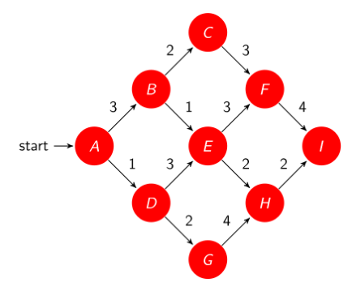
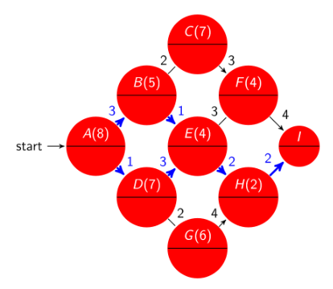
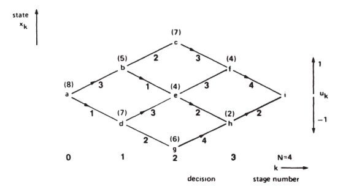
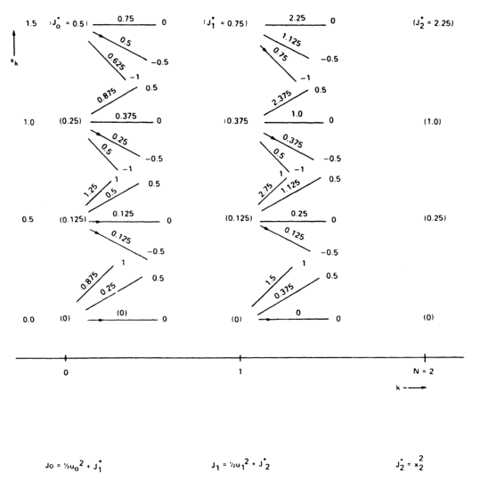
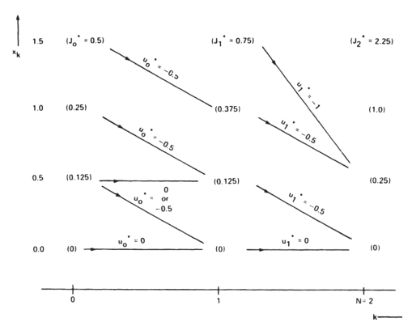
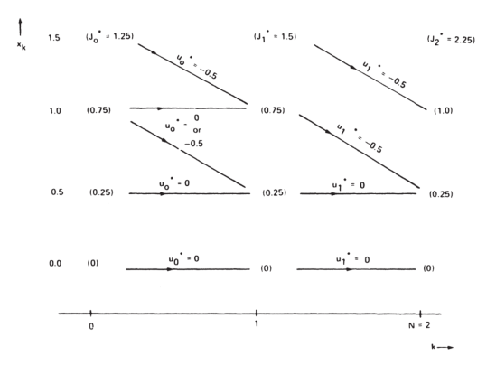
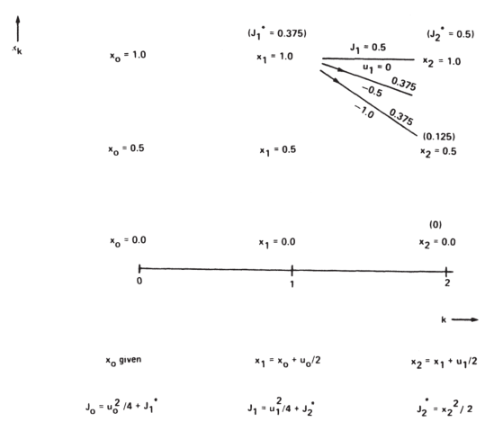
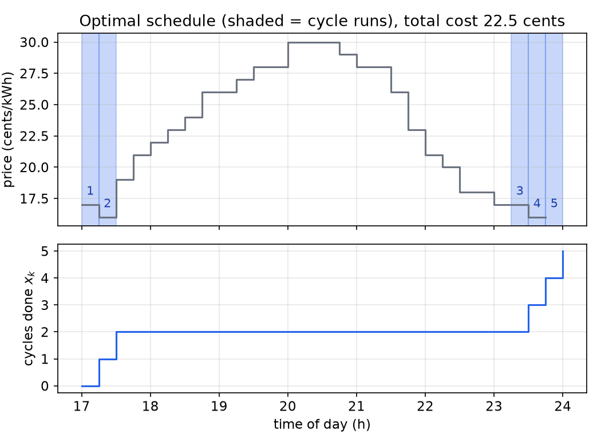
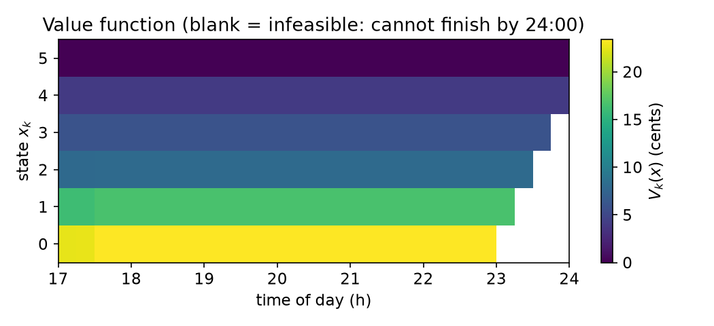

# Dynamic Programming and the Hamilton–Jacobi–Bellman Equation

The variational approach of the previous chapters produces an optimal *trajectory*: necessary conditions along one path from one initial state, in the form of a two-point boundary-value problem. Dynamic programming takes the opposite view. It computes the optimal cost from *every* state at *every* time, the **value function**, by working backward from the end, and the optimal control comes out as a state-feedback law. In discrete time this gives an algorithm that handles constraints, quantized controls and nonlinear dynamics with equal ease. In continuous time it gives a partial differential equation, the Hamilton–Jacobi–Bellman (HJB) equation, from which the Riccati equation of LQR drops out once more. The same backward recursion is the foundation of [reinforcement learning](reinforcement-learning.md).

## Bellman and the Name

Richard Bellman developed dynamic programming at the RAND Corporation in the early 1950s. He later explained the curious name (*Eye of the Hurricane*, 1984): "The 1950s were not good years for mathematical research. … Wilson [the Secretary of Defense] … had a pathological fear and hatred of the word 'research' … You can imagine how he felt, then, about the term 'mathematical'. The RAND Corporation was employed by the Air Force … I felt I had to do something to shield Wilson and the Air Force from the fact that I was really doing mathematics inside the RAND Corporation. What title, what name, could I choose?" He settled on "programming" in its older sense of planning and scheduling, and "dynamic" to convey the multistage, time-varying character of the problems, a word he noted was hard to use in a pejorative sense.

## The Principle of Optimality

**Principle of optimality (Bellman).** *An optimal policy has the property that, whatever the previous decisions (controls) have been, the remaining decisions must constitute an optimal policy with regard to the state resulting from those previous decisions.*

In other words, every tail of an optimal trajectory is itself optimal. The argument is by contradiction: if the tail from some intermediate state \\(x\_k\\) were not optimal, replacing it with a better tail would lower the total cost (the cost already incurred up to \\(x\_k\\) is unaffected), contradicting optimality of the whole. The principle requires that the cost be *additive over stages* and that the future evolution depend only on the current state and future controls (the Markov property of the state).

The principle turns one large optimization over a whole control sequence into a sequence of small optimizations, one stage at a time, solved **backward**: first the last decision for every possible state, then the second-to-last, using the already computed optimal costs-to-go, and so on.

### Example 1 (shortest route through a graph)

A traveler starts at node \\(A\\) and must reach node \\(I\\), moving left to right along the directed edges of the graph below. The numbers on the edges are travel costs. Find the cheapest route.



*Figure: a routing problem. Edges are traversed left to right; the edge labels are costs. The nodes form stages: A; then B, D; then C, E, G; then F, H; then I.*

Enumerating all six routes is easy here, but the number of routes grows exponentially with the number of stages. Dynamic programming instead labels each node with its **optimal cost-to-go** \\(V(\cdot)\\), the cheapest cost from that node to \\(I\\), working backward:

| node | options (edge cost + cost-to-go of successor) | \\(V\\) | optimal decision |
|---|---|---|---|
| \\(I\\) | (destination) | 0 | — |
| \\(F\\) | \\(4 + V(I) = 4\\) | 4 | \\(F\to I\\) |
| \\(H\\) | \\(2 + V(I) = 2\\) | 2 | \\(H\to I\\) |
| \\(C\\) | \\(3 + V(F) = 7\\) | 7 | \\(C\to F\\) |
| \\(E\\) | \\(3 + V(F) = 7\\); \\(2 + V(H) = 4\\) | 4 | \\(E\to H\\) |
| \\(G\\) | \\(4 + V(H) = 6\\) | 6 | \\(G\to H\\) |
| \\(B\\) | \\(2 + V(C) = 9\\); \\(1 + V(E) = 5\\) | 5 | \\(B\to E\\) |
| \\(D\\) | \\(3 + V(E) = 7\\); \\(2 + V(G) = 8\\) | 7 | \\(D\to E\\) |
| \\(A\\) | \\(3 + V(B) = 8\\); \\(1 + V(D) = 8\\) | 8 | tie |



*Figure: the DP solution. Each node shows its optimal cost-to-go in parentheses; the blue arrows are the optimal decisions. At A both choices cost 8, so there are two optimal routes.*

The minimum cost is 8, and the optimum is **not unique**: \\(A\to B\to E\to H\to I\\) and \\(A\to D\to E\to H\to I\\) both cost 8. Notice that the table contains more than the answer to the original question. It gives the optimal decision from *every* node, i.e. a **feedback law**: a traveler pushed off course to \\(G\\) knows immediately to continue to \\(H\\).

**Shortest paths and DP.** Specialized shortest-path algorithms (label-correcting methods such as Dijkstra's and Bellman–Ford, A\* search, branch and bound) solve such problems efficiently, and deterministic finite-state DP is equivalent to a shortest-path problem under mild assumptions (finitely many states, no cycles of negative length). The tailored algorithms can have better worst-case complexity on graphs; DP is more versatile, because it extends directly to continuous states, stochastic transitions and arbitrary stage costs.

### Example 2 (minimum-fuel aircraft routing as a control problem)

The same graph can be read as a control problem. An aircraft flies left to right through cities; the edge numbers are fuel costs. Index the stages by \\(k = 0,\dots,N = 4\\), and let the state \\(x\_k\\) be the city at stage \\(k\\):
\\[
x\_0 = a, \quad x\_1\in\\{b, d\\}, \quad x\_2\in\\{c, e, g\\}, \quad x\_3\in\\{f, h\\}, \quad x\_4 = i .
\\]
The control at each stage is \\(u\_k = +1\\) (climb to the upper city) or \\(u\_k = -1\\) (descend to the lower one).



*Figure: the routing problem drawn as a control problem, with stage k horizontal and state x_k vertical. Numbers in parentheses are the optimal fuel costs-to-go; arrowheads mark the optimal decision u_k = ±1 at each state. Read together, the arrows are a state-feedback law.*

The backward pass, stage by stage:

- \\(k = 3\\): from \\(f\\), the only move is \\(u\_3 = -1\\), cost 4; from \\(h\\), \\(u\_3 = +1\\), cost 2.
- \\(k = 2\\): from \\(c\\), \\(u\_2 = -1\\), cost \\(3 + 4 = 7\\). From \\(e\\), \\(u\_2 = +1\\) (via \\(f\\)) costs \\(3 + 4 = 7\\) and \\(u\_2 = -1\\) (via \\(h\\)) costs \\(2 + 2 = 4\\), so \\(u\_2^\star(e) = -1\\) with cost-to-go 4. From \\(g\\), only \\(u\_2 = +1\\), cost \\(4 + 2 = 6\\).
- \\(k = 1\\): from \\(b\\), \\(u\_1^\star = -1\\) (to \\(e\\)), cost \\(1 + 4 = 5\\); from \\(d\\), \\(u\_1^\star = +1\\) (to \\(e\\)), cost \\(3 + 4 = 7\\).
- \\(k = 0\\): from \\(a\\), \\(u\_0 = +1\\) costs \\(3 + 5 = 8\\) and \\(u\_0 = -1\\) costs \\(1 + 7 = 8\\): non-unique.

The principle of optimality cuts the work: at each stage, each state is evaluated once with each control, instead of enumerating every complete path.

## Discrete-Time Dynamic Programming

### The Bellman recursion

Consider the plant and cost
\\[
x\_{k+1} = f^k(x\_k,u\_k), \qquad J\_i(x\_i) = \phi(x\_N, N) + \sum\_{k=i}^{N-1}L^k(x\_k,u\_k),
\\]
with \\(u\_k\\) possibly restricted to an admissible set \\(U\_k\\) and \\(x\_k\\) to \\(X\_k\\). Define the **value function** (optimal cost-to-go) \\(J\_k^\star(x)\\) as the minimum of \\(J\_k\\) over all admissible control sequences starting from \\(x\_k = x\\). Suppose \\(J\_{k+1}^\star\\) is known. If the control \\(u\_k\\) is applied at time \\(k\\) and the optimal policy is followed afterward, the cost is
\\[
J\_k(x\_k,u\_k) = L^k(x\_k,u\_k) + J\_{k+1}^\star(x\_{k+1}) = L^k(x\_k,u\_k) + J\_{k+1}^\star\big(f^k(x\_k,u\_k)\big).
\\]
By the principle of optimality, the optimal cost from \\(x\_k\\) is obtained by choosing the best \\(u\_k\\):
\\[
\boxed{J\_k^\star(x\_k) = \min\_{u\_k\in U\_k}\Big[L^k(x\_k,u\_k) + J\_{k+1}^\star\big(f^k(x\_k,u\_k)\big)\Big], \qquad J\_N^\star(x\_N) = \phi(x\_N,N).}
\\]
This is the **Bellman equation**. The minimizing \\(u\_k^\star(x\_k)\\) is the optimal feedback law. Each step optimizes over **one control vector at a time**, never over the whole sequence. The recursion makes no assumptions of linearity, differentiability or convexity, and constraints are handled simply by restricting the minimization to admissible controls that lead to admissible states.

### Discrete LQR by dynamic programming

For the linear-quadratic problem the value function stays quadratic at every stage, and the Bellman recursion can be carried out in closed form. Let
\\[
x\_{k+1} = Ax\_k + Bu\_k, \qquad J\_i = \tfrac12x\_N^\top S\_Nx\_N + \tfrac12\sum\_{k=i}^{N-1}\big(x\_k^\top Qx\_k + u\_k^\top Ru\_k\big), \qquad S\_N\succeq 0,\ Q\succeq 0,\ R\succ 0 .
\\]
Start at the end: \\(J\_N^\star = \tfrac12x\_N^\top S\_Nx\_N\\). At \\(k = N-1\\),
\\[
J\_{N-1} = \tfrac12\big(x\_{N-1}^\top Qx\_{N-1} + u\_{N-1}^\top Ru\_{N-1}\big) + \tfrac12\big(Ax\_{N-1} + Bu\_{N-1}\big)^\top S\_N\big(Ax\_{N-1} + Bu\_{N-1}\big).
\\]
This is a strictly convex quadratic in \\(u\_{N-1}\\) (its Hessian is \\(B^\top S\_NB + R\succ 0\\)), so the unconstrained minimum is where the gradient vanishes:
\\[
0 = \frac{\partial J\_{N-1}}{\partial u\_{N-1}} = Ru\_{N-1} + B^\top S\_N\big(Ax\_{N-1} + Bu\_{N-1}\big),
\\]
\\[
u\_{N-1}^\star = -\big(B^\top S\_NB + R\big)^{-1}B^\top S\_NA\\,x\_{N-1} =: -K\_{N-1}x\_{N-1}.
\\]
Substituting \\(u\_{N-1} = -K\_{N-1}x\_{N-1}\\) back, \\(x\_N = (A - BK\_{N-1})x\_{N-1}\\), and
\\[
J\_{N-1}^\star = \tfrac12x\_{N-1}^\top\Big[(A - BK\_{N-1})^\top S\_N(A - BK\_{N-1}) + K\_{N-1}^\top RK\_{N-1} + Q\Big]x\_{N-1} =: \tfrac12x\_{N-1}^\top S\_{N-1}x\_{N-1}.
\\]
The value function at \\(N-1\\) is again quadratic, with a new matrix \\(S\_{N-1}\\), so the same computation applies at \\(k = N-2, N-3,\dots\\). By induction,
\\[
K\_k = \big(B^\top S\_{k+1}B + R\big)^{-1}B^\top S\_{k+1}A, \qquad
S\_k = (A - BK\_k)^\top S\_{k+1}(A - BK\_k) + K\_k^\top RK\_k + Q,
\\]
and \\(J\_k^\star = \tfrac12x\_k^\top S\_kx\_k\\). Substituting \\(K\_k\\) gives the equivalent Riccati difference equation
\\[
S\_k = A^\top\Big[S\_{k+1} - S\_{k+1}B\big(B^\top S\_{k+1}B + R\big)^{-1}B^\top S\_{k+1}\Big]A + Q .
\\]
This is exactly the recursion obtained from the discrete-time necessary conditions and the sweep method in [Discrete-Time Optimal Control and LQR](discrete-optimal-control.md), now derived without costates. The DP derivation also proves global optimality directly, since each stage minimization is a convex quadratic program.

### Example 3 (quantized states and controls)

When the state and control take finitely many values, the Bellman recursion is a table computation. Consider
\\[
x\_{k+1} = x\_k + u\_k, \qquad J\_0 = x\_N^2 + \tfrac12\sum\_{k=0}^{N-1}u\_k^2, \qquad N = 2,
\\]
with admissible controls \\(u\_k\in\\{-1, -0.5, 0, 0.5, 1\\}\\) and admissible states \\(x\_k\in\\{0, 0.5, 1, 1.5\\}\\). Only controls that keep the next state admissible are considered; from \\(x\_0 = 1\\), for instance, \\(u\_0\in\\{-1, -0.5, 0, 0.5\\}\\) lead to \\(x\_1 = 0, 0.5, 1, 1.5\\). The recursion is \\(J\_k = \tfrac12u\_k^2 + J\_{k+1}^\star(x\_k + u\_k)\\), \\(J\_k^\star = \min\_{u\_k}J\_k\\).

**Stage \\(k = 2\\).** \\(J\_2^\star(x\_2) = x\_2^2\\): \\(J\_2^\star(1.5) = 2.25\\), \\(J\_2^\star(1) = 1\\), \\(J\_2^\star(0.5) = 0.25\\), \\(J\_2^\star(0) = 0\\).

**Stage \\(k = 1\\).** From \\(x\_1 = 1.5\\): \\(u\_1 = 0\\) gives \\(x\_2 = 1.5\\) and \\(J\_1 = 2.25\\); \\(u\_1 = -0.5\\) gives \\(x\_2 = 1\\) and \\(J\_1 = 0.125 + 1 = 1.125\\); \\(u\_1 = -1\\) gives \\(x\_2 = 0.5\\) and \\(J\_1 = 0.5 + 0.25 = 0.75\\). So \\(u\_1^\star(1.5) = -1\\), \\(J\_1^\star(1.5) = 0.75\\). Likewise \\(u\_1^\star(1) = -0.5\\) with \\(J\_1^\star = 0.375\\); \\(u\_1^\star(0.5) = -0.5\\) with \\(J\_1^\star = 0.125\\); \\(u\_1^\star(0) = 0\\) with \\(J\_1^\star = 0\\).

**Stage \\(k = 0\\).** From \\(x\_0 = 1.5\\): \\(u\_0\in\\{0, -0.5, -1\\}\\) give \\(J\_0 = 0 + 0.75\\), \\(0.125 + 0.375 = 0.5\\), \\(0.5 + 0.125 = 0.625\\); the minimum is \\(0.5\\) at \\(u\_0 = -0.5\\). Similarly \\(J\_0^\star(1) = 0.25\\) at \\(u\_0 = -0.5\\); \\(J\_0^\star(0.5) = 0.125\\) at \\(u\_0 = 0\\) **or** \\(-0.5\\) (non-unique); \\(J\_0^\star(0) = 0\\) at \\(u\_0 = 0\\).

From \\(x\_0 = 1\\) the optimal trajectory is \\(1\to 0.5\to 0\\) with \\(u\_0^\star = u\_1^\star = -0.5\\) and \\(J\_0^\star = 0.25\\): spreading the correction evenly over the two steps is cheaper than one big step, because the control cost is quadratic.



*Figure: the full decision grid (after Lewis, Vrabie and Syrmos). Each state at stages 0 and 1 fans out into its admissible controls (labels at the right end of each segment) with the candidate cost J_k on the segment; the optimal cost-to-go of each node is in parentheses.*



*Figure: the result of the backward pass, keeping only the optimal decisions. The arrows from every grid point form a time-varying state-feedback law u_k⋆(x_k); numbers in parentheses are the optimal costs-to-go.*

**A heavier control penalty.** Changing the cost to \\(J\_0 = x\_2^2 + 2\sum\_{k=0}^{1}u\_k^2\\) makes control four times more expensive relative to the terminal error. Repeating the recursion gives, at \\(k = 1\\): \\(u\_1^\star(1.5) = -0.5\\) \\((1.5)\\), \\(u\_1^\star(1) = -0.5\\) \\((0.75)\\), \\(u\_1^\star(0.5) = 0\\) \\((0.25)\\), \\(u\_1^\star(0) = 0\\) \\((0)\\); at \\(k = 0\\): \\(u\_0^\star(1.5) = -0.5\\) \\((1.25)\\), \\(u\_0^\star(1) = 0\\) or \\(-0.5\\) \\((0.75)\\), \\(u\_0^\star(0.5) = 0\\) \\((0.25)\\), \\(u\_0^\star(0) = 0\\) \\((0)\\). The control moves are smaller, and the state is no longer driven all the way to zero.



*Figure: the DP feedback law with the heavier control weight. Compared with the previous figure, the arrows are flatter (smaller control moves) and the costs-to-go larger.*

**Implementation.** The following short program carries out the recursion for any grid, stage cost and terminal cost. It reproduces both tables above.

```python
import numpy as np

def grid_dp(X, U, f, stage, terminal, N):
    """Backward DP on a finite state grid X with finite control set U."""
    V = {x: terminal(x) for x in X}
    tables = []
    for k in reversed(range(N)):
        Vk, pk = {}, {}
        for x in X:
            cands = [(stage(x, u) + V[f(x, u)], u) for u in U if f(x, u) in V]
            best = min(c for c, _ in cands)
            Vk[x], pk[x] = best, [u for c, u in cands if abs(c - best) < 1e-12]
        V = Vk
        tables.insert(0, (Vk, pk))
    return tables

X = [0.0, 0.5, 1.0, 1.5]; U = [-1.0, -0.5, 0.0, 0.5, 1.0]
for w in (0.5, 2.0):                          # control weights 1/2 and 2
    T = grid_dp(X, U, lambda x, u: x + u, lambda x, u: w * u**2, lambda x: x**2, N=2)
    for k, (Vk, pk) in enumerate(T):
        print(w, k, {x: (Vk[x], pk[x]) for x in X})
```

Output for weight \\(\tfrac12\\):

| \\(x\\) | \\(J\_0^\star\\) | \\(u\_0^\star\\) | \\(J\_1^\star\\) | \\(u\_1^\star\\) |
|---|---|---|---|---|
| 1.5 | 0.5 | −0.5 | 0.75 | −1 |
| 1.0 | 0.25 | −0.5 | 0.375 | −0.5 |
| 0.5 | 0.125 | 0 or −0.5 | 0.125 | −0.5 |
| 0.0 | 0 | 0 | 0 | 0 |

and for weight 2:

| \\(x\\) | \\(J\_0^\star\\) | \\(u\_0^\star\\) | \\(J\_1^\star\\) | \\(u\_1^\star\\) |
|---|---|---|---|---|
| 1.5 | 1.25 | −0.5 | 1.5 | −0.5 |
| 1.0 | 0.75 | 0 or −0.5 | 0.75 | −0.5 |
| 0.5 | 0.25 | 0 | 0.25 | 0 |
| 0.0 | 0 | 0 | 0 | 0 |

### Computational cost and the curse of dimensionality

Exhaustive search over control sequences grows **exponentially** with the horizon: with \\(C\\) admissible controls per stage there are up to \\(C^N\\) sequences, each of which must be simulated and costed. DP evaluates each (state, control) pair once per stage. With \\(M\\) grid states and \\(C\\) controls, the work is about \\(M\cdot C\cdot N\\) evaluations, **linear** in \\(N\\). In Example 3, with 4 states and 5 controls, that is at most 20 evaluations per stage.

The catch is \\(M\\). Gridding each of \\(n\\) state components with \\(m\\) points gives \\(M = m^n\\) grid states, which grows exponentially with the state dimension. Bellman called this the **curse of dimensionality**. It is why tabular DP is practical only for low-dimensional problems, and why approximate dynamic programming and reinforcement learning replace the table with a parametric approximation of the value function (see [Reinforcement Learning for Control](reinforcement-learning.md)).

## Continuous-Time Problems by Discretization

DP can be applied to a continuous-time problem by discretizing it. For
\\[
\dot x = f(x,u,t), \qquad J(0) = \phi\big(x(T),T\big) + \int\_0^{T}L(x,u,t)\\,dt,
\\]
choose a sampling period \\(\tau\\) with \\(N\tau = T\\) and use the Euler approximation \\(\dot x(k\tau)\approx(x\_{k+1} - x\_k)/\tau\\):
\\[
x\_{k+1} = x\_k + \tau f(x\_k,u\_k,k\tau) =: f^k(x\_k,u\_k), \qquad
J\_0 = \phi(x\_N,N\tau) + \sum\_{k=0}^{N-1}\tau L(x\_k,u\_k,k\tau),
\\]
so the stage cost is \\(L^k = \tau L\\). Then the discrete Bellman recursion applies. A new difficulty appears: the next state \\(x\_k + \tau f(x\_k,u\_k)\\) generally falls *between* grid points, so the value function must be **interpolated**.

### Example 4 (discretized scalar problem with interpolation)

Let \\(\dot x = ax + bu\\), \\(J(0) = \tfrac12x^2(T) + \tfrac12\int\_0^{T}u^2dt\\), \\(T = 1\\), with constraints \\(0\le x\le 1\\) and \\(\lvert u\rvert\le 1\\). Take \\(a = 0\\), \\(b = 1\\) and \\(\tau = 0.5\\) (\\(N = 2\\)):
\\[
x\_{k+1} = x\_k + 0.5\\,u\_k, \qquad J\_0 = \tfrac12x\_N^2 + \tfrac14\sum\_{k=0}^{N-1}u\_k^2 .
\\]
Quantize \\(u\_k\in\\{-1,-0.5,0,0.5,1\\}\\) and \\(x\_k\in\\{0, 0.5, 1\\}\\). The terminal values are \\(J\_2^\star(1) = 0.5\\), \\(J\_2^\star(0.5) = 0.125\\), \\(J\_2^\star(0) = 0\\).

At \\(x\_1 = 1\\): \\(u\_1 = 0\\) gives \\(x\_2 = 1\\) and \\(J\_1 = 0.5\\). \\(u\_1 = -1\\) gives \\(x\_2 = 0.5\\) and \\(J\_1 = 0.25 + 0.125 = 0.375\\). But \\(u\_1 = -0.5\\) gives \\(x\_2 = 0.75\\), which is **not on the grid**. Interpolate linearly between the neighbors:
\\[
J\_2^\star(0.75)\approx J\_2^\star(0.5) + \frac{J\_2^\star(1) - J\_2^\star(0.5)}{2} = 0.125 + 0.1875 = 0.3125,
\\]
so \\(u\_1 = -0.5\\) gives \\(J\_1 = 0.0625 + 0.3125 = 0.375\\). Both \\(u\_1 = -0.5\\) and \\(u\_1 = -1\\) are optimal, with \\(J\_1^\star(1) = 0.375\\).



*Figure: the fan of controls from x₁ = 1 in the discretized problem (after Lewis, Vrabie and Syrmos). The control u₁ = −0.5 leads to the off-grid state 0.75, whose cost-to-go is interpolated; both u₁ = −0.5 and u₁ = −1 give 0.375. The bottom rows list the discretized dynamics and the recursion.*

Completing the computation for the other grid points (with the interpolating program below) gives \\(J\_1^\star(0.5) = 0.125\\) (\\(u\_1 = 0\\) or \\(-0.5\\)), \\(J\_1^\star(0) = 0\\), and at the first stage \\(J\_0^\star(1) = 0.3125\\) with \\(u\_0^\star = -0.5\\). For comparison, the exact continuous-time solution (Example 6 below) has \\(J^\star = 0.25\\) and initial control \\(u(0) = -0.5\\). The DP answer is close given a three-point grid and two time steps, and refining \\(\tau\\) and the grid converges toward the continuous solution.

```python
import numpy as np
X = np.array([0.0, 0.5, 1.0]); U = [-1, -0.5, 0, 0.5, 1]; tau, N = 0.5, 2
V = 0.5 * X**2                                         # terminal cost on the grid
for k in reversed(range(N)):
    Vn = np.empty_like(V)
    for i, x in enumerate(X):
        Vn[i] = min(tau * 0.5 * u**2 + np.interp(x + tau * u, X, V)
                    for u in U if 0 <= x + tau * u <= 1)   # admissible next states
    V = Vn
print(V)                                               # [0. 0.125 0.3125]
```

## Example 5: Scheduling a Dishwasher Against Electricity Prices

Dynamic programming is not limited to physical control loops. Consider a dishwasher whose program consists of five cycles that must run in order, each lasting one 15-minute period, with different power draws. Electricity prices vary through the evening. When should each cycle run so that the bill is minimal and everything is finished by midnight?

**Model.** Index 15-minute periods by \\(k\\): \\(k = 0\\) is 17:00–17:15 and \\(k = N = 28\\) is 24:00–00:15. The state \\(x\_k\in\\{0,1,\dots,5\\}\\) is the number of the last completed cycle at the start of period \\(k\\), with \\(x\_0 = 0\\). The control \\(u\_k\in\\{0,1\\}\\) means "wait" or "run the next cycle during period \\(k\\)". The dynamics are
\\[
x\_{k+1} = x\_k + u\_k .
\\]
With price \\(c\_k\\) (cents/kWh) and power \\(p(j)\\) (kW) for cycle \\(j\\), running cycle \\(x\_k + 1\\) for a quarter hour costs \\(\tfrac14c\_k\\,p(x\_k + 1)\\) (kW times 0.25 h gives kWh). The problem is
\\[
\min\_{u\_0,\dots,u\_{N-1}}\ \sum\_{k=0}^{N-1}\tfrac14c\_k\\,p(x\_k + u\_k)\\,u\_k
\quad\text{s.t.}\quad x\_{k+1} = x\_k + u\_k,\ x\_0 = 0,\ x\_N = 5,\ u\_k\in\\{0,1\\}.
\\]
The stage cost is \\(g\_k(x\_k,u\_k) = \tfrac14c\_kp(x\_k + u\_k)u\_k\\) and the terminal cost enforces completion:
\\[
g\_N(x\_N) = \begin{cases}0, & x\_N = 5,\\\\ \infty, & \text{otherwise}.\end{cases}
\\]
The cycle powers are \\(p = (1.5,\ 2.0,\ 0.5,\ 0.5,\ 1.0)\\) kW for cycles 1–5 (the code below stores a leading 0 for the "no cycle" state), and the prices come from a day-long trace at 15-minute resolution.

**Bellman recursion.** With \\(V\_N(5) = 0\\) and \\(V\_N(x) = \infty\\) otherwise,
\\[
V\_k(x) = \min\Big\\{\underbrace{V\_{k+1}(x)}\_{\text{wait}},\ \underbrace{\tfrac14c\_k\\,p(x+1) + V\_{k+1}(x+1)}\_{\text{run cycle } x+1}\Big\\}, \qquad x<5,
\\]
and \\(V\_k(5) = V\_{k+1}(5) = 0\\) (once done, only waiting is possible). The infinite terminal cost propagates backward automatically: \\(V\_k(x) = \infty\\) whenever fewer than \\(5 - x\\) periods remain, so infeasible schedules are excluded without any special logic.

```matlab
%% Problem Data
p = [0; 1.5; 2.0; 0.5; 0.5; 1.0];          % cycle power [kW], state 0..5
c = [12,12,12,10,9,8,8,8,7,7,6,5,5,5,5,5,5,5,6,7,7,8,9,9,10,11,11,...
     12,12,14,15,15,16,17,19,19,20,21,21,22,22,22,20,20,19,17,15,15,16,...
     17,17,18,18,16,16,17,17,18,20,20,21,21,21,20,20,19,19,18,17,17,...
     16,19,21,22,23,24,26,26,27,28,28,30,30,...
     30,29,28,28,26,23,21,20,18,18,17,17,16,16];   % price trace
%% Solve DP Equations
N = 28;  nx = 6;
V = inf*ones(N,nx);            % value function
u = nan*ones(N,nx);            % control policy
V(end, end) = 0;               % boundary condition: all cycles done
for k = (N-1):-1:1             % backward in time
  for i = 1:nx
    if (i == nx)               % last state: can only wait
      V(k,i) = V(k+1,i);
    else                       % principle of optimality: u = 0 or u = 1
      [V(k,i), idx] = min([V(k+1,i); 0.25*c(69+k)*p(i+1) + V(k+1,i+1)]);
      u(k,i) = idx-1;          % save minimizing control
    end
  end
end
```

(In this listing rows of `V` are 1-indexed and the last row holds the terminal condition, so it optimizes over 27 periods; `c(69+k)` picks the evening part of the price trace.) The Python version below uses periods \\(k = 0,\dots,27\\) with an explicit terminal row \\(V\_{28}\\), then simulates the policy forward from \\(x\_0 = 0\\).

```python
import numpy as np
p = np.array([0, 1.5, 2.0, 0.5, 0.5, 1.0])           # power of cycle j (index 0 unused)
price = np.array(c)[69:69 + 28]  # c: the price trace in the MATLAB listing                               # evening prices, same alignment as c(69+k)
N, nx = 28, 6
V = np.full((N + 1, nx), np.inf); V[N, 5] = 0.0       # terminal cost
pol = np.zeros((N, nx), int)
for k in range(N - 1, -1, -1):
    for x in range(nx):
        wait = V[k + 1, x]
        run = 0.25 * price[k] * p[x + 1] + V[k + 1, x + 1] if x < 5 else np.inf
        V[k, x], pol[k, x] = min(wait, run), int(run < wait)
x, sched = 0, []
for k in range(N):                                    # forward pass with the feedback law
    if pol[k, x]: sched.append((k, x + 1)); x += 1
print(V[0, 0], sched)    # 22.5 cents; cycles at k = 0, 1, 25, 26, 27
```



*Figure: optimal dishwasher schedule. Top: the evening price profile (gray), with the periods in which a cycle runs shaded and labelled by cycle number. Bottom: the state x_k (cycles completed). The two power-hungry cycles (1.5 and 2.0 kW) run immediately at 17:00–17:30, before the evening price peak; the three light cycles wait until the prices fall again and finish exactly at midnight. Total cost: 22.5 cents.*

The optimal schedule runs cycles 1 and 2 at 17:00 and 17:15 (prices 17 and 16), then pauses through the evening peak (up to 30), and runs cycles 3–5 at 23:15, 23:30 and 23:45 (prices 17, 16, 16). The cost is \\(\tfrac14(17\cdot1.5 + 16\cdot2.0 + 17\cdot0.5 + 16\cdot0.5 + 16\cdot1.0) = \tfrac14\cdot 90 = 22.5\\) cents. For comparison, running all five cycles back to back from 17:00 costs 24.875 cents (the later cycles meet prices of 19–22), and running them in the last five periods costs 23.375 cents; DP finds the cheaper split automatically.



*Figure: the value function V_k(x) of the dishwasher problem: the cheapest cost to finish from x completed cycles at time k. The blank region at the lower right is infeasible (too few periods remain to finish by midnight), the region where the infinite terminal cost has propagated backward.*

## Continuous-Time Dynamic Programming: The HJB Equation

### Derivation

Return to continuous time without discretizing. Let
\\[
\dot x = f(x,u,t), \qquad J(t\_0) = \phi\big(x(T),T\big) + \int\_{t\_0}^{T}L(x,u,t)\\,dt, \qquad \psi\big(x(T),T\big) = 0,
\\]
and define the value function \\(J^\star(x,t)\\) as the minimal cost-to-go starting from state \\(x\\) at time \\(t\\). Split the cost of any control at a short interval \\([t, t + \Delta t]\\):
\\[
J(x,u,t) = \int\_t^{t+\Delta t}L\\,d\tau + \int\_{t+\Delta t}^{T}L\\,d\tau + \phi\big(x(T),T\big).
\\]
By the principle of optimality, the control after \\(t + \Delta t\\) should be optimal for the state reached at that time, so
\\[
J^\star(x,t) = \min\_{u(\tau),\ t\le\tau\le t+\Delta t}\left[\int\_t^{t+\Delta t}L\\,d\tau + J^\star\big(x + \Delta x,\ t + \Delta t\big)\right].
\\]
Assume \\(J^\star\\) is continuously differentiable and expand it about \\((x,t)\\):
\\[
J^\star(x + \Delta x, t + \Delta t) = J^\star(x,t) + \big(J\_x^\star\big)^\top\Delta x + J\_t^\star\Delta t + O\big((\Delta t)^2\big),
\\]
with \\(J\_x^\star = \partial J^\star/\partial x\\) and \\(J\_t^\star = \partial J^\star/\partial t\\). For small \\(\Delta t\\), \\(\int\_t^{t+\Delta t}L\\,d\tau = L\Delta t + o(\Delta t)\\) and \\(\Delta x = f\Delta t + o(\Delta t)\\). Since \\(J^\star(x,t)\\) and \\(J\_t^\star\\) do not depend on the control chosen at time \\(t\\), they come out of the minimization:
\\[
J^\star = J^\star + J\_t^\star\Delta t + \min\_u\Big[L\Delta t + \big(J\_x^\star\big)^\top f\\,\Delta t\Big] + o(\Delta t).
\\]
Cancel \\(J^\star\\), divide by \\(\Delta t\\), and let \\(\Delta t\to 0\\):
\\[
\boxed{-\frac{\partial J^\star}{\partial t}(x,t) = \min\_{u\in U}\Big[L(x,u,t) + \big(J\_x^\star(x,t)\big)^\top f(x,u,t)\Big]}
\\]
This is the **Hamilton–Jacobi–Bellman equation**, a first-order nonlinear partial differential equation for \\(J^\star(x,t)\\), to be solved backward in time from the boundary condition
\\[
J^\star\big(x,T\big) = \phi(x,T)\quad\text{on the hypersurface } \psi(x,T) = 0 .
\\]
In terms of the Hamiltonian \\(H(x,u,\lambda,t) = L + \lambda^\top f\\),
\\[
-J\_t^\star = \min\_{u\in U}H\big(x,u,J\_x^\star,t\big),
\\]
and the optimal control is the feedback law \\(u^\star(x,t) = \arg\min\_uH(x,u,J\_x^\star,t)\\).

### Relation to Pontryagin's principle

Comparing with [Pontryagin's minimum principle](pontryagin.md), the HJB equation contains the same pointwise minimization of the Hamiltonian, with the costate replaced by the gradient of the value function:
\\[
\lambda(t) = J\_x^\star\big(x^\star(t),t\big).
\\]
The costate is the **sensitivity of the optimal cost to the state**: how much the remaining cost would change if the state were perturbed. If \\(J^\star\\) is twice differentiable, differentiating the HJB equation with respect to \\(x\\) along the optimal trajectory recovers the costate equation: by the envelope theorem the dependence through \\(u^\star\\) drops out, so \\(-J\_{tx}^\star = H\_x + J\_{xx}^\star f\\), and then
\\[
\frac{d}{dt}J\_x^\star = J\_{xt}^\star + J\_{xx}^\star f = -H\_x .
\\]
The two approaches are complementary. Pontryagin gives conditions along one trajectory (ODEs, a boundary-value problem); HJB gives the optimal control from all states at once (a PDE, a feedback law), at the price of the curse of dimensionality.

### Sufficiency: the verification theorem

Unlike Pontryagin's principle, the HJB equation is also **sufficient**.

**Theorem (verification).** Suppose \\(V(x,t)\\) is continuously differentiable, satisfies the HJB equation with the boundary condition \\(V(x,T) = \phi(x,T)\\), and the minimizing feedback \\(u^\star(x,t)\\) generates an admissible closed-loop trajectory. Then \\(V(x,t) = J^\star(x,t)\\) and \\(u^\star\\) is optimal.

*Proof.* For any admissible control \\(u\\) with trajectory \\(x(t)\\), the HJB equation gives \\(V\_t + V\_x^\top f(x,u,t)\ge -L(x,u,t)\\), i.e. \\(\frac{d}{dt}V(x(t),t)\ge -L\\). Integrating from \\(t\_0\\) to \\(T\\),
\\[
V(x\_0,t\_0)\le\phi\big(x(T),T\big) + \int\_{t\_0}^{T}L\\,dt = J(u),
\\]
with equality for \\(u = u^\star\\), where the minimum in the HJB equation is attained. \\(\blacksquare\\)

The differentiability assumption is a real restriction. Value functions of constrained problems are often not differentiable: the minimum-time function of the double integrator in [Pontryagin's Minimum Principle](pontryagin.md) has a corner along the switching curve. The modern theory handles this with **viscosity solutions** (Crandall and Lions, 1983), a weak solution concept under which the value function is the unique solution of the HJB equation.

### Infinite horizon

For time-invariant \\(f\\) and \\(L\\) on an infinite horizon, the value function does not depend on time, \\(J\_t^\star = 0\\), and the HJB equation becomes the **stationary HJB equation**
\\[
0 = \min\_{u\in U}\Big[L(x,u) + \big(J\_x^\star(x)\big)^\top f(x,u)\Big].
\\]
This equation, and its policy-iteration solution, is the starting point of continuous-time reinforcement learning and adaptive dynamic programming ([Reinforcement Learning for Control](reinforcement-learning.md)), and its two-player version is the Hamilton–Jacobi–Isaacs equation of [differential games](games.md).

## LQR from the HJB Equation

The linear-quadratic problem is the one case where the HJB equation can be solved in closed form. Let
\\[
\dot x = Ax + Bu, \qquad J(t\_0) = \tfrac12x^\top(T)S(T)x(T) + \tfrac12\int\_{t\_0}^{T}\big(x^\top Qx + u^\top Ru\big)dt .
\\]
The Hamiltonian is \\(H = \tfrac12(x^\top Qx + u^\top Ru) + \lambda^\top(Ax + Bu)\\). With no constraints on \\(u\\), the minimum is at the stationary point:
\\[
0 = H\_u = Ru + B^\top\lambda \ \Rightarrow\ u = -R^{-1}B^\top\lambda, \qquad H\_{uu} = R\succ 0,
\\]
so it is indeed a minimum. Substituting, the minimized Hamiltonian is
\\[
H^\star = \tfrac12x^\top Qx + \lambda^\top Ax - \tfrac12\lambda^\top BR^{-1}B^\top\lambda
\\]
(the term \\(\tfrac12\lambda^\top BR^{-1}B^\top\lambda\\) from \\(\tfrac12u^\top Ru\\) combines with \\(-\lambda^\top BR^{-1}B^\top\lambda\\) from \\(\lambda^\top Bu\\)). With \\(\lambda = J\_x^\star\\), the HJB equation is
\\[
-J\_t^\star = \tfrac12x^\top Qx + \big(J\_x^\star\big)^\top Ax - \tfrac12\big(J\_x^\star\big)^\top BR^{-1}B^\top J\_x^\star, \qquad J^\star(x,T) = \tfrac12x^\top S(T)x .
\\]
**Quadratic ansatz.** Since the terminal cost is quadratic and the dynamics linear, guess that the value function stays quadratic:
\\[
J^\star(x,t) = \tfrac12x^\top S(t)x, \qquad S(t) = S^\top(t).
\\]
Then \\(J\_t^\star = \tfrac12x^\top\dot Sx\\) and \\(J\_x^\star = Sx\\). Substituting,
\\[
-\tfrac12x^\top\dot Sx = \tfrac12x^\top Qx + x^\top SAx - \tfrac12x^\top SBR^{-1}B^\top Sx .
\\]
The term \\(x^\top SAx\\) is a scalar, so it equals its symmetric part, \\(x^\top SAx = \tfrac12x^\top(SA + A^\top S)x\\). Every term is now a quadratic form with a symmetric matrix, and the equation holds for all \\(x\\), so the matrices must agree:
\\[
\boxed{-\dot S = A^\top S + SA - SBR^{-1}B^\top S + Q, \qquad S(T)\text{ given},}
\qquad u^\star(t) = -R^{-1}B^\top S(t)x(t).
\\]
This is the differential Riccati equation of [Continuous-Time LQR](continuous-lqr.md), obtained here for the third time (after the discrete sweep and the continuous sweep). The quadratic ansatz is justified after the fact by the verification theorem: \\(\tfrac12x^\top S(t)x\\) is smooth and satisfies the HJB equation, so it *is* the value function. On an infinite horizon the stationary HJB equation gives the algebraic Riccati equation in the same way.

**Example 6 (exact solution of Example 4).** For \\(\dot x = u\\), \\(J = \tfrac12x^2(T) + \tfrac12\int\_0^{T}u^2dt\\) (Example 4 without discretization), the Riccati equation with \\(A = 0\\), \\(B = 1\\), \\(Q = 0\\), \\(R = 1\\) is \\(\dot s = s^2\\), \\(s(T) = 1\\), whose solution is
\\[
s(t) = \frac{1}{1 + T - t}.
\\]
(Check: \\(\dot s = 1/(1 + T - t)^2 = s^2\\).) With \\(T = 1\\), \\(x\_0 = 1\\): \\(J^\star = \tfrac12s(0)x\_0^2 = \tfrac12\cdot\tfrac12 = 0.25\\) and \\(u^\star(0) = -s(0)x\_0 = -0.5\\). The coarse DP grid of Example 4 found \\(u\_0^\star = -0.5\\) and \\(J\_0^\star = 0.3125\\); the difference is discretization and interpolation error.

## Summary

- **Principle of optimality.** Tails of optimal trajectories are optimal; the optimal decision depends only on the current state and time.
- **Bellman equation.** \\(J\_k^\star(x\_k) = \min\_{u\_k}\big[L^k(x\_k,u\_k) + J\_{k+1}^\star(f^k(x\_k,u\_k))\big]\\), \\(J\_N^\star = \phi\\); backward in time, one control at a time, yielding a feedback law. Constraints and quantization are handled by restricting the minimization.
- **Discrete LQR.** Quadratic value functions; \\(K\_k = (B^\top S\_{k+1}B + R)^{-1}B^\top S\_{k+1}A\\), \\(S\_k = (A - BK\_k)^\top S\_{k+1}(A - BK\_k) + K\_k^\top RK\_k + Q\\).
- **Complexity.** Linear in the horizon, exponential in the state dimension (curse of dimensionality). Discretized continuous problems need interpolation of the value function between grid points.
- **HJB equation.** \\(-J\_t^\star = \min\_u\big[L + (J\_x^\star)^\top f\big]\\), \\(J^\star(x,T) = \phi\\); the costate is \\(\lambda = J\_x^\star\\). A smooth solution is sufficient for optimality (verification theorem).
- **LQR from HJB.** \\(J^\star = \tfrac12x^\top S(t)x\\) gives \\(-\dot S = A^\top S + SA - SBR^{-1}B^\top S + Q\\) and \\(u = -R^{-1}B^\top Sx\\).

## See Also

- [Discrete-Time Optimal Control and LQR](discrete-optimal-control.md): the discrete Riccati recursion from the necessary conditions.
- [Continuous-Time LQR and Its Extensions](continuous-lqr.md): the Riccati equation and its steady state.
- [Pontryagin's Minimum Principle](pontryagin.md): necessary conditions along trajectories, bounded controls and non-smooth value functions.
- [Reinforcement Learning for Control](reinforcement-learning.md) and Reinforcement Learning: approximate solution of the Bellman and HJB equations from data.
- [Differential and Dynamic Games](games.md): the two-player Bellman and Hamilton–Jacobi–Isaacs equations.
- [Model Predictive Control](mpc.md): on-line, finite-horizon optimization as an alternative to precomputing the value function.
- [Digital Control: Reinforcement Learning](../me6403-digital-control/reinforcement-learning.md) and Optimization.
