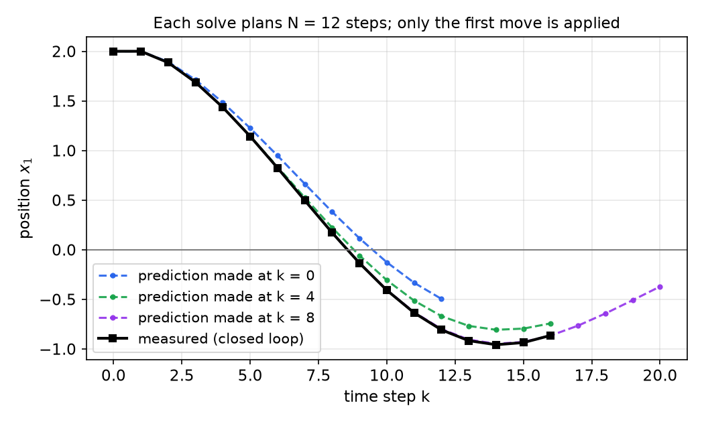
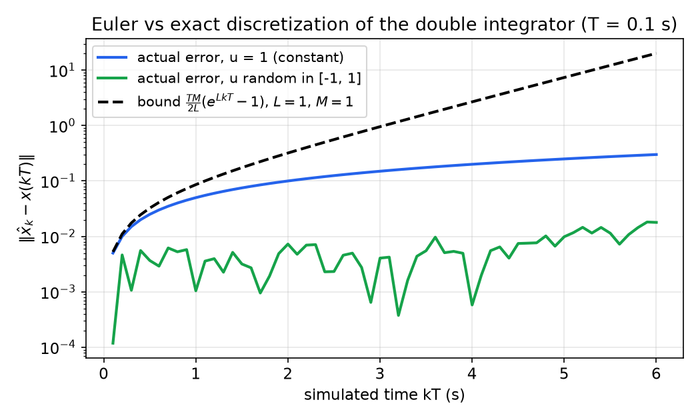
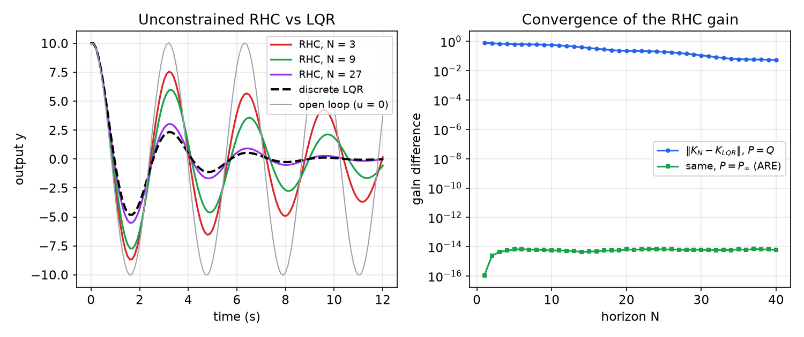
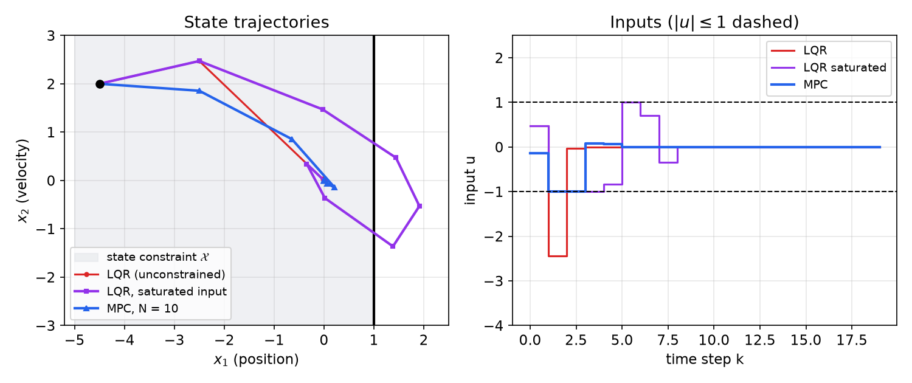
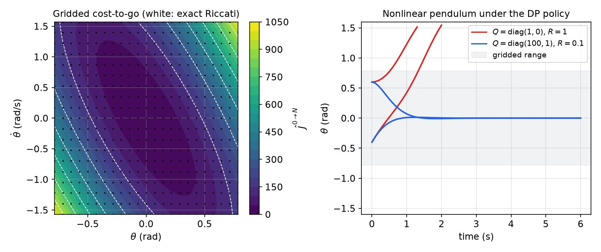

# Model Predictive Control: Formulation and Solution

Model predictive control (MPC) turns feedback design into repeated optimization. At every sampling instant the controller measures the state, solves a finite-horizon optimal control problem that respects the input and state constraints, applies only the first move of the optimal plan, and then solves the problem again at the next instant from the new measurement. This chapter builds the tools MPC needs and the two standard ways of solving it. The tools are discrete-time models and their errors, Lyapunov stability and linear matrix inequalities, and convex optimization with the KKT conditions. The two solution methods are the *batch* approach, which turns linear MPC into a quadratic program, and the *recursive* (dynamic-programming) approach. The material follows a graduate course on model predictive control (Duke ME 555, 2023), which in turn follows Borrelli, Bemporad and Morari, *Predictive Control for Linear and Hybrid Systems*. The [next chapter](mpc-stability.md) takes up the question this one leaves open: when does MPC work, meaning that it stays feasible forever and stabilizes the system?

## The Receding-Horizon Idea

The MPC problem at time \\(t\\), with measured state \\(x(t)\\), is
\\[
\begin{aligned}
J^\*(x(t)) = \min\_{\underline u}\ & p(x\_N) + \sum\_{k=0}^{N-1} q(x\_k,u\_k) \\\\
\text{s.t.}\ & x\_{k+1} = f(x\_k,u\_k), \quad x\_0 = x(t), \quad \underline u = [u\_0;\dots;u\_{N-1}], \\\\
& x\_k\in\mathcal{X},\ \ u\_k\in\mathcal{U},\ \ (x\_k,u\_k)\in\mathcal{H}, \quad k = 0,\dots,N-1, \\\\
& x\_N \in \mathcal{X}\_f .
\end{aligned}
\\]
Each piece has a role:

- the **running cost** \\(q(x\_k,u\_k)\\) says what is good (fast convergence, low effort, profit);
- the **terminal cost** \\(p(x\_N)\\) accounts for what happens after the horizon;
- the **dynamics** \\(x\_{k+1} = f(x\_k,u\_k)\\) are equality constraints that tell the optimizer where each input leads;
- \\(x\_0 = x(t)\\) ties the plan to the current measurement;
- \\(\mathcal{X}\\), \\(\mathcal{U}\\) and the mixed set \\(\mathcal{H}\\) encode safety limits and actuator limits (a motor whose torque cannot exceed 10 N·m);
- the **terminal set** \\(\mathcal{X}\_f\\) constrains where the plan must end.

The solution is an input sequence \\(\underline u^\* = [u\_0^\*;\dots;u\_{N-1}^\*]\\). The **receding-horizon control** law applies only its first element,
\\[
u\_{\text{rhc}}(x(t)) = u\_0^\*(x(t)),
\\]
then the plant moves, a new state is measured, and the whole problem is solved again with the horizon shifted one step forward. The remaining \\(N-1\\) planned inputs are discarded. Re-planning from each measurement is what makes MPC a *feedback* law: model errors and disturbances are corrected at the next solve.



*Figure: receding-horizon control of a lightly damped oscillator whose real parameters differ from the model. Dashed curves are the 12-step predictions made at k = 0, 4 and 8. The black curve is what actually happens when only the first input of each plan is applied. Each new prediction starts from the measured state, so the plan is corrected as the model error shows up.*

A first, deliberately naive "MPC" shows the idea. A process held at constant input \\(u\\) for \\(T\_s = 3\\) s evolves as \\(y(t+3) = c\_1y(t) + c\_2u\\), with nominal \\((c\_1,c\_2) = (0.7, 2)\\) that may be wrong by up to 5%. Starting from \\(y(0) = 2\\), we want to follow the reference \\(y\_d(k) = y\_{\text{set}} + (y\_0 - y\_{\text{set}})\lambda^k\\) toward \\(y\_{\text{set}} = 3\\), with \\(\lambda = e^{-T\_s/9}\\). A horizon of one step and the cost \\(\lvert y\_d(t+3) - y(t+3)\rvert\\) give
\\[
\lvert y\_d(t+3) - c\_1y(t) - c\_2u\rvert = 0 \quad\Longrightarrow\quad u(t) = \frac{y\_d(t+3) - c\_1y(t)}{c\_2}.
\\]
At steady state \\(y = 3\\), this input is \\((3 - 0.7\cdot 3)/2 = 0.45\\). Applied open loop (the input schedule computed in advance from the nominal model), the controller cannot correct a 5% parameter error. Applied in closed loop (the same formula evaluated at each *measured* \\(y\\)), it corrects most of it. The lesson on testing applies to every MPC design: design with the nominal model, but simulate against a plant whose parameters are perturbed, ideally over many random plants, and plot outputs, errors, inputs and a performance metric.

## Discrete-Time Models

MPC is computed on a digital computer, so the prediction model is always discrete time. Physical modelling usually produces a continuous-time ODE \\(\dot x = A\_cx + B\_cu\\), and we need \\(x(t+T) = A\_dx(t) + B\_du(t)\\).

### Exact discretization under a zero-order hold

The solution of the continuous-time LTI system follows from multiplying \\(\dot x = A\_cx + B\_cu\\) by \\(e^{-A\_ct}\\). Term-wise differentiation of the series \\(e^{-A\_ct} = \sum\_k (-t)^kA\_c^k/k!\\) gives \\(\tfrac{d}{dt}e^{-A\_ct} = -A\_ce^{-A\_ct}\\), and \\(A\_c\\) commutes with its exponential. Hence
\\[
\frac{d}{dt}\big(e^{-A\_ct}x\big) = e^{-A\_ct}(\dot x - A\_cx) = e^{-A\_ct}B\_cu,
\\]
and integrating from \\(0\\) to \\(t\\) gives the variation-of-constants formula
\\[
x(t) = e^{A\_ct}x(0) + \int\_0^t e^{A\_c(t-\tau)}B\_cu(\tau)\\,d\tau .
\\]
(See [Time Response of Linear Systems](../me6401-linear-control/time-response.md) for the matrix exponential.) Because the system is time invariant, the clock can be restarted at any \\(t\\):
\\[
x(t+T) = e^{A\_cT}x(t) + \int\_0^T e^{A\_c(T-\tau)}B\_cu(t+\tau)\\,d\tau .
\\]
A **zero-order hold (ZOH)** keeps the input constant between samples, \\(u(t+\tau) = u(t)\\) for \\(\tau\in[0,T)\\). (A first-order hold would vary it linearly, and so on.) Then \\(u(t)\\) leaves the integral and, with \\(s = T - \tau\\),
\\[
\boxed{A\_d = e^{A\_cT}, \qquad B\_d = \Big(\int\_0^T e^{A\_cs}\\,ds\Big)B\_c = A\_c^{-1}\big(e^{A\_cT} - I\big)B\_c \ \ (A\_c \text{ invertible}).}
\\]
The output matrices are unchanged, \\(C\_d = C\_c\\), \\(D\_d = D\_c\\), since states and inputs keep their meaning. The construction relies on linearity (a nonlinear ODE has no such solution formula) and on the hold; if \\(A\_c\\) is singular the integral must be evaluated directly. In practice \\(A\_d, B\_d\\) are computed together from one matrix exponential, \\(\exp\Big(\begin{bmatrix}A\_c & B\_c\\\\ 0 & 0\end{bmatrix}T\Big) = \begin{bmatrix}A\_d & B\_d\\\\ 0 & I\end{bmatrix}\\), which is what MATLAB's `c2d` does. Sampling and holds are treated in more depth in [Digital Control: Sampling](../me6403-digital-control/sampling.md).

**Example 1 (unattached mass).** For \\(m\ddot q = u\\) with \\(x = [q;\dot q]\\), \\(A\_c = \begin{bmatrix}0&1\\\\0&0\end{bmatrix}\\) is nilpotent (\\(A\_c^2 = 0\\)), so \\(e^{A\_cT} = I + A\_cT\\) exactly:
\\[
A\_d = \begin{bmatrix}1 & T\\\\ 0 & 1\end{bmatrix}, \qquad B\_d = \int\_0^T\begin{bmatrix}1 & s\\\\ 0 & 1\end{bmatrix}ds\begin{bmatrix}0\\\\ 1/m\end{bmatrix} = \begin{bmatrix}T^2/(2m)\\\\ T/m\end{bmatrix}.
\\]

### Solution and linearization in discrete time

For \\(x^+ = Ax + Bu\\), \\(y = Cx + Du\\), the solution is
\\[
x(n) = A^nx(0) + \sum\_{k=0}^{n-1}A^kBu(n-1-k).
\\]
*Check by induction.* Write \\(x(n+1) = A^{n+1}x(0) + \sum\_{k=0}^{n}A^kBu(n-k)\\), pull out the \\(k = 0\\) term \\(Bu(n)\\) and re-index \\(j = k-1\\):
\\[
x(n+1) = A\Big[A^nx(0) + \sum\_{j=0}^{n-1}A^jBu(n-1-j)\Big] + Bu(n) = Ax(n) + Bu(n).
\\]
The discrete and continuous solutions look alike, but the stability tests differ: \\(\lvert\lambda\rvert < 1\\) in discrete time against \\(\operatorname{Re}\lambda < 0\\) in continuous time.

A nonlinear discrete-time system \\(x^+ = f(x,u)\\) is linearized by Taylor expansion about \\((\hat x,\hat u)\\):
\\[
x^+ \approx f(\hat x,\hat u) + \nabla\_xf(\hat x,\hat u)\\,\Delta x + \nabla\_uf(\hat x,\hat u)\\,\Delta u, \qquad \Delta x = x - \hat x .
\\]
Writing \\(x^+ = \hat x + \Delta x^+\\), the constants cancel only if \\(\hat x = f(\hat x,\hat u)\\): the linearization point must be a **fixed point of the map** (in continuous time the condition is \\(f(\hat x,\hat u) = 0\\)). Then \\(\Delta x^+ = A\Delta x + B\Delta u\\) with \\(A = \nabla\_xf\\), \\(B = \nabla\_uf\\). Linearizing about a non-equilibrium point leaves a constant and gives an *affine* model.

### Taylor's theorem with remainder and Euler's method

Exact discretization is rarely available, and in practice the simplest scheme, Euler's method, is common. Its error analysis comes straight from Taylor's theorem. Write \\(g\in C^n[a,b]\\) if \\(g\\) and its first \\(n\\) derivatives are continuous on \\([a,b]\\).

**Theorem (Taylor).** Suppose \\(g\in C^n[a,b]\\), \\(g^{(n+1)}\\) exists on \\([a,b]\\), and \\(\hat t\in[a,b]\\). Then for every \\(t\in[a,b]\\) there is a \\(\tilde t\\) between \\(t\\) and \\(\hat t\\) such that
\\[
g(t) = \sum\_{k=0}^n\frac{g^{(k)}(\hat t)}{k!}(t - \hat t)^k + \frac{g^{(n+1)}(\tilde t)}{(n+1)!}(t - \hat t)^{n+1}.
\\]
The last term is the remainder, informally "higher-order terms". Nobody computes \\(\tilde t\\); it is used only to build worst-case error bounds. (The hypothesis asks only that \\(g^{(n+1)}\\) exist, not that it be continuous.)

For \\(\dot x = f(x,t)\\), Taylor's theorem with \\(n = 1\\) about \\(t = kT\\) gives
\\[
x(kT + T) = x(kT) + T\\,f(x(kT),kT) + \frac{T^2}{2}\ddot x(\tilde t), \qquad \tilde t\in(kT,kT+T).
\\]
**Euler's method** drops the remainder:
\\[
x\_{k+1} = x\_k + T\\,f(x\_k,kT), \qquad \text{local error} = \tfrac{T^2}{2}\ddot x(\tilde t).
\\]
Each step adds a small local error, and the error in \\(x\_k\\) is then propagated by every later step. To bound the accumulation we need to know how fast \\(f\\) can change.

**Definition (Lipschitz constant).** \\(f:\mathbb{R}^n\to\mathbb{R}^m\\) has Lipschitz constant \\(L\\) on \\(D\\) if \\(\lVert f(x\_1) - f(x\_2)\rVert \le L\lVert x\_1 - x\_2\rVert\\) for all \\(x\_1,x\_2\in D\\). For a \\(C^1\\) scalar function on an interval, \\(L\\) is the largest slope magnitude.

**Theorem (global error of Euler's method).** Let \\(f(y,t)\\) be continuous on \\(D = \mathbb{R}\times[a,b]\\) with Lipschitz constant \\(L\\) in \\(y\\), and let the solution of \\(\dot y = f(y,t)\\), \\(y(a) = y\_0\\), satisfy \\(\lvert\ddot y(t)\rvert \le M\\) on \\([a,b]\\). Let \\(\hat y\_0 = y\_0\\), \\(\hat y\_{k+1} = \hat y\_k + Tf(\hat y\_k, a + kT)\\). Then for \\(k \le (b-a)/T\\),
\\[
\boxed{\lvert y(a + kT) - \hat y\_k\rvert \le \frac{TM}{2L}\big(e^{LkT} - 1\big).}
\\]

*Proof (induction on \\(k\\)).* Let \\(y\_k = y(a+kT)\\) and \\(e\_k = \lvert y\_k - \hat y\_k\rvert\\). The base case is \\(e\_0 = 0\\). For the step, write the true solution by Taylor's theorem and the estimate by Euler's rule, group the terms and use the triangle inequality:
\\[
\begin{aligned}
e\_{k+1} &= \Big\lvert y\_k + Tf(y\_k,a+kT) + \tfrac{T^2}{2}\ddot y(\tilde t\_k) - \hat y\_k - Tf(\hat y\_k,a+kT)\Big\rvert \\\\
&\le e\_k + T\big\lvert f(y\_k,a+kT) - f(\hat y\_k,a+kT)\big\rvert + \tfrac{T^2}{2}\lvert\ddot y(\tilde t\_k)\rvert \le (1 + TL)e\_k + \tfrac{T^2M}{2}.
\end{aligned}
\\]
The Lipschitz bound handled the middle term and \\(M\\) the last. Unrolling to \\(e\_0 = 0\\) and summing the geometric series,
\\[
e\_k \le \frac{T^2M}{2}\sum\_{j=0}^{k-1}(1 + TL)^j = \frac{T^2M}{2}\cdot\frac{(1+TL)^k - 1}{TL} = \frac{TM}{2L}\big((1+TL)^k - 1\big) \le \frac{TM}{2L}\big(e^{LTk} - 1\big),
\\]
using \\(1 + x \le e^x\\). ∎

The bound reads as follows. A smaller step \\(T\\) reduces the factor in front. A solution whose second derivative stays small (small \\(M\\)) is easy to follow. But \\(kT\\) is the *simulated time*, which refining \\(T\\) cannot shrink (a smaller \\(T\\) just means more steps), so the bound grows exponentially in time at rate \\(L\\). However good the model, a long enough open-loop simulation drifts away from reality. This is one reason MPC re-measures the state every step, and why the step size, the model accuracy and the robustness margin should be chosen together.

**Example 2 (Euler error for the unattached mass).** Take Example 1 with \\(\hat x^+ = \hat x + Tf(\hat x,u) = \begin{bmatrix}1&T\\\\0&1\end{bmatrix}\hat x + \begin{bmatrix}0\\\\T/m\end{bmatrix}u\\).

1. *Lipschitz constant in \\(x\\)* (with \\(u\\) fixed). For two points \\(a, b\\),
\\(\lVert f(a,u) - f(b,u)\rVert = \lvert a\_2 - b\_2\rvert \le \lVert a - b\rVert\\), so \\(L = 1\\).
2. *Bound on \\(\ddot x\\).* Under a ZOH, \\(\dot u = 0\\) within each step, so \\(\ddot x = A\_c\dot x = A\_c(A\_cx + B\_cu) = \begin{bmatrix}u/m\\\\0\end{bmatrix}\\) and \\(M = \lvert u\rvert\_{\max}/m\\).
3. *Bound:* \\(\lVert\hat x\_K - x(KT)\rVert \le \frac{T}{2m}\lvert u\rvert\_{\max}\big(e^{KT} - 1\big)\\).

The exact discretization lets us check this. Euler and ZOH have the same \\(A\_d\\) and differ only in \\(B\\), by \\(\begin{bmatrix}T^2/(2m)\\\\0\end{bmatrix}\\), so after \\(K\\) steps from the same initial state
\\[
\lVert\hat x\_K - x\_K\rVert = \frac{T^2}{2m}\Big\lvert\sum\_{i=0}^{K-1}u\_i\Big\rvert \le \frac{T}{2m}\lvert u\rvert\_{\max}\\,(KT) \le \frac{T}{2m}\lvert u\rvert\_{\max}\big(e^{KT} - 1\big),
\\]
since \\(s \le e^s - 1\\). The true error grows only linearly, safely inside the exponential bound.



*Figure: Euler discretization error for the double integrator (m = 1, T = 0.1 s). With a constant input the error grows linearly in time (blue), the worst case for this system. With random inputs the errors partly cancel (green). The dashed curve is the theorem's bound, which is valid but grows exponentially.*

## Stability of Discrete-Time Systems

### Notions of stability

An equilibrium \\(x\_e\\) of \\(x^+ = f(x)\\) is **Lyapunov stable** if for every \\(\eta > 0\\) there is \\(\delta(\eta) > 0\\) such that \\(\lVert x(0) - x\_e\rVert < \delta \Rightarrow \lVert x(t) - x\_e\rVert < \eta\\) for all \\(t \ge 0\\): starting near, you stay near. It is **attractive** if trajectories converge to it, and **asymptotically stable** if both hold. Other notions exist, notably bounded-input bounded-output stability. A ball in a bowl is the picture of a stable equilibrium; a ball on a hilltop, which rolls away from any perturbation however small, is unstable. A frictionless pendulum hanging down is Lyapunov stable but not attractive: it never swings higher than where it was released. The Stability overview and [Linear Systems: Stability](../me6401-linear-control/stability.md) treat these notions in detail.

### Eigenvalue criteria for \\(x^+ = Ax\\)

*Non-defective \\(A\\).* If every eigenvalue's geometric multiplicity equals its algebraic multiplicity, the eigenvectors \\(v\_i\\) form a basis (linearly independent, though orthogonal only for normal \\(A\\)). Writing \\(x\_0 = \sum\_i\alpha\_iv\_i\\),
\\[
x\_k = \sum\_{i=1}^n\alpha\_i\lambda\_i^kv\_i, \qquad \lVert x\_k\rVert \le \Big(\max\_i\lvert\lambda\_i\rvert\Big)^k\sum\_i\lVert\alpha\_iv\_i\rVert .
\\]
If all \\(\lvert\lambda\_i\rvert < 1\\) the state converges to zero. If some \\(\lvert\lambda\_i\rvert = 1\\) and the rest are smaller, it stays bounded (stable, not attractive). If some \\(\lvert\lambda\_i\rvert > 1\\) it diverges.

*Defective \\(A\\).* The basis must be completed with generalized eigenvectors, \\((A - \lambda\_iI)^pv\_i = 0\\). For a chain of length two, \\((A - \lambda I)^2v = 0\\), induction gives
\\[
A^kv = \big[\lambda^kI + k\lambda^{k-1}(A - \lambda I)\big]v .
\\]
The step: write \\(A = \lambda I + (A - \lambda I)\\), so \\(A\big[\lambda^kI + k\lambda^{k-1}(A - \lambda I)\big]v = \big[\lambda^{k+1}I + (k+1)\lambda^k(A - \lambda I) + k\lambda^{k-1}(A - \lambda I)^2\big]v\\), and the last term vanishes. The new term carries a factor \\(k\\). If \\(\lvert\lambda\rvert < 1\\), geometric decay beats linear growth. If \\(\lvert\lambda\rvert = 1\\), the term grows like \\(k\\) and the system is **unstable**. This gives the decision procedure:

1. Is \\(\lvert\lambda\_i\rvert \le 1\\) for all \\(i\\)? If not, the system is unstable.
2. If all \\(\lvert\lambda\_i\rvert < 1\\), it is asymptotically stable.
3. Otherwise, is every eigenvalue on the unit circle non-defective? If yes, it is (marginally) stable; if not, it is unstable.

The continuous-time version replaces \\(\lvert\lambda\rvert\\) with \\(\operatorname{Re}\lambda\\) and the unit circle with the imaginary axis; a defective zero eigenvalue (a chain of integrators) is the classic unstable case.

### Lyapunov's direct method

**Theorem (Lyapunov, discrete time).** Let \\(f\\) be continuous on a domain \\(D\\) containing the equilibrium \\(0\\). Suppose there is a continuous \\(V:D\to\mathbb{R}\\) with

1. \\(V(0) = 0\\) and \\(V(x) > 0\\) for \\(x\in D\setminus\\{0\\}\\) (positive definite);
2. \\(V(f(x)) - V(x) < 0\\) for \\(x\in D\setminus\\{0\\}\\).

Then the origin is asymptotically stable. If \\(D = \mathbb{R}^n\\) and \\(V\\) is radially unbounded (\\(V(x)\to\infty\\) as \\(\lVert x\rVert\to\infty\\)), it is globally asymptotically stable. In continuous time the decrease condition becomes \\(\dot V = \nabla V(x)\cdot f(x) < 0\\) and \\(V\\) must be \\(C^1\\).

The picture is a bowl: the level sets of \\(V\\) surround the origin and every step moves the state to a lower level set. A Lyapunov function need not be an energy and is not unique. It only has to *exist*, and failing to find one proves nothing. The nonlinear theory is developed in [Lyapunov Stability](../me6402-nonlinear-control/lyapunov.md).

## Linear Matrix Inequalities

### Definition

A **linear matrix inequality (LMI)** in the variable \\(x\in\mathbb{R}^m\\) is a constraint
\\[
F(x) = F\_0 + \sum\_{i=1}^m x\_iF\_i \preceq 0, \qquad F\_i = F\_i^\top \text{ given},
\\]
where \\(X \preceq 0\\) means \\(X\\) is negative semidefinite and \\(X \prec 0\\) negative definite. (Compare: \\(x < y\\) for vectors is elementwise.) In control the variables are usually matrices. For example, with \\(A\\), \\(Q = Q^\top\\) known and \\(P = P^\top\\) unknown,
\\[
PA + A^\top P + Q \prec 0, \qquad P \succ 0
\\]
is an LMI, because \\(PA\\) and \\(A^\top P\\) are linear in \\(P\\). Expanding \\(P = \sum\_{i\le j}p\_{ij}E\_{ij}\\) in a basis of symmetric matrices recovers the standard form, a tedious step that parsers such as YALMIP or CVXPY do automatically. An LMI defines a convex set, so optimization over LMIs (semidefinite programming) has a global optimum that solvers find reliably.

### Stability analysis

**Theorem.** If there is \\(P \succ 0\\) with \\(A^\top PA - P \prec 0\\), then \\(x^+ = Ax\\) is globally asymptotically stable. (The converse also holds: if \\(A\\) is Schur stable, such a \\(P\\) exists, for instance the solution of \\(A^\top PA - P = -I\\).)

*Proof.* Take \\(V(x) = x^\top Px\\). It is continuous, positive definite since \\(P \succ 0\\), and radially unbounded. Its decrease is
\\[
V(x^+) - V(x) = (Ax)^\top P(Ax) - x^\top Px = x^\top(A^\top PA - P)x < 0 \quad (x \ne 0). \qquad ∎
\\]

Numerical solvers handle only non-strict inequalities, so \\(\mathrm{LMI}(x) \prec 0\\) is imposed as \\(\mathrm{LMI}(x) \preceq -\varepsilon I\\) with a small \\(\varepsilon > 0\\) such as \\(10^{-3}\\). Common SDP solvers are SeDuMi, SDPT3 and MOSEK. If one fails numerically, try another; if all fail, suspect the formulation.

### State-feedback synthesis

To design \\(u = Kx\\) so that \\(x^+ = (A + BK)x\\) is stable, we need \\(P \succ 0\\) and \\(K\\) with
\\[
(A + BK)^\top P(A + BK) - P \prec 0 . \tag{1}
\\]
This is *not* an LMI: it contains products such as \\(K^\top PK\\). Three tricks make it one.

**Lemma (Schur complement).** Let \\(X = \begin{bmatrix}M & N\\\\ N^\top & L\end{bmatrix}\\) be symmetric.
- If \\(M \succ 0\\): \\(X \succeq 0 \iff L - N^\top M^{-1}N \succeq 0\\).
- If \\(L \succ 0\\): \\(X \succeq 0 \iff M - NL^{-1}N^\top \succeq 0\\).

The same holds with all inequalities strict, or with all directions reversed (apply the lemma to \\(-X\\)).

**Congruence.** If \\(T\\) is invertible, \\(X \prec 0 \iff T^\top XT \prec 0\\).

**Change of variables.** A bijective substitution can turn products of unknowns into new single unknowns.

*Step 1 (Schur).* Match (1) to \\(L - N^\top M^{-1}N \prec 0\\) with \\(L = -P\\), \\(N = A + BK\\), \\(M = -P^{-1} \prec 0\\). Then
\\[
(1) \iff \begin{bmatrix}-P^{-1} & A + BK\\\\ (A + BK)^\top & -P\end{bmatrix} \prec 0 .
\\]
*Step 2 (congruence)* with \\(T = \operatorname{diag}(I, P^{-1})\\):
\\[
\begin{bmatrix}-P^{-1} & AP^{-1} + BKP^{-1}\\\\ P^{-1}A^\top + P^{-1}K^\top B^\top & -P^{-1}\end{bmatrix} \prec 0 .
\\]
*Step 3 (change of variables)* \\(\tilde P = P^{-1}\\), \\(\tilde K = KP^{-1}\\):
\\[
\boxed{\begin{bmatrix}-\tilde P & A\tilde P + B\tilde K\\\\ \tilde PA^\top + \tilde K^\top B^\top & -\tilde P\end{bmatrix} \prec 0, \qquad \tilde P \succ 0,}
\\]
an LMI in \\((\tilde P,\tilde K)\\). From a solution, \\(P = \tilde P^{-1}\\) and \\(K = \tilde K\tilde P^{-1}\\). The matrix \\(P\\) is only a certificate; the controller is \\(K\\). Which variable to invert is a puzzle that gets easier with practice. The same three tricks produce the LMI for the MPC terminal cost in the [next chapter](mpc-stability.md#choosing-the-terminal-cost-by-lmis). A standard catalogue of such manipulations is Caverly and Forbes, *LMI Properties and Applications in Systems, Stability, and Control Theory* (arXiv:1903.08599).

## Convex Optimization

The MPC problem is an optimization problem, and whether it can be solved reliably online depends on convexity. The general problem is
\\[
\text{(P1)} \qquad \inf\_{z\in Z} f(z) \quad \text{s.t.} \quad g(z) \le 0, \quad h(z) = 0,
\\]
with \\(g(z)\in\mathbb{R}^{n\_g}\\), \\(h(z)\in\mathbb{R}^{n\_h}\\). In MPC, input and state limits are inequality constraints and the dynamics are equality constraints. The infimum is the greatest lower bound; it equals the minimum when it is attained. A broader treatment is in [Static Optimization](optimization.md) and Optimization.

### Unconstrained optimality

**Theorem 1.** If \\(f\\) is twice differentiable near \\(z^\*\\), \\(\nabla f(z^\*) = 0\\) and the Hessian \\(\nabla^2f(z^\*) \succ 0\\), then \\(z^\*\\) is a strict local minimizer.

This follows from Taylor's theorem: \\(f(z^\* + \Delta z) \approx f(z^\*) + \tfrac12\Delta z^\top\nabla^2f(z^\*)\Delta z\\), a paraboloid above \\(f(z^\*)\\). A non-convex function can have many such local minima that are not global.

### Convex sets and functions

A set \\(\Omega\\) is **convex** if \\(\lambda z\_1 + (1-\lambda)z\_2\in\Omega\\) for all \\(z\_1, z\_2\in\Omega\\) and \\(\lambda\in[0,1]\\). A disc and a triangle are convex; a star is not. A function \\(f\\) on a convex \\(\Omega\\) is **convex** if
\\[
f(\lambda z\_1 + (1-\lambda)z\_2) \le \lambda f(z\_1) + (1-\lambda)f(z\_2),
\\]
so the chord lies above the graph. It is strictly convex if the inequality is strict for \\(z\_1 \ne z\_2\\), \\(\lambda\in(0,1)\\). Convexity is preserved by:

- **intersection** of any number of convex sets;
- **sublevel sets**: \\(\\{z\in\Omega : f(z) \le \alpha\\}\\) is convex if \\(f\\) is convex, which is why convex inequality constraints define convex feasible sets;
- **nonnegative sums** \\(\sum\_i\alpha\_if\_i\\), \\(\alpha\_i \ge 0\\) (a negative weight turns convex into concave);
- **pointwise maximum** \\(\max\_if\_i(x)\\);
- **composition** \\(h(g(x))\\) when \\(h\\) is convex and \\(g\\) affine; or \\(h\\) convex and nondecreasing in each argument and \\(g\\) convex; or \\(h\\) convex and nonincreasing and \\(g\\) concave.

**Theorem 2 (local is global).** If \\(f\\) and the feasible set are convex, every local minimizer is a global minimizer.

*Proof.* Let \\(\bar x\\) be a local minimizer, with \\(f(\bar x) \le f(x)\\) on a ball \\(B(\bar x,\varepsilon)\\) within the feasible set, and suppose some feasible \\(z\\) has \\(f(z) < f(\bar x)\\). For \\(\lambda\in[0,1)\\), the point \\(\lambda\bar x + (1-\lambda)z\\) is feasible and
\\[
f(\lambda\bar x + (1-\lambda)z) \le \lambda f(\bar x) + (1-\lambda)f(z) < f(\bar x).
\\]
As \\(\lambda\to1\\) these points enter \\(B(\bar x,\varepsilon)\\) with lower cost, a contradiction. ∎

**Theorem 3.** If \\(f:\mathbb{R}^n\to\mathbb{R}\\) is convex and differentiable at \\(z^\*\\) with \\(\nabla f(z^\*) = 0\\), then \\(z^\*\\) is a global minimizer.

**Example 3 (unconstrained QP).** Let \\(f(u) = \tfrac12u^\top Hu + q^\top u + r\\) with \\(H \succ 0\\). The constant and linear parts cancel in the convexity test, and for the quadratic part, using \\(\lambda^2 - \lambda = -\lambda(1-\lambda)\\),
\\[
f(\lambda u\_1 + (1-\lambda)u\_2) - \lambda f(u\_1) - (1-\lambda)f(u\_2) = -\frac{\lambda(1-\lambda)}{2}(u\_1 - u\_2)^\top H(u\_1 - u\_2) \le 0,
\\]
with strict inequality when \\(u\_1 \ne u\_2\\). So \\(f\\) is strictly convex, and by Theorem 3 the unique global minimizer solves \\(\nabla f = Hu + q = 0\\):
\\[
\boxed{u^\* = -H^{-1}q.}
\\]

### Lagrangian duality

Any feasible \\(z\\) gives an *upper* bound \\(f(z) \ge f^\*\\). Duality builds *lower* bounds. With multipliers \\(\mu \ge 0\\) for the inequalities and \\(\nu\\) for the equalities, every feasible \\(z\\) satisfies \\(\mu^\top g(z) \le 0\\) and \\(\nu^\top h(z) = 0\\), so \\(f(z) \ge f(z) + \mu^\top g(z) + \nu^\top h(z)\\). Minimizing both sides, and noting that dropping constraints can only lower a minimum,
\\[
f^\* \ \ge\ \min\_{z\in Z}\ \mathcal{L}(z,\mu,\nu) =: d(\mu,\nu), \qquad \mathcal{L}(z,\mu,\nu) = f(z) + \mu^\top g(z) + \nu^\top h(z).
\\]
The best lower bound is the **dual problem** \\(d^\* = \max\_{\mu\ge0,\nu}d(\mu,\nu)\\), the maximization of a concave function. **Weak duality** \\(f^\* \ge d^\*\\) always holds. **Strong duality** \\(f^\* = d^\*\\) holds for convex problems under a constraint qualification, such as Slater's condition (a strictly feasible point) or linear constraints. The software term "primal–dual optimal" refers to this pair.

(The multipliers are written \\(\mu, \nu\\) here because \\(u\\) is reserved for the control input. Many MPC texts write them \\(u, v\\).)

### The KKT conditions

**Theorem (Karush–Kuhn–Tucker).** Consider (P1) with \\(f\\) and \\(g\\) convex and differentiable, \\(h\\) affine, and the problem feasible. Let \\(\mathcal{A}(z^\*) = \\{i : g\_i(z^\*) = 0\\}\\) be the **active set**, and assume the gradients \\(\\{\nabla h\_i(z^\*)\\}\cup\\{\nabla g\_i(z^\*)\\}\_{i\in\mathcal{A}}\\) are linearly independent (LICQ). Then \\(z^\*\\) is optimal if and only if there exist \\(\mu^\*, \nu^\*\\) with

- [KKT1] \\(\nabla\_z\mathcal{L}(z^\*,\mu^\*,\nu^\*) = 0\\) (stationarity),
- [KKT2] \\(\mu^{\*\top}g(z^\*) = 0\\) (complementary slackness),
- [KKT3] \\(\mu^\* \ge 0\\),
- [KKT4] \\(g(z^\*) \le 0\\),
- [KKT5] \\(h(z^\*) = 0\\).

(For convex problems, KKT points are always optimal; the constraint qualification is what makes the conditions necessary.) Since each \\(\mu\_i^\*g\_i(z^\*) \le 0\\) by KKT3–4, KKT2 forces every product to vanish. An **inactive** constraint (\\(g\_i < 0\\)) has \\(\mu\_i^\* = 0\\); an **active** one (\\(g\_i = 0\\)) may have \\(\mu\_i^\* \ge 0\\).

### Linear programs

For \\(\text{(LP1)}\ \min\_z c^\top z\\) s.t. \\(Gz \le w\\), the hypotheses hold automatically: linear functions are convex and smooth, and there is no \\(h\\). Since \\(\nabla\_zg = G\\), LICQ says that the **rows of \\(G\\) active at the optimum are linearly independent**. KKT1 reads \\(c + G^\top\mu^\* = 0\\). Splitting active rows \\(G\_{\mathcal{A}}\\) from inactive rows (whose multipliers vanish),
\\[
0 = c + G\_{\mathcal{A}}^\top\mu\_{\mathcal{A}}^\* .
\\]
Linear independence means \\(G\_{\mathcal{A}}\\) has full row rank and therefore a right inverse \\(G\_{\mathcal{A}}^+ = G\_{\mathcal{A}}^\top(G\_{\mathcal{A}}G\_{\mathcal{A}}^\top)^{-1}\\), \\(G\_{\mathcal{A}}G\_{\mathcal{A}}^+ = I\\). Multiplying by \\((G\_{\mathcal{A}}^+)^\top\\),
\\[
\boxed{\mu\_{\mathcal{A}}^\* = -(G\_{\mathcal{A}}^+)^\top c .}
\\]
This needs the active set, which is part of the answer, so it is mainly a check and an insight: the multipliers follow directly from which constraints are active. Solving by hand means juggling KKT1–5 to find the active set. Geometrically, an LP is infeasible, unbounded, solved at a unique vertex, or solved along a whole edge or face.

**Definition (primal degeneracy).** (LP1) is *primal degenerate* if \\(G\_{\mathcal{A}}\\) at an optimizer does not have full row rank. If the feasible set is bounded and some optimizer has a rank-deficient \\(G\_{\mathcal{A}}\\), then some optimizer has more active constraints than the dimension of \\(z\\). If (LP1) is not primal degenerate, its Lagrange multiplier is unique.

In two dimensions, degeneracy typically means three constraint lines through one vertex, one of them **redundant**: it never affects the feasible set. Removing redundant constraints (the MINREP algorithm of the [next chapter](mpc-stability.md#basic-operations)) removes this source of degeneracy.

**Example 4 (a redundant constraint).** Take \\(z = (x,y)\\) and the constraints ① \\(y \le 1\\), ② \\(x + y \le 1\\), ③ \\(x \ge 0\\), ④ \\(y \ge 0\\):
\\[
G = \begin{bmatrix}0 & 1\\\\ 1 & 1\\\\ -1 & 0\\\\ 0 & -1\end{bmatrix}, \qquad w = \begin{bmatrix}1\\\\1\\\\0\\\\0\end{bmatrix}.
\\]
The feasible set is the triangle with vertices \\((0,0), (1,0), (0,1)\\), and ① is redundant.

- With \\(c = [1;1]\\), the optimum is the origin, where ③ and ④ are active and independent. KKT1, \\([1;1] + \mu\_3[-1;0] + \mu\_4[0;-1] = 0\\), gives the unique multipliers \\(\mu\_3 = \mu\_4 = 1\\).
- With \\(c = [1;-1]\\) (minimize \\(x - y\\)), the optimum is the vertex \\((0,1)\\), where ①, ② and ③ are all active: three constraints in \\(\mathbb{R}^2\\), so the problem is primal degenerate. KKT1, \\(\mu\_1[0;1] + \mu\_2[1;1] + \mu\_3[-1;0] = [-1;1]\\), gives \\(\mu\_2 - \mu\_3 = -1\\) and \\(\mu\_1 + \mu\_2 = 1\\). Every \\(\mu\_2 = s\in[0,1]\\), \\(\mu\_1 = 1 - s\\), \\(\mu\_3 = 1 + s\\) satisfies KKT. Deleting the redundant row ① forces \\(\mu\_1 = 0\\), hence \\(s = 1\\), and the multipliers become unique: \\(\mu\_2 = 1\\), \\(\mu\_3 = 2\\).

### Quadratic programs

\\[
\text{(QP1)} \qquad \min\_z\ \tfrac12z^\top Hz + q^\top z + r \quad \text{s.t.} \quad Gz \le w, \qquad H \succ 0 .
\\]
The constant \\(r\\) shifts the optimal value but not the minimizer, so it is usually dropped. There are three cases:

1. the feasible set \\(\mathcal{P}\\) is empty (by convention the optimum is \\(+\infty\\));
2. the unconstrained minimizer \\(-H^{-1}q\\) lies in \\(\mathcal{P}\\), and it is the solution;
3. otherwise the optimum lies on the **boundary** of \\(\mathcal{P}\\), where a level ellipsoid of the cost just touches the polytope, so at least one constraint is active.

Case 3 carries a design lesson. Whenever constraints matter, the optimal input pushes the system *to* its limits: actuators saturate and safety constraints are met with equality. A chemical plant optimized for maximum output will run at its limits, and something will eventually go wrong unless the constraints carry a robustness margin. This is why constrained controllers must be designed carefully.

The KKT conditions of (QP1) are as follows. The hypotheses hold, and LICQ again means "not primal degenerate". KKT1, \\(Hz^\* + q + G^\top\mu^\* = 0\\), gives
\\[
\boxed{z^\* = -H^{-1}(q + G^\top\mu^\*),}
\\]
and substituting into KKT2–4 leaves conditions on \\(\mu^\*\\) alone:
\\[
\mu^{\*\top}\big(GH^{-1}(q + G^\top\mu^\*) + w\big) = 0, \qquad \mu^\* \ge 0, \qquad -GH^{-1}(q + G^\top\mu^\*) - w \le 0 .
\\]
Once the multipliers are known, the optimizer follows at once. Dual and active-set QP solvers are built on this structure.

**Slack variables and the epigraph trick.** We are always free to add design variables. To minimize \\(\lvert az - b\rvert\\), which is neither linear nor quadratic, minimize an upper bound \\(\gamma\\) instead:
\\[
\min\_{z,\gamma}\ \gamma \quad \text{s.t.} \quad az - b \le \gamma, \quad -(az - b) \le \gamma,
\\]
using \\(\lvert v\rvert \le \gamma \iff -\gamma \le v \le \gamma\\). Bounding only one branch would restrict nothing. The same device turns \\(\ell\_1\\) and \\(\ell\_\infty\\) costs into LPs.

## The Batch Approach

The batch approach writes MPC as an ordinary optimization problem by eliminating the predicted states. Every \\(x\_k\\) becomes a function of the measured state \\(x(t)\\) and the input sequence \\(\underline u\\) only.

### Stacked dynamics

For nonlinear dynamics, define recursively \\(x\_0 = x(t) =: f\_0(x(t),\underline u)\\), \\(x\_1 = f(f\_0, u\_0) =: f\_1(x(t),\underline u)\\), …, \\(x\_N =: f\_N(x(t),\underline u)\\), and stack \\(\bar x = [x\_0;\dots;x\_N] = \bar f(x(t),\underline u)\\). For LTI dynamics this is explicit: \\(x\_k = A^kx(t) + \sum\_{j=0}^{k-1}A^{k-1-j}Bu\_j\\), so
\\[
\underbrace{\begin{bmatrix}x\_0\\\\x\_1\\\\x\_2\\\\ \vdots\\\\x\_N\end{bmatrix}}\_{\bar x} = \underbrace{\begin{bmatrix}I\\\\A\\\\A^2\\\\ \vdots\\\\A^N\end{bmatrix}}\_{\bar A}x(t) + \underbrace{\begin{bmatrix}0 & 0 & \cdots & 0\\\\ B & 0 & \cdots & 0\\\\ AB & B & \cdots & 0\\\\ \vdots & & \ddots & \vdots\\\\ A^{N-1}B & A^{N-2}B & \cdots & B\end{bmatrix}}\_{\bar B}\underline u .
\\]
Here \\(\bar A\in\mathbb{R}^{(N+1)n\times n}\\) and \\(\bar B\in\mathbb{R}^{(N+1)n\times Nm}\\): there is one more state than inputs. Build \\(\bar A\\) recursively (each block is \\(A\\) times the previous one) rather than recomputing powers. \\(\bar B\\) is block-Toeplitz: fill its first block column, then copy it into each later column, shifted down one block. A good test of the code is to simulate a closed loop both with a for-loop and with the batch matrices (using \\(A + BK\\) in place of \\(A\\)); the two should agree to machine precision.

### Cost and constraints

With quadratic costs \\(q(x,u) = x^\top Qx + u^\top Ru\\) and \\(p(x) = x^\top Px\\), the cost has no cross terms between time steps, so
\\[
J = \bar x^\top\bar Q\bar x + \underline u^\top\bar R\underline u, \qquad \bar Q = \operatorname{blkdiag}(Q,\dots,Q,P) = \operatorname{blkdiag}(I\_N\otimes Q,\\, P), \qquad \bar R = I\_N\otimes R .
\\]
In MATLAB, `Qb = blkdiag(kron(eye(N),Q),P); Rb = kron(eye(N),R);`. Substituting \\(\bar x = \bar Ax(t) + \bar B\underline u\\),
\\[
J(\underline u) = \underline u^\top(\bar B^\top\bar Q\bar B + \bar R)\underline u + 2x(t)^\top\bar A^\top\bar Q\bar B\underline u + x(t)^\top\bar A^\top\bar Q\bar Ax(t) = \tfrac12\underline u^\top\bar H\underline u + \bar q^\top\underline u + r,
\\]
\\[
\bar H = 2(\bar B^\top\bar Q\bar B + \bar R), \qquad \bar q = 2\bar B^\top\bar Q\bar Ax(t), \qquad r = x(t)^\top\bar A^\top\bar Q\bar Ax(t).
\\]
The measured state enters only the linear term and the constant. \\(\bar H \succ 0\\) whenever \\(R \succ 0\\) and \\(Q, P \succeq 0\\).

For polytopic constraints \\(H\_uu\_k \le k\_u\\) and \\(H\_xx\_k \le k\_x\\), stack \\(\bar H\_u = I\_N\otimes H\_u\\) and \\(\bar H\_x = I\_{N+1}\otimes H\_x\\) (the last block may be replaced by the terminal-set description \\(H\_fx\_N \le k\_f\\)), with matching right-hand sides \\(\bar k\_u, \bar k\_x\\). With LTI dynamics,
\\[
\underbrace{\begin{bmatrix}\bar H\_x\bar B\\\\ \bar H\_u\end{bmatrix}}\_{\bar G}\underline u \le \underbrace{\begin{bmatrix}\bar k\_x - \bar H\_x\bar Ax(t)\\\\ \bar k\_u\end{bmatrix}}\_{\bar w(x(t))}.
\\]
With nonlinear dynamics the same polytopic constraints become \\(\bar H\_x\bar f(x(t),\underline u) \le \bar k\_x\\), nonlinear and possibly non-convex in \\(\underline u\\). Polytopic constraints help only when the dynamics are linear.

### Linear MPC is a quadratic program

\\[
\boxed{\underline u^\* = \arg\min\_{\underline u}\ \tfrac12\underline u^\top\bar H\underline u + \bar q(x(t))^\top\underline u \quad \text{s.t.} \quad \bar G\underline u \le \bar w(x(t)).}
\\]
This is exactly (QP1), one of the two problem classes (with LPs) for which fast, reliable solvers exist. Because \\(x(t)\\) appears only in \\(\bar q\\) and \\(\bar w\\), it is a **parametric QP** in the state, which is the starting point of explicit MPC. Keeping the states as variables, with the dynamics as equality constraints, gives the equivalent *sparse* formulation. It is larger but structured, and is preferred for long horizons.

### The unconstrained case and LQR

Without constraints, Example 3 gives the closed form
\\[
\underline u^\* = -\bar H^{-1}\bar q = -\underbrace{(\bar B^\top\bar Q\bar B + \bar R)^{-1}\bar B^\top\bar Q\bar A}\_{K\_{\text{batch}}}\\,x(t), \qquad u\_{\text{rhc}} = -K\_{\text{batch}}(1{:}m,:)\\,x(t) =: -K\_Nx(t).
\\]
Unconstrained linear-quadratic MPC is therefore a **linear state feedback**, computable offline for any horizon. As \\(N\to\infty\\), the problem becomes the infinite-horizon LQ problem, whose solution is the [discrete LQR](discrete-optimal-control.md) \\(u = -K\_{\text{LQR}}x\\) with \\(K\_{\text{LQR}} = (B^\top P\_\infty B + R)^{-1}B^\top P\_\infty A\\) and \\(P\_\infty\\) from the algebraic Riccati equation. A finite-horizon receding controller "cuts off the tail": it ignores everything after step \\(N\\) except through the terminal cost.

**Example 5 (effect of the horizon).** Take the lightly damped oscillator \\(\ddot y + 2\zeta\omega\_n\dot y + \omega\_n^2y = u\\) with \\(\omega\_n = 2\\), \\(\zeta = 0.1\\), discretized by Euler's method with \\(T = 0.1\\) s and \\(x = [y;\dot y]\\):
\\[
A = I + TA\_c = \begin{bmatrix}1 & 0.1\\\\ -0.4 & 0.96\end{bmatrix}, \qquad B = TB\_c = \begin{bmatrix}0\\\\0.1\end{bmatrix}.
\\]
Let \\(Q = P = 2I\\), \\(R = 3\\), and \\(y(0) = 10\\), \\(\dot y(0) = 0\\). The LQR gain is \\(K\_{\text{LQR}} = [-0.100,\ 0.866]\\). The 3-step receding-horizon gain is \\(K\_3 = [-0.122,\ 0.166]\\): it barely damps the oscillation, because three steps (0.3 s) of an oscillation with period about 3 s see almost no benefit from braking.

```matlab
[K_lqr,~,~] = dlqr(A, B, Q, R);            % u = -K_lqr*x
Kb = (Bb'*Qb*Bb + Rb) \ (Bb'*Qb*Ab);       % batch gain
K_rhc = Kb(1:m,:);                         % first block row: u0 = -K_rhc*x
```



*Figure: left, the output under unconstrained receding-horizon control with N = 3, 9, 27 (terminal cost P = Q), discrete LQR, and no control. Longer horizons approach LQR. Right, the distance between the receding-horizon gain and the LQR gain. With P = Q it shrinks slowly with N. With the terminal cost P equal to the Riccati solution it is zero (to rounding) for every N.*

The right panel shows a fact that underlies the [stability theory](mpc-stability.md#infinite-horizon-mpc). If the terminal cost is the infinite-horizon cost-to-go, \\(p(x) = x^\top P\_\infty x\\), the finite-horizon problem *is* the infinite-horizon problem, and receding-horizon control reproduces LQR exactly for any \\(N \ge 1\\). The tail is not lost; it is summarized by \\(P\_\infty\\). A poor terminal cost, by contrast, can make a short-horizon controller worse than LQR, and even, as Example 7 below shows, unstable.

The real test of a discrete controller is to apply it, through a zero-order hold, to the *continuous-time* plant (integrating the ODE over each sample interval with the input held constant). Discretization error and model mismatch then appear as they would in hardware.

### Constraints: MPC versus saturated LQR

**Example 6 (braking before a wall).** Consider the double integrator \\(x^+ = \begin{bmatrix}1&1\\\\0&1\end{bmatrix}x + \begin{bmatrix}0\\\\1\end{bmatrix}u\\) (position, velocity). The input is limited to \\(\lvert u\rvert \le 1\\), the states to \\(\lvert x\_i\rvert \le 5\\), and there is a wall at \\(x\_1 \le 1\\). The weights are \\(Q = \operatorname{diag}(100,1)\\), \\(R = 0.1\\), and the initial state is \\(x(0) = (-4.5,\ 2)\\), moving toward the wall. Compare three controllers:

- **LQR**, \\(u = -K\_{\text{LQR}}x\\) with \\(K\_{\text{LQR}} = [0.987,\ 1.986]\\). It asks for \\(u = -2.44\\) at step 1, violating the input limit.
- **Saturated LQR**, the same law clipped to \\([-1,1]\\). It brakes too late, overshoots to \\(x\_1 = 1.91\\) and goes through the wall.
- **MPC** with \\(N = 10\\), \\(p(x) = x^\top P\_\infty x\\), and all constraints in the QP. It sees the wall coming and brakes at full effort early, so the position never exceeds 1.



*Figure: left, phase-plane trajectories of the double integrator. The wall at x₁ = 1 is the black line; the shaded region is the feasible set. Right, the inputs. Unconstrained LQR violates the input limit. Clipping its output keeps the input feasible but drives the state through the wall. MPC anticipates the constraint and keeps both input and state feasible.*

The accumulated closed-loop costs over 20 steps are 2661 for LQR (but infeasible), 3441 for saturated LQR (also infeasible, through the wall), and 2705 for MPC. Saturating a linear law handles input limits only after the fact. Prediction is what lets MPC respect *state* constraints, which input clipping cannot.

### Soft constraints

Hard state constraints can make the QP infeasible: after a disturbance, or simply because the state starts where no admissible input sequence satisfies them. An infeasible QP returns no input at all. The standard remedy is to **soften** the state constraints with slack variables \\(\varepsilon\_k \ge 0\\):
\\[
H\_xx\_k \le k\_x + \varepsilon\_k, \qquad \varepsilon\_k \ge 0, \qquad J\_{\text{soft}} = J + \sum\_k\big(\rho\\,\mathbf{1}^\top\varepsilon\_k + \varepsilon\_k^\top S\varepsilon\_k\big).
\\]
The problem is always feasible (take \\(\varepsilon\\) large), and it remains a QP. The linear penalty \\(\rho\\) makes the penalty **exact**: if \\(\rho\\) exceeds the largest Lagrange multiplier of the hard-constrained problem (in the \\(\ell\_\infty\\) norm), then whenever the hard problem is feasible the soft problem returns the same solution with \\(\varepsilon = 0\\). A purely quadratic penalty is never exact; it always trades some violation for performance. Input constraints, which represent physical limits, are kept hard. Softening sacrifices the guarantees of the next chapter in exchange for always producing an input. A common compromise is to keep the terminal constraint hard and soften only the path constraints.

## The Recursive Approach: Dynamic Programming

For nonlinear dynamics, batching "stacks a messy thing into a big messy nonlinear problem" that may be too slow to solve several times per second on an embedded processor. The recursive approach splits the problem into a sequence of small problems solved **offline**, one stage at a time. It also builds the viewpoint used in the [next chapter](mpc-stability.md) to prove when MPC works. The general theory is in [Dynamic Programming and the HJB Equation](dynamic-programming.md).

### Bellman's principle and the cost-to-go

> An optimal policy has the property that whatever the initial state and initial decision are, the remaining decisions must constitute an optimal policy with regard to the state resulting from the first decision. (Bellman)

If the optimal route from Durham to Montreal passes through New York City but not Boston, re-planning in New York will never add Boston: if a better tail existed, the original route was not optimal. Define the cost-to-go from stage \\(j\\) and its optimal value:
\\[
J^{j\to N} = p(x\_N) + \sum\_{k=j}^{N-1}q(x\_k,u\_k), \qquad J^{\*j\to N}(x) = \min J^{j\to N} \ \ \text{s.t. dynamics},\ x\_j = x,\ x\_k\in\mathcal{X},\ u\_k\in\mathcal{U},\ x\_N\in\mathcal{X}\_f .
\\]
Bellman's principle splits off one stage:
\\[
J^{\*(j-1)\to N}(x) = \min\_{u\in\mathcal{U}}\ q(x,u) + J^{\*j\to N}\big(f(x,u)\big), \qquad x\in\mathcal{X},
\\]
with the convention \\(J^\* = +\infty\\) where the problem is infeasible.

### Feasible sets

The cost-to-go is finite only on the set of states that can be driven, feasibly, into \\(\mathcal{X}\_f\\) in the remaining steps:
\\[
\mathcal{X}\_{N\to N} = \mathcal{X}\_f, \qquad \mathcal{X}\_{j\to N} = \\{x\in\mathcal{X} : \exists u\in\mathcal{U},\ f(x,u)\in\mathcal{X}\_{j+1\to N}\\}.
\\]
\\(\mathcal{X}\_{0\to N}\\) is the set of initial states from which the MPC problem is feasible. With a short horizon or weak actuators it can be much smaller than \\(\mathcal{X}\\). (Borrelli et al. define these sets without the intersection with \\(\mathcal{X}\\); requiring \\(x\in\mathcal{X}\\) simply excludes states that are already infeasible.) These are the \\(k\\)-step controllable sets of the next chapter, \\(\mathcal{X}\_{N-k\to N} = \mathcal{K}\_k(\mathcal{X}\_f)\\).

### The algorithm

**Initialization.**
\\[
J^{\*N\to N}(x) = \begin{cases}p(x), & x\in\mathcal{X}\_f,\\\\ +\infty, & \text{otherwise.}\end{cases}
\\]
**Recursion**, for \\(j = N, N-1, \dots, 1\\):
\\[
J^{\*(j-1)\to N}(x) = \min\_{u}\ q(x,u) + J^{\*j\to N}(f(x,u)) \quad \text{s.t.} \quad x\in\mathcal{X},\ u\in\mathcal{U} .
\\]
**End.** \\(J^\*(x) = J^{\*0\to N}(x)\\), and \\(u\_{\text{rhc}}(x)\\) is the minimizing \\(u\\) in the last stage.

Three features stand out:

- Each stage is a small optimization over a single input, given the next cost-to-go *as a function*.
- **Feasibility is inherited through \\(+\infty\\).** If a state can stay feasible for two steps but not three, the infinite value propagates backward. Each stage therefore needs only the current state and input constraints.
- **Online cost is tiny.** All optimization is done offline; online, the controller evaluates a stored function, about as fast as evaluating \\(\sin x\\).

For linear dynamics, quadratic costs and no constraints, the recursion is solved exactly by quadratic functions \\(J^{\*j\to N}(x) = x^\top P\_jx\\), with the Riccati recursion (derived in the [next chapter](mpc-stability.md#infinite-horizon-mpc)). With constraints or nonlinear dynamics, no closed form exists.

### Gridding, interpolation and accumulated error

The obstacle is that \\(J^{\*j\to N}\\) is needed as a *function*, while numerical solvers give its value at one point at a time. The practical recipe:

1. choose grid points \\(\hat x\_1,\dots,\hat x\_M\\) covering the region of interest;
2. at each grid point, solve the stage problem using the interpolated next cost-to-go \\(\hat J^{\*j\to N}(f(\hat x\_i,u))\\);
3. interpolate the computed values to form \\(\hat J^{\*(j-1)\to N}\\), and repeat.

The approach works only on **bounded** regions, since an unbounded region cannot be gridded, and the grid size grows exponentially with the state dimension (the curse of dimensionality). There is also no free lunch: **approximation errors accumulate**. \\(J^{\*N\to N} = p\\) is exact, \\(\hat J^{\*(N-1)\to N}\\) is an interpolation, \\(\hat J^{\*(N-2)\to N}\\) is built on that interpolation, and so on. Successors \\(f(\hat x\_i,u)\\) that leave the grid must be extrapolated, and there the approximation can be very poor.

**Example 7 (approximate DP for an inverted pendulum).** The linearized pendulum \\(\dot x = \begin{bmatrix}0&1\\\\2.5&-0.05\end{bmatrix}x + \begin{bmatrix}0\\\\0.25\end{bmatrix}u\\), \\(x = (\theta,\dot\theta)\\), comes from \\(a\_0 = -mgl/(I + ml^2) = -2.5\\), \\(a\_1 = b/(I + ml^2) = 0.05\\), \\(b\_0 = ml/(I + ml^2) = 0.25\\). Exact ZOH discretization with \\(T = 0.1\\) s gives
\\[
A\_d = \begin{bmatrix}1.0125 & 0.1002\\\\ 0.2504 & 1.0075\end{bmatrix}, \qquad B\_d = \begin{bmatrix}0.00125\\\\ 0.0250\end{bmatrix}.
\\]
(A quick sanity check: \\(A\_d \approx I + TA\_c\\).) The terminal cost is \\(p(x) = x^\top Qx\\) and the horizon \\(N = 10\\). The grid covers \\(\lvert\theta\rvert \le \pi/4\\) in 4° steps (23 points) and \\(\lvert\dot\theta\rvert \le \pi/2\\) in 10°/s steps (19 points), with spline interpolation. At each grid point and stage, the scalar problem \\(\min\_u x^\top Qx + Ru^2 + \hat J(A\_dx + B\_du)\\) is solved numerically. The design variable is \\(u\\), not \\(x\\): the controller cannot choose the state, only the input that leads to the next one.

```matlab
get_grid = @(x,J) interp2(X1, X2, J, x(1), x(2), 'spline');
for i = N-1:-1:0
  for each grid point x:
    [u, Jnew(x2,x1)] = fminunc(@(u) x'*Q*x + u'*R*u + get_grid(Ad*x + Bd*u, J), 0, opts);
  J = Jnew;
end
```

The policy is then stored the same way (\\(u\\) at each grid point, interpolated) and simulated on the *nonlinear* pendulum \\(\ddot\theta = 2.5\sin\theta - 0.05\dot\theta + 0.25u\\). The ODE is integrated over each 0.1 s interval with \\(u\\) held constant.



*Figure: left, the gridded cost-to-go for Q = diag(100, 1), R = 0.1 (filled contours; dots are grid points), with the exact Riccati cost-to-go overlaid as white dashed contours. Right, the nonlinear pendulum under the interpolated DP policy from two initial conditions. The aggressive weights stabilize it in about 2 s. With Q = diag(1, 0), R = 1 the pendulum falls.*

The two weightings behave very differently.

- With \\(Q = \operatorname{diag}(100,1)\\), \\(R = 0.1\\), the optimal inputs keep successors inside the grid. The gridded cost-to-go matches the exact Riccati value to within \\(5\times10^{-5}\\) of its maximum, and the pendulum is stabilized in about 2 s.
- With \\(Q = \operatorname{diag}(1,0)\\), \\(R = 1\\) the controller is so gentle that the predicted successors leave the gridded box, the extrapolated cost-to-go is badly wrong (errors several times the largest grid value), and simulations fail. Worse, the failure is not only numerical. Even the *exact* 10-step receding-horizon law for these weights, \\(K\_{10} = [0.278,\ 0.143]\\), gives a closed-loop spectral radius of 1.16: unstable. The infinite-horizon LQR with the same weights is stable (spectral radius 0.85). A short horizon with a terminal cost that ignores what happens later can destabilize an unstable plant. The [next chapter](mpc-stability.md) shows how to choose \\(p\\), \\(\mathcal{X}\_f\\) and \\(N\\) so that this cannot happen.

DP is attractive for its fast online evaluation, but numerical error builds up, even in a simple problem with quadratic costs. With a terminal *constraint*, the optimal costs behave differently from this unconstrained example. For instance, with \\(x\_N = 0\\) required, a longer horizon can never cost more (a two-step plan can reach the target in one step and then rest at zero cost), so \\(J\_2^\* \le J\_1^\*\\). This monotonicity reappears in the stability proofs.

### Batch or recursive?

| | Batch (online QP/NLP) | Recursive (offline DP) |
|---|---|---|
| Natural fit | linear dynamics, convex constraints | nonlinear, low-dimensional |
| Online cost | one optimization per sample; grows with \\(N\\) | function evaluation; independent of \\(N\\) |
| Offline cost | none | many optimizations; exponential in state dimension |
| Accuracy | exact (to solver tolerance) | interpolation error that accumulates over stages |
| Large state dimension | QP size grows, but tractable | infeasible (curse of dimensionality) |

Neither approach handles truly large-scale systems with many states gracefully, which remains an open problem.

## Summary

- **Receding horizon:** solve \\(\min p(x\_N) + \sum q(x\_k,u\_k)\\) subject to dynamics and constraints from the measured \\(x(t)\\), apply \\(u\_0^\*\\), repeat.
- **ZOH discretization:** \\(A\_d = e^{A\_cT}\\), \\(B\_d = \int\_0^Te^{A\_cs}ds\\,B\_c\\). **Euler error:** \\(\lvert y(a+kT) - \hat y\_k\rvert \le \frac{TM}{2L}(e^{LkT} - 1)\\), exponential in simulated time.
- **Stability:** \\(x^+ = Ax\\) is asymptotically stable iff all \\(\lvert\lambda\_i\rvert < 1\\); defective eigenvalues on the unit circle are unstable. Lyapunov: \\(V \succ 0\\), \\(V(f(x)) - V(x) < 0\\).
- **LMIs:** \\(A^\top PA - P \prec 0\\), \\(P \succ 0\\) certifies stability. State-feedback synthesis via Schur complement, congruence and \\(\tilde P = P^{-1}\\), \\(\tilde K = KP^{-1}\\): \\(\begin{bmatrix}-\tilde P & A\tilde P + B\tilde K\\\\ \* & -\tilde P\end{bmatrix} \prec 0\\).
- **Convexity:** local minima are global; \\(\nabla f = 0\\) is sufficient. Unconstrained QP: \\(u^\* = -H^{-1}q\\).
- **KKT:** \\(\nabla\mathcal{L} = 0\\), \\(\mu^{\*\top}g = 0\\), \\(\mu^\* \ge 0\\), \\(g \le 0\\), \\(h = 0\\). LP multipliers \\(\mu\_{\mathcal{A}}^\* = -(G\_{\mathcal{A}}^+)^\top c\\); redundant constraints cause primal degeneracy and non-unique multipliers. QP: \\(z^\* = -H^{-1}(q + G^\top\mu^\*)\\); constrained optima lie on the boundary.
- **Batch:** \\(\bar x = \bar Ax(t) + \bar B\underline u\\), \\(\bar H = 2(\bar B^\top\bar Q\bar B + \bar R)\\), \\(\bar q = 2\bar B^\top\bar Q\bar Ax(t)\\), \\(\bar G\underline u \le \bar w(x(t))\\): linear MPC is a parametric QP. Unconstrained: \\(\underline u^\* = -(\bar B^\top\bar Q\bar B + \bar R)^{-1}\bar B^\top\bar Q\bar Ax(t)\\), which equals LQR for every \\(N\\) when \\(P = P\_\infty\\).
- **Soft constraints:** slack variables with an exact \\(\ell\_1\\) penalty keep the QP feasible.
- **Recursive (DP):** \\(J^{\*(j-1)\to N}(x) = \min\_u q(x,u) + J^{\*j\to N}(f(x,u))\\), \\(J^{\*N\to N} = p\\) on \\(\mathcal{X}\_f\\) and \\(+\infty\\) elsewhere. Cheap online, but gridding errors accumulate and grids grow exponentially with dimension.

## See Also

- [Invariant Sets, Recursive Feasibility and Stability of MPC](mpc-stability.md): designing \\(p\\), \\(\mathcal{X}\_f\\) and \\(N\\) so that MPC never fails and always stabilizes.
- [Discrete-Time Optimal Control and LQR](discrete-optimal-control.md) and [Dynamic Programming and the HJB Equation](dynamic-programming.md): the unconstrained problem and Bellman's recursion.
- [Static Optimization](optimization.md) and Optimization: Lagrange multipliers and KKT conditions in general.
- Optimal Control overview and Modern Control.
- [Linear Systems: Stability](../me6401-linear-control/stability.md), [Lyapunov Stability](../me6402-nonlinear-control/lyapunov.md) and [Digital Control: Sampling](../me6403-digital-control/sampling.md).
- [Reinforcement Learning for Control](reinforcement-learning.md): learning the cost-to-go from data instead of gridding it.
