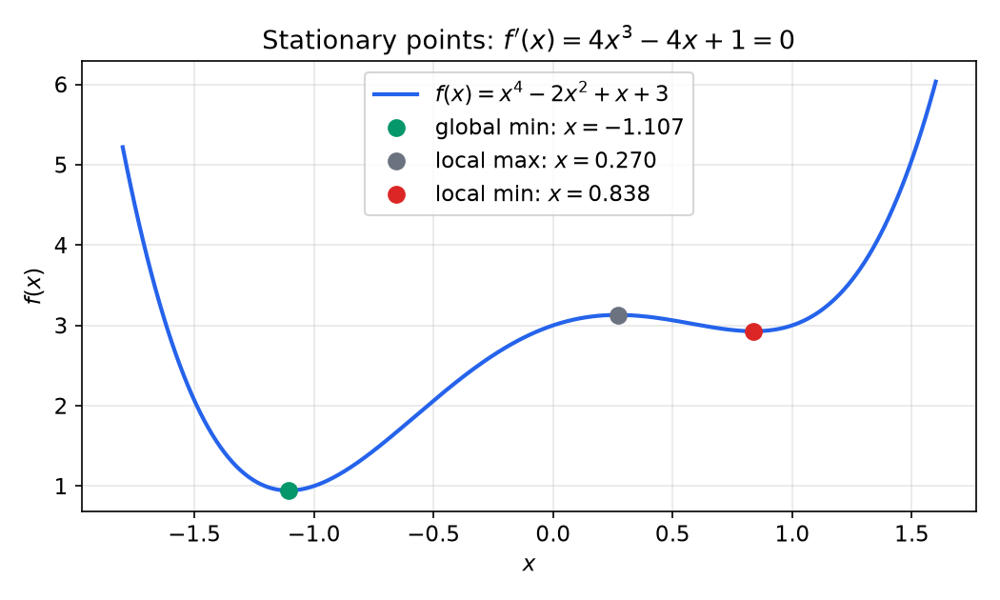
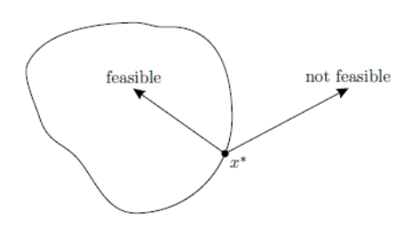
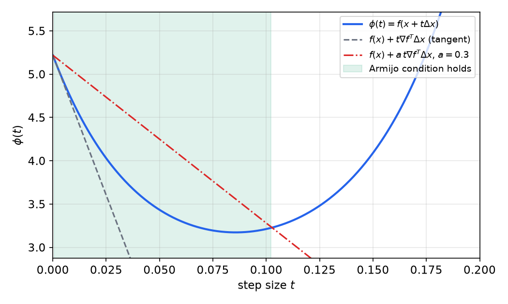
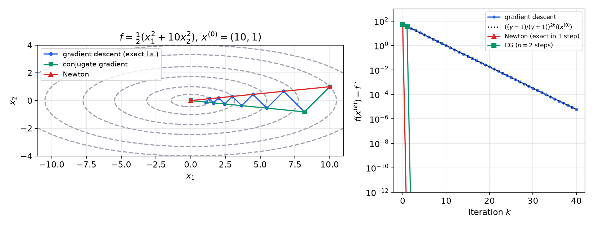
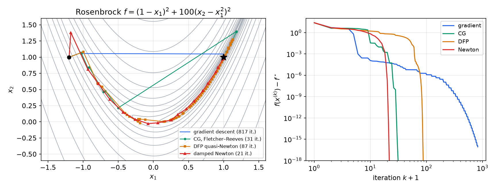
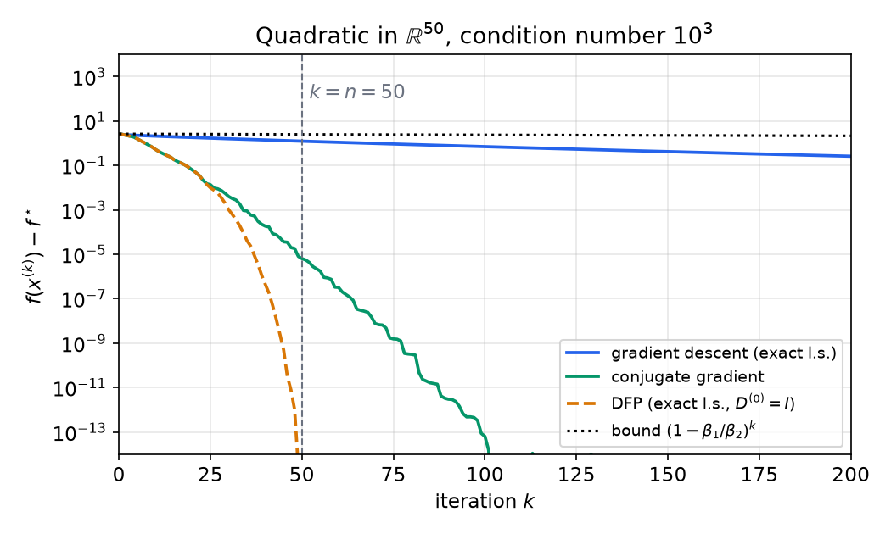
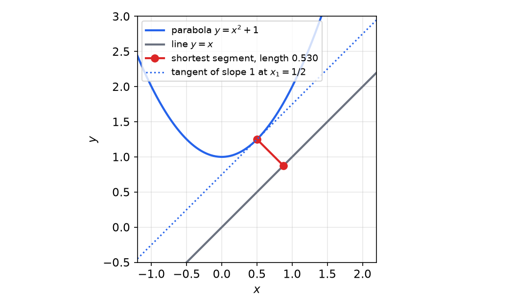

# Static Optimization

Every optimal-control problem is an optimization problem in disguise: a cost is minimized over decision variables, subject to constraints. This chapter develops the finite-dimensional theory on which the rest of the subsection builds. It covers optimality conditions for unconstrained problems, the iterative algorithms that compute minima numerically (gradient, steepest descent, Newton, conjugate-gradient and quasi-Newton methods, with their convergence proofs), and equality-constrained optimization with Lagrange multipliers and the Hamiltonian. The Hamiltonian, the multiplier equations and the sensitivity interpretation of the multiplier all reappear, almost unchanged, when the decision variable becomes a function of time in the [calculus of variations](calculus-of-variations.md) and in [discrete-time optimal control](discrete-optimal-control.md).

## Optimization-Based Design

### Why optimize?

Many engineering goals are naturally phrased as "best": send a rocket to the Moon with minimum fuel, or as high as possible (Goddard's rocket problem, 1910); place satellites in orbit and plan interplanetary trajectories; drive an autonomous car between two cities in minimum time or with minimum fuel subject to speed limits; raise sales of a product to a target level with minimum advertising spend; maximize the throughput of a channel of given bandwidth; produce a given amount of a chemical in minimum time or with minimum catalyst. Optimality is also a principle of nature. The laws of mechanics can be stated as variational principles (the trajectory of a system makes the action stationary), and light travels along paths of least time.

The idea of **optimization-based design** is to state the design problem as an optimization problem. This gives a systematic procedure, works directly with nonlinear models, and handles state and input constraints. The price is that a suitable criterion is sometimes hard to write down.

Some optimization problems are easy and some are extraordinarily hard. Two easy ones: in **portfolio optimization** the variables are the amounts invested in each asset, the constraint is the budget and the objective is risk or return; in **data fitting** the variables are model parameters, the constraints are parameter limits and prior information, and the objective is prediction error. A hard one: Fermat's Last Theorem (no positive integers satisfy \\(x^n+y^n=z^n\\) for \\(n\ge 3\\)) is equivalent to the statement that the optimal value of
\\[
\min\_{x,y,z,n}\\; (x^n+y^n-z^n)^2 \quad\text{s.t.}\quad x,y,z\ge 1,\\; n\ge 3,\\; \sin^2\pi n+\sin^2\pi x+\sin^2\pi y+\sin^2\pi z=0
\\]
is positive. The problem has four variables and five constraints; the sine constraint forces all variables to be integers. It took from 1637 to 1994 (Wiles) to prove. Small size does not mean easy: what matters is structure, above all convexity.

### Ingredients of an optimal-control problem

The problems of later chapters have the form: given the system
\\[
\dot x = f(t,x,u),\qquad x(t\_0)=x\_0,\qquad x\in\mathbb R^n,\\; u\in U\subset\mathbb R^m,
\\]
find an admissible input \\(u(\cdot)\\) minimizing the **cost functional**
\\[
J(u) = \int\_{t\_0}^{t\_f} L(t,x,u)\\,dt + K(t\_f,x\_f),
\\]
where \\(L\\) is the **running cost**, \\(K\\) the **terminal cost**, \\(x\_f := x(t\_f)\\), the final time may be fixed or free, and the final state may be free, fixed, or constrained to a target set.

**Example 1 (Minimum-time parking).** A car moves on a line with position \\(x\\) and acceleration \\(u\in U=[-1,1]\\) (negative values brake). The model is the double integrator \\(\ddot x = u\\), or \\(\dot x\_1=x\_2\\), \\(\dot x\_2=u\\). To park at \\((x\_1,x\_2)=(0,0)\\) in minimum time, take \\(L=1\\) and \\(K=0\\), so that \\(J = t\_f\\).

This chapter treats the finite-dimensional version, where the decision variable is a vector rather than a function.

## Unconstrained Optimization

### Local and global minima

Consider
\\[
\min\_{x\in\mathbb R^n} f(x),
\\]
with \\(f\\) continuously differentiable; \\(x\\) is the decision (control) vector. Write \\(f\_x := \partial f/\partial x\\) for the gradient (a column vector, also written \\(\nabla f\\)) and \\(f\_{xx} := \partial^2 f/\partial x^2\\) for the Hessian (also \\(\nabla^2 f\\)). The quantity \\(f(x^\star+\Delta x)\\) is called an **increment** of \\(f\\) at \\(x^\star\\).

**Definition (Strong and weak minimum).** A point \\(x^\star\\) is a **strong** (strict) local minimum if there is \\(\delta>0\\) such that
\\[
f(x^\star) < f(x^\star+\Delta x)\quad\text{for all } 0<\lVert\Delta x\rVert\le\delta .
\\]
It is a **weak** local minimum if it is not strong and there is \\(\delta>0\\) with \\(f(x^\star)\le f(x^\star+\Delta x)\\) for all \\(0<\lVert\Delta x\rVert\le\delta\\). A strong minimum increases in every direction; a weak minimum stays level in some directions. If the inequality holds with \\(\delta=\infty\\), the minimum is **global** (unique in the strong case); otherwise it is local.



*Figure: \\(f(x)=x^4-2x^2+x+3\\) has three stationary points, the roots of \\(f'(x)=4x^3-4x+1\\). At \\(x\approx-1.107\\) (global minimum, \\(f\approx0.944\\)) and \\(x\approx0.838\\) (local minimum, \\(f\approx2.927\\)) the curvature \\(f''=12x^2-4\\) is positive; at \\(x\approx0.270\\) it is negative (local maximum). First- and second-order conditions cannot distinguish the two minima: both are local information.*

### First- and second-order conditions

Assume \\(f\in C^2\\) and expand about \\(x\\):
\\[
f(x+\Delta x) = f(x) + \Delta x^T f\_x + \tfrac12\Delta x^T f\_{xx}\Delta x + O(\lVert\Delta x\rVert^3).
\\]
For small \\(\lVert\Delta x\rVert\\) the linear term dominates. Its sign changes with the sign of \\(\Delta x\\), so unless \\(f\_x=0\\) some direction decreases \\(f\\). Hence:

**Theorem (First-order necessary condition).** If \\(x^\star\\) is an interior local minimum of \\(f\in C^1\\), then \\(f\_x(x^\star)=0\\).

A point with \\(f\_x=0\\) is **stationary**. Stationarity is necessary but not sufficient for a minimum: maxima and saddle points are stationary too. At a stationary point the expansion reduces to
\\[
f(x^\star+\Delta x) = f(x^\star) + \tfrac12\Delta x^T f\_{xx}(x^\star)\Delta x + O(\lVert\Delta x\rVert^3),
\\]
and the quadratic term decides.

**Theorem (Second-order conditions).** Let \\(f\in C^2\\) and \\(f\_x(x^\star)=0\\).
1. (Necessary) If \\(x^\star\\) is a local minimum, then \\(f\_{xx}(x^\star)\succeq0\\).
2. (Sufficient) If \\(f\_{xx}(x^\star)\succ0\\), then \\(x^\star\\) is a strong local minimum.

*Proof of 2.* Let \\(\lambda\_{\min}>0\\) be the smallest eigenvalue of \\(f\_{xx}(x^\star)\\). Then \\(\tfrac12\Delta x^Tf\_{xx}\Delta x\ge\tfrac12\lambda\_{\min}\lVert\Delta x\rVert^2\\), which dominates the \\(O(\lVert\Delta x\rVert^3)\\) remainder for \\(\lVert\Delta x\rVert\\) small enough, so the increment is strictly positive. For part 1, if \\(\Delta x^Tf\_{xx}\Delta x<0\\) for some \\(\Delta x\\), moving along \\(t\Delta x\\) with \\(t\\) small decreases \\(f\\). ∎

In terms of the eigenvalues of the symmetric Hessian at a stationary point:

| Eigenvalues of \\(f\_{xx}(x^\star)\\) | Definiteness | Conclusion |
|---|---|---|
| all \\(>0\\) | \\(f\_{xx}\succ0\\) | strong local minimum |
| all \\(<0\\) | \\(f\_{xx}\prec0\\) | strong local maximum |
| nonzero, mixed signs | indefinite | saddle point |
| some zero, others one sign | semidefinite | undecided: higher-order terms needed |

In the semidefinite case, directions with \\(\Delta x^Tf\_{xx}\Delta x=0\\) are decided by third- and fourth-order terms (compare \\(x^4\\), \\(-x^4\\) and \\(x^3\\) at \\(x=0\\)).

**Example 2 (Quadratic surfaces).** Let \\(f(x)=\tfrac12x^TQx+S^Tx\\) with \\(Q\\) symmetric. Then \\(f\_x=Qx+S\\) and \\(f\_{xx}=Q\\).
- If \\(Q\\) is nonsingular, the unique stationary point is \\(x^\star=-Q^{-1}S\\).
- It is a minimum if \\(Q\succ0\\), a maximum if \\(Q\prec0\\) and a saddle if \\(Q\\) is indefinite. If \\(Q\\) is singular the stationary set is empty or an affine subspace, and the Hessian alone says nothing more.
- The stationary value is
\\[
f(x^\star) = \tfrac12(Q^{-1}S)^TQ(Q^{-1}S) - S^TQ^{-1}S = -\tfrac12 S^TQ^{-1}S .
\\]
Contour plots (MATLAB `contour`, matplotlib `contour`) of the cases \\(Q\succ0\\), \\(Q\prec0\\) and indefinite \\(Q\\) show nested ellipses around a minimum, nested ellipses around a maximum, and hyperbolas around a saddle.

**Example 3 (Scalar manipulation).** For \\(f(x\_1,x\_2)=\tfrac12x\_1^2+x\_1x\_2+x\_2^2+x\_2\\),
\\[
\frac{\partial f}{\partial x\_1}=x\_1+x\_2=0,\qquad \frac{\partial f}{\partial x\_2}=x\_1+2x\_2+1=0,
\\]
so \\(x\_2=-1\\), \\(x\_1=1\\). The Hessian \\(\begin{bmatrix}1&1\\\\1&2\end{bmatrix}\\) has determinant 1 and trace 3, so it is positive definite and \\((1,-1)\\) is the global minimum, with \\(f=-\tfrac12\\).

### Feasibility

The first-order condition requires \\(f\in C^1\\) and \\(x^\star\\) to be an **interior** point of the domain \\(D\subset\mathbb R^n\\); the second-order condition requires \\(f\in C^2\\). When \\(D=\mathbb R^n\\) the problem is *completely unconstrained*, but for a local minimum it suffices that \\(x^\star\\) lies in the interior of \\(D\\).

If \\(x^\star\\) is on the boundary of \\(D\\), not every increment stays in \\(D\\).

**Definition (Feasible direction).** A direction \\(\Delta x\\) is **feasible** at \\(x^\star\in D\\) if \\(x^\star+\epsilon\Delta x\in D\\) for all sufficiently small \\(\epsilon>0\\).



*Figure: feasible and infeasible directions at a point \\(x^\star\\) on the boundary of the set \\(D\\). Only directions pointing into \\(D\\) are admissible increments, so the first-order condition weakens to \\(f\_x(x^\star)^T\Delta x\ge0\\) for feasible \\(\Delta x\\) and \\(f\_x(x^\star)=0\\) is no longer necessary.*

If \\(D\\) is convex, the segment from \\(x^\star\\) to any \\(x\in D\\) lies in \\(D\\), so every \\(x-x^\star\\) is a feasible direction. If \\(D\\) is not convex, conditions built from feasible directions are conservative. These issues motivate [constrained optimization](#equality-constrained-optimization) and, in optimal control, the [minimum principle](pontryagin.md) for bounded inputs.

## Iterative Methods

Most optimization problems cannot be solved in closed form. An **iterative algorithm** generates a sequence \\(x^{(0)},x^{(1)},\dots\\) with \\(f(x^{(k+1)})<f(x^{(k)})\\), stopping when, for example, \\(\lVert\nabla f(x^{(k)})\rVert<\epsilon\\). Requiring a strict decrease is what makes the method a descent method: it rules out cycling, and if \\(f\\) is bounded below the values \\(f(x^{(k)})\\) converge. There is no guarantee of reaching a global minimum in general; for convex problems the stationary points that gradient-type methods converge to are global minima.

### Strong convexity

**Definition (Strong convexity).** A twice-differentiable \\(f\\) is **strongly convex** on a set \\(S\\) if there is \\(\beta>0\\) such that \\(\nabla^2f(x)\succeq\beta I\\) for all \\(x\in S\\).

Strong convexity converts a small gradient into a certificate of near-optimality.

**Theorem (Suboptimality bounds).** If \\(f\\) is strongly convex with constant \\(\beta\\) and \\(f^\star=\inf f\\) is attained at \\(x^\star\\), then for all \\(x\\)
\\[
f(x)-f^\star \le \frac{1}{2\beta}\lVert\nabla f(x)\rVert^2,\qquad
\lVert x-x^\star\rVert \le \frac{2}{\beta}\lVert\nabla f(x)\rVert .
\\]

*Proof.* By Taylor's theorem with the mean-value form of the remainder, for any \\(x,y\\) there is a \\(z\\) on the segment between them with
\\[
f(y) = f(x)+\nabla f(x)^T(y-x)+\tfrac12(y-x)^T\nabla^2 f(z)(y-x) \ge f(x)+\nabla f(x)^T(y-x)+\tfrac\beta2\lVert y-x\rVert^2 .
\\]
Fix \\(x\\). The right-hand side is a convex quadratic in \\(y\\), minimized at \\(\tilde y = x-\tfrac1\beta\nabla f(x)\\), where it equals \\(f(x)-\tfrac1{2\beta}\lVert\nabla f(x)\rVert^2\\). So \\(f(y)\ge f(x)-\tfrac1{2\beta}\lVert\nabla f(x)\rVert^2\\) for every \\(y\\), in particular for \\(y=x^\star\\), which is the first bound.

For the second, put \\(y=x^\star\\) in the same inequality and use Cauchy–Schwarz:
\\[
f^\star \ge f(x)+\nabla f(x)^T(x^\star-x)+\tfrac\beta2\lVert x^\star-x\rVert^2 \ge f(x)-\lVert\nabla f(x)\rVert\\,\lVert x^\star-x\rVert+\tfrac\beta2\lVert x^\star-x\rVert^2 .
\\]
Since \\(f(x)\ge f^\star\\), we get \\(-\lVert\nabla f(x)\rVert\\,\lVert x^\star-x\rVert+\tfrac\beta2\lVert x^\star-x\rVert^2\le0\\). Dividing by \\(\lVert x^\star-x\rVert\\) (the claim is trivial if it is zero) gives \\(\lVert x-x^\star\rVert\le\tfrac2\beta\lVert\nabla f(x)\rVert\\). ∎

The first bound yields a stopping rule when \\(\beta\\) is known:
\\[
\lVert\nabla f(x)\rVert\le\sqrt{2\beta\epsilon}\quad\Longrightarrow\quad f(x)-f^\star\le\epsilon .
\\]

### The general descent method

A descent method iterates
\\[
x^{(k+1)} = x^{(k)} + t^{(k)}\Delta x^{(k)},
\\]
where \\(\Delta x^{(k)}\\) is the **search direction** and \\(t^{(k)}>0\\) the **step size**. A **descent direction** satisfies
\\[
\nabla f(x^{(k)})^T\Delta x^{(k)} < 0,
\\]
because then \\(f(x+t\Delta x)=f(x)+t\nabla f^T\Delta x+o(t)<f(x)\\) for small \\(t>0\\).

**Algorithm 1 (General descent).** Given a starting point \\(x\\), repeat:
1. determine a descent direction \\(\Delta x\\);
2. line search: choose a step size \\(t>0\\);
3. update \\(x := x+t\Delta x\\);

until the stopping criterion is satisfied.

The methods below differ in the choice of direction: gradient, steepest descent in a chosen norm, Newton, conjugate gradient and quasi-Newton. They trade cost per iteration against the number of iterations.

### Line search

**Exact line search** chooses
\\[
t^{(k)} = \arg\min\_{t\ge0} f(x^{(k)}+t\Delta x^{(k)})
\\]
(or the restricted version over \\(0\le t\le s\\)). It is worthwhile when the one-dimensional minimization is cheap relative to computing the direction.

**Example 4 (Exact line search).** Let \\(f(x\_1,x\_2)=x\_1^2+x\_2^2+x\_1x\_2\\), \\(x^{(0)}=(1,-1)\\) and \\(\Delta x^{(0)}=(0,1)\\). The gradient at \\(x^{(0)}\\) is \\((2x\_1+x\_2,\\;2x\_2+x\_1)=(1,-1)\\), so \\(\nabla f^T\Delta x=-1<0\\) and the direction is a descent direction. Along it, \\(x=(1,\\,-1+t)\\) and
\\[
\phi(t) = f(1,-1+t) = 1+(t-1)^2+(t-1),\qquad \phi'(t)=2(t-1)+1=0\;\Rightarrow\; t^\star=\tfrac12,
\\]
so \\(x^{(1)}=(1,-\tfrac12)\\) with \\(f=\tfrac34\\), down from \\(f(x^{(0)})=1\\). In general the one-dimensional problem has no closed form, and solving it accurately at every iteration is wasteful in high dimensions.

**Backtracking (Armijo) line search.** Given a descent direction \\(\Delta x\\) and parameters \\(a\in(0,0.5)\\), \\(\beta\in(0,1)\\): start with \\(t=1\\) and set \\(t:=\beta t\\) until
\\[
f(x+t\Delta x) < f(x)+a\\,t\\,\nabla f(x)^T\Delta x .
\\]
The right-hand side is the tangent line at \\(t=0\\) with its slope reduced by the factor \\(a\\). Because \\(\Delta x\\) is a descent direction, \\(f(x+t\Delta x)\\) lies below this line for all sufficiently small \\(t\\), so the loop terminates. The accepted step guarantees a decrease proportional to the step length and slope, which is what convergence proofs need.



*Figure: the backtracking condition along a gradient direction for \\(f(x)=e^{x\_1+3x\_2-0.1}+e^{x\_1-3x\_2-0.1}+e^{-x\_1-0.1}\\) at \\(x=(-1,0.7)\\). The step is accepted wherever \\(\phi(t)=f(x+t\Delta x)\\) (blue) lies below the line of reduced slope \\(a\nabla f^T\Delta x\\) (red, \\(a=0.3\\)); the shaded interval is accepted. Backtracking from \\(t=1\\) by factors \\(\beta\\) lands in this interval without locating the exact minimizer.*

Other step-size rules are a constant step, or a diminishing step \\(t^{(k)}\to0\\) satisfying the infinite-travel condition \\(\sum\_{k=1}^\infty t^{(k)}=\infty\\), which keeps the iterates from stalling before reaching a stationary point. In practice: exact minimization is possible only in special cases; most descent methods do not need the optimal \\(t\\); and backtracking is easy to implement.

### Gradient descent

The simplest choice of direction is the negative gradient, \\(\Delta x=-\nabla f(x)\\), which is a descent direction whenever \\(\nabla f(x)\ne0\\) since \\(\nabla f^T\Delta x=-\lVert\nabla f\rVert^2\\).

**Algorithm 2 (Gradient descent).** Repeat: \\(\Delta x:=-\nabla f(x)\\); choose \\(t\\) by exact or backtracking line search; \\(x:=x-t\nabla f(x)\\); until the stopping criterion holds.

**Theorem (Linear convergence of gradient descent).** Suppose \\(\beta\_1 I\preceq\nabla^2f(x)\preceq\beta\_2 I\\) for all \\(x\\), with \\(0<\beta\_1\le\beta\_2\\). Then gradient descent with exact line search satisfies
\\[
f(x^{(k+1)})-f^\star \le \Big(1-\frac{\beta\_1}{\beta\_2}\Big)\big(f(x^{(k)})-f^\star\big).
\\]

*Proof.* Let \\(x^+(t)=x-t\nabla f(x)\\). The upper bound \\(\nabla^2 f\preceq\beta\_2I\\) and Taylor's theorem give
\\[
f(x^+(t)) \le f(x) - t\lVert\nabla f(x)\rVert^2 + \frac{\beta\_2t^2}{2}\lVert\nabla f(x)\rVert^2 .
\\]
Exact line search does at least as well as any particular \\(t\\), and the right-hand side is minimized at \\(t=1/\beta\_2\\). Hence
\\[
f(x^{(k+1)}) \le f(x^{(k)}) - \frac{1}{2\beta\_2}\lVert\nabla f(x^{(k)})\rVert^2,
\qquad\text{so}\qquad
f(x^{(k+1)})-f^\star \le f(x^{(k)})-f^\star - \frac{1}{2\beta\_2}\lVert\nabla f(x^{(k)})\rVert^2 .
\\]
Strong convexity with constant \\(\beta\_1\\) gives \\(\lVert\nabla f(x)\rVert^2\ge2\beta\_1(f(x)-f^\star)\\) (the first suboptimality bound). Substituting,
\\[
f(x^{(k+1)})-f^\star \le \Big(1-\frac{\beta\_1}{\beta\_2}\Big)(f(x^{(k)})-f^\star). \qquad ∎
\\]

So \\(f(x^{(k)})-f^\star\le c^k(f(x^{(0)})-f^\star)\\) with \\(c=1-\beta\_1/\beta\_2<1\\): convergence is geometric (called *linear* in optimization, because \\(\log(f-f^\star)\\) decreases linearly in \\(k\\)). The ratio \\(\beta\_2/\beta\_1\\) bounds the condition number of the Hessian. When it is large, \\(c\\) is close to 1 and convergence is very slow. A similar result holds with backtracking line search, with \\(c=1-\min\\{2a\beta\_1,\\;2\beta a\beta\_1/\beta\_2\\}\\).

**Example 5 (Ill-conditioned quadratic).** Let \\(f(x)=\tfrac12(x\_1^2+\gamma x\_2^2)\\) with \\(\gamma>0\\). Then \\(x^\star=0\\), \\(f^\star=0\\), \\(\nabla^2f=\mathrm{diag}(1,\gamma)\\), \\(\beta\_1=\min\\{1,\gamma\\}\\) and \\(\beta\_2=\max\\{1,\gamma\\}\\). From \\(x^{(0)}=(\gamma,1)\\), gradient descent with exact line search has the closed form
\\[
x\_1^{(k)}=\gamma\Big(\frac{\gamma-1}{\gamma+1}\Big)^k,\qquad
x\_2^{(k)}=\Big(-\frac{\gamma-1}{\gamma+1}\Big)^k,\qquad
f(x^{(k)})=\frac{\gamma(\gamma+1)}{2}\Big(\frac{\gamma-1}{\gamma+1}\Big)^{2k}=\Big(\frac{\gamma-1}{\gamma+1}\Big)^{2k}f(x^{(0)}).
\\]
To verify the first step: the gradient is \\(\nabla f=(x\_1,\gamma x\_2)\\), and the exact step for a quadratic is \\(t=\nabla f^T\nabla f/(\nabla f^T\nabla^2 f\\,\nabla f)\\). At \\(x^{(0)}\\), \\(\nabla f=(\gamma,\gamma)\\) and \\(t=2\gamma^2/(\gamma^2+\gamma^3)=2/(1+\gamma)\\), giving \\(x^{(1)}=(\gamma-2\gamma/(1+\gamma),\\;1-2\gamma/(1+\gamma))=\tfrac{\gamma-1}{\gamma+1}(\gamma,-1)\\). The pattern repeats with alternating sign of \\(x\_2\\). For \\(\gamma=10\\) the contraction factor per step is \\((9/11)^2\approx0.67\\), and convergence is very slow when \\(\gamma\gg1\\) or \\(\gamma\ll1\\).



*Figure: left, iterates on the contours of \\(f=\tfrac12(x\_1^2+10x\_2^2)\\) from \\(x^{(0)}=(10,1)\\). Gradient descent (blue) zig-zags because each exact line search ends tangent to a contour, so successive steps are orthogonal. Newton's method (red) reaches the minimum in one step and conjugate gradient (green) in \\(n=2\\) steps. Right, the gradient-descent error follows the closed form \\(((\gamma-1)/(\gamma+1))^{2k}f(x^{(0)})\\) exactly.*

**Practical summary for gradient descent.**
- Convergence is linear: \\(f(x^{(k)})-f^\star\to0\\) geometrically.
- Backtracking parameters have a noticeable but modest effect; \\(a\in(0.2,0.5)\\) and \\(\beta=0.5\\) are safe. Exact line search is rarely worth the effort.
- The rate depends strongly on the condition number of the Hessian. Above about 1000 the method is too slow to be useful.
- The method is very simple but often very slow.

### Steepest descent

Gradient descent is a special case of a more general idea. To first order, \\(f(x+v)\approx f(x)+\nabla f(x)^Tv\\). The **normalized steepest descent direction** with respect to a norm \\(\lVert\cdot\rVert\\) is
\\[
\Delta x\_{nsd} = \arg\min\\{\nabla f(x)^Tv \;:\; \lVert v\rVert\le1\\},
\\]
the unit-norm step that decreases the linear model the most.

- **Euclidean norm.** The minimizer of \\(\nabla f^Tv\\) over the unit ball is \\(v=-\nabla f(x)/\lVert\nabla f(x)\rVert\_2\\) (Cauchy–Schwarz). Steepest descent in the Euclidean norm is gradient descent.
- **Quadratic norm** \\(\lVert x\rVert\_P=(x^TPx)^{1/2}=\lVert P^{1/2}x\rVert\_2\\), \\(P\succ0\\). Then
\\[
\Delta x\_{nsd} = -\frac{P^{-1}\nabla f(x)}{\lVert P^{-1}\nabla f(x)\rVert\_P}.
\\]
This is gradient descent after the change of coordinates \\(\bar x=P^{1/2}x\\): the gradient in the new coordinates is \\(P^{-1/2}\nabla f\\), and mapping the step back gives \\(P^{-1}\nabla f\\). A good \\(P\\) makes the sublevel sets of \\(f\\) round in the new coordinates.
- **\\(\ell\_1\\) norm** \\(\lVert x\rVert\_1=\sum\_i\lvert x\_i\rvert\\), a convex but non-differentiable function, which is the maximum of \\(2^n\\) linear functions: \\(\lVert x\rVert\_1=\max\\{s^Tx: s\_i\in\\{-1,1\\}\\}\\), the active ones having \\(s\_i=\mathrm{sign}(x\_i)\\) (several are active when some \\(x\_i=0\\)). The unit ball is a cross-polytope whose vertices are \\(\pm e\_i\\), so the linear function \\(\nabla f^Tv\\) is minimized at a vertex:
\\[
\Delta x\_{nsd} = -\mathrm{sign}\Big(\frac{\partial f}{\partial x\_i}\Big)e\_i,\qquad i=\arg\max\_j\Big\lvert\frac{\partial f}{\partial x\_j}\Big\rvert .
\\]
Each step changes only the coordinate with the largest partial derivative: this is **coordinate descent**.

All steepest-descent methods converge linearly, \\(f(x^{(k+1)})-f^\star\le c\\,(f(x^{(k)})-f^\star)\\), with \\(c\\) depending on the norm. The norm can change the rate dramatically.

**Example 6 (Choice of norm).** Take
\\[
f(x)=e^{x\_1+3x\_2-0.1}+e^{x\_1-3x\_2-0.1}+e^{-x\_1-0.1},
\\]
whose minimum is \\(f^\star=2\sqrt2\\,e^{-0.1}\approx2.559\\) at \\(x^\star=(-\tfrac12\ln2,\\,0)\\). Run steepest descent in the quadratic norms with \\(P=\mathrm{diag}(8,2)\\) and \\(P=\mathrm{diag}(2,8)\\), with backtracking \\(a=0.1\\), \\(\beta=0.7\\). Which works better? At the minimum the Hessian is approximately \\(\mathrm{diag}(2.56,\\,11.5)\\): the function is about 4.5 times more curved in \\(x\_2\\) than in \\(x\_1\\). The norm \\(P=\mathrm{diag}(2,8)\\) has the same shape, so after the change of coordinates the sublevel sets are nearly round. Starting from \\((-1,1)\\), a run reaches \\(f-f^\star<10^{-10}\\) in 15 iterations with \\(P=\mathrm{diag}(2,8)\\) and needs about 100 with \\(P=\mathrm{diag}(8,2)\\), which makes the conditioning worse. The lesson: choose \\(P\\) so that its ellipsoid approximates the sublevel sets of \\(f\\), that is, \\(P\approx\nabla^2 f(x^\star)\\). Taking this to its conclusion gives Newton's method.

### Newton's method

The **Newton step** is
\\[
\Delta x\_{nt} = -\nabla^2 f(x)^{-1}\nabla f(x).
\\]
It is a descent direction when \\(\nabla^2f(x)\succ0\\), since then \\(\nabla f^T\Delta x\_{nt}=-\nabla f^T\nabla^2f^{-1}\nabla f<0\\) for \\(\nabla f\ne0\\). (Positive *definiteness* is needed; a semidefinite Hessian may be singular.) The Newton step has three interpretations:
1. **Minimizer of the second-order model.** \\(x+\Delta x\_{nt}\\) minimizes \\(\hat f(x+v)=f(x)+\nabla f^Tv+\tfrac12v^T\nabla^2f\\,v\\). If \\(f\\) is nearly quadratic near \\(x^\star\\), this is a very good estimate of \\(x^\star\\).
2. **Root of the linearized optimality condition.** It solves \\(\nabla f(x+v)\approx\nabla f(x)+\nabla^2f(x)v=0\\): Newton's root-finding method applied to \\(\nabla f=0\\).
3. **Steepest descent in the Hessian norm** \\(\lVert v\rVert\_{\nabla^2f(x)}=(v^T\nabla^2f(x)v)^{1/2}\\), the choice \\(P=\nabla^2 f(x)\\) above. This suggests fast convergence once \\(\nabla^2 f(x)\approx\nabla^2f(x^\star)\\).

**Definition (Newton decrement).**
\\[
\lambda(x) = \big(\nabla f(x)^T\nabla^2f(x)^{-1}\nabla f(x)\big)^{1/2}.
\\]
It measures the proximity of \\(x\\) to \\(x^\star\\):
- \\(f(x)-\inf\_y\hat f(y)=\tfrac12\lambda(x)^2\\), so \\(\tfrac12\lambda^2\\) estimates \\(f(x)-f^\star\\);
- \\(\lambda(x)=(\Delta x\_{nt}^T\nabla^2f(x)\Delta x\_{nt})^{1/2}\\), the length of the Newton step in the Hessian norm;
- \\(\nabla f^T\Delta x\_{nt}=-\lambda(x)^2\\), the directional derivative along the Newton direction (used in the line search);
- it is affine invariant, unlike \\(\lVert\nabla f\rVert\_2\\).

**Algorithm 3 (Newton's method).** Given \\(x\\) and a tolerance \\(\epsilon>0\\), repeat:
1. compute \\(\Delta x\_{nt}\\) and \\(\lambda^2\\);
2. quit if \\(\lambda^2/2\le\epsilon\\);
3. choose \\(t\\) by backtracking line search;
4. update \\(x:=x+t\Delta x\_{nt}\\).

With the line search this is the **damped** (or guarded) Newton method; the **pure** Newton method uses \\(t=1\\) always and may diverge far from the solution.

**Theorem (Two-phase convergence of Newton's method).** Let \\(f\\) be strongly convex with constant \\(\beta\_1\\), and let \\(\nabla^2f\\) be Lipschitz with constant \\(L\\): \\(\lVert\nabla^2f(x)-\nabla^2f(y)\rVert\_2\le L\lVert x-y\rVert\_2\\). Then there are constants \\(\eta\in(0,\beta\_1^2/L]\\) and \\(\gamma>0\\) such that:
1. **Damped Newton phase** (\\(\lVert\nabla f(x^{(k)})\rVert\_2\ge\eta\\)): \\(f(x^{(k+1)})-f(x^{(k)})\le-\gamma\\). Most iterations require backtracking. Since \\(f\\) decreases by at least \\(\gamma\\) per step, this phase ends after at most \\((f(x^{(0)})-f^\star)/\gamma\\) iterations.
2. **Quadratically convergent phase** (\\(\lVert\nabla f(x^{(k)})\rVert\_2<\eta\\)): backtracking accepts \\(t=1\\) and
\\[
\frac{L}{2\beta\_1^2}\lVert\nabla f(x^{(k+1)})\rVert\_2 \le \Big(\frac{L}{2\beta\_1^2}\lVert\nabla f(x^{(k)})\rVert\_2\Big)^2 .
\\]
Once in this phase the iterates stay in it, and for \\(l\ge k\\)
\\[
\frac{L}{2\beta\_1^2}\lVert\nabla f(x^{(l)})\rVert\_2 \le \Big(\frac{L}{2\beta\_1^2}\lVert\nabla f(x^{(k)})\rVert\_2\Big)^{2^{l-k}} \le \Big(\frac12\Big)^{2^{l-k}} .
\\]

*Proof idea for phase 2.* With \\(t=1\\), \\(\nabla f(x^+)=\nabla f(x^+)-\nabla f(x)-\nabla^2f(x)\Delta x\_{nt}=\int\_0^1(\nabla^2f(x+s\Delta x\_{nt})-\nabla^2f(x))\Delta x\_{nt}\\,ds\\). The Lipschitz bound gives \\(\lVert\nabla f(x^+)\rVert\le\tfrac L2\lVert\Delta x\_{nt}\rVert^2\le\tfrac{L}{2\beta\_1^2}\lVert\nabla f(x)\rVert^2\\), using \\(\lVert\Delta x\_{nt}\rVert\le\lVert\nabla f\rVert/\beta\_1\\). Multiplying by \\(L/(2\beta\_1^2)\\) gives the squared recursion. ∎

The number of correct digits roughly doubles at each step of phase 2. Combining the phases, the number of iterations until \\(f-f^\star\le\epsilon\\) is at most
\\[
\frac{f(x^{(0)})-f^\star}{\gamma} + \log\_2\log\_2\frac{\epsilon\_0}{\epsilon},
\\]
where \\(\gamma\\) and \\(\epsilon\_0=2\beta\_1^3/L^2\\) depend on \\(\beta\_1\\), \\(L\\) and \\(x^{(0)}\\). The second term grows so slowly that it is effectively a constant (about 6 for any reasonable \\(\epsilon\\)). The constants \\(\beta\_1\\) and \\(L\\) are usually unknown, so the bound is qualitative: a modest number of damped steps, then a handful of quadratically convergent ones.

For the exponential function of Example 6, Newton's method with \\(a=0.1\\), \\(\beta=0.7\\) converges to machine precision in about five iterations. On large problems the behaviour is the same: for \\(f(x)=c^Tx-\sum\_{i=1}^{500}\log(b\_i-a\_i^Tx)\\) in \\(\mathbb R^{100}\\) (a log-barrier function), Newton's method with backtracking \\(a=0.01\\), \\(\beta=0.5\\) reaches \\(f-f^\star\approx10^{-12}\\) in about eight iterations, almost as fast as with exact line search; the step size settles at \\(t=1\\) after the first two or three iterations, which marks the start of the quadratic phase.

**Summary on Newton's method.** Convergence is fast (quadratic near \\(x^\star\\)); the method is affine invariant (insensitive to the choice of coordinates and to conditioning); it scales well with problem size; and its performance hardly depends on the choice of line-search parameters. The main disadvantage is the cost of forming and storing the Hessian and of solving \\(\nabla^2f\\,\Delta x=-\nabla f\\) at each iteration, which motivates the next two methods.



*Figure: the Rosenbrock function \\(f=(1-x\_1)^2+100(x\_2-x\_1^2)^2\\), minimum \\(f^\star=0\\) at \\((1,1)\\), from the classic start \\((-1.2,1)\\). Left: iterates on the banana-shaped valley. Right: \\(f-f^\star\\) against iteration (log–log). Gradient descent with backtracking (\\(a=0.25\\), \\(\beta=0.5\\)) gets close quickly and then crawls along the valley floor for hundreds of iterations, because the Hessian there has condition number in the thousands. Damped Newton (21 iterations) follows the valley and finishes with the characteristic quadratic plunge; DFP and Fletcher–Reeves CG (with a Wolfe line search and restarts) lie in between, with superlinear endgames. Iteration counts depend on the line-search details.*

### Conjugate gradient method

The conjugate gradient (CG) method accelerates steepest descent without forming a Hessian. It was developed for the quadratic problem
\\[
\min\_x f(x)=\tfrac12x^TQx-b^Tx,\qquad Q\succ0,
\\]
which is equivalent to solving \\(Qx=b\\), and was later extended to non-quadratic functions.

**Definition (Q-conjugacy).** Nonzero vectors \\(d\_0,\dots,d\_{k}\\) are **Q-conjugate** if \\(d\_i^TQd\_j=0\\) for \\(i\ne j\\). For \\(Q=I\\), this is ordinary orthogonality. Q-conjugate vectors are linearly independent (multiply \\(\sum c\_id\_i=0\\) by \\(d\_j^TQ\\)), so there are at most \\(n\\) of them.

Given any linearly independent \\(\xi\_0,\dots,\xi\_{n-1}\\), a Q-conjugate set is produced by **Gram–Schmidt in the \\(Q\\) inner product**: \\(d\_0=\xi\_0\\) and
\\[
d\_{k+1} = \xi\_{k+1} - \sum\_{i=0}^{k}\frac{\xi\_{k+1}^TQd\_i}{d\_i^TQd\_i}\\,d\_i .
\\]

**Theorem (Expanding subspace).** Let \\(f\\) be the quadratic above, \\(d\_0,\dots,d\_{n-1}\\) Q-conjugate, and \\(x^{(k+1)}=x^{(k)}+\alpha\_kd\_k\\) with exact line search \\(\alpha\_k=-g\_k^Td\_k/(d\_k^TQd\_k)\\), where \\(g\_k=\nabla f(x^{(k)})=Qx^{(k)}-b\\). Then \\(x^{(k+1)}\\) minimizes \\(f\\) over the affine set \\(x^{(0)}+\mathrm{span}\\{d\_0,\dots,d\_k\\}\\). In particular \\(x^{(n)}=x^\star\\): the method terminates in at most \\(n\\) steps.

*Proof.* We show \\(g\_{k+1}^Td\_i=0\\) for all \\(i\le k\\). For \\(i=k\\) this is the exact line search condition. Since \\(g\_{k+1}=g\_k+\alpha\_kQd\_k\\), for \\(i<k\\) we have \\(g\_{k+1}^Td\_i=g\_k^Td\_i+\alpha\_kd\_k^TQd\_i=g\_k^Td\_i\\), which vanishes by induction. Thus the gradient at \\(x^{(k+1)}\\) is orthogonal to the subspace, and since \\(f\\) restricted to the affine set is a convex quadratic, \\(x^{(k+1)}\\) is its minimizer. For \\(k=n-1\\) the span is \\(\mathbb R^n\\). ∎

**The CG directions.** Apply Gram–Schmidt to the negative gradients \\(\xi\_k=-g\_k\\). By the theorem, \\(g\_k\\) is orthogonal to \\(\mathrm{span}\\{d\_0,\dots,d\_{k-1}\\}=\mathrm{span}\\{g\_0,\dots,g\_{k-1}\\}\\). Also \\(Qd\_i=(g\_{i+1}-g\_i)/\alpha\_i\\), so \\(g\_k^TQd\_i=0\\) for \\(i<k-1\\): every term of the Gram–Schmidt sum except the last vanishes. The recursion collapses to
\\[
d\_k = -g\_k + \beta\_kd\_{k-1},\qquad \beta\_k=\frac{g\_k^TQd\_{k-1}}{d\_{k-1}^TQd\_{k-1}}=\frac{g\_k^Tg\_k}{g\_{k-1}^Tg\_{k-1}},
\\]
the second form (Fletcher–Reeves) following from \\(Qd\_{k-1}=(g\_k-g\_{k-1})/\alpha\_{k-1}\\), \\(g\_k^Tg\_{k-1}=0\\) and \\(d\_{k-1}^Tg\_{k-1}=-\lVert g\_{k-1}\rVert^2\\). (With the opposite sign convention, \\(\xi\_k=+g\_k\\), one obtains \\(d\_k=g\_k-\beta\_kd\_{k-1}\\) and steps along \\(-d\_k\\); the iterates are identical.) The new direction needs only the current gradient and the previous direction.

For non-quadratic \\(f\\), the same recursion is used with a numerical line search, usually restarted with \\(d\_k=-g\_k\\) every \\(n\\) iterations.

**Properties.** CG terminates at the optimum in at most \\(n\\) steps for a quadratic (in exact arithmetic). Memory needs are minimal: a few vectors, no matrix. A good line search is needed, because errors destroy conjugacy. In floating point, conjugacy is lost gradually for ill-conditioned \\(Q\\), so convergence takes more than \\(n\\) steps, but CG is still far faster than gradient descent.

### Quasi-Newton methods

Quasi-Newton methods iterate
\\[
x^{(k+1)} = x^{(k)}+\alpha^{(k)}d^{(k)},\qquad d^{(k)}=-D^{(k)}\nabla f(x^{(k)}),
\\]
where \\(D^{(k)}\succ0\\) approximates the **inverse** Hessian and is updated at every iteration from gradient differences, so no Hessian is ever computed or inverted. The curvature information comes from
\\[
p\_k = x^{(k+1)}-x^{(k)},\qquad q\_k=\nabla f(x^{(k+1)})-\nabla f(x^{(k)}),\qquad q\_k\approx\nabla^2f(x^{(k+1)})\\,p\_k,
\\]
which is exact for a quadratic (\\(q\_k=Qp\_k\\)). The update is required to satisfy the **quasi-Newton (secant) condition** \\(D^{(k+1)}q\_k=p\_k\\).

**Davidon–Fletcher–Powell (DFP) update.**
\\[
D^{(k+1)} = D^{(k)} + \frac{p\_kp\_k^T}{p\_k^Tq\_k} - \frac{D^{(k)}q\_kq\_k^TD^{(k)}}{q\_k^TD^{(k)}q\_k}.
\\]
It is a rank-two correction. Multiplying by \\(q\_k\\) shows that it satisfies the secant condition: \\(D^{(k+1)}q\_k=D^{(k)}q\_k+p\_k-D^{(k)}q\_k=p\_k\\).

**Theorem (DFP preserves positive definiteness).** If \\(D^{(k)}\succ0\\) and \\(p\_k^Tq\_k>0\\), then \\(D^{(k+1)}\succ0\\). With exact line search, \\(p\_k^Tq\_k>0\\) holds automatically whenever \\(\nabla f(x^{(k)})\ne0\\).

*Proof.* For \\(z\ne0\\) let \\(a=(D^{(k)})^{1/2}z\\) and \\(b=(D^{(k)})^{1/2}q\_k\\). Then
\\[
z^TD^{(k+1)}z = \frac{\lVert a\rVert^2\lVert b\rVert^2-(a^Tb)^2}{\lVert b\rVert^2} + \frac{(z^Tp\_k)^2}{p\_k^Tq\_k}.
\\]
Both terms are nonnegative (the first by Cauchy–Schwarz). The first vanishes only if \\(a\\) is parallel to \\(b\\), i.e. \\(z=cq\_k\\); then the second is \\(c^2(p\_k^Tq\_k)>0\\). So the sum is positive. With exact line search \\(\nabla f(x^{(k+1)})^Td^{(k)}=0\\), hence \\(p\_k^Tq\_k=-\alpha^{(k)}\nabla f(x^{(k)})^Td^{(k)}=\alpha^{(k)}\nabla f(x^{(k)})^TD^{(k)}\nabla f(x^{(k)})>0\\). ∎

Positive definiteness of \\(D^{(k)}\\) keeps every \\(d^{(k)}\\) a descent direction. For a quadratic with exact line search, DFP generates Q-conjugate directions, satisfies \\(D^{(k+1)}q\_i=p\_i\\) for all \\(i\le k\\) (the hereditary property), terminates in at most \\(n\\) steps, and ends with \\(D^{(n)}=Q^{-1}\\). With \\(D^{(0)}=I\\) its iterates coincide with those of CG. On general functions convergence is superlinear. The price is storing an \\(n\times n\\) matrix and a matrix–vector product per iteration. (The BFGS update, which applies the same construction to the Hessian approximation, is the more robust modern default.)



*Figure: a random quadratic in \\(\mathbb R^{50}\\) with Hessian eigenvalues from 1 to \\(10^3\\). Gradient descent (blue) barely moves, as predicted by the factor \\(1-\beta\_1/\beta\_2=0.999\\) (dotted bound). DFP with exact line search (orange) terminates at \\(k=n=50\\). CG (green) would also terminate at \\(k=50\\) in exact arithmetic; in floating point it loses conjugacy and needs about twice as many steps, still orders of magnitude faster than gradient descent.*

**Conclusions on unconstrained methods.**
- Avoid plain gradient descent except for very large or very cheap problems.
- Use Newton's method when the Hessian is available and affordable.
- If the Hessian cannot be formed or inverted, use a quasi-Newton method.
- Conjugate gradient needs no matrix storage, but watch for loss of conjugacy.

```python
import numpy as np
from scipy.optimize import minimize, rosen, rosen_der, rosen_hess
x0 = np.array([-1.2, 1.0])
for method in ["CG", "BFGS", "Newton-CG"]:
    r = minimize(rosen, x0, jac=rosen_der,
                 hess=rosen_hess if method == "Newton-CG" else None, method=method)
    print(method, r.nit, r.x)
```

## Equality-Constrained Optimization

### Problem formulation

Now minimize subject to equality constraints. Following the notation that carries over to optimal control, split the variables into a **decision** (control) vector \\(u\in\mathbb R^m\\) and an auxiliary **state** \\(x\in\mathbb R^n\\) that is determined by \\(u\\) through \\(n\\) scalar constraint equations:
\\[
\min\_{u}\\; L(x,u)\qquad\text{s.t.}\qquad F(x,u)=0,\qquad F:\mathbb R^n\times\mathbb R^m\to\mathbb R^n .
\\]
In optimal control, \\(u\\) will be the input sequence or function, \\(x\\) the resulting trajectory, and \\(F=0\\) the dynamics. We assume \\(F\_x=\partial F/\partial x\\) is nonsingular, so that by the implicit function theorem \\(F(x,u)=0\\) defines \\(x\\) locally as a smooth function of \\(u\\).

**Example 7 (Substitution).** Minimize \\(L=\tfrac12x\_1^2+\tfrac12x\_2^2\\) subject to \\(x\_1+x\_2=-2\\). The unconstrained minimum \\(x\_1=x\_2=0\\) is infeasible. Eliminate \\(x\_2=-x\_1-2\\):
\\[
\tilde f(x\_1)=\tfrac12x\_1^2+\tfrac12(x\_1+2)^2,\qquad \tilde f'(x\_1)=2x\_1+2=0,
\\]
so \\(x\_1=x\_2=-1\\) and \\(L^\star=1\\). Substitution works for linear constraints and small problems but not in general, because the constraint usually cannot be solved explicitly. Lagrange multipliers remove the need to do so.

### Lagrange multipliers

At a point satisfying \\(F(x,u)=0\\), the differentials of the cost and the constraint are
\\[
dL = L\_x^Tdx+L\_u^Tdu,\qquad dF=F\_x\\,dx+F\_u\\,du .
\\]
Admissible variations keep the constraint satisfied, \\(dF=0\\), so \\(dx=-F\_x^{-1}F\_u\\,du\\). Substituting,
\\[
dL = \big(L\_u^T - L\_x^TF\_x^{-1}F\_u\big)du,
\qquad
\frac{\partial L}{\partial u}\Big\rvert\_{dF=0} = L\_u - F\_u^TF\_x^{-T}L\_x .
\\]
Since \\(du\\) is now arbitrary, a stationary point requires
\\[
L\_u - F\_u^TF\_x^{-T}L\_x = 0 .
\\]

The same conclusion in a form that generalizes: stack the two differentials,
\\[
\begin{bmatrix} dL \\\\ dF\end{bmatrix} = \begin{bmatrix} L\_x^T & L\_u^T \\\\ F\_x & F\_u\end{bmatrix}\begin{bmatrix} dx \\\\ du\end{bmatrix}.
\\]
At a constrained stationary point there are nonzero variations with \\(dF=0\\) and \\(dL=0\\) simultaneously, so the \\((n+1)\times(n+m)\\) coefficient matrix has rank less than \\(n+1\\): its rows are linearly dependent. Because \\(F\_x\\) is nonsingular, the last \\(n\\) rows are independent, so the first row is a combination of them, and there is a vector \\(\lambda\in\mathbb R^n\\) with
\\[
\begin{bmatrix} 1 & \lambda^T\end{bmatrix}\begin{bmatrix} L\_x^T & L\_u^T \\\\ F\_x & F\_u\end{bmatrix} = 0,
\qquad\text{i.e.}\qquad
\lambda^T = -L\_x^TF\_x^{-1},\quad L\_u^T+\lambda^TF\_u=0 .
\\]
\\(\lambda\\) is the **Lagrange multiplier**.

### The Hamiltonian

Adjoin the constraint to the cost with the multiplier, which does not change the value when \\(F=0\\):
\\[
\boxed{H(x,u,\lambda) = L(x,u) + \lambda^TF(x,u)}
\\]
Now treat \\((x,u,\lambda)\\) as free and look for a stationary point. The differential is \\(dH=H\_x^Tdx+H\_u^Tdu+H\_\lambda^Td\lambda\\). Since \\(H\_\lambda=F\\), stationarity in \\(\lambda\\) enforces the constraint, and on the constraint \\(H=L\\). Choose \\(\lambda\\) to kill the \\(dx\\) term:
\\[
H\_x = L\_x+F\_x^T\lambda=0\quad\Longrightarrow\quad\lambda=-F\_x^{-T}L\_x ,
\\]
which is the multiplier found above. Then \\(dL=dH=H\_u^Tdu\\), and stationarity requires \\(H\_u=0\\).

**Theorem (First-order necessary conditions).** If \\((x^\star,u^\star)\\) is a local minimum of \\(L\\) subject to \\(F=0\\), and \\(F\_x(x^\star,u^\star)\\) is nonsingular, then there is a \\(\lambda\\) such that
\\[
H\_\lambda = F = 0,\qquad H\_x = L\_x+F\_x^T\lambda = 0,\qquad H\_u = L\_u+F\_u^T\lambda=0 .
\\]

These are \\(2n+m\\) equations in the \\(2n+m\\) unknowns \\((x,u,\lambda)\\). The constrained problem has been turned into an unconstrained stationarity problem for \\(H\\) in an enlarged space. The pattern (state equation from \\(H\_\lambda\\), costate equation from \\(H\_x\\), stationarity from \\(H\_u\\)) is exactly the structure of the necessary conditions in [discrete-time](discrete-optimal-control.md) and [continuous-time](continuous-optimal-control.md) optimal control.

**Example 7 (continued).** \\(H=\tfrac12(x\_1^2+x\_2^2)+\lambda(x\_1+x\_2+2)\\). The conditions \\(H\_{x\_1}=x\_1+\lambda=0\\), \\(H\_{x\_2}=x\_2+\lambda=0\\), \\(H\_\lambda=x\_1+x\_2+2=0\\) are linear:
\\[
\begin{bmatrix} x\_1 \\\\ x\_2 \\\\ \lambda\end{bmatrix} = \begin{bmatrix} 1&0&1 \\\\ 0&1&1 \\\\ 1&1&0\end{bmatrix}^{-1}\begin{bmatrix} 0 \\\\ 0 \\\\ -2\end{bmatrix} = \begin{bmatrix} -1 \\\\ -1 \\\\ 1\end{bmatrix}.
\\]
The multiplier encodes the coupling between \\(x\_1\\) and \\(x\_2\\) that would otherwise be chosen independently. For large nonlinear problems the system cannot be solved by hand, which motivates the numerical method at the end of the chapter.

### Second-order conditions

Expand both functions to second order:
\\[
dL = L\_x^Tdx+L\_u^Tdu+\tfrac12\begin{bmatrix} dx^T & du^T\end{bmatrix}\begin{bmatrix} L\_{xx}&L\_{xu} \\\\ L\_{ux}&L\_{uu}\end{bmatrix}\begin{bmatrix} dx \\\\ du\end{bmatrix}+O(3),
\\]
\\[
dF = F\_xdx+F\_udu+\tfrac12\begin{bmatrix} dx^T & du^T\end{bmatrix}\begin{bmatrix} F\_{xx}&F\_{xu} \\\\ F\_{ux}&F\_{uu}\end{bmatrix}\begin{bmatrix} dx \\\\ du\end{bmatrix}+O(3),
\\]
where the second-order terms of \\(dF\\) are understood componentwise. Multiply the second by \\(\lambda^T\\) and add:
\\[
\begin{bmatrix} 1 & \lambda^T\end{bmatrix}\begin{bmatrix} dL \\\\ dF\end{bmatrix} = \begin{bmatrix} H\_x^T & H\_u^T\end{bmatrix}\begin{bmatrix} dx \\\\ du\end{bmatrix}+\tfrac12\begin{bmatrix} dx^T & du^T\end{bmatrix}\begin{bmatrix} H\_{xx}&H\_{xu} \\\\ H\_{ux}&H\_{uu}\end{bmatrix}\begin{bmatrix} dx \\\\ du\end{bmatrix}+O(3).
\\]
At a stationary point \\(H\_x=H\_u=0\\); admissible variations have \\(dF=0\\), so to first order \\(dx=-F\_x^{-1}F\_udu+O(2)\\). Substituting (the \\(O(2)\\) error in \\(dx\\) only produces \\(O(3)\\) terms because the first-order terms vanish),
\\[
dL = \tfrac12\\,du^T\\,L\_{uu}^{F=0}\\,du + O(3),
\qquad
L\_{uu}^{F=0} := \begin{bmatrix} -F\_u^TF\_x^{-T} & I\end{bmatrix}\begin{bmatrix} H\_{xx}&H\_{xu} \\\\ H\_{ux}&H\_{uu}\end{bmatrix}\begin{bmatrix} -F\_x^{-1}F\_u \\\\ I\end{bmatrix}.
\\]
Expanded,
\\[
L\_{uu}^{F=0} = H\_{uu} - F\_u^TF\_x^{-T}H\_{xu} - H\_{ux}F\_x^{-1}F\_u + F\_u^TF\_x^{-T}H\_{xx}F\_x^{-1}F\_u .
\\]

**Theorem (Second-order conditions).** At a point satisfying the first-order conditions, \\(L\_{uu}^{F=0}\succ0\\) is sufficient for a strong constrained local minimum and \\(L\_{uu}^{F=0}\succeq0\\) is necessary. If \\(L\_{uu}^{F=0}\prec0\\) the point is a constrained maximum; if it is indefinite, a constrained saddle.

The **reduced (constrained) curvature matrix** \\(L\_{uu}^{F=0}\\) is the Hessian of \\(L\\) along the constraint surface, expressed in the free variables \\(u\\). Note that it is built from the Hessian of \\(H\\), not of \\(L\\): the constraint's curvature enters through \\(\lambda^TF\_{xx}\\) and so on.

**Example 8 (Quadratic cost, linear constraint).** Minimize
\\[
L(x,u) = \tfrac12\begin{bmatrix} x & u\end{bmatrix}\begin{bmatrix} 1&1 \\\\ 1&2\end{bmatrix}\begin{bmatrix} x \\\\ u\end{bmatrix}+\begin{bmatrix} 0 & 1\end{bmatrix}\begin{bmatrix} x \\\\ u\end{bmatrix}
= \tfrac12x^2+xu+u^2+u
\quad\text{s.t.}\quad F=x-3=0 .
\\]
With \\(H=L+\lambda(x-3)\\) (scalar \\(\lambda\\)):
\\[
H\_\lambda = x-3=0,\qquad H\_x = x+u+\lambda=0,\qquad H\_u = x+2u+1=0,
\\]
giving \\(x^\star=3\\), \\(u^\star=-2\\), \\(\lambda=-1\\), and \\(L^\star=\tfrac92-6+4-2=\tfrac12\\). Here \\(F\_u=0\\), so \\(L\_{uu}^{F=0}=H\_{uu}=2>0\\): a minimum.

### More examples

**Example 9 (Weighted distance to a line).** Minimize
\\[
L=\tfrac12\Big(\frac{x^2}{a^2}+\frac{u^2}{b^2}\Big)\quad\text{s.t.}\quad F=x+mu-c=0 .
\\]
Geometrically, find the smallest ellipse \\(L=\text{const}\\) that touches the line \\(x+mu=c\\). With \\(H=L+\lambda(x+mu-c)\\):
\\[
H\_\lambda = x+mu-c=0,\qquad H\_x=\frac{x}{a^2}+\lambda=0,\qquad H\_u=\frac{u}{b^2}+\lambda m=0 .
\\]
So \\(x=-a^2\lambda\\), \\(u=-b^2m\lambda\\), and the constraint gives \\(-\lambda(a^2+b^2m^2)=c\\):
\\[
x^\star=\frac{a^2c}{a^2+b^2m^2},\qquad u^\star=\frac{b^2mc}{a^2+b^2m^2},\qquad \lambda=-\frac{c}{a^2+b^2m^2},\qquad L^\star=\frac12\frac{c^2}{a^2+b^2m^2}.
\\]
With \\(F\_x=1\\), \\(F\_u=m\\), \\(H\_{xx}=1/a^2\\), \\(H\_{uu}=1/b^2\\), \\(H\_{xu}=0\\), the reduced curvature is \\(L\_{uu}^{F=0}=\tfrac1{b^2}+\tfrac{m^2}{a^2}>0\\): a constrained minimum.

**Example 10 (Vector quadratic).** Minimize
\\[
L=\tfrac12x^TQx+\tfrac12u^TRu\quad\text{s.t.}\quad F=x+Bu+c=0,
\\]
with \\(Q\succeq0\\), \\(R\succ0\\) symmetric and \\(c\in\mathbb R^n\\). With \\(H=L+\lambda^T(x+Bu+c)\\):
\\[
H\_\lambda = x+Bu+c=0,\qquad H\_x=Qx+\lambda=0,\qquad H\_u=Ru+B^T\lambda=0 .
\\]
Then \\(u=-R^{-1}B^T\lambda\\) and \\(\lambda=-Qx=Q(Bu+c)\\), so \\(Ru=-B^TQBu-B^TQc\\), i.e. \\((R+B^TQB)u=-B^TQc\\):
\\[
u^\star = -(R+B^TQB)^{-1}B^TQc,\qquad
x^\star = -\big(I-B(R+B^TQB)^{-1}B^TQ\big)c,\qquad
\lambda = \big(Q-QB(R+B^TQB)^{-1}B^TQ\big)c .
\\]
The inverse exists because \\(R\succ0\\) and \\(B^TQB\succeq0\\). Here \\(F\_x=I\\), \\(F\_u=B\\), and the reduced curvature is \\(L\_{uu}^{F=0}=R+B^TQB\succ0\\), so this is a minimum. These formulas are one step of the discrete LQR problem: \\(x\\) plays the role of the next state, \\(u\\) the input and \\(c\\) the drift.

The multiplier simplifies with the matrix inversion lemma.

**Lemma (Block inverse and matrix inversion lemma).** Let \\(A=\begin{bmatrix} A\_{11}&A\_{12} \\\\ A\_{21}&A\_{22}\end{bmatrix}\\) with \\(A\_{11}\\) and \\(A\_{22}\\) nonsingular, and define the Schur complements \\(D\_{22}=A\_{22}-A\_{21}A\_{11}^{-1}A\_{12}\\) and \\(D\_{11}=A\_{11}-A\_{12}A\_{22}^{-1}A\_{21}\\), assumed nonsingular. Then
\\[
A^{-1} = \begin{bmatrix} A\_{11}^{-1}+A\_{11}^{-1}A\_{12}D\_{22}^{-1}A\_{21}A\_{11}^{-1} & -A\_{11}^{-1}A\_{12}D\_{22}^{-1} \\\\ -D\_{22}^{-1}A\_{21}A\_{11}^{-1} & D\_{22}^{-1}\end{bmatrix}
= \begin{bmatrix} D\_{11}^{-1} & -A\_{11}^{-1}A\_{12}D\_{22}^{-1} \\\\ -A\_{22}^{-1}A\_{21}D\_{11}^{-1} & D\_{22}^{-1}\end{bmatrix}.
\\]
The first form follows from block Gaussian elimination of the first column; the second from eliminating the second column. Equating the (1,1) blocks gives \\(D\_{11}^{-1}=A\_{11}^{-1}+A\_{11}^{-1}A\_{12}D\_{22}^{-1}A\_{21}A\_{11}^{-1}\\). Renaming \\(A\_{11}\to A\_{11}^{-1}\\), \\(A\_{22}\to-A\_{22}^{-1}\\) gives the common form
\\[
\big(A\_{11}^{-1}+A\_{12}A\_{22}A\_{21}\big)^{-1} = A\_{11}-A\_{11}A\_{12}\big(A\_{21}A\_{11}A\_{12}+A\_{22}^{-1}\big)^{-1}A\_{21}A\_{11}.
\\]
It can also be checked directly by multiplying the right-hand side by \\(A\_{11}^{-1}+A\_{12}A\_{22}A\_{21}\\).

With \\(A\_{11}=Q\\) (assumed invertible), \\(A\_{12}=B\\), \\(A\_{21}=B^T\\), \\(A\_{22}=R^{-1}\\), the multiplier of Example 10 becomes
\\[
\lambda = \big(Q^{-1}+BR^{-1}B^T\big)^{-1}c .
\\]
The optimal cost then follows neatly. Since \\(x=-Q^{-1}\lambda\\) and \\(u=-R^{-1}B^T\lambda\\),
\\[
L^\star = \tfrac12\lambda^TQ^{-1}\lambda+\tfrac12\lambda^TBR^{-1}B^T\lambda = \tfrac12\lambda^T(Q^{-1}+BR^{-1}B^T)\lambda = \tfrac12c^T\big(Q^{-1}+BR^{-1}B^T\big)^{-1}c .
\\]
Example 9 is the scalar case \\(Q=1/a^2\\), \\(R=1/b^2\\), \\(B=m\\), with \\(c\\) replaced by \\(-c\\): \\(L^\star=\tfrac12c^2/(a^2+b^2m^2)\\).

**Example 11 (Shortest distance between a parabola and a line).** Find the closest points on the parabola \\(y=ax^2+bx+d\\) and the line \\(y=x+c\\). Let \\((x\_1,y\_1)\\) lie on the parabola and \\((x\_2,y\_2)\\) on the line:
\\[
F\_1=y\_1-ax\_1^2-bx\_1-d=0,\qquad F\_2=y\_2-x\_2-c=0,\qquad L=\tfrac12(x\_1-x\_2)^2+\tfrac12(y\_1-y\_2)^2,
\\]
\\[
H = L+\lambda\_1(y\_1-ax\_1^2-bx\_1-d)+\lambda\_2(y\_2-x\_2-c).
\\]
The stationarity conditions are
\\[
H\_{\lambda\_1}=y\_1-ax\_1^2-bx\_1-d=0,\qquad H\_{\lambda\_2}=y\_2-x\_2-c=0,
\\]
\\[
H\_{x\_1}=x\_1-x\_2-\lambda\_1(2ax\_1+b)=0,\qquad H\_{x\_2}=-(x\_1-x\_2)-\lambda\_2=0,
\\]
\\[
H\_{y\_1}=y\_1-y\_2+\lambda\_1=0,\qquad H\_{y\_2}=-(y\_1-y\_2)+\lambda\_2=0 .
\\]
The last two give \\(\lambda\_1=-\lambda\_2\\). From \\(H\_{x\_2}\\) and \\(H\_{y\_2}\\), \\(x\_2-x\_1=\lambda\_2=y\_1-y\_2\\); inserting \\(y\_1=ax\_1^2+bx\_1+d\\) and \\(y\_2=x\_2+c\\),
\\[
x\_2 = \tfrac12\big(ax\_1^2+(b+1)x\_1+d-c\big),\qquad
\lambda\_1 = x\_1-x\_2 = -\tfrac12\big(ax\_1^2+(b-1)x\_1+d-c\big).
\\]
Substituting into \\(H\_{x\_1}=\lambda\_1-\lambda\_1(2ax\_1+b)=\lambda\_1(1-b-2ax\_1)=0\\) gives the cubic
\\[
\big(2ax\_1+(b-1)\big)\big(ax\_1^2+(b-1)x\_1+d-c\big)=0 .
\\]
The second factor vanishes exactly where the line meets the parabola. In that case \\(\lambda\_1=\lambda\_2=0\\) and the distance is zero: the constraints are not "active" in the sense that they cost nothing. Otherwise the first factor gives \\(x\_1=(1-b)/(2a)\\), the point where the slope of the parabola, \\(2ax\_1+b\\), equals the slope 1 of the line. The connecting segment is then perpendicular to both.



*Figure: Example 11 with \\(a=1\\), \\(b=0\\), \\(d=1\\), \\(c=0\\). The line \\(y=x\\) misses the parabola \\(y=x^2+1\\), so the optimum is at \\(x\_1=\tfrac12\\), \\(y\_1=\tfrac54\\), where the parabola's tangent is parallel to the line. Then \\(x\_2=y\_2=0.875\\), \\(\lambda\_1=-0.375\\), \\(\lambda\_2=0.375\\), and the distance is \\(0.375\sqrt2\approx0.530\\).*

### Sensitivity: the meaning of the multiplier

How does the optimum move when the constraint level changes? Suppose that at a stationary point \\(H\_x=H\_u=H\_\lambda=0\\) with \\(F=0\\), and perturb the constraint to \\(F(x,u)=dF\\). The optimum moves to \\((x+dx,u+du)\\) and the multiplier to \\(\lambda+d\lambda\\). To first order,
\\[
dH\_x = H\_{xx}dx+H\_{xu}du+F\_x^Td\lambda,\qquad
dH\_\lambda = dF = F\_xdx+F\_udu,\qquad
dH\_u = H\_{ux}dx+H\_{uu}du+F\_u^Td\lambda .
\\]
The new point must still be stationary, so \\(dH\_x=dH\_u=0\\). The first two equations give
\\[
dx = F\_x^{-1}dF - F\_x^{-1}F\_u\\,du,\qquad d\lambda = -F\_x^{-T}(H\_{xx}dx+H\_{xu}du).
\\]
Substitute both into \\(dH\_u=0\\):
\\[
\big(H\_{ux}-F\_u^TF\_x^{-T}H\_{xx}\big)dx + \big(H\_{uu}-F\_u^TF\_x^{-T}H\_{xu}\big)du = 0,
\\]
and then the expression for \\(dx\\). Collecting the \\(du\\) terms reproduces exactly the reduced Hessian \\(L\_{uu}^{F=0}\\), so
\\[
du = -\big(L\_{uu}^{F=0}\big)^{-1}\big(H\_{ux}-F\_u^TF\_x^{-T}H\_{xx}\big)F\_x^{-1}dF \equiv -C\\,dF,
\\]
\\[
dx = \Big[I+F\_x^{-1}F\_u\big(L\_{uu}^{F=0}\big)^{-1}\big(H\_{ux}-F\_u^TF\_x^{-T}H\_{xx}\big)\Big]F\_x^{-1}dF = F\_x^{-1}(I+F\_uC)\\,dF .
\\]
For the change in optimal cost, use \\(H\_x=H\_u=0\\), i.e. \\(L\_x=-F\_x^T\lambda\\) and \\(L\_u=-F\_u^T\lambda\\):
\\[
dL = L\_x^Tdx+L\_u^Tdu = -\lambda^T(F\_xdx+F\_udu) = -\lambda^TdF
\\]
to first order. Carrying the expansion to second order gives
\\[
dL = -\lambda^TdF + \tfrac12dF^T\Big(F\_x^{-T}H\_{xx}F\_x^{-1}-C^TL\_{uu}^{F=0}C\Big)dF + O(3).
\\]

**Interpretation.** \\(-\lambda\\) is the gradient of the optimal cost with respect to the constraint level: the **shadow price** of the constraint. A large multiplier means the constraint is expensive; a zero multiplier means the constraint costs nothing at the margin (as in Example 11 when the curves intersect). In optimal control the costate \\(\lambda(t)\\) inherits this meaning: it is the sensitivity of the optimal cost-to-go to the state, which is the bridge to [dynamic programming](dynamic-programming.md).

**Example 9 (check).** For \\(F=x+mu-c\\), perturbing \\(F=dF\\) is the same as replacing \\(c\\) by \\(c+dF\\). From \\(L^\star=\tfrac12c^2/(a^2+b^2m^2)\\), \\(dL^\star/dc=c/(a^2+b^2m^2)=-\lambda\\), as predicted. For the second-order term, \\(C=-mb^2/(a^2+m^2b^2)\\) and
\\[
F\_x^{-T}H\_{xx}F\_x^{-1}-C^TL\_{uu}^{F=0}C = \frac1{a^2}-\frac{m^2b^4}{(a^2+m^2b^2)^2}\cdot\frac{a^2+m^2b^2}{a^2b^2} = \frac{1}{a^2+b^2m^2},
\\]
which matches \\(\tfrac12\\,d^2L^\star/dc^2=\tfrac12/(a^2+b^2m^2)\\). Likewise \\(du=-C\\,dF\\) agrees with \\(du^\star/dc=mb^2/(a^2+b^2m^2)\\), and \\(dx=(1+mC)dF=\tfrac{a^2}{a^2+b^2m^2}dF\\) agrees with \\(dx^\star/dc\\).

### A numerical method: constrained steepest descent

The derivation of \\(\partial L/\partial u\rvert\_{dF=0}=H\_u\\) gives a gradient method that works in the reduced space of \\(u\\) and enforces the constraint exactly at every iterate.

**Algorithm 4 (Steepest descent for equality-constrained problems).** Given a starting \\(u\\), repeat:
1. solve \\(F(x,u)=0\\) for \\(x\\) (in optimal control: simulate the dynamics forward);
2. compute the multiplier \\(\lambda=-F\_x^{-T}L\_x\\) (in optimal control: integrate the costate backward);
3. compute the reduced gradient \\(H\_u=L\_u+F\_u^T\lambda\\);
4. update \\(\Delta u=-KH\_u\\) with a gain \\(K>0\\) (use \\(+KH\_u\\) to maximize);
5. predict the change \\(\Delta L=H\_u^T\Delta u=-K\lVert H\_u\rVert^2\\);

until \\(\lvert\Delta L\rvert\\) (or \\(\lVert H\_u\rVert\\)) is below a tolerance.

The gain cannot be too large, or the iteration overshoots, because \\(\Delta L\\) is only a first-order prediction. Reducing \\(K\\) as the stationary point approaches (or choosing it by line search on the true \\(L\\)) works best. Steps 1–3 are the **adjoint method** for computing gradients: one forward solve and one adjoint solve give the gradient with respect to all of \\(u\\) at once, which is how gradients of trajectory costs are computed in [continuous optimal control](continuous-optimal-control.md) and backpropagation through time in machine learning.

```python
import numpy as np
# Example 9 with a=1, b=2, m=1, c=3: minimize (x^2/a^2 + u^2/b^2)/2 s.t. x + m u = c
a, b, m, c = 1.0, 2.0, 1.0, 3.0
u, K = 0.0, 0.5
for k in range(50):
    x = c - m * u                    # solve F(x,u) = 0
    lam = -(x / a**2)                # lambda = -F_x^{-T} L_x, with F_x = 1
    Hu = u / b**2 + m * lam          # reduced gradient
    u -= K * Hu
print(u, b**2 * m * c / (a**2 + b**2 * m**2))   # both 2.4
```

## Summary

- Unconstrained: \\(f\_x(x^\star)=0\\) is necessary; \\(f\_{xx}(x^\star)\succeq0\\) is necessary and \\(f\_{xx}(x^\star)\succ0\\) sufficient for a strong local minimum. Quadratic \\(\tfrac12x^TQx+S^Tx\\): \\(x^\star=-Q^{-1}S\\), \\(f^\star=-\tfrac12S^TQ^{-1}S\\).
- Strong convexity \\(\nabla^2f\succeq\beta I\\): \\(f(x)-f^\star\le\tfrac1{2\beta}\lVert\nabla f\rVert^2\\) and \\(\lVert x-x^\star\rVert\le\tfrac2\beta\lVert\nabla f\rVert\\).
- Descent direction: \\(\nabla f^T\Delta x<0\\). Armijo: accept \\(t\\) when \\(f(x+t\Delta x)<f(x)+at\nabla f^T\Delta x\\), \\(a\in(0,\tfrac12)\\).
- Gradient descent converges linearly with factor \\(1-\beta\_1/\beta\_2\\); on \\(\tfrac12(x\_1^2+\gamma x\_2^2)\\) the factor is \\(((\gamma-1)/(\gamma+1))^2\\).
- Steepest descent in \\(\lVert\cdot\rVert\_P\\) is gradient descent in coordinates \\(P^{1/2}x\\); in \\(\ell\_1\\) it is coordinate descent.
- Newton: \\(\Delta x\_{nt}=-\nabla^2f^{-1}\nabla f\\), decrement \\(\lambda^2=\nabla f^T\nabla^2f^{-1}\nabla f\\); damped phase then quadratic convergence; affine invariant.
- CG: \\(d\_k=-g\_k+\beta\_kd\_{k-1}\\), \\(\beta\_k=\lVert g\_k\rVert^2/\lVert g\_{k-1}\rVert^2\\); at most \\(n\\) steps on quadratics. DFP: rank-two update of the inverse Hessian, secant condition \\(D^{(k+1)}q\_k=p\_k\\), stays positive definite when \\(p\_k^Tq\_k>0\\).
- Equality constraints: \\(H=L+\lambda^TF\\); necessary conditions \\(H\_\lambda=0\\), \\(H\_x=0\\), \\(H\_u=0\\); reduced Hessian \\(L\_{uu}^{F=0}\\) decides the type.
- Matrix inversion lemma: \\((Q^{-1}+BR^{-1}B^T)^{-1}=Q-QB(R+B^TQB)^{-1}B^TQ\\).
- Sensitivity: \\(dL^\star=-\lambda^TdF\\) to first order; the multiplier is the price of the constraint.
- Constrained steepest descent: solve \\(F=0\\) for \\(x\\), \\(\lambda=-F\_x^{-T}L\_x\\), \\(\Delta u=-KH\_u\\).

## See Also

- Optimization: overview, with unconstrained, constrained, convex and gradient methods
- [Calculus of Variations and the Riccati Equation](calculus-of-variations.md): the same ideas for functions instead of vectors
- [Discrete-Time Optimal Control](discrete-optimal-control.md): Lagrange multipliers over a time horizon
- [Continuous-Time Optimal Control](continuous-optimal-control.md)
- Optimal Control overview
- Eigenvalues and Eigenvectors and Matrices
