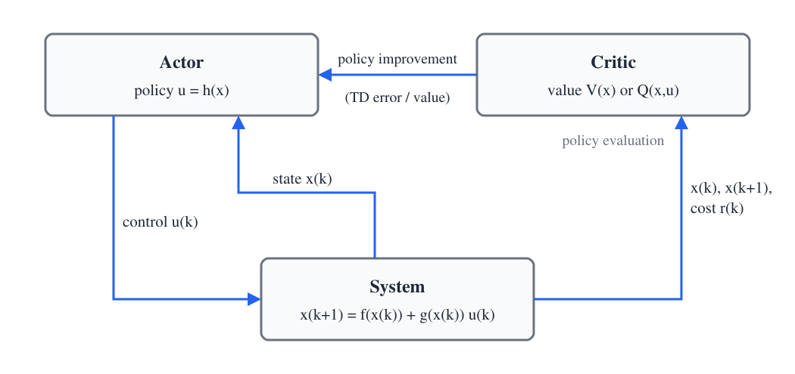
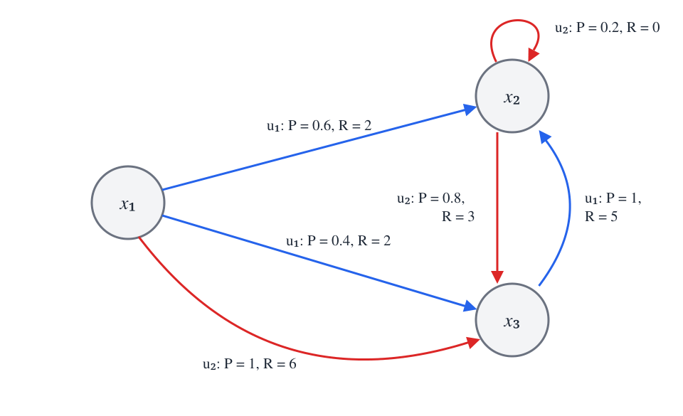
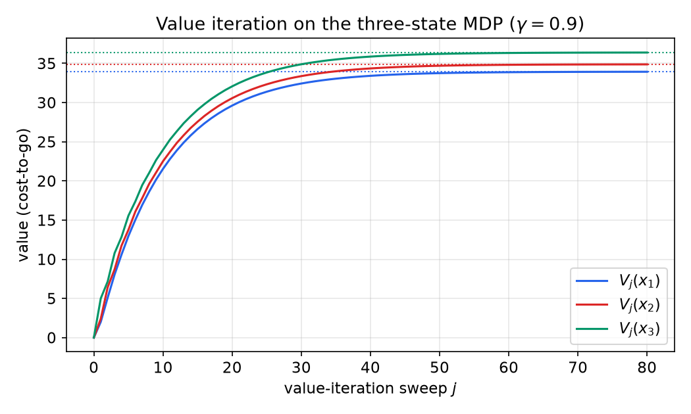
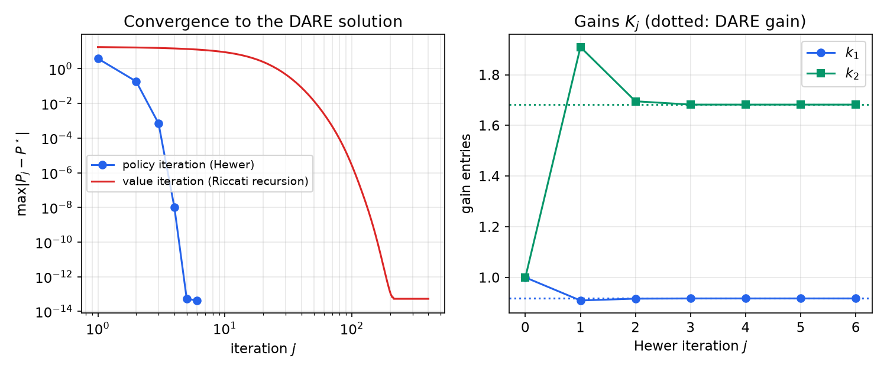
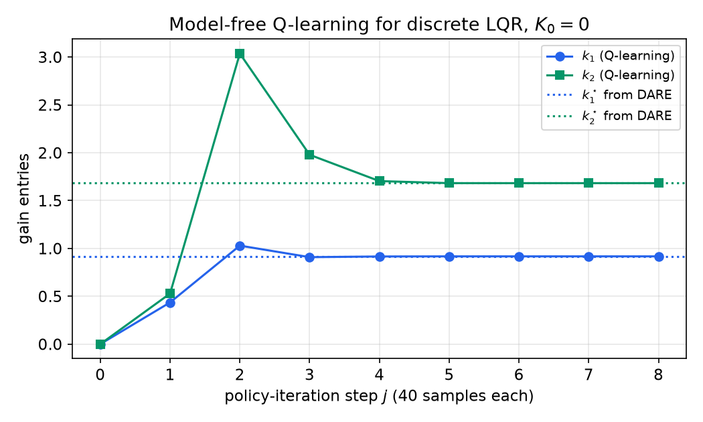
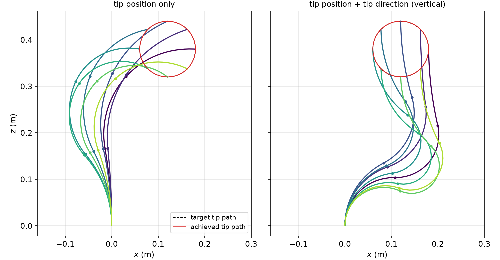
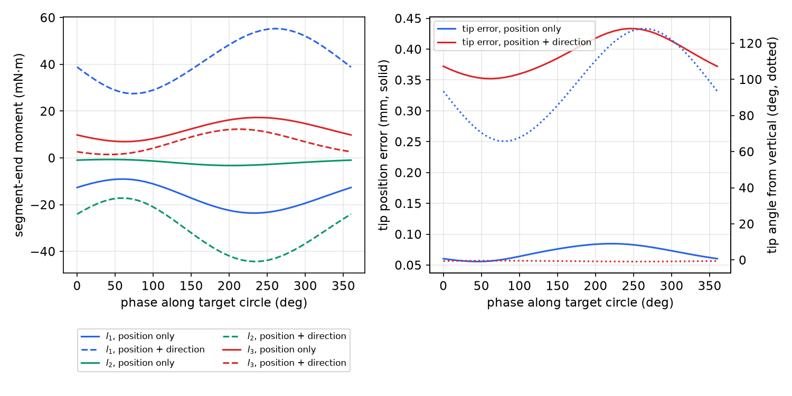

# Reinforcement Learning and Adaptive Dynamic Programming

The optimal controllers of the previous chapters are designed offline, backward in time, from a complete model: the Riccati equation needs \\(A\\) and \\(B\\), and the Hamilton–Jacobi–Bellman equation needs \\(f\\) and \\(g\\). Adaptive controllers, at the other extreme, learn online from measured data but are usually not optimal. Reinforcement learning (RL) joins the two: it designs controllers that learn, online and forward in time, the solution of a user-prescribed optimal control problem, using measured states and costs instead of a model. This chapter develops the idea from Markov decision processes to continuous-state feedback control. It shows that for the discrete-time linear quadratic regulator the classical RL algorithms are familiar Riccati iterations in disguise, and that Q-learning solves the algebraic Riccati equation with \\(A\\) and \\(B\\) both unknown. A case study at the end applies shooting-based optimal control to the shape of a continuum robot.

The value function, the principle of optimality and the Bellman recursion are developed in [Dynamic Programming and the HJB Equation](dynamic-programming.md). The discrete LQR and its Riccati recursion are in [Discrete-Time Optimal Control and LQR](discrete-optimal-control.md). A shorter, digital-control introduction to the same ideas is [Reinforcement Learning for Control](../me6403-digital-control/reinforcement-learning.md), and the machine-learning view is in Reinforcement Learning.

## From Optimal Control to Learning

Three traditions meet in this chapter.

- **Optimal control** solves the HJB equation, or for linear quadratic problems the Riccati equation, offline with full knowledge of the dynamics. The result is optimal but fixed: if the plant changes, the design must be redone.
- **Adaptive control** adjusts the controller online. Indirect adaptive control first identifies a model and then designs a controller for it; direct adaptive control tunes the controller parameters themselves (see [Adaptive Control](../me6402-nonlinear-control/adaptive-control.md)). Neither is generally optimal for a prescribed cost. Some adaptive laws are only *inverse optimal*, optimal for some cost that the designer did not choose.
- **Reinforcement learning** originated in the study of animal learning: an agent acts, observes the consequence and a reward (or cost), and modifies its behaviour to improve future reward. Neural correlates such as dopamine-driven reward-prediction signals have been identified in the brain.

The engineering form of RL that matters here is the **actor–critic** structure (Barto, Sutton and Anderson, 1983). The *critic* evaluates the current control policy, that is, it estimates the cost-to-go that the policy incurs; this step is called **policy evaluation**. The *actor* uses that evaluation to produce a better policy; this step is **policy improvement**. Alternating the two steps, using data measured along the system trajectory, drives the policy toward the optimal one.



*Figure: the actor–critic structure. The actor applies a feedback policy to the system. The critic watches the transition from x(k) to x(k+1) and the incurred cost r(k), and evaluates the current policy (policy evaluation). Its value estimate, through the temporal-difference error, tells the actor how to improve the policy (policy improvement).*

Bertsekas and Tsitsiklis developed these methods as **neuro-dynamic programming**, mostly as offline computational tools for large DP problems. Werbos developed them as **adaptive (or approximate) dynamic programming (ADP)**, online feedback controllers, and classified four families: heuristic dynamic programming (HDP, which learns the value), dual heuristic programming (DHP, which learns its gradient), and their action-dependent versions (ADHDP and ADDHP, which learn a function of state *and* action; ADHDP is Q-learning).

The central message of the chapter can be stated now. For discrete-time systems, RL solves the HJB equation online without the full dynamics; for the linear quadratic case it solves the algebraic Riccati equation online without knowing \\(A\\), and Q-learning needs neither \\(A\\) nor \\(B\\). Continuous-time systems are harder, for a reason we shall see, and need a modified Bellman equation.

## Markov Decision Processes

### Definition

**Definition (Markov decision process).** A Markov decision process (MDP) is a tuple \\((X, U, P, R)\\), where \\(X\\) is a set of states, \\(U\\) a set of actions (controls),
\\[
P^u\_{x x'} = \Pr\\{x\_{k+1} = x' \mid x\_k = x,\ u\_k = u\\}
\\]
is the transition probability from \\(x\\) to \\(x'\\) under action \\(u\\), and \\(R^u\_{xx'}\\) is the expected immediate cost of that transition. The **Markov property** says that the transition probabilities depend only on the current state and action, not on the history.

A **policy** \\(\pi(x,u) = \Pr\\{u\_k = u \mid x\_k = x\\}\\) is a rule for choosing actions. It may be stochastic (a *mixed* policy, in the language of [games](games.md)) or deterministic, \\(u = \mu(x)\\). In control we minimize costs; much of the RL literature maximizes rewards, which is the same thing with a sign change.



*Figure: a three-state MDP. Each arrow is a possible transition under the action shown, labelled with its probability P and cost R. State x1 has two actions; x2 and x3 have one each. Blue arrows are action u1, red arrows action u2.*

The **stage cost** is \\(r\_k = r(x\_k, u\_k, x\_{k+1})\\). Over a horizon of \\(T\\) steps from time \\(k\\), with discount factor \\(0 \le \gamma < 1\\), the cost is
\\[
J\_{k,T} = \sum\_{i=0}^{T} \gamma^i r\_{k+i}.
\\]
Discounting makes costs that occur far in the future count less and keeps infinite sums finite.

A fixed policy turns the MDP into a Markov chain, with transition probabilities
\\[
P\_{xx'} = \sum\_u \pi(x,u)\\,P^u\_{xx'} ,
\\]
which obey the Chapman–Kolmogorov equation. Under ergodicity assumptions there exists an optimal policy that is stationary and deterministic, so we can restrict attention to such policies when convenient.

### Value functions and the backward recursion

**Definition (value function).** The value of a policy \\(\pi\\) at state \\(x\\) is the expected cost incurred by starting at \\(x\\) and following \\(\pi\\):
\\[
V^\pi\_k(x) = E\_\pi\Big\\{\sum\_{i=k}^{k+T}\gamma^{i-k} r\_i \\;\Big\|\\; x\_k = x\Big\\}.
\\]
The **optimal value** is \\(V^\star\_k(x) = \min\_\pi V^\pi\_k(x)\\), and an optimal policy attains it.

Splitting off the first term of the sum and conditioning on the first transition gives the **backward recursion**
\\[
V^\pi\_k(x) = \sum\_u \pi(x,u)\sum\_{x'} P^u\_{xx'}\Big[R^u\_{xx'} + \gamma V^\pi\_{k+1}(x')\Big].
\\]
Applying Bellman's principle of optimality, "whatever the first decision, the remaining decisions must be optimal from the resulting state", turns this into dynamic programming:
\\[
V^\star\_k(x) = \min\_u \sum\_{x'} P^u\_{xx'}\Big[R^u\_{xx'} + \gamma V^\star\_{k+1}(x')\Big], \qquad
u^\star\_k(x) = \arg\min\_u \sum\_{x'} P^u\_{xx'}\Big[R^u\_{xx'} + \gamma V^\star\_{k+1}(x')\Big].
\\]
This is the stochastic version of the recursion in [Dynamic Programming](dynamic-programming.md). It runs offline, backward in time, and requires the full model \\((P, R)\\).

### The Bellman equation

For an infinite horizon and a stationary policy, the value no longer depends on \\(k\\). The backward recursion becomes a **consistency condition** with the same unknown function on both sides.

**Bellman equation.**
\\[
V^\pi(x) = \sum\_u \pi(x,u)\sum\_{x'} P^u\_{xx'}\Big[R^u\_{xx'} + \gamma V^\pi(x')\Big].
\\]
For a finite MDP with \\(N\\) states this is a system of \\(N\\) *linear* equations for the \\(N\\) numbers \\(V^\pi(x)\\).

**Bellman optimality equation.**
\\[
V^\star(x) = \min\_u \sum\_{x'} P^u\_{xx'}\Big[R^u\_{xx'} + \gamma V^\star(x')\Big],
\qquad u^\star(x) = \arg\min\_u \sum\_{x'} P^u\_{xx'}\Big[R^u\_{xx'} + \gamma V^\star(x')\Big].
\\]
This is the discrete-state HJB equation: \\(N\\) *nonlinear* equations, because of the minimization.

The Bellman equation has a useful reading. \\(V^\pi(x)\\) is the *predicted* performance from \\(x\\); \\(\sum P R\\) is the *observed* one-step cost; \\(\gamma V^\pi(x')\\) is the current estimate of the future. The equation demands that prediction equal observation plus estimated future. Learning algorithms exploit the mismatch between the two sides.

## Policy Evaluation and Policy Improvement

### Greedy improvement

Given the value \\(V^\pi\\) of a policy, define a new deterministic policy that is **greedy** with respect to it:
\\[
\pi'(x) = \arg\min\_u \sum\_{x'} P^u\_{xx'}\Big[R^u\_{xx'} + \gamma V^\pi(x')\Big].
\\]

**Theorem (policy improvement).** If \\(\pi'\\) is greedy with respect to \\(V^\pi\\), then \\(V^{\pi'}(x) \le V^\pi(x)\\) for every \\(x\\). A policy is optimal if and only if it is greedy with respect to its own value function.

*Proof sketch.* By the greedy choice, the one-step cost of taking \\(\pi'\\) once and then following \\(\pi\\) is no larger than \\(V^\pi(x)\\). Apply the same argument at the next state, and the next; after \\(n\\) steps the cost of following \\(\pi'\\) for \\(n\\) steps and then \\(\pi\\) is no larger than \\(V^\pi(x)\\), and the discount factor makes the tail vanish as \\(n\to\infty\\). If \\(\pi\\) is greedy for its own value, then \\(V^\pi\\) satisfies the Bellman optimality equation, whose solution is unique (it is the fixed point of a contraction), so \\(V^\pi = V^\star\\). ∎

### Policy iteration

**Algorithm (policy iteration).** Start from an *admissible* policy \\(\pi\_0\\), one with finite cost. For \\(j = 0, 1, 2, \dots\\):

1. *Policy evaluation:* solve the Bellman equation for \\(V\_j = V^{\pi\_j}\\):
\\[
V\_j(x) = \sum\_u \pi\_j(x,u)\sum\_{x'} P^u\_{xx'}\Big[R^u\_{xx'} + \gamma V\_j(x')\Big].
\\]
2. *Policy improvement:*
\\[
\pi\_{j+1}(x) = \arg\min\_u \sum\_{x'} P^u\_{xx'}\Big[R^u\_{xx'} + \gamma V\_j(x')\Big].
\\]

Each evaluation solves a full linear system. By the improvement theorem the values decrease monotonically; since a finite MDP has finitely many deterministic policies, policy iteration terminates in finitely many steps (in practice very few). Convergence proofs in general spaces use the Banach fixed-point theorem.

### Value iteration

Policy evaluation can itself be done iteratively. For a fixed policy, the map
\\[
V^{i+1}(x) = \sum\_u \pi(x,u)\sum\_{x'} P^u\_{xx'}\Big[R^u\_{xx'} + \gamma V^{i}(x')\Big]
\\]
is a contraction with modulus \\(\gamma\\) in the sup norm, so \\(V^i \to V^\pi\\) from any start. This is **iterative policy evaluation**.

**Algorithm (value iteration).** Perform only *one* sweep of iterative policy evaluation before each improvement. The two steps then merge into
\\[
V\_{j+1}(x) = \min\_u \sum\_{x'} P^u\_{xx'}\Big[R^u\_{xx'} + \gamma V\_j(x')\Big].
\\]
Value iteration needs no admissible initial policy: any initial \\(V\_0\\) will do. With \\(0 < \gamma < 1\\) and all states updated at every sweep it converges for every initial condition. With \\(\gamma = 1\\) one needs an absorbing (terminal) state and a properness assumption (every policy eventually reaches it). Convergence usually takes infinitely many steps; it is finite only in special cases, such as an acyclic optimal chain started from a large \\(V\_0\\).

Several variants interpolate between the two methods.

- **Generalized policy iteration** performs a fixed number of evaluation sweeps per improvement. Policy iteration (many sweeps, few improvements, expensive iterations) and value iteration (one sweep, many cheap iterations) are the two extremes.
- **Asynchronous** value iteration updates only a subset of states at each step, even one state at a time, and still converges provided every state is updated infinitely often.
- **Rollout** algorithms improve a base policy by one step of lookahead with the base policy simulated afterward. They are closely related to receding-horizon control ([Model Predictive Control](mpc.md)).

**Example 1 (three-state MDP).** Consider the MDP in the figure above, with discount \\(\gamma = 0.9\\). Only \\(x\_1\\) has a choice: action \\(u\_1\\) goes to \\(x\_2\\) with probability 0.6 or \\(x\_3\\) with probability 0.4, each at cost 2; action \\(u\_2\\) goes to \\(x\_3\\) with certainty at cost 6. From \\(x\_2\\) the only action reaches \\(x\_2\\) again (probability 0.2, cost 0) or \\(x\_3\\) (probability 0.8, cost 3). From \\(x\_3\\) the only action returns to \\(x\_2\\) at cost 5.

*Policy iteration.* Start from the policy that uses \\(u\_2\\) at \\(x\_1\\). The Bellman equation for this policy is the linear system
\\[
\begin{aligned}
V(x\_1) &= 6 + 0.9\\,V(x\_3),\\\\
V(x\_2) &= 0.2\\,(0 + 0.9\\,V(x\_2)) + 0.8\\,(3 + 0.9\\,V(x\_3)),\\\\
V(x\_3) &= 5 + 0.9\\,V(x\_2),
\end{aligned}
\\]
whose solution is \\(V = (38.76,\ 34.88,\ 36.40)\\). The improvement step compares the two actions at \\(x\_1\\):
\\[
Q(x\_1,u\_1) = 2 + 0.9\\,(0.6\cdot 34.88 + 0.4\cdot 36.40) = 33.94, \qquad Q(x\_1,u\_2) = 6 + 0.9\cdot 36.40 = 38.76 .
\\]
The greedy policy switches to \\(u\_1\\). Evaluating it gives
\\[
V^\star = (33.94,\ 34.88,\ 36.40),
\\]
and a second improvement step leaves the policy unchanged, so it is optimal. Policy iteration finished after one improvement. (The values of \\(x\_2\\) and \\(x\_3\\) did not change, because neither state can reach \\(x\_1\\).)

*Value iteration.* Starting from \\(V\_0 = 0\\), the first sweeps give \\(V\_1 = (2,\ 2.4,\ 5)\\), \\(V\_2 = (5.10,\ 6.43,\ 7.16)\\), \\(V\_{10} = (21.5,\ 22.5,\ 24.0)\\), \\(V\_{50} = (33.76,\ 34.70,\ 36.21)\\). The error shrinks roughly by the factor \\(\gamma = 0.9\\) per sweep, so many sweeps are needed, but each sweep is cheap and no initial admissible policy is required. The optimal action at \\(x\_1\\) becomes \\(u\_1\\) after the first few sweeps, long before the values have converged.



*Figure: value iteration on the three-state MDP from V = 0. Each curve is the value estimate of one state; the dotted lines are the optimal values (33.94, 34.88, 36.40). The approach is geometric at rate about γ = 0.9, which is why value iteration needs many more (but cheaper) iterations than policy iteration.*

### The Q function

The greedy step above minimizes a quantity that deserves its own name.

**Definition (Q function).** The optimal Q function (action-value function) is
\\[
Q^\star(x,u) = \sum\_{x'} P^u\_{xx'}\Big[R^u\_{xx'} + \gamma V^\star(x')\Big],
\\]
the cost of taking action \\(u\\) now and acting optimally afterward. Similarly, \\(Q^\pi(x,u)\\) is the cost of taking \\(u\\) now and following \\(\pi\\) afterward.

Its key properties are
\\[
V^\star(x) = \min\_u Q^\star(x,u), \qquad u^\star(x) = \arg\min\_u Q^\star(x,u).
\\]
The second formula is the point. Once the Q function is known, the optimal action is found by minimizing over \\(u\\) **without any model**: the dynamics are already folded into \\(Q\\). By contrast, extracting a policy from \\(V^\star\\) requires the transition probabilities.

The Q function satisfies its own Bellman equations. For a policy \\(\pi\\),
\\[
Q^\pi(x,u) = \sum\_{x'} P^u\_{xx'}\Big[R^u\_{xx'} + \gamma \sum\_{u'}\pi(x',u')Q^\pi(x',u')\Big],
\\]
and at the optimum
\\[
Q^\star(x,u) = \sum\_{x'} P^u\_{xx'}\Big[R^u\_{xx'} + \gamma \min\_{u'} Q^\star(x',u')\Big].
\\]
Compared with the Bellman optimality equation for \\(V^\star\\), the minimization and the expectation have changed places: here the minimum sits *inside* the expectation. That interchange is what allows the Q function to be learned from sampled transitions. Policy iteration and value iteration carry over verbatim, with \\(Q\\) in place of \\(V\\): evaluate \\(Q\_j = Q^{\pi\_j}\\), then set \\(\pi\_{j+1}(x) = \arg\min\_u Q\_j(x,u)\\); or iterate \\(Q\_{j+1}(x,u) = \sum P[R + \gamma\min\_{u'}Q\_j(x',u')]\\).

## The Linear Quadratic Case

The MDP machinery applies to continuous states and actions as well. The linear quadratic regulator shows exactly what the abstract algorithms compute.

### Bellman equation equals Lyapunov equation

**Example 2 (discrete LQR as an MDP).** Take the deterministic plant
\\[
x\_{k+1} = Ax\_k + Bu\_k
\\]
with stage cost \\(r(x\_k,u\_k) = x\_k^\top Qx\_k + u\_k^\top Ru\_k\\), \\(Q \succeq 0\\), \\(R \succ 0\\), and \\(\gamma = 1\\). For a stabilizing linear policy \\(u\_k = -Kx\_k\\), the value is quadratic, \\(V(x) = x^\top Px\\), with
\\[
V(x\_k) = \sum\_{i=k}^{\infty}\big(x\_i^\top Qx\_i + u\_i^\top Ru\_i\big).
\\]
(Some texts put a factor \\(\tfrac12\\) in front of the cost; it scales \\(P\\) and changes nothing else.)

*Bellman equation.* Splitting off the first term gives
\\[
V(x\_k) = x\_k^\top Qx\_k + u\_k^\top Ru\_k + V(x\_{k+1}),
\qquad\text{i.e.}\qquad
x\_k^\top Px\_k = x\_k^\top Qx\_k + u\_k^\top Ru\_k + x\_{k+1}^\top Px\_{k+1}.
\\]
Look at what this equation contains: the measured states \\(x\_k\\), \\(x\_{k+1}\\), the applied control and the cost. It does **not** contain \\(A\\) or \\(B\\). If we can measure \\(x\_k\\) and \\(x\_{k+1}\\), we can test whether a candidate \\(P\\) satisfies it. That is what makes reinforcement learning possible.

*Lyapunov equation.* Substituting \\(x\_{k+1} = (A - BK)x\_k\\) and \\(u\_k = -Kx\_k\\), and requiring the identity for every \\(x\_k\\), gives
\\[
(A - BK)^\top P(A - BK) - P + Q + K^\top RK = 0 .
\\]
This is the discrete Lyapunov equation for the closed loop, and it uses the model. The Bellman equation is the model-free form of the Lyapunov equation.

*Optimality.* The discrete Hamiltonian is the difference of the two sides of the Bellman equation,
\\[
H(x\_k,u\_k) = x\_k^\top Qx\_k + u\_k^\top Ru\_k + (Ax\_k + Bu\_k)^\top P(Ax\_k + Bu\_k) - x\_k^\top Px\_k .
\\]
Setting \\(\partial H/\partial u\_k = 2Ru\_k + 2B^\top P(Ax\_k + Bu\_k) = 0\\) gives
\\[
u\_k = -(B^\top PB + R)^{-1}B^\top PA\\,x\_k ,
\\]
and substituting back into \\(H = 0\\) gives the **discrete algebraic Riccati equation** (DARE)
\\[
A^\top PA - P + Q - A^\top PB(B^\top PB + R)^{-1}B^\top PA = 0 .
\\]
So: the Bellman equation is the Lyapunov equation, and the Bellman optimality equation is the Riccati equation.

### The Q-function kernel

**Example 2 (continued).** For the LQR, the Q function of a policy with value \\(x^\top Px\\) is
\\[
Q(x\_k,u\_k) = x\_k^\top Qx\_k + u\_k^\top Ru\_k + (Ax\_k + Bu\_k)^\top P(Ax\_k + Bu\_k)
= \begin{bmatrix}x\_k \\\\ u\_k\end{bmatrix}^\top
\underbrace{\begin{bmatrix}A^\top PA + Q & A^\top PB \\\\ B^\top PA & B^\top PB + R\end{bmatrix}}\_{S}
\begin{bmatrix}x\_k \\\\ u\_k\end{bmatrix}.
\\]
Partition the kernel as \\(S = \begin{bmatrix}S\_{xx} & S\_{xu} \\\\ S\_{ux} & S\_{uu}\end{bmatrix}\\). Minimizing over \\(u\_k\\) gives \\(\partial Q/\partial u\_k = 2(S\_{ux}x\_k + S\_{uu}u\_k) = 0\\), so
\\[
u\_k = -S\_{uu}^{-1}S\_{ux}\\,x\_k .
\\]
Since \\(S\_{uu} = B^\top PB + R\\) and \\(S\_{ux} = B^\top PA\\), this is the familiar gain. But written in terms of \\(S\\) it uses no model at all: if the kernel \\(S\\) can be learned from data, the improved policy follows directly.

### Policy iteration is Hewer's algorithm

Apply policy iteration to the LQR. Policy evaluation for \\(u = -K\_jx\\) is the Lyapunov equation; policy improvement is the greedy gain.

**Algorithm (Hewer, 1971).** Start from a stabilizing gain \\(K\_0\\). For \\(j = 0, 1, 2, \dots\\):
\\[
\begin{aligned}
&\text{evaluate:} && (A - BK\_j)^\top P\_j(A - BK\_j) - P\_j + Q + K\_j^\top RK\_j = 0,\\\\
&\text{improve:} && K\_{j+1} = (B^\top P\_jB + R)^{-1}B^\top P\_jA .
\end{aligned}
\\]

**Theorem (convergence of Hewer's algorithm).** Let \\((A,B)\\) be stabilizable, \\((A, Q^{1/2})\\) detectable, \\(R \succ 0\\), and \\(K\_0\\) stabilizing. Then every \\(K\_j\\) is stabilizing, \\(P\_0 \succeq P\_1 \succeq P\_2 \succeq \dots \succeq P^\star\\), and \\(P\_j \to P^\star\\), the stabilizing solution of the DARE. Convergence is quadratic.

*Proof sketch.* For any symmetric \\(P\\) and any gain \\(K\\), completing the square gives the identity
\\[
(A - BK)^\top P(A - BK) + Q + K^\top RK = \mathcal{R}(P) + (K - K\_P)^\top(R + B^\top PB)(K - K\_P),
\\]
where \\(K\_P = (R + B^\top PB)^{-1}B^\top PA\\) and \\(\mathcal{R}(P) = A^\top PA + Q - A^\top PB(R + B^\top PB)^{-1}B^\top PA\\) is the Riccati operator. Apply it twice with \\(P = P\_j\\). With \\(K = K\_j\\), the left side equals \\(P\_j\\) by the evaluation step. With \\(K = K\_{j+1} = K\_{P\_j}\\), the square vanishes. Subtracting,
\\[
P\_j = (A - BK\_{j+1})^\top P\_j(A - BK\_{j+1}) + Q + K\_{j+1}^\top RK\_{j+1} + (K\_j - K\_{j+1})^\top(R + B^\top P\_jB)(K\_j - K\_{j+1}).
\\]
This says that \\(x^\top P\_jx\\) is a Lyapunov function for \\(A - BK\_{j+1}\\), which (with detectability) proves that \\(K\_{j+1}\\) is stabilizing. Subtracting the evaluation equation for \\(P\_{j+1}\\) gives
\\[
P\_j - P\_{j+1} = (A - BK\_{j+1})^\top(P\_j - P\_{j+1})(A - BK\_{j+1}) + (K\_j - K\_{j+1})^\top(R + B^\top P\_jB)(K\_j - K\_{j+1}),
\\]
a Lyapunov equation with a positive semidefinite right side and a stable closed loop, so \\(P\_j \succeq P\_{j+1}\\). A monotone sequence bounded below by \\(P^\star\\) (every stabilizing gain costs at least the optimum) converges, and its limit satisfies \\(P = \mathcal{R}(P)\\). Quadratic convergence follows because the iteration is Newton's method applied to \\(\mathcal{R}(P) - P = 0\\). ∎

### Value iteration is the Riccati recursion

Apply value iteration instead: one Lyapunov *recursion* step per improvement.

**Algorithm (Lyapunov recursion).** Start from any \\(P\_0 \succeq 0\\), for instance \\(P\_0 = 0\\). For \\(j = 0, 1, 2, \dots\\):
\\[
K\_j = (B^\top P\_jB + R)^{-1}B^\top P\_jA, \qquad
P\_{j+1} = (A - BK\_j)^\top P\_j(A - BK\_j) + Q + K\_j^\top RK\_j .
\\]
By the identity in the proof above, \\(P\_{j+1} = \mathcal{R}(P\_j)\\): this is exactly the Riccati difference equation of [Discrete-Time Optimal Control](discrete-optimal-control.md), run forward in the iteration index. It needs **no stabilizing initial gain**, and it converges to the DARE solution under the same stabilizability and detectability assumptions (Lancaster and Rodman, 1995), but only linearly.

Both iterations, as written, are offline and need \\((A,B)\\). Their value lies in what comes next: replacing the Lyapunov equation by its model-free Bellman form turns them into online learning algorithms.

**Example 3 (Hewer's iteration on a sampled double integrator).** Take
\\[
A = \begin{bmatrix}1 & 0.1 \\\\ 0 & 1\end{bmatrix}, \qquad B = \begin{bmatrix}0 \\\\ 0.1\end{bmatrix}, \qquad Q = I, \qquad R = 1,
\\]
a double integrator sampled at 0.1 s. The DARE solution and optimal gain are
\\[
P^\star = \begin{bmatrix}18.342 & 10.905 \\\\ 10.905 & 18.911\end{bmatrix}, \qquad K^\star = \begin{bmatrix}0.917 & 1.682\end{bmatrix}.
\\]
Start Hewer's algorithm from \\(K\_0 = [1,\ 1]\\), which is stabilizing: the eigenvalues of \\(A - BK\_0\\) are \\(0.95 \pm 0.087j\\). The iterates are

| \\(j\\) | \\(K\_{j}\\) | \\(\max\_{ik}\lvert (P\_{j-1} - P^\star)\_{ik}\rvert\\) |
|---|---|---|
| 0 | [1, 1] | – |
| 1 | [0.909, 1.909] | 3.88 |
| 2 | [0.916, 1.695] | 0.187 |
| 3 | [0.917, 1.682] | 7.0e−4 |
| 4 | [0.917, 1.682] | 1.0e−8 |

The error is roughly squared at each step, the signature of Newton's method. Value iteration (the Lyapunov recursion from \\(P\_0 = 0\\)) reaches the same answer, but its error is still 9.1 after 10 iterations, 0.014 after 50 and \\(2.6\times10^{-6}\\) after 100.

```python
import numpy as np, scipy.linalg as sl
A = np.array([[1, .1], [0, 1]]); B = np.array([[0], [.1]]); Q = np.eye(2); R = np.eye(1)
K = np.array([[1., 1.]])
for j in range(5):                       # Hewer = policy iteration
    Acl = A - B @ K
    P = sl.solve_discrete_lyapunov(Acl.T, Q + K.T @ R @ K)   # evaluation
    K = np.linalg.solve(R + B.T @ P @ B, B.T @ P @ A)        # improvement
print(K, sl.solve_discrete_are(A, B, Q, R))
```



*Figure: left, the distance from the DARE solution for policy iteration (Hewer's algorithm, blue dots) and value iteration (the Riccati recursion from P = 0, red) on a log–log scale. Policy iteration reaches machine precision in five steps; value iteration converges linearly and needs about 200. Right, the gain entries of Hewer's iterates approaching the DARE gain (dotted).*

### Continuous time: Kleinman's algorithm

The continuous-time counterpart of Hewer's algorithm is due to Kleinman (1968). For \\(\dot x = Ax + Bu\\) with cost \\(\int\_0^\infty(x^\top Qx + u^\top Ru)\\,dt\\), start from a stabilizing \\(K\_0\\) and iterate
\\[
(A - BK\_j)^\top P\_j + P\_j(A - BK\_j) + Q + K\_j^\top RK\_j = 0, \qquad K\_{j+1} = R^{-1}B^\top P\_j .
\\]
Under the same stabilizability and detectability assumptions, all \\(K\_j\\) are stabilizing and \\(P\_j\\) decreases monotonically and quadratically to the stabilizing solution of the continuous ARE ([Continuous-Time LQR](continuous-lqr.md)). This is Newton's method on the ARE, and it is the policy iteration of continuous-time optimal control. The proof follows the discrete one line by line.

## Implementing the Bellman Equation from Data

How can policy evaluation be carried out without the model? Three families of methods exist.

- **Exact computation** solves the Bellman equation from \\(P\\) and \\(R\\). For the LQR this is the Lyapunov or Riccati solution above. It needs the full model.
- **Monte Carlo** methods estimate \\(V^\pi(x)\\) by averaging the returns observed over many episodes that start at \\(x\\). They need no model, but they need sufficient exploration (for example, episodes started from every state, "exploring starts"), and they update only when an episode ends. They are related to iterative learning control, which also improves a trajectory between repeated trials.
- **Temporal-difference (TD) learning** updates online, along a single trajectory, after every transition.

### Temporal differences

Write the Bellman equation for a deterministic policy as an expectation,
\\[
V^\pi(x\_k) = E\\{r\_k \mid x\_k\\} + \gamma\\,E\\{V^\pi(x\_{k+1}) \mid x\_k\\}.
\\]
TD learning replaces the expectations by the single sample actually observed,
\\[
V^\pi(x\_k) = r\_k + \gamma V^\pi(x\_{k+1}),
\\]
and measures how far the current estimate is from satisfying it by the **temporal-difference error**
\\[
e\_k = -V^\pi(x\_k) + r\_k + \gamma V^\pi(x\_{k+1}).
\\]
The timeline is: at time \\(k\\), apply the action and observe the cost \\(r\_k\\) and the next state \\(x\_{k+1}\\); compute the estimate \\(V^\pi(x\_{k+1})\\); then correct the earlier prediction \\(V^\pi(x\_k)\\) toward \\(r\_k + \gamma V^\pi(x\_{k+1})\\); and finally improve the action. In the tabular case the simplest update is TD(0),
\\[
V(x\_k) \leftarrow V(x\_k) + \alpha\_k e\_k ,
\\]
with a step size \\(\alpha\_k\\). This is a stochastic approximation (Robbins–Monro) scheme: the average of the sampled corrections is the true Bellman residual, so with suitably decreasing step sizes the estimate converges to \\(V^\pi\\).

## Adaptive Dynamic Programming for Continuous-State Systems

### Problem setting

Consider the discrete-time nonlinear system, affine in the control,
\\[
x\_{k+1} = f(x\_k) + g(x\_k)u\_k ,
\\]
with a state-feedback policy \\(u\_k = h(x\_k)\\) and the discounted cost
\\[
V^h(x\_k) = \sum\_{i=k}^{\infty}\gamma^{i-k}\Big(Q(x\_i) + u\_i^\top Ru\_i\Big), \qquad Q(x) > 0 \text{ for } x \ne 0,\ R \succ 0 .
\\]
A policy is **admissible** if it stabilizes the system, is continuous, satisfies \\(h(0) = 0\\), and gives a finite cost from every initial state.

The value satisfies the Bellman equation \\(V^h(x\_k) = r(x\_k,h(x\_k)) + \gamma V^h(x\_{k+1})\\), with \\(V^h(0) = 0\\), and the optimal value satisfies the **discrete-time HJB equation**
\\[
V^\star(x\_k) = \min\_{u\_k}\Big[Q(x\_k) + u\_k^\top Ru\_k + \gamma V^\star\big(f(x\_k) + g(x\_k)u\_k\big)\Big].
\\]
Define the discrete Hamiltonian
\\[
H(x\_k, h(x\_k), \Delta V\_k) = r(x\_k, h(x\_k)) + \gamma V^h(x\_{k+1}) - V^h(x\_k).
\\]
It is exactly the TD error. So the TD error that the critic computes from data is the Hamiltonian of optimal control, and driving it to zero solves the Bellman equation.

### Policy iteration and value iteration with TD

**Algorithm (policy iteration via TD).** Start from an admissible \\(h\_0\\). For \\(j = 0, 1, \dots\\):
\\[
\begin{aligned}
&\text{evaluate:} && V\_{j+1}(x\_k) = Q(x\_k) + h\_j^\top(x\_k)Rh\_j(x\_k) + \gamma V\_{j+1}(x\_{k+1}),\\\\
&\text{improve:} && h\_{j+1}(x\_k) = \arg\min\_{u\_k}\Big[Q(x\_k) + u\_k^\top Ru\_k + \gamma V\_{j+1}(x\_{k+1})\Big].
\end{aligned}
\\]
For the affine system, setting the gradient with respect to \\(u\_k\\) to zero (with \\(x\_{k+1}\\) depending on \\(u\_k\\)) gives
\\[
h\_{j+1}(x\_k) = -\frac{\gamma}{2}R^{-1}g^\top(x\_k)\nabla V\_{j+1}(x\_{k+1}).
\\]

**Algorithm (value iteration via TD).** Start from any policy \\(h\_0\\) and \\(V\_0\\), and replace the evaluation step by
\\[
V\_{j+1}(x\_k) = Q(x\_k) + h\_j^\top(x\_k)Rh\_j(x\_k) + \gamma V\_j(x\_{k+1}).
\\]
The unknown now appears only on the left, so each step is an explicit update.

### Value function approximation

For continuous states the value cannot be stored as a table. Represent it in a basis instead.

*LQR basis.* For the LQR, \\(V(x) = x^\top Px\\) can be written as
\\[
V(x) = \operatorname{vec}(P)^\top(x\otimes x) = \bar p^\top\bar x ,
\\]
where \\(\bar x\\) collects the quadratic monomials of \\(x\\) and \\(\bar p\\) the corresponding entries of \\(P\\). Removing the redundant products (\\(x\_ix\_j = x\_jx\_i\\)) leaves \\(n(n+1)/2\\) terms. For \\(n = 2\\),
\\[
V(x) = \begin{bmatrix}p\_{11} & 2p\_{12} & p\_{22}\end{bmatrix}\begin{bmatrix}x\_1^2 \\\\ x\_1x\_2 \\\\ x\_2^2\end{bmatrix}.
\\]

*General basis.* For nonlinear systems, a neural network or other universal approximator gives, by the Weierstrass approximation theorem,
\\[
V(x) = W^\top\phi(x) + \varepsilon(x),
\\]
with \\(L\\) basis functions \\(\phi(x)\\), weights \\(W\\) and an approximation error \\(\varepsilon\\) that can be made small on a compact set.

**Algorithm (policy iteration with value function approximation).** With \\(V\_{j+1}(x) = W\_{j+1}^\top\phi(x)\\), the evaluation step becomes
\\[
W\_{j+1}^\top\Big(\phi(x\_k) - \gamma\phi(x\_{k+1})\Big) = Q(x\_k) + h\_j^\top(x\_k)Rh\_j(x\_k),
\\]
and the improvement step
\\[
h\_{j+1}(x\_k) = -\frac{\gamma}{2}R^{-1}g^\top(x\_k)\nabla\phi^\top(x\_{k+1})W\_{j+1}.
\\]

The evaluation equation is *linear in the unknown weights*. Each measured transition \\((x\_k, x\_{k+1})\\) gives one scalar equation with regression vector \\(\Phi(k) = \phi(x\_k) - \gamma\phi(x\_{k+1})\\) and target \\(r\_k\\). So:

- At least \\(L\\) transitions are needed per evaluation. Collect them and solve by **batch least squares**, or update online by **recursive least squares** (RLS).
- The regression vectors must span \\(\mathbb{R}^L\\). Along a closed-loop trajectory that converges quickly to zero this can fail; the data must be **persistently exciting**. In practice one restarts from new initial conditions or adds a probing signal.
- A gradient (LMS-type) alternative updates after each sample:
\\[
W^{i+1} = W^i - \alpha\\,\Phi(k)\Big(W^{i\top}\Phi(k) - r\_k\Big).
\\]

**Algorithm (value iteration with value function approximation).** The update
\\[
W\_{j+1}^\top\phi(x\_k) = Q(x\_k) + h\_j^\top(x\_k)Rh\_j(x\_k) + \gamma W\_j^\top\phi(x\_{k+1})
\\]
is again linear in \\(W\_{j+1}\\), now with regression vector \\(\phi(x\_k)\\).

### The actor network

Look again at the improvement step. For the LQR it reads \\(K\_{j+1} = (B^\top P\_{j+1}B + R)^{-1}B^\top P\_{j+1}A\\), which needs \\(A\\). For a nonlinear system the formula \\(h\_{j+1}(x\_k) = -\frac{\gamma}{2}R^{-1}g^\top(x\_k)\nabla V\_{j+1}(x\_{k+1})\\) is implicit, because \\(x\_{k+1}\\) itself depends on \\(h\_{j+1}(x\_k)\\). Both difficulties are removed by a second approximator for the policy, the **actor**:
\\[
u\_k = h(x\_k) = U^\top\sigma(x\_k).
\\]
The actor weights are tuned by gradient descent on the quantity being minimized in the improvement step, \\(Q(x\_k) + u\_k^\top Ru\_k + \gamma V\_{j+1}(x\_{k+1})\\):
\\[
U^{i+1} = U^i - \beta\\,\sigma(x\_k)\Big(2RU^{i\top}\sigma(x\_k) + \gamma\\,g^\top(x\_k)\nabla\phi^\top(x\_{k+1})W\_{j+1}\Big)^\top .
\\]
This update needs \\(g(x\_k)\\), the input matrix \\(B\\) in the linear case, but **not** \\(f\\) or \\(A\\). The drift dynamics are learned implicitly from the measured pairs \\((x\_k, x\_{k+1})\\). After training, \\(u = U^\top\sigma(x)\\) is an ordinary feedback law that can be implemented directly.

The critic and actor networks are tuned sequentially: the critic is updated to evaluate the current actor, then the actor is updated to improve on the critic. Al-Tamimi, Lewis and Abu-Khalaf (2008) proved convergence of value iteration with two such networks for nonlinear discrete-time systems.

### Online solution of the Riccati equation

For the LQR these algorithms deliver the following.

- **Policy iteration** solves the Lyapunov equation online in its Bellman form, \\(x\_k^\top P\_{j+1}x\_k = x\_k^\top(Q + K\_j^\top RK\_j)x\_k + x\_{k+1}^\top P\_{j+1}x\_{k+1}\\), without \\(A\\) or \\(B\\); the improvement step (with an actor) needs only \\(B\\).
- **Value iteration** solves the Lyapunov recursion \\(x\_k^\top P\_{j+1}x\_k = x\_k^\top(Q + K\_j^\top RK\_j)x\_k + x\_{k+1}^\top P\_jx\_{k+1}\\) online in the same way.
- Both converge to the solution of the DARE, online and without knowing \\(A\\).

**Example 4 (load-frequency control of a power system by online value iteration).** A linearized model of a power-generating area has state \\(x = [\Delta f,\ \Delta P\_g,\ \Delta X\_g,\ \Delta E]^\top\\) (frequency deviation, generator output, governor valve position, integral control) and
\\[
\dot x = \begin{bmatrix}-1/T\_p & K\_p/T\_p & 0 & 0 \\\\ 0 & -1/T\_T & 1/T\_T & 0 \\\\ -1/(R\_gT\_G) & 0 & -1/T\_G & -1/T\_G \\\\ K\_E & 0 & 0 & 0\end{bmatrix}x + \begin{bmatrix}0 \\\\ 0 \\\\ 1/T\_G \\\\ 0\end{bmatrix}u ,
\\]
where \\(R\_g\\) is the speed regulation constant. Numerically,
\\[
A = \begin{bmatrix}-0.0665 & 8 & 0 & 0 \\\\ 0 & -3.663 & 3.663 & 0 \\\\ -6.86 & 0 & -13.736 & -13.736 \\\\ 0.6 & 0 & 0 & 0\end{bmatrix}, \qquad B = \begin{bmatrix}0 \\\\ 0 \\\\ 13.7355 \\\\ 0\end{bmatrix}.
\\]
The model is sampled with a zero-order hold at \\(T = 0.01\\) s, with \\(Q = I\\), \\(R = I\\), \\(\gamma = 1\\). Only \\(T\_G\\), that is \\(B\\), is assumed known; the plant parameters in \\(A\\) are not. The critic uses the 10 quadratic monomials of the 4 states. Every 15 samples (0.15 s) a batch least-squares problem updates the critic weights, and the actor is tuned by the gradient law above. Over a 60 s run the states are regulated within about 6 s, and the critic weights converge to within about 1 % of the DARE solution,
\\[
P\_{\text{DARE}} = \begin{bmatrix}0.4750 & 0.4766 & 0.0601 & 0.4751 \\\\ 0.4766 & 0.7831 & 0.1237 & 0.3829 \\\\ 0.0601 & 0.1237 & 0.0513 & 0.0298 \\\\ 0.4751 & 0.3829 & 0.0298 & 2.3370\end{bmatrix},
\\]
with, for instance, learned values \\(P\_{11} = 0.4802\\) and \\(P\_{44} = 2.3433\\).

A word of caution if you reproduce this: solving the DARE for the ZOH model with stage weights \\(Q = R = I\\) gives a matrix about 101 times larger (\\(P\_{11} = 48.05\\)). The printed values correspond to stage weights scaled by the sampling period, \\(Q = R = T\cdot I\\), the natural discretization of a continuous-time integral cost. The gain is the same either way, since scaling \\(Q\\) and \\(R\\) together does not change it.

## Q-Learning

Value-function methods still need \\(B\\) (or \\(g\\)) to improve the policy. Q-learning, which Werbos called action-dependent HDP, removes even that.

### Tabular Q-learning

Watkins' Q-learning updates, after each observed transition \\((x\_k, u\_k, r\_k, x\_{k+1})\\),
\\[
Q\_k(x\_k,u\_k) = Q\_{k-1}(x\_k,u\_k) + \alpha\_k\Big[r\_k + \gamma\min\_u Q\_{k-1}(x\_{k+1},u) - Q\_{k-1}(x\_k,u\_k)\Big].
\\]
**Theorem (Watkins and Dayan, 1992).** For a finite MDP, \\(Q\_k \to Q^\star\\) with probability one if every state–action pair is visited infinitely often and the step sizes satisfy
\\[
\sum\_k \alpha\_k = \infty, \qquad \sum\_k \alpha\_k^2 < \infty .
\\]
The first condition lets the updates travel any distance; the second makes the noise average out.

### Parametric Q-learning

Approximate the Q function in a basis over the joint state–action vector \\(z = [x^\top,\ u^\top]^\top\\):
\\[
Q(x,u) = W^\top\phi(z).
\\]
**Algorithm (Q-learning policy iteration).** For \\(j = 0, 1, \dots\\):
\\[
\begin{aligned}
&\text{evaluate:} && W\_{j+1}^\top\Big(\phi(z\_k) - \gamma\phi(z\_{k+1})\Big) = r(x\_k,u\_k), \qquad z\_{k+1} = \begin{bmatrix}x\_{k+1} \\\\ h\_j(x\_{k+1})\end{bmatrix},\\\\
&\text{improve:} && h\_{j+1}(x) = \arg\min\_u W\_{j+1}^\top\phi(x,u).
\end{aligned}
\\]
The value-iteration version replaces the left side by \\(W\_{j+1}^\top\phi(z\_k)\\) and adds \\(\gamma W\_j^\top\phi(z\_{k+1})\\) to the right.

Two features distinguish it from value-function ADP.

- The improvement step minimizes an explicit function of \\(u\\), so **no actor network and no model** are needed.
- The Q function must be learned for actions other than the policy's own, so the applied action \\(u\_k\\) must explore. A **probing noise** is added to the control, \\(u\_k = h\_j(x\_k) + n\_k\\), to make the regression vectors persistently exciting. Notice that the next action in \\(z\_{k+1}\\) is the noise-free policy action; the Q-function Bellman equation then holds exactly for any \\(u\_k\\), so the probing noise excites the data without biasing the evaluation.

### Q-learning for the LQR

For the LQR, \\(Q(x,u) = z^\top Sz\\) with the kernel \\(S\\) derived in Example 2. With the quadratic basis on \\(z\\), the number of unknowns is \\((n+m)(n+m+1)/2\\).

**Algorithm (model-free LQR by Q-learning).** Choose an initial gain \\(K\_0\\). For \\(j = 0, 1, \dots\\):

1. Apply \\(u\_k = -K\_jx\_k + n\_k\\) with probing noise \\(n\_k\\), and record \\((x\_k, u\_k, x\_{k+1})\\).
2. Solve, by batch least squares or RLS over enough samples,
\\[
W\_{j+1}^\top\Big(\phi(z\_k) - \phi(z\_{k+1})\Big) = x\_k^\top Qx\_k + u\_k^\top Ru\_k, \qquad z\_{k+1} = \begin{bmatrix}x\_{k+1} \\\\ -K\_jx\_{k+1}\end{bmatrix}.
\\]
3. Unpack \\(W\_{j+1}\\) into the symmetric kernel \\(S\\) and set \\(K\_{j+1} = S\_{uu}^{-1}S\_{ux}\\).

At no point do \\(A\\) or \\(B\\) appear. Since the evaluation step solves the same Lyapunov equation as Hewer's algorithm, only from data, the iteration is Hewer's algorithm executed without a model, and it converges to the DARE gain. In the noise-free limit with exact evaluation, the requirement on \\(K\_0\\) is the same as for Hewer's algorithm (stabilizing); the value-iteration form of Q-learning removes that requirement, and in practice the least-squares fit often recovers from a poor initial gain, as the next example shows.

**Example 5 (model-free Q-learning on the sampled double integrator).** Return to the plant of Example 3 and pretend that \\(A\\) and \\(B\\) are unknown. The joint vector \\(z = [x\_1, x\_2, u]^\top\\) has a 6-term quadratic basis
\\[
\phi(z) = \begin{bmatrix}z\_1^2 & 2z\_1z\_2 & 2z\_1z\_3 & z\_2^2 & 2z\_2z\_3 & z\_3^2\end{bmatrix}^\top ,
\\]
with the factors 2 chosen so that the weights are the entries of \\(S\\). Start from \\(K\_0 = 0\\) (no feedback at all, which is only marginally stable for the double integrator, so its cost is not even finite). In each iteration collect 40 transitions, with probing noise of standard deviation 0.5 added to the control and the state reset to a random point every 10 steps to keep the data exciting. The gain iterates are

| \\(j\\) | 1 | 2 | 3 | 4 | 5 |
|---|---|---|---|---|---|
| \\(K\_j\\) | [0.435, 0.528] | [1.029, 3.037] | [0.909, 1.979] | [0.916, 1.704] | [0.917, 1.682] |

and the learned kernel agrees with the analytic one to four digits:
\\[
S = \begin{bmatrix}Q + A^\top P^\star A & A^\top P^\star B \\\\ B^\top P^\star A & R + B^\top P^\star B\end{bmatrix} = \begin{bmatrix}19.342 & 12.739 & 1.090 \\\\ 12.739 & 22.275 & 2.000 \\\\ 1.090 & 2.000 & 1.189\end{bmatrix}.
\\]
The final gain \\(S\_{uu}^{-1}S\_{ux} = [1.090,\ 2.000]/1.189 = [0.917,\ 1.682]\\) is \\(K^\star\\). After the first iteration the sequence is essentially Hewer's sequence of Example 3; the probing noise supplied the excitation, and no knowledge of \\(A\\) or \\(B\\) was used.

```python
rng = np.random.default_rng(0); K = np.zeros((1, 2))
def phi(z):   # quadratic basis; off-diagonal terms doubled so weights = entries of S
    return np.array([z[i]*z[j]*(1 if i == j else 2) for i in range(3) for j in range(i, 3)])
for it in range(6):
    X, Y, x = [], [], rng.normal(size=2)
    for k in range(40):
        u = -K @ x + 0.5*rng.normal(size=1)          # probing noise
        xn = A @ x + B @ u                           # the "plant" (unknown to the learner)
        X.append(phi(np.r_[x, u]) - phi(np.r_[xn, -K @ xn]))
        Y.append(x @ Q @ x + u @ R @ u); x = xn
        if k % 10 == 9: x = rng.normal(size=2)       # restart for excitation
    w = np.linalg.lstsq(np.array(X), np.array(Y), rcond=None)[0]
    S = np.zeros((3, 3)); idx = [(i, j) for i in range(3) for j in range(i, 3)]
    for (i, j), wv in zip(idx, w): S[i, j] = S[j, i] = wv
    K = np.linalg.solve(S[2:, 2:], S[2:, :2])         # K = S_uu^{-1} S_ux
```



*Figure: model-free Q-learning for the discrete LQR, starting from K = 0. Each marker is one policy-iteration step using 40 measured transitions with probing noise. Both gain entries settle on the values given by the DARE (dotted) within five iterations, although the learner never used A or B.*

Two practical remarks. First, the probing noise must be rich enough (persistently exciting) for the least-squares problem to be well posed; with the noise turned off and a converged policy, the regression matrix becomes rank deficient. Second, in value-function schemes where the noisy control also enters the evaluated policy, the probing noise biases the learned solution; off-policy formulations, which separate the behaviour policy from the evaluated one as the Q-function form above does, are the standard remedy.

## Continuous Time and Integral Reinforcement Learning

Why not run the same algorithms in continuous time? For \\(\dot x = f(x) + g(x)u\\) and \\(V(x(t)) = \int\_t^\infty r(x,u)\\,d\tau\\), differentiating along trajectories gives the continuous-time Bellman equation
\\[
0 = r\big(x,\mu(x)\big) + \nabla V^\top(x)\Big(f(x) + g(x)\mu(x)\Big).
\\]
Unlike its discrete-time counterpart, this equation **contains the dynamics** \\(f\\) and \\(g\\), and the value appears only once, through its gradient. There is no pair \\(V(x\_k)\\), \\(V(x\_{k+1})\\) to compare, so neither model-free TD nor value iteration follows directly. Earlier work circumvented this with Euler approximations of the derivative, infinite-horizon integration, or estimates of partial derivatives (Baird, Doya, Murray, Mehta and Meyn), each with drawbacks.

The remedy is **integral reinforcement learning (IRL)** (Vrabie and Lewis). Integrate the cost over a finite interval \\(T\\) instead of differentiating:
\\[
V\big(x(t)\big) = \int\_t^{t+T} r\big(x(\tau),u(\tau)\big)\\,d\tau + V\big(x(t+T)\big).
\\]
This is a Bellman equation with the same structure as the discrete one: two values of \\(V\\) at measured states, and a measured "reinforcement" (the integral of the cost) in between. It contains neither \\(f\\) nor \\(g\\). For the LQR with \\(u = -K\_jx\\), policy evaluation becomes
\\[
x(t)^\top P\_jx(t) = \int\_t^{t+T}x^\top\big(Q + K\_j^\top RK\_j\big)x\\,d\tau + x(t+T)^\top P\_jx(t+T),
\\]
a linear regression for \\(P\_j\\) from measured state samples, and the improvement step is \\(K\_{j+1} = R^{-1}B^\top P\_j\\), which needs \\(B\\) but not \\(A\\). The iteration is Kleinman's algorithm, executed online with the drift dynamics unknown. The same idea extends to nonlinear systems with neural-network critics and actors, and to the zero-sum games of the [next chapter](games.md), where it learns \\(H\_\infty\\) controllers online.

## Case Study: Optimal Shape Control of a Continuum Robot

This section is based on the AE 8803 final project report by Timothy A. Brumfiel, "Optimal Control of a Highly Coupled Multi-DoF Continuum Robot". The problem formulation and the reported results below are his. The planar simulations and figures in this section were re-created for this book; they illustrate the method and are not results from the report.

The case study is not reinforcement learning. It belongs here because it closes the subsection's arc in an unexpected way: the robot's *mechanics* are themselves an optimal control problem, posed in arc length instead of time, and *controlling* the robot means nesting a second optimization around the shooting solution of the first.

### The robot and why it is hard

Continuum robots are slender, continuously deformable structures. They suit minimally invasive surgery (catheters and guidewires for cardiovascular disease, or neurosurgical instruments for pediatric hydrocephalus) because they miniaturize well, are inherently compliant, and can take complex shapes. They are often made of super-elastic nitinol, whose stress–strain law is nonlinear. Controlling their **whole shape**, not only the tip, is hard for three reasons: the structure is underactuated, with infinitely many degrees of freedom and a handful of actuators; the actuated joints are strongly mechanically coupled; and the mechanics are nonlinear.

Earlier approaches surveyed in the report include constant-curvature kinematic models with joint-deflection maps; a pseudo-rigid-link product-of-exponentials model with Jacobian control, which loses accuracy under external loads and is singular in the straight configuration; model reference adaptive control that adapts to nitinol super-elasticity; piecewise-constant-curvature task-space control of a two-DoF soft robot; and RL approaches (fuzzy RL per segment, deep deterministic policy gradients, and shielded multi-agent deep Q-networks). The report instead builds on optimal-control derivations of Cosserat rod mechanics (Boyer and coauthors, 2023) and on the elastic-stability analysis of Cosserat rods (Till and Rucker, 2017).

### Rod statics as optimal control in arc length

The rod centerline is a curve of frames \\(g(s) = (R(s), p(s)) \in SE(3)\\), \\(s\in[0,L]\\), with \\(R(s)\\) the cross-section orientation and \\(p(s)\\) its position. The static equilibrium shape minimizes the total potential energy, which can be written as an optimal control problem in which arc length plays the role of time:
\\[
\min\ J = \phi\big(x(L)\big) + \int\_0^L\Big(U(s) - w(s)^\top x\Big)\\,ds
\quad\text{s.t.}\quad x' = f(x,u,s),\quad x(0) = x\_0,\quad \beta\big(x(L)\big) = 0 .
\\]
Here \\(U\\) is the strain energy density, \\(\phi\\) the terminal cost from the tip wrench, \\(w\\) the distributed load, and \\(\beta\\) the boundary conditions. The necessary conditions of this problem (the Euler–Lagrange or minimum-principle equations of [Pontryagin's Minimum Principle](pontryagin.md)) are the Cosserat rod equations:
\\[
n'(s) = -f\_e(s), \qquad m'(s) = -p'(s)\times n(s) - l\_e(s), \qquad p'(s) = R(s)v(s), \qquad R'(s) = R(s)\\,[u(s)]\_\times ,
\\]
with internal force \\(n\\), internal moment \\(m\\), distributed external force and moment \\(f\_e\\), \\(l\_e\\), and \\([u]\_\times\\) the skew-symmetric matrix of the curvature vector \\(u\\). The costates of the optimal control problem are the internal force and moment, the mechanical analogue of "the costate is the sensitivity of the cost". The linear constitutive laws are
\\[
v = K\_{se}^{-1}R^\top n + v^\star, \qquad u = K\_{bt}^{-1}R^\top m + u^\star,
\\]
with \\(v^\star = [0,0,1]^\top\\), \\(u^\star = 0\\) (straight, unstretched reference), shear–extension stiffness \\(K\_{se} = \operatorname{diag}(GA, GA, EA)\\) and bending–torsion stiffness \\(K\_{bt} = \operatorname{diag}(EI\_{xx}, EI\_{yy}, EI\_{zz})\\). For the constant circular cross-section, \\(A = \pi r^2\\) and \\(I\_{xx} = I\_{yy} = I\_{zz}/2 = \tfrac{\pi}{4}r^4\\).

The robot has three equal segments ending at \\(s = L\_1, L\_2, L\_3 = L\\). Tendons apply point moments \\(l\_1, l\_2, l\_3\\) at the segment ends. The boundary conditions are

- base: \\(R(0) = I\\), \\(p(0) = 0\\), with \\(n(0)\\) and \\(m(0)\\) unknown;
- tip: \\(n(L\_3) = f\_e(L\_3)\\) and \\(m(L\_3) = l\_3\\);
- jumps at the intermediate segment ends: \\(n(L\_i^-) = n(L\_i^+) + f\_e(L\_i^-)\\) and \\(m(L\_i^-) = m(L\_i^+) + l\_i\\), \\(i = 1, 2\\).

This is a **multi-point boundary-value problem**: half of the conditions are at the base, half at the tip, with jumps in between. It is solved by **shooting** ([Continuous-Time Optimal Control](continuous-optimal-control.md)): guess the unknown base values, integrate the ODEs from base to tip applying the jumps, and adjust the guess until the tip conditions hold. Assuming no external force at the segment ends,
\\[
\min\_{n(0),\\,m(0)}\ \lVert e\_n\rVert\_2^2 + \lVert e\_m\rVert\_2^2, \qquad e\_n = n(L\_3^-), \qquad e\_m = m(L\_3^-) - l\_3 .
\\]

### Three controllers as nested optimizations

Only bending moments are actuated (\\(l\_{iz} = 0\\), as for tendon drive). The report stacks the shooting unknowns and the actuation into one decision vector \\(g(0) = [n(0);\ m(0);\ l\_1;\ l\_2;\ l\_3]\in\mathbb{R}^{15}\\) and solves, at each point of a desired trajectory, one of three programs. Each keeps the boundary conditions \\(n(L\_3^-) = 0\\), \\(m(L\_3^-) = l\_3\\) and the jump conditions as constraints.

1. **Tip position:** \\(\min \lVert e\_p\rVert\_2^2\\), \\(e\_p = y\_d - p(L\_3)\\).
2. **Multi-segment position:** \\(\min \sum\_i \lVert e\_{p,i}\rVert\_2^2\\), \\(e\_{p,i} = y\_{d,i} - p(L\_i)\\). In the tests only segments 1 and 3 are commanded, to keep the targets feasible.
3. **Tip position and orientation:** only the tip tangent (the steering direction of a guidewire) matters. With unit quaternions \\(q\_t = \\{\eta\_t, \varepsilon\_t\\}\\) (tip) and \\(q\_d = \\{\eta\_d, \varepsilon\_d\\}\\) (desired), the vector part of the error quaternion is
\\[
\delta\_r = -\eta\_d\varepsilon\_t + \eta\_t\varepsilon\_d - \varepsilon\_d\times\varepsilon\_t ,
\\]
and the program is \\(\min \lVert e\_p\rVert\_2^2 + \lVert \delta\_r\rVert\_2^2\\), with the position error in millimetres so that the two terms have comparable scales.

### Setup and reported results

The rod is 0.5 m long, discretized with 1000 points, in three segments of 166.67 mm, outer diameter 1.0 mm, Young's modulus 40 GPa, shear modulus 26.7 GPa and density 2770 kg/m³. The segments are deliberately identical, which maximizes the mechanical coupling between them. The plant statics are solved by shooting with MATLAB `fsolve` (tolerance \\(10^{-6}\\)); each control program is solved by shooting with tolerance \\(10^{-4}\\), **warm-started from the solution at the previous trajectory point**. The targets are circles and squares in horizontal planes 300–400 mm above the base, inside a dome-shaped workspace of radius about 500 mm.

The report's root-mean-square errors were:

| Controller | Circle \\(e\_p\\) (mm) | Circle \\(e\_r\\) (rad) | Square \\(e\_p\\) (mm) | Square \\(e\_r\\) (rad) |
|---|---|---|---|---|
| Tip position | 9.48 | – | 8.65 | – |
| Multi-segment: tip | 17.6 | – | 9.60 | – |
| Multi-segment: segment 1 | 28.1 | – | 16.8 | – |
| Position + orientation | 10.89 | 0.0305 | 37.42 | 0.04 |

- *Tip position* (a circle of radius 250 mm at height 300 mm, and a square of side 500 mm): the moments are cyclic, up to about 0.5 N·m, with maximum error just under 20 mm.
- *Multi-segment* (tip circle of radius 250 mm at 300 mm with a segment-1 circle of radius 80 mm at 150 mm; and the analogous squares of side 500 and 150 mm): the square is tracked better than the circle, and the moments reach about 1 N·m.
- *Position and orientation* (a circle of radius 250 mm at 400 mm with the tip kept vertical; a square of side 360 mm): the moments become smooth near-sinusoids of about ±0.15 N·m, phase-shifted between segments. On the square the position error grows to 37 mm because following position and orientation exactly is **infeasible** there, while on the circle it is feasible.

The report notes that the errors are small relative to the robot and trajectory sizes, that the method exploits the shape complexity better than pseudo-rigid-link models, and that computation is slow (more than 5 s per trajectory point for position and orientation). Coarser spatial grids and better BVP solvers would help; trajectories that the underactuated robot cannot follow call for via-point generation. Proposed future work is elastically stable motion planning for multi-segment concentric-tube robots, which have bistable "snapping" configurations, and real-time implementation.

### A planar re-creation

To see the structure of the method, consider the planar version, re-created here with the report's material and geometry: three segments of length \\(L/3\\), \\(L = 0.5\\) m, \\(E = 40\\) GPa and a 1.0 mm diameter, so \\(EI = E\pi r^4/4 = 1.96\times10^{-3}\\) N·m². Neglect shear and extension. Let \\(\theta(s)\\) be the tangent angle from the vertical, so \\(p' = [\sin\theta,\ \cos\theta]^\top\\) in the \\((x,z)\\) plane, and let a constant tip force \\(F\\) act (here a small downward load of 0.01 N). Then \\(n \equiv F\\) everywhere, and the rod equations reduce to
\\[
\theta' = \frac{m}{EI}, \qquad m' = -\big(\cos\theta\\,F\_x - \sin\theta\\,F\_z\big), \qquad p' = \begin{bmatrix}\sin\theta \\\\ \cos\theta\end{bmatrix},
\\]
with \\(\theta(0) = 0\\), \\(p(0) = 0\\), the jumps \\(m(L\_i^+) = m(L\_i^-) - l\_i\\), and the tip condition \\(m(L^-) = l\_3\\). Only one shooting unknown, \\(m(0)\\), remains, found by scalar root finding. (Without any external force, \\(m\\) would be piecewise constant and every segment a circular arc; the tip load is what makes the shape genuinely depend on the BVP solution.)

The outer optimization is a nonlinear least-squares problem over \\(l = (l\_1, l\_2, l\_3)\\), solved at 40 points around a target circle of radius 60 mm centred at \\((x,z) = (120, 380)\\) mm, each warm-started from the previous point. Three moments and two position coordinates leave one redundant degree of freedom, so the tip-position program adds a small penalty on the curvatures \\(l\_i/EI\\). The second program adds the tip direction (vertical) as a third target.



*Figure: planar re-creation of shooting-based shape control (not from the report). Each coloured curve is the equilibrium shape at one point along the target circle (dashed), with dots at the segment ends; the red curve is the achieved tip path. Left: tip position only; the redundancy is resolved by the small moment penalty, and the tip direction is left free. Right: tip position plus a vertical tip direction; the three moments are now fully used, and the rod takes an S-shape to keep the tip vertical.*



*Figure: segment-end moments (left) and tip error and tip direction (right) along the circle for the two programs. With position only (solid), the tip direction wanders between about 66° and 128° from vertical; adding the orientation target (dashed moments, red curves) holds the tip within 1° of vertical at the price of roughly twice the moment magnitude. The sub-millimetre tip errors come from the regularizing penalty.*

The re-creation shows the same qualitative features as the report: smooth, periodic, phase-shifted segment moments; a large increase in actuation when orientation is added; and a trade-off governed by the weights of a least-squares cost. In the plane, three moments can meet three targets (two position coordinates and one angle), so position and orientation together are feasible (RMS tip error 0.39 mm, against 0.07 mm for position only). In three dimensions the report's robot has six bending moments for five or six task coordinates, coupled through the rod mechanics, and the square trajectory demanded combinations the robot could not reach; the weighted cost then traded position error for orientation accuracy, exactly as a least-squares formulation should.

### Lessons

- **Optimal control in space instead of time.** The statics of an elastic rod are the necessary conditions of an energy minimization over arc length; internal force and moment play the role of costates, and the boundary conditions split between base and tip like a two-point boundary-value problem.
- **Nested optimization.** Control is an outer tracking problem wrapped around an inner shooting problem, solved quasi-statically with warm starts, a receding-horizon flavour without dynamics.
- **Underactuation and competing objectives.** When targets exceed what the actuators can produce, a weighted least-squares cost decides how errors are distributed, and the weights become design parameters. For a full three-dimensional Cosserat treatment of a related robot see the [Cosserat case study](../me6402-nonlinear-control/cosserat-case-study.md) in the nonlinear control subsection.

## Summary

- **MDP Bellman equations.** \\(V^\pi(x) = \sum\_u\pi(x,u)\sum\_{x'}P^u\_{xx'}[R^u\_{xx'} + \gamma V^\pi(x')]\\) (linear); \\(V^\star(x) = \min\_u\sum\_{x'}P^u\_{xx'}[R^u\_{xx'} + \gamma V^\star(x')]\\) (HJB).
- **Policy iteration** = full evaluation + greedy improvement; needs an admissible start; finite termination for finite MDPs. **Value iteration** = one evaluation sweep per improvement; any start; geometric convergence at rate \\(\gamma\\).
- **Q function.** \\(Q^\star(x,u) = \sum P[R + \gamma\min\_{u'}Q^\star(x',u')]\\); \\(u^\star = \arg\min\_uQ^\star(x,u)\\) needs no model.
- **LQR dictionary.** Bellman equation ⇔ Lyapunov equation; Bellman optimality ⇔ DARE; policy iteration ⇔ Hewer's algorithm (Kleinman's in continuous time), quadratic convergence from a stabilizing gain; value iteration ⇔ Riccati recursion, linear convergence from any \\(P\_0\\).
- **Q kernel.** \\(S = \begin{bmatrix}A^\top PA + Q & A^\top PB \\\\ B^\top PA & B^\top PB + R\end{bmatrix}\\), \\(K = S\_{uu}^{-1}S\_{ux}\\).
- **TD error** \\(e\_k = r\_k + \gamma V(x\_{k+1}) - V(x\_k)\\) is the discrete Hamiltonian.
- **Value function approximation** turns the Bellman equation into linear regression in the weights; data must be persistently exciting.
- **What each method needs.** Critic only (with an explicit policy update): \\(A\\) and \\(B\\). Actor–critic: \\(B\\) only. Q-learning: nothing.
- **Continuous time.** The Bellman equation contains \\(f\\), \\(g\\); integral RL, \\(V(x(t)) = \int\_t^{t+T}r\\,d\tau + V(x(t+T))\\), restores model-free evaluation.
- **Case study.** Rod statics are an optimal control problem in arc length; shape control nests a tracking optimization around a shooting BVP.

## See Also

- [Dynamic Programming and the HJB Equation](dynamic-programming.md): the principle of optimality and the Bellman and HJB equations.
- [Discrete-Time Optimal Control and LQR](discrete-optimal-control.md): the Riccati recursion that value iteration reproduces.
- [Continuous-Time LQR](continuous-lqr.md) and [Linear Quadratic Regulator](../me6401-linear-control/lqr.md): the ARE that Kleinman's algorithm solves.
- [Dynamic and Differential Games](games.md): zero-sum games, the Isaacs equation and \\(H\_\infty\\) control, the next targets of online learning.
- [Continuous-Time Optimal Control](continuous-optimal-control.md): shooting methods for two-point boundary-value problems.
- [Model Predictive Control](mpc.md): receding-horizon optimization, related to rollout.
- [Reinforcement Learning for Control](../me6403-digital-control/reinforcement-learning.md) and Reinforcement Learning: other viewpoints in this book.
- [Adaptive Control](../me6402-nonlinear-control/adaptive-control.md) and [Cosserat Rod Case Study](../me6402-nonlinear-control/cosserat-case-study.md).
- Probability: Markov chains and expectations.
