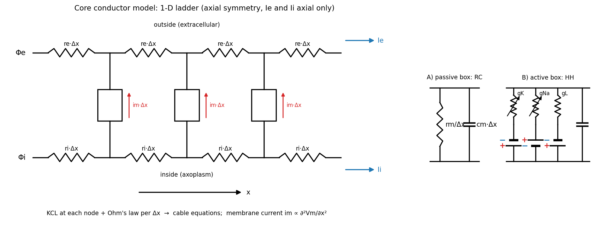
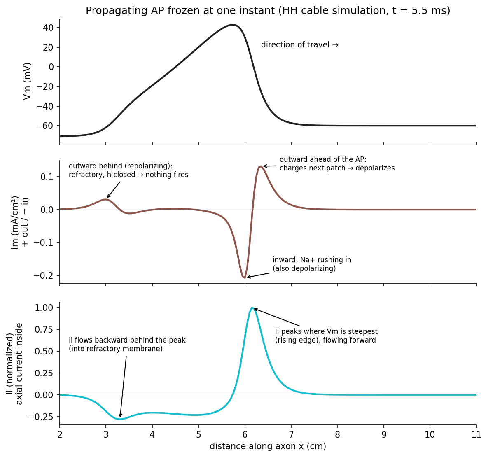
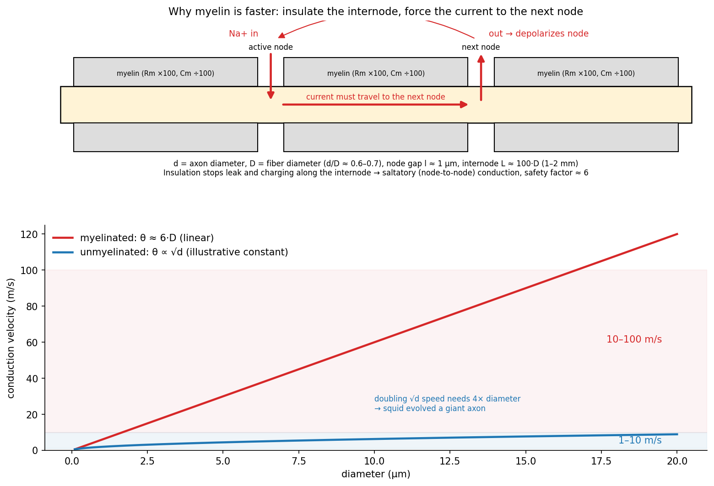

# The Cable Equation and Propagation

A space-clamped patch has no geometry. A real axon is a long, thin tube of conducting cytoplasm wrapped in membrane and bathed in conducting fluid, and the action potential travels along it. The **core-conductor** (cable) model treats the fibre as a one-dimensional ladder network and leads to one central result: the membrane current at any point is proportional to the second spatial derivative, the curvature, of the membrane voltage. From there follow the conduction velocity of unmyelinated fibres and the advantage of myelin.

## Per-Unit-Length Parameters

Material properties are specified per unit area or volume; the cable equation needs them per unit length of a fibre of radius \\(a\\).

| Quantity | Specific (material) value | Per unit length |
|---|---|---|
| Axial (intracellular) resistance | \\(R\_i\\), Ω·cm (volume resistivity) | \\(r\_i = R\_i/(\pi a^2)\\), Ω/cm |
| Membrane resistance | \\(R\_m\\), Ω·cm² (area resistance) | \\(r\_m = R\_m/(2\pi a)\\), Ω·cm |
| Membrane capacitance | \\(C\_m\\), µF/cm² | \\(c\_m = C\_m\\,2\pi a\\), µF/cm |

The axial resistance of a length \\(\Delta x\\) is resistivity times length over cross-sectional area, \\(R\_i\Delta x/(\pi a^2)\\), hence \\(r\_i\\). The membrane of the same length has area \\(2\pi a\Delta x\\), and resistances in parallel divide by area, giving \\(R\_m/(2\pi a\Delta x)\\) for the segment and \\(r\_m = R\_m/(2\pi a)\\) "per unit length" (in Ω·cm, because a longer piece has *less* resistance). Capacitances in parallel add, giving \\(c\_m = 2\pi aC\_m\\).

## The Core-Conductor Model

### Assumptions

For an excised single fibre:

1. Axial symmetry (\\(\partial/\partial\phi = 0\\)) and no radial variation (\\(\partial/\partial r = 0\\)) inside the fibre, so everything depends on \\(x\\) only.
2. The extracellular current \\(I\_e\\) is axial only. This holds for an excised fibre wetted with a thin film of fluid, or an axon buried in a nerve bundle.
3. The intracellular current \\(I\_i\\) is axial only, reasonable because the fibre's length greatly exceeds its radius.
4. The membrane is a series of boxes, either **passive** (\\(r\_m \parallel c\_m\\)) for subthreshold behaviour or **active** (the HH branches \\(g\_K, g\_{Na}, g\_L\\) with their batteries, in parallel with \\(c\_m\\)).

*Figure: the core-conductor ladder. Inside and outside resistances r_i and r_e per unit length run along the fibre; membrane boxes connect them. Each box is either passive (r_m ∥ c_m) or an HH membrane.*

### Kirchhoff's laws on the ladder

Take currents positive in the \\(+x\\) direction. Ohm's law along the inside and outside conductors:
\\[
\frac{\partial\Phi\_e}{\partial x} = -I\_e r\_e, \qquad \frac{\partial\Phi\_i}{\partial x} = -I\_i r\_i .
\\]
Current leaving the inside through the membrane (\\(i\_m\\), per unit length, positive outward) reduces the axial current inside and adds to it outside. An extracellular electrode can also inject current \\(i\_p\\) per unit length into the outside space:
\\[
\frac{\partial I\_i}{\partial x} = -i\_m, \qquad \frac{\partial I\_e}{\partial x} = i\_m + i\_p .
\\]
The total axial current \\(I = I\_i + I\_e\\) therefore changes only where the electrode injects current:
\\[
\frac{\partial I}{\partial x} = i\_p .
\\]

### Membrane current is curvature

Differentiate \\(V\_m = \Phi\_i - \Phi\_e\\):
\\[
\frac{\partial V\_m}{\partial x} = -r\_iI\_i + r\_eI\_e = -r\_iI\_i + r\_e(I - I\_i) = -(r\_i + r\_e)I\_i + r\_eI .
\\]
Differentiate once more, using \\(\partial I\_i/\partial x = -i\_m\\) and \\(\partial I/\partial x = i\_p\\):
\\[
\frac{\partial^2V\_m}{\partial x^2} = (r\_i + r\_e)\\,i\_m + r\_e\\,i\_p .
\\]
Away from any stimulating electrode (\\(i\_p = 0\\)):
\\[
\boxed{i\_m = \frac{1}{r\_i + r\_e}\frac{\partial^2V\_m}{\partial x^2}}
\\]
The membrane current at a point is proportional to the curvature of the voltage profile there. This is the core result of cable theory and the reason the second spatial derivative of potential appears throughout stimulation theory. Working from the inside alone (\\(\partial^2\Phi\_i/\partial x^2 = r\_i i\_m\\)) gives a version that does not require the outside current to be axial.

### Potentials in a source-free region

Where no electrode injects current, and the fibre extends to infinity with no net axial current (\\(I = 0\\), so \\(I\_e = -I\_i\\)):
\\[
\frac{\partial\Phi\_e}{\partial x} = r\_eI\_i, \qquad \frac{\partial V\_m}{\partial x} = -(r\_i + r\_e)I\_i
\quad\Longrightarrow\quad
\frac{\partial\Phi\_e}{\partial x} = -\frac{r\_e}{r\_i + r\_e}\frac{\partial V\_m}{\partial x}.
\\]
Integrating inward from \\(x = \infty\\), where all deviations vanish:
\\[
\phi\_e = -\frac{r\_e}{r\_i + r\_e}\\,v\_m, \qquad \phi\_i = \frac{r\_i}{r\_i + r\_e}\\,v\_m .
\\]
The extracellular potential is a scaled, **inverted** copy of the action potential. With a large bath (\\(r\_e\to 0\\)) it vanishes, which is why extracellular signals in a big volume of fluid are tiny compared with the transmembrane potential.

## The Propagating Action Potential

In Hodgkin and Huxley's large bath, \\(r\_e \approx 0\\), so \\(i\_m = (\pi a^2/R\_i)\\,\partial^2V\_m/\partial x^2\\). Dividing by the circumference \\(2\pi a\\) gives the current per unit area of membrane, which must equal the HH membrane current:
\\[
I\_m = \frac{a}{2R\_i}\frac{\partial^2V\_m}{\partial x^2} = C\_m\frac{\partial V\_m}{\partial t} + \bar g\_Kn^4(V\_m - E\_K) + \bar g\_{Na}m^3h(V\_m - E\_{Na}) + g\_L(V\_m - E\_L).
\\]
The left side is the geometry (cable); the right side is the membrane (HH). Rearranged as a reaction–diffusion equation,
\\[
\frac{\partial V\_m}{\partial t} = \frac{1}{C\_m}\left(\frac{a}{2R\_i}\frac{\partial^2V\_m}{\partial x^2}\right) - \frac{1}{C\_m}\sum I\_{ion},
\\]
it can be integrated numerically by dividing the axon into compartments of length \\(\Delta x\\) and replacing the second derivative with the central difference \\((V\_{k-1} - 2V\_k + V\_{k+1})/\Delta x^2\\). The cable term is a diffusion with coefficient \\(1/(r\_ic\_m)\\), so its stability depends on the **mesh ratio**
\\[
\mu = \frac{\Delta t}{r\_ic\_m\Delta x^2}.
\\]
An explicit (forward-Euler) update is stable only for \\(\mu \le \tfrac12\\). For the squid axon (\\(a = 238\\) µm, \\(R\_i = 35.4\\) Ω·cm, \\(C\_m = 1\\) µF/cm²), \\(r\_ic\_m \approx 3\times10^{-3}\\) s/cm²; with \\(\Delta x = 20\\) µm that forces \\(\Delta t \lesssim 6\\) ns. Implicit schemes such as Crank–Nicolson are stable for any \\(\mu\\), which is why practical simulations can use steps like \\(\Delta x \approx 20\\) µm and \\(\Delta t \approx 10\\) µs; accuracy, not stability, then sets the step.

### The shape of the currents

*Figure: one instant of an action potential travelling to the right, plotted against distance. V_m has a steep leading edge and a slow tail. The membrane current I_m follows the curvature of V_m: outward just ahead of the spike, inward where the Na⁺ channels are open. The internal axial current I_i is largest at the steep rising edge.*

- **\\(V\_m(x)\\)** has a steep rising edge in front and a slow tail behind. The whole event spans several centimetres, which is why [circuit theory fails](fields.md).
- **\\(I\_m(x)\\)** is inward (negative) near the peak, where Na⁺ channels are open, and outward (positive) just ahead, where that current exits and depolarizes the next patch. Since \\(I\_m\propto\partial^2V\_m/\partial x^2\\), it tracks the curvature of \\(V\_m\\).
- **\\(I\_i(x)\\)**, from \\(\partial V\_m/\partial x = -(r\_i + r\_e)I\_i\\), is proportional to the negative slope of \\(V\_m\\). It is largest at the steep leading edge and flows forward. Behind the peak it flows backward and out, but that membrane is refractory.

Both the outward current ahead and the inward Na⁺ current at the peak depolarize, for different reasons: the first by an Ohmic voltage drop across the resting membrane, the second by carrying positive charge inward (see [the cathode–anode picture](hodgkin-huxley.md#current-paths-around-a-cathode-and-an-anode)).

## Conduction Velocity of Unmyelinated Fibres

A uniformly propagating action potential keeps its shape and moves at constant speed \\(\theta\\), so it is a travelling wave:
\\[
V\_m(x,t) = V\_m(x - \theta t).
\\]
For any function of \\(x - \theta t\\), \\(\partial/\partial x = -(1/\theta)\\,\partial/\partial t\\), so
\\[
\frac{\partial^2V\_m}{\partial x^2} = \frac{1}{\theta^2}\frac{\partial^2V\_m}{\partial t^2}.
\\]
Substituting into the propagating-AP equation turns the partial differential equation into an ordinary one in time:
\\[
\frac{a}{2R\_i\theta^2}\frac{d^2V\_m}{dt^2} = C\_m\frac{dV\_m}{dt} + \sum I\_{ion}(V\_m, m, h, n).
\\]
The right side depends only on the membrane, identical for fibres of any diameter made of the same membrane. The equation has a physically sensible solution (rest at both ends, a single spike in between) only for one particular value of the coefficient on the left. Call it \\(1/K\\):
\\[
\frac{a}{2R\_i\theta^2} = \frac{1}{K}
\quad\Longrightarrow\quad
\boxed{\theta = \sqrt{\frac{aK}{2R\_i}} \propto \sqrt{d}}
\\]
\\(K\\) is a property of the membrane alone. Measure \\(\theta\\) for one fibre size to obtain \\(K\\), and the velocity of every other size follows. Hodgkin and Huxley found \\(K\\) by trial integration and predicted 18.8 m/s for the squid axon, against a measured 21.2 m/s, one of the great confirmations of the model.

The square-root law is expensive: **doubling the speed requires four times the diameter**. Hence the squid's giant axon (>300 µm) for its escape reflex, and the evolutionary pressure toward a better solution.

## Myelinated Fibres

Vertebrates speed up conduction by wrapping axons in **myelin**, many layers of membrane formed by Schwann cells (peripheral nervous system) or oligodendrocytes (central nervous system). The sheath is interrupted at regular intervals by short bare **nodes of Ranvier**.

### Geometry

| Symbol | Meaning | Typical value |
|---|---|---|
| \\(d\\) | Axon diameter | \\(d/D = 0.6\\)–0.7 |
| \\(D\\) | Fibre diameter (axon + myelin) | 1–20 µm |
| \\(l\\) | Nodal gap | ≈ 1 µm, independent of size |
| \\(L\\) | Internodal length | 1–2 mm; \\(L/D \approx 100\\) (60–150) |

### Membrane properties

| Membrane | \\(R\_m\\) (Ω·cm²) | \\(C\_m\\) (F/cm²) |
|---|---|---|
| Single Schwann-cell membrane | 10³ | 10⁻⁶ |
| Myelin sheath (~100 layers) | 10⁵ | 10⁻⁸ |
| Node of Ranvier (frog) | 20 | 3×10⁻⁶ |

Stacking \\(N\\) membranes in series multiplies the resistance by \\(N\\) and divides the capacitance by \\(N\\), which is exactly what the table shows for \\(N \approx 100\\).

### Why myelin is faster

*Figure: left, the local-circuit current from an active node is forced along the axon to the next node because the internode is insulated. Right, conduction velocity versus diameter: square-root growth for unmyelinated fibres, linear growth for myelinated ones.*

- The internode leaks very little current (\\(R\_m\\) up about 100-fold) and needs very little charge to change its voltage (\\(C\_m\\) down about 100-fold). Current from one node reaches the next almost undiminished, and charges it quickly.
- Na⁺ channels are concentrated at the nodes (K⁺ channels sit under the paranodal edges of the myelin). Each node produces a large inward current that depolarizes the next node. The excitation jumps from node to node: **saltatory conduction**.

### Linear scaling with diameter

Model the fibre as a chain of nodes connected by internodal axial resistances \\(R\_a\\), ignoring the small internodal leak. Kirchhoff's law at node \\(k\\):
\\[
C\_n\frac{dV\_k}{dt} + I\_{ion,k} = \frac{V\_{k-1} - 2V\_k + V\_{k+1}}{R\_a}.
\\]
Now scale the fibre, keeping \\(d/D\\), \\(L/D\\) and the nodal gap \\(l\\) fixed:

- Internodal axial resistance: \\(R\_a = \dfrac{R\_iL}{\pi d^2/4} \propto \dfrac{d}{d^2} = \dfrac{1}{d}\\), since \\(L\propto D\propto d\\).
- Nodal membrane area \\(\pi d\\,l \propto d\\) (not \\(d^2\\), because \\(l\\) is constant), so nodal capacitance \\(C\_n\propto d\\), nodal ionic current \\(I\_{ion}\propto d\\), and nodal membrane resistance \\(\propto 1/d\\).

Divide the node equation by \\(d\\). Every term then has a coefficient independent of size: \\(C\_n/d\\), \\(I\_{ion}/d\\) and \\(1/(R\_ad)\\) are all constants. The voltage time course at each node, and so the delay \\(\Delta t\\) from one node to the next, is the same for every fibre size. The distance between nodes, however, is \\(L\propto D\\). Hence
\\[
\theta = \frac{L}{\Delta t} \propto D, \qquad \boxed{\theta \approx (5.7\text{ to }6)\\,D\ \text{m/s}\quad (D\text{ in µm})}.
\\]
Myelinated velocity grows linearly with diameter, against the square root for unmyelinated fibres. In round numbers: 1–10 m/s unmyelinated, 10–100 m/s myelinated, about ten times faster for the same size.

### Safety factor and the size limit

- The current reaching the next node is about **six times** what is needed to excite it. In principle the internode could be six times longer without increasing the diameter; the margin protects conduction against damage and variability.
- Fibres smaller than about 1 µm are not myelinated: Schwann cells cannot wrap that small, and below that size the unmyelinated square-root law is actually competitive.
- Mammalian internodes have almost no Na⁺ channels, so **demyelination blocks conduction** (diphtheria toxin and demyelinating diseases such as multiple sclerosis). Axons can partially adapt as Na⁺ channels redistribute into demyelinated regions.

## See Also

- Partial Differential Equations and Numerical PDEs: diffusion-type equations and the stability of explicit schemes.
- [Models of the Node of Ranvier](node-models.md): the membrane at each node.
- [Electrical Stimulation of Excitable Tissue](excitation.md): the passive cable driven from outside, and the length constant.
- [Neurophysiology Foundations](../neural-control-of-movement/neurophysiology.md): fibre classes and their velocities.
