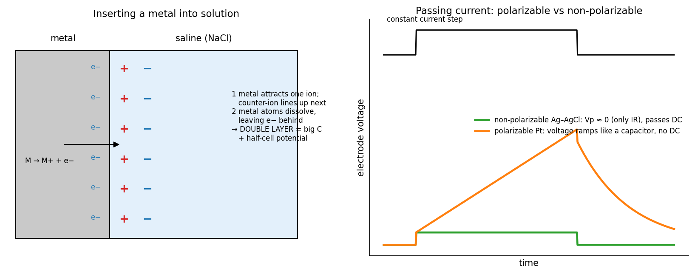
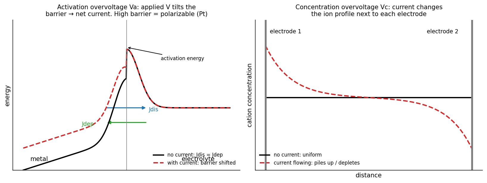
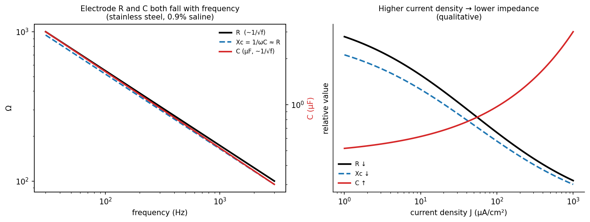
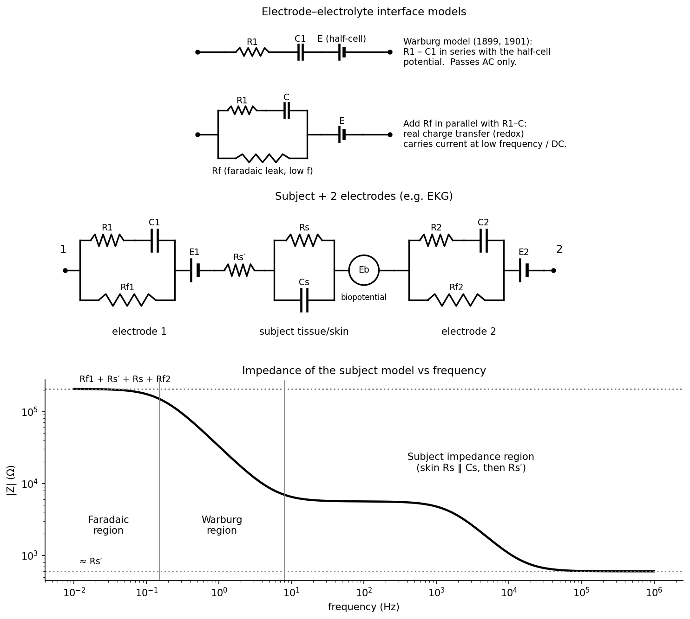

# The Electrode–Electrolyte Interface

Every recording or stimulating system meets the body at an electrode, and at that surface current changes carriers: electrons in the metal, ions in the tissue. The conversion is electrochemistry, and it gives the interface a potential of its own, a large capacitance, a frequency- and current-dependent impedance, and the chemical reactions that decide whether stimulation is safe.

## A Metal in Solution

Dip a metal into saline (NaCl) and two things happen at once.

1. The metal surface attracts one ionic species (cations or anions), which accumulates at the surface; by space-charge neutrality the counter-ions line up just beyond it.
2. Some metal atoms dissolve as cations, \\(\mathrm{M \rightarrow M^{\+} + e^-}\\), leaving their electrons behind in the metal (this is the start of corrosion).

Together these build a **double layer** of separated charge a few ångströms thick: a sheet of charge in the metal facing a sheet of ions in the solution. Two consequences follow.

- The double layer is a capacitor with a very small gap, so its capacitance is very large (tens of µF/cm²).
- A potential difference, the **half-cell potential**, appears between metal and solution.

*Figure: left, the double layer formed when a metal is placed in saline. Right, response to a constant-current step: a non-polarizable Ag–AgCl electrode shows only an IR step and passes DC; a polarizable Pt electrode charges like a capacitor and cannot pass steady DC.*

Inside tissue there is little capacitance apart from cell membranes. The large capacitance in a recording or stimulation circuit sits at the electrode–electrolyte interface, where electronic current is converted to ionic current.

## Half-Cell Potentials

A single half-cell potential cannot be measured: any measurement needs a second electrode, which has its own. Potentials are therefore quoted relative to the **standard hydrogen electrode**: sintered (platinized) platinum, which catalyses the reaction, bathed in H₂ gas in a solution with pH 0 (1 mol/L H⁺):
\\[
\mathrm{H\_2\\,(gas)} \rightleftharpoons \mathrm{2H\\,(adsorbed)} \rightleftharpoons \mathrm{2H^+ + 2e^-}.
\\]

| Electrode | Half-cell potential (V, no current) |
|---|---|
| Aluminum | −1.662 |
| Hydrogen (Pt in H₂) reference | 0.000 |
| Silver | +0.799 |
| Platinum | +1.2 |

Two electrodes of the same metal in the same solution show no net potential between them; two different metals give the difference of their half-cell potentials, which is a battery. Half-cell potentials depend on concentration through the Nernst equation of the electrode reaction,
\\[
E = E^0 + \frac{RT}{nF}\ln\frac{a\_{ox}}{a\_{red}},
\\]
where \\(n\\) is the number of electrons transferred and \\(a\\) are activities. The tabulated values assume no current.

## Passing Current: Polarization

With no current, metal dissolution and deposition proceed at equal and opposite rates, \\(J\_{dis} = J\_{dep}\\), each called the **exchange current**. Each direction has to cross an activation-energy barrier. Passing a net current unbalances them, and the electrode's potential shifts from its zero-current value. The shift is the **polarization overvoltage**:
\\[
V\_p = V(i) - V(0) = V\_r + V\_c + V\_a .
\\]

*Figure: left, activation overvoltage: the applied potential tilts the energy barrier, speeding one direction of the reaction and slowing the other. Right, concentration overvoltage: current depletes or accumulates ions near each electrode.*

### The three overvoltages

- **Ohmic (resistive), \\(V\_r\\)**: the voltage drop in the solution next to the electrode. Despite its name it is not strictly Ohmic; it depends on current magnitude and direction. It falls as the surface area increases (sintering, roughening, or a larger electrode), which also changes what the electrode records.
- **Concentration, \\(V\_c\\)**: current changes the ion concentrations next to the electrode. If the surface concentration \\(C\_s\\) differs from the bulk \\(C\_0\\), the local equilibrium potential shifts by the Nernst amount
\\[
V\_c = \frac{RT}{nF}\ln\frac{C\_s}{C\_0}.
\\]
- **Activation, \\(V\_a\\)**: the energy needed to drive charge across the interface. The applied potential lowers the barrier in one direction and raises it in the other. The standard description is the **Butler–Volmer equation**,
\\[
J = J\_0\left[e^{(1-\alpha)nFV\_a/RT} - e^{-\alpha nFV\_a/RT}\right],
\\]
with exchange current density \\(J\_0\\) and transfer coefficient \\(\alpha\approx 0.5\\). For small \\(V\_a\\) the exponentials linearize to \\(J \approx J\_0(nF/RT)V\_a\\), a **charge-transfer resistance** \\(R\_{ct} = RT/(nFJ\_0)\\). For large \\(V\_a\\) one term dominates and \\(V\_a\\) grows logarithmically with \\(J\\) (the **Tafel** region).

### Polarizable and non-polarizable electrodes

The exchange current density \\(J\_0\\) sets everything. A large \\(J\_0\\) means a small \\(R\_{ct}\\): current crosses easily and the potential barely moves. A small \\(J\_0\\) means the interface passes almost no faradaic (charge-transfer) current, and behaves like a capacitor.

| | Non-polarizable (reversible) | Ideally polarizable (irreversible) |
|---|---|---|
| \\(V\_p\\) | ≈ 0 | = \\(V\_{applied}\\) |
| Example | Ag–AgCl | Platinum |
| Activation energy | Low (\\(J\_0\\) large) | High (\\(J\_0\\) small) |
| Current passed | DC passes across the interface | No steady DC; AC only, like a capacitor |
| Where the applied voltage goes | Not across the interface | Entirely across the interface |
| Good for | Recording stable DC and low-frequency biopotentials | AC signals; stimulation without consuming the metal |

The Ag–AgCl electrode is non-polarizable because two fast, reversible reactions shuttle charge through it:
\\[
\mathrm{Ag \rightleftharpoons Ag^+ + e^-}, \qquad \mathrm{Ag^+ + Cl^- \rightleftharpoons AgCl}.
\\]
Its potential depends only on the Cl⁻ activity, which is high and stable in physiological saline. With very large currents, however, Cl⁻ migrates toward the anode, the AgCl balance shifts, and the electrode begins to behave as polarizable.

## Electrode Impedance

### Measuring it

Two identical electrodes of area \\(A\\), separated by a distance \\(L\\) in a solution of resistivity \\(\rho\\), behave as a series chain: electrode 1 (\\(R\_1\\) in series with \\(C\_1\\)), the solution \\(\rho L/A\\), electrode 2 (\\(R\_2\\), \\(C\_2\\)):
\\[
Z\_{12} = R\_1 + \frac{\rho L}{A} + R\_2 + \frac{1}{j\omega}\left(\frac{1}{C\_1} + \frac{1}{C\_2}\right).
\\]
Place the pair in one arm of an AC Wheatstone bridge whose opposite arm is a variable resistor \\(R\_b\\) in series with a variable capacitor \\(C\_b\\), with equal ratio arms, an AC source, and a detector coupled through an isolation transformer. At balance the two arms have equal impedance, so real and imaginary parts match separately:
\\[
R\_b = R\_1 + \frac{\rho L}{A} + R\_2, \qquad \frac{1}{C\_b} = \frac{1}{C\_1} + \frac{1}{C\_2}.
\\]
For identical electrodes,
\\[
R\_1 = R\_2 = \frac{R\_b}{2} - \frac{\rho L}{2A}, \qquad C\_1 = C\_2 = 2C\_b .
\\]
If \\(\rho\\) is unknown, balance at two separations \\(L\_1\\) and \\(L\_2\\): the difference \\(R\_b(L\_2) - R\_b(L\_1) = \rho(L\_2 - L\_1)/A\\) gives \\(\rho\\).

### How R and C behave

*Figure: series R and C of a stainless-steel electrode in 0.9% saline. Both fall with frequency, roughly as 1/√f, so the reactance tracks the resistance. Increasing current density raises C and lowers R, so impedance falls.*

| Change | \\(R\\) | \\(C\\) | Reactance \\(1/\omega C\\) | Impedance |
|---|---|---|---|---|
| Frequency ↑ | ↓ (≈ \\(1/\sqrt f\\)) | ↓ (≈ \\(1/\sqrt f\\)) | ↓ | ↓ |
| Current density ↑ | ↓ | ↑ | ↓ | ↓ |

The example in the notes is stainless steel in 0.9% saline at 25 µA/cm² and \\(A = 0.157\\) cm²: from 30 Hz to 3 kHz, R falls from about 300 Ω and C from about 3 µF, and both the resistance and the reactance drop from roughly 1 kΩ to 100 Ω.

Why \\(1/\sqrt f\\)? When the current at the interface is limited by ions diffusing to and from the surface, the diffusion equation \\(\partial C/\partial t = D\\,\partial^2C/\partial x^2\\) driven sinusoidally at \\(\omega\\) has solutions decaying as \\(e^{-x\sqrt{j\omega/D}}\\). The surface flux is then proportional to \\(\sqrt{j\omega}\\) times the surface concentration swing, and the resulting **Warburg impedance** is
\\[
Z\_W = \frac{\sigma\_W}{\sqrt{\omega}}(1 - j),
\\]
with equal real and imaginary parts (a constant phase of −45°) that both fall as \\(1/\sqrt\omega\\). That is exactly the observed behaviour: \\(R \propto 1/\sqrt f\\), \\(1/(\omega C) \propto 1/\sqrt f\\) so \\(C \propto 1/\sqrt f\\), and reactance ≈ resistance.

The engineering lesson is that **biological "resistors" and "capacitors" are not constant**. They change with frequency and with how hard the electrode is driven. A system designed around a single fixed electrode impedance will fail; the course notes tell of a company that did exactly this and spent over a million dollars redesigning before learning it.

## Models of the Interface

Warburg proposed (1899, 1901) circuit models built from these observations.

*Figure: top, Warburg model 1 (R₁–C₁ in series with the half-cell E) and model 2 (adding the faradaic leak R_f). Middle, the full chain for two electrodes on a subject. Bottom, |Z| versus frequency: a high flat faradaic region at low frequency, a falling Warburg region, and a flat subject region at high frequency.*

- **Model 1**: \\(R\_1\\) and \\(C\_1\\) in series with the half-cell potential \\(E\\). It passes only AC.
- **Model 2** adds \\(R\_f\\), a **faradaic** path in parallel with \\(R\_1\\)–\\(C\\), representing real charge transfer by chemical reactions. It carries current at low frequency, including DC.

\\[
Z\_{\text{model 1}} = R\_1 + \frac{1}{j\omega C\_1}, \qquad
Z\_{\text{model 2}} = R\_f \parallel\left(R\_1 + \frac{1}{j\omega C}\right) = \frac{R\_f\left(R\_1 + \frac{1}{j\omega C}\right)}{R\_f + R\_1 + \frac{1}{j\omega C}}.
\\]
Model 2 has two limits: \\(Z\to R\_f\\) as \\(\omega\to 0\\) (the capacitor is open) and \\(Z\to R\_fR\_1/(R\_f + R\_1)\\) as \\(\omega\to\infty\\) (the capacitor is a short).

### Two electrodes on a subject

A recording such as an electrocardiogram puts two such interfaces in series with the body: electrode 1 [\\(R\_{f1}\parallel(R\_1\text{–}C\_1)\\)] with half-cell \\(E\_1\\); the series resistance of deep tissue \\(R\_s'\\); the skin and tissue \\(C\_s\parallel R\_s\\); the biopotential source \\(E\_b\\); and electrode 2 [\\(R\_{f2}\parallel(R\_2\text{–}C\_2)\\)] with \\(E\_2\\). On a log-frequency plot \\(\|Z\|\\) shows three regions:

- **Low frequency**: all capacitors are open, current goes through the faradaic leaks, \\(\|Z\| = R\_{f1} + R\_s' + R\_s + R\_{f2}\\).
- **Middle (Warburg) region**: the electrode capacitances take over and \\(\|Z\|\\) falls with frequency.
- **High frequency**: all capacitors are short circuits and only the subject's series resistance remains, \\(\|Z\| = R\_s'\\).

If \\(E\_1 = E\_2\\) their half-cell potentials cancel; any mismatch, or any drift between them, appears as a DC offset or slow artefact in the recording, one more reason to use matched, non-polarizable electrodes for recording.

## Choosing an Electrode Metal

| Group | Metals | Verdict |
|---|---|---|
| Noble | Platinum, iridium, rhodium, Pt–Ir alloys | Use for stimulation; activated (electrochemically oxidized) iridium is best |
| Non-noble alloys | Stainless steel, Elgiloy, MP35N | Corrode (\\(\mathrm{Fe\rightarrow Fe^{2\+}}\\)) |
| Avoid as active electrodes | Copper, silver | Dissolve and are toxic |
| Acceptable | Tungsten, tantalum | Usable but not best |
| Titanium | Ti, TiN coatings | Widely used in pacemakers |

The choice follows from polarizability.

- **For recording**, use a non-polarizable Ag–AgCl electrode, which gives a stable potential and low noise at low frequencies.
- **For stimulating**, use a polarizable noble metal, so that charge passes mainly through the double-layer capacitance (and through reversible surface reactions) without consuming the metal. A polarizable electrode cannot drive DC; it passes only pulses or AC.

For maximum safe AC stimulation in the brain, **iridium oxide** (or Pt–Ir) is the choice: iridium oxide can inject far more charge safely, because its surface oxide switches reversibly between valence states, but it is expensive.

## Reactions at the Interface

### Reversible and irreversible reactions

| Reversible | Irreversible (generally harmful) |
|---|---|
| Introduce no permanent new species, except H⁺ and OH⁻ | Introduce new species into the tissue |
| \\(\mathrm{Ag\rightleftharpoons Ag^+ + e^-}\\); \\(\mathrm{Ag^+ + Cl^-\rightleftharpoons AgCl}\\) | \\(\mathrm{Pt + 4Cl^-\rightarrow PtCl\_4^{2-} + 2e^-}\\) |
| Charge can be recovered by reversing the current | Products diffuse away and cannot be recovered |

### Anodic reactions (oxidation; the electrode takes electrons)

| Reaction | Equation | Potential (V) |
|---|---|---|
| Electrolysis of water | \\(\mathrm{2H\_2O\rightarrow O\_2 + 4H^+ + 4e^-}\\) | 1.228 |
| Oxidation of saline | \\(\mathrm{Cl^- + H\_2O\rightarrow ClO^- + 2H^+ + 2e^-}\\) | 1.715 |
| Dissolution of platinum | \\(\mathrm{Pt + 4Cl^-\rightarrow PtCl\_4^{2-} + 2e^-}\\) | 1.143 |
| Oxidation of organics | \\(\mathrm{C\_6H\_{12}O\_6 + 6H\_2O\rightarrow 6CO\_2 + 24H^+ + 24e^-}\\) | 0.015 |
| Corrosion of stainless steel | \\(\mathrm{Fe\rightarrow Fe^{2\+} + 2e^-}\\) | ≈ 0.03 |

In general the anode generates H⁺, so **pH falls** (acid).

### Cathodic reactions (reduction; the electrode supplies electrons)

\\[
\mathrm{2H\_2O + 2e^-\rightarrow H\_2 + 2OH^-}, \qquad
\mathrm{O\_2 + H\_2O + 2e^-\rightarrow OH^- + O\_2H^-}, \quad \mathrm{O\_2H^- + H^+\rightarrow H\_2O\_2}.
\\]
The first produces hydrogen gas bubbles; the second produces hydrogen peroxide. In general the cathode generates OH⁻, so **pH rises** (base).

Each reaction becomes possible once the electrode potential passes its threshold value. In practice: stimulation splits water, making the anode side acidic and the cathode side basic. Running current in one direction for too long accumulates these products, which is why practical stimulation reverses the current ([next chapter](safe-stimulation.md)).

### Anode and cathode compared

| | Anode (+) | Cathode (−) |
|---|---|---|
| Chemistry | Oxidation: O₂, chlorine compounds, metal dissolution | Reduction: H₂ gas, OH⁻, H₂O₂ |
| pH | Falls (acid) | Rises (base) |
| Electrode damage | Corrodes or dissolves | Not consumed |
| Effect on a nearby axon | Hyperpolarizes; anode break possible at release | Depolarizes; the action potential starts here |
| As a field source | Current source into tissue | Current sink |

## See Also

- Physical Chemistry: electrochemical potentials and reaction kinetics.
- [Neural Interfaces and Electrodes](../neural-control-of-movement/electrodes.md): electrode technologies and materials for neural implants.
- [Safe Stimulation and Waveform Design](safe-stimulation.md): staying inside the electrochemical limits.
- [Biopotential Amplifiers](amplifiers.md): how electrode impedance affects recordings.
