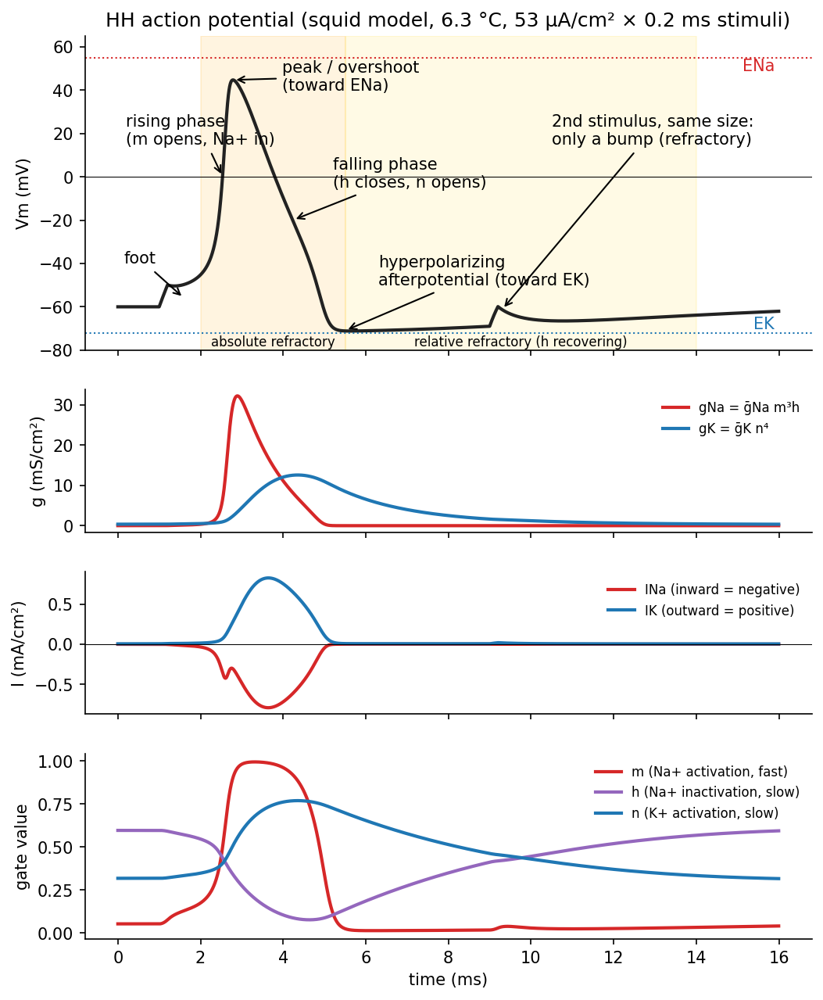
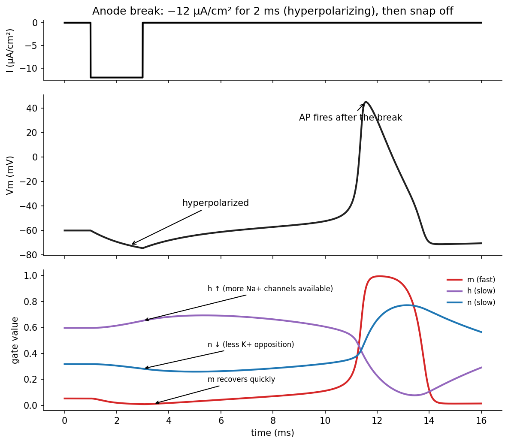
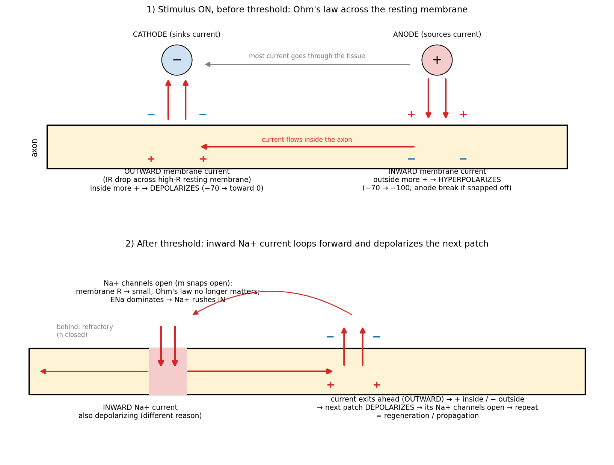

# Hodgkin–Huxley Kinetics and Excitation

The voltage-clamp experiments of the [previous chapter](membrane-circuit.md) produced conductance-versus-time curves at many voltages. Hodgkin and Huxley summarized them with three gating variables: a fast Na⁺ activation gate \\(m\\) that starts the action potential, and two slow processes, Na⁺ inactivation \\(h\\) and K⁺ activation \\(n\\), that end it. The same slow variables explain the refractory period, anode break and accommodation.

## The Action Potential

Inject a depolarizing current into a patch of membrane. Below threshold the voltage rises and decays passively, as in an RC circuit. Above threshold an action potential fires. Its parts are:

- **rest**, near the K⁺ Nernst potential (about −60 to −70 mV in the squid; −60 to −100 mV across tissues);
- the **foot**, the passive depolarization produced by the stimulus;
- the **rising phase**, as Na⁺ channels open and Na⁺ rushes in;
- the **peak** or **overshoot** above 0 mV, approaching the Na⁺ Nernst potential (about +40 mV);
- the **falling phase**, as Na⁺ channels inactivate and K⁺ channels open;
- the **hyperpolarizing afterpotential**, below rest and toward \\(E\_K\\), followed by a slow return (sometimes with a small **depolarizing afterpotential**).

On an axon stimulated from outside, the action potential begins under the **cathode** and travels away in both directions.



*Figure: a Hodgkin–Huxley simulation (squid model, 6.3 °C, 53 µA/cm² × 0.2 ms stimuli). Top to bottom: V_m with its phases labelled; g_Na and g_K; I_Na (inward, negative) and I_K (outward, positive); and the gates m, h, n. m jumps first (τ_m < 1 ms) and g_Na spikes, driving V_m toward E_Na; then h falls and n rises (3–10 ms), g_Na collapses while g_K peaks, and V_m falls below rest toward E_K. An identical stimulus at 9 ms produces only a bump: h has not yet recovered.*

## The Gating Model

Hodgkin and Huxley wrote the conductances as maximum values times powers of gating variables:
\\[
g\_K = \bar g\_K\\,n^4, \qquad g\_{Na} = \bar g\_{Na}\\,m^3h .
\\]

- \\(n\\) is the probability that one K⁺ "gating particle" is in its permissive position. If four independent particles must all be permissive for the channel to conduct, the open probability is \\(n^4\\). The fourth power is what makes \\(g\_K\\) rise along a delayed sigmoid rather than an exponential.
- \\(m\\) is Na⁺ activation (three particles, \\(m^3\\)) and \\(h\\) is Na⁺ inactivation (one particle).

Each variable \\(x \in \\{m, h, n\\}\\) obeys first-order kinetics between a non-permissive state (fraction \\(1 - x\\)) and a permissive state (fraction \\(x\\)):
\\[
(1 - x)\ \underset{\beta\_x}{\overset{\alpha\_x}{\rightleftharpoons}}\ x,
\qquad
\frac{dx}{dt} = \alpha\_x(v\_m)(1 - x) - \beta\_x(v\_m)\\,x .
\\]
The opening rate \\(\alpha\_x\\) and closing rate \\(\beta\_x\\) (ms⁻¹) depend only on voltage, here written as \\(v\_m = V\_m - V\_{rest}\\) in mV.

### Solution under voltage clamp

When \\(v\_m\\) is held constant, \\(\alpha\\) and \\(\beta\\) are constants and the gate equation is linear:
\\[
\frac{dx}{dt} + (\alpha\_x + \beta\_x)\\,x = \alpha\_x .
\\]
Its solution from an initial value \\(x\_0\\) is an exponential relaxation to a steady state:
\\[
x(t) = x\_\infty - (x\_\infty - x\_0)\\,e^{-t/\tau\_x},
\qquad
x\_\infty = \frac{\alpha\_x}{\alpha\_x + \beta\_x},
\qquad
\tau\_x = \frac{1}{\alpha\_x + \beta\_x}.
\\]
The relations invert directly, which is how the rate constants were obtained from data:
\\[
\alpha\_x = \frac{x\_\infty}{\tau\_x}, \qquad \beta\_x = \frac{1 - x\_\infty}{\tau\_x}.
\\]

### Fitting \\(n\\) from the K⁺ conductance

At rest \\(n = n\_0\\). After a clamp step,
\\[
g\_K(t) = \bar g\_K\left[n\_\infty - (n\_\infty - n\_0)e^{-t/\tau\_n}\right]^4 .
\\]
For each clamp voltage, fitting this curve to the measured \\(g\_K(t)\\) gives \\(n\_\infty\\) and \\(\tau\_n\\); converting to \\(\alpha\_n\\) and \\(\beta\_n\\) and repeating over many voltages yields points through which smooth functions of \\(v\_m\\) were drawn.

### Fitting \\(m\\) and \\(h\\) from the Na⁺ conductance

Two observations simplify the Na⁺ fit. At rest \\(g\_{Na}\\) is very small, so \\(m\_0 \approx 0\\). After a large depolarization \\(g\_{Na}\\) decays to zero, so \\(h\_\infty \approx 0\\). Substituting into \\(m^3h\\):
\\[
g\_{Na}(t) = \bar g\_{Na}\\,m\_\infty^3h\_0\left(1 - e^{-t/\tau\_m}\right)^3e^{-t/\tau\_h},
\\]
a rising exponential (cubed) times a decaying one. The resting availability \\(h\_0\\) was measured separately with **double-pulse** (prepulse) voltage-clamp protocols.

### The rate functions

| Gate | \\(\alpha\\) (ms⁻¹) | \\(\beta\\) (ms⁻¹) | Speed |
|---|---|---|---|
| \\(n\\) (K⁺ activation) | \\(\dfrac{0.01(10 - v\_m)}{e^{(10 - v\_m)/10} - 1}\\) | \\(0.125\\,e^{-v\_m/80}\\) | Slow, \\(\tau\\) 3–10 ms |
| \\(m\\) (Na⁺ activation) | \\(\dfrac{0.1(25 - v\_m)}{e^{(25 - v\_m)/10} - 1}\\) | \\(4\\,e^{-v\_m/18}\\) | Fast, \\(\tau < 1\\) ms |
| \\(h\\) (Na⁺ inactivation) | \\(0.07\\,e^{-v\_m/20}\\) | \\(\dfrac{1}{e^{(30 - v\_m)/10} + 1}\\) | Slow, \\(\tau\\) 3–10 ms |

At rest (\\(v\_m = 0\\)):
\\[
\alpha\_m = \frac{2.5}{e^{2.5} - 1} = 0.224,\ \beta\_m = 4 \\;\Rightarrow\\; m\_0 = 0.053,\ \tau\_m = 0.24\ \text{ms};
\\]
\\[
\alpha\_h = 0.07,\ \beta\_h = \frac{1}{e^{3} + 1} = 0.047 \\;\Rightarrow\\; h\_0 = 0.60,\ \tau\_h = 8.5\ \text{ms};
\\]
\\[
\alpha\_n = \frac{0.1}{e - 1} = 0.058,\ \beta\_n = 0.125 \\;\Rightarrow\\; n\_0 = 0.32,\ \tau\_n = 5.5\ \text{ms}.
\\]
Even at rest, 40% of the Na⁺ channels are inactivated (\\(h\_0 = 0.60\\)). Note the removable singularities: \\(\alpha\_n\\) at \\(v\_m = 10\\) and \\(\alpha\_m\\) at \\(v\_m = 25\\) are \\(0/0\\), with limits 0.1 and 1.0 ms⁻¹ respectively (L'Hôpital); numerical code must handle them.

The membrane constants of the squid model are \\(\bar g\_{Na} = 120\\), \\(\bar g\_K = 36\\), \\(g\_L = 0.3\\) mS/cm², \\(C\_m = 1\\) µF/cm², and, relative to rest, \\(E\_{Na} = +115\\), \\(E\_K = -12\\), \\(E\_L = +10.6\\) mV.

### What \\(h\\) means

A high \\(h\\) does not mean the channel is open; it means the channel is **not inactivated** (available). Current flows only when \\(m\\) is also high, since \\(g\_{Na}\propto m^3h\\). Hyperpolarization raises \\(h\\): \\(\alpha\_h = 0.07e^{-v\_m/20}\\) grows as \\(v\_m\\) becomes negative while \\(\beta\_h\\) shrinks. At \\(v\_m = -15\\) mV,
\\[
h\_\infty = \frac{\alpha\_h}{\alpha\_h + \beta\_h} = \frac{0.07e^{0.75}}{0.07e^{0.75} + 1/(e^{4.5} + 1)} = \frac{0.148}{0.148 + 0.011} \approx 0.93,
\\]
compared with 0.60 at rest. Hyperpolarization makes more Na⁺ channels available.

## Simulating an Action Potential

With a space clamp but no voltage clamp, the membrane equation is Kirchhoff's current law for the patch with a stimulus \\(I\_d\\):
\\[
C\_m\frac{dV}{dt} = I\_d - \bar g\_{Na}m^3h(V - E\_{Na}) - \bar g\_Kn^4(V - E\_K) - g\_L(V - E\_L),
\\]
coupled to the three gate equations, each scaled by a temperature factor:
\\[
\frac{dx}{dt} = k\left[\alpha\_x(V)(1 - x) - \beta\_x(V)\\,x\right], \qquad k = 3^{\\,0.1T - 0.63}\quad (T\ \text{in }^\circ\text{C}),
\\]
so \\(k = 1\\) at 6.3 °C, the temperature of the original experiments, and the rates triple for every 10 °C (\\(Q\_{10} = 3\\)).

- \\(I\_d\\) is on for \\(0 < t < T\\) and zero afterwards.
- \\(I\_L = g\_L(V - E\_L)\\) is the leak, mostly Cl⁻. \\(g\_L\\) is fixed and \\(E\_L\\) is chosen so that the total ionic current is zero at the resting potential.

These four coupled nonlinear ODEs have no closed-form solution and are integrated numerically. At each time step: evaluate \\(\alpha(V)\\) and \\(\beta(V)\\) at the present voltage, update \\(m, h, n\\), compute the conductances and currents, then update \\(V\\).

```python
import numpy as np

def rates(v):                      # v = Vm - Vrest (mV)
    an = 0.1 if abs(v - 10) < 1e-6 else 0.01*(10 - v)/(np.exp((10 - v)/10) - 1)
    am = 1.0 if abs(v - 25) < 1e-6 else 0.1*(25 - v)/(np.exp((25 - v)/10) - 1)
    bn, bm = 0.125*np.exp(-v/80), 4*np.exp(-v/18)
    ah, bh = 0.07*np.exp(-v/20), 1/(np.exp((30 - v)/10) + 1)
    return am, bm, ah, bh, an, bn

def hh(I_stim, t_end=20.0, dt=0.01, T=6.3):
    gNa, gK, gL, ENa, EK, EL, C = 120, 36, 0.3, 115, -12, 10.6, 1.0
    k = 3**(0.1*T - 0.63)
    v, m, h, n = 0.0, 0.053, 0.596, 0.318
    out = []
    for i in range(int(t_end/dt)):
        t = i*dt
        am, bm, ah, bh, an, bn = rates(v)
        # exact exponential update of each gate for a frozen v (stable for any dt)
        m = am/(am+bm) + (m - am/(am+bm))*np.exp(-dt*k*(am+bm))
        h = ah/(ah+bh) + (h - ah/(ah+bh))*np.exp(-dt*k*(ah+bh))
        n = an/(an+bn) + (n - an/(an+bn))*np.exp(-dt*k*(an+bn))
        I_ion = gNa*m**3*h*(v - ENa) + gK*n**4*(v - EK) + gL*(v - EL)
        v += dt*(I_stim(t) - I_ion)/C
        out.append((t, v, m, h, n))
    return np.array(out)

trace = hh(lambda t: 53.0 if 1.0 <= t < 1.2 else 0.0)   # 53 µA/cm² for 0.2 ms
```

Updating each gate with its exact exponential solution for the current voltage (the Rush–Larsen scheme) keeps the stiff gate equations stable; forward Euler on \\(V\\) with \\(\Delta t = 10\\) µs is adequate for the squid model.

With a 53 µA/cm² brief pulse, \\(m\\) jumps from 0.05 to nearly 1 within about 1 ms and the inward Na⁺ current exceeds the outward K⁺ current: the membrane depolarizes regeneratively. \\(g\_{Na}\\) peaks first and narrow; \\(g\_K\\) peaks later and broader. Meanwhile \\(h\\) falls from 0.6 to about 0.1 and \\(n\\) rises to about 0.75, ending the spike.

## Refractory Periods

Both refractory periods follow from the slow gates.

- **Absolute refractory period.** Immediately after the spike \\(h\\) is near zero. No Na⁺ channels are available, so no stimulus of any strength can produce a second action potential.
- **Relative refractory period.** \\(h\\) is recovering slowly and \\(n\\) is still elevated. A second action potential is possible but needs a larger stimulus, and is smaller.

Refractoriness is also what makes propagation one-way: the membrane just behind a travelling action potential cannot be re-excited.

## What Threshold Really Is

The textbook rule "reach −50 mV and the neuron fires" is a simplification. Threshold is the point at which the **inward Na⁺ current exceeds the passive outward current**, so that depolarization becomes self-reinforcing. Whether that happens depends on the state of \\(h\\) and \\(n\\), not on voltage alone. Two phenomena break the fixed-voltage picture:

- **Accommodation**: a slow ramp can carry the membrane past −50 mV without firing, because \\(h\\) inactivates and \\(n\\) opens as fast as \\(m\\) activates (see [Electrical Stimulation of Excitable Tissue](excitation.md)).
- **Anode break**: releasing a hyperpolarization can fire an action potential with no depolarizing stimulus at all.

Both are consequences of the differential equations, not of a fixed threshold voltage.

## Anode Break Excitation

Apply a hyperpolarizing (anodal) current, for example 12 µA/cm² for 2 ms (ten times longer than a typical stimulating pulse), then switch it off abruptly.



*Figure: anode break. During the hyperpolarizing current h rises and n falls; at release the fast m gate overshoots while h and n are still at their hyperpolarized values, and an action potential fires several milliseconds after the break.*

1. **During hyperpolarization** (\\(V\_m\\) pushed from about −70 toward −100 mV): \\(h\\) rises (0.6 → about 0.8, more Na⁺ channels available), \\(n\\) falls (0.3 → about 0.2, less K⁺ opposition), and \\(m\\) dips toward 0.
2. **At the break** \\(V\_m\\) swings back toward rest. \\(m\\) follows within a fraction of a millisecond; \\(h\\) and \\(n\\), with time constants of several milliseconds, stay at their hyperpolarized values.
3. **Relative to this primed state**, the return to rest acts like a depolarization with extra Na⁺ availability and reduced K⁺ conductance. \\(m\\) keeps rising, Na⁺ inflow regenerates, and an action potential fires. The fast \\(m\\) gate fires the spike before the slow \\(n\\) and \\(h\\) can stop it.

The hyperpolarization must last long enough for \\(h\\) and \\(n\\) to change, and the release must be quick.

## Current Paths Around a Cathode and an Anode

The single most useful picture in this subject is where current flows when a pair of electrodes is placed near an axon.



*Figure: top, before threshold: current enters the axon under the anode and leaves under the cathode, depolarizing the membrane at the cathode by Ohm's law. Bottom, after threshold: inward Na⁺ current at the active site loops forward inside the axon and exits ahead, depolarizing the next patch.*

**Under the cathode, before threshold.** At rest the membrane resistance is high (Na⁺ channels mostly closed). Turning on the cathode draws current out of the nearby tissue, so current crosses the membrane **outward** beneath it. Wherever current flows through a resistor, the end where it enters is positive and the end where it leaves is negative. Here it enters on the inside and leaves on the outside: inside +, outside −, so \\(V\_m\\) moves from −70 toward 0. This is an **outward current that depolarizes**, purely by Ohm's law. The ions carrying it can be any species (K⁺ out, Cl⁻ in, some Na⁺); it is just current.

**Under the anode.** Current crosses the membrane **inward**: outside +, inside −, so the membrane **hyperpolarizes** (−70 toward −100 mV). An action potential can start here only at the break, if the anodal current has been on long enough and is switched off quickly.

**After threshold.** The \\(m\\) gates snap open and the Na⁺ branch resistance becomes very small. The membrane voltage is now set by the Na⁺ battery (whether described through Goldman, the parallel conductance model or Nernst, the conclusion is the same) and Na⁺ rushes **in**. This **inward current also depolarizes**, for a different reason: it carries positive charge into the cell.

**Propagation.** The inward Na⁺ current must complete a loop. It flows along the inside of the axon and out through the membrane ahead of the active region, producing the same outward, Ohmic, depolarizing current there that the cathode produced. That patch reaches threshold, its Na⁺ channels open, and the process repeats. This regeneration is the action potential's propagation.

**Behind the action potential.** Current also leaves the membrane behind the active region, but that membrane is refractory (\\(h\\) closed), so it does not fire. Without refractoriness the excitation could turn around and re-enter. In the heart such **re-entry** produces arrhythmias, where one synchronous beat is wanted; in the brain, runaway synchronous firing is a seizure.

| | Cathode (−) | Anode (+) |
|---|---|---|
| Membrane current beneath it | Outward | Inward |
| Effect on \\(V\_m\\) | Depolarizes | Hyperpolarizes |
| Action potential | Starts here at **make** | Only at **break** |
| As a field source | Sink (current returns to the electrode) | Source (current enters tissue) |

## See Also

- Systems of ODEs and Numerical ODEs: stiff systems and integration schemes.
- [The Cable Equation and Propagation](cable.md): HH membranes connected along an axon.
- [Computational Neural Modeling](../neural-control-of-movement/modeling.md): modern descendants of the HH model.
