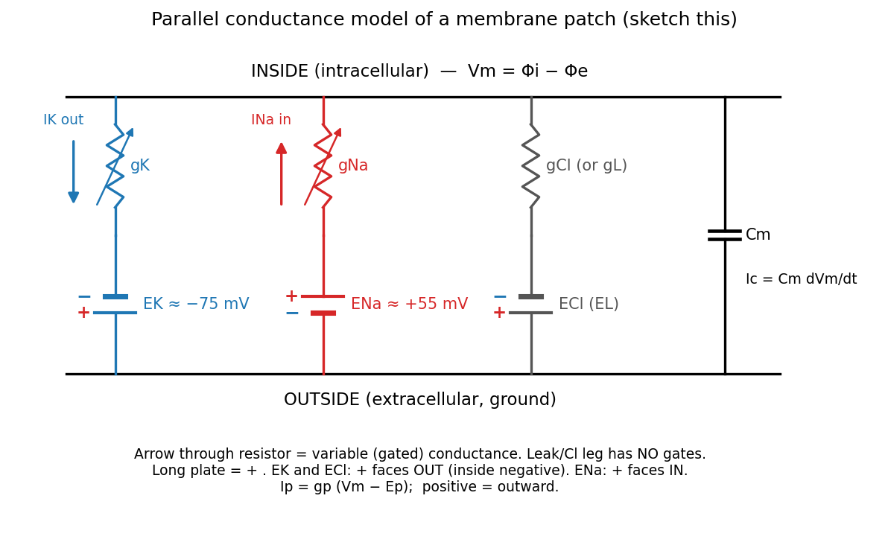
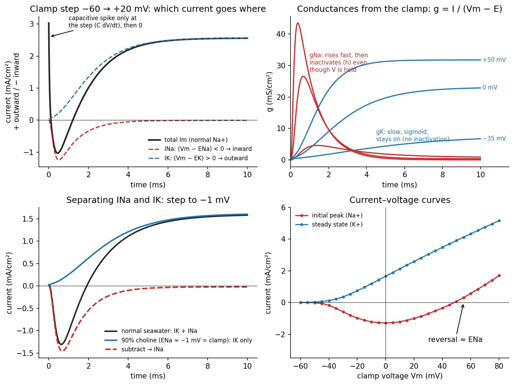
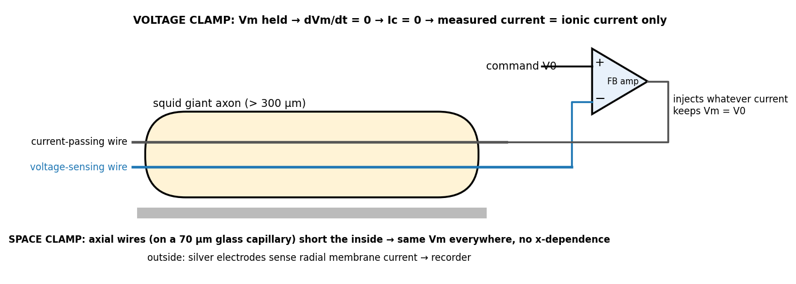

# The Parallel Conductance Model and the Voltage Clamp

The Goldman equation tells us where the membrane potential settles; it does not say how fast it gets there or what happens when it is disturbed. For that we model a small patch of membrane as an electrical circuit. This chapter builds that circuit, uses it to reason about which current flows where, and then follows Hodgkin and Huxley's experiments that measured its time-varying conductances.

## The Membrane as a Circuit

A small patch of membrane has three kinds of element in parallel:

- the lipid bilayer, a **capacitor** \\(C\_m\\);
- for each permeable ion \\(p\\), an ionic pathway modelled as a **conductance** \\(g\_p\\) in series with a **battery** \\(E\_p\\) equal to that ion's Nernst potential.

*Figure: the parallel conductance model. The Na⁺ and K⁺ conductances are drawn as variable resistors (arrows) because they are voltage-gated; the Cl⁻ (or leak) conductance is fixed. Battery polarity: E_K and E_Cl are negative (inside negative), so their positive terminal faces outward; E_Na is positive, so its positive terminal faces inward. At rest i_K flows outward and i_Na flows inward.*

Why a battery in series with a conductance? The ion's flux is zero when \\(V\_m = E\_p\\), and for small departures from \\(E\_p\\) the current is proportional to the departure. Linearizing the GHK current equation about \\(E\_p\\) gives exactly this form, with \\(g\_p\\) the slope (**chord conductance**). The difference \\(V\_m - E\_p\\) is the **driving force** on the ion.

\\[
I\_K = g\_K(V\_m - E\_K), \qquad I\_{Na} = g\_{Na}(V\_m - E\_{Na}), \qquad I\_{Cl} = g\_{Cl}(V\_m - E\_{Cl}), \qquad I\_c = C\_m\frac{dV\_m}{dt}.
\\]
With positive current defined as outward, the sign of the driving force gives the direction: \\(V\_m > E\_p\\) drives the ion's current outward, \\(V\_m < E\_p\\) inward.

When drawing this circuit, three details matter:

1. Every battery is labelled with + and − (the long plate is +). Drawing all batteries the same way round with signed values (\\(E\_K = -80\\) mV, \\(E\_{Na} = +40\\) mV) is equally correct, provided it is labelled.
2. The Na⁺ and K⁺ conductances are **variable** (gated); the third branch, whether called \\(g\_{Cl}\\) or a leak \\(g\_L\\), has no gates and a fixed value.
3. The capacitor conducts only while \\(V\_m\\) is changing.

## The Resting Potential as a Weighted Average

An isolated patch with no applied stimulus has nowhere for current to go except around its own branches, so Kirchhoff's current law gives
\\[
I\_m = I\_c + I\_K + I\_{Na} + I\_{Cl} = 0
\\]
at every instant. In the steady state \\(dV\_m/dt = 0\\), so \\(I\_c = 0\\) and
\\[
g\_{Na}(V\_m - E\_{Na}) + g\_K(V\_m - E\_K) + g\_{Cl}(V\_m - E\_{Cl}) = 0 .
\\]
Solving for \\(V\_m\\):
\\[
\boxed{V\_{rest} = \frac{g\_KE\_K + g\_{Na}E\_{Na} + g\_{Cl}E\_{Cl}}{g\_K + g\_{Na} + g\_{Cl}}}
\\]
The resting potential is a **conductance-weighted average** of the Nernst potentials. This is the linear-circuit counterpart of the Goldman equation, where the weights are permeabilities inside a logarithm. Both say the same thing: the membrane sits closest to the battery of the ion it is most permeable to.

### Worked example: the squid axon

| Ion | \\(g\\) (mS/cm²) | \\(E\\) (mV) | Driving force at \\(V\_m = -68\\) mV | Current at rest |
|---|---|---|---|---|
| K⁺ | 0.367 | −74.7 | +6.7 mV | Outward (efflux) |
| Cl⁻ | 0.582 | −65.8 | −2.2 mV | Small |
| Na⁺ | 0.010 | +54.2 | −122.2 mV | Inward (influx) |

\\[
V\_{rest} = \frac{(0.367)(-74.7) + (0.582)(-65.8) + (0.010)(54.2)}{0.367 + 0.582 + 0.010} = \frac{-27.4 - 38.3 + 0.5}{0.959} \approx -68\ \text{mV}.
\\]
Because \\(g\_{Na}\ll g\_K\\), \\(V\_m\\) sits near \\(E\_K\\). Na⁺ has an enormous driving force but a tiny conductance, so the inward Na⁺ current, \\((0.010)(-122.2) = -1.2\\) µA/cm², is comparable to the outward K⁺ current, \\((0.367)(6.7) = +2.5\\) µA/cm², with the Cl⁻ current \\((0.582)(-2.2) = -1.3\\) µA/cm² making up the balance. The currents cancel because of the differences in conductance, not because the driving forces are small.

### Time constant of a passive patch

With the gates frozen, the patch is an RC circuit with total conductance \\(g\_T = g\_K + g\_{Na} + g\_{Cl}\\). A small current step \\(I\_{st}\\) gives
\\[
C\_m\frac{dV\_m}{dt} = I\_{st} - g\_T(V\_m - V\_{rest})
\quad\Longrightarrow\quad
V\_m(t) = V\_{rest} + \frac{I\_{st}}{g\_T}\left(1 - e^{-t/\tau}\right), \qquad \tau = \frac{C\_m}{g\_T}.
\\]
For the squid values, \\(\tau = (1\ \text{µF/cm}^2)/(0.959\ \text{mS/cm}^2) \approx 1\\) ms. This passive behaviour reappears in the strength–duration curve of [Electrical Stimulation of Excitable Tissue](excitation.md).

## Clamping the Membrane: What Current Flows Where?

Suppose the membrane is held (clamped) at some voltage. Each branch's current is its conductance times its driving force, so the reasoning is always the same three steps:

1. **Direction** from the sign of \\(V\_m - E\_p\\) (positive means outward).
2. **Timing** from the gates: Na⁺ activates fast and then inactivates; K⁺ activates slowly and stays on.
3. **Capacitor** current flows only at the instant the voltage steps.

Take a step from −60 to +20 mV with \\(E\_{Na} = +57\\) mV and \\(E\_K \approx -70\\) mV:
\\[
V\_m - E\_{Na} = 20 - 57 = -37\ \text{mV}\ (\text{inward}), \qquad V\_m - E\_K = 20 - (-70) = +90\ \text{mV}\ (\text{outward}).
\\]

| Clamp condition | Na⁺ branch | K⁺ branch | Capacitor |
|---|---|---|---|
| Step −60 → +20 mV | Inward, early (first 1–2 ms), then inactivates | Outward, delayed and sustained | Brief spike at the step only |
| Clamp at \\(E\_{Na}\\) | Zero (reversal potential) | Outward | Step spike only |
| Clamp above \\(E\_{Na}\\) | Reverses to outward | Outward | Step spike only |
| Clamp at \\(E\_K\\) | Inward if depolarized enough to open the gates | Zero | Step spike only |

*Figure: the recorded current for a depolarizing step is a capacitive spike, then an inward dip (Na⁺), then a rising outward current (K⁺). The I–V plot has two curves: the early peak current, inward between about −60 mV and its reversal near E_Na, and the late steady-state current, outward and rising with voltage.*

## The Hodgkin–Huxley Experiments

Alan Hodgkin and Andrew Huxley (Nobel Prize 1963, shared with John Eccles) set out to measure \\(g\_{Na}(t)\\) and \\(g\_K(t)\\) directly. An action potential is hard to analyse because three things vary at once: voltage varies along the axon, capacitive current flows whenever voltage changes, and two ionic currents overlap. Their achievement was to remove every unknown but one.

### Space clamp: removing x

Two fine silver wires, wound on a 70 µm glass capillary (about 120 µm overall), are threaded down the inside of a squid giant axon (>300 µm). The low-resistance wire shorts the axon interior, so every point along the clamped segment has the same \\(V\_m\\): there is no dependence on \\(x\\). The modern descendant is the patch clamp (Neher and Sakmann, Nobel Prize 1991).

### Voltage clamp: removing the capacitive current

A feedback amplifier compares the measured \\(V\_m\\) with a command voltage \\(V\_0\\) and injects whatever current is needed to hold \\(V\_m = V\_0\\). After the step,
\\[
\frac{dV\_m}{dt} = 0 \quad\Longrightarrow\quad I\_c = C\_m\frac{dV\_m}{dt} = 0 \quad\Longrightarrow\quad I\_m = I\_{ion}.
\\]
The injected current equals the ionic current, and the driving forces are fixed because \\(V\_m\\) is fixed.

*Figure: the axial current-passing and voltage-sensing wires (space clamp) and the feedback amplifier that holds V_m at the command value (voltage clamp).*

The Cl⁻ current is small and nearly constant, so it is lumped into a **leakage** current, leaving only Na⁺ and K⁺ to separate.

### Ion substitution: separating Na⁺ from K⁺

Replace 90% of the external Na⁺ with choline, a large cation that cannot pass the Na⁺ channel. The Na⁺ Nernst potential shifts by
\\[
\Delta E\_{Na} = \frac{RT}{F}\ln\frac{0.1[Na]\_o}{[Na]\_o} = -58\log\_{10}(10) = -58\ \text{mV},
\qquad E'\_{Na} = 57 - 58 = -1\ \text{mV}.
\\]
Clamping at −1 mV in the low-Na⁺ solution gives zero Na⁺ current, so the recorded current is \\(I\_K\\) alone. Subtracting it from the normal-solution record (\\(I\_K + I\_{Na}\\)) leaves \\(I\_{Na}\\). This assumes the two currents are independent, so that changing external Na⁺ does not alter the K⁺ current.

### The general separation

Clamping only at the new \\(E'\_{Na}\\) would give data at a single voltage. To separate the currents at *any* clamp voltage, Hodgkin and Huxley used three assumptions (primes denote the low-Na⁺ solution):

1. \\(I\_K = 0\\) for \\(0 < t < T/3\\), where \\(T\\) is the time of peak inward current. K⁺ activation is delayed, so the very early current is pure Na⁺.
2. \\(I'\_{Na}(t)/I\_{Na}(t) = A\\), a constant. At the same \\(V\_m\\) the gates behave identically, so \\(g\_{Na}(t)\\) is the same in both solutions; only the driving force differs:
\\[
A = \frac{g\_{Na}(t)(V\_m - E'\_{Na})}{g\_{Na}(t)(V\_m - E\_{Na})} = \frac{V\_m - E'\_{Na}}{V\_m - E\_{Na}}.
\\]
Assumption 1 lets \\(A\\) be measured directly as \\(I'\_m/I\_m\\) in the early window.
3. \\(I'\_K(t) = I\_K(t)\\): K⁺ is unaffected by external Na⁺.

Then at any time \\(t\_1\\),
\\[
I\_m = I\_{Na} + I\_K, \qquad I'\_m = A\\,I\_{Na} + I\_K .
\\]
Subtracting eliminates \\(I\_K\\); multiplying the first by \\(A\\) and subtracting eliminates \\(I\_{Na}\\):
\\[
\boxed{I\_{Na}(t\_1) = \frac{I\_m(t\_1) - I'\_m(t\_1)}{1 - A}, \qquad I\_K(t\_1) = \frac{A\\,I\_m(t\_1) - I'\_m(t\_1)}{A - 1}}
\\]

### From currents to conductances

Because \\(V\_m\\) is clamped, each driving force is a known constant, so each conductance is simply proportional to its current:
\\[
g\_K(t) = \frac{I\_K(t)}{V\_m - E\_K}, \qquad g\_{Na}(t) = \frac{I\_{Na}(t)}{V\_m - E\_{Na}}.
\\]

### Pharmacological separation

Today the same separation is done with blockers. **Tetrodotoxin (TTX)**, the pufferfish neurotoxin (about 1 mg is fatal to a human, roughly 10,000 times more lethal than cyanide), blocks Na⁺ channels. **Tetraethylammonium (TEA)** blocks K⁺ channels. Both confirm the independence assumption, with small deviations at high ion concentrations.

### What the conductances do

- **\\(g\_{Na}\\)** rises rapidly and then falls back to nearly zero within about 4 ms *even though the voltage is held*. This decline is **inactivation**. Larger depolarizing steps (−35, 0, +50 mV) give larger and faster peaks.
- **\\(g\_K\\)** rises slowly along a sigmoid (delayed) curve and stays elevated for as long as the clamp is held. It does not inactivate. Larger steps give higher plateaus.

What remained after the clamps and the ion substitution was conductance versus time at each voltage. Hodgkin and Huxley fitted those curves with the gating variables \\(m\\), \\(h\\) and \\(n\\), which is the subject of the [next chapter](hodgkin-huxley.md).

## See Also

- [Ions, Diffusion, and Membrane Potentials](ions-membranes.md): where the batteries come from.
- Circuit Laws: Kirchhoff's laws and RC circuits.
- [Hodgkin–Huxley Kinetics and Excitation](hodgkin-huxley.md): the gating model fitted to these data.
