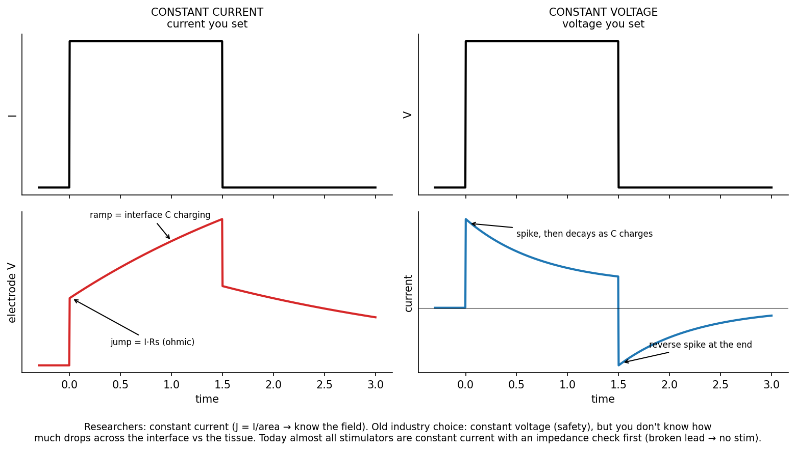
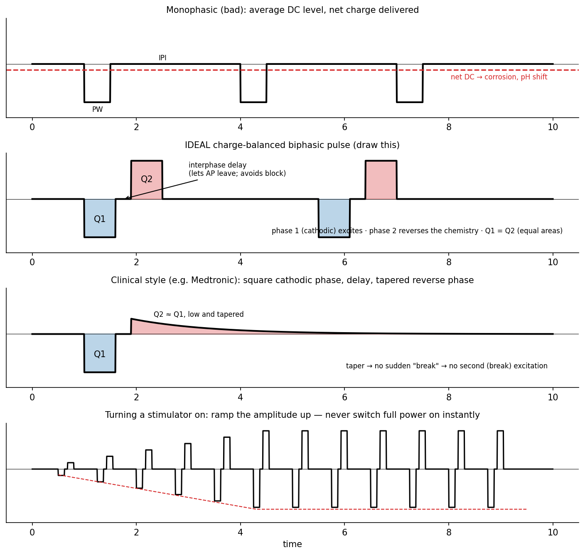
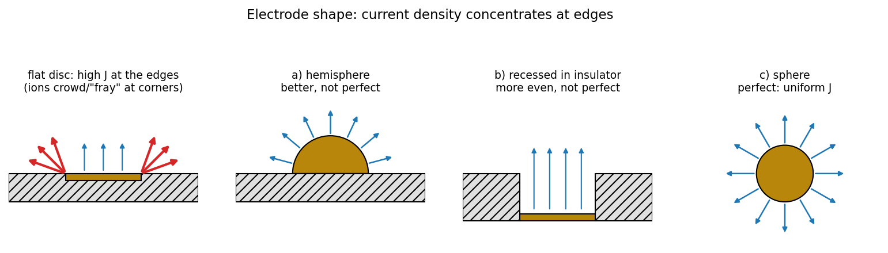

# Safe Stimulation and Waveform Design

Exciting a nerve takes very little energy; doing it millions of times without damaging the electrode or the tissue takes care. The rules follow from the interface electrochemistry of the [previous chapter](electrode-interface.md): keep the charge per phase below the limits of the metal and the tissue, and deliver it in charge-balanced pulses so no net direct current reaches the body.

## Charge, Charge Density, and Their Limits

For a rectangular pulse of amplitude \\(I\\) and width \\(PW\\), the charge per phase and the charge density on an electrode of area \\(A\\) are
\\[
Q = I\cdot PW, \qquad q = \frac{Q}{A}.
\\]
For example, 1 mA for 100 µs delivers 100 nC; on a 1 mm² (0.01 cm²) contact that is 10 µC/cm², i.e. 0.01 mC/cm².

| Limit | Charge density per phase |
|---|---|
| Platinum (onset of gas formation) | 0.1–0.4 mC/cm² |
| Iridium oxide | 1–3 mC/cm² |
| Titanium oxide | 0.6–0.9 mC/cm² |
| Neural damage, small electrodes | up to 1 mC/cm² |
| Neural damage, large electrodes | up to 0.1 mC/cm² |

Two different kinds of limit appear in the table.

- **Electrochemical limits** for the metal come from the electrode potential at which gas evolution and the irreversible reactions of the previous chapter begin. Below them, charge is carried by the double-layer capacitance and reversible surface reactions.
- **Tissue damage limits** depend on electrode size: small electrodes tolerate a higher charge density than large ones. This suggests that a minimum total charge, and not only a density, is needed to injure neural tissue. The widely used **Shannon criterion** formalizes the trade-off as
\\[
\log\_{10}\frac{Q}{A} = k - \log\_{10}Q,
\\]
with \\(Q\\) in µC per phase, \\(Q/A\\) in µC/cm² per phase, and damage observed for \\(k\\) above about 1.5–2.
- The damage levels are the same whether the electrode passes charge faradaically (redox reactions plus capacitive coupling) or purely capacitively, so the damage is not caused only by electrode reaction products.

Less charge for the same effect is always better. Early cochlear implants converted a 200 Hz sound into 200 Hz sinusoidal stimulation (a 5 ms period); modern devices use 0.1 ms pulses at 200 Hz, which deliver far less charge and produce the same percept.

## Constant-Current and Constant-Voltage Stimulators

Model the electrode and tissue as a resistance \\(R\\) (tissue and solution) in series with the interface capacitance \\(C\\).

*Figure: left, a constant-current pulse: the electrode voltage jumps by the Ohmic drop and then ramps as the interface capacitance charges. Right, a constant-voltage pulse: the current spikes and then decays as the capacitance charges, with a reverse spike at the end.*

**Constant current.** With \\(I\\) fixed, the voltage across the pair is the Ohmic step plus the capacitor's linear charging:
\\[
V(t) = IR + \frac{I}{C}t, \qquad 0 < t < PW .
\\]
At the end of the pulse the voltage drops by \\(V\_0 = IR\\) and the capacitor discharges slowly through whatever leak paths exist.

**Constant voltage.** With \\(V\\) fixed, the current is that of an RC circuit charging:
\\[
i(t) = \frac{V}{R}e^{-t/RC}.
\\]
The current spikes at turn-on and decays; at turn-off the charged capacitor drives a reverse spike that decays back to zero.

| | Constant current | Constant voltage |
|---|---|---|
| Traditionally preferred by | Researchers | Industry |
| Why | \\(J = I/A\\) is known, so the stimulus maps directly to field strength and activation; all the current passes through the subject | Safety: the voltage cannot run away |
| Risk | If an electrode or lead partially breaks, the same \\(I\\) flows through a smaller area, \\(J\\) rises, and tissue can be burned | The actual current is unknown and changes with impedance; you do not know how much of the voltage drops across each interface and how much across the tissue |

Almost every modern stimulator is constant current. The safety problem is solved by **measuring the electrode impedance before stimulating**: if a lead is failing, the impedance check fails and the stimulator refuses to stimulate.

## Charge-Balanced Biphasic Pulses

A **monophasic** pulse train (amplitude \\(I\\), width \\(PW\\), charge \\(Q\_p\\), inter-pulse interval \\(IPI\\)) has a non-zero average, a DC component:
\\[
\bar I = \frac{Q\_p}{PW + IPI}.
\\]
Net charge delivered in one direction is eventually carried by irreversible reactions, once the reversible charge carriers at the interface are used up: corrosion, pH change and gas.

*Figure: a monophasic train (with its DC average), the ideal charge-balanced biphasic pulse, a clinical waveform with an interphase delay and a tapered reverse phase, and the ramped onset of a pulse train.*

The **charge-balanced biphasic pulse** follows the excitatory phase with an opposite phase of equal charge:
\\[
Q\_1 = \int\_{\text{phase 1}}I\\,dt = Q\_2, \qquad Q\_{net} = Q\_1 - Q\_2 = 0 .
\\]

- The **first phase** (usually cathodic) excites the tissue.
- The **second phase** drives the electrochemical reactions in reverse, recovering the charge.
- A short **interphase delay** prevents the second phase from cancelling the excitation before the action potential has been launched.

Charge balance is necessary but not sufficient. Forward and reverse reactions proceed at different rates, so an exactly balanced pulse may fail to reverse all of the reversible reactions, or may itself push the electrode into an irreversible reaction on the return phase. One alternative in the notes recovers about 98% of the charge (\\(Q\_2 = 0.98Q\_1\\)) with a decaying exponential second phase rather than a square one.

### Why clinical waveforms look the way they do

1. **Cathodic first phase**: it starts the action potential, exactly as a cathode does.
2. **A short delay**: let the action potential leave the region under the electrode. Reversing immediately could block it.
3. **Reverse phase**: undo the redox reactions (water splitting and the rest) so harmful products do not accumulate.
4. **Taper the reverse phase** instead of ending it abruptly. A sharp end is itself a stimulus (a break) and can excite a second, unwanted action potential. The aim is one stimulation, not two.
5. **Ramp the amplitude up** at the start of a train. Never switch on at full strength: the patient will be jolted.

A cautionary case from the notes: a company stimulating through skin gel did not reverse the current. The reaction products stayed in the gel, which seemed safe since the gel is wiped off, but enough acid accumulated to burn patients' skin. Adding a reverse phase solved the problem.

## Electrode Shape and Edge Effects

Current does not leave a flat electrode uniformly. For a disc of radius \\(a\\) flush with an insulating surface, the potential in the conducting half-space satisfies Laplace's equation with the disc at constant potential. The solution (the primary current distribution) is
\\[
J(r) = \frac{I}{2\pi a\sqrt{a^2 - r^2}}, \qquad 0 \le r < a .
\\]
At the centre \\(J = I/(2\pi a^2)\\), half the average \\(I/(\pi a^2)\\); at the edge (\\(r\to a\\)) the density diverges. In practice the edges and corners of an electrode carry far more current than its centre, so they reach the electrochemical and damage limits first.

*Figure: current density on a flat disc peaks at the edges. A hemisphere is better but not perfect; recessing the disc into the insulator helps but is not perfect; a sphere in an infinite medium gives perfectly uniform density.*

Remedies, in increasing order of uniformity:

- a hemispherical electrode (better, not perfect);
- a disc recessed into the insulator (better, not perfect);
- a sphere (perfectly uniform, \\(J = I/(4\pi a^2)\\), by symmetry).

Charge-density limits must therefore be applied to the *peak* density at the edge, not just the average \\(Q/A\\).

## See Also

- [The Electrode–Electrolyte Interface](electrode-interface.md): the reactions these rules guard against.
- [Neural Interfaces and Electrodes](../neural-control-of-movement/electrodes.md): safe charge injection for implanted electrodes.
- [Electrical Stimulation of Neural Tissue](../neural-control-of-movement/stimulation-theory.md): waveforms in clinical neuromodulation.
