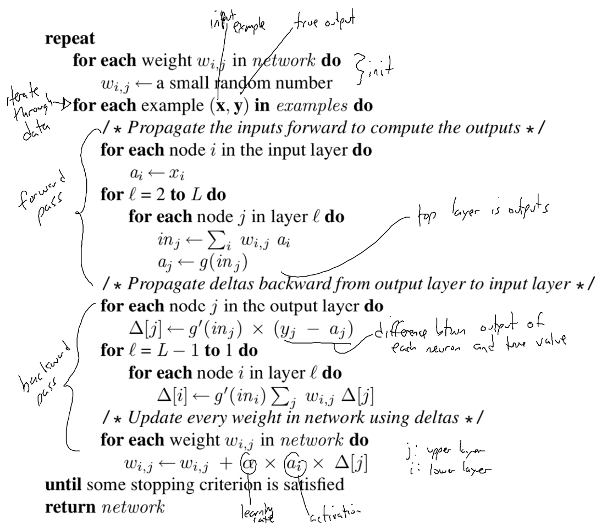
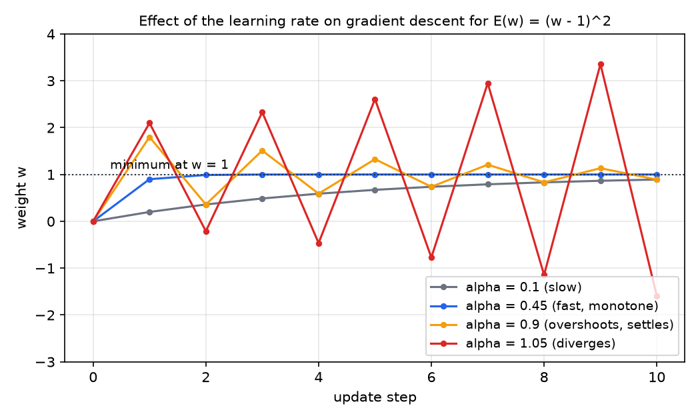
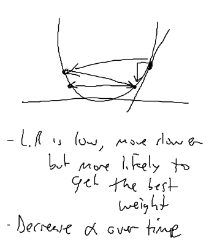
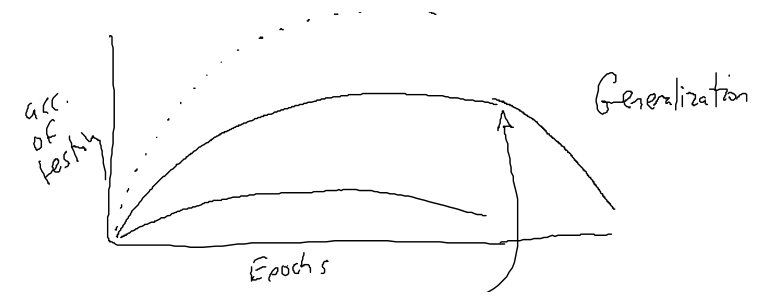
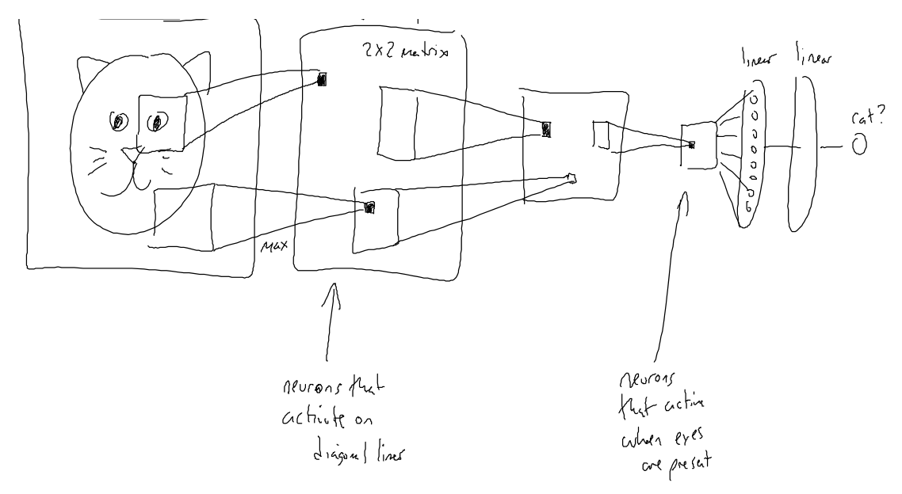
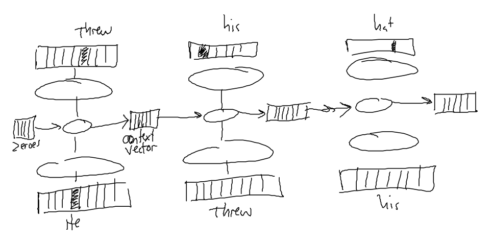

# Backpropagation and Network Architectures

Training a network with hidden layers means choosing the weights that make its outputs match the targets. Backpropagation computes the gradient of the error with respect to every weight by applying the chain rule backward through the layers. The intermediate values from the forward pass are reused, so one pass over an example gives all the gradients at a small constant multiple of the cost of the forward pass. This chapter derives the algorithm and gives a corrected form of its pseudocode. It then covers the learning rate, epochs and the split between training and test data, and shows the same training method at work in three architectures: classifiers with softmax outputs, convolutional networks for images, and recurrent networks for sequences. A hand-computed backpropagation on a specific network is in [Worked Neural-Network Exercises](neural-network-exercises.md).

## Gradient Descent on the Error

Take the network of the previous chapter. Each weight \\(w\_{ij}\\) joins a lower node \\(i\\) to an upper node \\(j\\). Each node \\(j\\) computes

\\[
\text{in}\_j = \sum\_i w\_{ij}\\, a\_i, \qquad a\_j = g(\text{in}\_j),
\\]

where the sum includes the bias node with \\(a\_0 = -1\\). The error for one training example \\((\mathbf x, \mathbf y)\\) is the squared error summed over the output units \\(k\\),

\\[
E = \tfrac{1}{2} \sum\_k \bigl(y\_k - a\_k\bigr)^2.
\\]

Gradient descent with learning rate \\(\alpha\\) changes each weight by \\(w\_{ij} \leftarrow w\_{ij} - \alpha\\, \partial E / \partial w\_{ij}\\). Over a full training set the error is a sum over examples, so the total gradient is the sum of the per-example gradients. Updating after each example, as the algorithm below does, approximates the total gradient and is often faster in practice.

This chapter uses the logistic sigmoid \\(g(x) = \sigma(x) = 1/(1+e^{-x})\\), so that \\(g'(x) = g(x)\bigl(1-g(x)\bigr)\\). The source's pseudocode uses a symbol \\(g\\) and its derivative \\(g'\\) without defining them. Any differentiable \\(g\\) works in the same derivation, with its own \\(g'\\) in place of the sigmoid form.

## The Output-Layer Gradient

Consider a weight \\(w\_{jk}\\) into an output unit \\(k\\). The error depends on this weight only through \\(\text{in}\_k\\), so the chain rule has three factors:

\\[
\frac{\partial E}{\partial w\_{jk}} = \frac{\partial E}{\partial a\_k} \cdot \frac{\partial a\_k}{\partial \text{in}\_k} \cdot \frac{\partial \text{in}\_k}{\partial w\_{jk}}.
\\]

The three factors are simple. The first is \\(\partial E / \partial a\_k = -(y\_k - a\_k)\\), from differentiating \\(\tfrac12 (y\_k - a\_k)^2\\). The second is \\(g'(\text{in}\_k)\\). The third is \\(a\_j\\), since \\(\text{in}\_k = \sum\_j w\_{jk} a\_j\\). Multiplying them gives

\\[
\frac{\partial E}{\partial w\_{jk}} = -\Delta\_k\\, a\_j, \qquad \Delta\_k = g'(\text{in}\_k)\bigl(y\_k - a\_k\bigr).
\\]

The quantity \\(\Delta\_k\\) is the **delta** of output unit \\(k\\). Gradient descent then gives the output-layer update

\\[
w\_{jk} \leftarrow w\_{jk} + \alpha\\, a\_j\\, \Delta\_k.
\\]

For the sigmoid, \\(\Delta\_k = a\_k(1-a\_k)(y\_k - a\_k)\\). Every quantity in it was already computed by the forward pass, so the output-layer gradient costs one multiplication per weight once the forward values are stored.

## Propagating Deltas to Hidden Layers

A hidden unit \\(j\\) affects the error through every unit \\(k\\) that it feeds. The chain rule therefore sums over those successors. For a weight \\(w\_{ij}\\) into the hidden unit \\(j\\),

\\[
\frac{\partial E}{\partial a\_j} = \sum\_k \frac{\partial E}{\partial \text{in}\_k} \cdot \frac{\partial \text{in}\_k}{\partial a\_j} = \sum\_k \bigl(-\Delta\_k\bigr)\\, w\_{jk}.
\\]

The hidden unit's own input passes through \\(g\\), so \\(\partial E / \partial \text{in}\_j = g'(\text{in}\_j)\\, \partial E / \partial a\_j\\). Since \\(\partial \text{in}\_j / \partial w\_{ij} = a\_i\\), the gradient of the weight is

\\[
\frac{\partial E}{\partial w\_{ij}} = -\Delta\_j\\, a\_i, \qquad \Delta\_j = g'(\text{in}\_j) \sum\_k w\_{jk}\\, \Delta\_k.
\\]

This is the backward recursion. The delta of a hidden unit is its activation slope times the weighted sum of the deltas above it, so a hidden unit is blamed for the output errors in proportion to how strongly it feeds them. Starting from the output layer, the deltas are computed one layer at a time down to the input layer. The weight update for every layer then has the same form, \\(w\_{ij} \leftarrow w\_{ij} + \alpha\\, a\_i\\, \Delta\_j\\).

The efficiency comes from reusing \\(\Delta\_k\\). Computing each weight's derivative separately would repeat the sums over successors many times. The backward pass computes each delta once and uses it for all the weights into that unit.

### Worked example: one sigmoid unit

The example below is a single output unit. It is not the network from the exercises, and its numbers are chosen for this illustration. The inputs are \\(x\_1 = 1.0\\) and \\(x\_2 = 0.5\\). The bias weight is \\(w\_0 = 0.1\\), so the bias term is \\(a\_0 w\_0 = -0.1\\), and the input weights are \\(w\_1 = 0.5\\) and \\(w\_2 = -0.4\\). The target is \\(y = 1\\) and the learning rate is \\(\alpha = 0.5\\).

*Forward pass.* The net input is \\(\text{in} = -0.1 + 0.5(1.0) - 0.4(0.5) = 0.2\\), so \\(a = \sigma(0.2) = 0.54983\\). The error is \\(E = \tfrac12 (1 - 0.54983)^2 = 0.10132\\).

*Backward pass.* The delta is \\(\Delta = a(1-a)(y-a) = 0.54983 \cdot 0.45017 \cdot 0.45017 = 0.11142\\).

*Update.* Each weight changes by \\(\alpha\\, a\_i\\, \Delta\\), where \\(a\_0 = -1\\), \\(a\_1 = 1.0\\) and \\(a\_2 = 0.5\\):

\\[
w\_0 = 0.1 + 0.5(-1)(0.11142) = 0.04429, \qquad w\_1 = 0.5 + 0.5(1.0)(0.11142) = 0.55571, \qquad w\_2 = -0.4 + 0.5(0.5)(0.11142) = -0.37214.
\\]

*Check.* With the new weights the net input is \\(-0.04429 + 0.55571 - 0.18607 = 0.32535\\), so \\(a = 0.58063\\) and \\(E = \tfrac12 (1 - 0.58063)^2 = 0.08794\\). The error fell from 0.10132 to 0.08794 in one step. As a further check, a finite-difference estimate of \\(\partial E / \partial w\_1\\) at the original weights gives \\(-0.11142\\), which equals \\(-\Delta\\, a\_1 = -0.11142\\).

## The Algorithm

The printed version of the algorithm is reproduced first, as drawn in the source material. The corrected form follows it, and its differences are explained after the listing.



*Figure: the backpropagation pseudocode as printed in the source material, with handwritten braces marking the forward pass, the backward pass and the update. The outer loop and the initialization are as printed. The corrected listing below moves the initialization outside the loop and defines the activation.*

```
initialize every weight w_ij to a small random number     (once, before the loop)
repeat until the stopping criterion is satisfied:
    for each example (x, y) in the training set:
        a_i <- x_i for every input node i, with a_0 = -1
        forward pass: for l = 2 to L, for each node j in layer l:
            in_j <- sum over i of w_ij a_i
            a_j <- g(in_j)
        backward pass: for each output node j:
            Delta_j <- g'(in_j) (y_j - a_j)
        for l = L-1 down to 1, for each node i in layer l:
            Delta_i <- g'(in_i) sum over j of w_ij Delta_j
        update: for every weight w_ij:
            w_ij <- w_ij + alpha a_i Delta_j
return the network
```

Three changes were made from the printed version. The first is the placement of the initialization. In the printed version the random initialization sits inside the outer loop, so the weights would be reset on every pass and the learning would be discarded. The weights must be initialized once, before the loop.

The second is the definition of \\(g\\). The sigmoid, with \\(g' = g(1-g)\\), is the choice used in this chapter, and the listing assumes it.

The third is the bias. The sum over \\(i\\) includes the bias node \\(a\_0 = -1\\), so the bias weight \\(w\_{0j}\\) is updated by \\(\alpha(-1)\Delta\_j\\). This is the same gradient as for any other weight, because the bias is the weight on a fixed input.

The random initialization must be small and random, not zero and not equal across weights. If all the weights into a layer start equal, every unit in that layer computes the same function and receives the same gradient, so the units never become different. Random starting values break this symmetry.

## Learning Rate, Epochs and Generalization

The learning rate \\(\alpha\\) is usually taken in \\(0 \le \alpha \le 1\\). A larger rate moves the weights faster down the error surface, but it can overshoot the minimum. A smaller rate is slower and more likely to settle in a good minimum. The practical advice in the source is to decrease \\(\alpha\\) over training, which gives large steps early and fine steps late.

The effect is easiest to see on a one-dimensional quadratic. Let \\(E(w) = (w-1)^2\\), so \\(\partial E / \partial w = 2(w-1)\\), and start at \\(w\_0 = 0\\). The gradient step gives \\(w\_{t+1} - 1 = (1-2\alpha)(w\_t - 1)\\). Each step multiplies the distance to the minimum by \\(1-2\alpha\\), so \\(w\_t = 1 - (1-2\alpha)^t\\). The iteration converges exactly when \\(\lvert 1-2\alpha \rvert < 1\\), that is, when \\(0 < \alpha < 1\\). The table gives the first three weights for four learning rates.

| Learning rate \\(\alpha\\) | \\(w\_1\\) | \\(w\_2\\) | \\(w\_3\\) | Behavior |
|---|---|---|---|---|
| 0.1 | 0.200 | 0.360 | 0.488 | slow, monotone |
| 0.45 | 0.900 | 0.990 | 0.999 | fast, monotone |
| 0.9 | 1.800 | 0.360 | 1.512 | overshoots, then settles |
| 1.05 | 2.100 | \\(-0.210\\) | 2.331 | diverges |



*Figure: gradient descent on \\(E(w) = (w-1)^2\\) from \\(w = 0\\), for four learning rates. Each marker is one update. The gray curve is slow and monotone. The blue curve is fast, reaching the minimum at \\(w = 1\\) within a few steps without overshoot. The orange curve overshoots and oscillates, but its oscillations shrink. The red curve oscillates with growing amplitude and diverges.*

The source's sketch shows the same idea on a U-shaped error curve. With a low learning rate the steps down the curve are small, and the weight is more likely to reach the best value, but it takes many steps.



*Figure: a sketch of weight updates on a U-shaped error curve with a low learning rate. Each arrow is one update. The steps are small and move the weight down the curve. The captions state the trade-off: a low rate is slow but more likely to reach the best weight, and the rate should decrease over time.*

### Epochs and the error curve

One pass through all the training examples is an **epoch**. Training runs for many epochs, often hundreds, and each epoch moves each weight a little closer to a better setting. Plotting the network error against the epoch gives a decreasing curve. A falling curve shows the network is learning, but it does not show that the network will generalize.

### Training and testing data

Generalization is measured on examples the network has not trained on. The data are split into a training set and a test set, commonly 80/20 or 90/10. The algorithm never sees the test set during training, and the test accuracy is computed periodically during training as well.

Two curves illustrate the usual pattern. Training accuracy rises with the number of epochs and flattens near a plateau. Test accuracy rises at first, reaches a peak at the point of best generalization, and then falls. The fall is overfitting. As training continues, the network memorizes patterns in the training data that do not appear in the test data, and its accuracy on new examples drops even though its accuracy on the training data keeps rising.



*Figure: test accuracy against the number of epochs, as sketched in the source material. The upper curve rises to a peak labeled as the point of generalization, then falls, which is overfitting. The arrow marks the peak. The dotted curve above the others is unlabeled in the source; it lies above the test curves and is consistent with training accuracy, but the sketch does not say so. The lower curve is also unlabeled.*

The same measurement guides the choice of network size. Too few hidden units give low accuracy, because the network cannot represent a function complex enough for the task. Too many give low accuracy for a different reason: training becomes slow, and the extra capacity makes overfitting more likely. The test accuracy should be checked after each change to the number of layers or units.

The source also notes that per-example updates can push one weight up for one example and down for the next. It calls the result catastrophic forgetting. That term usually names the loss of earlier tasks when a network learns new ones, so this chapter calls the effect interference. It is the same thrashing that the perceptron section described, and a small learning rate with repeated epochs controls it.

## Classification Networks and Softmax

For a problem with several classes, the output layer has one unit per class, and the outputs are turned into a probability distribution by the **softmax**. If \\(z\_c\\) is the score of class \\(c\\), then

\\[
p\_c = \frac{e^{z\_c}}{\sum\_{c'} e^{z\_{c'}}},
\\]

and the \\(p\_c\\) are positive and sum to 1. The scores \\(z\_c\\) are called logits. With a one-hot target vector \\(\mathbf y\\), the cross-entropy loss is \\(L = -\sum\_c y\_c \log p\_c\\). Its gradient with respect to the logits has a simple form, which is the reason the two are always used together. Write \\(\partial p\_k / \partial z\_c = p\_k(\delta\_{kc} - p\_c)\\), where \\(\delta\_{kc}\\) is 1 when \\(k = c\\) and 0 otherwise. This holds because \\(\partial p\_k / \partial z\_c = \delta\_{kc} p\_k - p\_k p\_c\\). Then

\\[
\frac{\partial L}{\partial z\_c} = -\sum\_k \frac{y\_k}{p\_k} \cdot p\_k(\delta\_{kc} - p\_c) = -y\_c + p\_c \sum\_k y\_k = p\_c - y\_c,
\\]

because the target sums to one. The gradient at the output is the predicted probabilities minus the target, and backpropagation carries it down through the layers as before.

The classifier in the source has ten input features, a hidden layer of \\(K\\) units, a second hidden layer of \\(K/2\\) units, three outputs and a softmax. The source asks why the width halves at the second layer and does not answer. This chapter does not answer either. A narrowing layer is one design among several, and the width is a choice to be tested on held-out data.

The source gives PyTorch pseudocode for this network. Its printed form has four faults, and the corrected version below fixes them.

```python
import torch
import torch.nn as nn

class MyNet(nn.Module):
    def __init__(self, input_size, hidden_size, output_size):
        super().__init__()
        self.linear1 = nn.Linear(input_size, hidden_size)
        self.linear2 = nn.Linear(hidden_size, hidden_size // 2)
        self.linear3 = nn.Linear(hidden_size // 2, output_size)

    def forward(self, x):
        h1 = torch.sigmoid(self.linear1(x))
        h2 = torch.sigmoid(self.linear2(h1))
        return self.linear3(h2)  # raw scores (logits); softmax is applied inside the loss

def train(batches, max_epochs, lr=0.01):
    net = MyNet(10, 10, 3)
    optimizer = torch.optim.SGD(net.parameters(), lr=lr)
    criterion = nn.CrossEntropyLoss()
    for epoch in range(max_epochs):
        for x, y in batches:          # x: (N, 10) floats; y: (N,) integer class indices
            optimizer.zero_grad()     # clear the gradients left from the previous step
            out = net(x)
            loss = criterion(out, y)
            loss.backward()
            optimizer.step()
```

The first fault is the width. In Python 3, \\(\texttt{hidden\_size/2}\\) is a float, and a layer size must be an integer, so the corrected code uses integer division.

The second is the double softmax. The printed model applies a sigmoid to the output scores and then a softmax, and the loss applies a softmax again internally. The cross-entropy loss already computes the log-softmax, so the model should return raw scores. The sigmoid on the output also limits the damage in a way that is easy to miss. Its outputs lie in \\((0,1)\\), and a softmax over three numbers in that interval cannot give any class a probability above \\(e/(e+2) \approx 0.58\\). A network with that output layer could never be confident.

The third is the missing \\(\texttt{zero\_grad}\\). Gradients accumulate across calls to \\(\texttt{backward}\\), so without clearing them each step adds the new gradient to the old ones.

The fourth is the optimizer and the activation names. \\(\texttt{nn.SGD}\\) needs a learning rate, the activation is \\(\texttt{torch.sigmoid}\\), and \\(\texttt{nn.Softmax}\\) is a module that is not called in that way. The corrected code avoids the naming error by returning raw scores.

## Image Classification and Convolutional Layers

The source introduces image classification with a single-output task: is this image a blueberry muffin or a chihuahua? An image of \\(512 \times 512\\) pixels has \\(262{,}144\\) inputs. A fully connected first layer with \\(H\\) units then has \\(262{,}144\\, H\\) weights. With \\(H = 1{,}000\\), that is 262,144,000 weights in the first layer alone. Each weight would be learned separately, and nothing in the design reflects the fact that a feature such as an edge can appear anywhere in the image.

A **convolutional** layer fixes both problems. Each unit looks at a small patch of the input, its receptive field, and the same set of weights, the filter, is applied at every position. The number of weights depends on the size of the filter, not on the size of the image. To make the operation concrete, take the \\(4 \times 4\\) binary image below and the \\(2 \times 2\\) anti-diagonal filter \\(K\\). The response at position \\((i,j)\\) is \\(y\_{ij} = \sum\_{u,v} K\_{uv}\\, X\_{i+u,\\,j+v}\\), summed over the filter's \\(2 \times 2\\) window. The sum is over positions where the window fits, which gives a \\(3 \times 3\\) response.

| Image \\(X\\) | | | |
|---|---|---|---|
| 0 | 0 | 1 | 1 |
| 0 | 1 | 1 | 0 |
| 1 | 1 | 0 | 0 |
| 1 | 0 | 0 | 0 |

The filter is \\(K = \begin{bmatrix} 0 & 1 \\\\ 1 & 0 \end{bmatrix}\\). For this filter \\(y\_{ij} = X\_{i,j+1} + X\_{i+1,j}\\), and the response is

| Response \\(y\\) | | |
|---|---|---|
| 0 | 2 | 2 |
| 2 | 2 | 0 |
| 2 | 0 | 0 |

Take the entry at row 0, column 1 as a check. It is \\(X\_{0,2} + X\_{1,1} = 1 + 1 = 2\\). The filter responds strongly where the image has a line running from lower left to upper right, which is the anti-diagonal the filter encodes. A pooling layer then summarizes each window of the response. Max pooling over a \\(2 \times 2\\) window keeps the largest value. The top-left window \\(\bigl(\begin{smallmatrix} 0 & 2 \\\\ 2 & 2 \end{smallmatrix}\bigr)\\) pools to 2, and pooling makes the representation less sensitive to small shifts of the pattern.

The weights of a convolution are shared across positions, so the gradient of the error with respect to a filter weight is the sum of its contributions at every position where it was used. For the weight \\(K\_{uv}\\), which enters every response \\(y\_{ij}\\) with the pixel \\(X\_{i+u,j+v}\\),

\\[
\frac{\partial E}{\partial K\_{uv}} = \sum\_{i,j} \frac{\partial E}{\partial y\_{ij}}\\, X\_{i+u,\\,j+v}.
\\]

This is backpropagation applied to a graph in which one weight appears many times, and it is the rule used to train every convolutional network.



*Figure: a convolutional network as sketched in the source material. Local windows over the input image feed feature maps. The first map responds to diagonal lines, and the annotation marks those units. Max pooling keeps the strongest response in each region. Later units respond to larger parts, such as eyes. Two fully connected layers then produce a single output, labeled as the question "cat?".*

Deep reinforcement learning uses the same convolutional stack, with the game screen as input and one output per action, as the earlier chapter on Q-learning described. The depth of the convolutional network is covered in [Convolutional Networks and Visualization](../cs7643-deep-learning/convolutional-networks.md).

## Sequences: One-Hot Words and Recurrence

Language is a sequence, and the first step in applying a network is to represent words as numbers. A common choice is the one-hot vector. With a vocabulary of 70,000 words, each word is a vector of length 70,000 with a single 1 at its own position. Such vectors are sparse and carry no notion of meaning, but they are unambiguous, and learned representations can be built on them.

A first attempt at translation uses a feedforward network with one slot per word. A four-word input such as "I love my cat" fills four fixed input slots, and the output has four slots for the four words of the translation. The design fails for three reasons. Sentences have different lengths, so a fixed number of slots cannot match every sentence. Each slot has its own weights, so the network must learn the same word's behavior separately for every position. And nothing carries information from earlier words to later ones. The source sketch crosses out this design, and the next design replaces it.

A **recurrent** network applies the same unit at every step and passes a hidden state from one step to the next. With \\(\mathbf x\_t\\) the input at step \\(t\\), \\(h\_t\\) the hidden state and \\(y\_t\\) the output,

\\[
h\_t = g\bigl(W\_{xh}\\, \mathbf x\_t + W\_{hh}\\, h\_{t-1} + \mathbf b\_h\bigr), \qquad y\_t = \operatorname{softmax}\bigl(W\_{hy}\\, h\_t + \mathbf b\_y\bigr),
\\]

with \\(h\_0 = \mathbf 0\\). The hidden state is the context that carries information forward, and the same weights are used at every step. The network therefore handles sequences of any length, and its number of parameters does not grow with the sequence.

The source illustrates this with the prompt "He threw his ___". The network reads one word at a time, and at each step its output is a distribution over the next word.



*Figure: the recurrent network unrolled over three steps, as sketched in the source material. At each step the input word enters at the bottom, the hidden state is carried to the right, and the output word appears at the top. The steps read "He", "threw" and "his" and predict "threw", "his" and "hat". The same units are drawn three times because they share their weights.*

### Training through time

A recurrent network is trained by unrolling it into a feedforward graph with one copy of the cell per time step, and applying backpropagation to the unrolled graph. The method is called backpropagation through time. The weights are shared across steps, so the gradient for each shared weight is the sum of its contributions at every step, in the same way as for convolutional filters:

\\[
\frac{\partial E}{\partial W\_{hh}} = \sum\_t \frac{\partial E}{\partial W\_{hh}}\bigg\|\_{t}.
\\]

The unrolled graph also has a weakness. The error at a late step reaches an early hidden state through a product of Jacobians, one per step. Each factor contains the recurrent weights and the derivative of the activation. The sigmoid's derivative is at most \\(\tfrac14\\), so with small recurrent weights the contributions from distant steps shrink geometrically. This is the vanishing-gradient problem. The chapter on recurrent networks treats it, and the gated cells that were designed to address it, in detail.

## Summary

- Backpropagation computes all weight gradients by applying the chain rule backward. The output delta is \\(\Delta\_k = g'(\text{in}\_k)(y\_k - a\_k)\\), the hidden delta is \\(\Delta\_j = g'(\text{in}\_j) \sum\_k w\_{jk} \Delta\_k\\), and every weight moves by \\(w\_{ij} \leftarrow w\_{ij} + \alpha\\, a\_i \Delta\_j\\).
- The weights are initialized once, to small random values, before the training loop. The sigmoid is the activation used here, with \\(g' = g(1-g)\\).
- A single sigmoid unit with the numbers in the worked example reduces its error from 0.10132 to 0.08794 in one step with \\(\alpha = 0.5\\).
- On the quadratic \\(E(w) = (w-1)^2\\), the error is multiplied by \\(1-2\alpha\\) each step, so the iteration converges exactly when \\(0 < \alpha < 1\\).
- Training error falls with epochs, but generalization is measured on held-out data. Test accuracy peaks and then falls when the network overfits.
- With a one-hot target, the cross-entropy gradient at the logits is \\(p\_c - y\_c\\). The classifier should return raw scores, and the softmax belongs in the loss.
- In convolutional layers, a filter's weights are shared across positions, so its gradient is a sum over positions. A \\(512 \times 512\\) image needs 262,144 inputs per fully connected unit, which is why convolution is used.
- In recurrent networks, the same weights act at every step, and training unrolls the network through time. Products of activation derivatives make gradients from distant steps shrink.

## References

- Russell, S. and Norvig, P., *Artificial Intelligence: A Modern Approach*. The layout of the backpropagation pseudocode in this chapter resembles the learning algorithm in this textbook.

## See Also

- [Neurons, Perceptrons, and Feedforward Networks](neural-network-basics.md): the unit, the activations and the forward pass that this chapter differentiates.
- [Worked Neural-Network Exercises](neural-network-exercises.md): the hand computation of a full backpropagation step on a three-input network.
- [Backpropagation](../cs7643-deep-learning/backpropagation.md): the computation-graph and vectorized treatment of the same algorithm.
- [Convolutional Networks and Visualization](../cs7643-deep-learning/convolutional-networks.md): convolution, pooling and the architectures built from them.
- [Recurrent Networks and LSTMs](../cs7643-deep-learning/recurrent-networks.md): backpropagation through time, vanishing gradients and gated cells.
- Neural Networks: the shallow-network basics in the machine-learning section.
