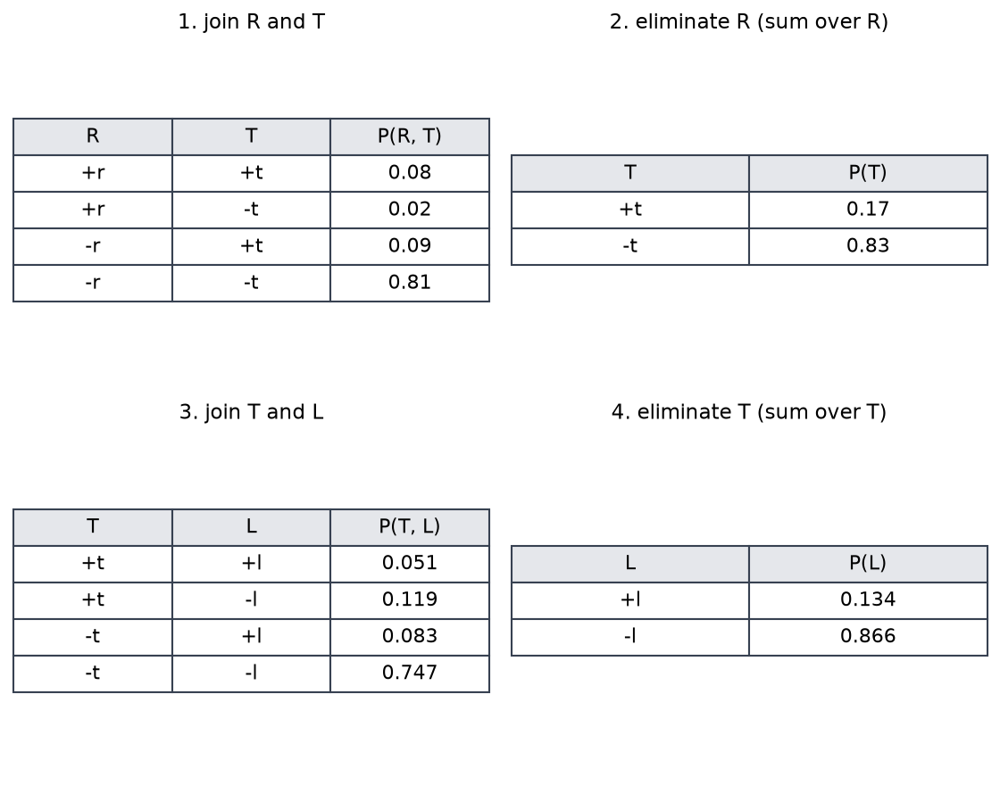
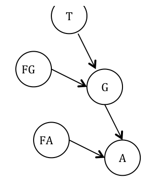
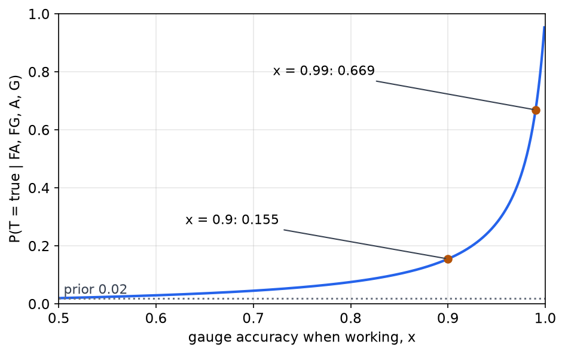

# Inference in Bayesian Networks

A Bayesian network stores a joint distribution compactly, and the point of storing it is to answer questions. A **query** asks for the posterior distribution of one or more variables given some **evidence**, and the answer is usually obtained by summing over the variables that are neither queried nor observed. This chapter covers the methods for doing that sum. Exact inference by enumeration is the direct method. Variable elimination reorders the same sums so that they are cheaper. Sampling methods give approximate answers when the exact sums are too expensive, and they include prior sampling, rejection sampling, likelihood weighting and Gibbs sampling. The chapter ends with two worked problems: the Monty Hall puzzle, read as a Bayes-rule calculation, and a nuclear-plant alarm problem solved symbolically. The networks come from [Bayesian Networks: Structure and Independence](bayes-nets.md), and the rules of conditioning come from [Probability and Bayes' Rule](probability.md).

## The Inference Problem

Consider a network whose variables are split into three sets. **Evidence** variables are observed and have known values. **Query** variables are the outputs we want. **Hidden** variables are everything else, and they are summed out. The answer to a query is a **posterior distribution** over the query variables given the evidence, not a single number. Inference can run in either direction. Causal inference goes from causes to effects, and diagnostic inference goes from effects back to causes. The **most likely explanation** is the combination of query values with the highest posterior.

The running example is an earthquake network. Burglary \\(B\\) and earthquake \\(E\\) are roots. The alarm \\(A\\) has both as parents, and the two calls \\(J\\) (John) and \\(M\\) (Mary) each have the alarm as their only parent. The conditional probabilities are the ones given in the burglary network of [the previous chapter](bayes-nets.md), with the earthquake in the place of the thunderstorm:

| Quantity | Value |
|---|---|
| \\(P(+b)\\), \\(P(+e)\\) | 0.001, 0.002 |
| \\(P(+a \mid +b, +e)\\), \\(P(+a \mid +b, -e)\\) | 0.95, 0.94 |
| \\(P(+a \mid -b, +e)\\), \\(P(+a \mid -b, -e)\\) | 0.29, 0.001 |
| \\(P(+j \mid +a)\\), \\(P(+j \mid -a)\\) | 0.9, 0.05 |
| \\(P(+m \mid +a)\\), \\(P(+m \mid -a)\\) | 0.7, 0.01 |

The complements of these entries (for example \\(P(-a \mid +b, +e) = 0.06\\)) are used as well. The worked examples in this chapter use the same numbers as the typed tables of the burglary network, so the whole model is fixed.

Suppose Mary calls and we want to know whether there was a burglary. Then \\(M\\) is the evidence, \\(B\\) is the query, and \\(E\\), \\(A\\) and \\(J\\) are hidden. The query is \\(P(B \mid +m)\\). The answer depends on the hidden variables only through the sums that the following sections describe.

## Inference by Enumeration

The definition of conditional probability gives the target directly. For the query \\(B\\) with evidence \\(+j\\) and \\(+m\\),

\\[
P(+b \mid +j, +m) = \frac{P(+b, +j, +m)}{P(+j, +m)} .
\\]

Each numerator and denominator is a sum over the hidden variables. The numerator is

\\[
P(+b, +j, +m) = \sum\_{e} \sum\_{a} P(+b)\\,P(e)\\,P(a \mid +b, e)\\,P(+j \mid a)\\,P(+m \mid a) ,
\\]

and the denominator is the same sum with \\(B\\) summed over both of its values. Each term of the sum is a product of five CPT entries, read straight from the tables. The method is called enumeration because it lists every combination of the hidden variables and adds up the products.

The procedure can be written recursively. It loops over the values of the query, and for each value it enumerates the remaining variables in order, multiplying by the table entry when a variable is observed and summing when it is not.

```
ENUMERATION-ASK(X, evidence e, network bn):
    for each value x of X:  Q[x] = ENUMERATE-ALL(bn.variables, e + {X = x})
    return normalize(Q)

ENUMERATE-ALL(vars, e):
    if vars is empty: return 1.0
    Y = first(vars)
    if Y is in e:      return P(Y = e[Y] | parents(Y)) * ENUMERATE-ALL(rest(vars), e)
    else:              return sum over y of P(Y = y | parents(Y)) * ENUMERATE-ALL(rest(vars), e + {Y = y})
```

### A Full Enumeration

The four combinations of \\(E\\) and \\(A\\) for \\(B = +b\\) are one part of the numerator, and the four for \\(B = -b\\) are the other. A single term is a product of five factors. For \\(B = +b\\), \\(E = +e\\) and \\(A = +a\\), the term is

\\[
P(+b)\\,P(+e)\\,P(+a \mid +b, +e)\\,P(+j \mid +a)\\,P(+m \mid +a) = 0.001 \times 0.002 \times 0.95 \times 0.9 \times 0.7 = 0.000001197 ,
\\]

which is \\(1.2 \times 10^{-6}\\). The eight terms are:

| \\(B\\) | \\(E\\) | \\(A\\) | Product | Value |
|---|---|---|---|---|
| \\(+b\\) | \\(+e\\) | \\(+a\\) | \\(0.001 \times 0.002 \times 0.95 \times 0.9 \times 0.7\\) | \\(1.197 \times 10^{-6}\\) |
| \\(+b\\) | \\(+e\\) | \\(-a\\) | \\(0.001 \times 0.002 \times 0.05 \times 0.05 \times 0.01\\) | \\(5 \times 10^{-11}\\) |
| \\(+b\\) | \\(-e\\) | \\(+a\\) | \\(0.001 \times 0.998 \times 0.94 \times 0.9 \times 0.7\\) | \\(5.910 \times 10^{-4}\\) |
| \\(+b\\) | \\(-e\\) | \\(-a\\) | \\(0.001 \times 0.998 \times 0.06 \times 0.05 \times 0.01\\) | \\(2.994 \times 10^{-8}\\) |
| \\(-b\\) | \\(+e\\) | \\(+a\\) | \\(0.999 \times 0.002 \times 0.29 \times 0.9 \times 0.7\\) | \\(3.650 \times 10^{-4}\\) |
| \\(-b\\) | \\(+e\\) | \\(-a\\) | \\(0.999 \times 0.002 \times 0.71 \times 0.05 \times 0.01\\) | \\(7.093 \times 10^{-7}\\) |
| \\(-b\\) | \\(-e\\) | \\(+a\\) | \\(0.999 \times 0.998 \times 0.001 \times 0.9 \times 0.7\\) | \\(6.281 \times 10^{-4}\\) |
| \\(-b\\) | \\(-e\\) | \\(-a\\) | \\(0.999 \times 0.998 \times 0.999 \times 0.05 \times 0.01\\) | \\(4.980 \times 10^{-4}\\) |

The first four rows, with \\(B = +b\\), sum to \\(0.00059224\\). The last four, with \\(B = -b\\), sum to \\(0.00149187\\). The denominator \\(P(+j, +m)\\) is their total, \\(0.00208411\\), and the posterior is

\\[
P(+b \mid +j, +m) = \frac{0.00059224}{0.00208411} = 0.284 .
\\]

The burglary network of the previous chapter gives the same value for \\(P(B = T \mid J = T, M = T)\\), because its numbers are identical. The posterior is well below one, even though both calls are reliable, because the prior probability of a burglary is only 0.001. The alarm is fairly reliable, and so are both callers, but a burglary is rare, and the two calls together raise the probability from 0.001 to 0.284 rather than to near one.

### Speeding Up Enumeration

Enumeration is correct but expensive, and two observations reduce its cost.

The first is to pull terms out of the sums. The factor \\(P(+b)\\) does not depend on \\(e\\) or \\(a\\), so it moves outside both sums. The factor \\(P(e)\\) does not depend on \\(a\\), so it moves outside the sum over \\(a\\). The innermost loop then has three factors instead of five. The number of rows is the same, so the saving is only a constant factor.

The second is the structure. The cost of enumeration depends on the number of rows, and the number of rows depends on the network. A linear chain \\(X\_1 \to \cdots \to X\_n\\) takes time proportional to \\(n\\). A fully connected network of \\(n\\) Boolean variables takes time proportional to \\(2^n\\). The same joint distribution can be written as several different networks, depending on the order in which the nodes are added, and the orders differ in cost.

The node-order experiment makes this concrete. Add the nodes of the earthquake network in the order \\(J, M, A, B, E\\), and at each step connect the new node to the earlier nodes it depends on, given those already added.

| Node added | Depends on (given the nodes already added) | Arcs created |
|---|---|---|
| \\(J\\) | none | none |
| \\(M\\) | \\(J\\), since \\(A\\) is not observed | \\(J \to M\\) |
| \\(A\\) | \\(J\\) and \\(M\\) | \\(J \to A\\), \\(M \to A\\) |
| \\(B\\) | \\(A\\) only; \\(B\\) is independent of \\(J\\) and \\(M\\) given \\(A\\) | \\(A \to B\\) |
| \\(E\\) | \\(A\\) and \\(B\\) | \\(A \to E\\), \\(B \to E\\) |

This ordering gives a network with \\(1 + 2 + 4 + 2 + 4 = 13\\) free numbers. The causal ordering, with \\(B\\) and \\(E\\) first and then \\(A\\), \\(J\\) and \\(M\\), gives the network with arcs \\(B \to A\\), \\(E \to A\\), \\(A \to J\\) and \\(A \to M\\), which needs \\(1 + 1 + 4 + 2 + 2 = 10\\) numbers. The causal network is smaller, and it is also easier to do inference on, because the arcs run from causes to effects and the hidden variables sit close to the query. Writing the network in the causal direction is the practical rule.

## Variable Elimination

Enumeration joins the whole joint distribution before summing, and it repeats the same work many times. **Variable elimination** interleaves the two operations on **factors**, which are multidimensional tables indexed by some of the variables. A factor begins as one CPT. The two operations are:

- **Join** (pointwise product): two or more factors are multiplied entrywise into a factor over the union of their variables.
- **Eliminate** (sum out): a variable is summed out of a factor, leaving a factor over the other variables.

The algorithm repeats these operations in a chosen order until only the query variables remain. Exact inference in general Bayesian networks is NP-hard, so no method is fast on every network. Variable elimination is faster than enumeration in most practical cases, and the order of elimination decides how large the intermediate factors become.

The procedure can be written in a few lines.

```
VARIABLE-ELIMINATION(query Q, evidence e, factors F, ordering):
    for each hidden variable H in ordering:
        S = factors in F that mention H
        f = pointwise product of S            # JOIN
        g = sum over values h of f            # ELIMINATE H
        F = (F minus S) plus {g}
    return normalize(pointwise product of F)
```

### A Worked Elimination

Take a three-variable chain \\(R \to T \to L\\): rain, traffic, and being late. The CPTs are \\(P(+r) = 0.1\\), \\(P(+t \mid +r) = 0.8\\), \\(P(+t \mid -r) = 0.1\\), \\(P(+l \mid +t) = 0.3\\) and \\(P(+l \mid -t) = 0.1\\). The task is \\(P(L)\\), the probability of being late. Let \\(R\\) and then \\(T\\) be the hidden variables, eliminated in that order.

**Step 1: join \\(R\\) and \\(T\\).** The factor \\(P(R, T) = P(R)\\,P(T \mid R)\\) has four entries:

| \\(R\\) | \\(T\\) | \\(P(R, T)\\) |
|---|---|---|
| \\(+r\\) | \\(+t\\) | \\(0.1 \times 0.8 = 0.08\\) |
| \\(+r\\) | \\(-t\\) | \\(0.1 \times 0.2 = 0.02\\) |
| \\(-r\\) | \\(+t\\) | \\(0.9 \times 0.1 = 0.09\\) |
| \\(-r\\) | \\(-t\\) | \\(0.9 \times 0.9 = 0.81\\) |

**Step 2: eliminate \\(R\\).** Summing the two rows for each value of \\(T\\) gives the marginal \\(P(T)\\):

\\[
P(+t) = 0.08 + 0.09 = 0.17 , \qquad P(-t) = 0.02 + 0.81 = 0.83 .
\\]

The entries sum to one, as they must.

**Step 3: join \\(T\\) and \\(L\\).** The factor \\(P(T, L) = P(T)\\,P(L \mid T)\\) now has four entries:

| \\(T\\) | \\(L\\) | \\(P(T, L)\\) |
|---|---|---|
| \\(+t\\) | \\(+l\\) | \\(0.17 \times 0.3 = 0.051\\) |
| \\(+t\\) | \\(-l\\) | \\(0.17 \times 0.7 = 0.119\\) |
| \\(-t\\) | \\(+l\\) | \\(0.83 \times 0.1 = 0.083\\) |
| \\(-t\\) | \\(-l\\) | \\(0.83 \times 0.9 = 0.747\\) |

**Step 4: eliminate \\(T\\).** Summing over \\(T\\) gives the answer:

\\[
P(+l) = 0.051 + 0.083 = 0.134 , \qquad P(-l) = 0.119 + 0.747 = 0.866 .
\\]

The answer is the same as enumeration would give. The saving is that the largest factor has two variables, \\(T\\) and \\(L\\), and the full joint of the three variables, with eight entries, was never formed. The same pattern applies to a network with dozens of variables, where the difference between the sizes of the intermediate factors and the full joint is large.



*Figure 1: The four steps of variable elimination on the chain \\(R \to T \to L\\). The top row joins and then eliminates \\(R\\), and the bottom row joins \\(T\\) with \\(L\\) and then eliminates \\(T\\). Each table is a factor, and the final column of the last table gives \\(P(L)\\).*

The intermediate factors are not probabilities in general; they are products of CPT entries. Only the final factor is normalized, and here it already sums to one. The ordering matters. Eliminating \\(T\\) first would have joined \\(P(T \mid R)\\) and \\(P(L \mid T)\\) into a factor over \\(R\\), \\(T\\) and \\(L\\), which is one variable larger.

## Sampling

Exact inference becomes expensive when a network has many hidden variables or many connections. **Sampling** methods estimate the posterior from simulated data. The idea is simple. If the process that generates the network can be simulated, then running it many times and counting outcomes approximates the joint distribution, and counting only the outcomes consistent with the evidence approximates the posterior. Sampling has two practical advantages. It gives an answer when exact inference is too costly, and it works even when the numbers in the CPTs are unknown, as long as the process can be run.

The intuition is that of a coin experiment. Flip two coins repeatedly, tally each joint outcome, and divide by the number of flips. The estimate converges to the true joint as the number of flips grows.

### Prior Sampling

For a network, prior sampling generates a complete sample by visiting the nodes in topological order, so that every parent is sampled before its children. Each node is sampled from its CPT given the values already sampled for its parents.

Consider the sprinkler network: Cloudy \\(C\\) is the root, and it has children Sprinkler \\(S\\) and Rain \\(R\\). Wet grass \\(W\\) has parents \\(S\\) and \\(R\\). The CPTs used in the worked calculations are \\(P(+c) = 0.5\\), \\(P(+s \mid +c) = 0.1\\) (so \\(P(-s \mid +c) = 0.9\\)), \\(P(+r \mid +c) = 0.8\\) (so \\(P(-r \mid +c) = 0.2\\)), \\(P(+w \mid -s, +r) = 0.9\\) (so \\(P(-w \mid -s, +r) = 0.1\\)) and \\(P(+w \mid +s, +r) = 0.99\\).

One pass of prior sampling runs as follows.

1. Sample \\(C\\) from \\(P(C)\\). The result is \\(+c\\).
2. Sample \\(S\\) from the \\(+c\\) row, which gives \\(+s\\) with probability 0.1 and \\(-s\\) with probability 0.9. The result is \\(-s\\).
3. Sample \\(R\\) from the \\(+c\\) row, which gives \\(+r\\) with probability 0.8. The result is \\(+r\\).
4. Sample \\(W\\) from the row for \\((-s, +r)\\), which gives \\(+w\\) with probability 0.9 and \\(-w\\) with probability 0.1. Suppose the result is \\(+w\\).

The complete sample is \\((+c, -s, +r, +w)\\). The most likely outcome for \\(W\\) given the rows that apply is \\(+w\\), since \\(0.9 > 0.1\\).

Prior sampling is **consistent**. Each variable is sampled from its CPT given its sampled parents, so as the number of samples grows, the counts converge to the joint distribution. This is the sense in which sampling is correct, even when it is not efficient.

The pseudocode is a short loop over the topological order.

```
PRIOR-SAMPLE(bn):
    x = {}
    for X_i in topological order:            # parents before children
        x[X_i] = sample from P(X_i | parents(X_i) values in x)
    return x
```

### Rejection Sampling

To estimate a conditional probability, rejection sampling draws prior samples and keeps only those that agree with the evidence. Each kept sample then contributes to the count for the query value, and the counts are normalized.

For example, to compute the probability of wet grass given that it is not cloudy, a sample with \\(+c\\) is discarded, while a sample such as \\((-c, +s, +r, -w)\\) is kept. The method is consistent, because the kept samples are a correct sample from the conditional distribution, but it is wasteful. Most samples are thrown away whenever the evidence is unlikely.

The waste comes from the evidence, not from the query. In the earthquake network, the evidence \\(+a\\) has probability

\\[
P(+a) = 0.001 \times 0.002 \times 0.95 + 0.001 \times 0.998 \times 0.94 + 0.999 \times 0.002 \times 0.29 + 0.999 \times 0.998 \times 0.001 = 0.00252 .
\\]

Rejection sampling keeps only the samples with the alarm on, which is about one sample in four hundred, so almost all of the work is discarded. The pseudocode is as follows.

```
REJECTION-SAMPLING(X, e, bn, N):
    counts[x] = 0 for each value x of X
    repeat N times:
        s = PRIOR-SAMPLE(bn)
        if s agrees with e: counts[s[X]] += 1
    return normalize(counts)
```

### Likelihood Weighting

Likelihood weighting avoids the waste. It fixes the evidence variables to their observed values, samples the other variables from their CPTs, and keeps every sample with a weight. The weight of a sample is the product of \\(P(\text{evidence} \mid \text{parents})\\) for the evidence variables, because a sample in which the evidence is improbable should count for less.

Without weights, the samples would be biased toward the wrong values, because the evidence has been forced on them. The weights correct that bias.

The sprinkler network gives a standard exercise. Estimate \\(P(R \mid +s, +w)\\) by likelihood weighting, with sprinkler and wet grass fixed to \\(+s\\) and \\(+w\\).

- Sample \\(C\\). The result is \\(+c\\), by chance.
- Sprinkler is forced to \\(+s\\). The weight is multiplied by \\(P(+s \mid +c) = 0.1\\).
- Rain is sampled from \\(P(R \mid +c)\\), and the result is \\(+r\\). Its weight is unchanged.
- Wet grass is forced to \\(+w\\). The weight is multiplied by \\(P(+w \mid +s, +r) = 0.99\\).

The weight of the sample \\((+c, +s, +r, +w)\\) is therefore \\(0.1 \times 0.99 = 0.099\\). The sample counts toward \\(R = +r\\) with weight \\(0.099\\), not with weight one. Keeping the weights is what makes the estimator consistent.

Likelihood weighting has a weakness when the evidence is upstream of the query. In \\(P(C \mid +s, +r)\\), the evidence lies downstream of \\(C\\), and \\(C\\) is sampled without looking at the evidence. Many samples then receive low weight, so the estimate is noisy, even though nothing is rejected.

The pseudocode is:

```
LIKELIHOOD-WEIGHTING(X, e, bn, N):
    W[x] = 0 for each value x of X
    repeat N times:
        (s, w) = WEIGHTED-SAMPLE(bn, e)
        W[s[X]] += w
    return normalize(W)

WEIGHTED-SAMPLE(bn, e):
    w = 1.0;  x = {}
    for X_i in topological order:
        if X_i is in e:  x[X_i] = e[X_i];  w = w * P(e[X_i] | parents(X_i) values in x)
        else:            x[X_i] = sample from P(X_i | parents(X_i) values in x)
    return (x, w)
```

### Gibbs Sampling

Gibbs sampling is a Markov chain Monte Carlo method, named after the physicist Josiah Willard Gibbs. It uses all the evidence, including evidence downstream of the query, and it avoids the weights.

The method starts with the evidence variables fixed at their observed values and the other variables set to random values. It then repeats the following step. Pick one non-evidence variable and resample it from its distribution conditioned on the current values of all the other variables. Count the values of the query variable over the visited states.

Successive states differ in only one variable, so consecutive samples are correlated, unlike the independent samples of the earlier methods. The chain is still consistent: over a long run, the visited states represent the posterior. The method is simple to state and widely used, and it is the basis of many practical samplers.

```
GIBBS-ASK(X, e, bn, N):
    x = random values for non-evidence variables; e fixed
    counts[...] = 0
    repeat N times:
        pick a non-evidence variable Z (for example, cycling through them)
        x[Z] = sample from P(Z | all other variables in x)
        counts[x[X]] += 1
    return normalize(counts)
```

## Monty Hall as a Bayes-Rule Problem

The Monty Hall puzzle is a useful test of Bayesian reasoning, because intuition about it is often wrong. There are three doors, one car and two goats. The contestant picks door 1. The host, who knows where the car is, opens door 3, which has a goat, and offers the contestant the chance to switch to door 2. Should the contestant switch?

The answer comes from a Bayes-rule calculation. Let \\(C\\) be the door that hides the car, with prior \\(P(C = i) = 1/3\\) for each door. The evidence is that the host opens door 3. The host's behavior is part of the model, and the standard assumptions are these: the host never opens the contestant's door or the car's door, and when the car is behind door 1, the host chooses between doors 2 and 3 at random.

The likelihoods of the host's choice are:

- If the car is behind door 1, the host opens door 3 with probability \\(1/2\\).
- If the car is behind door 2, the host must open door 3, with probability 1.
- If the car is behind door 3, the host cannot open it, with probability 0.

The probability of the evidence is the total probability over the car's location:

\\[
P(\text{open } 3) = \tfrac{1}{3}\cdot\tfrac{1}{2} + \tfrac{1}{3}\cdot 1 + \tfrac{1}{3}\cdot 0 = \tfrac{1}{2} .
\\]

Bayes' rule then gives the posteriors:

\\[
P(C = 1 \mid \text{open } 3) = \frac{\tfrac{1}{3}\cdot\tfrac{1}{2}}{\tfrac{1}{2}} = \tfrac{1}{3}, \qquad P(C = 2 \mid \text{open } 3) = \frac{\tfrac{1}{3}\cdot 1}{\tfrac{1}{2}} = \tfrac{2}{3} .
\\]

Sticking with door 1 wins with probability \\(1/3\\), and switching to door 2 wins with probability \\(2/3\\). The calculation shows why the reveal is informative: the host's choice depends on where the car is, and that dependence is the evidence.

The result depends on the host's rule, and the calculation makes the dependence explicit. Suppose the host opens door 3 with probability \\(q\\) when the car is behind door 1. Then \\(P(\text{open } 3) = \tfrac{1}{3}(q + 1)\\), and the posterior for door 1 becomes

\\[
P(C = 1 \mid \text{open } 3) = \frac{\tfrac{1}{3} q}{\tfrac{1}{3}(q + 1)} = \frac{q}{q + 1} .
\\]

With \\(q = 1/2\\) this is \\(1/3\\). With \\(q = 1\\), the host always prefers door 3 when the car is behind door 1, and the posterior for door 1 becomes \\(1/2\\), so switching gains nothing. The one-third answer is therefore a claim about the host's fair choice, not a fact about doors alone. Under the usual assumptions, switching wins with probability \\(2/3\\). The view, attributed to the host himself, that switching makes no difference is therefore incorrect under those assumptions.

## A Nuclear-Plant Alarm Problem

A practice problem applies the same machinery to a network with a deterministic node. A nuclear plant has a temperature gauge that reports either "high" or "normal", and an alarm that sounds when the gauge reports high. The alarm and the gauge can both be faulty. The actual temperature is too high with probability 0.02.

The Boolean variables are \\(A\\) (the alarm sounds), \\(FA\\) (the alarm is faulty), \\(G\\) (the gauge reports high), \\(FG\\) (the gauge is faulty) and \\(T\\) (the actual temperature is too high).



*Figure 2: The structure of the nuclear-plant alarm network. The actual temperature \\(T\\) and the gauge fault \\(FG\\) are parents of the gauge reading \\(G\\), and \\(G\\) and the alarm fault \\(FA\\) are parents of the alarm \\(A\\).*

The network has arcs \\(T \to G\\), \\(FG \to G\\), \\(G \to A\\) and \\(FA \to A\\). The roots \\(T\\), \\(FG\\) and \\(FA\\) have priors. The problem's parts are to draw the network, to write the CPT for \\(G\\), to write the CPT for \\(A\\), and to find \\(P(T \mid FA, FG, A, G)\\) when the alarm and gauge are known to be working and the alarm sounds.

The gauge reports the true state with probability \\(x\\) when it is working and with probability \\(y\\) when it is faulty. Its CPT, with columns for the parents \\((FG, T)\\), is:

| \\(FG\\) | \\(T\\) | \\(P(G = \text{high} \mid \cdot)\\) | \\(P(G = \text{normal} \mid \cdot)\\) |
|---|---|---|---|
| faulty | true | \\(y\\) | \\(1 - y\\) |
| faulty | false | \\(1 - y\\) | \\(y\\) |
| working | true | \\(x\\) | \\(1 - x\\) |
| working | false | \\(1 - x\\) | \\(x\\) |

The alarm works correctly except when faulty, in which case it never sounds. Its CPT is deterministic: the alarm sounds exactly when it is not faulty and the gauge reports high.

| \\(FA\\) | \\(G\\) | \\(P(A = \text{sounds} \mid \cdot)\\) | \\(P(A = \text{silent} \mid \cdot)\\) |
|---|---|---|---|
| faulty | high | 0 | 1 |
| faulty | normal | 0 | 1 |
| working | high | 1 | 0 |
| working | normal | 0 | 1 |

### The Posterior, Symbolically

The evidence is \\(FA = \text{false}\\), \\(FG = \text{false}\\) and \\(A = \text{true}\\). The alarm is not faulty and sounds, so the deterministic CPT forces \\(G = \text{true}\\), that is, the gauge reads high. The query is \\(P(T \mid FA, FG, A, G)\\).

Bayes' rule gives

\\[
P(T \mid FA, FG, A, G) = \frac{P(FG, FA, A, G \mid T)\\,P(T)}{P(FG, FA, A, G)} .
\\]

The network factors the numerator. Given \\(T\\), the variables \\(A\\) and \\(G\\) depend only on their parents, so

\\[
P(FG, FA, A, G \mid T) = P(A \mid FA, G)\\,P(G \mid FG, T)\\,P(FA)\\,P(FG) .
\\]

The denominator is the same expression with \\(T\\) summed out. Substituting both and cancelling the factors that do not depend on \\(T\\) gives

\\[
P(T \mid FA, FG, A, G) = \frac{P(G \mid FG, T)\\,P(T)}{\sum\_{T} P(G \mid FG, T)\\,P(T)} .
\\]

The cancelled factors are \\(P(A \mid FA, G)\\), \\(P(FA)\\) and \\(P(FG)\\), and they are the same for both values of \\(T\\). The denominator is the marginal over \\(T\\), and it is the step that a hint in the problem asks for.

With \\(FG = \text{false}\\) and \\(G = \text{high}\\), the denominator is

\\[
\sum\_{T} P(G = \text{high} \mid FG = \text{false}, T)\\,P(T) = (1 - x)(0.98) + x(0.02) .
\\]

The numerator for \\(T = \text{true}\\) is \\(x(0.02)\\), and the numerator for \\(T = \text{false}\\) is \\((1 - x)(0.98)\\). Therefore

\\[
\boxed{P(T = \text{true} \mid FA, FG, A, G) = \frac{0.02\\,x}{0.98(1 - x) + 0.02\\,x}} .
\\]

The answer depends on the gauge accuracy \\(x\\) and not on \\(y\\). The variable \\(y\\) appears only in the CPT for the faulty gauge, and the faulty case has been ruled out by the evidence.

Two checks follow from the formula. At \\(x = 0.5\\) the gauge reading is uninformative, and the posterior equals the prior, \\(0.02\\), because \\(0.01 / 0.5 = 0.02\\). As \\(x\\) tends to one, the posterior tends to one, because the denominator tends to \\(0.02\\), which is the numerator.

### Numerical Values

The symbolic answer is the result. For illustration, take \\(x = 0.9\\), a gauge that is correct nine times in ten when it works. Then

\\[
P(T \mid \cdot) = \frac{0.02 \times 0.9}{0.98 \times 0.1 + 0.02 \times 0.9} = \frac{0.018}{0.116} = 0.155 .
\\]

A gauge that is correct 99 times in 100 gives \\(x = 0.99\\), and then

\\[
P(T \mid \cdot) = \frac{0.0198}{0.0098 + 0.0198} = \frac{0.0198}{0.0296} = 0.669 .
\\]

The posterior rises from the prior of 0.02 to about 0.155 for the 90 percent gauge and to about 0.669 for the 99 percent gauge. These two values are illustrations chosen for \\(x\\), not values given in the problem. The posterior as a function of \\(x\\) is plotted below.



*Figure 3: The posterior \\(P(T \mid FA, FG, A, G)\\) as a function of the gauge accuracy \\(x\\), with the prior 0.02 marked. The curve is flat near the prior when the gauge is close to random at \\(x = 0.5\\), and it rises steeply as \\(x\\) approaches one. The two marked points are the illustrative values \\(x = 0.9\\) and \\(x = 0.99\\).*

### The Faulty-Gauge Variant

The same method answers a variant in which the gauge is known to be faulty instead, with \\(FG = \text{true}\\). The CPT entries are then \\(P(G = \text{high} \mid FG = \text{true}, T = \text{true}) = y\\) and \\(P(G = \text{high} \mid FG = \text{true}, T = \text{false}) = 1 - y\\), and the posterior becomes

\\[
P(T \mid \cdot) = \frac{0.02\\,y}{0.02\\,y + 0.98(1 - y)} .
\\]

This is an extension worked with the same steps, not one of the stated results of the problem. It shows the role of \\(y\\). At \\(y = 0.5\\) the faulty gauge is uninformative, and the posterior is again the prior, \\(0.02\\). The answer depends on \\(y\\) only when the gauge is faulty, which is the case that the evidence in the original problem excludes.

## Summary

- A query asks for the posterior over query variables given evidence, and the hidden variables are summed out. Enumeration does this directly, at a cost that grows as \\(2^n\\) for \\(n\\) binary variables.
- The earthquake network gives \\(P(+b \mid +j, +m) = 0.284\\) from the eight enumeration terms. The prior of 0.001 keeps the posterior low even though both calls are reliable.
- The network order decides the cost. The causal ordering of the earthquake network needs 10 free numbers, and the non-causal ordering needs 13.
- Variable elimination alternates joins and sums on factors. The chain \\(R \to T \to L\\) gives \\(P(+l) = 0.134\\) with a largest factor of two variables.
- Prior sampling is consistent but can waste most of its samples. Rejection sampling discards samples that disagree with the evidence. Likelihood weighting keeps every sample and weights it by the probability of the evidence, giving \\(0.1 \times 0.99 = 0.099\\) for one sample in the sprinkler exercise. Gibbs sampling uses all the evidence through a Markov chain.
- Monty Hall is a Bayes-rule problem. The answer \\(1/3\\) for the first door and \\(2/3\\) for switching depends on the host choosing at random when the car is behind the contestant's door.
- In the nuclear-plant problem, the posterior is \\(0.02\\,x / (0.98(1 - x) + 0.02\\,x)\\). It depends on the gauge accuracy \\(x\\) and not on the faulty-gauge accuracy \\(y\\).

## References

- Russell, S. and Norvig, P., *Artificial Intelligence: A Modern Approach*, 3rd edition, Section 14.4 "Exact Inference in Bayesian Networks", which covers inference by enumeration and the normalization over the query variable.

## See Also

- [Bayesian Networks: Structure and Independence](bayes-nets.md): the networks and the factored joint used throughout this chapter.
- [Probability and Bayes' Rule](probability.md): conditioning, normalization and Bayes' rule.
- [Filtering over Time and Belief States](filtering.md): the same reasoning extended to a sequence of observations.
- [Particle Filtering](particle-filtering.md): sampling applied to a time-series model, following the sampling methods of this chapter.
