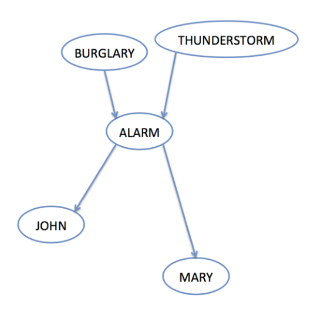
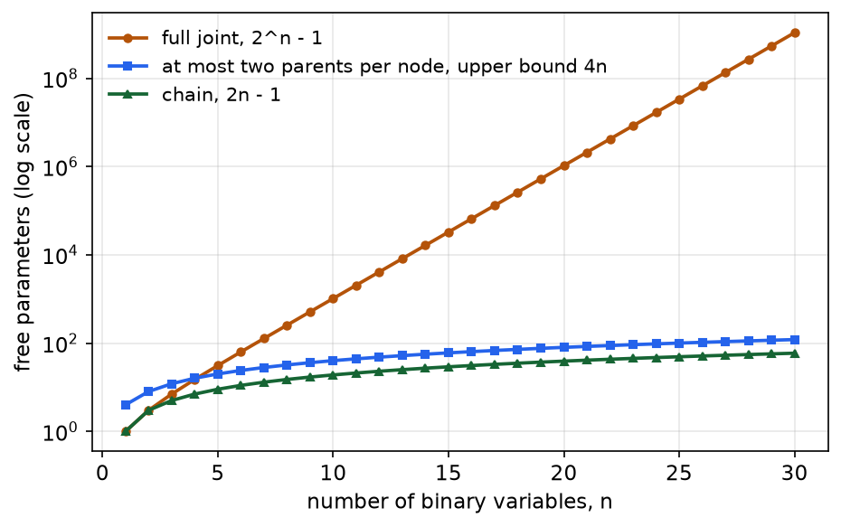
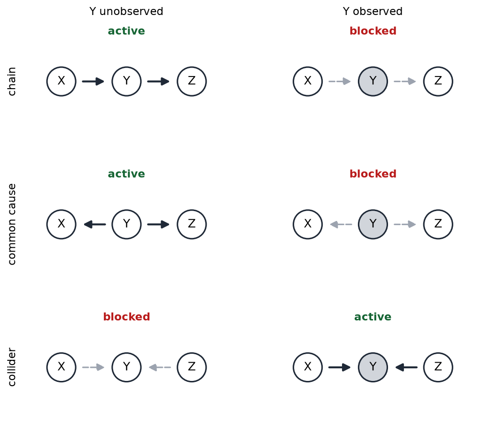
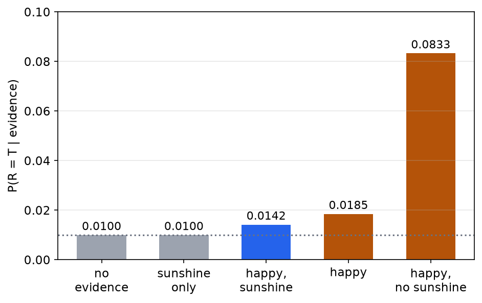
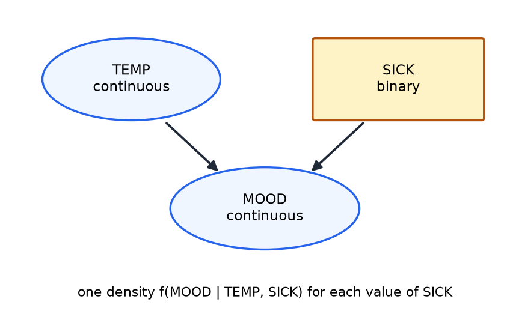

# Bayesian Networks: Structure and Independence

A full joint distribution over \\(n\\) Boolean variables has \\(2^n - 1\\) free numbers, which is hopeless for a realistic model: thirty variables need about a billion. A **Bayesian network** represents the same kind of joint distribution with far fewer numbers. It draws a directed graph over the variables, one node per variable, and it attaches to each node a conditional probability table given that node's parents. The graph records which variables influence which, and the conditional independences it implies are what make the representation compact. This chapter covers the factored form of the joint, the burglary network, counting parameters, the graphical test for conditional independence called d-separation, the explaining-away effect, and networks with continuous variables. Exact and approximate inference in these networks is the subject of [Inference in Bayesian Networks](bayes-net-inference.md).

## From Tables to Graphs

A Bayesian network has two parts. The **structure** is a directed acyclic graph whose nodes are random variables and whose arcs run from a **parent** to a **child**. An arc says that the child is influenced directly by the parent. The **parameters** are a conditional probability table (CPT) for each node, giving the distribution of the node for each combination of its parents' values. Each row of a CPT is a distribution, so its entries sum to one.

The influence is probabilistic, not deterministic, and the graph does not have to be causal, although causal orderings tend to give the smallest networks. A root node has no parents and gets a prior table. A child gets one row for each combination of parent values. A diagnostic network built from a car's observations has the same shape: hidden causes such as a flat battery or an empty tank sit above observed readings such as the gauges and the warning lights. A car network of this kind has 16 Boolean variables, and it is stated to need 47 numbers, against \\(2^{16} - 1 = 65{,}535\\) for the full joint. Only the total is given, and the stated breakdown of the parameters sums to 29, not 47, while the full structure is not spelled out. The count is therefore quoted here as a claim and not checked. The arithmetic of the factored form is shown on smaller networks below.

### The Factored Joint Distribution

The network defines the joint distribution through the **chain rule** together with a set of conditional independences. The chain rule, applied in any order of the variables, is

\\[
P(X\_1, X\_2, \ldots, X\_n) = \prod\_{i=1}^{n} P(X\_i \mid X\_1, \ldots, X\_{i-1}) .
\\]

The network replaces the conditioning on all earlier variables by conditioning on the parents only. The assumption is that, once its parents are known, a node is independent of its other predecessors in the ordering. Under that assumption,

\\[
\boxed{P(X\_1, \ldots, X\_n) = \prod\_{i=1}^{n} P\big(X\_i \mid \text{PARENTS}(X\_i)\big)} .
\\]

The product runs over the nodes, and each factor is a single CPT entry. This is the sense in which the network encodes the joint. The network is a statement about which variables are irrelevant to which others, and every absent arc is an independence assumption. A missing arc means the parents carry all of the influence of the other predecessors.

## The Burglary Network

The standard example has five Boolean variables. BURGLARY (\\(B\\)) and THUNDERSTORM (\\(TH\\)) are roots, ALARM (\\(A\\)) has both as parents, and JOHN (\\(J\\)) and MARY (\\(M\\)) each have ALARM as their only parent. The structure is a "v" into ALARM followed by two leaves.

*Figure 1: The burglary network. The two causes at the top point to the alarm. The alarm points to the two callers, who are observed only through the alarm. Neither caller has an arc from burglary or thunderstorm.*

The CPTs of the network are as follows. The priors are

| Variable | Value | Probability |
|---|---|---|
| \\(B\\) | T | 0.001 |
| \\(B\\) | F | 0.999 |
| \\(TH\\) | T | 0.002 |
| \\(TH\\) | F | 0.998 |

The alarm table gives \\(P(A \mid B, TH)\\), one row per combination of its parents:

| \\(B\\) | \\(TH\\) | \\(P(A = T \mid B, TH)\\) | \\(P(A = F \mid B, TH)\\) |
|---|---|---|---|
| T | T | 0.95 | 0.05 |
| T | F | 0.94 | 0.06 |
| F | T | 0.29 | 0.71 |
| F | F | 0.001 | 0.999 |

The two callers depend only on the alarm:

| \\(A\\) | \\(P(J = T \mid A)\\) | \\(P(J = F \mid A)\\) |
|---|---|---|
| T | 0.9 | 0.1 |
| F | 0.05 | 0.95 |

| \\(A\\) | \\(P(M = T \mid A)\\) | \\(P(M = F \mid A)\\) |
|---|---|---|
| T | 0.7 | 0.3 |
| F | 0.01 | 0.99 |

Because the two callers are conditionally independent given the alarm, the only route from burglary to MARY is through the alarm. Learning that MARY called raises the probability of the alarm, and the alarm is then evidence about burglary.

### A Worked Joint Probability

Take the event \\(J = T, M = T, A = T, B = F, TH = F\\): both callers call, the alarm sounds, and there is neither a burglary nor a thunderstorm. The factored form gives

\\[
P(J{=}T, M{=}T, A{=}T, B{=}F, TH{=}F) = P(J{=}T \mid A{=}T)\\,P(M{=}T \mid A{=}T)\\,P(A{=}T \mid B{=}F, TH{=}F)\\,P(B{=}F)\\,P(TH{=}F) .
\\]

Each factor is read from a table, and the product is

\\[
0.9 \times 0.7 \times 0.001 \times 0.999 \times 0.998 = 0.63 \times 0.001 \times 0.999 \times 0.998 .
\\]

Multiplying step by step: \\(0.63 \times 0.001 = 0.00063\\), then \\(0.00063 \times 0.999 = 0.00062937\\), then \\(0.00062937 \times 0.998 = 0.00062811\\). The joint probability is therefore \\(0.000628\\). One version of this calculation truncates it to \\(0.00062\\), which drops two significant figures; the value to use is \\(0.000628\\).

The event is unlikely because a false alarm with no thunderstorm has probability 0.001, and that is the bottleneck. The next chapter uses the same network to compute the reverse query, the probability of a burglary given both calls.

### Counting Parameters

Each CPT contributes one free number for each row, because the other entry in the row is fixed by the sum-to-one condition. For the burglary network:

- \\(B\\) and \\(TH\\) are roots, so each has one free number: \\(1 + 1 = 2\\).
- \\(A\\) has two binary parents, so its table has four rows, with one free number each: \\(4\\).
- \\(J\\) and \\(M\\) each have one binary parent, so each has two rows: \\(2 + 2 = 4\\).

The total is \\(2 + 4 + 4 = 10\\) free numbers. The full joint over the same five variables has \\(2^5 - 1 = 31\\) free numbers. The saving is a factor of three here, and it grows exponentially as the network grows, provided the parents per node stay bounded.

The general rule is simple. A node with \\(K\\) binary parents has \\(2^K\\) rows, and each row contributes one free number, so the node contributes \\(2^K\\) numbers. A root has \\(K = 0\\), so it contributes \\(1\\).

## Counting Parameters on a Larger Network

The next network makes the rule concrete. Take five binary variables with these arcs: \\(A \to C\\), \\(B \to C\\), \\(C \to D\\), \\(C \to E\\). The roots are \\(A\\) and \\(B\\), \\(C\\) has two parents, and \\(D\\) and \\(E\\) each have one.

| Node | Parents | Free numbers |
|---|---|---|
| \\(A\\) | none | 1 |
| \\(B\\) | none | 1 |
| \\(C\\) | \\(A, B\\) | \\(2^2 = 4\\) |
| \\(D\\) | \\(C\\) | \\(2^1 = 2\\) |
| \\(E\\) | \\(C\\) | \\(2^1 = 2\\) |
| **Total** | | **10** |

The full joint over the same five variables has \\(2^5 - 1 = 31\\) numbers. A total of 13 is also quoted for this network, with a breakdown that does not match it. The count of 13 is the correct count for a different network: the same joint written with the nodes added in a non-causal order, which the next chapter analyzes. The network above has 10 numbers, so 10 is the answer for it.

A second network makes the same point. Let \\(A\\), \\(B\\) and \\(C\\) be roots. Let \\(D\\) have the three parents \\(A\\), \\(B\\) and \\(C\\), let \\(E\\) and \\(F\\) each have \\(D\\) as their only parent, and let \\(G\\) have the two parents \\(D\\) and \\(C\\). The counts are \\(1 + 1 + 1\\) for the roots, \\(8\\) for \\(D\\) (three parents), \\(2 + 2\\) for \\(E\\) and \\(F\\), and \\(4\\) for \\(G\\). The total is \\(1 + 1 + 1 + 8 + 2 + 2 + 4 = 19\\). Against \\(2^7 - 1 = 127\\) for the full joint, the graph gives a saving of almost a factor of seven.

The figure below plots the growth. For a chain of \\(n\\) binary variables, the network needs \\(2n - 1\\) numbers, while the full joint needs \\(2^n - 1\\). A network in which every node has at most two parents needs at most \\(4n\\) numbers.

*Figure 2: Free parameters against the number of Boolean variables \\(n\\), on a logarithmic scale. The full joint grows as \\(2^n\\). A chain network grows linearly, and a network whose nodes have at most two parents grows linearly with a larger constant. The sparse graph is what turns an impossible model into a practical one.*

## Conditional Independence in the Graph: d-Separation

The graph does more than save space. It tells us which variables are conditionally independent given evidence, and that reading can be done by inspecting paths. The method is **d-separation**, also called reachability. Observed nodes are the evidence, and they are often shaded in diagrams.

There are three basic configurations of three nodes \\(X\\), \\(Y\\), \\(Z\\) that connect along a path.

- **Chain** \\(X \to Y \to Z\\). The middle node passes information along the chain. If \\(Y\\) is unobserved, \\(X\\) and \\(Z\\) are dependent. If \\(Y\\) is observed, the chain is blocked and \\(X\\) and \\(Z\\) are independent given \\(Y\\).
- **Common cause** (fork) \\(X \leftarrow Y \to Z\\). \\(Y\\) explains both \\(X\\) and \\(Z\\). Unobserved, it makes them dependent. Observed, it screens them off from each other.
- **Collider** (v-structure) \\(X \to Y \leftarrow Z\\). Here \\(Y\\) is a common effect. Unobserved, the path is blocked, so \\(X\\) and \\(Z\\) are independent. Observed, the path opens, so they become dependent.

For the collider, observing a descendant of \\(Y\\) is enough to open the path, because the descendant carries information about \\(Y\\). The collider case is the mechanism behind explaining away, discussed in the next section.

*Figure 3: The three basic configurations. Shaded nodes are observed. In each row, the left panel has the middle node unobserved and the right panel has it observed. A dashed line marks a blocked path, and a solid line marks an active path. The chain and the common cause switch from active to blocked when the middle node is observed. The collider switches from blocked to active.*

The rule for general networks follows directly. Two variables \\(X\\) and \\(Z\\) are conditionally independent given an evidence set \\(E\\) when every path between them contains at least one blocked configuration. A path is blocked if it has a chain or fork whose middle node is in \\(E\\), or a collider whose middle node and all of whose descendants are outside \\(E\\).

### Worked Examples of d-Separation

**Example 1.** Take the network with arcs \\(A \to B \to C\\) and \\(A \to D \to E\\). Each of the following questions is answered by checking the paths.

- Is \\(C\\) independent of \\(A\\)? No. The chain \\(A \to B \to C\\) is active when \\(B\\) is unobserved.
- Is \\(C\\) independent of \\(A\\) given \\(B\\)? Yes. Observing \\(B\\) blocks the chain.
- Is \\(C\\) independent of \\(D\\)? No. The path \\(C \leftarrow B \leftarrow A \to D\\) is a fork at \\(A\\), and it is active while \\(A\\) is unobserved.
- Is \\(C\\) independent of \\(D\\) given \\(A\\)? Yes. Observing the fork at \\(A\\) blocks the only path.
- Is \\(E\\) independent of \\(C\\) given \\(D\\)? Yes. The path runs through \\(D\\) as a chain, and observing \\(D\\) blocks it.

**Example 2.** Take the network with arcs \\(A \to C \leftarrow B\\), \\(C \to D\\) and \\(C \to E\\). Here \\(C\\) is a collider for \\(A\\) and \\(B\\).

- Is \\(A\\) independent of \\(E\\)? No. The chain \\(A \to C \to E\\) is active.
- Is \\(A\\) independent of \\(E\\) given \\(B\\)? No. Observing \\(B\\) does not block \\(A \to C \to E\\).
- Is \\(A\\) independent of \\(E\\) given \\(C\\)? Yes. Observing \\(C\\) blocks the chain.
- Is \\(A\\) independent of \\(B\\)? Yes. The two roots are joined only through the unobserved collider \\(C\\).
- Is \\(A\\) independent of \\(B\\) given \\(C\\)? No. Observing the collider activates the path \\(A \to C \leftarrow B\\).

**Example 3.** Take the network with arcs \\(A \to B \to D\\), \\(F \to E \to D\\) and \\(D \to G \to H\\). Here \\(D\\) is a collider.

- Is \\(F\\) independent of \\(A\\)? Yes. The collider \\(D\\) is unobserved.
- Is \\(F\\) independent of \\(A\\) given \\(D\\)? No. Observing the collider opens the path \\(A \to B \to D \leftarrow E \leftarrow F\\).
- Is \\(F\\) independent of \\(A\\) given \\(G\\)? No. \\(G\\) is a child of \\(D\\), and observing a descendant of a collider also opens the path.
- Is \\(F\\) independent of \\(A\\) given \\(H\\)? No. \\(H\\) is a grandchild of the collider \\(D\\), and the descendant rule applies to descendants at any depth. Observing \\(H\\) carries information about \\(G\\), and \\(G\\) carries information about \\(D\\), so the path through \\(D\\) opens.

The last answer differs from one reading of this example, which treats the grandchild as leaving the path closed. That reading confuses the direction of the arcs: what matters is whether the evidence is a descendant of the collider, not whether it reaches the collider. Similarly, an example that is sometimes stated for the network of Example 2, concluding that \\(E\\) is independent of \\(C\\) given \\(B\\), does not hold there, because \\(C\\) points directly into \\(E\\). The answers above are the ones to rely on.

## Dependence and Independence Do Not Imply One Another

The three configurations show that independence and conditional independence are different properties, and neither implies the other.

Consider the two-test cancer model: one hidden cause \\(C\\) (cancer) with \\(C \to T\_1\\) and \\(C \to T\_2\\). The two tests are identically distributed, with \\(P(+ \mid c) = 0.9\\) and \\(P(+ \mid \neg c) = 0.2\\). Given \\(C\\), the tests are independent, because they are both children of \\(C\\) and the fork at \\(C\\) is blocked. Without \\(C\\), they are dependent, because the fork is active.

The numbers show the dependence. The prior probability of a positive second test is \\(P(+\_2) = 0.01 \times 0.9 + 0.99 \times 0.2 = 0.207\\). After one positive test, the posterior of cancer is \\(P(c \mid +\_1) = 0.009 / 0.207 = 0.04348\\), and the chance of a positive second test is

\\[
P(+\_2 \mid +\_1) = P(+\_2 \mid c)\\,P(c \mid +\_1) + P(+\_2 \mid \neg c)\\,P(\neg c \mid +\_1) = 0.9 \times 0.04348 + 0.2 \times 0.95652 = 0.2304 .
\\]

The exact value is \\(0.2304\\), which equals \\(0.0477 / 0.207\\) as a check. One version of this calculation writes \\(0.2301\\) because it rounds the posterior to \\(0.043\\) before multiplying. The rounding is the only difference. The chance of a second positive rises from \\(0.207\\) to \\(0.2304\\), so the tests are dependent without the cancer variable.

The same network gives the posteriors for two test patterns. With both tests positive, the posterior is

\\[
P(c \mid +\_1, +\_2) = \frac{0.01 \times 0.9 \times 0.9}{0.01 \times 0.9 \times 0.9 + 0.99 \times 0.2 \times 0.2} = \frac{0.0081}{0.0477} = 0.1698 .
\\]

With one positive and one negative test, the cancer term is \\(0.01 \times 0.9 \times 0.1 = 0.0009\\), and the non-cancer term is \\(0.99 \times 0.2 \times 0.8 = 0.1584\\). One version of this example uses \\(0.009\\) for the cancer term, which would give \\(0.0538\\). That is the product of the first test only, with the second test omitted. The correct product is \\(0.0009\\), so

\\[
P(c \mid +\_1, -\_2) = \frac{0.0009}{0.0009 + 0.1584} = \frac{0.0009}{0.1593} = 0.00565 \approx 0.0056 , \qquad P(\neg c \mid +\_1, -\_2) = 0.99435 .
\\]

### The Happiness Network

A second network has two independent causes of one effect. Let \\(S\\) (sunshine) and \\(R\\) (a raise) be independent causes, with \\(P(S = T) = 0.7\\) and \\(P(R = T) = 0.01\\). Both point to \\(H\\) (happiness), with

| \\(S\\) | \\(R\\) | \\(P(H = T \mid S, R)\\) |
|---|---|---|
| T | T | 1.0 |
| F | T | 0.9 |
| T | F | 0.7 |
| F | F | 0.1 |

Without evidence about \\(H\\), the causes do not interact: \\(P(R \mid S) = P(R) = 0.01\\). Observing \\(H\\) makes them dependent, because \\(H\\) is a collider. Its three posteriors show the effect:

- \\(P(R \mid H, S) = 0.0142\\). Given that it is sunny and the person is happy, the raise is unlikely to be needed to explain the happiness.
- \\(P(R \mid H) = 0.0185\\). Given only happiness, the raise rises a little from \\(0.01\\).
- \\(P(R \mid H, \neg S) = 0.0833\\). Given that it is not sunny and the person is happy, the raise becomes the main explanation.

The middle value requires summing out sunshine. The calculation is

\\[
P(H) = 1(0.7 \times 0.01) + 0.9(0.3 \times 0.01) + 0.7(0.7 \times 0.99) + 0.1(0.3 \times 0.99) = 0.5245 ,
\\]

\\[
P(H \mid R) = 1(0.7) + 0.9(0.3) = 0.97 , \qquad P(R \mid H) = \frac{0.97 \times 0.01}{0.5245} = 0.0185 .
\\]

The first posterior uses \\(P(H \mid S) = 1 \times 0.01 + 0.7 \times 0.99 = 0.703\\), so \\(P(R \mid H, S) = 0.01 / 0.703 = 0.0142\\). The third uses \\(P(H \mid \neg S) = 0.9 \times 0.01 + 0.1 \times 0.99 = 0.108\\), so \\(P(R \mid H, \neg S) = 0.009 / 0.108 = 0.0833\\).

### Explaining Away

The three posteriors show **explaining away**. Once the effect is observed, one cause explains it, and the other cause becomes less likely. When sunshine is known to be present, it accounts for the happiness, and the raise is discounted from \\(0.0185\\) to \\(0.0142\\). When sunshine is known to be absent, the raise is the remaining explanation, and its probability rises to \\(0.0833\\).

*Figure 4: The posterior probability that a raise occurred, under five kinds of evidence. The prior is 0.01. Learning sunshine alone changes nothing, because the two causes are independent. Observing happiness raises the probability, and adding sunshine lowers it again, while adding the absence of sunshine raises it sharply.*

The effect is the collider rule in the language of probabilities. A common effect couples its causes once it is observed, and a single explanation can account for the effect and so reduce the need for the others.

## Networks with Continuous Variables

So far every variable has been discrete. A continuous variable, such as a temperature, takes values in a range, and a table cannot list its values. A continuous variable instead has a **probability density** \\(f(x)\\) with \\(f(x) \ge 0\\) and \\(\int f(x)\\,dx = 1\\). The probability of an interval is the area under the density:

\\[
P(a \le X \le b) = \int\_a^b f(x)\\,dx .
\\]

The probability of a single exact value is zero, because the area of a line is zero. The density is not a probability and can exceed one. An example makes the arithmetic concrete. Let TEMP be uniform on \\([0, 100]\\) with density \\(f(x) = 1/100\\). Then

\\[
P(60 \le \text{TEMP} \le 70) = \int\_{60}^{70} \frac{1}{100}\\,dx = \frac{10}{100} = 0.1 .
\\]

For a continuous variable with a continuous parent, the table is replaced by a family of densities, one for each value of the parent. Given TEMP, the density of MOOD is \\(f(\text{MOOD} \mid \text{TEMP})\\), and the family changes smoothly as TEMP changes.

A **hybrid network** mixes discrete and continuous variables. Consider MOOD with two parents, a continuous TEMP and a binary SICK. Then MOOD has one density for each value of SICK, and each density is a function of TEMP.

*Figure 5: A hybrid network. TEMP and MOOD are continuous (ellipses), and SICK is binary (box). MOOD has one conditional density for each value of SICK, and each density is indexed by the value of TEMP. The SICK value changes the shape of the density, not only its location.*

The representation is the same as for discrete networks: each node has a conditional distribution given its parents, and the joint is the product of those distributions. Inference is harder, because the sums of discrete networks become integrals when continuous variables are summed out. This chapter does not treat that inference. The usual practical choice, a linear Gaussian conditional density, keeps the integrals in closed form, and the standard textbook covers it in its section on efficient representations of conditional distributions.

## Summary

- A Bayesian network is a directed acyclic graph with one conditional table per node. Its joint distribution is \\(P(X\_1, \ldots, X\_n) = \prod\_i P(X\_i \mid \text{PARENTS}(X\_i))\\).
- A node with \\(K\\) binary parents contributes \\(2^K\\) free numbers. The burglary network needs 10 numbers against 31 for the full joint.
- Conditional independence is read from the graph by d-separation. A chain or a fork is blocked by observing its middle node. A collider is blocked when neither it nor its descendants are observed, and it is opened when one of them is observed.
- Two causes of a common effect are independent a priori but dependent given the effect. Observing one cause explains the effect and lowers the posterior of the other.
- Conditional independence and absolute independence do not imply each other.
- A continuous variable has a density, and an interval has the area under it as its probability. A hybrid network replaces a table by a family of densities, one for each value of the discrete parents.

## References

- Russell, S. and Norvig, P., *Artificial Intelligence: A Modern Approach*, 3rd edition, Section 14.1 "Representing Knowledge in an Uncertain Domain", Section 14.2 "The Semantics of Bayesian Networks", and Section 14.3 "Efficient Representation of Conditional Distributions".

## See Also

- [Probability and Bayes' Rule](probability.md): the conditional probability, independence and Bayes' rule that a network builds on.
- [Inference in Bayesian Networks](bayes-net-inference.md): enumeration, variable elimination and sampling on these networks.
- [Filtering over Time and Belief States](filtering.md): the same networks extended over time as dynamic Bayesian networks.
- [Particle Filtering](particle-filtering.md): an approximate filter for the hybrid networks of time-series models.
