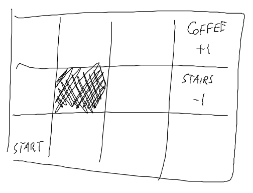
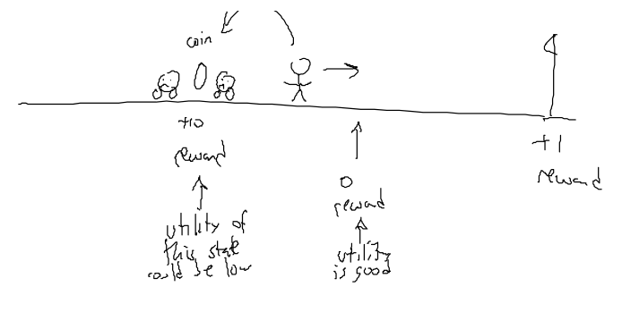
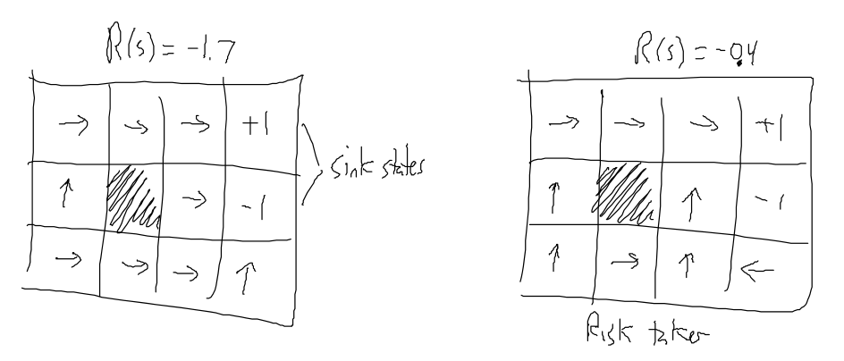
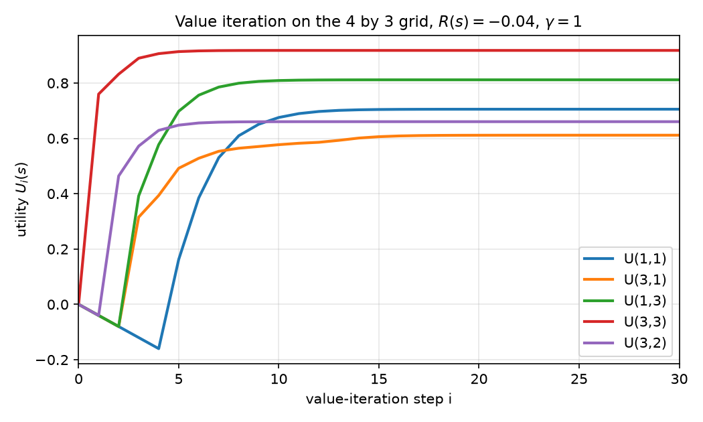
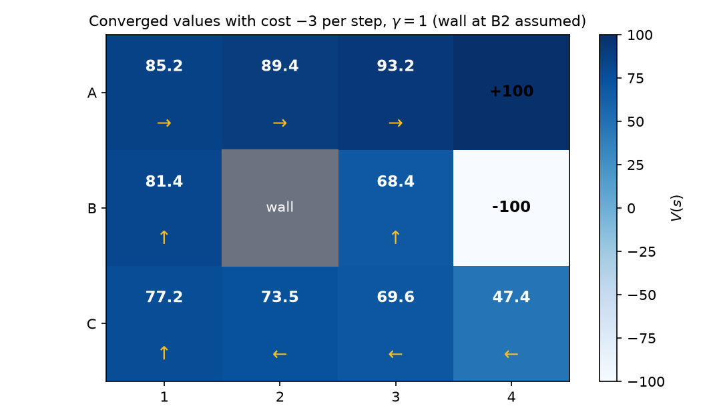

# Markov Decision Processes

Search assumes that actions have known effects and that the agent sees the whole state. Many real problems break both assumptions. A robot's wheels slip, so the same command can leave it in different places, but the robot can still see where it is. A Markov decision process (MDP) is the model for that middle ground: the state is fully observed, the outcomes of actions are random, and the agent must choose an action in every state so as to maximise the reward it collects over time. The answer to an MDP is a policy, a rule that gives an action for each state, not a single sequence of moves. This chapter introduces the model, the Bellman equation that characterises optimal behavior, and value iteration, the most direct way to compute it. The worked numbers come from a small grid world, and the chapters that follow compute more examples by hand.

The model is the stochastic, fully observable branch of planning. Its partially observable counterpart, where the agent must infer the state from observations, is treated in [Filtering over Time and Belief States](filtering.md) and in [Partially Observable MDPs](../cs7642-reinforcement-learning/pomdps.md).

## Decisions Under Uncertainty

Start with a one-shot decision. An action \\(a\\) has several possible results, and each result \\(\text{result}\_i(a)\\) has a probability and a utility. The expected utility of the action is

\\[
EU(a) = \sum\_{i=1}^{N} P(\text{result}\_i(a)) \\, U(\text{result}\_i(a)).
\\]

The rule is to pick the action with the highest expected utility. A worked comparison makes the arithmetic concrete. Consider a lottery with a win worth \\(U = 10^6\\) and a loss worth \\(U = -5\\), where the win has probability \\(1/(125 \times 10^6) = 8 \times 10^{-9}\\). Its expected utility is

\\[
EU(\text{lottery}) = 8 \times 10^{-9} \cdot 10^{6} + (1 - 8 \times 10^{-9})(-5) = 0.008 - 5 + 4 \times 10^{-8} \approx -4.992.
\\]

Buying a candy bar gives "yum" with probability 0.999 and utility 10, and "stuck" with probability 0.001 and utility \\(-5\\). Its expected utility is \\(0.999 \cdot 10 + 0.001 \cdot (-5) = 9.985\\). The candy bar is chosen. The win branch is so improbable that its large utility contributes almost nothing, and the loss branch dominates. The utilities here are the designer's scores for each outcome, not dollars.

The one-shot case is an episode of length one. The problems of this chapter are sequential: the agent takes a sequence of actions, and each action changes the state from which the next one is taken.

## The Grid World

The running example is a grid four columns wide and three rows high. Cells are named by their coordinates \\((x, y)\\), with \\((1, 1)\\) at the bottom left and \\((4, 3)\\) at the top right. The start is \\((1, 1)\\). Cell \\((4, 3)\\) is a terminal state with reward \\(+1\\) (labeled COFFEE in the source), cell \\((4, 2)\\) is a terminal state with reward \\(-1\\) (STAIRS), and cell \\((2, 2)\\) is a wall that the agent cannot enter.

*Figure: the grid world as drawn in the source. The hatched cell is a wall. Each action goes in the intended direction with probability 0.8 and drifts to each perpendicular side with probability 0.1. The two labeled cells are terminal.*

Each action moves the agent in the intended direction with probability 0.8. It drifts to the left with probability 0.1 and to the right with probability 0.1, relative to the intended direction. A move into a wall or off the grid leaves the agent where it was. This convention is stated in the source only implicitly, through the arithmetic, but it is the one used throughout.

The noise makes a fixed plan unreliable. Suppose the planner chooses Up, Up, Right, Right, Right, Right, Right, Up, Up, Right, which is a path from the start to the coffee cell. Each step can drift sideways, and after one drift the remaining moves no longer lead to the goal. The margin of the source puts it plainly: if a move fails, replanning is expensive. A **policy** avoids replanning by giving the best action for every state the agent might reach:

\\[
\pi : S \rightarrow A, \qquad \pi(s) = a.
\\]

The policy does not depend on how the agent got to \\(s\\). This is the **Markov assumption**: to choose the best action, the agent needs to know only where it is, not its history. The assumption applies to executing the policy. Computing the policy is a different matter. It depends on the whole model, so the computation as a whole is not Markovian.

## The Formal Model

An MDP consists of the following parts.

- A set of states \\(S\\), some of which are terminal ("sink") states, and an initial state \\(s\_0 \in S\\).
- A set of actions \\(A\\).
- A transition function \\(T(s, a, s') = P(s' \mid s, a)\\): the probability of arriving in \\(s'\\) after action \\(a\\) is taken in \\(s\\). For each \\(s\\) and \\(a\\) these probabilities sum to 1 over \\(s'\\).
- A reward function \\(R : S \rightarrow \mathbb{R}\\), giving the immediate "goodness" of being in each state.

The transition function captures the stochastic action model. For the grid, the row for state \\((1, 1)\\) and action Up gives probability 0.8 to \\((1, 2)\\), the intended cell. The left drift is blocked by the boundary, so it leaves the agent in \\((1, 1)\\) with probability 0.1. The right drift goes to \\((2, 1)\\) with probability 0.1. The three probabilities sum to 1, as they must.

The objective is to choose a policy that maximises the expected sum of rewards. The rewards are collected along a random trajectory, and the expectation is taken over the noise. The reward function is what defines optimality. A policy that is best under one reward may be poor under another, and the next section shows this in the grid world.

## Reward Is Not Utility

Two quantities need to be kept apart. **Reward** is a number attached to a state: the points for being there. **Utility** is future-looking: it measures how much reward the agent can expect to collect from a state onward. The two can differ sharply. A Mario-style cartoon in the source shows a state with a coin between two enemies. The coin carries a reward of +10, but the state leads into danger, so its utility is low. A neighboring state with no reward leads to a good future, so its utility is high. The flagpole at the end has a reward of +1.

*Figure: reward is local to a state, while utility sums the reward reachable from it. The coin state has high reward and low utility because it leads toward the enemies.*

Utility of a state sequence \\([s\_0, s\_1, \dots, s\_N]\\) can be defined in two ways. The **additive** form is

\\[
U([s\_0, s\_1, \dots, s\_N]) = R(s\_0) + R(s\_1) + \dots + R(s\_N).
\\]

For an infinite sequence this sum can diverge. The **discounted** form, with discount factor \\(0 < \gamma \le 1\\), weights later rewards less:

\\[
U([s\_0, s\_1, \dots, s\_N]) = R(s\_0) + \gamma R(s\_1) + \gamma^2 R(s\_2) + \dots + \gamma^N R(s\_N).
\\]

When \\(\gamma < 1\\) and every reward satisfies \\(\|R(s)\| \le R\_{\max}\\), the discounted sum of an infinite sequence is bounded by \\(R\_{\max}/(1 - \gamma)\\). Discounting therefore makes the objective finite, and it expresses a preference for near rewards over distant ones.

### The optimal policy depends on the reward

Keep the transition model of the grid world and vary a constant reward \\(R(s)\\) on every non-terminal state. The optimal policy changes with the reward. The source draws four panels, and they can be checked by computing the optimal policy for each reward value with value iteration (described below).

*Figure: optimal policies for constant living rewards, as drawn in the source. The top-left panel uses \\(R = -1.7\\), the top-right panel \\(R = -0.4\\) (labeled risk taker), the bottom-left \\(R = -0.01\\), and the bottom-right \\(R = 2\\). Arrows show the optimal action in each non-terminal cell.*

Reading the figure against the computed policies resolves a label that the source leaves unclear. The top-right panel is labeled \\(R(s) = -0.4\\). Running value iteration with \\(R = -0.4\\) gives, along the bottom row, Up, Right, Up, Left, which is exactly the drawing. Running it with \\(R = -0.04\\) gives Up, Left, Left, Left instead. The panel is therefore the \\(-0.4\\) policy, and the name "risk taker" is justified. With a large cost per step, the agent prefers the short route up the third column, beside the \\(-1\\) cell, to the long safe route along the bottom. With a small cost, as at \\(-0.01\\) and \\(-0.04\\), the cost of extra steps is small, and the agent takes the safer route.

The utility table printed in the source (values 0.812, 0.868, 0.918, and so on) is the one for \\(R = -0.04\\). Computing it gives 0.812, 0.868, 0.918 across the top row, 0.762 and 0.660 in the middle row, and 0.705, 0.655, 0.611 and 0.388 along the bottom. The printed entries 0.866, 0.668 and 0.635 are most likely misreadings of 0.868, 0.660 and 0.655. The reward value of the table is not stated on the slide, and the computation supplies it.

## Optimality and the Bellman Equation

The best value of a state is the best expected discounted utility from it. The recursive form of the utility is the **Bellman equation**:

\\[
U(s) = R(s) + \gamma \max\_{a \in A} \left( \sum\_{s' \in S} T(s, a, s') \\, U(s') \right).
\\]

The equation says that the utility of a state is its immediate reward plus the discounted value of the best action, where the value of an action is the expected utility of its successor states. The \\(\max\\) is taken over the agent's actions, and the sum is taken over the random outcomes of the chosen action. This is why the update has a maximum outside and an expectation inside.

Once the utilities are known, the optimal policy is the action that maximises the expected utility of the successors:

\\[
\pi^{\*}(s) = \underset{a \in A}{\arg\max} \left( \sum\_{s' \in S} T(s, a, s') \\, U(s') \right).
\\]

Because \\(R(s)\\) and \\(\gamma\\) do not depend on \\(a\\), they can be dropped from the argmax. The Bellman equation does not have a closed-form solution in general, which is why an iterative method is used.

## Value Iteration

Value iteration computes the utilities by repeating the Bellman equation as an update. Start with an initial guess for every state, set each terminal state to its reward, and then sweep over the non-terminal states, updating each by

\\[
U\_{i+1}(s) = R(s) + \gamma \max\_{a \in A} \left( \sum\_{s' \in S} T(s, a, s') \\, U\_i(s') \right).
\\]

After many sweeps the values stop changing. The fixed point satisfies the Bellman equation, and the policy is read off with \\(\pi^{\*}\\). The source states that this process converges and that the limit is the true utility, which is the standard result for discounted MDPs with \\(\gamma < 1\\), and for the undiscounted grid as long as the agent reaches a terminal state with probability 1.

The source describes value iteration as propagation of reward. The value of a state picks up reward from the states that can be reached from it, and only the fraction that actually reaches those states propagates, because the agent may not end up where it intended.

### A worked sweep on the grid

Use \\(R(s) = -0.04\\) for the non-terminal states and \\(\gamma = 1\\), so that the numbers are easy to check. The terminal values are \\(U(4, 3) = +1\\) and \\(U(4, 2) = -1\\), and all other states start at 0.

For the cell \\((3, 3)\\), the first sweep compares the four actions. Right sends the agent to \\((4, 3)\\) with probability 0.8. The two drifts are up, which goes off the grid and leaves the agent in place, and down, which goes to \\((3, 2)\\) with value 0. The expected value of Right is therefore \\(0.8 \cdot 1 + 0.1 \cdot 0 + 0.1 \cdot 0 = 0.8\\). The other actions are no better. So

\\[
U\_1(3, 3) = -0.04 + 0.8 = 0.76.
\\]

The second sweep uses the values from the first. Right now has expected value \\(0.8 \cdot 1 + 0.1 \cdot 0.76 + 0.1 \cdot (-0.04) = 0.872\\), because the cell below \\((3, 3)\\) is now \\((3, 2)\\) with value \\(-0.04\\). So \\(U\_2(3, 3) = -0.04 + 0.872 = 0.832\\). Continuing gives 0.8896 after three sweeps, and the values converge to 0.918 for this cell.

*Figure: the utility of five cells over value-iteration steps for the grid with \\(R = -0.04\\) and \\(\gamma = 1\\). Each curve rises or falls to its fixed value within about twenty-five sweeps.*

The fixed point of this sweep is the converged table given above. Cells near the \\(+1\\) goal have high utility, and the cells near the \\(-1\\) cell have lower utility. The policy, read off with the argmax, goes up the left column and then east along the top row to the coffee cell, avoiding the stairs. The arrows along the bottom row point back west, toward the left column.

## A Cost Model on a Larger Grid

The source also works with a grid whose terminal states are \\(+100\\) and \\(-100\\), and whose every other state costs 3 per step. The layout is the same 3 by 4 arrangement, with rows A (top), B and C (bottom), and columns 1 to 4. The \\(+100\\) state is A4 and the \\(-100\\) state is B4. The wall is not placed in the source, so the calculations here put it at B2, a placement that reproduces the spoken values listed below.

*Figure: converged values with a cost of 3 per step and \\(\gamma = 1\\), computed by value iteration with the wall at B2. Arrows show the optimal action for each cell. The policy takes the risk of the \\(-100\\) cell where the step cost makes it worth while.*

Begin with the deterministic version, in which the chosen action always succeeds. The first backup of A3 with the action East gives \\(V(A3) = 100 - 3 = 97\\) after one sweep. The value of B3 becomes \\(97 - 3 = 94\\) after A3 has been updated, because North from B3 leads to A3. The value of C1 after convergence is 85: the shortest path from C1 to A4 has five steps, and each costs 3, so \\(100 - 3 \cdot 5 = 85\\). In the deterministic case the value of a state equals \\(100\\) minus three times its distance to the goal.

With stochastic moves the first backup of A3 is

\\[
V(A3) = 0.8 \cdot 100 + 0.1 \cdot 0 + 0.1 \cdot 0 - 3 = 77.
\\]

The 0.2 of probability that does not reach A4 is spread over the stay and slip outcomes, each of which has value 0 at this stage. The first backup of B3, after A3 has value 77 and B4 has value \\(-100\\), gives two candidates. North gives \\(0.8 \cdot 77 + 0.1 \cdot (-100) + 0.1 \cdot 0 - 3 = 48.6\\). West gives \\(0.1 \cdot 77 + 0.8 \cdot 0 + 0.1 \cdot 0 - 3 = 4.7\\). North is better, even though it risks the \\(-100\\) cell, because the \\(77\\) state is one step away.

The converged values reproduce the spoken sequence. In decreasing order of value they are A3 = 93.2, A2 = 89.4, A1 = 85.2, B1 = 81.4, C1 = 77.2, C2 = 73.5, C3 = 69.6, B3 = 68.4 and C4 = 47.4. The source's values of 93, 89, 85, 81, 77, 73, 70, 68 and 47 are these numbers rounded, and the cell names are the ones this layout gives.

### Discounting and the choice of backups

The source introduces a discount factor \\(\gamma\\) and gives the value 0.9 once, as an example of the discounted objective. The objective is to maximise the expected discounted sum of rewards, so that the reward \\(R\_t\\) received at time \\(t\\) has weight \\(\gamma^t\\):

\\[
\max\_{\pi} \\; \mathbb{E}\Big[\sum\_{t} \gamma^{t} R\_t \\;\Big\|\\; \pi \Big].
\\]

The worked backups above use \\(\gamma = 1\\), and this is required by their numbers. With \\(\gamma = 0.9\\) the first backup of A3 would be \\(-3 + 0.9 \cdot 0.8 \cdot 100 = 69\\), not 77. The discounted value is therefore not the one that the backup numbers show. Discounting plays a similar role to the step cost: it makes a path that reaches the goal sooner worth more. The source's examples use the step cost rather than the discount.

### Values of a policy

For a fixed policy \\(\pi\\), the value of a state is the expected discounted sum of rewards from that state:

\\[
V^{\pi}(s) = \mathbb{E}\Big[\sum\_{t} \gamma^{t} R\_t \\;\Big\|\\; s\_0 = s, \\; \pi\Big].
\\]

One can estimate this by simulating the agent under the policy many times and averaging the rewards until it reaches a terminal state. The average is well defined for every state and every policy, even when the agent wanders back and forth. Value functions are the central object of MDP algorithms: better values give better policies, and the policy is improved by taking the action that maximises the expected successor value.

### How the cost changes the policy

The source compares three cost models on the same grid.

- **Cost of \\(-3\\) per step, \\(\gamma = 1\\).** The policy runs along the top row toward the goal, and it takes a 10 percent risk of the \\(-100\\) cell below the goal, because going the long way round costs more.
- **Cost of 0 per step.** Every state that can reach \\(+100\\) safely converges to 100. Time spent does not matter, so the agent waits as long as needed. Without step costs the safe-route answers are different: the best action at C4 is South, which keeps the agent in place with probability 0.9, and the best action at B3 is West, which avoids the \\(-100\\) cell.
- **Cost of \\(-200\\) per step.** Each step costs more than the \\(-100\\) penalty, so the agent ends the episode as quickly as possible, even by stepping into \\(-100\\). The source calls this extreme, and the reason for choosing such a penalty is not clear.

The lesson is that the reward model sets the behavior. Two reward functions that look similar can produce very different policies, and the designer must check the policy the reward produces.

## Summary

- An MDP has fully observed states, stochastic transitions \\(T(s, a, s')\\) and rewards \\(R(s)\\). A policy maps each state to an action.
- Reward is local to a state. Utility is the expected discounted sum of future reward. The discounted sum is bounded by \\(R\_{\max}/(1 - \gamma)\\) when \\(\gamma < 1\\).
- The Bellman equation \\(U(s) = R(s) + \gamma \max\_a \sum\_{s'} T(s, a, s') U(s')\\) characterises utility, and the optimal policy is the argmax of the expected successor utility.
- Value iteration applies the Bellman update repeatedly. It converges to the optimal utilities, and the policy is read off from them.
- On the 4 by 3 grid with \\(R = -0.04\\) the utilities are 0.812 to 0.918 near the goal and fall to 0.388 at the far corner. The policy changes with \\(R\\): the panel labeled \\(-0.4\\) is the risk-taking policy.
- On the cost grid with a cost of 3 per step, the values run from 93.2 next to the goal to 47.4 in the far corner. The step cost makes the agent take risks near the \\(-100\\) cell.

## References

- Russell, S. and Norvig, P., *Artificial Intelligence: A Modern Approach*. The 4 by 3 grid world and its utility values are the standard textbook example of this chapter.

## See Also

- [MDP Examples and Value Iteration](mdp-examples.md): micro-blackjack, a pursuit-evasion game and two-step value iteration on a 2 by 2 grid.
- [Q-Learning and Reinforcement Learning Practice](q-learning.md): learning the values from experience when the transition model is unknown.
- [Logic and Planning](logic-and-planning.md): the deterministic and belief-state planning that this chapter extends to stochastic actions.
- [MDP Framework](../cs7642-reinforcement-learning/mdp-framework.md): the formal treatment, with state-action values and horizons.
- Dynamic Programming: the general method that value iteration is an instance of.
- Reinforcement Learning: the one-page overview of the field that MDPs underpin.
