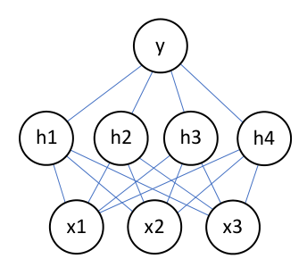
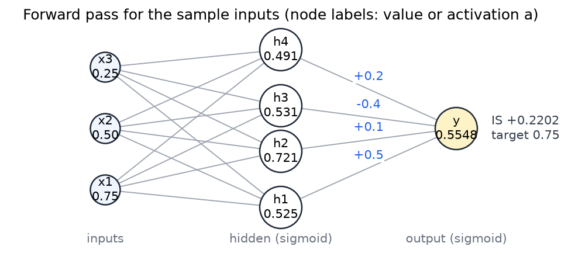
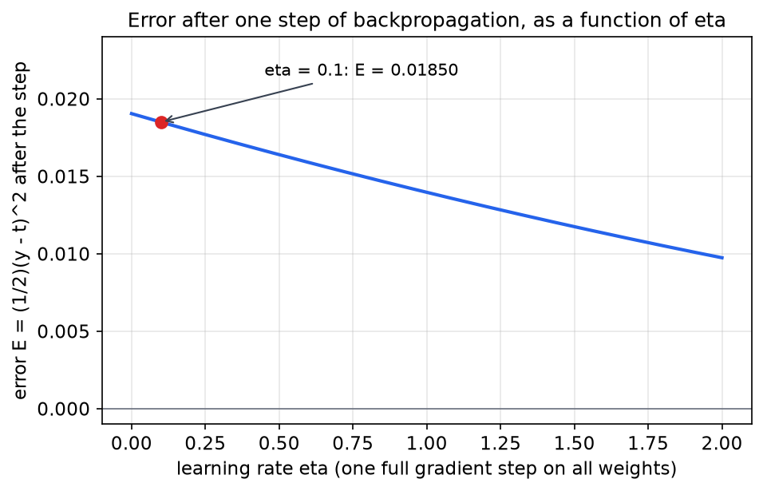

# Worked Neural-Network Exercises

Backpropagation is easy to state and easy to get subtly wrong. A small network, carried through one complete training step with every number written out, is the best way to check that the chain rule, the sign conventions and the bias terms are all understood. This chapter works one step for a three-input, four-hidden-neuron, one-output network of sigmoid units: the forward pass, the error, the backward pass for every weight and every bias, and an independent check on the result. The derivation rests on the general theory in [Backpropagation and Network Architectures](backpropagation.md), and the building blocks (neurons, perceptrons and feedforward networks) are in [Neurons, Perceptrons, and Feedforward Networks](neural-network-basics.md). Several worked solutions to this exercise circulate with small errors. Where they disagree, the chapter states which value it uses and why.

## The network and its conventions

The network has three inputs \\(x\_1, x\_2, x\_3\\), a hidden layer of four neurons \\(h\_1, h\_2, h\_3, h\_4\\), and one output neuron \\(y\\). Every neuron uses the logistic sigmoid

\\[
\sigma(z) = \frac{1}{1 + e^{-z}}, \qquad \sigma'(z) = \sigma(z)\bigl(1 - \sigma(z)\bigr).
\\]

The derivative identity is worth proving once. Differentiating gives \\(\sigma'(z) = e^{-z}/(1+e^{-z})^2\\). Writing this as the product \\(\frac{1}{1+e^{-z}} \cdot \frac{e^{-z}}{1+e^{-z}}\\) and noting that \\(\frac{e^{-z}}{1+e^{-z}} = 1 - \sigma(z)\\) gives the second form. Because \\(\sigma'\\) is expressed in terms of the activation itself, the backward pass needs only the stored activations and never has to recompute the sigmoid.

*Figure: the architecture of the exercise network, cropped from the exercise sheet. Each line is one weight. There are twelve weights from the three inputs to the four hidden neurons and four weights from the hidden neurons to the output. Each neuron also has a bias weight, which the sheet describes but does not draw.*

The weight from input \\(x\_i\\) to hidden neuron \\(h\_j\\) is written \\(W^{(1)}\_{ij}\\). The weight from hidden neuron \\(h\_j\\) to the output is \\(W^{(2)}\_j\\). Each neuron has a bias weight \\(W\_b\\) attached to a constant input of \\(-1\\). The net input (also called the input strength) of a neuron is therefore

\\[
z = \sum\_i (\text{input}\_i)\\, W\_i \\;-\\; W\_b ,
\\]

with the bias entering with a minus sign. Its derivative with respect to the bias is \\(\partial z / \partial W\_b = -1\\). This is the convention the exercise states: each bias weight can be adjusted independently, and the net input of each neuron includes the term \\(-W\_b\\). All bias weights start at zero, so for the first forward pass they contribute nothing.

The error for one training example is

\\[
E = \tfrac12 (y - t)^2 ,
\\]

with target \\(t = 0.75\\). The factor \\(\tfrac12\\) cancels the 2 produced by differentiating the square, so \\(\partial E / \partial y = y - t\\). The sheet defines the error as a sum over output neurons, \\(\sum\_i \tfrac12 (y\_i - t\_i)^2\\). With one output there is one term. The learning rate is \\(\eta = 0.1\\).

The initial parameters are:

| Input | \\(h\_1\\) | \\(h\_2\\) | \\(h\_3\\) | \\(h\_4\\) |
|---|---|---|---|---|
| \\(x\_1\\) | 0.5 | 1 | -0.5 | 0.75 |
| \\(x\_2\\) | -0.5 | 0.1 | 0.75 | -1 |
| \\(x\_3\\) | -0.1 | 0.6 | 0.5 | -0.4 |

The weights from the hidden neurons to the output are \\(W^{(2)} = (0.5,\ 0.1,\ -0.4,\ 0.2)\\) for \\(h\_1, \dots, h\_4\\). The input vector for this example is \\(x = (0.75,\ 0.5,\ 0.25)\\).

## The forward pass

The forward pass computes, in order, the net input and activation of each hidden neuron and then of the output. For a hidden neuron, the net input is the weighted sum of the inputs minus the bias weight. With the biases at zero, the net input of \\(h\_j\\) is \\(\sum\_i x\_i W^{(1)}\_{ij}\\).

- \\(z\_{h\_1} = 0.5(0.75) - 0.5(0.5) - 0.1(0.25) = 0.375 - 0.250 - 0.025 = 0.100\\)
- \\(z\_{h\_2} = 1(0.75) + 0.1(0.5) + 0.6(0.25) = 0.750 + 0.050 + 0.150 = 0.950\\)
- \\(z\_{h\_3} = -0.5(0.75) + 0.75(0.5) + 0.5(0.25) = -0.375 + 0.375 + 0.125 = 0.125\\)
- \\(z\_{h\_4} = 0.75(0.75) - 1(0.5) - 0.4(0.25) = 0.5625 - 0.500 - 0.100 = -0.0375\\)

The activations are \\(a\_{h\_j} = \sigma(z\_{h\_j})\\):

\\[
a\_{h\_1} = \sigma(0.100) = 0.524979, \quad
a\_{h\_2} = \sigma(0.950) = 0.721115, \quad
a\_{h\_3} = \sigma(0.125) = 0.531209, \quad
a\_{h\_4} = \sigma(-0.0375) = 0.490626 .
\\]

The check on \\(a\_{h\_4}\\) is \\(1/(1 + e^{0.0375}) = 1/2.038212 = 0.490626\\). The output neuron takes the hidden activations as its inputs:

\\[
z\_y = 0.5(0.524979) + 0.1(0.721115) - 0.4(0.531209) + 0.2(0.490626) = 0.220243 ,
\\]

\\[
y = \sigma(0.220243) = 0.554839 .
\\]

The error is

\\[
E = \tfrac12 (0.554839 - 0.75)^2 = \tfrac12 (0.195161)^2 = \tfrac12 (0.038088) = 0.019044 .
\\]

The sheet already gives this error as 0.0190. That agreement confirms the \\(\tfrac12\\) in the definition, because without it the value would be 0.038.

*Figure: the forward pass for the sample inputs. Node labels show the input values on the left and the activations of the hidden neurons and the output. The four labels between the hidden neurons and the output are the weights \\(W^{(2)}\\). Net inputs are given in the table below, not in the figure.*

The forward-pass results are collected here.

| Neuron | Net input | Activation |
|---|---|---|
| \\(h\_1\\) | 0.100000 | 0.524979 |
| \\(h\_2\\) | 0.950000 | 0.721115 |
| \\(h\_3\\) | 0.125000 | 0.531209 |
| \\(h\_4\\) | -0.037500 | 0.490626 |
| \\(y\\) | 0.220243 | 0.554839 |

**Resolution of a discrepancy in the solution key.** The typed answer key for this exercise lists the net input of \\(h\_1\\) as 1.0 and that of \\(h\_4\\) as -0.375. Direct arithmetic gives 0.1 and -0.0375. The activations printed beside them in the key (0.525 and 0.491) are the values that 0.1 and -0.0375 produce, so the two input strengths are transcription errors and the activations are not affected. A worked solution marks the same two entries as corrections. This chapter uses 0.1 and -0.0375 throughout.

## The backward pass: the output layer

The gradient with respect to a weight \\(W^{(2)}\_j\\) from the hidden neuron \\(h\_j\\) to the output follows from the chain rule through the output's net input:

\\[
\frac{\partial E}{\partial W^{(2)}\_j}
= \frac{\partial E}{\partial y}\\,\frac{\partial y}{\partial z\_y}\\,\frac{\partial z\_y}{\partial W^{(2)}\_j}
= (y - t)\\, y(1 - y)\\, a\_{h\_j} .
\\]

The first two factors depend only on the output, so they are grouped into the output delta, \\(\delta\_y = (y - t)\\,y(1 - y)\\). The third factor is the activation feeding the weight. Each output-layer gradient is therefore \\(\delta\_y\\) times the activation at the weight's input. For this example,

\\[
y - t = -0.195161, \qquad y(1 - y) = 0.554839 \times 0.445161 = 0.246993 ,
\\]

\\[
\delta\_y = (-0.195161)(0.246993) = -0.048203 .
\\]

The update rule is \\(W \leftarrow W - \eta\\,\partial E/\partial W\\). Since \\(\delta\_y\\) is negative, each weight from an active hidden neuron increases. That moves the output toward the target of 0.75, which is above the current output of 0.5548. The four top weights become

- \\(W^{(2)}\_1 = 0.5 - 0.1(-0.048203)(0.524979) = 0.502531\\)
- \\(W^{(2)}\_2 = 0.1 - 0.1(-0.048203)(0.721115) = 0.103476\\)
- \\(W^{(2)}\_3 = -0.4 - 0.1(-0.048203)(0.531209) = -0.397439\\)
- \\(W^{(2)}\_4 = 0.2 - 0.1(-0.048203)(0.490626) = 0.202365\\)

The bias on the output has input \\(-1\\), so \\(\partial E / \partial W\_{b,y} = -\delta\_y\\). The update is then

\\[
W\_{b,y} \leftarrow W\_{b,y} - \eta(-\delta\_y) = 0 + \eta\\,\delta\_y = 0.1(-0.048203) = -0.0048203 .
\\]

The sign follows directly from the minus in the net input. A positive output delta would push the bias up, and the bias moves the net input down.

## The backward pass: the hidden layer

The hidden delta is the derivative of the error with respect to the hidden net input. The error reaches \\(h\_j\\) through the output, so

\\[
\delta\_{h\_j} = \frac{\partial E}{\partial z\_{h\_j}} = \delta\_y\\, W^{(2)}\_j\\, a\_{h\_j}(1 - a\_{h\_j}) .
\\]

This step must use the top weights as they were during the forward pass. The top weights change by between half a percent and 3.5 percent in one step, so computing the hidden deltas with the new weights would give a gradient that is visibly wrong, and a finite-difference check would detect it. The sigmoid factors are \\(a(1-a)\\):

- \\(h\_1\\): \\(0.524979 \times 0.475021 = 0.249376\\)
- \\(h\_2\\): \\(0.721115 \times 0.278885 = 0.201108\\)
- \\(h\_3\\): \\(0.531209 \times 0.468791 = 0.249026\\)
- \\(h\_4\\): \\(0.490626 \times 0.509374 = 0.249912\\)

With the old top weights, the four hidden deltas are

\\[
\delta\_{h\_1} = (-0.048203)(0.5)(0.249376) = -0.0060104 ,
\\]

\\[
\delta\_{h\_2} = (-0.048203)(0.1)(0.201108) = -0.00096941 ,
\\]

\\[
\delta\_{h\_3} = (-0.048203)(-0.4)(0.249026) = +0.0048016 ,
\\]

\\[
\delta\_{h\_4} = (-0.048203)(0.2)(0.249912) = -0.0024093 .
\\]

The gradient for a hidden weight \\(W^{(1)}\_{ij}\\) is \\(\partial E/\partial W^{(1)}\_{ij} = \delta\_{h\_j}\\, x\_i\\), because the input \\(x\_i\\) multiplies the weight in the net input. The update is \\(W^{(1)}\_{ij} \leftarrow W^{(1)}\_{ij} - \eta\\,\delta\_{h\_j}\\,x\_i\\). For the pair \\((x\_1, h\_1)\\):

\\[
W^{(1)}\_{11} = 0.5 - 0.1(-0.0060104)(0.75) = 0.5 + 0.00045078 = 0.500451 .
\\]

The full table of new hidden weights is:

| Input | \\(h\_1\\) | \\(h\_2\\) | \\(h\_3\\) | \\(h\_4\\) |
|---|---|---|---|---|
| \\(x\_1\\) | 0.500451 | 1.000073 | -0.500360 | 0.750181 |
| \\(x\_2\\) | -0.499699 | 0.100048 | 0.749760 | -0.999880 |
| \\(x\_3\\) | -0.099850 | 0.600024 | 0.499880 | -0.399940 |

The hidden bias weights have input \\(-1\\), so each one follows the same pattern as the output bias: \\(W\_{b,h\_j} \leftarrow \eta\\,\delta\_{h\_j}\\). The four values are

\\[
W\_{b,h\_1} = -0.00060104, \quad W\_{b,h\_2} = -0.0000969, \quad W\_{b,h\_3} = +0.00048015, \quad W\_{b,h\_4} = -0.00024093 .
\\]

**Resolution of the bias on \\(h\_1\\).** Three values for this bias appear across the worked solutions. One gives -0.0060049, another gives -0.00060049 from the formula it writes, and the typed key gives -0.00060104. The first is a decimal-place slip: the formula that the same solution writes produces a value a factor of ten smaller. The second is what the formula gives when it is evaluated with the rounded activations 0.525 and 0.555. The third is the full-precision value. This chapter states -0.00060104 and notes that the rounded working gives -0.00060050 in the fourth significant figure.

## The same step in matrix form

For larger networks the same steps are written with vectors and matrices, and that is the form implementations compute. Collect the hidden weights into the \\(3 \times 4\\) matrix \\(W^{(1)}\\), with rows for inputs and columns for hidden neurons, and write \\(\mathbf{x}\\), \\(\mathbf{a}\\) and \\(\mathbf{w}^{(2)}\\) for the input vector, the hidden activation vector and the output weight vector. The forward pass is then \\(\mathbf{z}\_h = W^{(1)\top}\mathbf{x} - \mathbf{w}\_b\\), \\(\mathbf{a} = \sigma(\mathbf{z}\_h)\\) and \\(z\_y = \mathbf{w}^{(2)\top}\mathbf{a} - w\_{b,y}\\), where \\(\mathbf{w}\_b\\) collects the hidden bias weights. The backward pass is

\\[
\boldsymbol{\delta}\_h = \delta\_y\\, \mathbf{w}^{(2)} \odot \mathbf{a} \odot (\mathbf{1} - \mathbf{a}), \qquad
\nabla\_{W^{(1)}} E = \mathbf{x}\\, \boldsymbol{\delta}\_h^{\top} ,
\\]

where \\(\odot\\) is the elementwise product. The first equation is the hidden-delta formula applied to all four neurons at once. The second is an outer product, so each entry of the gradient matrix is one input multiplied by one hidden delta.

For this example, \\(\delta\_y\\, \mathbf{w}^{(2)} = (-0.024102,\ -0.004820,\ 0.019281,\ -0.009641)\\). Multiplying this elementwise by \\(\mathbf{a} \odot (\mathbf{1} - \mathbf{a}) = (0.249376,\ 0.201108,\ 0.249026,\ 0.249912)\\) returns the four hidden deltas found above. The first row of the gradient matrix is the input \\(x\_1 = 0.75\\) times the hidden-delta vector, which is \\((-0.0045078,\ -0.0007271,\ 0.0036012,\ -0.0018070)\\). The update \\(W^{(1)} \leftarrow W^{(1)} - \eta\\,\nabla\_{W^{(1)}} E\\) then reproduces the table of new hidden weights in one matrix subtraction. The gradient of the hidden biases is \\(-\boldsymbol{\delta}\_h\\), the same statement as the scalar bias rule written as a vector.

Both passes cost about the same as one forward evaluation of the network, since each weight is touched a constant number of times. That is why backpropagation computes the gradient of every weight at a cost comparable to the forward pass, and why the matrix form is the one used in practice.

## Delta notation

Textbooks often use a different sign convention in which the delta is the negative of the one above. Define \\(\Delta\_j = -\delta\_j\\), so that \\(\Delta\_y = (t - y)\\,y(1 - y)\\) is positive here and the update becomes \\(W \leftarrow W + \eta\\, a\\, \Delta\\). The two conventions give identical weights, provided the sign is applied consistently. The hidden delta becomes \\(\Delta\_{h\_j} = a\_{h\_j}(1 - a\_{h\_j})\\,W^{(2)}\_j\\,\Delta\_y\\), and the update for a weight from a positive input is \\(W \leftarrow W + \eta\\, a\\, \Delta\\).

The bias case is where the sign error usually enters. A bias has input \\(-1\\), so its update is \\(W\_b \leftarrow W\_b - \eta\\,\Delta\\). With \\(\Delta\_{h\_1} = +0.0060104\\), this gives \\(W\_{b,h\_1} = -0.00060104\\), which agrees with the derivative form.

One worked solution, written in delta notation, gives \\(\Delta[h\_3] = -5.07 \times 10^{-3}\\). Recomputing the product \\(0.531 \times 0.469 \times (-0.4 \times 0.04816)\\) gives \\(-4.80 \times 10^{-3}\\), so the printed value is wrong. Its update for that delta is not used in the solution's listed weights. The same solution also writes the updated weight \\(W\_{h\_2,y}\\) as 0.1034. The exact value 0.103476 rounds to 0.1035 at four decimals, and the 0.1034 comes from truncation.

## Checking the arithmetic

Three independent checks support the values above.

First, a finite-difference check. Perturbing the output bias by \\(\pm 10^{-6}\\) and differencing the error gives \\(\partial E/\partial W\_{b,y} = 0.0482033\\), which equals \\(-\delta\_y\\) to the digits shown. The same test on the bias of \\(h\_1\\) gives \\(0.0060104 = -\delta\_{h\_1}\\), and on the weight \\((x\_1, h\_1)\\) it gives \\(-0.0045078 = \delta\_{h\_1}\\,x\_1\\). The signs and the factors are confirmed.

Second, descent. The error after one full step with \\(\eta = 0.1\\) is \\(E = 0.018497\\), down from 0.019044. The output moves from 0.5548 to 0.5577. The figure below plots the error after one step against the learning rate. Over the range shown the error falls monotonically, which is the expected behavior for a step small enough to stay in the region where the linear approximation holds.

*Figure: the error after one full gradient step, plotted against the learning rate \\(\eta\\). The horizontal axis is the step size and the vertical axis is the error after that step. The marked point at \\(\eta = 0.1\\) is the step used in this chapter, and the curve shows that larger steps lower the error further on this one example. A single example does not show whether larger steps are safe in general.*

Third, agreement with the typed key. The key gives the top weight \\(0.502531\\), the output bias \\(-0.0048203\\), the bias on \\(h\_1\\) as \\(-0.00060104\\) and the weight \\((x\_1, h\_1)\\) as \\(0.5004508\\). All of these match the values above to the digits shown.

## A second forward pass

Applying the updated parameters to the same input shows what one step accomplishes. The hidden net inputs become \\((0.101127,\ 0.950182,\ 0.124100,\ -0.037048)\\), the hidden activations become \\((0.525260,\ 0.721152,\ 0.530985,\ 0.490739)\\), and the output net input becomes \\(z\_y = 0.231676\\), so \\(y = 0.557661\\). The error falls to \\(E = 0.018497\\).

The output has moved by 0.0028 toward the target of 0.75, which is slow. The sizes of the updates explain why. The largest absolute change to a top weight is 0.0035, on the weight from \\(h\_2\\), which starts at 0.1. The largest change to a hidden weight is 0.00045. Two factors in the chain rule keep the hidden updates small. The output delta \\(\delta\_y = -0.048\\) is already scaled by \\(y(1-y) \approx 0.25\\). Each hidden delta is further multiplied by \\(a(1-a)\\), which is at most \\(\tfrac14\\) and equals \\(\tfrac14\\) only at \\(a = \tfrac12\\). A backward step through a sigmoid layer therefore shrinks the signal unless the weights that carry it are large. This is one reason the saturation of the sigmoid is a central concern for deeper networks, and it is taken up in the deep-learning treatment of training.

## Where each part of the exercise is worked

| Part of the exercise | Worked in |
|---|---|
| Question 1: forward pass | The forward pass, with the table of net inputs and activations |
| Question 2.a: error | The forward pass, where \\(E = 0.019044\\) is computed |
| Question 2.b: top-layer weights and output bias | The output-layer section |
| Question 2.c: hidden-layer weights and hidden biases | The hidden-layer section and the matrix form |
| Checks on the values | Checking the arithmetic and the second forward pass |

## Common errors this exercise exposes

The exercise is short enough that each error can be traced to its source.

- **Dropping the \\(\tfrac12\\).** The error is 0.0190 with the factor and 0.038 without it. The sheet's value confirms the factor.
- **Using updated top weights for the hidden deltas.** The hidden gradient depends on the weights that the forward pass used.
- **Rounding too early.** Carrying activations to three decimals changes the output delta from \\(-0.048203\\) to \\(-0.04816\\). The fourth digit of every update depends on this, so the full-precision values are the reference.
- **Sign of the bias update.** The bias input is \\(-1\\), so its gradient has the opposite sign to the gradient of a weight from a positive input with the same local delta.
- **Confusing net input and activation.** The derivative \\(a(1-a)\\) uses the activation, while the net input is needed only for the forward pass.

## Summary

- The net input of a neuron is the weighted sum of its inputs minus its bias weight, so the bias gradient is minus the local delta.
- For the sample inputs \\((0.75, 0.5, 0.25)\\), the hidden net inputs are \\(0.100, 0.950, 0.125, -0.0375\\), the hidden activations are \\(0.524979, 0.721115, 0.531209, 0.490626\\), and the output is \\(y = 0.554839\\).
- The squared error is \\(E = \tfrac12(y - t)^2 = 0.019044\\), which matches the value on the sheet.
- The output delta is \\(\delta\_y = (y - t)\\,y(1 - y) = -0.048203\\). The top weights become \\(0.502531, 0.103476, -0.397439, 0.202365\\), and the output bias becomes \\(-0.0048203\\).
- The hidden deltas, computed with the old top weights, are \\(-0.0060104, -0.00096941, +0.0048016, -0.0024093\\). The hidden weight \\((x\_1, h\_1)\\) becomes \\(0.500451\\), and the hidden bias on \\(h\_1\\) becomes \\(-0.00060104\\).
- The solution key's typos in the net inputs of \\(h\_1\\) and \\(h\_4\\) and the rounding slips in some worked solutions are resolved by direct computation. This chapter uses full-precision values throughout.

## See Also

- [Backpropagation and Network Architectures](backpropagation.md): the general derivation and the architectures this exercise instantiates.
- [Neurons, Perceptrons, and Feedforward Networks](neural-network-basics.md): the neuron model and the threshold units behind the forward pass.
- [Backpropagation and Training](../cs7643-deep-learning/backpropagation.md): vectorized and automatic-differentiation forms of the same chain rule.
- Neural Networks: the shallow-network overview.
