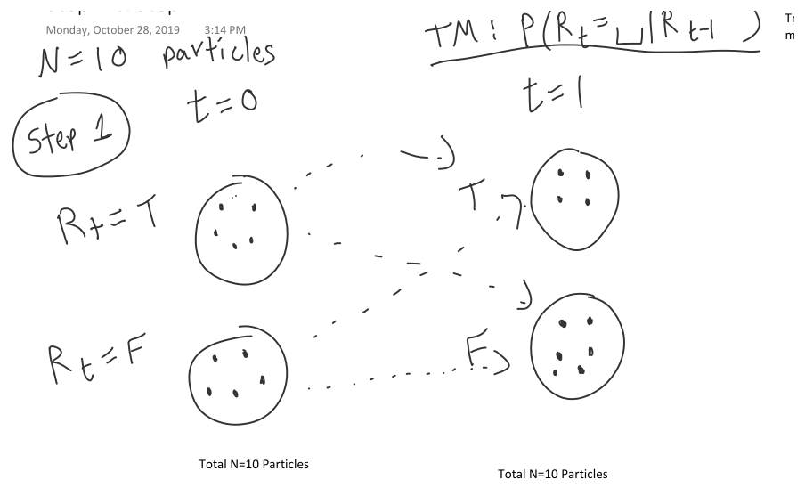
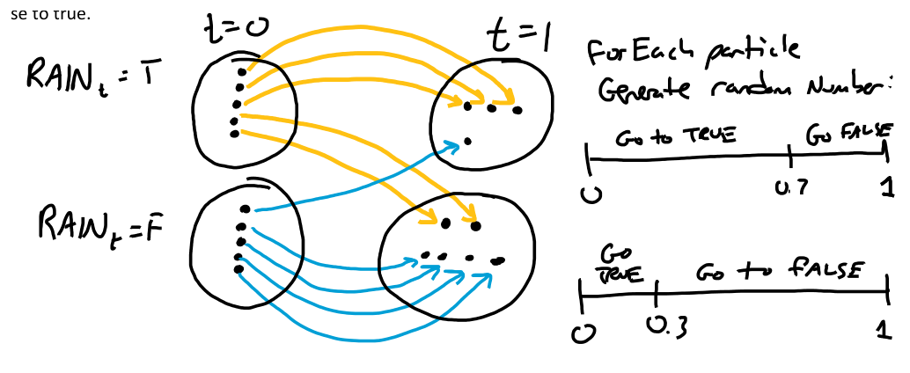
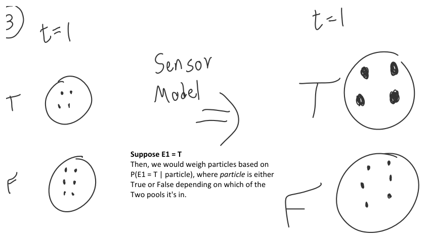
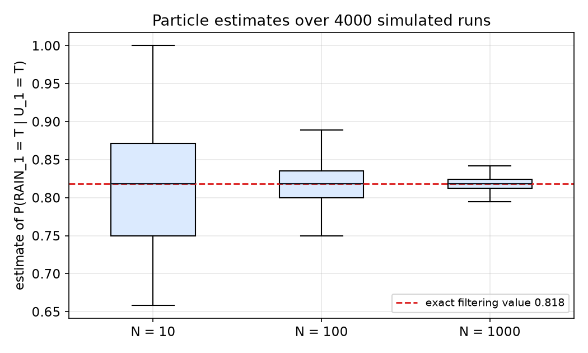

# Particle Filtering

The [filtering chapter](filtering.md) computed the belief over a hidden state exactly, by a sum over the previous states followed by a multiplication by the sensor model. That is cheap when the state is one variable with a handful of values, and expensive when the state has many variables. A **particle filter** replaces the exact belief with a set of samples, called particles, that are moved forward in time, reweighted by the evidence, and resampled. The cost of each step is set by the number of particles rather than by the size of the state space, at the price of sampling error. This chapter derives the algorithm, works it through on the umbrella world with ten particles, and shows how the error shrinks as the number of particles grows.

## Why Exact Filtering Becomes Expensive

For a single hidden variable \\(X\\) with \\(k\\) values, the forward recursion of the filtering chapter costs about \\(k^2\\) operations per step: for each successor value we sum over the \\(k\\) predecessors. That is trivial for the umbrella world, where \\(k = 2\\).

Now let the state consist of \\(n\\) variables, each with \\(k\\) values, as in a dynamic Bayesian network with several hidden quantities. The joint belief has \\(k^n\\) entries. A flat transition matrix over the joint state would have \\(k^{2n}\\) entries. For \\(n = 20\\) binary variables, the belief has \\(2^{20} = 1{,}048{,}576\\) entries and a flat transition matrix has \\(2^{40} \approx 1.1 \times 10^{12}\\). The factorization of the network removes much of this cost, and exact methods that exploit it exist, but their cost still grows exponentially in the worst case, and the growth is in the number of variables and the sequence length together.

The particle filter has a different cost profile. Each step handles \\(N\\) particles. Each particle is one sampled assignment of all the state variables, so the work per step grows with \\(N\\) and with the number of variables, not with the number of joint states. The price is that the belief is now an approximation.

## A Belief as a Set of Particles

A **particle** is a sampled value of the state. For a single variable it is a value such as "rain". For a network with several hidden variables, it is a complete assignment of all of them. Given \\(N\\) particles \\(x^{(1)}, \ldots, x^{(N)}\\), the belief is approximated by the empirical distribution
\\[
\hat{P}\_N(X = x) = \frac{1}{N} \sum\_{i=1}^{N} \mathbf{1}\big[x^{(i)} = x\big],
\\]
the fraction of particles that equal \\(x\\). The source describes this as particles "voting" for the state they are in. That is the right intuition: the counts of the votes are the belief.

The approximation is accurate for the same reason that the sample mean is accurate. If the true probability of an event is \\(p\\), the fraction of \\(N\\) independent particles that fall in the event has mean \\(p\\) and standard error
\\[
\sqrt{\frac{p(1-p)}{N}}.
\\]
For \\(p = 0.8\\) the standard error is about 0.127 with \\(N = 10\\), 0.040 with \\(N = 100\\), and 0.013 with \\(N = 1000\\). Each factor of 10 in particles reduces the error by a factor of about \\(\sqrt{10} \approx 3.2\\). Halving the error needs four times as many particles. The source says only that more particles give better accuracy, and does not give a rate. The rate \\(1/\sqrt{N}\\) is the standard one for sampling a single probability.

## The Five-Step Algorithm

The algorithm has five steps. The source gives them as an outline.

1. Take samples according to a distribution. The samples are the particles.
2. **Propagation**: let the particles flow to successor states, using the transition model.
3. **Weighting**: weight each particle by the sensor evidence.
4. **Resampling**: draw a new set of particles according to the weights.
5. Go to step 2.

Step 1 happens once, at the start. Steps 2 to 4 repeat at every time step. The source's pseudocode writes the loop explicitly. Here it is with the one correction the book needs: the initial particles are sampled from the prior \\(P(X\_0)\\), not from a uniform distribution. The two agree only when the prior is uniform.

```
Let N = number of particles
Let L = {p_1, ..., p_N} be the initial particles, each sampled from P(X_0)

for every time step t:
    for every particle p_i:
        q_i = sample from P(X_t | X_{t-1} = p_i)          # step 2: propagate
        w_i = P(e_t | X_t = q_i)                           # step 3: weight
    P(X_t = q_i) = w_i / sum_j w_j                         # normalize
    L = N new particles, each drawn from P(X_t)            # step 4: resample
```

The same loop in Python, for a discrete model with states indexed from zero, is short enough to show in full. The function takes the prior, the transition matrix, and the sensor model as arrays.

```python
import numpy as np

def particle_filter(evidence, N, prior, T, sensor, rng):
    n_states = len(prior)
    states = np.arange(n_states)
    particles = rng.choice(states, size=N, p=prior)        # step 1: sample from the prior
    beliefs = []
    for e in evidence:
        # step 2: propagate each particle through the transition model
        particles = np.array([rng.choice(states, p=T[x]) for x in particles])
        # step 3: weight each particle by the sensor model
        w = sensor[e][particles]
        # belief estimate: weighted fraction of particles in each state
        belief = np.bincount(particles, weights=w, minlength=n_states)
        beliefs.append(belief / belief.sum())
        # step 4: resample N particles in proportion to their weights
        particles = rng.choice(particles, size=N, p=w / w.sum())
    return beliefs
```

For the umbrella world the arguments are `prior = np.array([0.5, 0.5])`, `T = np.array([[0.7, 0.3], [0.3, 0.7]])`, and `sensor = {"umbrella": np.array([0.9, 0.2]), "none": np.array([0.1, 0.8])}`, with state 0 meaning rain and state 1 meaning no rain. Calling it with `evidence = ["umbrella", "umbrella"]` and a large \\(N\\) returns beliefs close to the exact values 0.818 and 0.883 from the filtering chapter.

### Step 1: initialization

The initial particles are drawn from the prior. With a prior \\((0.5,\ 0.5)\\) and \\(N = 10\\), about five particles start in each state. The sample is random, so the split is random too. Nothing in the algorithm requires the split to be exact, which is why the sampling error must be measured, as it is below.

### Step 2: propagation

Each particle is moved by sampling its successor from the transition model. For a particle in state \\(x\\), the successor is drawn from the row \\(P(X\_t \mid X\_{t-1} = x)\\). The source describes this as the particles "flowing" through pipes, with thick pipes for likely transitions.

The source also gives a concrete rule for the umbrella world, which is exactly inverse-transform sampling for a two-outcome distribution. Draw a uniform number \\(u\\) in \\([0, 1]\\). A rain particle goes to rain if \\(u < 0.7\\) and to no rain otherwise. A no-rain particle goes to rain if \\(u < 0.3\\) and to no rain otherwise. The probability that \\(u\\) falls below the threshold is exactly the transition probability, so each particle moves with the correct probability.



*Figure: two pools of \\(N = 10\\) particles, for rain (T) and no rain (F). The dashed arrows carry each particle from time 0 to its successor at time 1 under the transition model. The counts in the pools are one random outcome, not expected values.*



*Figure: the transition rules for the umbrella world, drawn as number lines. A uniform number below 0.7 moves a rain particle to rain, and a uniform number below 0.3 moves a no-rain particle to rain. The colored arrows show a single propagation from time 0 to time 1.*

### Step 3: weighting

Each propagated particle is weighted by the sensor model evaluated at its state,
\\[
w\_i = P(e\_t \mid X\_t = x\_i).
\\]
Particles that are consistent with the evidence get large weights, and particles that contradict it get small ones. Only the ratio of the weights matters, so any common scale can be used.

The source uses two different sets of weights. A slide with a sketch of the pools uses 3 for the rain particles and 1 for the others. The practice exercise uses 90 and 20, which are the sensor probabilities \\(0.9\\) and \\(0.2\\) multiplied by 100. The pair 3 and 1 is illustrative: its ratio of 3 is not the ratio of the umbrella model. The ratio the model implies is \\(0.9 / 0.2 = 4.5\\), which 90 and 20 reproduce. This chapter uses 90 and 20 throughout, and all the numbers below come from them.



*Figure: the weighting step drawn as particle sizes. The rain particles are drawn larger because they have a higher sensor probability for the observed evidence. The size is a visual stand-in for the weight; the numbers used in the text are 90 and 20.*

### Step 4: normalization and resampling

The weights are normalized to give a distribution over the particles,
\\[
P(X\_t = x\_i) = \frac{w\_i}{\sum\_j w\_j}.
\\]
The distribution has two equivalent views. The index view gives each particle a probability, which is a histogram over the particle indices. The state view sums the particles in each state: the probability of rain is the total normalized weight of the rain particles. The two views describe the same distribution.

Resampling draws \\(N\\) new particles from this distribution, with replacement. The new particles have equal weight, so the weighting information is now carried by how many copies of each state survive. A rain particle with a large weight is copied more often, and a no-rain particle with a small weight is often not copied at all. The particle set returns to size \\(N\\), and the next propagation starts from it.

The source's toy example makes the mechanism concrete with weights 3 and 1 on ten particles. Four particles are rain particles with total weight \\(4 \times 3 = 12\\), and six are no-rain particles with total weight \\(6 \times 1 = 6\\). The rain particles therefore carry \\(12/18 = 2/3\\) of the normalized weight, and resampling is expected to produce about 6.7 rain particles and 3.3 no-rain particles. A single resampled draw in the source's sketch has 7 and 3.

## Worked Example: Ten Particles in the Umbrella World

We now run one full step of the algorithm for the umbrella network, with the observation \\(U\_1 = T\\), the prior \\((0.5,\ 0.5)\\), and \\(N = 10\\). The practice numbers are used throughout.

**Step 1.** Sample ten particles from the prior. The practice sketch shows five rain particles and five no-rain particles.

**Step 2.** Propagate. From a rain particle, the successor is rain with probability 0.7. From a no-rain particle, the successor is rain with probability 0.3. The expected number of rain particles after propagation is \\(5(0.7) + 5(0.3) = 5.0\\). The realized sample in the practice has four rain particles and six no-rain particles at time 1.

**Step 3.** Weight. Each rain particle has weight 90 and each no-rain particle has weight 20:
\\[
\text{rain: } 4 \times 90 = 360, \qquad \text{no rain: } 6 \times 20 = 120, \qquad \text{total } 480.
\\]
The particle estimate of the filtered probability of rain is
\\[
\hat{P}(R\_1 = T \mid U\_1 = T) = \frac{360}{480} = 0.75.
\\]

The exact value from the filtering chapter is \\(0.818\\). The practice's answer, 0.75, differs from it. The explanation is in the particle counts, not in the weights. With five particles in each state the same weights give
\\[
\frac{5 \times 90}{5 \times 90 + 5 \times 20} = \frac{450}{550} = 0.818,
\\]
which is exactly the filtering value. The sample contained one fewer rain particle than the expected five after propagation, and the estimate moves with it. This is sampling error, and with ten particles it is large. The approximation is correct on average but not for any particular run.

**Step 4.** Resample ten particles from the normalized weights. Each particle is drawn as rain with probability \\(360/480 = 0.75\\), so about 7.5 of the 10 new particles are expected to be rain particles. The practice describes this as "gravity": particles are drawn toward the state with more weight.

The next step repeats steps 2 to 4 with \\(U\_2 = T\\). The weights for the second observation are the same 90 and 20, because the sensor model does not change. The exact filtered value at time 2 is 0.883. A particle estimate at that step differs from it by sampling error, which depends on the realized particles. The practice describes the process as continuing "until we reach the time step we desire", and gives no further numbers.

A seeded run of the Python sketch above with ten particles gives estimates of 0.750 at time 1 and 0.947 at time 2. With 100,000 particles the same code gives 0.818 and 0.883, matching the exact filter to three decimals. The ten-particle run at time 2 is further from the exact value than the time-1 run, which is the expected behavior of sampling noise: each step adds its own error, and the resampling step does not remove the error that was already made.

## How Accurate Is the Approximation?

The per-run error of the particle estimate is random, so the useful question is how its distribution depends on \\(N\\). The figure below repeats the time-1 estimate \\(\hat{P}(R\_1 = T \mid U\_1 = T)\\) over 4,000 independent simulated runs for each of three particle counts. It uses the same weights 90 and 20 and the same transition model, with the prior sampled at each run.



*Figure: box plots of the particle estimate of the time-1 filtered probability of rain, over 4,000 simulated runs for each particle count. The box covers the middle half of the runs, and the whiskers the 5th to 95th percentiles. The dashed line is the exact value 0.818. The spread narrows as the number of particles grows.*

The simulation gives the following summary.

| Particles \\(N\\) | Mean of estimates | Standard deviation | 5th to 95th percentile |
|---|---|---|---|
| 10 | 0.798 | 0.109 | 0.659 to 0.947 |
| 100 | 0.816 | 0.030 | 0.765 to 0.861 |
| 1000 | 0.818 | 0.009 | 0.802 to 0.833 |

The standard deviation falls by about \\(3.2\\) for each tenfold increase in particles, which is the \\(1/\sqrt{N}\\) rate derived above. The mean at \\(N = 10\\) lies about 0.02 below the exact value. The weighted estimator is a ratio of random sums, so it is biased for small \\(N\\), and the bias disappears as \\(N\\) grows. The source's remark that the approximation is "not precise but fast" is the right summary: each run is noisy, and the noise is controlled by \\(N\\) alone.

## Failure Modes

Three things can go wrong, and each has a standard remedy.

**Weight degeneracy.** If the sensor model is very sharp, most of the normalized weight falls on a few particles. Resampling then makes many copies of those few, and the particle set loses diversity: the filter represents the belief by a handful of distinct states. A common diagnostic is the effective sample size \\(\left(\sum\_i w\_i\right)^2 / \sum\_i w\_i^2\\), which is \\(N\\) when the weights are equal and close to 1 when one weight dominates. Remedies used in practice include resampling only when the effective sample size falls below a threshold, and adding a small random perturbation to resampled particles. These are standard techniques rather than material in the source.

**Sampling error at small N.** This is the error the simulation measures. With ten particles the error is large enough that single-run estimates can be far from the exact value. The remedy is more particles, at a cost proportional to \\(N\\).

**Bias in the estimator.** The weighted estimate is a ratio, so its expectation is not the exact value for finite \\(N\\). The bias is small compared with the sampling error once \\(N\\) is in the hundreds, and it is not a reason to avoid the method.

## Particle Filters for Several State Variables

The algorithm applies unchanged to a dynamic Bayesian network with several hidden variables. A particle is then a full assignment of all of them. Propagation samples each variable in an order that respects the network, drawing each one from its conditional distribution given the sampled values of its parents at the previous step. The sensor model then weights the particle by the probability of all the observations at that time. Resampling works on the whole assignment.

The source's robot network, with battery, velocity and position variables and three kinds of sensor reading, has this structure, but the source does not work an example with it. The method is the same as in the umbrella example, with each particle now a longer tuple of values. Sampling each variable from the correct conditional is the part that needs care, and the sampling order must follow the network's arcs.

The particle filter does not need the joint distribution of the state to be stored, which is why it remains usable when exact methods are not. It does need enough particles to cover the regions of the state space where the belief has mass, and in high-dimensional problems that can require many particles.

## Summary

- The exact filter of the filtering chapter costs time that grows with the size of the joint state. A particle filter approximates the belief by \\(N\\) sampled particles, so its cost per step is set by \\(N\\).
- The five steps are: sample the initial particles from the prior, propagate each particle through the transition model, weight it by the sensor model, resample in proportion to the weights, and repeat.
- Propagation for a two-state chain is inverse-transform sampling: a rain particle stays in rain when a uniform number is below 0.7, and a no-rain particle moves to rain when a uniform number is below 0.3.
- The umbrella example uses weights 90 and 20, the sensor values times 100. With ten particles the time-1 estimate of rain is 0.75, against the exact 0.818. With five particles in each state the same weights give exactly 0.818, so the gap is sampling error in the particle counts.
- The standard error of the estimate falls as \\(1/\sqrt{N}\\). In simulation the standard deviation of the time-1 estimate is 0.109 at \\(N = 10\\), 0.030 at \\(N = 100\\), and 0.009 at \\(N = 1000\\).
- Weight degeneracy is the main failure mode. Monitoring the effective sample size and resampling only when it falls are standard remedies.

## References

- Russell, S. and Norvig, P., *Artificial Intelligence: A Modern Approach*, 3rd ed. Section 15.2 (exact filtering in temporal models, with the umbrella numbers), Section 15.5 (dynamic Bayesian networks, where particle filtering is introduced), and Section 15.6 (keeping track of many objects with particles).

## See Also

- [Filtering over time and belief states](filtering.md)
- [Hidden Markov models and sequence recognition](hidden-markov-models.md)
- [Inference in Bayesian networks](bayes-net-inference.md)
- [Probability and Bayes' rule](probability.md)
