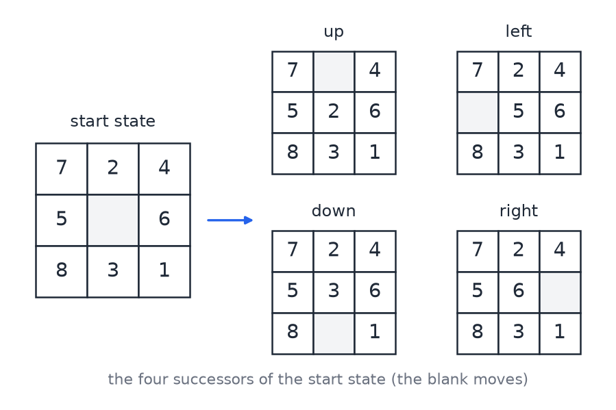
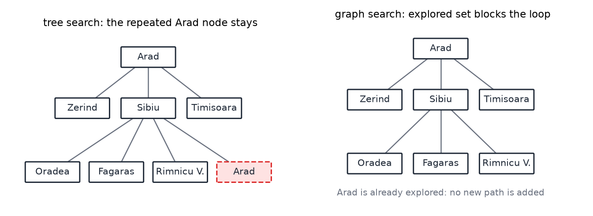

# State-Space Search

Many problems can be solved by describing them as a set of states, a set of actions that move between states, and a goal test. The solution is a sequence of actions that leads from the start state to a goal. This chapter sets out that formulation and then treats the search methods that work on it: breadth-first, depth-first and uniform-cost search, which use no knowledge beyond the problem, and then the heuristic methods greedy best-first and A\*, which use an estimate of the distance to the goal. The chapter ends with the heuristic methods used for the 8-puzzle, and with a short look at the limits of search. Search for games, where an opponent acts between the agent's moves, is in [Game Playing and Adversarial Search](game-playing.md). Search over assignments of values to variables, which needs its own methods, is in [Local Search, Constraint Satisfaction, and the Pacman Project](local-search-csp-pacman.md).

## When search applies

A search method is the right tool when the agent knows the model of the problem and can plan ahead, but does not know directly which actions reach the goal. The standard setting has five properties. The environment is fully observable, so the agent knows its initial state. The set of actions is known. The set of states is discrete and finite in practice. Each action has a known deterministic result. And the environment is static, so nothing changes except through the agent's own actions. When these hold, the agent can compute a complete plan before acting and then execute it.

The alternatives are settings in which one or more of these conditions fail: partial observability, unknown or stochastic transitions, or a changing environment. Those settings are treated later in the book, and the methods for them build on the ideas here.

The conditions are demanding, and the cost of a plan computed this way is that the agent executes it without checking what happens along the way. The plan is a fixed sequence of actions. This is useful when the model is accurate, and it fails when the model is wrong.

## Formulating a search problem

A search problem has five parts.

1. **Initial state.** The state the agent is in before searching, for example Arad in a route-finding problem.
2. **Actions.** A function \\(\text{actions}(s)\\) that returns the set of actions available in state \\(s\\). In route finding these are the roads to neighboring cities.
3. **Transition model.** A function \\(\text{result}(s, a)\\) that returns the state reached by action \\(a\\) from state \\(s\\). For example, from Arad, driving toward Timisoara gives Timisoara.
4. **Goal test.** A function that returns true when a state is a goal. In route finding the goal is being in Bucharest. A goal may be a set of states, not a single one.
5. **Path cost.** A function that assigns a cost to a path. For most problems it is additive: the sum of the step costs \\(c(s, a, s')\\), where a step cost is the cost of one action, for example a distance in kilometres or a time in minutes.

The **state space** is the set of states reachable from the initial state. In route finding it is the set of cities, and actions depend on the city. A **path** is a sequence of actions, and the path of length zero is the start state alone. The **solution** is a path that ends in a goal state. An optimal solution has the lowest path cost among all solutions.

At every point in a search, the states fall into three parts. The **explored** region contains states whose successors have been generated. The **frontier** contains the states at the edge of the explored region, which have been reached but not yet expanded. The **unexplored** region is everything else. Each search method is a rule for choosing which frontier state to expand next.

### Example state spaces

A small example is the vacuum world. Two locations, A and B, may be dirty or clean, and the robot is at one of them. The state records the robot's position and the dirt status of each location, so there are \\(2 \times 2 \times 2 = 8\\) states. Actions include moving right, moving left and sucking up the dirt at the current location.

A richer variant, the deluxe vacuum, adds more variables. The power switch has three settings (on, off, sleep). The dirt sensor has two settings. The brush height has five settings. Each of ten positions may hold dirt or not, which gives \\(2^{10} = 1024\\) dirt patterns, and the robot may be at any of ten positions. The number of states is

\\[
3 \times 2 \times 5 \times 1024 \times 10 = 307\\,200.
\\]

A model with few variables can therefore have a very large state space, which is the reason efficient search matters.

The sliding-block puzzle is the standard example of this kind. The 8-puzzle has eight numbered tiles and one blank on a \\(3 \times 3\\) board. The action is to move the blank up, down, left or right. From the start board

\\[
\begin{array}{ccc} 7 & 2 & 4 \\\\ 5 & \_ & 6 \\\\ 8 & 3 & 1 \end{array}
\\]

the blank can move in each of the four directions, giving four successor boards. The figure shows them.

*Figure: the start state of the 8-puzzle and its four successors. Each successor is produced by one move of the blank. The moves up and left produce the boards in the top row, and the moves down and right produce those in the bottom row.*

The successor function for this example returns the four boards above when the blank is in the center and two or three when it is at an edge or corner. Its output is a set of legal new states, each reached from the current state by a single action.

## The generic search loop

A naive loop follows from the definition. Start in the initial state, compute its successors, pick one, and repeat until a goal appears. The loop has three faults. It can run forever by returning to states it has already visited. It is not systematic, so it can miss the goal. And it is inefficient, because it may revisit many states. The fixes are to remember where the search has been, and to choose the next state in a systematic order.

The generic search algorithm does both. It keeps two sets. The **open** set (the frontier) holds states that are known but not yet expanded, and the **closed** set (the explored set) holds states that have been expanded. The loop is as follows.

1. Put the initial state in the open set. The closed set is empty.
2. While the open set is not empty and the current state is not a goal, move the current state to the closed set and add its successors that are not already in the closed set to the open set.
3. Take the next state from the open set as the current state.
4. If the current state is a goal, report success. Otherwise report failure.

The search strategy is determined entirely by how the open set is organized. If the open set is a queue, taking the oldest entry first, the search is breadth-first. If it is a stack, taking the newest entry first, the search is depth-first. If it is a priority queue sorted by a value, the search expands the state with the smallest value. Sorting by the path cost \\(g\\) gives uniform-cost search, and sorting by \\(g + h\\), where \\(h\\) is a heuristic, gives A\*. This is the central idea of the chapter: one loop, with the open set's ordering as the only difference between methods.

## Tree search and graph search

**Tree search** superimposes a search tree on the state space. The same state may appear many times in the tree. Its loop is as follows.

1. Put the path consisting only of the initial state on the frontier.
2. If the frontier is empty, fail: there is no solution.
3. Choose a path on the frontier and remove it. This choice distinguishes the members of the family.
4. If the end state of the path is a goal, return the path.
5. Otherwise expand the path. For each action available in the end state, add the old path extended by that action as a new path on the frontier.
6. Return to step 2.

Tree search is correct but wasteful. A path from Arad to Sibiu and back to Arad is valid in tree search, and nothing stops the search from expanding the Arad state again. In a graph with loops, the tree contains an infinite set of paths, and the search can cycle forever.

**Graph search** avoids this by remembering the states that have been expanded. It adds an explored set to the tree-search loop, and its rules are as follows.

1. Start with an empty explored set.
2. Remove a path from the frontier and add its end state to the explored set.
3. When expanding, add a child state only if it is in neither the frontier nor the explored set.
4. Otherwise follow the same steps as tree search.

The figure contrasts the two on a small part of the Romania map. Arad has three neighbors, Zerind, Sibiu and Timisoara. Sibiu has four neighbors, among them Arad itself. Tree search keeps the Arad node under Sibiu and expands it again. Graph search recognizes that Arad is already explored and adds no new path.

*Figure: the start of the search from Arad on part of the Romania map. Left, tree search keeps the repeated Arad node under Sibiu, which is a valid path but a repetition. Right, graph search has Arad in its explored set and adds no new path.*

Graph search needs memory for the explored set, and this memory is the main cost. Most of the methods below are graph searches. Some results are stated for tree search, where the argument is simpler, and the extension to graph search is a standard step.

## Breadth-first search

**Breadth-first search** always expands the shortest unexpanded path. It is implemented with a first-in, first-out queue, and it works one level at a time.

On the Romania map, breadth-first search from Arad first takes the three paths of length 1, to Zerind, Sibiu and Timisoara, in the order the tie is broken. Expanding Zerind adds Oradea. Expanding Sibiu adds Rimnicu Vilcea and Fagaras, and expanding Timisoara adds Lugoj. Each of these is a path of two steps. Expanding Fagaras adds Bucharest by the three-step path Arad, Sibiu, Fagaras, Bucharest. Graph search adds no path to a state already on the frontier, so the entries for Oradea and the other states stay as they are. The goal test is applied when a path is removed from the frontier, not when it is added. The Bucharest path is removed after the remaining two-step paths and the three-step paths queued before it, and it is the first goal path removed. Its cost is 450. The path through Pitesti, Arad, Sibiu, Rimnicu Vilcea, Pitesti, Bucharest, has four steps and costs 418, so breadth-first search does not return it.

Breadth-first search finds the path with the fewest steps. Its guarantee is about the number of actions, and it does not, in general, find the cheapest path by total step cost. That is the reason for uniform-cost search.

## Uniform-cost search

**Uniform-cost search** expands the frontier path with the lowest path cost \\(g(s)\\), the total cost from the start to \\(s\\) along the best known path. The open set is a priority queue sorted on \\(g\\). It is Dijkstra's algorithm, applied from one source to all destinations.

1. Start with the empty path at the start state. Move it to the explored set and expand it.
2. Among the frontier paths, choose the one with the lowest total path cost.
3. Remove it, add its end state to the explored set, and expand it. Add only children not already explored.
4. Repeat steps 2 and 3. Stop when a path that reaches the goal is removed from the frontier, not when it is added.

The Romania trace below uses the route from Arad, with cumulative costs in kilometres.

| Step | Expanded | Cost | New frontier entries |
|---|---|---|---|
| 1 | Arad | 0 | Zerind 75, Timisoara 118, Sibiu 140 |
| 2 | Zerind | 75 | Oradea 146 |
| 3 | Timisoara | 118 | Lugoj 229 |
| 4 | Sibiu | 140 | Rimnicu Vilcea 220, Fagaras 239 |
| 5 | Oradea | 146 | none (both neighbors explored) |
| 6 | Rimnicu Vilcea | 220 | Pitesti 317, Craiova 366 |
| 7 | Lugoj | 229 | Mehadia 299 |
| 8 | Fagaras | 239 | Bucharest 450 (not yet removed) |
| 9 | Mehadia | 299 | Dobreta 374 |
| 10 | Pitesti | 317 | Bucharest 418 (cheaper entry added) |
| 11 | Craiova | 366 | none new |
| 12 | Dobreta | 374 | none new |
| 13 | Bucharest | 418 | goal, search stops |

Expanding Fagaras at step 8 adds Bucharest with cost \\(239 + 211 = 450\\). A spoken version of this trace gives 460 for the same path, but the two distances sum to 450, and the chapter uses 450 throughout. That goal entry is not removed, because the route through Pitesti is cheaper: expanding Pitesti at step 10 adds a second entry for Bucharest at cost 418. The cheaper entry is removed first and passes the goal test.

The result is Arad, Sibiu, Rimnicu Vilcea, Pitesti, Bucharest, with cost 418. The search waits until a goal path is removed, not merely generated, because the first goal path found is not necessarily cheapest. Waiting is what guarantees optimality.

Three remarks on implementation follow from this trace. When a state's \\(g\\) improves, the priority queue must be updated. Parents must be recorded, because a state's parent can change when a better path is found. And the search must not stop early at the first goal generated.

Uniform-cost search is complete when step costs are positive and finite. It is optimal: when the goal is removed from the frontier, every state with a smaller \\(g\\) has already been expanded, so no cheaper path exists. Its time and space are exponential, because it keeps every state it has generated in memory.

## Comparing the uninformed methods

The three uninformed methods are compared below, with \\(b\\) the branching factor, \\(d\\) the depth of the shallowest solution and \\(m\\) the maximum depth of the tree.

| | Breadth-first | Depth-first | Uniform-cost |
|---|---|---|---|
| Open set | queue | stack | priority queue on \\(g\\) |
| Complete | yes | no in an infinite tree (yes in a finite graph with an explored set) | yes, for positive step costs |
| Optimal | yes, in number of actions | no | yes, for total step cost |
| Time | \\(O(b^{d})\\) | \\(O(b^{m})\\) | exponential |
| Space | all states kept, exponential | linear with a recursive tree search | all states kept, exponential |

Depth-first search always expands the deepest path. It is roughly the opposite of breadth-first search, and it is not optimal: if goals sit at two depths, it can reach the deeper one by a long route first and never reach the shallower one. A storage comparison shows the difference. In an infinite binary tree, the breadth-first frontier at level \\(n\\) holds \\(2^{n}\\) paths, while depth-first search holds about \\(n\\) paths, one for each level of the branch it is following. Without an explored set, depth-first search has a large space advantage. With one, most of that advantage is lost, since the explored set grows with the search.

The completeness of depth-first search depends on the space. In a finite graph with an explored set, it is complete. In an infinite space, it can follow an infinite path and never reach the goal.

## Why heuristics are needed

Uniform-cost search expands outward in contours of equal cost, like the contour lines of a topographic map. Before the goal is reached, it has examined most of the states within the goal's cost, and on average roughly half the space before the goal. Uninformed knowledge alone cannot do better. To search less, the agent needs more knowledge about the problem.

The most useful extra knowledge is an estimate of the distance from a state to the goal. In route finding the straight-line distance is a natural choice. A **heuristic function** \\(h(s)\\) estimates the cost of the cheapest path from \\(s\\) to a goal, and lower values are better. A heuristic should be cheap to compute.

**Greedy best-first search** expands first the path whose end state looks closest to the goal under \\(h\\). Its open set is a priority queue sorted on \\(h\\), and it ignores the cost of the path so far. With no obstacles it heads straight to the goal and expands few states. With an obstacle between the start and the goal, it keeps moving along the obstacle toward the goal and accepts a long path. Going over the obstacle would have been shorter, but greedy search would first have to move farther from the goal, and it never prefers such a move.

On the Romania map, with straight-line distance to Bucharest as \\(h\\), the values are Arad 366, Sibiu 253, Timisoara 329, Zerind 374, Fagaras 176, Oradea 380, Rimnicu Vilcea 193, Pitesti 100, Craiova 160 and Bucharest 0. Greedy search from Arad expands Arad, then Sibiu (253), then Fagaras (176), and reaches Bucharest. The path Arad, Sibiu, Fagaras, Bucharest costs \\(140 + 99 + 211 = 450\\). The path Arad, Sibiu, Rimnicu Vilcea, Pitesti, Bucharest costs 418. Greedy search is therefore not optimal.

The goal of the combined method is clear. Greedy search expands few states, and uniform-cost search guarantees a shortest path. A\* combines the two.

## A\* search

**A\*** orders the open set by \\(f(s) = g(s) + h(s)\\). The function \\(g\\) is the cost of the path so far, and \\(h\\) is the estimate of the remaining cost. Because \\(g\\) keeps the search honest about the past and \\(h\\) looks forward, A\* behaves like uniform-cost search when \\(h\\) is zero and like greedy search when \\(g\\) is ignored.

The algorithm is as follows.

1. Put the start path on the frontier with \\(f = g + h\\).
2. If the frontier is empty, fail.
3. Remove the path with the smallest \\(f\\).
4. If its end state is a goal, return the path. The goal test is applied on removal.
5. Otherwise expand it. For each child, add the extended path with \\(g\\) equal to the parent's \\(g\\) plus the step cost, \\(h\\) equal to the heuristic of the child, and \\(f = g + h\\).
6. Return to step 2. Track an explored set as in graph search.

### A worked example on the Romania map

Take the search from Arad to Bucharest with straight-line distance as \\(h\\). Each row gives \\(g\\), \\(h\\) and \\(f = g + h\\).

- **Expand Arad.** Sibiu: \\(140 + 253 = 393\\). Timisoara: \\(118 + 329 = 447\\). Zerind: \\(75 + 374 = 449\\). The smallest is Sibiu at 393, so Sibiu is expanded next.
- **Expand Sibiu.** Oradea: \\(291 + 380 = 671\\). Fagaras: \\(239 + 176 = 415\\). Rimnicu Vilcea: \\(220 + 193 = 413\\). The smallest is Rimnicu Vilcea at 413, which beats Fagaras at 415.
- **Expand Rimnicu Vilcea.** Pitesti: \\(317 + 100 = 417\\). Craiova: \\(366 + 160 = 526\\) via Rimnicu Vilcea. The frontier minimum is now Fagaras at 415.
- **Expand Fagaras.** Bucharest with \\(g = 450\\) and \\(h = 0\\), so \\(f = 450\\). This goal path is added but not removed, because Pitesti at 417 is smaller.
- **Expand Pitesti.** Bucharest is reached with \\(g = 418\\) and \\(h = 0\\), so \\(f = 418\\). This is now the smallest value on the frontier.
- **Remove Bucharest at 418.** It passes the goal test, and the search returns Arad, Sibiu, Rimnicu Vilcea, Pitesti, Bucharest, with cost 418.

The search expanded five states. Four of them, Arad, Sibiu, Rimnicu Vilcea and Pitesti, lie on the optimal path. Fagaras was expanded because its \\(f\\) value was the smallest on the frontier at that point, but its goal entry at 450 never became the cheapest, and the Pitesti entry at 418 replaced it. The heuristic guided the search toward the right region without deciding the answer by itself.

### Admissibility and optimality

A heuristic is **admissible** if it never overestimates the cost of reaching the goal. For every state \\(s\\),

\\[
h(s) \le h^{\*}(s),
\\]

where \\(h^{\*}(s)\\) is the true cost of the cheapest path from \\(s\\) to a goal. The inequality is non-strict: an admissible heuristic may equal the true cost. With an admissible heuristic, A\* returns an optimal solution.

The reason is an intuition about the frontier. When A\* returns a path \\(p\\) of cost \\(c\\), its heuristic at the goal is zero, so \\(c\\) is the true cost of \\(p\\). Each frontier path has estimated total cost at least \\(c\\), since the frontier is removed in order of \\(f\\). With an admissible \\(h\\), the true cost of each frontier path is at least its estimate. Paths beyond the frontier cost at least as much, because step costs are non-negative. So \\(p\\) is minimal. The argument is stated for tree search. Graph search needs a slightly longer version, but the conclusion is the same.

Admissibility matters, and it is easy to break. A small Romania subgraph with goal Bucharest and start Sibiu shows the effect. Use the heuristic values as before, and let \\(g(P) = 177\\), the cost of the path through Rimnicu Vilcea to Pitesti.

- With \\(h(P) = 100\\), the true cost from Pitesti to Bucharest being 101, the heuristic is admissible. The values are \\(f(R) = 80 + 193 = 273\\), \\(f(F) = 99 + 176 = 275\\) and \\(f(P) = 177 + 100 = 277\\). Pitesti is expanded before the Fagaras goal can be popped, and the optimal cost 278 is found.
- With \\(h(P) = 140\\), the heuristic overestimates the true cost. Then \\(f(P) = 177 + 140 = 317\\). The goal reached through Fagaras has \\(f = 310\\), and it is removed first. The search returns a path of cost 310, which is not optimal. The optimal cost, 278, is through Pitesti.

The lesson is that an overestimate in an intermediate state can make a suboptimal goal look cheap relative to the frontier.

A stronger local condition is **consistency**, also called monotonicity. A heuristic is consistent if \\(h(A) - h(B) \le K(A, B)\\) for every edge from \\(A\\) to \\(B\\), where \\(K(A, B)\\) is the cost of the edge. Equivalently, \\(h(A) \le K(A, B) + h(B)\\): the estimate cannot drop by more than the cost of the step. Consistency implies admissibility, and it reduces the average time needed to solve a problem. As a check, take \\(h(A) = 10\\), \\(h(B) = 2\\) and \\(K(A, B) = 6\\). Then \\(h(A) - h(B) = 8 > 6\\), so the heuristic is not consistent. If \\(h(B)\\) were at least 4, the check would pass.

### Properties of A\*

A\* is complete: if a solution exists, it is found, provided the branching factor is finite and step costs are bounded away from zero. With an admissible heuristic it is optimal. Its time is exponential in general, but a good heuristic makes the average time much smaller. Its space is also exponential, since it keeps the states it has generated. A better heuristic keeps fewer states in memory.

## Inventing heuristics by relaxation

A natural question is whether an admissible and informed heuristic can always be found. One general method is **relaxation**. Simplify the problem by removing constraints, solve the simpler problem exactly, and use its exact cost as the heuristic for the original problem. Each relaxation gives a heuristic that never overestimates, because the relaxed problem has more freedom and so its optimal cost is no larger.

The 8-puzzle gives the standard example. A move of a tile from square \\(A\\) to square \\(B\\) has two constraints: \\(A\\) must be adjacent to \\(B\\), and \\(B\\) must be blank.

- Remove the requirement that \\(B\\) is blank. A tile may then move to any adjacent square, occupied or not. The exact cost of this relaxed problem is the total Manhattan distance of the tiles from their goal squares.
- Remove both requirements. A tile may then move to any square in one step. Each misplaced tile needs at least one move, and one move suffices for each, so the exact cost is the number of misplaced tiles.

Both heuristics come from a mechanical edit of the formal rule, so a program could generate heuristics automatically by dropping constraints from the problem's description.

Take the 8-puzzle start \\(7\ 2\ 4 / 5\ \_\ 6 / 8\ 3\ 1\\) and the goal \\(\_\ 1\ 2 / 3\ 4\ 5 / 6\ 7\ 8\\). Every one of the eight tiles is out of place, so the misplaced-tile heuristic gives 8. The Manhattan distances are: tile 1, 3; tile 2, 1; tile 3, 2; tile 4, 2; tile 5, 2; tile 6, 3; tile 7, 3; tile 8, 2. Their sum is 18. Both values are admissible, and the Manhattan value is the larger of the two, so it is the better heuristic. Any solution needs at least 18 moves, since each move changes one tile's position by one step.

Two heuristics \\(h\\_1\\) and \\(h\\_2\\) can be combined by taking the maximum, \\(\max(h\\_1, h\\_2)\\). The maximum of two admissible heuristics is admissible, and it is at least as informed as either. The cost is the time to compute both. This is worth it only when the saving in expanded states outweighs the extra work per state.

A heuristic \\(h\\_1\\) **dominates** \\(h\\_2\\) when \\(h\\_2(s) \le h\\_1(s) \le h^{\*}(s)\\) for all states. Then A\* with \\(h\\_1\\) expands no more states than A\* with \\(h\\_2\\), apart from ties. The Manhattan distance dominates the misplaced-tile count in this way. The informedness of a heuristic can be measured as the size of the total search space divided by the average number of states explored with it. By that measure the Manhattan distance is more informed than the misplaced-tile count.

## Bidirectional and multi-source search

Searching from both ends can reduce the work. A bidirectional search that grows from the start and from the goal, each to depth \\(d/2\\), expands about \\(b^{d/2}\\) states in each direction rather than \\(b^{d}\\) in one. The idea extends to several sources. Consider three locations that a route must connect to a common destination. One approach runs three separate searches and then combines them, which repeats many node visits. A better approach starts a search from all three locations at once, growing until two searches meet and then continuing until the third joins. Designing an admissible heuristic for such a search, when two possible goals must be handled together, is harder, and this chapter does not give a method for it.

## Limits of search

Search yields a fixed sequence of actions, which is executed without checking what happens. The agent plans and then acts without looking, like a driver who plans a route and then drives with eyes closed. This works only when the five conditions listed at the start of the chapter hold. When they fail, the plan must be revised as the agent acts, and the methods for those cases are the ones treated in later chapters.

The methods also have a memory limit. A\* keeps every generated state in memory, so for large problems the frontier can exhaust the machine. Iterative-deepening A\*, which searches with a bound on \\(f\\) that is raised step by step, trades repeated work for much less memory. It is the method used to find optimal solutions to the Rubik's cube, where the state space is far too large to store. The number of quarter turns needed in the worst case was established by computer search in 2010, and the proof relied on a very large amount of computation.

## Implementation

A search node carries four fields: the state, the action that reached it, the total path cost, and a pointer to the parent node. A path is the abstract idea, and a node is its computer representation, with one node for each path. The frontier needs removal of the best item and insertion of new items, so it is a priority queue. It also needs a membership test, so it is usually paired with a set. The explored set needs only insertion and membership, so a hash table or tree suffices. The parent pointers allow the solution to be read back from the goal node.

## Summary

- A search problem is given by an initial state, an action function, a transition model, a goal test and a path cost.
- Tree search and graph search differ only in the explored set. Without it, repeated states make the search wasteful or endless.
- The generic search algorithm is one loop. The ordering of the open set (queue, stack or priority queue) determines the method.
- Breadth-first search finds the fewest-step path. Uniform-cost search finds the cheapest path, with time and space exponential in the depth.
- Greedy best-first search expands the state closest to the goal under \\(h\\). It is fast but not optimal.
- A\* orders by \\(f = g + h\\). With an admissible heuristic, \\(h(s) \le h^{\*}(s)\\) for all \\(s\\), it returns an optimal solution. Consistency is a stronger local condition.
- Relaxing a problem's constraints gives admissible heuristics. The 8-puzzle's Manhattan distance and misplaced-tile count are the standard examples. For the start state used here, they are 18 and 8.
- A heuristic that dominates another expands no more states with A\*, and the maximum of admissible heuristics is admissible.

## See Also

- [Game Playing and Adversarial Search](game-playing.md): the same tree machinery, with an opponent whose moves are not under the agent's control.
- [Local Search, Constraint Satisfaction, and the Pacman Project](local-search-csp-pacman.md): search over complete assignments, where the path does not matter.
- Graph Algorithms: shortest paths, Dijkstra's algorithm and related methods for explicit graphs.
