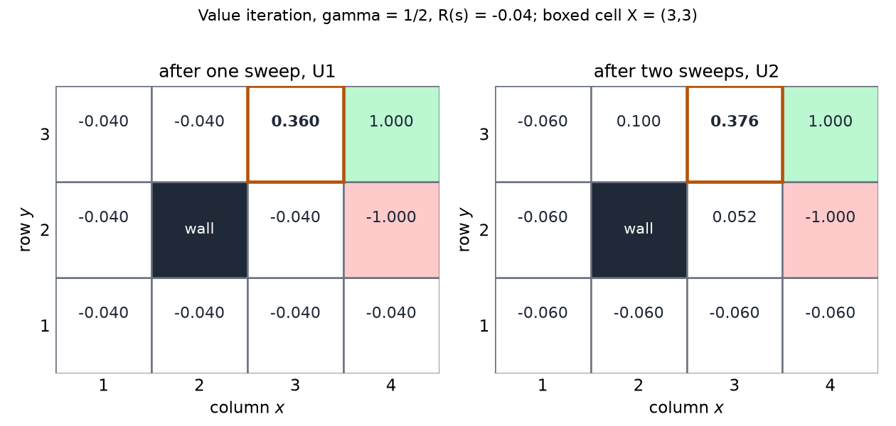
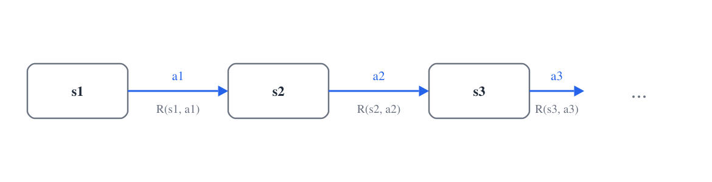
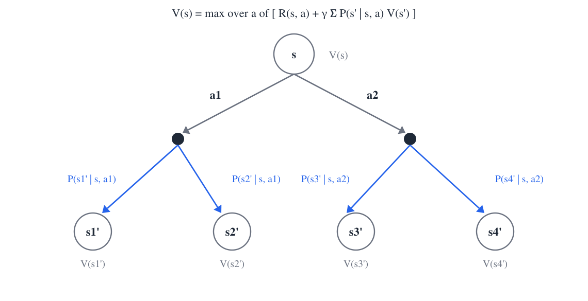
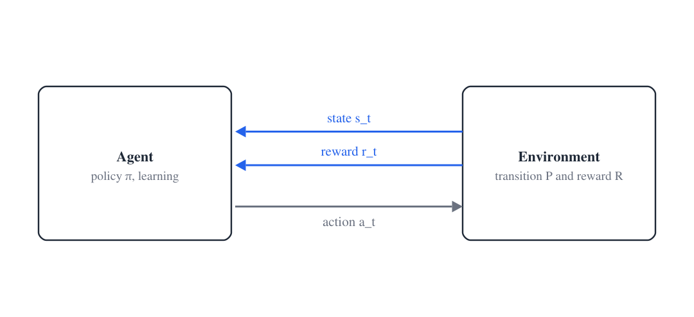

# Bellman Equations and Learning from Experience

The Bellman equation writes the value of a state in terms of the values of the states that can follow it. It is the key equation for solving MDPs and for reinforcement learning, because it holds the whole model in one relation. This chapter derives the equation from the definition of utility, solves it by value iteration and policy iteration, and rewrites it in the V, Q and continuation forms. The Q form is the one that can be learned from experience without a model, and the later sections turn to the setting in which the model is unknown, to the kinds of behavior an agent can use, and to the evaluation of a policy and of a learner.

## Optimal utilities and the Bellman equation

Let \\(\pi\\) be a policy. The utility of state \\(s\\) under \\(\pi\\) is the expected discounted reward from \\(s\\),

\\[
U^\pi(s) = \mathbb{E}\\!\left[ \sum\_{t=0}^{\infty} \gamma^t R(s\_t) \\;\middle\|\\; s\_0 = s,\ \pi \right].
\\]

The optimal utility is \\(U(s) = \max\_\pi U^\pi(s)\\), the value of the best policy from \\(s\\). The optimal policy chooses, in each state, the action with the highest expected utility of the next state,

\\[
\pi^\*(s) = \arg\max\_a \sum\_{s'} P(s' \mid s, a)\\, U(s').
\\]

This definition is circular, because the policy appears on both sides until the utilities are known. The Bellman equation breaks the circle.

**Theorem 2.1 (Bellman optimality equation).** Let the MDP be finite, with rewards bounded and \\(\gamma \in [0,1)\\). Then the optimal utility satisfies

\\[
U(s) = R(s) + \gamma \max\_a \sum\_{s'} P(s' \mid s, a)\\, U(s').
\\]

*Proof.* The argument splits the first step off the sum.

1. Write \\(U(s) = \max\_\pi \mathbb{E}\big[ R(s\_0) + \sum\_{t \ge 1} \gamma^t R(s\_t) \mid s\_0 = s \big]\\). The first reward \\(R(s)\\) does not depend on the policy, so it comes out of the maximum: \\(U(s) = R(s) + \max\_\pi \mathbb{E}\big[ \gamma \sum\_{t \ge 0} \gamma^t R(s\_{t+1}) \mid s\_0 = s \big]\\).
2. Condition on the action \\(a\\) taken at time 0 and on the next state \\(s'\\). The continuation from time 1 is a policy applied to the process started at \\(s'\\).
3. Because the process is Markov, the best continuation from \\(s'\\) does not depend on how the agent reached \\(s'\\). Its expected discounted reward is therefore \\(U(s')\\), and it can be achieved by a stationary optimal policy from \\(s'\\).
4. Substituting gives \\(U(s) = R(s) + \gamma \max\_a \sum\_{s'} P(s' \mid s, a) U(s')\\). \\(\square\\)

The step that makes the proof work is the Markov property. Without it, the best continuation could depend on the path, and the maximum could not be taken state by state. The optimality equation contains the whole MDP: the rewards, the discount, the transition probabilities and the actions. Solving it for every state gives the optimal policy.

Unrolling the equation along the path that the policy takes gives

\\[
U(s) = R(s) + \gamma R(s') + \gamma^2 R(s'') + \cdots ,
\\]

where \\(s', s'', \ldots\\) are the states visited. Each state's utility is its own reward, plus the discounted utility of what follows.

The equation is a system of \\(N\\) equations in \\(N\\) unknowns, one per state, because the rewards and transitions are known. The system is not linear. The maximum over actions makes it a nonlinear system, so ordinary matrix inversion, which solves linear regression problems, does not apply directly. The two standard ways to solve it are value iteration and policy iteration.

## Value iteration

Value iteration treats the Bellman equation as an update rule.

1. Start with arbitrary estimates \\(\hat U\_0(s)\\) for every state.
2. At each iteration \\(t\\), compute for every state
\\[
\hat U\_{t+1}(s) = R(s) + \gamma \max\_a \sum\_{s'} P(s' \mid s, a)\\, \hat U\_t(s') .
\\]
All states use the previous iteration's estimates, so the updates are coupled.
3. Repeat until the estimates stop changing.
4. Read off the policy \\(\pi(s) = \arg\max\_a \sum\_{s'} P(s' \mid s, a)\\, \hat U(s')\\).

Why does this converge? The key fact is that the update is a contraction. Let \\(B\\) denote the map \\(U \mapsto R + \gamma \max\_a \sum P\\, U\\). For any two utility functions \\(U\\) and \\(V\\), and for each state \\(s\\), the inequality \\(\lvert \max\_a f(a) - \max\_a g(a) \rvert \le \max\_a \lvert f(a) - g(a) \rvert\\) gives

\\[
\lVert BU - BV \rVert\_\infty \le \gamma\\, \lVert U - V \rVert\_\infty .
\\]

Since \\(\gamma < 1\\), each iteration shrinks the distance between the current estimate and the solution by at least the factor \\(\gamma\\). The fixed point of \\(B\\) is unique, and the estimates converge to it. The rate of convergence and the stopping rule are treated in the [convergence chapter](convergence.md). Intuitively, the true reward at each state is correct from the start, and it propagates backward through the states that can reach it. Each sweep corrects more of the wrong initial values, and the discount makes the old errors shrink.

### Worked example: one state on the grid

Take the grid of the [previous chapter](mdp-framework.md), with \\(\gamma = 1/2\\), \\(R(s) = -0.04\\) in every non-absorbing state, and the absorbing states fixed at \\(+1\\) and \\(-1\\). Start with \\(\hat U\_0 = 0\\) everywhere except at the absorbing states. Let \\(X = (3,3)\\), the cell directly left of the goal.

**Example 2.1 (The first two sweeps at X).** At iteration 1 the three alternatives at \\(X\\) are compared.

- Right succeeds with probability 0.8 and enters the goal, worth \\(+1\\). A slip up bumps the top boundary and leaves the agent at \\(X\\), worth \\(0\\) at this stage. A slip down enters \\((3,2)\\), also worth \\(0\\). The expected next value is \\(0.8 \cdot 1 = 0.8\\).
- Up gives \\(0.8 \cdot 0 + 0.1 \cdot 1 + 0.1 \cdot 0 = 0.1\\), because the slip right enters the goal.
- Down gives \\(0.8 \cdot 0 + 0.1 \cdot 1 + 0.1 \cdot 0 = 0.1\\) for the same reason.

Right is best, so

\\[
\hat U\_1(X) = -0.04 + \tfrac{1}{2}(0.8) = 0.36 .
\\]

At iteration 2 the same action is best, and the expected next value is \\(0.8 \cdot 1 + 0.1 \cdot 0.36 + 0.1 \cdot (-0.04) = 0.832\\). The slip-up outcome is \\(X\\) itself, whose value after one sweep is \\(0.36\\), and the slip-down outcome is \\((3,2)\\), whose value is \\(-0.04\\). Therefore

\\[
\hat U\_2(X) = -0.04 + \tfrac{1}{2}(0.832) = 0.376 .
\\]

The value of \\(X\\) rose from 0.36 to 0.376. The gain is small, because the sweep changes only the slip outcomes, which carry total probability 0.2.

**Example 2.2 (The cell below X).** The cell \\((3,2)\\) sits beside the pit and below \\(X\\). At iteration 1 the four actions give the following expected values, with all estimates still zero except the absorbing states.

- Left: the agent bumps the wall at \\((2,2)\\) and stays put with probability 0.8. The slips go up to \\(X\\) and down to \\((3,1)\\), both worth 0. The value is \\(0\\).
- Up: the agent reaches \\(X\\) with probability 0.8, and the slip right enters the pit with probability 0.1. The value is \\(0.8 \cdot 0 + 0.1 \cdot (-1) + 0.1 \cdot 0 = -0.1\\).
- Down: the agent reaches \\((3,1)\\) with probability 0.8, and the slip right enters the pit. The value is again \\(-0.1\\).
- Right: the agent enters the pit with probability 0.8. The value is \\(-0.8\\).

Left is best, so \\(\hat U\_1(3,2) = -0.04 + \tfrac{1}{2} \cdot 0 = -0.04\\). The agent chooses to bump the wall, because every other action carries a risk of entering the pit.

At iteration 2 the comparison changes. Up now reaches \\(X\\), worth \\(0.36\\), with probability 0.8. The value is \\(0.8 \cdot 0.36 + 0.1 \cdot (-1) + 0.1 \cdot (-0.04) = 0.184\\), so \\(\hat U\_2(3,2) = -0.04 + \tfrac{1}{2}(0.184) = 0.052\\). Left would give only \\(-0.04\\), so the best action at \\((3,2)\\) has switched from bumping the wall to moving up. The bump was the right choice only because every other value was still zero.

*Figure: value iteration on the \\(4 \times 3\\) grid with \\(\gamma = 1/2\\) and \\(R(s) = -0.04\\). The left panel shows \\(\hat U\_1\\) and the right panel \\(\hat U\_2\\), computed by the sweep above. The boxed cell is \\(X = (3,3)\\). Each number is the value of its cell after the sweep, so the change from the left panel to the right panel shows how the values propagate.*

The example shows what matters for control. The policy depends on which action is best at each state, and so on the ordering of the action values within each state, not on their absolute size. An estimate with the right ordering gives the right policy even if the values are wrong. The utilities contain more information than the policy needs, because for a given policy many utility functions are consistent with it.

## Policy iteration

Policy iteration works in the space of policies instead of values.

1. Start with an arbitrary policy \\(\pi\_0\\).
2. Evaluate the policy. Compute \\(U\_t\\) from
\\[
U\_t(s) = R(s) + \gamma \sum\_{s'} P(s' \mid s, \pi\_t(s))\\, U\_t(s') .
\\]
3. Improve the policy. Set \\(\pi\_{t+1}(s) = \arg\max\_a \sum\_{s'} P(s' \mid s, a)\\, U\_t(s')\\).
4. Repeat steps 2 and 3 until the policy stops changing.

The evaluation step is easier than the value-iteration update, because the maximum has disappeared. With the policy fixed, the equations are linear in the \\(N\\) unknowns, and in matrix form \\(U\_t = (I - \gamma P\_{\pi\_t})^{-1} R\\), where \\(P\_{\pi}\\) is the transition matrix under \\(\pi\\). Solving this system by elimination takes about \\(N^3\\) operations. Iterative shortcuts, such as a few sweeps of value iteration under the fixed policy, also work.

The improvement step never makes the policy worse at any state. Because there are finitely many deterministic policies, the process must stop, and it stops at an optimal policy. The argument is the policy improvement theorem, and its proof is given with the convergence results.

Value iteration and policy iteration reach the same answer. Value iteration uses cheap sweeps, and policy iteration uses fewer but more expensive policy evaluations. Both need the model, that is, \\(P\\) and \\(R\\), and the next sections show how the Bellman equation can be rewritten so that the model is no longer needed.

## Value, Q and continuation forms

The later chapters use the reward \\(R(s,a)\\) for being in \\(s\\) and taking \\(a\\), so the Bellman equation is restated with it:

\\[
V(s) = \max\_a \Big[ R(s,a) + \gamma \sum\_{s'} P(s' \mid s, a)\\, V(s') \Big].
\\]

Here \\(V\\) is the optimal value, the same quantity as \\(U\\) above.

### The recursive structure of the sequence

The agent starts in \\(s\_1\\), takes \\(a\_1\\), receives \\(R(s\_1, a\_1)\\), lands in \\(s\_2\\), takes \\(a\_2\\), and so on. The history is a chain of triples, state, action and reward.

*Figure: the sequence of state, action and reward. The action \\(a\_i\\) leads from \\(s\_i\\) to \\(s\_{i+1}\\), and the reward \\(R(s\_i, a\_i)\\) is collected on the way. The value of everything after the maximum over the first action is \\(V(s\_2)\\), which gives the recursion.*

*Figure: the one-step backup. The circle at the top is the state \\(s\\), the dots are its actions, and the circles at the bottom are the successor states with the probabilities of the transitions. The value of \\(s\\) is the best action's reward plus the discounted expected value of its successors, so the diagram is the Bellman equation read from top to bottom.*

### The Q form

Regroup the Bellman equation so that the repeating piece begins after the action. Define

\\[
Q(s,a) = R(s,a) + \gamma \sum\_{s'} P(s' \mid s, a) \max\_{a'} Q(s', a') .
\\]

Then \\(V(s) = \max\_a Q(s,a)\\). Substituting \\(V(s') = \max\_{a'} Q(s', a')\\) into the value form gives the Q form, so the two forms are the same equation written in two groupings. The value \\(Q(s,a)\\) is the expected discounted return when the agent takes \\(a\\) in \\(s\\) and acts optimally afterwards.

The Q function needs both the state and the action. The reward \\(R(s,a)\\) depends on both, and the value of an action means nothing without the state it is taken in.

The Q form matters for learning. The best action in state \\(s\\) is \\(\arg\max\_a Q(s,a)\\), and this needs no model of \\(P\\) or \\(R\\). With the value function alone, finding the best action requires \\(R\\) and \\(P\\), because \\(V\\) only ranks the states. A learner that observes transitions can estimate \\(Q\\) directly from samples of \\((s, a, r, s')\\), which is the idea behind Q-learning and the model-free methods in the later chapters.

The Q iteration

\\[
Q\_{t+1}(s,a) = R(s,a) + \gamma \sum\_{s'} P(s' \mid s, a) \max\_{a'} Q\_t(s', a')
\\]

is value iteration in this form. It still needs \\(P\\) and \\(R\\) to compute the expectation, but the maximum now sits inside the sum over next states and ranges over the next action \\(a'\\), not the current action \\(a\\).

### The continuation form

The third form starts after the reward is collected. Define the continuation

\\[
C(s,a) = \gamma \sum\_{s'} P(s' \mid s, a)\\, V(s') .
\\]

After taking \\(a\\) in \\(s\\), the agent receives \\(R(s,a)\\), and what remains is the discounted expectation over the next state of the optimal value. The continuation includes the discount, so the relation to \\(Q\\) needs no extra factor. The continuation form is useful when the reward is difficult to write as a function of the state and action, because \\(C\\) depends only on the transitions and the values. The relations between \\(V\\), \\(Q\\) and \\(C\\) are:

- \\(V(s) = \max\_a Q(s,a)\\), which needs no model.
- \\(V(s) = \max\_a \big[ R(s,a) + C(s,a) \big]\\), which needs \\(R\\).
- \\(Q(s,a) = R(s,a) + C(s,a)\\), which needs \\(R\\).
- \\(Q(s,a) = R(s,a) + \gamma \sum\_{s'} P(s' \mid s, a) V(s')\\), which needs \\(R\\) and \\(P\\).
- \\(C(s,a) = \gamma \sum\_{s'} P(s' \mid s, a) V(s')\\), which needs \\(P\\).
- \\(C(s,a) = \gamma \sum\_{s'} P(s' \mid s, a) \max\_{a'} Q(s', a')\\), which needs \\(P\\) but not \\(R\\).

The rule for finding each relation is to unroll the infinite sequence until the expression can be written in terms of \\(V\\), \\(Q\\) or \\(C\\). The pattern of needs explains the choice of form. From \\(C\\), recovering \\(V\\) or \\(Q\\) requires \\(R\\). From \\(V\\), recovering \\(Q\\) requires \\(R\\) and \\(P\\). From \\(Q\\), the value \\(V\\) is available with no extra information, and the continuation needs only \\(P\\). The \\(Q\\) form is the one that gives the best action directly, which is why learning methods prefer it.

## Learning from experience

So far the MDP has been given. The agent could compute the Bellman equation because it knew \\(P\\) and \\(R\\). In reinforcement learning the agent does not have that knowledge, and the information about the environment arrives only through interaction.

*Figure: the agent-environment loop. The environment reveals the state \\(s\_t\\) and the reward \\(r\_t\\) for the most recent state-action pair. The agent responds with an action \\(a\_t\\), which changes the environment, and the loop repeats. The MDP elements are the same as before; what differs is that the agent learns them.*

The agent may build a model of the environment inside its own computation. That model is an estimate, not the environment, and it can be wrong. The distinction matters because a learner can be right about the policy while its model is wrong, and the methods in the next chapters depend on this distinction.

**Example 2.3 (A world with unknown rules).** Consider a small world drawn as a grid of colored squares with walls between some of them. An object sits on one square, and the agent can pick it up, carry it, and put it down. There are six numbered actions. Four of them move the agent down, right, up or left in some squares, and in others they do nothing. One action picks up the object, and another puts it down. The reward is paid when the object is dropped on the square whose color matches the object.

At the start the agent knows none of this. It does not know which action moves it where, which squares are walls, or what the goal is. A plan works only when every action does what the planner expects. Here an action may move the agent in one square and do nothing in another, so the agent must learn the mapping from state to effect. The agent must also learn that the black lines are walls, and it may have to run into them to find out. Learning an unknown MDP is slower than solving a known one, and it needs more patience, because each action must be tried in each state before its effect is known.

## Plans, conditional plans and policies

The goal of learning is a behavior, a way of interacting with the environment that gets high reward. There are three forms of behavior, and they differ in how much they can respond to what happens.

A **plan** is a fixed sequence of actions, chosen from the current situation and then executed without observing anything else. A plan works only if the environment is deterministic, because the agent has no way to correct a bad outcome.

A **conditional plan** is a plan with branch points. It is a program with conditionals, such as "if this holds, take these actions, otherwise take those." It responds to observations at the branch points, but the branches are fixed in advance.

A **stationary policy** is a mapping from states to actions, as in the MDP. After each transition the agent looks up the action for its new state. A stationary policy is a conditional plan with a test at every state, and because the test depends only on the current state, the same policy applies whatever the agent did before. It handles any amount of stochasticity, and it is not compact, because the agent must have an action for every state.

The three forms can be illustrated by directions. A plan gives turn-by-turn directions. A conditional plan gives directions with a choice at a checkpoint, such as "take the highway; if it is crowded, take the back roads." A policy gives the direction to take from every location in the neighborhood. It is very large, but it works from wherever the traveller happens to be.

For a finite MDP with the infinite horizon and discounting, there is always an optimal stationary policy, so the search never needs to go beyond stationary policies. The qualifier matters. Under a finite horizon the best action can depend on how many steps remain, as the [previous chapter](mdp-framework.md) showed, and then a stationary policy is not enough. This book concentrates on the infinite-horizon case, where the statement holds.

## Evaluating a policy

A policy in a stochastic environment produces many possible trajectories. To compare two policies, the set of trajectories and their probabilities must be reduced to one number. The procedure has four steps.

1. Convert each transition into an immediate reward with the reward function.
2. Truncate each reward sequence to the horizon. For a finite horizon \\(T\\), keep the first \\(T\\) rewards. For the infinite horizon, keep the whole sequence.
3. Reduce each sequence to its return by discounting: \\(G = \sum\_{i} \gamma^i r\_i\\), where the first reward has exponent 0.
4. Take the expectation over trajectories, weighted by their probabilities: \\(V(\pi) = \sum\_k P(\tau\_k)\\, G(\tau\_k)\\).

The number \\(V(\pi)\\) is the value of the policy, the expected long-term reward from the start state.

**Example 2.4 (Three trajectories).** Take \\(\gamma = 0.8\\) and truncate each trajectory to five rewards, as step 2 requires. The immediate rewards are \\(+1\\) for entering the green cell, \\(-0.2\\) for entering the red cell, and 0 for a white cell. The three trajectories are shown below, with their rewards in order and their probabilities.

| Trajectory | Rewards \\(r\_0\\) to \\(r\_4\\) | Return \\(G\\) | Probability |
|---|---|---|---|
| \\(\tau\_1\\) | 0, 1, 0, 0, 0 | \\(0.8\\) | 0.6 |
| \\(\tau\_2\\) | 0, 0, 0, 1, 0 | \\(0.8^3 = 0.512\\) | 0.1 |
| \\(\tau\_3\\) | 0, 1, 0, 0, \\(-0.2\\) | \\(0.8 - 0.8^4 \cdot 0.2 = 0.71808\\) | 0.3 |

The return of \\(\tau\_1\\) is \\(\gamma^1 \cdot 1 = 0.8\\). The return of \\(\tau\_2\\) is \\(\gamma^3 \cdot 1 = 0.512\\). The return of \\(\tau\_3\\) has two terms, \\(\gamma^1 \cdot 1 = 0.8\\) and \\(\gamma^4 \cdot (-0.2) = -0.08192\\), which sum to \\(0.71808\\). The value of the policy is the probability-weighted average,

\\[
V(\pi) = 0.6 \cdot 0.8 + 0.1 \cdot 0.512 + 0.3 \cdot 0.71808 = 0.746624 .
\\]

**Convention.** The answer depends on where the discount exponent starts. The return above puts the discount \\(\gamma^0\\) on the first reward, which is the standard convention for an infinite-horizon return, \\(G\_t = \sum\_{k \ge 0} \gamma^k R\_{t+k+1}\\). If the exponent is instead started at 1, the same three trajectories give \\(0.597\\), which rounds to about 0.60. The two conventions give different numbers, so any comparison of values must state which one is used.

## Evaluating a learner

A learner is judged by the policy it outputs, and by the cost of producing that policy. Two learners that output the same optimal policy can still differ in how much they need to learn. The main criteria are the following.

- **Computation time.** The wall-clock time the learner needs to produce its policy.
- **Experience, or sample complexity.** The number of interactions with the environment that the learner needs before its policy is good. Two learners with the same optimal policy are compared by how many interactions each one needs. A learner that needs a few thousand interactions is far more useful than one that needs a billion.
- **Space.** The memory the learner uses. It is measurable, but it is usually not the binding constraint, because computation and sample complexity limit a learner first.

There is a trade-off between the first two criteria. A learner with few interactions may do heavy computation between them, and a learner with light computation may need many more interactions. The methods in the [exploration chapter](exploration.md) make the sample complexity precise. Here the point is that a learner must be evaluated on its output and on what it costs to reach that output, not only on the procedure it follows.

## Summary

- The Bellman optimality equation \\(U(s) = R(s) + \gamma \max\_a \sum\_{s'} P(s' \mid s, a) U(s')\\) holds for the optimal utility, and its proof uses the Markov property at the step where the continuation is replaced by \\(U(s')\\).
- Value iteration applies the Bellman update repeatedly. The update is a \\(\gamma\\)-contraction in the sup norm, so the estimates converge.
- In the worked grid example, \\(\hat U\_1(X) = 0.36\\) and \\(\hat U\_2(X) = 0.376\\) for \\(\gamma = 1/2\\). At the cell below \\(X\\), the best action changes from bumping the wall to moving up between the first and second sweeps.
- Policy iteration alternates policy evaluation, a linear system, with greedy improvement, and it stops at an optimal policy.
- The V, Q and continuation forms are the same equation grouped in different ways. The Q form gives the best action directly and can be learned from samples without a model.
- The agent learns the MDP through interaction, and the learned model is an estimate of the environment.
- A policy is a stationary map from states to actions. Under the infinite horizon an optimal stationary policy always exists.
- The value of a policy is the probability-weighted average of discounted returns. In Example 2.4 it is 0.746624 with the exponent starting at 0, and the convention must be stated.

## See Also

- [The MDP framework](mdp-framework.md): the definitions, the discounted utility and the horizon.
- [Convergence and analysis](convergence.md): the contraction argument, the convergence of value iteration and the policy improvement theorem.
- [Temporal-difference learning](td-learning.md): estimating values from sampled transitions.
- [Exploration, bandits and R-max](exploration.md): sample complexity and how to explore an unknown MDP.
- [Markov decision processes](../cs3600-cs6601-artificial-intelligence/mdps.md) and [MDP examples and value iteration](../cs3600-cs6601-artificial-intelligence/mdp-examples.md): the introductory treatment of the grid world and of value iteration.
- [Q-learning](../cs3600-cs6601-artificial-intelligence/q-learning.md): model-free control with the Q form.
- Dynamic programming: the general method behind value and policy iteration.
- [Deep Q-learning](../cs7643-deep-learning/deep-q-learning.md): the Q form with a neural network as the function approximator.
