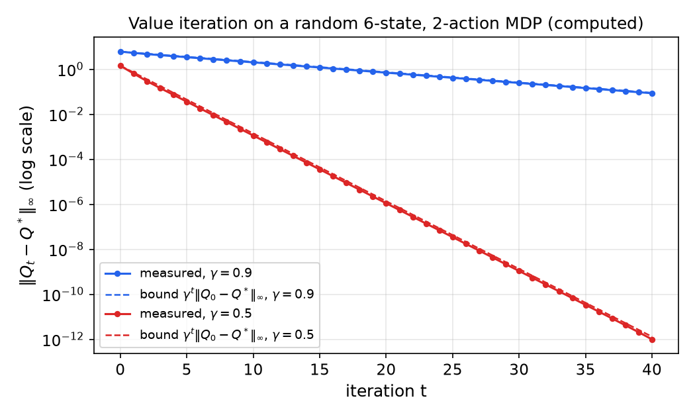
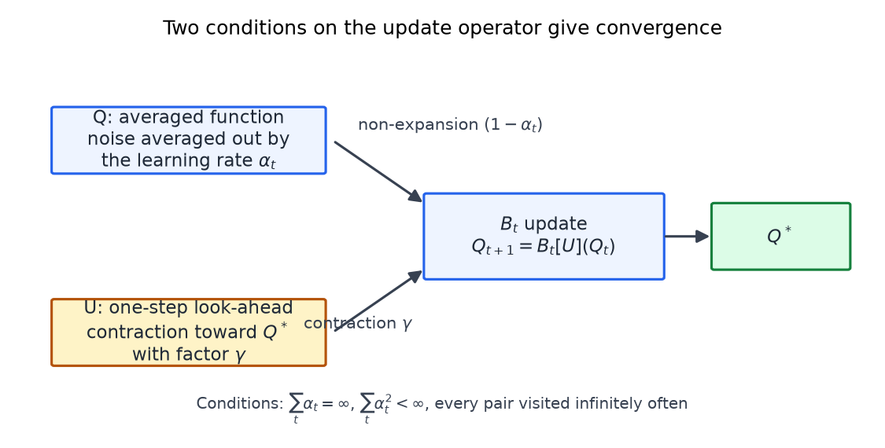
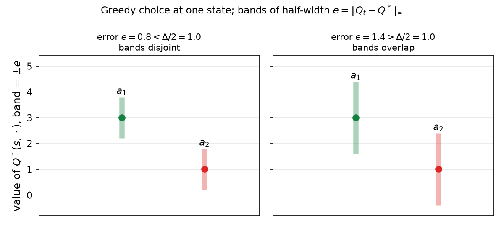
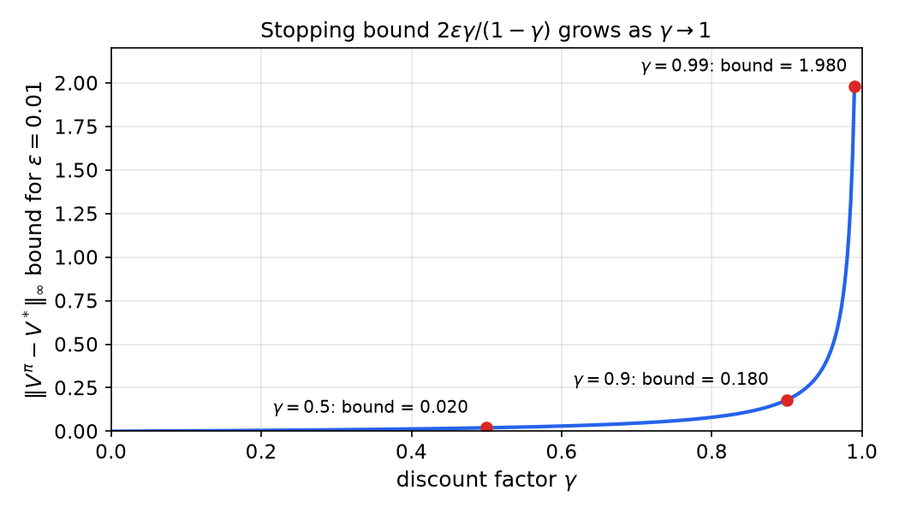
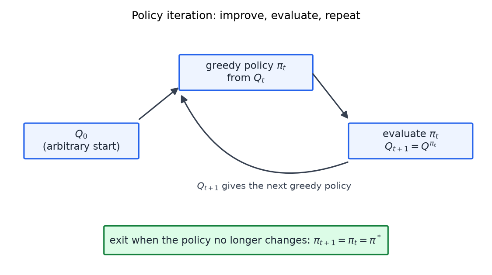

# Convergence and Analysis

The earlier chapters gave the TD and Q-learning update rules and argued that they average well-chosen samples. This chapter asks when those rules are guaranteed to find the right answer. The main tool is the **contraction mapping**: an operator that brings any two candidate value functions closer together. A contraction has exactly one fixed point, and repeated application reaches it from any starting point. The Bellman operator is a contraction, so value iteration converges, and Q-learning can be read as a noisy version of value iteration whose convergence follows from the same argument. The chapter also covers the three exact methods for a known MDP (value iteration, linear programming and policy iteration), because they rest on the same machinery and each gives a different view of the optimal policy.

## From Prediction to Control

TD prediction estimates the value of a fixed policy. Control needs more: the values of actions, so that the agent can choose its behavior. Without actions, the Bellman equation for a state value says that the value of a state is the reward plus the discounted expected value of the next state,

\\[
V(s) = \mathbb{E}\big[\\, r + \gamma V(s') \\,\big].
\\]

The TD(0) update of the previous chapter is the sampled form of this rule. With actions, the Bellman equation for the action-value function is

\\[
Q(s,a) = R(s,a) + \gamma\\, \mathbb{E}\_{s'}\Big[\max\_{a'} Q(s',a')\Big],
\\]

where the expectation is over the next state \\(s'\\) drawn from \\(P(s' \mid s,a)\\), and the maximum is over the actions available in \\(s'\\).

Q-learning replaces the expectation by a single sample. When the agent leaves the pair \\((s\_{t-1}, a\_{t-1})\\), receives the reward \\(r\_t\\) and arrives at \\(s\_t\\), only that pair changes:

\\[
Q(s\_{t-1},a\_{t-1}) \leftarrow Q(s\_{t-1},a\_{t-1}) + \alpha\_t \Big[ r\_t + \gamma \max\_{a} Q(s\_t,a) - Q(s\_{t-1},a\_{t-1}) \Big].
\\]

All other pairs keep their values. The update contains two approximations, and the convergence proof has to handle both.

1. **Sampling in place of a model.** If the transition probabilities and rewards were known, the Bellman equation could be applied directly at the visited pair, averaging over every possible next state. Instead, the next state is sampled from the world. Averaging the samples over repeated visits replaces the expectation.
2. **Bootstrapping.** The one-step look-ahead \\(\max\_a Q(s\_t,a)\\) uses the current estimates in place of \\(Q^\*\\). The lecture calls this "kind of cheating", because the values of the next state are taken as already known. The estimates are only approximately right, and the proof must show that the errors shrink.

The learning rates \\(\alpha\_t\\) must satisfy

\\[
\sum\_t \alpha\_t = \infty, \qquad \sum\_t \alpha\_t^2 < \infty .
\\]

The first condition lets the steps add up to enough movement to reach any target. The second makes the sampling noise average out. The choice \\(\alpha\_t = 1/t\\) satisfies both, since the harmonic series diverges and \\(\sum\_t 1/t^2\\) converges. The plan of the argument is to prove that the exact Bellman update converges first, and then to argue that the two approximations do not break that convergence.

## The Bellman Operator and Value Iteration

An **operator** is a rule that maps one Q function to another. Define the Bellman operator \\(B\\) by

\\[
(BQ)(s,a) = R(s,a) + \gamma \sum\_{s'} P(s' \mid s,a) \max\_{a'} Q(s',a').
\\]

The lecture's definition of \\(B\\) leaves out the maximum over next actions. The maximum is implied by the Q-form above and by the value-iteration discussion, so this chapter writes it explicitly. Two identities follow:

- \\(Q^\* = BQ^\*\\). This is the Bellman optimality equation, and it characterizes \\(Q^\*\\) as a fixed point of \\(B\\).
- \\(Q\_t = BQ\_{t-1}\\). Repeating the operator is **value iteration**.

Value iteration needs a starting function \\(Q\_0\\). The lecture notes that any starting function works, not only zero, as long as its type is right. The convergence theorem below explains why.

## Contraction Mappings

Measure the distance between two Q functions by the largest pointwise gap:

\\[
\lVert F - G \rVert\_\infty = \max\_{s,a} \lvert F(s,a) - G(s,a) \rvert .
\\]

**Definition (contraction).** An operator \\(B\\) is a \\(\gamma\\)-contraction if there is a \\(\gamma < 1\\) such that, for all Q functions \\(F\\) and \\(G\\),

\\[
\lVert BF - BG \rVert\_\infty \le \gamma \\, \lVert F - G \rVert\_\infty .
\\]

The state-action pair that attains the largest gap can change from one application to the next, so the norm is a worst case over pairs, not a fixed pair.

The lecture tests the definition on scalar operators, which act on single real numbers. Think of them as the Bellman operator of an MDP with one state and one action. The table uses two starting numbers each time.

| Operator | Inputs | Outputs | Gap before and after | Contraction? |
|---|---|---|---|---|
| \\(X/2\\) | 16, 32 | 8, 16 | 16 becomes 8 | Yes, with \\(\gamma = 1/2\\) |
| \\(X + 1\\) | 6, 8 | 7, 9 | 2 stays 2 | No |
| \\(X - 1\\) | 6, 8 | 5, 7 | 2 stays 2 | No |
| \\((X + 100)\cdot 0.9\\) | 6, 8 | 95.4, 97.2 | 2 becomes 1.8 | Yes, with \\(\gamma = 0.9\\) |

Adding a constant leaves every distance unchanged. For \\(X + 1\\) no choice \\(\gamma < 1\\) makes \\(2 \le 2\gamma\\) true. The last row is \\(0.9X + 90\\), so every gap is multiplied by \\(0.9\\).

**Theorem (contraction mapping).** Let \\(B\\) be a \\(\gamma\\)-contraction on the Q functions of a finite MDP, with the max norm. Then:

1. There is a unique \\(F^\*\\) with \\(BF^\* = F^\*\\).
2. For any \\(F\_0\\), the iterates \\(F\_t = BF\_{t-1}\\) satisfy \\(\lVert F\_t - F^\* \rVert\_\infty \le \gamma^t \lVert F\_0 - F^\* \rVert\_\infty\\), so they converge to \\(F^\*\\).

*Proof of part 2.* Since \\(F^\* = BF^\*\\),

\\[
\lVert F\_t - F^\* \rVert\_\infty = \lVert BF\_{t-1} - BF^\* \rVert\_\infty \le \gamma \\, \lVert F\_{t-1} - F^\* \rVert\_\infty .
\\]

Applying this \\(t\\) times gives the stated bound. Each application removes at least the fraction \\(1-\gamma\\) of the remaining distance. The existence of \\(F^\*\\) also follows from this argument, since the iterates form a Cauchy sequence, and the space of Q functions on a finite set is complete.

*Proof of part 1 (uniqueness).* Suppose \\(F^\*\\) and \\(G^\*\\) are both fixed points. Then

\\[
\lVert F^\* - G^\* \rVert\_\infty = \lVert BF^\* - BG^\* \rVert\_\infty \le \gamma \\, \lVert F^\* - G^\* \rVert\_\infty .
\\]

Since \\(\gamma < 1\\), this forces \\(\lVert F^\* - G^\* \rVert\_\infty = 0\\). \\(\square\\)

The theorem explains why the starting point does not matter. Every starting function gives the same limit, and only the number of iterations depends on how far it starts from the answer.

**Example (iterations needed).** Take \\(\gamma = 0.9\\), an initial error \\(\lVert Q\_0 - Q^\* \rVert\_\infty = 10\\), and a target accuracy of \\(0.01\\). The worst-case bound requires

\\[
10 \cdot 0.9^t \le 0.01
\quad\Longleftrightarrow\quad
t \ge \frac{\ln 0.001}{\ln 0.9} = \frac{-6.908}{-0.1054} \approx 65.6 .
\\]

So 66 iterations suffice in the worst case. Each iteration is one Bellman backup over all state-action pairs. The bound is a guarantee, not a prediction of the typical run.

The same reasoning applies to \\(k\\) steps at once. The operator \\(B^k\\) is a contraction with index \\(\gamma^k\\). For \\(\gamma = 0.9\\) and \\(k = 10\\), \\(0.9^{10} \approx 0.349\\), so ten sweeps of value iteration shrink the distance by about a factor of three.

*Figure: Value iteration on a random MDP with six states and two actions (computed with \\(\gamma = 0.9\\) and \\(\gamma = 0.5\\)). Solid lines show the measured error \\(\lVert Q\_t - Q^\* \rVert\_\infty\\) on a logarithmic axis; dashed lines show the bound \\(\gamma^t \lVert Q\_0 - Q^\* \rVert\_\infty\\). The theorem guarantees that each solid line lies on or below its dashed line. A straight line on this axis means geometric convergence at rate \\(\gamma\\).*

## The Bellman Operator Is a Contraction

Take two Q functions \\(Q\_1\\) and \\(Q\_2\\). The claim is that \\(\lVert BQ\_1 - BQ\_2 \rVert\_\infty \le \gamma \lVert Q\_1 - Q\_2 \rVert\_\infty\\). The proof has five steps.

1. The rewards \\(R(s,a)\\) are the same in both backups, so they cancel. The factor \\(\gamma\\) and the sum over next states factor out:

\\[
(BQ\_1)(s,a) - (BQ\_2)(s,a) = \gamma \sum\_{s'} P(s' \mid s,a) \Big[ \max\_{a'} Q\_1(s',a') - \max\_{a'} Q\_2(s',a') \Big].
\\]

2. The two maxima range over possibly different actions, one for \\(Q\_1\\) and one for \\(Q\_2\\). They cannot be merged into a single maximum, and the proof does not need them to be.

3. The sum over \\(s'\\) is a weighted average with nonnegative weights that add to 1. A weighted average of numbers cannot exceed the largest of them in absolute value, so the weights can be replaced by the worst next state:

\\[
\Big\lvert (BQ\_1)(s,a) - (BQ\_2)(s,a) \Big\rvert \le \gamma \max\_{s'} \Big\lvert \max\_{a'} Q\_1(s',a') - \max\_{a'} Q\_2(s',a') \Big\rvert .
\\]

4. The maximum over actions in the right-hand side is a **max non-expansion**: the difference of the two maxima is at most the largest pointwise difference. This is the step the lecture calls the most interesting part of the proof:

\\[
\Big\lvert \max\_{a'} Q\_1(s',a') - \max\_{a'} Q\_2(s',a') \Big\rvert \le \max\_{a'} \lvert Q\_1(s',a') - Q\_2(s',a') \rvert .
\\]

5. Taking the maximum over \\((s,a)\\) on the left and over \\((s',a')\\) on the right gives

\\[
\lVert BQ\_1 - BQ\_2 \rVert\_\infty \le \gamma \\, \lVert Q\_1 - Q\_2 \rVert\_\infty .
\\]

The next section proves the non-expansion property.

## Max Is a Non-Expansion

**Property (max is a non-expansion).** For real functions \\(f\\) and \\(g\\) on a finite set of actions,

\\[
\Big\lvert \max\_a f(a) - \max\_a g(a) \Big\rvert \le \max\_a \lvert f(a) - g(a) \rvert .
\\]

There is no discount factor here. The inequality is the statement that a maximum cannot move more than the largest individual move.

**Example (numerical check).** The lecture checks the property on seven actions. The values below are reconstructed from the arithmetic in the source and are consistent with its results.

| Action | \\(a\_1\\) | \\(a\_2\\) | \\(a\_3\\) | \\(a\_4\\) | \\(a\_5\\) | \\(a\_6\\) | \\(a\_7\\) |
|---|---|---|---|---|---|---|---|
| \\(f\\) | 7 | 9 | 1 | 0 | 6 | 3 | -2 |
| \\(g\\) | 5 | 3 | 8 | 1 | 8 | 5 | 5 |
| \\(\lvert f - g \rvert\\) | 2 | 6 | 7 | 1 | 2 | 2 | 7 |

The maximum of \\(f\\) is 9, at \\(a\_2\\). The maximum of \\(g\\) is 8, at \\(a\_3\\) and \\(a\_5\\). The left side of the property is \\(\lvert 9 - 8 \rvert = 1\\). The largest pointwise gap is 7, so the right side is 7 and \\(1 \le 7\\). One example does not prove the property, which is why the lecture turns to a deductive argument.

**Proof.** Without loss of generality \\(\max f \ge \max g\\), because the other case is the same with \\(f\\) and \\(g\\) swapped. Let \\(a\_1\\) be an action that maximizes \\(f\\), and let \\(a\_2\\) be an action that maximizes \\(g\\). These need not be the same action.

Since \\(a\_1\\) maximizes \\(f\\) and \\(a\_2\\) maximizes \\(g\\),

\\[
0 \le \max f - \max g = f(a\_1) - g(a\_2).
\\]

Since \\(a\_2\\) maximizes \\(g\\), we have \\(g(a\_1) \le g(a\_2)\\). Replacing \\(g(a\_2)\\) by the smaller \\(g(a\_1)\\) can only increase the difference, so

\\[
f(a\_1) - g(a\_2) \le f(a\_1) - g(a\_1) .
\\]

Combining the two displays,

\\[
0 \le \max f - \max g \le f(a\_1) - g(a\_1) = \lvert f(a\_1) - g(a\_1) \rvert \le \max\_a \lvert f(a) - g(a) \rvert .
\\]

The last inequality holds because the maximum over all actions includes \\(a\_1\\). This proves the property. \\(\square\\)

The same argument shows that the minimum is also a non-expansion, since \\(\min f = -\max(-f)\\) and \\(\lvert (-f) - (-g) \rvert = \lvert f - g \rvert\\). The lecture notes that other operators with this property exist, and the next sections use that fact.

## Convergence of Q-Learning

Q-learning does not apply the Bellman operator exactly. It takes one noisy step per visit. The lecture recasts the update as a sequence of random operators,

\\[
Q\_{t+1} = B\_t(Q\_t),
\\]

where \\(B\_t\\) depends on the sample seen at step \\(t\\). Only the visited pair has a nonzero learning rate, so the update changes that pair and leaves the rest alone.

**Theorem (Q-learning convergence, as stated in the source).** Consider the iteration \\(Q\_{t+1} = B\_t(Q\_t)\\) with \\(Q^\*\\) the fixed point of the Bellman operator. Assume:

1. **Averaging is non-expansive.** For any two Q-type functions \\(U\_1\\) and \\(U\_2\\) and every pair \\((s,a)\\), applying the update built from \\(U\_1\\) and the update built from \\(U\_2\\) to \\(Q^\*\\) gives results that differ by at most \\((1-\alpha\_t)\\) times \\(\lVert U\_1 - U\_2 \rVert\_\infty\\).
2. **Contraction toward \\(Q^\*\\).** With the look-ahead function \\(U\\) held fixed, the update moves \\(Q\\) toward \\(Q^\*\\):

\\[
\lVert B\_t^{U}(Q) - B\_t^{U}(Q^\*) \rVert\_\infty \le \gamma \\, \lVert Q - Q^\* \rVert\_\infty , \qquad \gamma < 1 .
\\]

3. **Learning rates and visits.** \\(\sum\_t \alpha\_t = \infty\\), \\(\sum\_t \alpha\_t^2 < \infty\\), and every state-action pair is visited infinitely often.

Then \\(Q\_t \to Q^\*\\).

The lecture states the conditions in words, so the operators \\(B\_t\\) above are schematic. The exact formulas are not given in the source. Standard statements of this theorem add the qualifier "with probability one" and assume finite state and action sets. The lecture does not state either qualifier, and a precise version should include them.

The third condition has a hidden requirement. Because \\(\alpha\_t\\) is zero for every step at which a pair is not visited, \\(\sum\_t \alpha\_t = \infty\\) holds for a pair only if the pair is visited infinitely often. This is an extra demand on exploration, and it is why the theorem is an infinite-time result. A finite run can only approximate it.

**Why condition 1 holds.** The update for a pair moves its entry toward \\(r + \gamma U(s',\cdot)\\), and the expectation of this target over the next state is the Bellman look-ahead with \\(U\\) in place of \\(Q^\*\\). Averaging over repeated visits removes the randomness of the transition function. The factor \\((1-\alpha\_t)\\) is the amount by which the previous estimate survives the step, which is why the averaging is a non-expansion.

**Why condition 2 holds.** The look-ahead operator is the Bellman operator, which is a contraction. Holding \\(U\\) fixed and applying the update therefore brings \\(Q\\) closer to \\(Q^\*\\). The lecture gives this as its argument for the condition and does not derive the exact inequality for the sampled operator.

The proof separates two roles that ordinary Q-learning merges. In ordinary Q-learning the function being averaged, \\(Q\\), and the function used for the look-ahead, \\(U\\), are the same. The proof treats them as two functions, because the theorem is easier to apply that way. The flow diagram shows the two inputs.

*Figure: Structure of the convergence argument. The update operator \\(B\_t\\) takes two inputs. The averaged function \\(Q\\) carries the non-expansion factor \\((1-\alpha\_t)\\), and the look-ahead function \\(U\\) carries the contraction factor \\(\gamma\\) toward \\(Q^\*\\). Both conditions together give convergence.*

The conclusion follows because both conditions and the learning-rate condition hold. The proof is modular: the same argument applies to other Q-learning-like algorithms, provided each has the two properties. This is why the lecture can reuse it for game settings.

## Generalized Operators

The Bellman equation has two operators. One replaces the expectation over next states, and the other replaces the maximum over next actions:

\\[
Q^\*(s,a) = R(s,a) + \gamma \\, \bigoplus\_{s'} \\, \bigotimes\_{a'} \\, Q^\*(s',a') .
\\]

Choosing different operators gives different decision processes. Value iteration and Q-learning can be run on any of them. The standard MDP has \\(\bigoplus\\) equal to the expectation over \\(s'\\) and \\(\bigotimes\\) equal to the maximum over \\(a'\\). The lecture gives four instances.

| Instance | Next-state operator | Next-action operator | Interpretation | Non-expansion? |
|---|---|---|---|---|
| 1 | \\(\mathbb{E}\_{s'}\\) | \\(\max\_{a'}\\) | Regular MDP | Yes |
| 2 | \\(\min\_{s'}\\) | \\(\max\_{a'}\\) | Worst-case next state, a two-player game against the environment | Yes |
| 3 | \\(\mathbb{E}\_{s'}\\) | fixed-weight sum over ranked actions | Exploration-sensitive values, or satisficing with sampled maxima | Yes, when the weights are fixed |
| 4 | \\(\mathbb{E}\_{s'}\\) | minimax over joint actions | Zero-sum game | Yes |

In the third row, the weights \\(w\_i\\) are nonnegative and sum to 1, and \\(a\_{(i)}\\) is the action of rank \\(i\\). Weight 1 on the top rank gives the maximum, weight 1 on the bottom rank gives the minimum, and uniform weights give the average. The values therefore describe the policy that is actually followed, including its exploration, and not the best policy. A sampled maximum over a random subset of actions is one such case, and the lecture calls the resulting target satisficing, since it need not be the best action. The result is an approximation that may be good but is not optimal. The fourth row is a Bellman equation for a zero-sum game, with minimax over the joint actions of the two players.

The non-expansion property determines convergence. Max, min, fixed rank-weighted combinations (order statistics), and minimax are all non-expansions, so value iteration and Q-learning on them converge to a fixed point. Being a convex combination is not enough. If the weights depend on the values, as in Boltzmann exploration, the operator need not be a non-expansion, and the lecture says convergence may fail. It also notes that some value-dependent operators still converge, which it cites from a two-player game algorithm. That claim is not verified here.

A question remains. For a generalized operator the limit is generally a different fixed point, not \\(Q^\*\\). Replacing the maximum with a fixed stochastic policy gives the value of that policy. The theorem tells us which operator the algorithm converges to, not that the result is optimal.

## Value Iteration, Linear Programming and Policy Iteration

The three exact methods solve a known MDP. The lecture applies the convergence ideas to each. The key facts are these: value iteration converges in the limit, and its greedy policy becomes exact in finitely many steps; linear programming is convenient but has high overhead; and policy iteration converges exactly in finitely many outer steps.

### When the greedy policy is exact

Value iteration converges to \\(Q^\*\\) only in the limit, but the policy it reads off can become exactly optimal after finitely many steps. Let \\(\Delta\_s\\) be the gap at state \\(s\\) between the best action and the second-best action,

\\[
\Delta\_s = Q^\*(s,a^\*) - \max\_{a \ne a^\*} Q^\*(s,a) > 0 ,
\\]

and let \\(\Delta = \min\_s \Delta\_s\\).

**Theorem (greedy policy becomes exact).** If \\(\lVert Q\_t - Q^\* \rVert\_\infty < \Delta / 2\\), then the greedy policy with respect to \\(Q\_t\\) is optimal.

*Proof.* Let \\(e = \lVert Q\_t - Q^\* \rVert\_\infty\\). Suppose the greedy action at \\(s\\) is \\(a\\), and suppose \\(a\\) is not optimal, so \\(Q^\*(s,a) \le Q^\*(s,a^\*) - \Delta\\). Greediness gives \\(Q\_t(s,a) \ge Q\_t(s,a^\*)\\). Using the error bound at both pairs,

\\[
Q^\*(s,a) + e \ge Q\_t(s,a) \ge Q\_t(s,a^\*) \ge Q^\*(s,a^\*) - e ,
\\]

so \\(2e \ge Q^\*(s,a^\*) - Q^\*(s,a) \ge \Delta\\). This contradicts \\(e < \Delta/2\\). \\(\square\\)

The lecture states this condition as "the error is smaller than the gap". The sharper condition is that the error must be less than half the gap. The figure shows why: with error bands of half-width \\(e\\) around each value, the bands are disjoint exactly when \\(2e < \Delta\\).

**Example (steps until the policy is exact).** Take \\(\gamma = 0.9\\), an initial error \\(\lVert Q\_0 - Q^\* \rVert\_\infty = 1\\), and a gap \\(\Delta = 0.3\\). The condition is \\(0.9^t < 0.15\\). Since \\(0.9^{18} \approx 0.1501\\) and \\(0.9^{19} \approx 0.1351\\), the policy is exact after \\(T^\* = 19\\) iterations.

The lecture says that the bound on \\(T^\*\\) is polynomial in the number of states, the number of actions, the magnitude of the rewards, the bits of precision used for the transition probabilities, and \\(1/(1-\gamma)\\). It gives no constants. The bound is polynomial for a fixed \\(\gamma\\). It is not polynomial in the full length of the problem, because a few bits can specify a \\(\gamma\\) very close to 1, which makes \\(1/(1-\gamma)\\) huge. The lecture's reason for the gap bound is Cramer's rule, which it does not derive. The chapter records it as a fact about the problem, with no further derivation.

*Figure: The greedy choice at one state, with error bands of half-width \\(e\\) around the two action values. Left, the error is below half the gap and the bands are disjoint, so the greedy action is the optimal one. Right, the error exceeds half the gap, the bands overlap, and the greedy action can be wrong.*

### A stopping rule for value iteration

The lecture gives a bound on the loss of the greedy policy, which can be checked without knowing \\(V^\*\\). Use state values \\(V\\) for this section. Let \\(V\_t\\) be the value iterates, and let \\(\pi\\) be the policy greedy with respect to the latest iterate \\(V\_{t+1}\\).

**Theorem (stopping bound).** If \\(\lVert V\_{t+1} - V\_t \rVert\_\infty < \varepsilon\\), then

\\[
\lVert V^\pi - V^\* \rVert\_\infty \le \frac{2\\,\varepsilon\\,\gamma}{1-\gamma} .
\\]

The pair of iterates that defines \\(\varepsilon\\) is therefore the consecutive pair \\(V\_t\\) and \\(V\_{t+1}\\), and the greedy policy is taken with respect to the later one. The lecture does not say which pair is meant. The difference between consecutive iterates is the quantity that can be computed during the run.

The lecture gives this bound without a proof and attributes it to published work. The argument below is a standard residual proof, added here because it shows where each factor comes from. Let \\(T\\) be the Bellman optimality operator on state values, \\(T\_\pi\\) the operator for a fixed policy, and \\(r = \lVert V\_{t+1} - TV\_{t+1} \rVert\_\infty\\) the residual of the latest iterate.

*Proof sketch.*

1. **Residual bound.** Because \\(V\_{t+1} = TV\_t\\),

\\[
r = \lVert TV\_t - TV\_{t+1} \rVert\_\infty \le \gamma \lVert V\_t - V\_{t+1} \rVert\_\infty < \gamma\varepsilon .
\\]

2. **Greedy policy versus its residual.** Let \\(\pi\\) be greedy with respect to \\(V\\), so \\(T\_\pi V = TV\\). Then \\(V^\pi\\) and \\(V\\) satisfy \\((I - \gamma P\_\pi)(V^\pi - V) = TV - V\\), where \\(P\_\pi\\) is the transition matrix of \\(\pi\\). Since \\(P\_\pi\\) is row-stochastic, \\(\lVert (I - \gamma P\_\pi)^{-1} \rVert\_\infty \le 1/(1-\gamma)\\), so

\\[
\lVert V^\pi - V \rVert\_\infty \le \frac{r}{1-\gamma} .
\\]

3. **The optimal value versus the residual.** Similarly, \\(V^\* - V = (TV^\* - TV) + (TV - V)\\), and the first term has norm at most \\(\gamma \lVert V^\* - V \rVert\_\infty\\). Hence \\(\lVert V^\* - V \rVert\_\infty \le r/(1-\gamma)\\).

4. **Combine.** Using the triangle inequality on \\(V^\pi - V^\* = (V^\pi - V) + (V - V^\*)\\),

\\[
\lVert V^\pi - V^\* \rVert\_\infty \le \frac{2r}{1-\gamma} < \frac{2\gamma\varepsilon}{1-\gamma} . \qquad \square
\\]

The lecture's explanation of the factors matches this proof. The factor \\(1/(1-\gamma)\\) is the error magnified over the future. The 2 comes from the two terms in step 4, because the sign of the error is unknown. The \\(\gamma\\) comes from the residual, which is one step behind the change in the iterates.

**Example (size of the bound).** With \\(\varepsilon = 0.01\\), the bound is \\(2(0.01)(0.9)/0.1 = 0.18\\) for \\(\gamma = 0.9\\), and \\(2(0.01)(0.99)/0.01 = 1.98\\) for \\(\gamma = 0.99\\). Both numbers are worst-case loss bounds on the value of the greedy policy, not estimates of its actual loss. The growth with \\(\gamma\\) reflects the effective horizon. The lecture says the effective horizon is roughly \\(1/(1-\gamma)\\): ten steps for \\(\gamma = 0.9\\), and a hundred steps for \\(\gamma = 0.99\\). A small \\(\gamma\\) gives small bounds and an easy problem, but a short-sighted agent. A \\(\gamma\\) close to 1 looks further ahead but is harder to compute.

*Figure: The stopping bound \\(2\varepsilon\gamma/(1-\gamma)\\) for \\(\varepsilon = 0.01\\), plotted against \\(\gamma\\). The bound is small and nearly flat for small \\(\gamma\\), then rises steeply as \\(\gamma\\) approaches 1. Stopping early is cheap for a short horizon and expensive for a long one.*

### Linear programming

Linear programming (LP) is the second exact method. An LP has linear constraints and a linear objective, and it can be solved in time polynomial in the number of variables and constraints. The lecture states that LP is the only method it knows that solves MDPs in polynomial time. That is the lecturer's claim, and the chapter does not check it.

The difficulty is the maximum in the Bellman equation, which is not linear. A maximum can be encoded with linear constraints. To represent \\(x = \max\\{-3, 2, 5, 7\\}\\), impose \\(x \ge c\\) for each \\(c\\) in the set, and minimize \\(x\\). The feasible set is \\(x \ge 7\\), and the minimum is 7. A value such as 9 satisfies every inequality, but it is not the minimum, so the objective is needed.

**Primal LP.** The variables are \\(V(s)\\) for each state. For every state \\(s\\) and action \\(a\\),

\\[
V(s) \ge R(s,a) + \gamma \sum\_{s'} P(s' \mid s,a)\\, V(s') ,
\\]

and the objective is to minimize \\(\sum\_s V(s)\\). Minimizing the sum pushes each \\(V(s)\\) down until it equals the maximum over actions on its right-hand side. The solution is therefore not only an upper bound, and the greedy policy with respect to the optimal \\(V\\) is optimal. The constraint right-hand side is written in full here, because the lecture refers to it as "this expression" and the source does not reproduce it in that form.

**Example (one state).** Take one state and two actions with rewards \\(R = (1, 0.5)\\), and \\(\gamma = 0.9\\). The constraints are \\(V \ge 1 + 0.9V\\) and \\(V \ge 0.5 + 0.9V\\). Each rearranges to \\(V \ge R/(1-\gamma)\\), giving \\(V \ge 10\\) and \\(V \ge 5\\). The minimum is \\(V = 10\\), which is the value of always taking the better action.

**Dual LP.** Taking the dual swaps constraints and variables. Each primal constraint gives a dual variable \\(x(s,a) \ge 0\\), which measures how much discounted activity passes through each pair. The dual is

\\[
\text{maximize } \sum\_{s,a} R(s,a)\\, x(s,a)
\\]

subject to, for each state \\(s'\\),

\\[
\sum\_{a} x(s',a) = 1 + \gamma \sum\_{s,a} P(s' \mid s,a)\\, x(s,a) .
\\]

The left side is the flow leaving \\(s'\\). The right side is a constant injection of 1 at \\(s'\\) plus the discounted flow arriving there. The constraints are a conservation law: flow in equals flow out at each state. The constant 1 comes from the primal objective, which gives weight 1 to every state, and duality moves those weights to the right-hand side. The lecture leaves the normalization unstated, so this is the pairing the chapter uses.

**Example (dual check).** For the one-state MDP above, the dual constraint is \\(x(a\_1) + x(a\_2) = 1 + 0.9\bigl(x(a\_1) + x(a\_2)\bigr)\\), so the total flow is \\(x(a\_1) + x(a\_2) = 10\\). The objective \\(1 \cdot x(a\_1) + 0.5 \cdot x(a\_2)\\) is maximized by putting all the flow on \\(a\_1\\), which gives 10. The primal and dual optima agree.

The dual suggests searching over policies, since an optimal flow determines a policy by the actions it uses at each state. The lecture uses this to motivate policy iteration. Practically, LP has significant overhead and is not competitive with value iteration or policy iteration in ordinary use. Its advantage is that extra linear constraints, such as limits on how often an action can be used, are easy to add.

### Policy iteration

Policy iteration alternates between two steps. Start from an arbitrary \\(Q\_0\\). At iteration \\(t\\):

1. Compute the greedy policy \\(\pi\_t\\) with respect to \\(Q\_t\\).
2. Evaluate \\(\pi\_t\\) to get \\(Q\_{t+1} = Q^{\pi\_t}\\). This can be done by solving a linear system, or by running value iteration for the fixed policy to completion.
3. Stop when the policy no longer changes. Otherwise repeat.

*Figure: The policy iteration loop. The policy is improved greedily from the current values, the new policy is evaluated, and the loop repeats until the policy is stable.*

Policy evaluation costs about as much as running value iteration to completion. So each outer iteration is expensive, and a comparison depends on what is counted. Counting only the outer loop favors policy iteration. The lecture states that when value iteration and policy iteration start from the same function, each policy iteration step moves toward \\(Q^\*\\) at least as fast as a value iteration step.

The number of outer iterations is bounded in both directions. The lecture says that some MDPs need about as many iterations as there are states, so about \\(\lvert S \rvert\\) is a lower bound. The upper bound is \\(\lvert A \rvert^{\lvert S \rvert}\\), which is the number of deterministic policies. The upper bound follows from the proof below, since no policy repeats. The exact worst-case complexity is an open question, as the lecture says. The lecture's own bounds were garbled in the recording, and the chapter uses only these two.

**Definitions.** Let \\(V^{\pi\_1}\\) and \\(V^{\pi\_2}\\) be the values of two policies. Policy \\(\pi\_1\\) **dominates** \\(\pi\_2\\) if \\(V^{\pi\_1}(s) \ge V^{\pi\_2}(s)\\) for every state \\(s\\). It **strictly dominates** if, in addition, the inequality is strict at some state.

For a policy \\(\pi\\), define the fixed-policy operator on state values

\\[
(T\_\pi V)(s) = R(s,\pi(s)) + \gamma \sum\_{s'} P(s' \mid s,\pi(s))\\, V(s') .
\\]

Its fixed point is \\(V^\pi\\). It has two properties that the proof uses.

- **Contraction.** Like the Bellman operator, \\(T\_\pi\\) shrinks the distance between two value functions by at least \\(\gamma\\).
- **Monotonicity.** If \\(U(s) \ge W(s)\\) for all \\(s\\), then \\(T\_\pi U \ge T\_\pi W\\). The rewards cancel in the difference, leaving

\\[
(T\_\pi U)(s) - (T\_\pi W)(s) = \gamma \sum\_{s'} P(s' \mid s,\pi(s)) \big( U(s') - W(s') \big) ,
\\]

which is a weighted average of nonnegative terms, so it is nonnegative.

**Theorem (policy iteration improves).** Let \\(\pi\_1\\) be any policy, let \\(V\_1 = V^{\pi\_1}\\), and let \\(\pi\_2\\) be greedy with respect to \\(V\_1\\). Then \\(V^{\pi\_2} \ge V^{\pi\_1}\\) at every state.

*Proof.* Write \\(V\_2 = V^{\pi\_2}\\).

1. **Value improvement.** Because \\(\pi\_2\\) is greedy with respect to \\(V\_1\\), its backup is at least the backup of \\(\pi\_1\\) at every state. So \\(T\_{\pi\_2} V\_1 = TV\_1 \ge T\_{\pi\_1} V\_1 = V\_1\\).
2. **Monotonicity, applied repeatedly.** From \\(V\_1 \le T\_{\pi\_2} V\_1\\), monotonicity gives \\(T\_{\pi\_2}^k V\_1 \le T\_{\pi\_2}^{k+1} V\_1\\) for every \\(k\\). The sequence \\(V\_1 \le T\_{\pi\_2} V\_1 \le T\_{\pi\_2}^2 V\_1 \le \cdots\\) is nondecreasing.
3. **Limit.** By the contraction theorem, \\(T\_{\pi\_2}^k V\_1 \to V\_2\\), the unique fixed point of \\(T\_{\pi\_2}\\). A nondecreasing sequence is bounded above by its limit, so \\(V\_1 \le V\_2\\). \\(\square\\)

The result holds at every state, and that is what makes the algorithm work. If \\(\pi\_1\\) is already optimal, the greedy policy with respect to its value is the same policy, and the algorithm stays at the fixed point. If \\(\pi\_1\\) is not optimal, some state has a strict improvement. Because the inequality holds state by state, the values never reverse at a state where they have already improved, so the algorithm cannot cycle between policies. Each step produces a new deterministic policy that is strictly better at some state. There are finitely many deterministic policies, so the sequence stops, and it stops at an optimal policy. The lecture makes the same point more briefly: improvement at every state prevents both cycling and getting stuck at a local optimum.

The lecture's two-state example, in which the value rows swap but \\(V\_1\\) still dominates \\(V\_2\\), is described only loosely in the source, and its numbers are unreliable. The chapter does not reproduce them. The general point is the one proved above: domination must hold at every state, not only in total.

### Comparing the three methods

| Method | What converges | Finite-time behavior | Polynomial time? | Cost per step |
|---|---|---|---|---|
| Value iteration | Values, geometrically at rate \\(\gamma\\) | Greedy policy exact after \\(T^\*\\) steps | Polynomial for fixed \\(\gamma\\), by the lecture's bound | One Bellman backup, cheap |
| Linear programming | Exact solution in one solve | Exact | Lecturer's claim: yes | Large, high overhead in practice |
| Policy iteration | Exact policy in finitely many outer steps | Between about \\(\lvert S \rvert\\) and \\(\lvert A \rvert^{\lvert S \rvert}\\) outer iterations | Open in the worst case | About one full value iteration per outer step |

## Summary

- The Q-learning update averages sampled Bellman targets, and its convergence follows from two properties of the update: averaging is a non-expansion, and the look-ahead is a \\(\gamma\\)-contraction toward \\(Q^\*\\). The learning rates must satisfy \\(\sum\_t \alpha\_t = \infty\\) and \\(\sum\_t \alpha\_t^2 < \infty\\), and every pair must be visited infinitely often.
- A \\(\gamma\\)-contraction has a unique fixed point, and its iterates satisfy \\(\lVert F\_t - F^\* \rVert\_\infty \le \gamma^t \lVert F\_0 - F^\* \rVert\_\infty\\).
- The Bellman operator is a \\(\gamma\\)-contraction, because the maximum is a non-expansion: \\(\lvert \max f - \max g \rvert \le \max \lvert f - g \rvert\\).
- Value iteration converges in the limit, and its greedy policy is exact once the error is below half the gap between the best and second-best actions.
- The stopping rule \\(\lVert V^\pi - V^\* \rVert\_\infty \le 2\varepsilon\gamma/(1-\gamma)\\) uses the difference between consecutive iterates, and it grows sharply as \\(\gamma\\) approaches 1.
- Linear programming encodes the maximum with linear constraints. Its dual is a conservation law on discounted flow, and it is convenient when extra constraints must be added.
- Policy iteration improves the policy at every state, so it cannot cycle, and it reaches an optimal policy in finitely many outer steps. The number of outer steps is at most \\(\lvert A \rvert^{\lvert S \rvert}\\).
- Generalized operators built from non-expansions (max, min, fixed rank-weighted combinations and minimax) still converge, though generally to a different fixed point than \\(Q^\*\\).

## See Also

- [Temporal-Difference Learning](td-learning.md): the TD(0) and TD(lambda) updates whose control version is analyzed here.
- [Bellman Equations and Learning from Experience](bellman-equations.md): the formal definitions of the value functions and their Bellman equations.
- [MDP Framework](mdp-framework.md): the MDP definition and discounted utility used throughout.
- [Markov Decision Processes](../cs3600-cs6601-artificial-intelligence/mdps.md): the first treatment of MDPs and the Bellman equation.
- [MDP Examples and Value Iteration](../cs3600-cs6601-artificial-intelligence/mdp-examples.md): worked grid-world value iteration and its arithmetic.
- [Q-Learning](../cs3600-cs6601-artificial-intelligence/q-learning.md): the introductory treatment of Q-learning and its practice problems.
- Convex Optimization: the linear programming background for the primal and dual forms.
- Reinforcement Learning: the one-page overview of the subsection.
