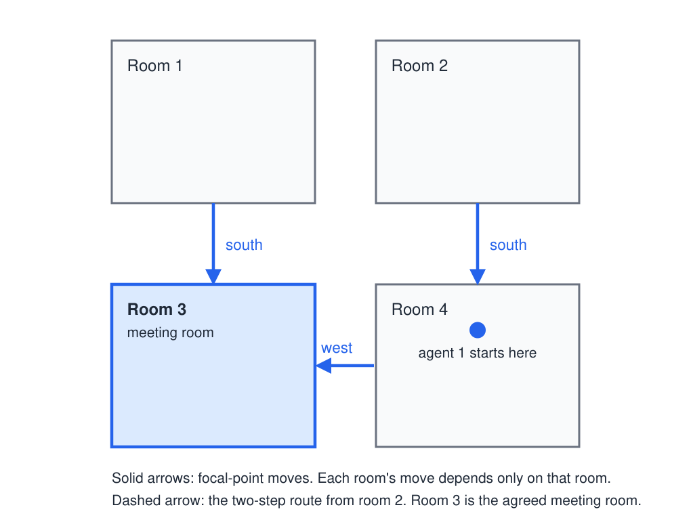
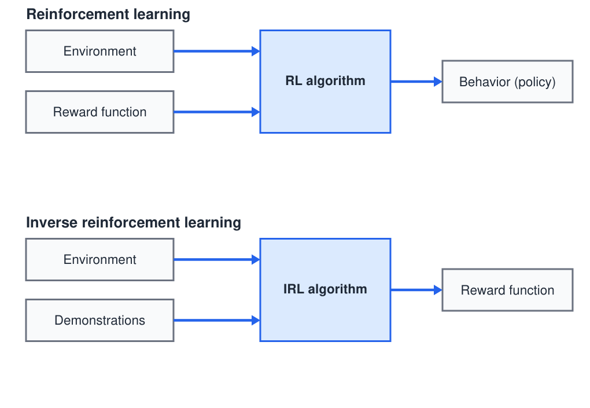
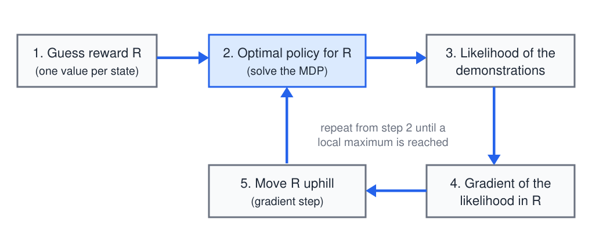
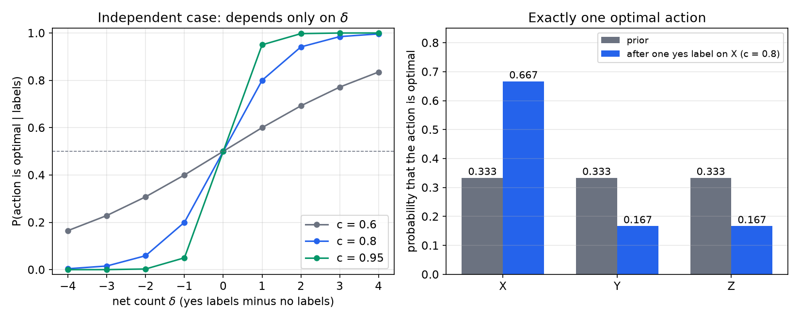

# Coordination, Inverse Reinforcement Learning, and Coaching

The MDP and POMDP models of the earlier chapters have one decision maker. This chapter relaxes that assumption in three ways. The first is coordination: several agents act at the same time, each with partial information, and must choose actions that work together. The second is inverse reinforcement learning (IRL), in which the learner infers a reward function from behavior it observes, the reverse of the usual direction. The third is coaching, in which a human supplies feedback that the agent must turn into a decision. The decentralized partially observable MDP (DEC-POMDP) models the first case, and it reduces to the [POMDP](pomdps.md) when only one agent is present. The second and third cases are learning problems that use the same probabilistic machinery as the rest of the subsection.

## Coordination with several agents

Consider two agents. Agent 1 receives a reward for getting an apple, and the apple lies closer to agent 2. Agent 1 has three options: walk to the apple itself, ask agent 2 to bring it, or wait for agent 2 to bring it. The standard planning recipe applies only partly. We define an MDP whose reward (called *utility* in game theory) makes the optimal policy do what we want, and then compute that policy. With one agent this works. With several agents the recipe breaks down, because the value of each option depends on what the other agent does, and agent 1 cannot observe agent 2's plan. It is hard to say what a request costs or how likely a plan is to succeed when the success depends on another agent's choices.

The analogy with POMDPs is the guide. A POMDP agent trades off actions that gain reward against actions that gain information, and information has value only insofar as it improves future reward. The DEC-POMDP applies the same logic to coordination and communication. "Ask for the apple" and "walk to the apple" become actions. The agents choose among such actions to maximize a shared utility, and a message has value only when it changes what the other agent does in a way that helps.

## The DEC-POMDP

**Definition (DEC-POMDP).** A decentralized partially observable Markov decision process is the tuple
\\[
\langle I, S, \\{A\_i\\}\_{i \in I}, T, R, \\{\Omega\_i\\}\_{i \in I}, O \rangle,
\\]
where:

- \\(I\\) is a finite set of agents, \\(\lvert I \rvert = n\\);
- \\(S\\) is a finite set of states;
- \\(A\_i\\) is the action set of agent \\(i\\). A *joint action* is \\(\vec a = (a\_1, \dots, a\_n)\\), with one action per agent;
- \\(T(s' \mid s, \vec a)\\) is the probability of moving to state \\(s'\\) when the joint action \\(\vec a\\) is taken in state \\(s\\);
- \\(R(s, \vec a)\\) is a single reward shared by all agents;
- \\(\Omega\_i\\) is the observation set of agent \\(i\\). After a joint action, the joint observation \\(\vec o = (o\_1, \dots, o\_n)\\) is drawn from \\(O(\vec o \mid s', \vec a)\\), and each agent receives only its own component \\(o\_i\\).

The model differs from a POMDP in three ways. Several agents act simultaneously, so the transition depends on the joint action. Observations are distributed, so no agent sees the full state or the others' observations. Rewards are shared, so all agents are cooperative: they maximize the same objective. If each agent instead had its own reward, the model would become a partially observable stochastic game (POSG). That model is the natural next step, but it is not developed here.

A joint policy is a tuple of local policies, one per agent. A local policy for agent \\(i\\) maps its own observation history to an action. It cannot condition on the true state or on the other agents' observations, because it never sees them. The value of a joint policy \\(\pi\\) over a horizon \\(H\\) is
\\[
V(\pi) = \mathbb{E}\_{\pi}\left[\sum\_{t=0}^{H-1} R(s\_t, \vec a\_t)\right],
\\]
where the expectation is over the initial state, the transitions and the observations that the policy induces. Planning can be centralized, meaning one planner with the full model computes the joint policy offline. Execution is then decentralized, because each agent carries out its own local policy.

The model sits between two familiar extremes. A POMDP is a DEC-POMDP with one agent. A common-interest game, in which every player maximizes the same payoff, is a DEC-POMDP with either no states or full observability. The DEC-POMDP is in this sense part way between game theory and POMDPs, and it subsumes both.

## Complexity and the value of communication

The complexity of planning shows how large the step from one agent to several is. The precise results are these, for finite horizons.

**Result (complexity of finite-horizon planning).** Planning for a finite-horizon POMDP is PSPACE-complete. Planning for a finite-horizon DEC-POMDP is NEXP-complete, where NEXP is the class of problems solved by nondeterministic machines in time exponential in the input. Because PSPACE is contained in NEXP, the step from one agent to several moves the problem into a class that is believed to be strictly harder.

For infinite horizons the situation is worse. The general planning question for POMDPs and DEC-POMDPs is undecidable: no algorithm can answer, for every instance, whether a policy with a given value exists. Informal statements about running times, such as descriptions of "double exponential" or "single exponential" algorithms, are not precise enough to use here, so this chapter does not rely on them. The practical consequence is that exact methods are limited to small problems, and useful methods are approximate or restricted to special structures.

Communication has the same character as information in a POMDP. A message is worth sending only when the cost of sending it is smaller than the value it brings through the other agent's changed behavior. An optimal DEC-POMDP policy therefore balances the cost of communicating against the cost of not communicating. This is the exploration and exploitation trade-off of the [exploration chapter](exploration.md), with the other agents as the source of the information. The model is of interest to multi-agent researchers and to dialogue researchers who must decide what is worth saying.

## Worked example: four rooms in a museum

Two agents explore a four-room museum and want to end in the same room. Each agent knows its own room but not the other's. At each step both agents move simultaneously: north, south, east, west, or stay. They win if they are in the same state after a simultaneous move.

We take the four rooms as a \\(2 \times 2\\) grid. Room 1 is top left, room 2 top right, room 3 bottom left, and room 4 bottom right. This is the layout in which every room is at most two moves from every other room, and it is the layout the strategy below uses. Agent 1 knows that it starts in room 4. The starting room of agent 2 is unknown to agent 1. One statement of the setup places both agents in room 4, but the plan does not depend on it: any strategy must work for every starting pair, so we design for an arbitrary start for agent 2.

*Figure: the four-room museum as a \\(2 \times 2\\) grid. Each arrow is the move that a room's occupant makes under the focal-point policy, and the move depends only on the current room. Room 3 is the agreed meeting room. Whatever room agent 2 starts in, both agents are in room 3 within two steps.*

There are three broad strategies. One agent can stay put while the other searches until they meet. The agents can agree on a fixed set of actions that guarantees a meeting from any start. Or they can agree on a focal point, a room that both head for. The argument that favors the focal point is the cost of reaching it. In this layout each agent needs at most two moves to reach room 3. The strategy below adopts that focal point.

The plan is a stationary policy on the agent's own room. The agents agree on it in advance:

| Current room | Move |
|---|---|
| 1 | south (to room 3) |
| 2 | south (to room 4) |
| 4 | west (to room 3) |
| 3 | stay |

Every entry depends only on the room the agent is in, which the agent observes. The agreed plan does not refer to the other agent's position or to the starting positions. That is the sense in which it is decentralized. We can check that it meets the requirement by tracing the cases. Suppose agent A starts in room 2 and agent B in room 4. At step 1, A moves south to room 4 and B moves west to room 3, so they are in rooms 4 and 3. At step 2, A moves west to room 3 and B stays in room 3. They meet at step 2.

The general argument is short. After one step, an agent that started in room 1 or room 4 is in room 3. An agent that started in room 2 is in room 4. An agent that started in room 3 stays in room 3. After a second step, every agent in room 4 has moved to room 3. So after at most two steps, both agents are in room 3, and they stay there. If both start in room 4, or both start in room 2, they are already in the same room after one step, which also counts as a meeting. The strategy therefore guarantees a meeting within two steps for every pair of starts.

Two features of the strategy matter. First, after the agreement is made, no message is exchanged. Second, neither agent knows whether the other has arrived, and neither needs to know, because both stay in room 3 once they are there. The argument assumes that moves are deterministic. With stochastic moves an agent can believe it is in one room while it is in another, and then the simple stay rule is no longer enough. This difficulty is real, but it is not analyzed here. In a real museum the natural focal point would be the entrance, which is the same kind of shared reference point.

## Communication: the apple revisited

Return to the apple. The two options "walk to the apple" and "ask agent 2 to bring it" differ in what they do to agent 2. The value of asking depends on whether agent 2 will bring the apple, and agent 2's choice depends on what it expects agent 1 to do. In a single-agent model, the request would have no effect on the outcome, because the world would not respond to it. In a DEC-POMDP, the request is an action of agent 1 whose effect is a change in the joint state and in agent 2's observations. The planning problem then includes the question of which request makes the joint plan succeed. That is the sense in which communication enters the model as an action.

## Inverse reinforcement learning

In ordinary reinforcement learning the environment and a reward function go into the learner, and a behavior comes out. The learner's task is to find a policy that gets high reward.

*Figure: the two problems as block diagrams. In reinforcement learning (top), the environment and the reward are the inputs and the behavior is the output. In inverse reinforcement learning (bottom), the environment and observed behavior, called demonstrations, are the inputs and the reward is the output. The arrows keep their direction, but the roles of the inputs and outputs are swapped.*

Inverse reinforcement learning swaps the roles. The learner observes the environment and a set of demonstrations, and it infers the reward function that makes those demonstrations sensible. The word "inverse" refers to this swap of inputs and outputs. The motivation is practical. Specifying a reward is hard, and trade-offs such as sudden stops in a car, bumpy roads and comfort against speed are easier to demonstrate than to quantify. A reward learned from demonstrations can also be optimized again in a new setting, which makes the learned quantity more general than the particular behavior that produced it.

The problem is underdetermined. Many reward functions yield the same optimal policy. For example, adding the same constant to every reward leaves the optimal policy unchanged in a discounted problem, because it adds the same amount to every action value. The shaping results in the [reward-shaping chapter](reward-shaping.md) are a further family of such changes. An IRL method must therefore choose one reward among the many that explain the behavior, and the choice is made by the form of the inference, such as a likelihood, a prior or a regularizer.

### Example: Frank in a grid world

An agent named Frank moves through a grid of colored cells to a green cell, and then stays there. We observe one demonstration and are given no numerical rewards. The task is to say which colors are good or bad. The inferences are as follows.

- Green is positively rewarding, since Frank goes there and stays.
- Blue is probably aversive, because Frank avoided it. Blue also lies on one of the shortest routes to green, so the avoidance might be a coincidence.
- Red is not clearly aversive. Frank could have avoided it at small cost and did not, so the evidence suggests he is roughly indifferent to it.
- Orange cannot be judged. Frank could not reach green without crossing it.

The lesson is that information comes from the paths not taken as well as from the one taken. A demonstration rules out inferences about cells that the agent could have avoided and did not, and it says nothing about cells that were unavoidable. No layout is given for the grid, so the example is described rather than drawn.

### Maximum-likelihood IRL

Maximum-likelihood IRL (MLIRL) turns the inference into an optimization. The procedure is as follows.

1. Guess a reward function, for example one value per color or per state.
2. Compute the optimal policy for that reward.
3. Measure the probability of the observed trajectories under that policy.
4. Compute the gradient of that likelihood with respect to the reward values: how should the reward change to make the data more probable?
5. Update the reward along the gradient and return to step 2, until a local maximum is reached.

*Figure: the five steps of maximum-likelihood IRL as a loop. Each pass solves the MDP for the current reward, scores the demonstrations under the resulting policy, and moves the reward uphill. The loop stops at a local maximum, not necessarily at the global one.*

To make step 3 and step 4 concrete, we need a model of how an agent picks actions from a reward. The procedure does not fix one, so we use the softmax (Boltzmann) policy, which is the usual choice. Let \\(Q\_R(s,a)\\) be the optimal action value under reward \\(R\\), and let \\(\beta > 0\\) be an inverse temperature. The probability of action \\(a\\) in state \\(s\\) is
\\[
\pi\_R(a \mid s) = \frac{\exp\left(\beta Q\_R(s,a)\right)}{\sum\_{b} \exp\left(\beta Q\_R(s,b)\right)}.
\\]
As \\(\beta\\) grows, the policy approaches the greedy optimal policy. With demonstrations \\(\zeta\_j\\) consisting of state-action pairs \\((s\_t^{j}, a\_t^{j})\\), the log-likelihood is
\\[
\mathcal{L}(R) = \sum\_{j} \sum\_{t} \log \pi\_R(a\_t^{j} \mid s\_t^{j}).
\\]
For a softmax policy, the derivative of \\(\log \pi\_R(a \mid s)\\) with respect to the action value \\(Q\_R(s,b)\\) is \\(\beta\\) times the difference between the indicator that \\(b\\) was taken and the probability of \\(b\\). Applying the chain rule through \\(Q\_R\\), which depends on \\(R\\) through the Bellman optimality equations, gives
\\[
\frac{\partial \mathcal{L}}{\partial R} = \sum\_{j}\sum\_{t}\sum\_{b} \beta \left(\mathbf{1}\_{b = a\_t^{j}} - \pi\_R(b \mid s\_t^{j})\right) \frac{\partial Q\_R(s\_t^{j}, b)}{\partial R}.
\\]
The factor \\(\partial Q\_R / \partial R\\) comes from differentiating the solved Bellman equations. Its computation is the expensive part of the method, and it is why the procedure can be slow.

The method has three practical difficulties. It is slow, because each gradient step requires solving an MDP. It can stop at a local maximum, so the answer depends on the starting guess. And it needs care with absorbing states. Frank remained in green. If the green state is counted once in the trajectory, the likelihood gives little weight to green. If it is counted at every step that Frank stayed, each repeated step adds a term \\(\log \pi\_R(\text{stay} \mid \text{green})\\) and pushes the value of green upward. Whether to count the absorbing state once or many times is a modeling decision, and it changes the inferred strength of the reward there.

### What MLIRL infers on the example

Applied to Frank's demonstration, the method gives the following reward picture.

- Green has a very high positive reward, which draws the agent to it.
- The blue puddles have a fairly negative reward, and Frank avoided them on purpose.
- Red has a reward near zero, the same as the background, because there is no evidence either way.
- The orange strip has a slightly negative reward. Many paths from the start to green cross orange more than once, while Frank's path crossed it only once, so a small penalty makes his behavior more probable.

The lesson is that a single demonstration communicates a good deal about the reward. The more demonstrations there are, the sharper the inferred values become. The example suggests the principle the later sections develop: the form of information a human naturally gives is often more useful than the form the algorithm was built to receive.

## Coaching with human feedback

### Options for Pac-Man

Consider the options that a Pac-Man player might use: eat the food pellets, eat the power pellet, eat the monsters, and avoid the ghosts. The first three have goals that can be reached. "Avoid ghosts" does not look like an option at all, because it has no goal that can be achieved. One can only fail at it, by being caught. In a study of this setting, people at all levels of expertise produced essentially the same list. Some added a fifth option that distinguishes edible ghosts from inedible ones.

The surprise is that the unusable-looking constraint is useful. Within Monte Carlo tree search, the "avoid ghosts" constraint helped design a better rollout strategy, and the improvement was large. The main point is not the particular search method, but the observation that humans describe the task in terms of constraints and failures, while an algorithm built around goals may not accept such descriptions. The guiding principle is to meet humans where they are: ask for the information they naturally provide and make the algorithm handle it, rather than forcing the human to supply the form the algorithm expects.

### Feedback as green and red buttons

In a feedback experiment, a human watches an agent play and occasionally presses a green button for a good action or a red button for a bad one. The labels arrive without any fixed pattern. The natural first approach is to translate the labels into rewards: green becomes +1 and red becomes −1, and the agent then runs an ordinary reinforcement learning algorithm. This works fairly well, because the feedback acts as a hint about where the agent should go. It is an example of reward shaping, in which the reward function is changed to reflect the human's wishes.

When humans give good or bad feedback, however, they do not think in reward values. They comment on the behavior: in this state, take this action, or do not take that action. The feedback translates directly into a statement about the policy. The natural name for this is policy shaping.

### Reward shaping and policy shaping

The two forms of feedback can be defined as follows.

- **Reward shaping** replaces the reward \\(R(s,a)\\) at some state and action, for example a zero, with a new value \\(R'(s,a)\\), such as +3.
- **Policy shaping** replaces the agent's current policy at a state with a different action. The human's label may confirm the current choice or override it. The idea is that the human overrides the policy in the same way that reward shaping overrides the reward.

The naive rule is "if the human gives positive feedback for an action that the agent would not take, take that action instead". It assumes the human is always right. In practice a person may be right most of the time, may be wrong now and then, or may be commenting on the previous step. The right treatment is to treat each label as evidence, combine it with the agent's other evidence, and form a best guess. This is why the process is called policy shaping and not policy doing: the feedback is evidence about the right action, not an order.

Reward shaping has its own pitfalls. A naive shaping scheme can create a cycle with positive total reward, which pays the agent to loop forever. The potential-based form in the [reward-shaping chapter](reward-shaping.md) avoids such cycles.

## Policy shaping: how much to believe a label

We now make the evidence explicit. Consider one state \\(s\\) with three actions \\(X\\), \\(Y\\) and \\(Z\\). A human labels actions as good or bad. Each label is correct with probability \\(c\\), and labels are independent of one another and of earlier and later labels. The prior is uniform: before any label, the agent has no reason to prefer one action. We consider two models.

- In the **exactly-one model**, exactly one action is optimal. Learning about one action then tells us about the others.
- In the **independent model**, any number of actions may be optimal, and each action is treated on its own, as a binary question.

### Two worked cases

In the first case the human is always correct, so \\(c = 1\\). The human labels \\(X\\) as good once and gives no labels for \\(Y\\) or \\(Z\\). In the exactly-one model, \\(X\\) is optimal with probability 1, and \\(Y\\) and \\(Z\\) have probability 0. In the independent model, \\(X\\) is optimal with probability 1, and \\(Y\\) and \\(Z\\) keep the prior of one-half, because they have no labels. The one-half depends on the uniform prior, and it would change if the prior did.

The exactly-one model has a degenerate case. If the human always labels two actions as good, no single-optimal hypothesis is consistent with the labels. Each hypothesis has likelihood zero, and the normalization is zero divided by zero. The model then says that the labels are impossible, which is the correct conclusion, since the human was assumed to be infallible.

In the second case the human is correct with probability \\(c = 0.8\\), and exactly one action is optimal. The label is again one good label on \\(X\\). A first guess is \\((0.8, 0.1, 0.1)\\). It is a valid distribution, but it is not the posterior. It gives the unlabeled actions \\(0.1\\) each, which does not follow from Bayes' rule. The posterior is found from an explicit generative model.

1. The correct action is chosen uniformly: each of \\(X\\), \\(Y\\), \\(Z\\) has probability \\(1/3\\).
2. The question "is \\(X\\) the right action?" is put to the human, who answers yes or no.
3. If \\(X\\) is the right action, the human says yes with probability \\(c = 4/5\\).
4. If \\(Y\\) or \\(Z\\) is the right action, the human says yes to \\(X\\) with probability \\(1 - c = 1/5\\).

Bayes' rule gives the posterior from the joint weights of the four cases:
\\[
P(X \text{ optimal} \mid \text{yes to } X) = \frac{\tfrac13 \cdot \tfrac45}{\tfrac13 \cdot \tfrac45 + \tfrac13 \cdot \tfrac15 + \tfrac13 \cdot \tfrac15} = \frac{4}{6} = \frac23.
\\]
The same computation gives \\(P(Y \text{ optimal} \mid \text{yes to } X) = \tfrac16\\) and \\(P(Z \text{ optimal} \mid \text{yes to } X) = \tfrac16\\). The normalizer is \\(P(\text{yes to } X) = 2/5\\), which is the sum of the three joint weights. The final distribution is \\((2/3, 1/6, 1/6)\\).

The intuition is that the human's answer counts as 0.8 of a vote for \\(X\\) and 0.2 of a vote against each of \\(Y\\) and \\(Z\\). Normalizing \\((0.8, 0.2, 0.2)\\) gives the same answer, \\((2/3, 1/6, 1/6)\\). Since only the argmax matters when the agent chooses an action, the normalizer can be ignored at that stage.

### The counting formula for independent actions

Write \\(D\_a\\) for the sequence of labels on action \\(a\\), and let \\(\delta\_a\\) be the number of yes labels minus the number of no labels. In the independent model, the posterior probability that \\(a\\) is optimal, with prior one-half, is
\\[
P(a \text{ optimal} \mid D\_a) = \frac{c^{\delta\_a}}{c^{\delta\_a} + (1-c)^{\delta\_a}}.
\\]

To derive it, consider the likelihood of the labels under the two hypotheses. If \\(a\\) is optimal, a yes label is correct with probability \\(c\\) and a no label with probability \\(1-c\\). If \\(a\\) is not optimal, the reverse holds. For \\(n\_+\\) yes labels and \\(n\_-\\) no labels, the ratio of the two likelihoods is
\\[
\frac{c^{n\_+}(1-c)^{n\_-}}{(1-c)^{n\_+}c^{n\_-}} = \left(\frac{c}{1-c}\right)^{n\_+ - n\_-} = \left(\frac{c}{1-c}\right)^{\delta\_a}.
\\]
With equal priors, the posterior is \\(\left(\tfrac{c}{1-c}\right)^{\delta\_a}\\) divided by one plus that quantity. Multiplying numerator and denominator by \\((1-c)^{\delta\_a}\\) gives the stated form.

Four consequences follow from the formula.

- Only the net count \\(\delta\_a\\) matters. Each yes label cancels a no label, so \\(4\\) yes and \\(3\\) no labels give the same posterior as one yes label.
- With \\(\delta\_a = 0\\), the posterior is the prior, one-half, however many labels there are.
- With \\(c = 0.8\\), the posterior for \\(\delta = -2, -1, 0, 1, 2, 3\\) is about \\(0.059\\), \\(0.200\\), \\(0.500\\), \\(0.800\\), \\(0.941\\) and \\(0.985\\). The curves for other values of \\(c\\) are shown in the figure below.
- The formula gives a point value. It does not represent how much evidence lies behind it, so two evidence sets with the same net count look identical. A model that treats \\(c\\) itself as uncertain would be needed to express that spread, and we do not develop one here.

*Figure: left, the independent model. The posterior probability that an action is optimal, plotted against the net count \\(\delta\\) of yes labels minus no labels, for three accuracies \\(c\\). The curve is steeper for more accurate humans, and it passes through one-half at \\(\delta = 0\\). Right, the exactly-one model with \\(c = 0.8\\): the uniform prior, and the posterior after one yes label on \\(X\\), which gives \\(2/3\\) to \\(X\\) and \\(1/6\\) to each of \\(Y\\) and \\(Z\\).*

### The counting formula for exactly one optimal action

When exactly one action is optimal, the labels on different actions are linked. The posterior is proportional to a power of the odds, and it is convenient to write it as a softmax over the net counts. Let \\(L = c/(1-c)\\). Under the uniform prior over the three single-optimal hypotheses, the posterior is
\\[
P(a \text{ optimal} \mid D) = \frac{L^{\delta\_a}}{\sum\_{b} L^{\delta\_b}}.
\\]
The same expression can be written in a second form, which is convenient when the normalizer is not needed. Multiplying numerator and denominator by \\((1-c)^{\sum\_j \delta\_j}\\) gives
\\[
P(a \text{ optimal} \mid D) \propto c^{\delta\_a}(1-c)^{\sum\_{j \neq a} \delta\_j}.
\\]
The two forms are equal, because \\(L^{\delta\_a} = c^{\delta\_a}(1-c)^{-\delta\_a}\\). As a check, take \\(c = 0.8\\), \\(\delta\_X = 1\\) and \\(\delta\_Y = \delta\_Z = 0\\). Then \\(L = 4\\) and the three weights are \\(4\\), \\(1\\) and \\(1\\), which normalize to \\((2/3, 1/6, 1/6)\\), as before. Since the normalizer is not needed to choose an action, the agent can compare the unnormalized values.

The formula is a single-action statement only in the independent model. In the exactly-one model it is a comparison among actions, and the labels on one action change the probability of every other.

### Extensions

The simple formulas extend in four directions, which are stated here without full derivations.

- **Per-action accuracy.** Each action can have its own accuracy \\(c\_a\\). This is possible, but it is not the usual case.
- **Asymmetric errors.** A false positive and a false negative can have different probabilities. The simple model treats the label as right or wrong with one probability, which is two cases, whereas the full model has four.
- **General priors over optimal sets.** In the independent model, the set of optimal actions can be any of the \\(2^N - 1\\) nonempty subsets. The prior over these subsets need not be uniform. A single optimal action might, for example, be more likely than two.
- **Cost of general priors.** The simple formulas are simple because the common prior factors cancel. For a non-uniform prior, the common factors must be carried through the calculation.

The next chapter combines the human's distribution over actions with the agent's own distribution, which the agent learns from experience. The product of the two distributions is the subject of the [drama-management chapter](drama-management.md).

## Summary

- A DEC-POMDP has a joint action, a shared reward and distributed observations. A POMDP is the one-agent case, and a common-interest game is a special case with no states or full observability.
- Each agent's policy depends only on its own observation history. Planning can be centralized, but execution is decentralized.
- For finite horizons, POMDP planning is PSPACE-complete and DEC-POMDP planning is NEXP-complete. For infinite horizons, the general planning question is undecidable.
- In the four-room example, the focal-point policy depends only on the agent's own room. Both agents are in room 3 within two steps, for every pair of starts.
- Inverse reinforcement learning infers a reward from demonstrations. One demonstration can rule out or support inferences about states that were avoidable or unavoidable. The reward is underdetermined, so the method's form of inference matters.
- Maximum-likelihood IRL ascends the likelihood of the demonstrations, using the gradient of the log-likelihood through the Bellman equations. Absorbing states must be counted with care.
- Reward shaping changes the reward at a state. Policy shaping treats a human label as evidence about the best action.
- With human accuracy \\(c\\), the independent model gives \\(P(a \text{ optimal}) = c^{\delta}/(c^{\delta} + (1-c)^{\delta})\\), which depends only on the net count \\(\delta\\). The exactly-one model gives a normalized \\(L^{\delta\_a}\\), with \\(L = c/(1-c)\\). With \\(c = 1\\) the formulas degenerate, and two good labels on different actions are inconsistent.

## See Also

- [Partially observable MDPs](pomdps.md): the one-agent case, and the belief-state formulation that the DEC-POMDP extends.
- [Two-player games and Nash equilibria](two-player-games.md) and [Beyond Nash equilibria](beyond-nash.md): the game-theoretic setting from which the DEC-POMDP departs.
- [Drama management and closing remarks](drama-management.md): combining the human's and the agent's distributions, and applying human-specified targets to a story.
- [Reward shaping](reward-shaping.md): the potential-based form of reward shaping.
- [Exploration, bandits and R-max](exploration.md): the exploration and exploitation trade-off that also governs communication.
- Reinforcement learning: the one-page overview.
- [Markov decision processes](../cs3600-cs6601-artificial-intelligence/mdps.md): the single-agent model on which this chapter builds.
- [Actor-critic, PPO and RLHF](../cs7643-deep-learning/actor-critic.md): learning from human preferences in deep reinforcement learning.
