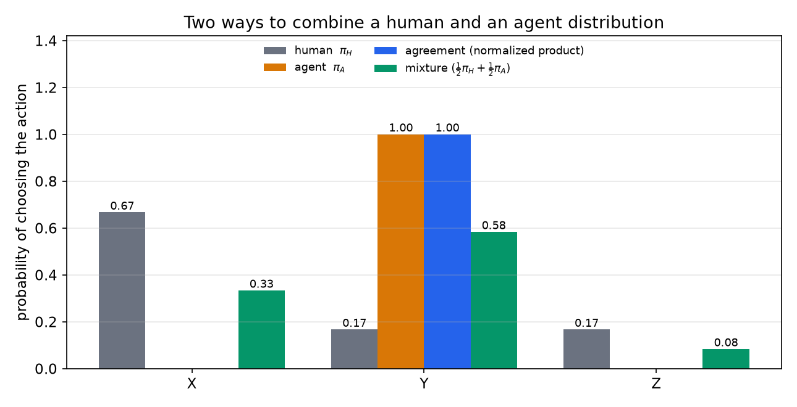
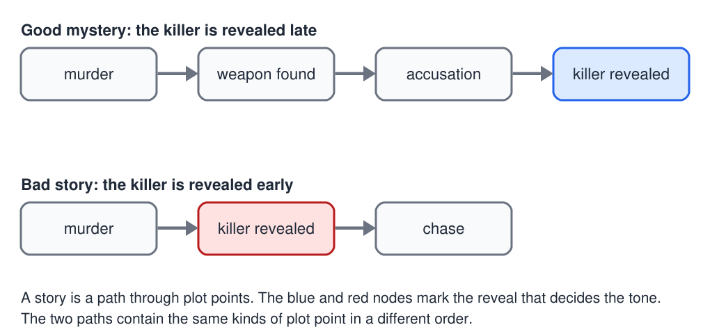
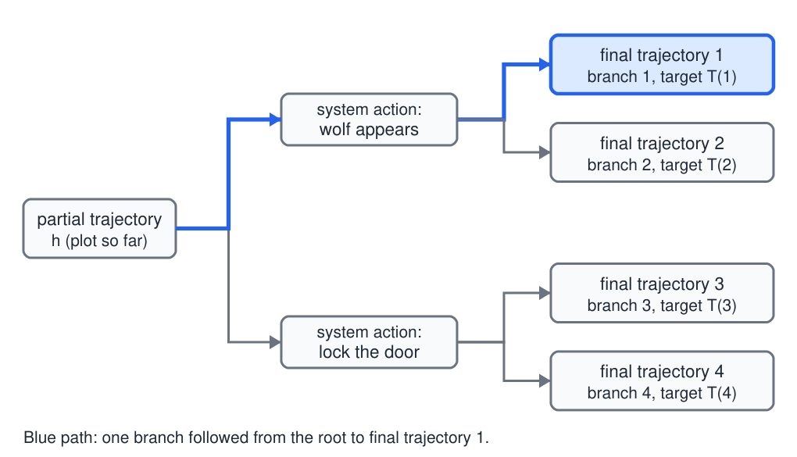
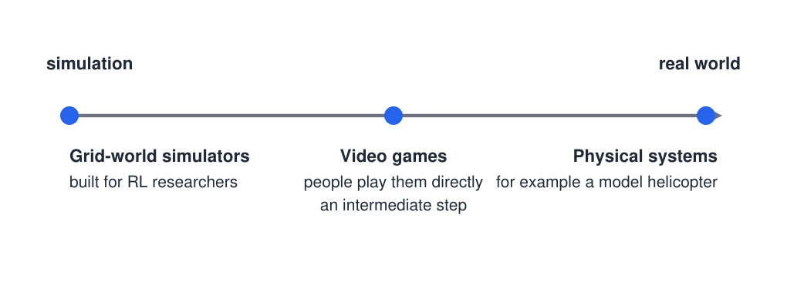
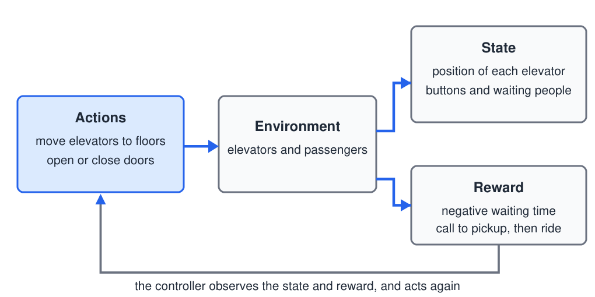
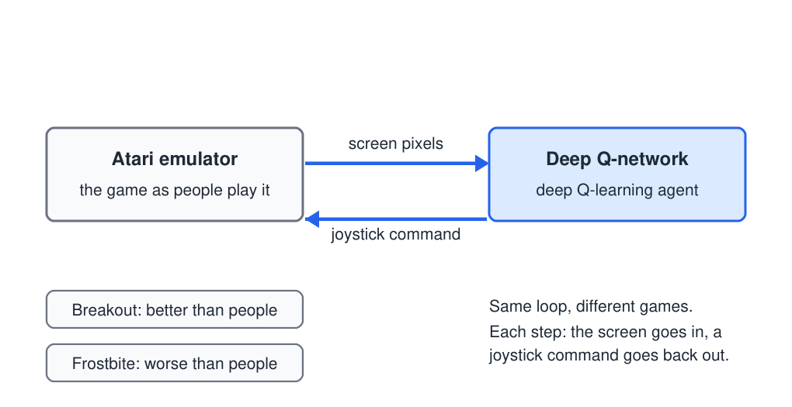

# Drama Management and Closing Remarks

The previous chapter left open how to combine a human's distribution over actions with the agent's own. This chapter answers that question: a normalized product of the two distributions is the right way to combine sources that must agree on one correct answer, and it follows from Bayes' rule when the prior is uniform. The chapter then turns to drama management, in which a system shapes a story while a human player takes part. The formal model for that setting is the targeted trajectory distribution MDP (TTD-MDP), whose goal is a target distribution over endings rather than a single best reward. The chapter closes with remarks on simulators, on why reinforcement learning needs data of a different kind from supervised learning, and on the real uses that have been reported.

## Combining a human and an agent

Suppose that in some state the human has given feedback, and that the feedback has been turned into a distribution \\(\pi\_H\\) over the actions. The agent has its own distribution \\(\pi\_A\\), learned from its experience in the environment. Both are probability distributions over the same actions in the same state. The question is which action to take.

One answer is the mixture. Choose one of the two sources at random, with probability one-half each, and then draw an action from that source. The combined distribution is
\\[
\pi\_{\mathrm{mix}}(a) = \tfrac12 \pi\_H(a) + \tfrac12 \pi\_A(a).
\\]
The mixture treats the sources as alternatives. Each one contributes with a fixed weight, whatever the other says.

The second answer is the agreement model. Suppose there is exactly one correct action, and each source is an independent estimate of it. The combined answer is the action that both sources would pick, which is the normalized product
\\[
\pi\_{\mathrm{agree}}(a) = \frac{\pi\_H(a)\\,\pi\_A(a)}{\sum\_{b} \pi\_H(b)\\,\pi\_A(b)}.
\\]
The normalized product can be read as the probability that the two sources agree on \\(a\\). Its value is high only where both sources give the action weight. A source that gives an action zero weight vetoes it. This is a different kind of combination from the mixture, and the difference matters.

### Why the product is the right rule

The product is not just a convenient choice. It follows from Bayes' rule under the agreement model. Let \\(a^\*\\) be the correct action, with prior \\(P(a)\\). Let \\(h\\) be the human's evidence and \\(g\\) the agent's evidence, and assume that they are conditionally independent given \\(a^\*\\). Then
\\[
P(a \mid h, g) \propto P(h \mid a)\\,P(g \mid a)\\,P(a).
\\]
Each source's distribution is a posterior built from the same prior, so \\(\pi\_H(a) = P(a \mid h) \propto P(h \mid a)\\,P(a)\\), which gives \\(P(h \mid a) \propto \pi\_H(a)/P(a)\\). The same holds for \\(g\\) and \\(\pi\_A\\). Substituting,
\\[
P(a \mid h, g) \propto \frac{\pi\_H(a)}{P(a)}\cdot\frac{\pi\_A(a)}{P(a)}\cdot P(a) = \frac{\pi\_H(a)\\,\pi\_A(a)}{P(a)}.
\\]
When the prior is uniform, the factor \\(P(a)\\) is constant and the posterior is proportional to the product. Each source already contains the prior, so the rule divides out one copy of it. That is why the factor \\(P(a)\\) appears in the derivation and disappears when the prior is uniform.

The derivation makes the assumptions visible. The two sources must be conditionally independent given the correct action, and each must be a posterior under the same prior. If the agent's distribution is over-confident, or if the human's labels are correlated with the agent's experience, the product overcounts the evidence.

### Worked example: a human who favors X

Take the human distribution from the previous chapter, \\(\pi\_H = (2/3, 1/6, 1/6)\\) over \\(X\\), \\(Y\\) and \\(Z\\). First suppose that the agent is undecided, with \\(\pi\_A = (1/3, 1/3, 1/3)\\). The product is \\((2/9, 1/18, 1/18)\\). Its sum is \\(1/3\\), so the normalized product is \\((2/3, 1/6, 1/6)\\). The agent's uniform opinion leaves the human's distribution unchanged, which is the behavior we want from a source with no information.

Now suppose that the agent has learned that \\(Y\\) is the correct action, so \\(\pi\_A = (0, 1, 0)\\). The product is \\((0, 1/6, 0)\\), which normalizes to \\((0, 1, 0)\\). The rule selects \\(Y\\) with certainty. The mixture gives \\(\pi\_{\mathrm{mix}} = (1/3, 7/12, 1/12)\\). It also selects \\(Y\\), but only with probability \\(7/12\\), and it still gives \\(X\\) weight \\(1/3\\) from the human.

*Figure: the three actions X, Y and Z, with the human distribution, the agent distribution and two combinations. The agreement model (blue) puts all weight on Y, because the agent's zero on X and Z removes them. The mixture (green) keeps weight on X from the human. Both models pick Y, but they differ in how much weight they give it and in how they treat a zero.*

The example shows that the agreement model is sensitive to zeros. A zero from the agent removes an action completely, so a zero that is wrong is costly. The mixture never removes an action unless both sources give it zero, and it is less sensitive to a single error.

### What happens as the agent learns

Several consequences follow from the product. They explain how the trust in the human changes without a separate schedule.

The distribution \\(\pi\_H\\) already contains the uncertainty about the human. It is a function of the human's labels and of the accuracy \\(c\\), so changing \\(c\\) changes the distribution. If the human is certain (\\(c = 1\\)), \\(\pi\_H\\) peaks on the labeled action. If the human is uncertain, \\(\pi\_H\\) stays close to uniform, and the agent's opinion decides the outcome.

If the human is treated as infallible, the two distributions can disagree only when one of them is wrong, and the disagreement is a sign that the model needs repair.

If the optimal action is unique and the agent gathers enough experience, \\(\pi\_A\\) moves toward that action. The product then returns that action, whatever the human thinks, provided the human gives it nonzero probability. The human's opinion matters only while the agent is uncertain.

Some methods reduce trust in the human on a fixed schedule. Here no such schedule is needed: trust follows from the two distributions. A confident agent overrides an uncertain human, and an uncertain agent defers to a confident human.

A third combination, mentioned in some presentations of this material, gives the two distributions only on screen and asks for the answer in words. Without the numbers we do not state an answer for that case. Once the two distributions are known, the product rule above determines the answer.

## Drama management

### Recap of human input

The earlier chapter identified three forms of human communication. In demonstrations, the human shows an example of right behavior, as in inverse reinforcement learning. In rewards, the human supplies reward values for what the agent does, which is reward shaping. In policy shaping, the human critiques an action the agent takes, by saying whether that action is correct in the state. Demonstrations show the right action, while policy shaping judges an action the agent has taken. These three forms are the context in which drama management is discussed.

### Roles and goal

Drama management is the setting in which a system shapes a story as a player experiences it. Three roles are involved.

- The **author** designs the game or the story and never plays with the player.
- The **player** is the human who controls a character, for example Pac-Man.
- The **agent** is the system, which can change the environment, such as the behavior of the ghosts or the layout of the level, in order to create the experience the author wants. In this chapter the agent is the system that shapes the experience, not the learner of the earlier chapters. The labels are kept as they are used in the drama-management setting.

The goal of the agent is to create for the player an experience that is consistent with the author's intent. One example of such an intent is that the player should be able to win every level, but only after dying several times in it. Such an intent can be turned into an objective function, but this chapter does not state one for that example. The game has to be hard enough to be interesting and not so hard that the player can never win. The TTD-MDP below gives one way to state the author's intent exactly, as a target distribution over the story's endings.

## Stories as trajectories

A story can be treated as a path through a space of plot points. A plot point is a vertex in a graph, and a story is one sequence of plot points: a murder, an accusation, the discovery of a weapon, and the reveal of the killer.

*Figure: two paths through the same kinds of plot point. In the top path, the killer is revealed last, after the weapon and the accusation, which produces a mystery. In the bottom path, the killer is revealed early and the story turns into a chase. The labels are illustrative, and the order of the plot points determines the tone.*

Good and bad murder mysteries differ in the order and the timing of plot points. In a good mystery the killer remains unknown until late in the story. In a bad one, the player sees the murder and learns the killer's identity at once, and the story becomes a chase or a horror film. The difference between a mystery and a horror film can thus be a difference in what the player knows about the killer. A system that shapes the story must change what happens underneath, so that the player gets a mystery and not a horror film. The interactive form the approach has in mind is text-based fiction, in which the player makes choices within a branching story.

### The naive MDP and its two problems

The first attempt is to model the story as an MDP. The states are partial trajectories, meaning the plot sequence so far. The actions are story actions the system can take, such as making a wolf appear, making a key appear, unlocking a door or locking a door. The transition model is a model of the player: given a partial trajectory and a system action, it gives a distribution over the next trajectory. The uncertainty comes from the player. The reward stands in for the writer's notion of a good story. Where the reward comes from is deferred to a later stage of the discussion.

The state graph is acyclic, because a partial trajectory cannot return to an earlier one. On an acyclic graph, value iteration can be done in one pass from the ending backward. Some remarks in the source describe the story structure as cyclical, which contradicts this statement and the tree structure described below. We follow the acyclic reading.

The naive model has two problems.

The first is size. The number of partial trajectories is hyper-exponential in the length of the story. A rough order-of-magnitude statement is that the count is 2 raised to the power 2 raised to the power \\(f\\), where \\(f\\) is the length, and no exact count is given here. A state space of that size cannot be enumerated for any interesting story.

The second is agency. Maximizing reward forces the player down one best path, whatever the player does. Put plainly, the system forces the player to experience the best story no matter what the player does, which removes the player's agency. In a choose-your-own-adventure story, the player should have real choices that lead to different endings. A single best path defeats that purpose.

## TTD-MDPs

The targeted trajectory distribution MDP (TTD-MDP) removes both problems. Its states are trajectories, not single plot points. The partial trajectories that the system has reached are first-class citizens of the model. The actions are the same system actions as before. The transition is again the player model: given a trajectory and an action, a distribution over the next trajectory, with the player's uncertainty built into it.

The reward is replaced by a target distribution \\(T\\) over final trajectories, which are the complete stories. Partial trajectories have target probability zero, so \\(T(h) = 0\\) for every partial trajectory \\(h\\). The target gives probability to the complete stories that the author wants to see, and more probable endings are the better stories in this sense. The goal is a probabilistic policy, meaning a distribution over actions at each state, that makes the distribution over final trajectories induced by the policy match the target. The hard constraint of reward maximization is replaced by a distributional constraint.

Write \\(p\_\pi(\tau)\\) for the probability that the policy \\(\pi\\), together with the player model, produces the final trajectory \\(\tau\\). The aim is to make \\(p\_\pi\\) agree with \\(T\\), and the match is measured by the KL divergence of \\(p\_\pi\\) from \\(T\\):
\\[
D(\pi) = \sum\_{\tau} T(\tau)\log\frac{T(\tau)}{p\_\pi(\tau)}.
\\]
Final trajectories that the target gives zero probability do not contribute to this sum, which is the reason that unseen trajectories can be ignored.

The model generalizes the earlier view. A point mass on one ending, with \\(T(\tau^\*) = 1\\) and \\(T(\tau) = 0\\) for all other \\(\tau\\), is a special case in which the only acceptable story is \\(\tau^\*\\). That is the hard constraint of the naive model. A target spread over several endings gives replayability: the player can take many routes, because several endings have high target probability.

The source makes a further claim, that moving from a hard constraint to a distribution makes the problem solvable in time linear in the length of the story. The claim is stated without proof, and this chapter does not prove it. It is a claim to be checked against the original work before it is relied on.

### The tree structure

The trajectories form a tree. Each partial trajectory has a unique history, and the agent cannot return to an earlier node. Once the agent is at a node, the distribution over the parts of the tree that it has left is irrelevant to the decision, because those parts can no longer be reached. Only the subtree below the current node matters, so the agent needs to follow one path down the tree.

*Figure: the TTD-MDP as a tree. The root is a partial trajectory. The system chooses an action, which here is the appearance of a wolf or the locking of a door. The player's response then leads to a final trajectory, and each final trajectory carries its target probability \\(T\\). The highlighted path is the one the agent follows from the root to one ending. The labels are illustrative, since the structure, not any particular story, is the point.*

The hard part is the intermediate target. The target is a distribution over final trajectories, but the agent makes decisions at intermediate nodes. We need target distributions over the intermediate nodes, which are induced by the final target. The source says that there are easy answers but does not state them here. The intermediate targets are easy to obtain when there is a function that maps each partial trajectory to a probability, because such a function gives the target for every node directly. Computing the intermediate targets from the final target alone can require building the whole tree, which has hyper-exponential size.

The KL divergence is what makes the computation local. Because the divergence is a sum of terms, each term depends only on one final trajectory and its target and policy probabilities. The sum can therefore be computed term by term, and the terms with zero target can be dropped. On this account, the work needed at each decision grows linearly with the number of plot points at that time. That is the per-step version of the linear-time claim above, and it is subject to the same caveat.

### Applications

The approach is reported to have been used to write stories and to satisfy players in real time. The details of those applications are not given here, and we do not reproduce any claim about their scale.

## Closing remarks

### Simulators and data

A natural question is why reinforcement learning should use simulators at all, when public data repositories exist. The answer rests on a distinction. Supervised learning fits a model to a fixed set of input-output pairs. In reinforcement learning, the learner sees states and rewards and chooses actions, and the data it sees depends on how it explores. A static data set does not capture that process. The source's reasoning is that the data repositories and toolkits built for supervised learning do not supply reinforcement learning problems or algorithms. Whether that is true of any particular toolkit is not checked here.

Simulators serve two roles. They supply a collection of reinforcement learning algorithms, and they stand in for data. A simulator acts as the environment, so the learner can interact with it, and the same environment can be shared between research groups. The drawback is that a simulator is a model, not data from a real problem. For some games, however, the simulator is the problem itself: a player who learns Pac-Man in a Pac-Man simulator has learned to play Pac-Man.

The source distinguishes two kinds of simulator. Grid-world simulators are built specifically for researchers. Video games are simulators that people interact with directly, and they are described as an intermediate step between simulation and the physical world.

*Figure: a spectrum from simulation to the real world. Grid-world simulators sit at the simulation end, video games are the middle, and physical systems such as a model helicopter sit at the real-world end. Reading from left to right, the environment becomes less of a model and more of the physical problem.*

### Reported uses

Several applications were mentioned as examples of reinforcement learning in use.

- **Backgammon.** TD-Gammon learned to play backgammon at a level that the source describes as comparable to, if not better than, human players. No numbers are given, and the claim should be checked against the original work.
- **Elevator control.** Elevator control can be written as an MDP. The actions are to move each elevator to a floor and to open or close its doors. The states are the position of each elevator, the buttons that have been pressed, and who is waiting on which floor. The reward is negative waiting time, measured from the moment a person calls an elevator until pickup and then until arrival at the destination. The source says that this work was done in simulation.

*Figure: elevator control as an MDP. The actions go to the environment, which changes the state and produces the reward. The controller observes the state and reward and acts again. The loop is the same as in the earlier chapters, with a real-world control problem in the environment box.*

- **Helicopter.** Work from Stanford and the University of California, Berkeley used reinforcement learning to fly a model helicopter through aerobatic maneuvers, including flight upside down, swinging back and forth, and rolling over and over. Flying a model helicopter is hard, partly because the rotor blades must be coordinated. The learned maneuvers ran on a real miniature helicopter, not in a simulator.
- **Atari.** A deep Q-learning system learned to play Atari games from the screen pixels, and it produced joystick commands. The same inputs, outputs and learning algorithm were used across roughly forty games, with a different game plugged in each time. The reported picture is that the system plays at about the level of human players on average. It is much better than people on some games, such as Breakout, where a ball must be kept in play, and much worse on others, such as Frostbite, where the player must jump between ice floes, which the system finds hard to learn. The source gives no figures, and the results should be checked against the original publication before they are quoted.

*Figure: the learning loop for Atari. The emulator sends the screen pixels to a deep Q-network, which returns a joystick command to the emulator. The loop repeats at each step, and the same loop applies to different games. The reward signal is not described in the source material. In the standard setup it is the change in the game score.*

The source also mentions data from the real world. Medical diagnosis and online education provide logged data that reinforcement learning algorithms use to make decisions. The limitation is that the learner does not choose which data to collect, because the data has already been gathered. This is not the full reinforcement learning problem, but it uses real data to make decisions, and the source describes it as a promising direction.

Reinforcement learning has also been used as a model of animal and human behavior. An agent that interacts with an environment, makes decisions and tries to get what it wants fits the reinforcement learning setting, and animals and people may be learners of this kind. Neuroscientists use the algorithms as a source of hypotheses about how learning might be organized in the brain, and they look for evidence of those algorithms in neural activity.

### Looking back

The source's closing summary is that reinforcement learning is not just a set of algorithms. It is a way of thinking about problems. The chapters in this subsection have covered the Markov decision process, value estimation from experience, convergence, the reward design and the exploration that data collection requires, partial observability, options and tree search, multi-agent games and equilibria, coordination and inverse learning from demonstrations, and the combination of human and agent judgment. Each of them uses the same basic loop of an agent that acts, observes and updates, and the last two chapters show how that loop extends to other agents and to human input.

## Summary

- A normalized product of a human distribution and an agent distribution is the agreement model. It follows from Bayes' rule with a uniform prior and conditionally independent sources. The mixture is an alternative that gives no veto.
- Under the product rule, a zero in one source removes an action, a confident agent overrides an uncertain human, and an undecided agent leaves the human's distribution unchanged.
- Drama management shapes a story as a player experiences it. The roles are the author, the player and the system.
- A story is a path through plot points. The naive MDP has a hyper-exponential state space, and reward maximization forces the player down one best path.
- The TTD-MDP has trajectories as states and a target distribution over final trajectories instead of a reward. The policy matches the target, and the match is measured by a KL divergence. A point-mass target recovers the hard constraint.
- Trajectories form a tree, so the agent follows one path. Intermediate targets are easy when a function maps partial trajectories to probabilities. The linear-time claim is stated as a claim and is not proved here.
- Simulators are models, and reinforcement learning data depends on the learner's actions. Reported uses include backgammon, elevator control, a model helicopter and Atari games, and each report should be checked against its source.

## See Also

- [Coordination, inverse reinforcement learning and coaching](coordination-irl.md): the previous chapter, which introduces the policy-shaping distribution that this chapter combines with the agent's own.
- [MDP framework](mdp-framework.md): the MDP model on which the naive story model is built.
- [Markov decision processes](../cs3600-cs6601-artificial-intelligence/mdps.md): the first treatment of MDPs and value iteration.
- [Probability and Bayes' rule](../cs3600-cs6601-artificial-intelligence/probability.md): the Bayes derivation of the product rule.
- [Deep Q-learning and policy gradients](../cs7643-deep-learning/deep-q-learning.md): the deep Q-network used in the Atari example.
- [Actor-critic, PPO and RLHF](../cs7643-deep-learning/actor-critic.md): learning from human preferences in deep reinforcement learning.
- Reinforcement learning: the one-page overview.
