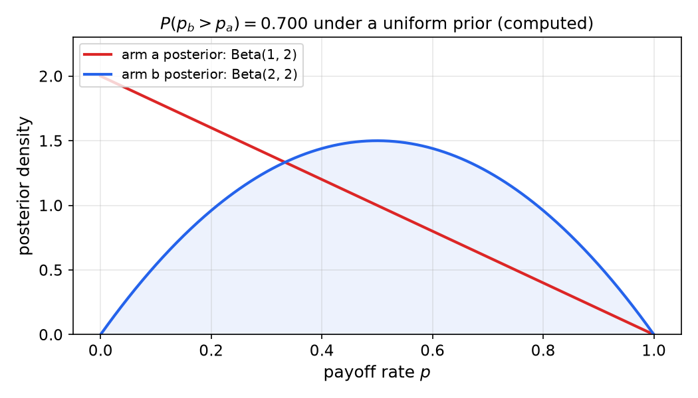
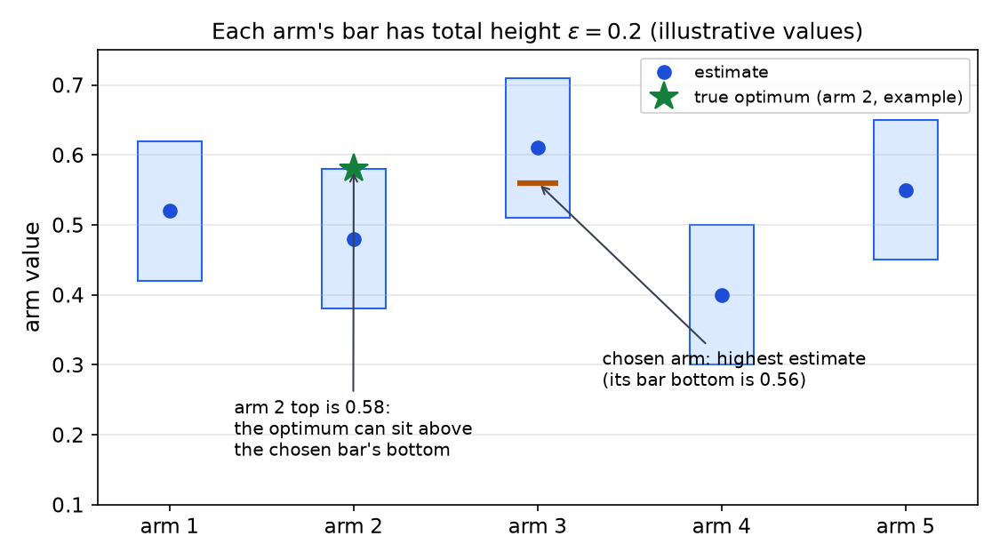
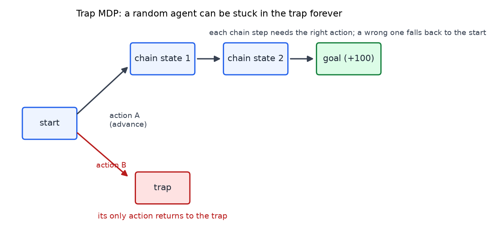
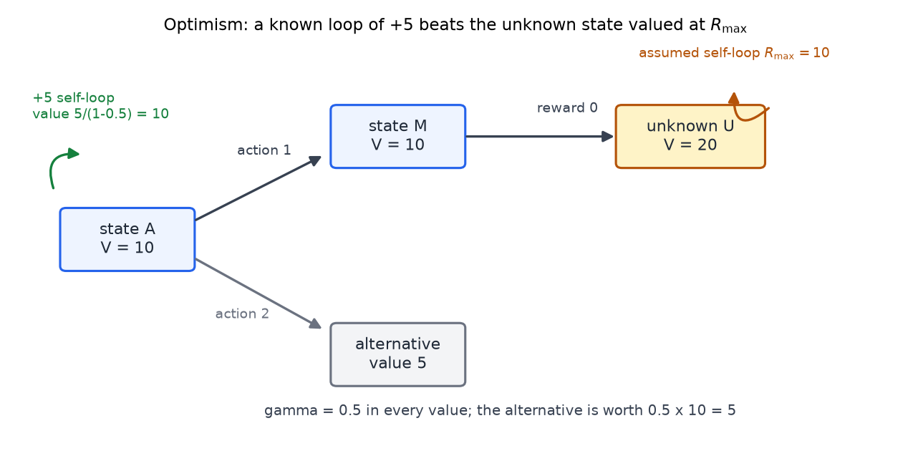
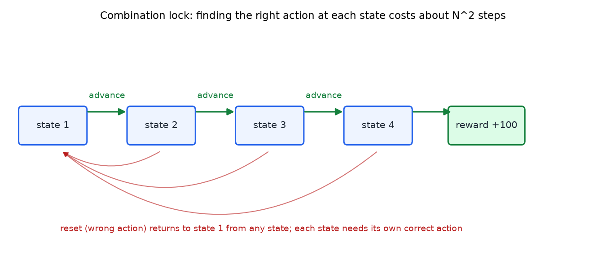

# Exploration, Bandits, and R-max

The agent in reinforcement learning must act to learn and learn to act, and the two goals pull against each other. Every action that gathers information may be an action that earns less. This chapter studies that trade-off in three steps: first the simplest setting, the k-armed bandit, where the agent faces several slot machines with unknown payoffs and no states; then deterministic MDPs, where the transitions are known to be deterministic but must be discovered; and finally stochastic MDPs, where an algorithm called R-max combines the two. The central idea is optimism in the face of uncertainty. Unknown options are assumed to be as good as possible until they are tried, and the analysis shows that this rule bounds the number of mistakes an agent can make.

## The Exploration-Exploitation Trade-Off

The lecture begins by calling exploration a fundamental trade-off of reinforcement learning, and perhaps the feature that separates it from other machine learning. Consider a bandit with \\(K\\) arms. Each arm pays 0 or 1 with some unknown probability. The name comes from slot machines, which are sometimes called one-armed bandits. If the payoff probabilities were known, the problem would be to pick the arm with the largest probability. They are not known, so one pull gives some information but not much. Information must be combined across many pulls, and that is why exploration is needed.

The lecture uses \\(K = 7\\) arms, named a to g, with the following data. The payoff counts are inferred from the stated ratios and from the remarks about "1 of 10" and "4 of 40" in the source.

| Arm | Pulls | Payoffs | Estimate |
|---|---|---|---|
| a | 10 | 1 | 1/10 |
| b | 20 | 2 | 1/10 |
| c | 40 | 4 | 1/10 |
| d | 5 | 1 | 1/5 |
| e | 10 | 2 | 1/5 |
| f | 20 | 4 | 1/5 |
| g | 40 | 8 | 1/5 |

The quiz asks for two things: the arm with the highest expected payoff, and the arm whose estimate one should be most confident in. The answer to the first is that arms d, e, f and g tie at 1/5. The lecture notes that naming g, because its count of 8 is the largest, gives the right letter for the wrong reason. The ratios must be computed. For the second, confidence increases with the number of samples, so arms c and g, each with 40 pulls, are the most confident. Arms a and c have the same mean of 1/10, but 1 payoff in 10 pulls is much less certain than 4 in 40.

Combining the two answers gives g, and the lecture says that this greedy-plus-confidence choice is problematic.

### Why greedy and confidence-based choices fail

A two-arm example makes the problem concrete. Arm a was pulled once and paid nothing. Arm b was pulled twice and paid once. Arm b wins on the expected value, 0.5 against 0, and on the number of pulls, 2 against 1. The question is whether b is really the better arm.

The lecture answers by drawing payoff rates at random and conditioning on the data. The result is that b is the better arm about 70% of the time, and a is better about 30%. The lecture's phrase is "you're going to be wrong almost a third of the time."

The 70% figure depends on an assumption the lecture does not state: the prior over the payoff rates. The number matches a uniform prior on each rate. Under that prior, the posterior after one payoff-free pull of a is Beta(1, 2), and the posterior after one payoff in two pulls of b is Beta(2, 2). The probability that the rate of b exceeds the rate of a is then

\\[
P(p\_b > p\_a) = \int\_0^1 2(1-y)\big(1 - 3y^2 + 2y^3\big)\\,dy = 0.7 .
\\]

The integrand is the density of a's posterior at \\(y\\) times the probability that b's posterior exceeds \\(y\\). The result is exactly 0.7, so the lecture's figure is correct under the uniform prior. The chapter states this assumption, because a different prior would give a different number.

*Figure: The posterior densities behind the two-arm comparison, for arm a (Beta(1, 2)) and arm b (Beta(2, 2)), under a uniform prior. The probability that b's rate exceeds a's is computed by integrating the densities and equals 0.70. The overlap of the two curves is why a single comparison of this kind is unreliable.*

The lecture then tests three strategies. The first is maximum likelihood, or greedy: after each pull, pick the arm with the highest estimated mean. Here it always picks b, because a's estimate of 0 never rises when a is not pulled again. The lecture says this strategy is right about 70% of the time.

The second is maximum confidence: pick the arm with the most pulls. The arm picked first gets more data and so stays ahead, so this also always picks b.

The third is minimum confidence: pick the arm with the fewest pulls, and break ties by maximum likelihood. This gathers data round-robin over all arms but never uses it. In the limit each arm receives \\(1/K\\) of the pulls, and this does not beat always choosing a or always choosing b.

The conclusion is that greedy is not a bad idea, because it exploits, and minimum confidence is not terrible, because it explores. The balance between them is the exploration-exploitation dilemma. The strategy has to be judged against a metric, and "eventually always pulling the better arm" is not the right metric, since, as the lecture puts it, "all the fun happens on the way to that point."

## Metrics for Bandit Strategies

The lecture lists six metrics. Each makes a different demand of the agent.

1. **Identify the optimal arm in the limit.** Round-robin achieves this too, and it accumulates no reward along the way. Ordinary reinforcement learning accumulates reward while it learns, so this metric is too weak.
2. **Maximize discounted expected reward over an infinite horizon.** Exploration and exploitation are both needed. The computation is intractable in general, but special cases work well through the Gittins index, which the lecture defines as follows. For an arm, the index is the sure payoff \\(p\\) per step at which the agent would be indifferent between retiring the arm for good and continuing to pull it. The index is larger than the sample mean when the arm has few pulls, because uncertain arms get a bonus for the chance that they reveal something valuable. The lecture states as a special result that always pulling the arm with the largest index maximizes discounted expected reward for a bandit. It cautions that no one has generalized the index to MDPs, and it does not give the formula for the index.
3. **Maximize expected reward over a finite horizon \\(h\\).** For \\(h = 1\\), choose the arm with the highest maximum-likelihood estimate. For larger \\(h\\), iterate the same idea in a manner similar to value iteration. This is computable but can be expensive.
4. **PAC-style identification.** After \\(\tau(K, \varepsilon, \delta)\\) pulls, the strategy has identified an arm within \\(\varepsilon\\) of optimal, with probability at least \\(1 - \delta\\). The polynomial \\(\tau\\) depends on \\(K\\), \\(1/\varepsilon\\) and \\(1/\delta\\). The name PAC is used loosely here, since the lecture notes that a paper proposed "probably approximately optimal", but PAC stuck.
5. **PAC-style reward.** After \\(\tau'(K, \varepsilon, \delta)\\) steps, the average per-step reward is within \\(\varepsilon\\) of the optimal per-step reward, with probability at least \\(1 - \delta\\). The lecturer prefers this to metric 4, because "it does matter how I get there, not just that I got there." A strategy meeting metric 4 could behave terribly before it announces the right answer.
6. **Mistake bound.** The number of pulls of arms that are not \\(\varepsilon\\)-near optimal is at most \\(\tau''(K, \varepsilon, \delta)\\), with probability at least \\(1 - \delta\\), over the whole run. The lecture says that identification, reward and mistakes are equivalent, in the sense that an algorithm for one yields an algorithm for the others. The proofs follow.

The lecture's remark that "all of these guys are actually equivalent" is ambiguous. The chapter takes the equivalence to hold among the three PAC-style metrics, 4, 5 and 6.

## Three Criteria Are Equivalent

The lecture shows that criteria (a) identify a best arm with few pulls, (b) make few mistakes and (c) do well per step are equivalent. Each reduction below turns an algorithm for one criterion into an algorithm for another, with the same probability guarantee. Together they put the three criteria into an equivalence class of difficulty, so one can work with whichever is most convenient.

**Reduction 1: finding the best arm gives few mistakes.** Suppose algorithm A identifies an \\(\varepsilon\\)-best arm within \\(\tau(K, \varepsilon, \delta)\\) pulls with probability at least \\(1 - \delta\\). Run A until it identifies its arm, then pull that arm forever. The total number of mistakes is at most the number of steps A takes to identify the arm, because after that point, with high probability, there are no more mistakes. A mistake is pulling an arm that is not \\(\varepsilon\\)-close to optimal, and the failure probability is the same in both problems.

**Reduction 2: few mistakes give good performance per step.** Let algorithm B make at most \\(M\\) mistakes, with high probability. Algorithm C runs B for \\(n\\) steps. Each mistake costs at most 1 unit of per-step reward, since the rewards are Bernoulli in \\([0, 1]\\), and the other steps are \\(\varepsilon\\)-optimal. To have average suboptimality at most \\(\varepsilon'\\) over \\(n\\) steps, with \\(\varepsilon = \varepsilon'/2\\), we need

\\[
M \cdot 1 + (n - M)\\,\frac{\varepsilon'}{2} \le n\\,\varepsilon' .
\\]

Rearranging gives \\(M(1 - \varepsilon'/2) \le n\varepsilon'/2\\), and so

\\[
n \ge M\left(\frac{2}{\varepsilon'} - 1\right) .
\\]

This is polynomial in \\(1/\varepsilon'\\). The bound is useful only when \\(\varepsilon' < 1\\).

**Reduction 3: good performance per step gives a near-best arm.** Assume algorithm C is \\(\varepsilon\\)-optimal per step after a polynomial number of pulls. Run C for \\(\tau\\) steps, and output the plurality arm, the one pulled most often. Some arm \\(i\\) is pulled at least a \\(1/K\\) fraction of the time. Its contribution to the per-step error is at least \\((1/K)\\,e\_i\\), where \\(e\_i\\) is its suboptimality, and that contribution is at most \\(\varepsilon\\). So \\(e\_i \le K\varepsilon\\). Setting \\(\varepsilon = \varepsilon'/K\\) gives \\(e\_i \le \varepsilon'\\), so the plurality arm is \\(\varepsilon'\\)-optimal. The lecturer adds that the dependence must be polynomial, since a \\(2^{1/\varepsilon'}\\) dependence would make the result bad.

The three criteria then support each other, and the lecture says no solvability result has yet been shown for the whole class. The argument is turtles all the way down, so a bottom-level bound is needed. The bottom is the Hoeffding bound.

## The Hoeffding Bound

Let \\(X\_1, \ldots, X\_n\\) be independent and identically distributed with mean \\(\mu\\), taking values in \\(\\{0, 1\\}\\). The sample mean \\(\hat\mu = \frac{1}{n}\sum\_i X\_i\\) is the maximum-likelihood estimate of \\(\mu\\). The Hoeffding inequality bounds the chance that it is far from \\(\mu\\),

\\[
P\big(\lvert \hat\mu - \mu \rvert \ge t\big) \le 2\exp(-2nt^2) .
\\]

Set the right-hand side to \\(\delta\\) and solve for \\(t\\). This gives a \\(100(1-\delta)\\%\\) confidence interval,

\\[
\hat\mu - \frac{z\_\delta}{\sqrt{n}} \le \mu \le \hat\mu + \frac{z\_\delta}{\sqrt{n}}, \qquad z\_\delta = \sqrt{\tfrac{1}{2}\ln\tfrac{2}{\delta}} .
\\]

The width shrinks like \\(1/\sqrt{n}\\), and it grows as \\(\delta\\) shrinks, because more confidence requires a wider window. The Hoeffding bound is the basic tool of PAC learning, and the lecture mentions related Chernoff and tail bounds.

## Combining Information Across Arms

The strategy that meets metric 4 has two steps. Take \\(c\\) samples of each arm, where \\(c\\) depends on \\(\varepsilon\\), \\(\delta\\) and \\(K\\). Then choose the arm with the highest estimate.

The requirement is that each arm be estimated to accuracy \\(\varepsilon/2\\) with confidence \\(1 - \delta/K\\). Then the final choice is \\(\varepsilon\\)-optimal with probability at least \\(1 - \delta\\). The reason is that the bars around the estimates have total height \\(\varepsilon\\). The optimal arm may sit at the top of a bar whose estimate is lower, while the chosen arm has the highest estimate but its true value is at the bottom of its bar. The most that can be lost is the height of the bar.

The guarantee can be written out. Let \\(i^\*\\) be the optimal arm and \\(j\\) the arm with the highest estimate. If every arm is within \\(\varepsilon/2\\) of its mean, then

\\[
\mu\_j \ge \hat\mu\_j - \frac{\varepsilon}{2} \ge \hat\mu\_{i^\*} - \frac{\varepsilon}{2} \ge \mu\_{i^\*} - \varepsilon .
\\]

The first and last steps use the accuracy bound, and the middle step uses the choice of \\(j\\).

The probability statement needs a union bound. If each arm is correct with probability \\(1 - \delta/K\\), then "all K are correct" has probability \\((1 - \delta/K)^K\\) only if the arms are independent, which is hard to justify. The union bound avoids independence:

\\[
P(\text{some arm wrong}) \le \sum\_{i=1}^{K} P(\text{arm } i \text{ wrong}) \le K \cdot \frac{\delta}{K} = \delta .
\\]

So the probability that all arms are correct is at least \\(1 - \delta\\). The lecturer uses a Venn diagram to show that this sum is the worst case when the events do not overlap.

*Figure: Error bars for a five-arm bandit, with illustrative values chosen for this example. Each arm's bar has total height \\(\varepsilon\\) and is centered on its estimate. The true optimum (arm 2, at 0.58) lies above the bottom of the chosen bar (arm 3, at 0.56). The chosen arm is therefore at most \\(\varepsilon\\) from the optimum.*

Substituting accuracy \\(\varepsilon/2\\) and confidence \\(\delta/K\\) into the Hoeffding half-width \\(z\_\delta/\sqrt{c}\\) gives the requirement \\(z/\sqrt{c} \le \varepsilon/2\\), with \\(z = \sqrt{\tfrac{1}{2}\ln\tfrac{2K}{\delta}}\\). Squaring and solving for \\(c\\) gives the sample count

\\[
c \ge \frac{2}{\varepsilon^2}\\,\ln\frac{2K}{\delta} .
\\]

The source writes the intermediate step without the square root in \\(z\\), which would give a different count. The final count in the source matches the version with the square root, and the chapter uses that form.

**Example (sample count).** For \\(\varepsilon = 0.1\\), \\(\delta = 0.05\\) and \\(K = 7\\), the count is \\(c \ge 200 \ln 280 \approx 1127\\) pulls per arm, or about 7,900 pulls in all. The dependence on \\(\delta\\) is logarithmic, so certainty is cheap. The dependence on \\(\varepsilon\\) is \\(1/\varepsilon^2\\), so closeness is expensive. Halving \\(\varepsilon\\) to 0.05 quadruples the count, and reducing it to \\(\varepsilon = 0.0001\\) makes the count very large. The lecture summarizes this as "being certain is cheap; being very close is expensive". The form of the bound matches the PAC bounds for agnostic learning, with arms playing the role of hypotheses and \\(K\\) the size of the hypothesis space. The lecture presents this as an observation, not a result.

## Deterministic MDPs

Now consider states. In a deterministic MDP, transitions and rewards are fixed, and the agent knows only its current state and the labels of the actions available there. States can have one or two actions, and the lecturer notes that one does not always equal two.

Trying every action once in every state reveals the whole MDP, which can then be solved. The difficulty is that the agent cannot teleport. Random exploration can be exponentially unlikely to reach a distant high-reward state along a chain that needs a specific action at each step. A trap state makes the problem harder: once the agent enters it, nothing it does can escape, so the agent must either be lucky or be able to reset.

The criterion for deterministic MDPs is a mistake bound. Count the number of times the agent takes an action in a state that is not \\(\varepsilon\\)-close to the best action in that state. Require the count to be polynomial in \\(1/\varepsilon\\), \\(1/\delta\\), the number of states \\(n\\) and the number of actions per state \\(k\\). In the trap example, one action enters the trap and the other enters the chain. After a single wrong choice the agent is in the trap, where its only action is optimal relative to that state. So the total number of mistakes is at most one. The lecturer calls the criterion "optimal relative to the state you're in".

*Figure: A trap MDP, with an illustrative structure taken from the lecture's description. From the start, one action enters a chain whose high-reward state needs the right action at each step. The other action enters a trap whose only action returns to the trap. Once inside the trap, the agent cannot leave.*

The lecture works through a small deterministic MDP as a worked experiment. The learner sees each reward and the resulting state. The rewards seen are \\(-8\\), \\(+2\\), \\(+10\\), \\(-6\\), \\(+1\\), \\(+6\\), \\(+4\\) and \\(-3\\), and the learner explores all state-action pairs but one. The full transition graph is not recoverable from the source, so the chapter does not reproduce it. Two points carry over. First, the discount must be less than 1: with \\(\gamma = 1\\), repeating a reward of +1 forever has an infinite value, whereas with \\(\gamma < 1\\) it is worth \\(1/(1-\gamma)\\). Second, if the unexplored pair is a self-loop worth 1,000,000 per step, the learner must find it. Lacking information, the learner must be optimistic about unknown pairs, and the next section develops that rule.

## Optimism and Deterministic R-max

The lecture's algorithm for deterministic MDPs is optimism in the face of uncertainty. Let \\(R\_{\max}\\) be the largest reward in any state. The algorithm runs in three steps.

1. Keep track of the MDP learned so far. Treat each unknown state-action pair as a self-loop that pays \\(R\_{\max}\\) on every step. No policy can do better than that from the state, so this model is optimistic.
2. Solve this optimistic MDP.
3. Execute its optimal policy. When this reveals an unknown pair, update the model and return to step 1.

The lecture names two things to show: the reward of the algorithm is \\(\varepsilon\\)-optimal, and the number of mistakes is small. The analysis proceeds in three claims.

**Claim 1.** Once every state-action pair has been visited, the model is exact. Step 2 then yields the true optimal policy, and there are no more mistakes. The open issue is that the algorithm may never visit every state. For example, it can stop visiting unknown pairs and loop through known ones.

**Claim 2.** A loop through known pairs that never reaches an unknown pair is not a mistake, because each unknown pair is valued at \\(R\_{\max}\\) and so is still not preferred. The example in the source uses \\(\gamma = 0.5\\) and \\(R\_{\max} = 10\\).

*Figure: The optimistic value chain for the analysis. State A has a self-loop of +5, worth \\(5/(1-0.5) = 10\\). Its other action leads to state M, worth 10, which leads to an unknown state U. U is assumed to be a self-loop of \\(R\_{\max} = 10\\), worth 20. The alternative action from A is worth 5, so the known loop is preferred.*

The arithmetic is as follows. State A has a self-loop with reward +5, so its value is \\(5/(1-0.5) = 10\\). The other action from A leads to state M, which has one action leading to the unknown state U. Since U is assumed to be a self-loop of \\(R\_{\max} = 10\\), its value is \\(10/(1-0.5) = 20\\). The value of M is \\(0.5 \times 20 = 10\\), and the alternative action from A has value \\(0.5 \times 10 = 5\\). The known self-loop, at 10, beats the optimistic alternative, at 5. The lecturer says the agent is right to stay in the loop, because if the unknown pair turns out to be worth less, the case is only strengthened.

The argument relies on discounting. If \\(\gamma\\) is close to 1, the agent must explore the whole MDP unless it finds a self-loop worth \\(R\_{\max}\\).

**Claim 3.** Between discoveries, the optimistic policy either reaches an unknown pair within at most \\(N\\) steps, where \\(N\\) is the number of states, or it loops forever without reaching one. Each discovery removes one unknown pair, and there are \\(NK\\) pairs in total. So there are at most \\(NK\\) discoveries, and the total number of mistakes is at most \\(N \cdot NK = N^2 K\\). The bound does not depend on \\(\varepsilon\\) or \\(\delta\\).

Three further remarks complete the picture. An analysis of Q-learning in this setting gives a bound of \\(N^3 K\\), which is also polynomial, provided the rewards and initial values are set correctly. For a bandit with one state, the algorithm takes each action once, which costs up to \\(K - 1\\) mistakes. With optimism, the algorithm stops as soon as an action gives \\(R\_{\max}\\). This does not change the bound, but it improves performance. Together, the three cases covered so far are stochastic bandits, deterministic MDPs and deterministic bandits. The fourth, the stochastic MDP, comes next.

## A Lower Bound: The Combination Lock

Is \\(N^2 K\\) a good bound? The lecture shows that no algorithm can do much better in the worst case. Build a chain of \\(N\\) states, where each state has two actions, purple and blue. One action advances one step along the chain, and the other resets to state 1. The chain ends in a large reward. The only way to reach the reward is to know, at each state, which action advances.

*Figure: A combination-lock MDP with four states, drawn for this chapter. The advance action moves one step along the chain, and the reset action, shown as the arcs, returns to state 1. The reward of +100 sits at the end, and reaching it requires the correct action at each state.*

Exploring state \\(i\\) costs something for each wrong guess. A wrong guess sends the agent back to state 1, which takes \\(i\\) steps, and then the agent must make one more step to advance. The total over states \\(1, \ldots, N\\) is \\(1 + 2 + \cdots + N = N(N+1)/2\\), which is a constant times \\(N^2\\). With \\(K\\) actions, one advances and \\(K - 1\\) reset. Each state may need up to \\(K\\) tries, and each wrong try costs up to \\(N\\) steps, so the total is about \\(KN^2\\). No algorithm can do better than this in the worst case, so the \\(N^2 K\\) bound of deterministic R-max is tight up to constants.

The lock is sequential. The feedback reveals how many leading actions are correct, so the agent needs about \\(N^2\\) steps, not \\(K^N\\) steps, to open it.

## Stochastic R-max

Stochastic R-max combines the two ideas. From bandits it takes the Hoeffding-style estimates: keep trying a state-action pair until its transition estimate is accurate. From R-max it takes optimism for unknown pairs. The algorithm is as follows.

1. Keep an estimate of the transitions and rewards for every state-action pair.
2. Call a pair \\((s,a)\\) unknown if it has been tried fewer than \\(C\\) times. Model each unknown pair as a self-loop with reward \\(R\_{\max}\\).
3. Build this MDP and solve it.
4. Take the optimal action in this MDP, update the counts, and return to step 1.

The transition estimate after \\(C\\) tries is the observed count divided by \\(C\\). For example, a transition seen once in \\(C\\) tries gets probability \\(1/C\\). The lecture does not spell out the reward estimate. The parameter \\(C\\) is the threshold on tries, and it plays the role of the sample count in the bandit analysis. The lecturer asks whether \\(C\\) can differ per pair, and presents the parametrized algorithm first, leaving the derivation of \\(C\\) to later.

### The simulation lemma

The analysis needs to relate the values under the estimated model to the values under the true model. Let \\((T\_1, R\_1)\\) be the estimated model and \\((T\_2, R\_2)\\) the true one. The lecture states a bound in terms of a quantity \\(\alpha\\) that limits how far the two models differ. For any policy, the values under the two models differ by an amount proportional to \\(\alpha\\), with a factor that depends on the discount and on the largest value. The lecture says the difference is bounded by "G over one minus gamma". The stated form of G is ambiguous, so the reconstruction below is labeled as such.

The reconstruction is

\\[
\lvert V\_1^\pi(s) - V\_2^\pi(s) \rvert \le \frac{G}{1-\gamma}, \qquad G = \alpha + \gamma\\,\alpha\\,V\_{\max}, \qquad V\_{\max} = \frac{R\_{\max}}{1-\gamma} .
\\]

The bound can be justified under a stated assumption. Suppose \\(\alpha\\) bounds both the difference of the rewards and the total-variation distance between the next-state distributions of the two models, and suppose the values lie in \\([0, V\_{\max}]\\). Write \\(V\_1^\pi = R\_1 + \gamma P\_1 V\_1^\pi\\) and \\(V\_2^\pi = R\_2 + \gamma P\_2 V\_2^\pi\\), and subtract:

\\[
V\_1^\pi - V\_2^\pi = (R\_1 - R\_2) + \gamma (P\_1 - P\_2) V\_2^\pi + \gamma P\_1 (V\_1^\pi - V\_2^\pi) .
\\]

The first term is at most \\(\alpha\\) in absolute value. For the second, the weights \\(P\_1 - P\_2\\) sum to zero, so shifting \\(V\_2^\pi\\) by the midpoint of its range changes nothing. The shifted values have size at most \\(V\_{\max}/2\\), and the total-variation distance \\(\alpha\\) bounds the \\(\ell\_1\\) norm of the weights by \\(2\alpha\\). So the second term is at most \\(\gamma\alpha V\_{\max}\\). Taking the maximum over states gives \\(\lVert V\_1^\pi - V\_2^\pi \rVert\_\infty \le \alpha + \gamma\alpha V\_{\max} + \gamma \lVert V\_1^\pi - V\_2^\pi \rVert\_\infty\\), which rearranges to the bound with \\(G\\). If \\(\alpha\\) instead bounded each transition probability separately, a factor involving the number of next states would enter, and the stated form would not hold.

If \\(\alpha = 0\\), the bound is zero and the values are identical. To make the value gap at most \\(\varepsilon\\), it is enough that

\\[
\alpha \le \frac{\varepsilon(1-\gamma)}{1 + \gamma V\_{\max}} .
\\]

The lecture says the required \\(\alpha\\) is "a heck of a lot smaller" than \\(\varepsilon\\), and that it is polynomially related to \\(R\_{\max}\\), \\(1/(1-\gamma)\\) and \\(1/\varepsilon\\). The quantity \\(\alpha\\) is an analysis quantity, not a parameter of the algorithm. The algorithm's parameter is \\(C\\).

To convert \\(\alpha\\) into \\(C\\), treat each state-action estimate like a bandit arm estimate. The Hoeffding bound gives the number of tries needed for accuracy \\(\alpha\\), and the union bound over all state-action pairs makes all the estimates accurate at once. The count grows with \\(1/\alpha^2\\) and a logarithmic term in the number of pairs and in \\(1/\delta\\), following the bandit argument. The exact constant is left as an exercise and is not derived here. In practice, \\(C\\) is set much smaller than the theory requires, and it is chosen by hand to balance accurate learning against over-exploration.

### The explore-or-exploit lemma

The main lemma of the analysis says that, while stochastic R-max runs, at each point one of two things holds, with high probability. Either the agent acts near-optimally, because its policy is optimal in the optimistic model and so makes no mistake, or it quickly reaches an unknown state-action pair and learns something. The union bound sets the failure probability.

The lemma controls the bad case. The number of "learn something new" events is at most \\(NK\\), and each takes at most a polynomial number of steps. So the agent cannot run for long in a suboptimal loop without either learning or acting near-optimally. The derivation of \\(C\\) is left as an exercise that follows the bandit analysis.

## Summary

- A bandit with \\(K\\) arms requires combining data across pulls. Greedy choice exploits and round-robin explores, and neither alone is good; the criterion must be a PAC-style mistake or reward bound.
- Under a uniform prior, the arm with one payoff in two pulls is the better arm with probability 0.7, against an arm with no payoff in one pull.
- The Hoeffding bound gives a confidence interval of half-width \\(z\_\delta/\sqrt{n}\\) with \\(z\_\delta = \sqrt{\tfrac{1}{2}\ln\tfrac{2}{\delta}}\\). Estimating each of \\(K\\) arms to accuracy \\(\varepsilon/2\\) with confidence \\(1 - \delta/K\\) yields an \\(\varepsilon\\)-optimal arm with probability at least \\(1-\delta\\), with about \\((2/\varepsilon^2)\ln(2K/\delta)\\) pulls per arm.
- The three PAC-style criteria (identification, reward and mistakes) reduce to one another, so the cost of one bounds the others.
- Optimism in the face of uncertainty treats unknown pairs as worth \\(R\_{\max}\\). Deterministic R-max makes at most \\(N^2 K\\) mistakes, and the combination lock shows that this bound is tight up to constants.
- Stochastic R-max combines a count threshold \\(C\\) for transition estimates with optimism for unknown pairs. Its analysis rests on a simulation lemma with bound \\(G/(1-\gamma)\\) (labeled reconstruction) and on an explore-or-exploit lemma.

## See Also

- [Temporal-Difference Learning](td-learning.md): the value-learning methods that the exploration analysis builds on.
- [Convergence and Analysis](convergence.md): the convergence theory for Q-learning, which needs every pair visited infinitely often.
- [Generalization and Function Approximation](generalization.md): what changes when the table of values is replaced by a function.
- [Reward Shaping](reward-shaping.md): optimistic initialization as a potential, and the link to the zero-initialization argument.
- [Q-Learning](../cs3600-cs6601-artificial-intelligence/q-learning.md): the introductory Q-learning update and its practice problems.
- [Deep Q-Learning](../cs7643-deep-learning/deep-q-learning.md): exploration in deep reinforcement learning, with replay and epsilon-greedy policies.
